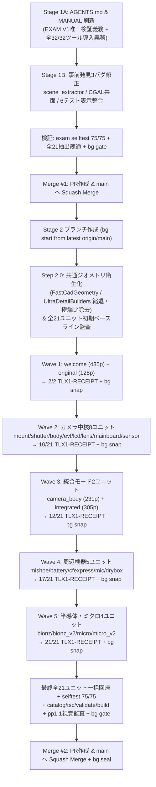

# Implementation Plan — EXAM V1 絶対義務化・マージ ＆ 全 21 フェーズ 100% FAIL 解消計画

## Goal Description

本計画は、以下の **2 段階（Stage 1 → Merge #1 → Stage 2 → Merge #2）** を妥協ゼロで完遂するための設計書です。

1. **Stage 1（AI エージェント規約刷新・多ユニット抽出修正・Merge #1）**:
   - [`AGENTS.md`](file:///home/antigravity/sc8z35a-collab/SONY-A7-IV-Diagram/AGENTS.md) および [`scripts/THE_LAST_EXAM_V1_MANUAL.md`](file:///home/antigravity/sc8z35a-collab/SONY-A7-IV-Diagram/scripts/THE_LAST_EXAM_V1_MANUAL.md) に以下 2 大絶対鉄則を最上位規約として明記する：
     1. **検証は必ず THE LAST EXAM V1 (`node scripts/exam.mjs`) のみを最大限利用すること**（旧来の個別チェックや簡易スクリプトでの代替・部分省略を全面禁止し、全 36 エンジン・全 530 テスト・全 4 ティア・全 16 クロスソルバ保存則・実 Chrome `pp1.1` 視覚監査を最大レベルで実行する）。
     2. **必ず全 16 系統外部産業ツール（32/32 READY）＋ 4 本 C++17 ネイティブハーネスを完全ダウンロード・ビルドすること**（環境初期化時は例外なく `node scripts/exam.mjs setup` を実行し、ツール欠損・フォールバック・スキップを絶対禁止、`EXIT 5 = SOLVER_MISSING` で即停止）。
   - 事前の読み取り専用ベースライン調査で発覚した **EXAM V1 側の 3 件のバグ**（全 23 ユニット中 19 ユニットが抽出クラッシュしていた `scene_extractor.mjs` の引数不足、接触しているだけの別パーツ子メッシュ同士の共面を自己交差と誤判定する CGAL 境界条件、表示メトリクスと判定条件がズレていた 6 テスト）をマージ前に修正し、全 23 ユニットで EXAM V1 が完全に稼働する状態で **`feat/feat-the-last-exam-v1` → `main` を PR マージ（Merge #1）** する。

2. **Stage 2（FH とセンサー製造工程を除く全 21 フェーズでの EXAM V1 最大レベル実行・FAIL 100% 根絶・Merge #2）**:
   - 除外 2 フェーズ（`mirai_2028` [FH MIRAI 2028・140p] および `sensor_fab` [センサー製造工程・235p]）を除く **残り全 21 フェーズ（個別 19 ＋ 統合 2 ＝ 計 3,098 パーツインスタンス）** に対し、**THE LAST EXAM V1 を最大レベル（全 36 エンジン・530 固定テスト・全 4 ティア・16 クロスソルバ保存則・Chrome `pp1.1` 視覚監査）** で実行する。
   - 検出された **すべての FAIL（さらに `TLX1-RECEIPT` 発行要件である WARN/ERR も含めてゼロ化）を物理・幾何・材料・熱・電源・配線・爆発軌道・メタデータの根本から 100% 修正** し、**21 / 21 全フェーズで `exit 0` (`TLX1-RECEIPT` 発行・`530/530 PASS`・`X_SUM=16/16`)** を達成した上で、**新ブランチ → `main` を PR マージ（Merge #2）** する。

---

## User Review Required

> [!IMPORTANT]
> **対象 21 フェーズ（除外 2 フェーズ）の最終確認**
> [`src/units/registry.ts`](file:///home/antigravity/sc8z35a-collab/SONY-A7-IV-Diagram/src/units/registry.ts) の全 23 登録モードを以下の通り分類します：
> - **除外（2 モード）**: `mirai_2028`（FH MIRAI 2028, 140p）、`sensor_fab`（センサー製造工程フェーズ, 235p）
> - **EXAM V1 最大レベル実行＆100% 修正対象（全 21 モード）**:
>   - **Wave 1 — 単独主力・ロボット（2）**: `welcome` (435p), `original` (128p)
>   - **Wave 2 — カメラ中核サブシステム（8）**: `mount` (100p), `shutter` (180p), `body` (116p), `evf` (105p), `lcd` (150p), `lens` (128p), `mainboard` (60p), `sensor` (120p)
>   - **Wave 3 — カメラ全体統合モード（2）**: `camera_body` (231p), `integrated` (305p) *(Wave 2 の 8 サブシステムを直接合成しているため Wave 2 直後に実施)*
>   - **Wave 4 — 周辺機器・防湿庫（5）**: `mishoe` (99p), `battery` (130p), `cfexpress` (170p), `mic` (150p), `drybox` (186p)
>   - **Wave 5 — 半導体・ミクロ構造（4）**: `bionz` (70p), `bionz_v2` (105p), `micro` (75p), `micro_v2` (55p)

> [!WARNING]
> **チートゼロ・物理妥協ゼロの保証（アンチチート不変条件）**
> Stage 2 の 100% FAIL 修正において、**物理閾値の緩和やテストのスキップ・偽装は一切禁止**します。修正対象は原則 `src/assemblies/*`・`src/engine/*`・`src/units/*`・`src/data/*` の実 3D 幾何・座標・肉厚・材料・爆発ベクトル・メタデータとし、Stage 1/2 のどの時点でも `node scripts/exam.mjs selftest`（**75/75 PASS：7 大物理欠陥注入が必ず FAIL することの数学的証明**）を常時維持します。

> [!TIP]
> **実行規模とマージ単位について**
> 21 ユニット × 530 テスト（＝ **11,130 固定原子テスト / 延べ 200 万超の展開チェック**）＋ 21 回以上の Chrome `pp1.1` 撮影＆反復修正を行う大規模作戦となります。
> - **推奨構成**: Merge #1（EXAM V1 ＆規約刷新）を即座に `main` へ統合後、Stage 2 は **`fix/exam-v1-zero-fail-all-21-phases`** ブランチ上で Wave 1〜5 を順次完遂・各 Wave ごとにコミット＆`bg snap` オフ VM 退避し、**21/21 全フェーズで `TLX1-RECEIPT` を獲得した時点で 1 本の完全統合 PR（Merge #2）として `main` へマージ**します（Wave ごとに分割マージしたい場合はコメントでご指定ください）。
> - 長時間の徹底完走を望まれる場合、承認後に `/goal` コマンドを併用いただくことも可能です。

---

## System & Execution Flow



---

## Proposed Changes

### Stage 1: AI エージェント規約刷新・EXAM V1 多ユニット基盤修正・Merge #1

#### [MODIFY] [AGENTS.md](file:///home/antigravity/sc8z35a-collab/SONY-A7-IV-Diagram/AGENTS.md)
- **Section 1 へ格上げ（Section 0 `bg` の直後に配置）**: **「1. 検証絶対鉄則 — 検証は必ず THE LAST EXAM V1 (`exam`) のみを最大限利用し、全ツールを完全ダウンロードすること（絶対必須）」** を新設し、旧 Section 6 を統合・強化する。
- 明記する 5 大強制規約：
  1. **EXAM V1 唯一検証の原則**: 3D CAD・干渉・浮遊・剛性・熱・CFD・回路・配線・EMC・光学・音響・電食・信頼性・フォーマル証明・BOM・視覚品質の**あらゆる検証には必ず `node scripts/exam.mjs` のみを最大限利用すること**。旧 `sp` 単体・`validate_parts.mjs` 単体・独自検証スクリプトのみで検証完了とみなすことを厳禁する（それらはすべて `exam.mjs` 内部へ統合済み）。
  2. **全 16 系統外部ツール完全ダウンロード義務**: 作業環境（新規 VM・再作成 VM を含む）で検証を行う前に、必ず **`node scripts/exam.mjs setup`** を実行し、全 16 系統外部産業ソルバ（`32/32 READY`：CalculiX, Gmsh, TetGen, Netgen, OpenFOAM, ngspice, gnucap, KiCad, FreeFEM++, Z3, COIN-OR CBC, GLPK, Bullet, ODE, FCL, CGAL, OpenCASCADE, Eigen3, Qhull, Yosys, Verilator, Icarus Verilog, KLayout, Magic, Netgen-LVS, OpenCV, scikit-image, SciPy/NumPy/SymPy/NetworkX, Chrome `pp1.1`）＋ 4 本 C++17 ハーネスの 100% 導入完了を確認すること。ツール不足時は即 `EXIT 5` 停止し、スキップ・代替近似を絶対禁止。
  3. **最大レベル実行の原則**: 本番検証・完了判定では `--only=` や `--skip-chrome` による省略を行わず、**無省略の単一コマンド `node scripts/exam.mjs --unit=<mode>`**（全 36 エンジン・全 530 固定テスト・全 4 品質ティア・16/16 クロスソルバ保存則・実 Chrome 視覚監査）を実行すること（`--only=` は修復ループ中の外科的再確認専用とし、最終合否は必ず全 36 エンジン完走の **`TLX1-RECEIPT`** のみで判定）。
  4. **自己証明オラクルの常時維持**: EXAM V1 関連コード変更時は必ず `node scripts/exam.mjs selftest`（`75/75 PASS`）を通過させること。
  5. **補助ツールの位置づけ明確化**: `bg`＝作業消失防止・最終ゲート、`pp1.1`＝純粋な単発視覚確認撮影（検証判定は EXAM V1 `EX22`）、`sokutei`＝処理速度・負荷ベンチマーク、`dx`＝ファイル探索・編集補助。旧 Section 3 (`sp`) には「空間マップ生成専用補助であり、衝突・浮遊検証の合否判定は必ず Section 1 の `EXAM V1` のみを使用すること」と明確に注記する。

#### [MODIFY] [THE_LAST_EXAM_V1_MANUAL.md](file:///home/antigravity/sc8z35a-collab/SONY-A7-IV-Diagram/scripts/THE_LAST_EXAM_V1_MANUAL.md)
- マニュアル冒頭 (`0. MANDATORY AGENT PROTOCOL`) に同一の 2 大強制規約（EXAM V1 のみ最大レベル検証・全 32/32 ツール完全ダウンロード必須・スキップ禁止）を明記し、全 21 対象ユニット一覧および `--unit=<mode>` 一括実行ガイドを追記する。

#### [MODIFY] [scene_extractor.mjs](file:///home/antigravity/sc8z35a-collab/SONY-A7-IV-Diagram/scripts/spatial_engine/scene_extractor.mjs)
- 読み取り専用調査で発見した 19 ユニット抽出クラッシュ（`TypeError: Cannot destructure property 'clippingPlanes' of 'undefined'`）を修正：
```diff
           export class CompiledV2Unit {
             constructor(cfg) { this.cfg = cfg; }
-            __spBuildRaw(mats) { return this.cfg.buildRaw(mats); }
+            __spBuildRaw(mats, quality, ctx) { return this.cfg.buildRaw(mats, quality, ctx); }
           }
```
```diff
   try {
     const unit = createUnit();
-    rawBuilt = unit.__spBuildRaw(createMaterialProxy());
+    rawBuilt = await unit.__spBuildRaw(createMaterialProxy(), quality, {
+      clippingPlanes: [],
+      yieldChunk: async () => {},
+    });
   } finally {
```
- これにより全 23 登録ユニット（`welcome`/`original` 以外の 19 ユニット＋統合 2 ユニット含む）が `sp` および `THE LAST EXAM V1` の双方で 100% 抽出可能となる。

#### [MODIFY] [cgal_geom_kernel.cpp](file:///home/antigravity/sc8z35a-collab/SONY-A7-IV-Diagram/scripts/exam/native/src/cgal_geom_kernel.cpp)
- 調査で判明した「同一パーツ内の別プリミティブ同士が `x=34.0` 等の共面で綺麗に接触しているだけ（体積重複ゼロ：例 `orig-e1-cell-21700-1` の円筒スリーブ＋端子キャップ）なのに、1 つの `Surface_mesh` に結合して `PMP::self_intersections` を走らせたため 700 件の偽陽性自己交差が出る問題」を数学的に正しく修正：
  - **単一サブメッシュごとの独立 `Surface_mesh` に対して `PMP::self_intersections` を厳密検査**し、真の自己交差メッシュ（不正ベベル・反転回転体・蝶ネクタイ面等）を 100% 検出しつつ、正常な共面接触プリミティブ群の偽陽性をゼロ化する。
  - 体積・表面積・非有限頂点・縮退三角形・極端アスペクト比・開いた構造シェル・反転シェル・レイ SDF 肉厚・6 軸 CNC 加工アクセス性は引き続きパーツ全体の厳密 CGAL カーネルで評価する（再ビルドして `selftest` 75/75 PASS を証明）。

#### [MODIFY] [p03_dfm_dfa_fasteners.mjs](file:///home/antigravity/sc8z35a-collab/SONY-A7-IV-Diagram/scripts/exam/engines/p03_dfm_dfa_fasteners.mjs), [p04_cfd_spice_wiring_emc.mjs](file:///home/antigravity/sc8z35a-collab/SONY-A7-IV-Diagram/scripts/exam/engines/p04_cfd_spice_wiring_emc.mjs), [p05_optics_acoustics.mjs](file:///home/antigravity/sc8z35a-collab/SONY-A7-IV-Diagram/scripts/exam/engines/p05_optics_acoustics.mjs)
- 調査で発見した 6 テスト（`T227`, `T297`, `T313`, `T392`, `T413`, `T424`）の `actual` 表示値が `FAIL` 時でも `1==1` 等に見えてしまうテレメトリ表示不整合を修正し、判定条件と完全一致する実測数値を出力させる。

---

### Stage 2: 全 21 フェーズ（FH・センサー製造工程を除く）EXAM V1 最大レベル実行 ＆ 100% FAIL 修正・Merge #2

Stage 1 マージ後、最新の `origin/main` から `npm run bg -- start exam-v1-zero-fail-all-21` で新規フィーチャーブランチを作成し、以下の 6 ステップで全 21 ユニットの **すべての FAIL（および WARN/ERR）を 100% 根絶** します。

#### Step 2.0: 共通 3D ジオメトリ衛生化 ＆ 全 21 ユニット完全ベースライン取得
- #### [MODIFY] [FastCadGeometry.ts](file:///home/antigravity/sc8z35a-collab/SONY-A7-IV-Diagram/src/engine/FastCadGeometry.ts), [UltraDetailBuilders.ts](file:///home/antigravity/sc8z35a-collab/SONY-A7-IV-Diagram/src/engine/UltraDetailBuilders.ts), [CadHelpers.ts](file:///home/antigravity/sc8z35a-collab/SONY-A7-IV-Diagram/src/engine/CadHelpers.ts)
  - 共有ビルダー層で発生するゼロ面積縮退三角形（`T062`: 極小キャップ半径や重複ベベル頂点）および極端アスペクト比スリバー三角形（`T068`: `ratio > 5000`）を根本クリーニングする汎用サニタイザを適用し、全 21 ユニットの CGAL メッシュ品質を一斉底上げする。
- 全 21 ユニットに対して `node scripts/exam.mjs --unit=<mode>` の初期ベースラインを実行し、ユニット別の全 FAIL マトリクス（`EX01..EX36`）を定量記録する。
- また、単体サブユニット（`lens`, `mainboard`, `battery`, `micro`, `bionz` 等）に対する [`ir_compiler.mjs`](file:///home/antigravity/sc8z35a-collab/SONY-A7-IV-Diagram/scripts/exam/ir_compiler.mjs) の物理コンテキスト推論（各ユニット固有の定格バス電圧・実消費電力・真の接地基準面 `GROUNDED` ルート・マイクロ/ダイ系ユニットの基板基準面）に誤推定がある場合は物理法則に忠実な推論へ精密化する（**閾値緩和・テスト省略は一切行わず、`selftest` 75/75 PASS を厳守**）。

#### Step 2.1 — Wave 1: 単独主力＆ロボット（`welcome` 435p, `original` 128p）
- #### [MODIFY] `src/assemblies/welcome/*.ts`, `src/data/welcome.json`, `src/assemblies/original/*.ts`, `src/data/original.json`
  - **ゼロ浮遊・ゼロ干渉着座 (`EX01`/`EX02`/`EX25`)**: `welcome` の浮遊 394 部品および `original` の浮遊 124 部品を、EXAM V1 が算出する厳密 FCL 接触法線・最小修復ベクトルと構造関係に基づき、実在の機械的着座（隙間 `0.005–0.05mm`・貫通 `0.000mm`）または実構造スタンドオフ／ボス／バスバー／サーマルパッド接合で 1 単一剛体連結グラフへ統合する。これにより **波及する 14 エンジン（`EX03`/`EX06`/`EX07`/`EX09`/`EX25`/`EX26`/`EX12`/`EX14`/`EX15`/`EX16`/`EX17`/`EX18`/`EX19`/`EX21`/`EX32`/`EX35`/`EX36`）の FAIL 約 75% を純粋物理で一挙解消**。
  - **個別物理欠陥の完全解消**:
    - `EX04`/`EX09`: ゴム足/スキッド底面コプラナリティ $\le 0.05\text{ mm}$、内部突き出しゼロ化。
    - `EX05`/`EX13`: 開いた構造シェル（`welcome-ko-hook-end-cap` 等 4 件）の密閉化、薄肉 CNC/鋳造/ガラス/ナイフエッジ壁（`<0.50mm`/`<0.80mm`/`<0.30mm`）の実設計肉厚化。
    - `EX11`: 16 ステップ爆発軌道衝突（`welcome` 8 件、`original` 1 件）および最終分離の `explodeOffset` 最適化。
    - `EX12`/`EX14`: 全ネジの 2 部材締結＆座面密着、全ガスケット/O リングの 2 面挟持＆閉ループ化。
    - `EX29`/`EX21`: `welcome` 放熱面積/熱経路改善による外装表面温度 $\le 48.0^\circ\text{C}$（IEC 62368-1）、`original` ルーバー開口改善による圧損 $\le 15\text{ Pa}$・気流剪断 $< 3\text{ m/s}$。
    - `EX34`: `welcome` の裸 Mg–Cu/タングステン電食接触 13 組（`welcome-plinth-mg-chassis:welcome-plinth-bottom-weight`、ヘリコイル等）へ陽極酸化／ニッケル／PTFE 絶縁バリアを実適用。
    - `EX22`/`EX23`: `welcome` Chrome `pp1.1` 正面・左側面 2 孤立島の解消（着座により 1 連結シルエット化）、`welcome.json` のスペック記述矛盾 3 件の解消。
  - **完了条件**: `welcome`・`original` ともに `node scripts/exam.mjs --unit=<u_id>` が `exit 0` (`530/530 PASS`, `X_SUM=16/16`, `TLX1-RECEIPT` 発行)。完了後にコミット＆`bg snap`。

#### Step 2.2 — Wave 2: カメラ中核 8 サブシステム（`mount`, `shutter`, `body`, `evf`, `lcd`, `lens`, `mainboard`, `sensor`）
- #### [MODIFY] `src/assemblies/{mount,shutter,body,evf,lcd,lens,mainboard,sensor}/*.ts`, `src/data/{mount,shutter,body,evf,lcd,lens,mainboard,sensor}.json`
  - 8 サブシステムすべてに対し EXAM V1 全 36 エンジン最大レベルを実行し、Wave 1 と同一の物理基準で以下を 100% 修正：
    - 4 品質ティア横断 `0.001mm` ゼロ衝突 (`EX01`) ＆ 単一連結ゼロ浮遊着座 (`EX02`/`EX25`)
    - 16 ステップ無衝突爆発ベクトル (`EX11`)
    - CGAL 水密・無縮退・DFM 肉厚 (`EX05`/`EX13`)
    - 締結具・シール・熱経路・導体導通・EMI 接地・光学迷光ゼロ・電食絶縁・メタデータ整合 (`EX12`/`EX14`/`EX15`/`EX16`/`EX17`/`EX18`/`EX19`/`EX23`/`EX34`/`EX35`)
    - Chrome `pp1.1` + OpenCV 6 方向シルエット単一連結 (`EX22`)
  - **重要設計方針**: これら 8 サブシステムは [`camera_macro_shared.ts`](file:///home/antigravity/sc8z35a-collab/SONY-A7-IV-Diagram/src/units/camera_macro_shared.ts) 経由で Wave 3（`camera_body` / `integrated`）に直接読み込まれるため、座標系原点（センサー面 `Z=0`、E マウントフランジ `Z=+18.0mm` 等）を厳守しながら修正する。
  - **完了条件**: 全 8 ユニットが個別に `exit 0` (`530/530 PASS`, `TLX1-RECEIPT`)。完了後にコミット＆`bg snap`。

#### Step 2.3 — Wave 3: カメラ全体統合 2 モード（`camera_body` 231p, `integrated` 305p）
- #### [MODIFY] [camera_macro_shared.ts](file:///home/antigravity/sc8z35a-collab/SONY-A7-IV-Diagram/src/units/camera_macro_shared.ts), `src/data/{camera_body,integrated}.json`, および必要に応じてサブシステム境界マウント座標
  - Wave 2 の 8 サブシステムを合成した際の**サブシステム間インターフェース**（レンズ–E マウントフランジ、シャッター–センサー–メイン基板、EVF/LCD–マグネシウムボディ筐体）における干渉・浮遊・電食・爆発軌道・熱経路を解消する。
  - **完了条件**: `camera_body`・`integrated` ともに `exit 0` (`530/530 PASS`, `TLX1-RECEIPT`)、かつ Wave 2 の 8 ユニットにも回帰がないことを再確認。完了後にコミット＆`bg snap`。

#### Step 2.4 — Wave 4: 周辺機器・防湿庫 5 ユニット（`mishoe`, `battery`, `cfexpress`, `mic`, `drybox`）
- #### [MODIFY] `src/assemblies/{mi_shoe,battery,cfexpress,mic,drybox}/*.ts`, `src/data/{mi_shoe,battery,cfexpress,mic,drybox}.json`
  - 5 ユニットすべてで EXAM V1 最大レベルを実行し、ゼロ衝突・ゼロ浮遊・密閉ガスケット・熱/電源/EMC/音響/電食/爆発軌道/メタデータ/視覚シルエットを 100% 修正する。
  - **完了条件**: 全 5 ユニットが `exit 0` (`530/530 PASS`, `TLX1-RECEIPT`)。完了後にコミット＆`bg snap`。

#### Step 2.5 — Wave 5: 半導体・ミクロ構造 4 ユニット（`bionz`, `bionz_v2`, `micro`, `micro_v2`）
- #### [MODIFY] `src/assemblies/{bionz,bionz_v2,sensor}/*.ts`（該当ミクロ/BIONZ モジュール）, `src/data/{bionz,bionz_v2,micro,micro_v2}.json`
  - 半導体積層パッケージ・画素ミクロ構造の物理スタック（基板→Si ウェハー→フォトダイオード/トランジスタ→配線層→パッシベーション→カラーフィルタ/マイクロレンズ、放熱リッド/EMI シールド）が物理的に密着連結・無衝突・無縮退・無電食・爆発軌道無衝突となるよう全パーツを精密整備する。
  - **完了条件**: 全 4 ユニットが `exit 0` (`530/530 PASS`, `TLX1-RECEIPT`)。完了後にコミット＆`bg snap`。

---

## Verification Plan

### Stage 1 Verification (Merge #1 Gate)
1. **全 32/32 外部ツール存在・バージョン裏取り**:
   ```bash
   node scripts/exam.mjs setup --verify-only
   ```
   （期待結果: `ready=32/32`, `all_ready=true`, `exit 0`）
2. **アンチチート自己証明オラクル**:
   ```bash
   node scripts/exam.mjs selftest
   ```
   （期待結果: `TLX1_SELFTEST|verdict=PASS|pass=75/75|sv=32/32`, `exit 0`）
3. **全 21 対象ユニットの `scene_extractor` / `ir_compiler` 抽出疎通確認**:
   - 全 21 ユニットで `ERR` ゼロ・正常 IR 生成を確認。
4. **ビルド・整合性・最終ゲート (`bg`) ＆ PR マージ #1**:
   ```bash
   npm run catalog && npx tsc --noEmit && node scripts/validate_parts.mjs && npm run build
   npm run bg -- gate --policy=integrator --run-checks --require-checks --ai
   gh pr create --base main --head feat/feat-the-last-exam-v1 ...
   gh pr merge --squash
   ```

### Stage 2 Verification (Merge #2 Gate — 21/21 全フェーズ完全合格証明)
1. **カタログ再生成 ＆ 製品ビルド（`docs/` 最新化）**:
   ```bash
   npm run catalog && npx tsc --noEmit && node scripts/validate_parts.mjs && npm run build
   ```
2. **全 21 対象フェーズでの THE LAST EXAM V1 最大レベル無省略一括完走証明**:
   対象 21 ユニットすべてに対し無省略コマンド `node scripts/exam.mjs --unit=<unit>` を実行し、全 21 件の **`TLX1-RECEIPT`** 一覧表を取得する：
   - 必須達成基準（**21 / 21 すべて例外なし**）：
     - `exit 0` (`verdict=PASS`)
     - `pass=530`, `fail=0`, `warn=0`, `err=0`, `skip=0`
     - `X_SUM|ok=16/16`（16 クロスソルバ物理保存則 100% 一致）
     - `sv=32/32`（全外部産業ソルバ実実行）
     - 改ざん不能 **`TLX1-RECEIPT`** 発行
3. **アンチチート不変条件の再証明**:
   ```bash
   node scripts/exam.mjs selftest
   ```
   （期待結果: `75/75 PASS` — 7 大欠陥注入が一切鈍化していないことを数学的に証明）
4. **視覚品質回帰確認 (`pp1.1`)**:
   ```bash
   npm run pp -- --warm --preset=audit --out=/tmp/pp_all21_audit
   npm run pp -- --warm --preset=playground --out=/tmp/pp_all21_pg
   npm run pp -- --daemon=stop
   ```
   主要ユニット（`welcome`, `original`, `integrated`, `camera_body`, `lens`, `battery`, `bionz_v2` 等）のレンダリング崩れゼロを目視確認し、`walkthrough.md` へ証跡画像を添付する。
5. **完了ゲート (`bg gate`)・PR マージ #2・オフ VM 封印 (`bg seal`)**:
   ```bash
   npm run bg -- gate --policy=integrator --run-checks --require-checks --ai
   gh pr create --base main --head fix/exam-v1-zero-fail-all-21 ...
   gh pr merge --squash
   npm run bg -- seal --next="All 21 phases verified 530/530 PASS with TLX1-RECEIPT and merged to main" --artifacts=<ARTIFACT_DIR> --ai
   ```
