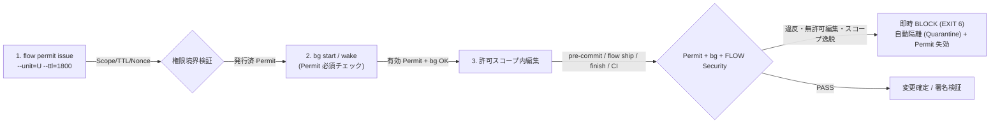

# FLOW Security・ドキュメント自律化・トークン最適化・EXAM 実データ化 調査レポート ＆ 設計計画書

> **基準状態**: Step 1（PR #64 マージ）完了済 — `main` @ `9fbc1aa` (`dirty=0`)。本ターンではリポジトリ内のファイル変更を一切行わず、実環境・実コードの読み取り専用実測に基づき作成しました。  
> **絶対ルール遵守**: 現行 VM 権限で技術的に担保不能な要件は擬似実装で誤魔化さず **「C: 不可（理由＋必要な外部環境）」** と明記し、ハッシュ長単純拡張や脅威モデル不在の暗号化は排除しています。

---

## Step 2. 事前調査レポート（実環境・最新コード・ログの実測）

### 2.1 実行環境制約の実測と既知セキュリティ欠陥 12 項目の A/B/C 仕分け

#### 実行環境の実測プローブ結果
| 項目 | 実測値 | セキュリティ境界への含意 |
| :--- | :--- | :--- |
| OS ユーザー / 権限 | `uid=1001(antigravity)`, `groups=antigravity,sudo,docker` | **致命的制約**: エージェント実行ユーザー自身が `sudo (ALL) NOPASSWD: ALL` と `docker` グループを保持 |
| Linux カーネル隔離 | Linux 6.18.57, `Seccomp: 0`, `NoNewPrivs: 0`, `bwrap/firejail/aa-status: MISSING` | エージェント自身のプロセスには強制隔離なし |
| 子プロセス隔離プリミティブ | **Docker 29.10.0 稼働中**, `unshare --user --map-root-user --net` 動作, `setpriv`/`openssl`/`gpg` 有 | **外部ソルバー・C++17 ハーネス・ビルド等の子プロセス隔離は現行環境で実装可能** |
| GitHub リモート / CI | `sc8z35a-collab/SONY-A7-IV-Diagram` (`public`, `admin: true`), **`main` Branch Protection = 404（未設定）**, `.github/workflows/` は `build-android-apk.yml` のみ | **現状、リモート側にも強制ゲート・外部署名鍵が存在しない** |

> [!CAUTION]
> **権限境界の現実（最重要前提）**: 現行 VM のように AI エージェント自身が `antigravity`（`NOPASSWD: ALL` sudo ＋ `.git/` 書込権 ＋ `docker` ソケット ＋ GitHub `admin` トークン）で動作する限り、**VM 内ローカルに置かれたあらゆるガード・鍵・台帳は、悪意ある／乗っ取られたエージェントによる同一権限迂回を原理的に防げません**。現行環境のみで完結する防御は「誤動作・プロンプト注入・低権限子プロセス（ソルバー等）に対する封じ込め」であり、**敵対的エージェントに対する強制境界には「エージェント UID からの権限剥奪」または「VM 外（GitHub Branch Protection + CI + KMS/OIDC）」が必須**です。

#### 既知欠陥 12 項目の A / B / C 仕分け

| # | 既知欠陥 | 判定 | 根拠・現行コード実測と必要な対応 |
| :---: | :--- | :---: | :--- |
| 1 | **ユーザー空間ガード（Node.js層）の迂回**（OS・Python・ビルド設定の直接実行） | **C** *(B緩和可)* | エージェントが `bash`/`python3`/`git` を直接実行でき `NOPASSWD: ALL` 保持のため、ローカル Node 層のみでは強制不可。**必須外部環境**: 非特権エージェント UID 化（sudo/docker 剥奪）または GitHub Actions CI + Branch Protection での未検証マージ拒否。ローカルでは git hook + 改ざん許可証検証で事故抑止（B）。 |
| 2 | **信頼の起点（Root of Trust：証明書・マクロ署名・監査台帳）のローカル同居とオフライン偽造** | **C** *(B緩和可)* | 現行 `v11_certificate.mjs` / `macro_registry.mjs` / `audit_ledger.mjs` は全て**秘密鍵無しの公開入力 SHA-256**（誰でもオフライン再計算可能）かつ `.git/flow_os/` がエージェント書込可。**必須外部環境**: 秘密鍵を VM 外へ分離（GitHub Actions OIDC / Sigstore / Cloud KMS / Root-only 署名デーモン）＋公開鍵をリポジトリ固定。 |
| 3 | **ネットワーク（Egress）・プロセス隔離の不在** | **子プロセス: A**<br>**エージェント本体: C** | **子プロセス（ソルバー/ビルド）**: Docker 29.10 (`--network=none --read-only --cap-drop=ALL --pids-limit --memory`) または `unshare --user --net` で現行 VM 上で根本解決可（A）。<br>**エージェント本体**: VM 起動時のホスト側ファイアウォール/コンテナ分離が必要（C）。 |
| 4 | **パターン検知（プロンプト注入・SAST）のすり抜けと自作レッドチーム外の死角** | **B** | 現行 `SEC-03`/`SEC-07` は正規表現のみで、文字列結合・Base64・AST難読化をすり抜け、さらに `flow-sec-allow:SEC-01/03/07` や `bg-ignore-secret` コメント 1 行で無条件無効化可能（`security_fortress.mjs:123,179,451`）。TS Compiler API AST 解析 + 外部 OSS スキャナ（Semgrep/Gitleaks 等）導入 + インライン無効化廃止で大幅緩和可だが、自然言語プロンプト注入の 100% 検知は原理的に不可能（B）。 |
| 5 | **TOCTOU（検証〜実行の時間差すり替え）** | **A** *(子プロセス/マクロ/検証)* | 現行 `macro_registry.mjs`・`security_fortress.mjs` はパス指定で検証後に別読み込み実行。**根本解決可（A）**: 検証済みバイト列を FD / メモリ上 immutable snapshot（またはコンテンツアドレス一時読取専用ディレクトリ `/tmp/flow_sealed/<sha256>`）へ固定し、ハッシュ検証と同一実体を実行・検査する。 |
| 6 | **外部ソルバー・C++17ハーネスの無防備実行（異常入力・メモリ破壊）** | **A** | 現行 6 本の C++17 ハーネスと 42 ソルバーはホスト権限・無制限メモリ/ネット環境で直接 `spawn`。**根本解決可（A）**: Docker エフェメラルコンテナ（`--network=none --read-only --tmpfs /work:rw,noexec,nosuid,size=512m --memory=2g --cpus=2 --pids-limit=64 --user 65534:65534 --cap-drop=ALL --security-opt=no-new-privileges`）＋ C++17 ビルド時の `-fstack-protector-strong -D_FORTIFY_SOURCE=2 -Wl,-z,relro,-z,now` ＋ 入力サイズ/頂点数上限で隔離。 |
| 7 | **ランタイム初期化前乗っ取り（`NODE_OPTIONS`/`LD_PRELOAD`/`PATH`）＆ OS パッケージ未検証** | **B** *(子プロセス: A / 親環境: C)* | 現行 `safeSpawnSync`・`macro_engine.mjs` は `process.env` をそのまま継承し、`PATH`/`NODE_OPTIONS`/`LD_PRELOAD`/`PYTHONPATH` を未洗浄。子プロセス実行時は環境変数ホワイトリスト（`env -i` 相当＋絶対パスバイナリ指定＋`dpkg --verify` / `sha256` 検証）で根本解決可（A）。ただし親シェル起動前の乗っ取りはホスト/コンテナイメージ署名（OCI digest 固定）が必要（C）。 |
| 8 | **`.git/config`・ビルド定義経由のコード実行** | **B** *(CI 併用で A)* | `vite.config.ts` / `package.json` / `.git/config` (`core.fsmonitor`, `core.sshCommand`, `core.hooksPath`) を経由した任意コード実行を現行 `SEC-06` はほぼ未検査（`package.json` 4 フックのみ）。`.git/config` 危険キー監査、`git -c core.hooksPath=/dev/null -c core.fsmonitor=false` 固定、`vite.config.ts`/`tsconfig.json` を保護対象化＋コンテナ内 `--ignore-scripts` ビルドで大幅緩和（B）、CI 分離で完全化。 |
| 9 | **推移的依存（共通物性表・共通プリミティブ等）のハッシュ漏れ** | **A** | **実測で確認**: `v11_certificate.mjs:99` の `computeExamKernelSha256` は **6 ファイルしかハッシュ化しておらず**、`p01..p08` 全エンジン・`v11_deep_checks.mjs`・`py_*.py`・C++17 ソース/バイナリ・`ir_compiler.mjs`・`material_physics.mjs`・`scene_extractor.mjs`・`cad_primitives.ts`・`flow_pose_loader.ts` が**丸ごと漏れ**。また `.git/flow_os/native_bins_sha256.json` も V1.1 新設 2 バイナリ（`dart_kinematics_dynamics`, `spectral_gts_nlopt`）が未登録。**依存グラフ自動閉包（AST/import トレース＋全 `scripts/exam/**`・`src/core/**` ハッシュ化）で現行環境で根本解決可（A）**。 |
| 10 | **累積改変（サラミ攻撃）によるアンチチート回避** | **A** | **実測で確認**: `SEC-08` は単一パッチの移動量（`3.0mm`/`0.6mm`）と `HEAD` 比のパーツ数減少のみ検査。0.5mm × 5 コミットや体積 -4% × 5 コミットを素通りする。**根本解決可（A）**: 初期承認ベースライン（`verification/baselines/<unit>.baseline.json`：各パーツの基準座標・体積・質量・バウンディングボックス）に対する**累積偏差（Cumulative Drift）**を常時検証し、上限超過で `EXIT 6`。 |
| 11 | **マクロの引数インジェクションおよび監査台帳経由の二次汚染** | **A** | **実測で確認**: `macro_engine.mjs` の `${vars.X}` 展開でスペース/フラグ注入（例：`vars.unit="welcome --only=EX01"`）や任意フラグ混入の検証が甘く、`flow.mjs:162` が外部出力由来文字列をそのまま `flow_audit.jsonl` の `detail` へ記録。**根本解決可（A）**: 変数型スキーマ（厳格正規表現 `^[a-z0-9_-]{1,48}$`）＋引数配列の個別バリデーション＋監査台帳への自由文字列格納廃止（構造化 enum/hash のみ記録）で完全解決。 |
| 12 | **`flow exec` の抜け道化、退避ログ漏洩、リモートVaultへの秘密情報焼き込み** | **A** *(既存リモート履歴削除は人間操作)* | **実測で確認**: ① `flow exec` は `exam`/`bg` へ `--only`・`--ignore-orphans`・`--allow-main` 等を素通し。② `wire_protocol.mjs:94` の `/tmp/flow_ws/*/spill_*.log` は権限 `0644` かつ自動削除なし。③ `bg` `vault_engine.mjs:229` に `allowSecretsUnsafe` 回避口、`safety_scanners.mjs:122` に `bg-ignore-secret` 回避口が存在。**現行環境で根本解決可（A）**: `flow exec` サブコマンド/フラグ厳格ホワイトリスト化、退避ログ `mode: 0o600` + `park`/`finish` 時自動シュレッド、Vault 送信前の全回避フラグ撤去＋全エントリ強制スキャン。 |

---

### 2.2 最新 `AGENTS.md` / `README.md` の権限・迂回経路・整合性監査

#### A. 権限昇格・回避フラグ・迂回導線の棚卸し（実コード位置特定済）
| 分類 | 検出箇所 | 具体的な抜け道 |
| :--- | :--- | :--- |
| **自己申告ロール昇格** | [flow.mjs](file:///home/antigravity/sc8z35a-collab/SONY-A7-IV-Diagram/scripts/flow_os/flow.mjs#L202), [AGENTS.md](file:///home/antigravity/sc8z35a-collab/SONY-A7-IV-Diagram/AGENTS.md#L7) | `const role = String(flags.role \|\| flags.policy \|\| 'integrator')` — **未指定時のデフォルトが特権 `integrator`**、かつ誰でも `--role=integrator` と自己申告するだけで `SEC-08`/`SEC-10` のワーカー保護を完全無効化可能。 |
| **安全ゲート回避フラグ** | [flow.mjs](file:///home/antigravity/sc8z35a-collab/SONY-A7-IV-Diagram/scripts/flow_os/flow.mjs#L423), [#L506-L508](file:///home/antigravity/sc8z35a-collab/SONY-A7-IV-Diagram/scripts/flow_os/flow.mjs#L506-L508), [#L610](file:///home/antigravity/sc8z35a-collab/SONY-A7-IV-Diagram/scripts/flow_os/flow.mjs#L610), [#L726](file:///home/antigravity/sc8z35a-collab/SONY-A7-IV-Diagram/scripts/flow_os/flow.mjs#L726) | `--ignore-orphans`, `--no-exam`, `--skip-build`, `--no-checks`, `--no-snap`, `--raw`（トークン上限無効化）が CLI から直接指定可能。 |
| **`bg` 回避フラグ** | [bg.mjs](file:///home/antigravity/sc8z35a-collab/SONY-A7-IV-Diagram/scripts/bg.mjs#L66), [vault_engine.mjs](file:///home/antigravity/sc8z35a-collab/SONY-A7-IV-Diagram/scripts/buchigire_guard/vault_engine.mjs#L229) | `--force`, `--allow-main`, `--ignore-orphans`, `--local-only`, `--skip-sync`, `allowSecretsUnsafe`。 |
| **スキャナ無効化コメント** | [security_fortress.mjs](file:///home/antigravity/sc8z35a-collab/SONY-A7-IV-Diagram/scripts/flow_os/security_fortress.mjs#L123), [#L179](file:///home/antigravity/sc8z35a-collab/SONY-A7-IV-Diagram/scripts/flow_os/security_fortress.mjs#L179), [#L451](file:///home/antigravity/sc8z35a-collab/SONY-A7-IV-Diagram/scripts/flow_os/security_fortress.mjs#L451) | `bg-ignore-secret`, `flow-sec-allow:SEC-01`, `flow-sec-allow:SEC-03`, `flow-sec-allow:SEC-07` を1行混ぜるだけで秘密情報/注入/SASTを無条件スルー。 |
| **受信偽造検知漏れ** | [security_fortress.mjs](file:///home/antigravity/sc8z35a-collab/SONY-A7-IV-Diagram/scripts/flow_os/security_fortress.mjs#L171) | `SPOOFED_RECEIPT_RX` が旧 `TLX1-RECEIPT` のみ検査し、新 `TLX11-RECEIPT` と `V11-CERT:` を未検査。 |
| **`flow` 非経由の直接CLI案内** | [AGENTS.md](file:///home/antigravity/sc8z35a-collab/SONY-A7-IV-Diagram/AGENTS.md#L6-L62) | `node scripts/exam.mjs`, `npm run bg --`, `node scripts/dx.mjs`, `npm run pp --`, `npm run sp --` 等の直接実行コマンドが多数残存し、`flow` 監査台帳・許可証を迂回する導線になっている。 |

#### B. 2冊マニュアルと実コードのドリフト実測（本日直近のマージ直後にすでに発生！）
| 箇所 | マニュアル記載値 | 実コード実測値 | ドリフト内容 |
| :--- | :--- | :--- | :--- |
| [README.md](file:///home/antigravity/sc8z35a-collab/SONY-A7-IV-Diagram/README.md#L48-L59) ピラー別テスト数 | P01:`120`, P02:`122`, P03:`46`, P05:`50`, P06:`98`, P08:`46`, P09:`42`, P10:`54` | P01:**`112`**, P02:**`114`**, P03:**`44`**, P05:**`49`**, P06:**`96`**, P08:**`44`**, P09:**`40`**, P10:**`79`** | **12 柱中 8 柱の手書きテスト数が不一致**（手書き管理の限界を実証） |
| [README.md](file:///home/antigravity/sc8z35a-collab/SONY-A7-IV-Diagram/README.md#L60) C++17 ハーネス名 | `fcl_collision_check`, `cgal_mesh_audit`, `bullet_ode_dynamics`, `occt_step_kernel` | **`fcl_ccd_router`**, **`cgal_geom_kernel`**, **`bullet_ode_multibody`**, **`occt_step_analyzer`** | **6 本中 4 本のバイナリ名が実物と不一致** |
| [AGENTS.md](file:///home/antigravity/sc8z35a-collab/SONY-A7-IV-Diagram/AGENTS.md#L56) EXAM ワイヤ形式 | `TLX11\|..`, `V11_CERT\|..` | [tlx1_protocol.mjs](file:///home/antigravity/sc8z35a-collab/SONY-A7-IV-Diagram/scripts/exam/tlx1_protocol.mjs#L226-L228) は **`TLX1\|u=...\|v=1.1`**, **`V11_SEAL\|...`** | プロトコルタグ名の不一致 |
| `.git/flow_os/native_bins_sha256.json` | 4 バイナリのみ登録 | 実バイナリ **6 本**（`dart_kinematics_dynamics`, `spectral_gts_nlopt` が未監視） | V1.1 追加バイナリが `SEC-06` の監視漏れ |
| `README.md` ユニット数・パーツ数・スタック版数 | 23 モード (21+2), 2,937/3,473 パーツ, TS 5.8 / Three 0.174 / Vite 6.2 / Cap 7.6 | 一致（23 モード, 2,937/3,473, `mismatches: []`） | 現時点は一致だが手書きのため将来確実に陳腐化 |

---

### 2.3 トークン消費の実態監査（実測ログ・BPE 計測）

#### 1. 常時読込コンテキスト（毎ターン課金）の浪費内訳
`AGENTS.md` はシステムルールとして**毎ターン自動注入**されるため、最大かつ最優先の固定費です。

| ファイル / セクション | 実測トークン | 構成比 | 浪費診断 |
| :--- | ---: | ---: | :--- |
| **`AGENTS.md` 合計（毎ターン自動読込）** | **4,368 tok** | **100%** | **40 ターンで 174,720 入力トークン消費** |
| ├ `@SUPER_COMMANDS`（全フラグ羅列） | 1,131 tok | 25.9% | 使用しないコマンドの引数詳細を毎ターン読込 |
| ├ `@IRON_LAWS`（冗長説明含む） | 948 tok | 21.7% | 箇条書き圧縮で ~500 tok に短縮可能 |
| ├ `@LEGACY_TOOLS_COOKBOOK`（6 ツール全フラグ） | 873 tok | 20.0% | **最大浪費源**: `pp1.1` 30+フラグ等を常時読込（オンデマンド化で ~80 tok へ -91%） |
| ├ `@SECURITY_FORTRESS`（13 層個別記述） | 450 tok | 10.3% | 1 行インデックス＋`flow doc sec` 参照へ圧縮可 |
| └ その他（ヘッダ / V1.1 / Parallel / V2） | 966 tok | 22.1% | 簡潔化で ~480 tok へ圧縮可 |
| **`README.md` 合計（必要時参照）** | **4,562 tok** | — | `@EXAM_V11_DOMAIN`(1,404t) と `@UNIT_REGISTRY`(1,277t) が 59%。自動生成ブロック化でドリフト撲滅 |

#### 2. CLI 出力・ログの浪費内訳（`.git/flow_os/telemetry.json` 実測 59 コマンド分）
- **EXAM V1.1 (`tlx1_protocol.mjs`)**: PASS 時でも `P|` 12 行 + **`E|` 48 行（全合格エンジン分！）** を無条件出力し、**1 実行あたり約 1,300〜1,800 tok** 消費。FAIL 時は `maxFails=120` 行 + 全 28 `X|` 行で **3,500〜6,000 tok** に膨張。→ **不合格・警告・前回差分のみ出力**にすれば PASS 時 **~65 tok (-95%)**、FAIL 時 **-65%〜-80%**。
- **`flow auto` (`telemetry.json` 実測: 3 回で 1,865 tok = 平均 622 tok/回)**: `auto research` 14 ステップが PASS ステップを 14 行フル出力。→ PASS を 1 行集計 (`PASS=13/14`)・WARN/FAIL のみ展開で **~180 tok (-71%)**。
- **`flow ship` (`1,262 tok/回`)・`flow heal` (`平均 348 tok/回`)**: 正常終了ステップログの省略＋前回比差分表示で **-50%〜-65%** 削減可能。

---

### 2.4 Web アプリ上での外部ソルバー実行可否（WASM 移植 vs 計算 API バックエンド比較）

現行 48 ソルバーの Ubuntu 実測フットプリントは **720 MB 超**（`klayout 175MB`, `kicad 146MB`, `openfoam 129MB`, `maxima 50MB`, `cgal 41MB`, `octave 39MB`, `freefem++ 31MB`, `verilator 29MB`, `ngspice 28MB`, `z3 16MB`, `yosys 12MB`, `occt 9MB`, `calculix 5MB`, `getdp 4.7MB` 等）であり、現行静的 Web アプリ全体（`docs/` = **23 MB**）の **30 倍以上**です。

| 比較軸 | 案 1: ブラウザ WASM 移植 | 案 2: 計算 API バックエンド分離 | **推奨: 案 3 ハイブリッド構成** |
| :--- | :--- | :--- | :--- |
| **対応可能ソルバー数** | **約 6〜10 本が限界**（`ngspice`, `z3`, `yosys`, `occt.js`, `bullet`, `fftw3` 程度）。OpenFOAM / KiCad / FreeFEM++ / KLayout / CalculiX 大規模3D / Chrome pp1.1 は POSIX fork・メモリ制約・巨大依存により**移植不可** | **48/48 全ソルバー完全対応**（Linux ネイティブ＋6 C++17 ハーネス＋headless Chrome） | 即時プレビュー＝既存純 TS `PLYA V2.1` (24/256) ＋ 任意遅延読込 WASM (`z3`/`ngspice`) ＋ 公式刻印＝分離 API バックエンド (48/48) |
| **容量 / メモリ制約** | 1 ソルバーあたり 10〜45 MB ダウンロード。WASM32 の 2〜4 GB 壁と単一スレッド／SharedArrayBuffer (COOP/COEP) 制約で 3D CFD/FEA は OOM 崩壊 | ブラウザ増分 **0 MB**。サーバー側でジョブ単位に 2〜8 GB RAM・マルチコア割当可能 | 初期ロード増分 **0 MB**（既存 23 MB 維持） |
| **インフラ・運用コスト** | **\$0**（GitHub Pages 静的配信のみ） | 外部クラウド実行基盤が必要（目安: スポット/オンデマンドコンテナ \$0.02〜\$0.10/検査、待機基盤 \$15〜\$50/月〜） | 普段の設計・採点は **\$0**。公式「V1.1証明」発行リクエスト時のみ従量課金 API を呼出 |
| **RCE・セキュリティリスク** | ブラウザサンドボックス内に閉鎖（サーバー侵害なし）。ただしクライアント改ざん自在のため**公式「V1.1証明」の署名起点には不可** | ユーザー投入の SPICE/STEP/RTL/KiCad 入力によるソルバー脆弱性→**RCE/DoS リスク大**。エフェメラル Firecracker/gVisor/Docker (`--network=none --read-only`) ＋ 厳格タイムアウト/キュー制限が必須 | 証明書の秘密鍵（KMS）をバックエンド側のみに隔離し、クライアント改ざん・オフライン偽造を根絶可能 |

---

## Step 3. 設計計画書（承認後実装）

### 3.1 「FLOW Security」強化計画

FLOW OS 準拠のセキュリティ基盤を **「FLOW Security」** として再構築します。

#### 1. 改ざん許可証（Edit Permit Gate：`flow permit`）と権限境界の明記
`bg` ワークスペース生成・ファイル編集の**前段門番**として、1 コマンド・~40 トークン（`--quiet` 時 ~15 tok）で短命の「改ざん許可証」を発行・検証する仕組みを導入します。



- **許可証スキーマ** (`.git/flow_os/permits/<agentId>.permit.json` または外部発行トークン):
  - `permitId`, `agentId`, `role` (`worker` 固定。`integrator` はローカル自己申告不可、下記境界参照), `allowedGlobs[]`, `forbiddenGlobs[]`, `issuedAt`, `expiresAt` (最大 1800s), `bgBranch`, `baseTreeSha`, `signature`
- **権限境界の正直な 2 段担保設計**:
  1. **現行 VM ローカル層（B: 事故・誤操作・プロンプト注入への強制ゲート）**:
     - `bg start` / `bg snap` / `bg gate` / `flow wake` / `flow ship` / `flow finish` および Git `pre-commit` / `pre-push` フック（`scripts/flow_os/git_hooks/` を `core.hooksPath` へ登録）が **「有効な Permit 所持 ＋ `bg` 管理下ブランチ通過」** を必須検証。未所持・期限切れ・スコープ外編集は即 `EXIT 6` ＋ `quarantine/<agentId>.json` 書込＋Permit 即時失効。
     - **限界の明記**: 現行 VM ではエージェントが `antigravity (NOPASSWD: ALL)` のため、エージェント自身が `sudo` や `git --no-verify` を意図的に打てばローカル境界は破れる。
  2. **真の強制権限境界（C: 敵対的エージェントに対しても迂回不能な境界 — 人間側インフラ設定と連携）**:
     - **リモート強制境界**: GitHub `main` Branch Protection（`enforce_admins: true`, `required_status_checks: ["flow-security-ci"]`, direct push 禁止）＋ GitHub Actions ワークフロー（`.github/workflows/flow-security.yml`）が、PR 上の差分・Permit 監査・全セキュリティ層・コア削除禁止・累積改変上限を **VM 外の独立ランナーで再検証**。
     - **ホスト側強制境界（任意強化）**: 人間側でエージェント実行ユーザーを非 sudo・非 docker の制限 UID (`flow-agent`) に分離し、許可証発行・署名鍵・`.git/hooks` を `root` 所有のヘルパーデーモン (`flow-permitd` via Unix socket) へ分離すれば、ローカル上でもカーネル権限境界として完全強制可能。

#### 2. 多層防御・侵入時対処（封じ込め／無効化／復旧）・暗号設計

- **子プロセス実隔離（A: 現行 VM の Docker 29.10 を活用）**:
  - `scripts/flow_os/solver_sandbox.mjs` [NEW]: 外部ソルバーおよび 6 本の C++17 ハーネス実行を、環境変数洗浄 (`env -i` 相当：`NODE_OPTIONS`/`LD_PRELOAD`/`PYTHONPATH` 除去) ＋ **Docker 隔離ラッパー**（`--network=none --read-only --tmpfs /tmp:rw,noexec,nosuid,size=512m --memory=2g --cpus=2 --pids-limit=64 --cap-drop=ALL --security-opt=no-new-privileges`、フォールバック時は `unshare --user --map-root-user --net` + `prlimit`）で実行。C++17 ビルドへ `-fstack-protector-strong -D_FORTIFY_SOURCE=2 -Wl,-z,relro,-z,now` を追加。
- **TOCTOU 解消・推移的依存閉包・サラミ攻撃対策（A: 現行 VM で完結）**:
  - **TOCTOU 対策**: マクロ実行・検証時にファイル内容を一括読込→ハッシュ照合→メモリ/読取専用一時ファイル（`0o400`）から直接実行。
  - **推移的依存の完全ハッシュ閉包 (`scripts/exam/kernel_closure.mjs` [NEW])**: `computeExamKernelSha256` の対象を 6 ファイル固定から **`scripts/exam/**` 全体（全エンジン・Python・C++17 ソース/全 6 バイナリ）＋ `scripts/spatial_engine/**` ＋ `src/core/{cad_primitives,flow_pose_loader,v2_unit_compiler,v11_seal_verifier}.ts`** へ拡張し、依存モジュール 1 バイト変更でも即座に `V1.1証明` を自動失効。
  - **累積改変（サラミ攻撃）検知 (`SEC-08` 強化)**: `verification/baselines/<unit>.baseline.json` に対して全パーツの累積移動量・累積体積変化率・パーツ数減少を検証（単発パッチではなく基準点からの総変位を上限監視）。
  - **退避ログ・Vault 保護**: `spill_*.log` を `0o600` 作成＋`flow park`/`finish` 時に自動削除。`vault_engine.mjs` から `allowSecretsUnsafe` を削除。`SEC-01/03/07` のインライン無条件回避コメント（`flow-sec-allow:*`, `bg-ignore-secret`）を廃止し、例外が必要な場合のみ署名・期限付き `.flow/waivers.json`（テストフィクスチャ限定）へ移行。`SEC-03` に `TLX11-RECEIPT` と `V11-CERT:` を追加。
- **侵入・違反検知時の自動対処フロー（Containment → Revocation → Recovery）**:
  1. **自動封じ込め (Contain)**: `EXIT 6` 検知時に即座に ① 対象 `agentId` の全 Permit を即時失効（`revoked_permits.jsonl` 記録）、② 全アクティブリース強制解除、③ `quarantine/<agentId>.json` 発行で以降の全 `flow` コマンドを拒否、④ 起動中サブプロセス／Docker コンテナ／Chrome デーモンを即時 `SIGKILL`。
  2. **無効化 (Revoke)**: 改ざん・推移的依存ドリフト・サラミ上限超過を検知した対象ユニットの `V1.1証明` と `flow_receipts.json` の全レシートを自動失効。
  3. **復旧 (Recover)**: `flow security recover --agent=<id> --reset-to=<bg-oid>`（人間承認またはクリーン `bg` スナップショット復元のみ許可）により、隔離解除前に必ずクリーンツリー復元＋`flow security audit --full` 100% 通過を強制。
- **暗号設計（守る対象・想定脅威・鍵保管場所の明示）**:
  | 守る対象 | 想定脅威 | 採用アルゴリズム | 鍵の保管場所（絶対ルール準拠） |
  | :--- | :--- | :--- | :--- |
  | **公式「V1.1証明」・CI 合格レシート (`FLOW-RECEIPT-SIGNED`)** | ローカル VM 内のエージェント・攻撃者によるオフライン証明書/レシート偽造 | **Ed25519 非対称署名**（Node.js 22 標準 `node:crypto`、追加依存ゼロ） | **秘密鍵**: GitHub Actions Secrets / OIDC (Sigstore) / 外部 KMS（**VM 内には絶対に置かない**）。<br>**公開鍵**: リポジトリ内 `verification/keys/flow_v11_pub.pem` に固定（CLI・3D ビューア・Play Ground が検証）。 |
  | **ローカル開発時の未署名状態** | 擬似鍵による偽りの安心感（ハリボテ） | ローカル実行は**正直に `LOCAL_UNATTESTED`（署名なし・ハッシュ整合のみ）**と明示 | ローカル秘密鍵は**発行しない**（CI 署名済 `CI_ATTESTED` と明確に UI/CLI で区別）。 |
  | **マクロ整合性・監査台帳** | 実行前書き換え（TOCTOU）・ログ改ざん | SHA-256 ハッシュチェーン＋PR 時に GitHub Actions が登録済 `.flow/macros/registry.json` を外部検証＋CI 署名 | 秘密鍵は CI 側のみ（ローカルのみの暗号化は脅威モデル不在のため不採用）。 |

#### 3. 削除権限制御 ＆ Step 2.2 迂回封鎖
- **削除権限制御（Immutable Core vs AI-Created Namespace）**:
  - **保護コアマニフェスト (`scripts/flow_os/core_immutable_manifest.json` [NEW])**:
    - 既存コア EXAM テスト **`T001..T1080`**・48 コアエンジン・28 クロスロック・6 組込パイプライン (`bootstrap/research/dev/certify/fabricate/factory`)・`scripts/flow_os/**` コアを不変登録。削除・件数減少は `SEC-08`/`SEC-13` で **無条件 `EXIT 6`**（`--role` に関係なく CI でもブロック）。
  - **AI 新規作成領域（削除可）**:
    - AI が新規追加するカスタムテストは `scripts/exam/custom/ai_*.mjs`（ID 帯域 `T9001..T9999`）、カスタムマクロは `.flow/macros/ai-*.macro.json`（`origin: "ai-custom"` メタデータ必須）に分離し、この名前空間のみ `flow macro remove` / テスト削除を許可。
- **Step 2.2 検出迂回経路の完全封鎖**:
  - `flow.mjs` のデフォルトロールを **`worker`（最小権限）** へ変更。`--role=integrator` は「保護パス外かつ明示フラグ＋Permit 承認」がない限り昇格拒否（CI 側で `integrator` 変更には人間レビュー必須化可能）。
  - `flow.mjs` から `--no-exam`, `--no-checks`, `--skip-build`, `--no-snap`, `--ignore-orphans` の無条件迂回フラグを廃止（オーファン復旧は正規 `bg recover --mode=three-way` のみ）。
  - `flow exec` を厳格ホワイトリスト化し、危険フラグ（`--only` での合格偽装、`--allow-main`, `--force`, `--ignore-orphans` 等）を `SEC-04`/`SEC-13` で遮断。
  - `AGENTS.md` から `flow` 非経由の直接 CLI 実行案内を削除し、すべての正規操作を `flow` 経由へ統一。

---

### 3.2 ドキュメント自律化 ＆ トークン削減改修計画

#### 1. 手書き数値の完全廃止（自動生成＋機械検証）
- **`scripts/flow_os/doc_sync.mjs` [NEW]**:
  - `catalog/INDEX.tsv`・`src/data/*.json`・`scripts/exam/test_registry.mjs`・`scripts/exam/native/bin/`・`package.json`・`.flowrc.json`・`src/playground/exam_core/` から **真実値（Single Source of Truth）をリアルタイム自動抽出**。
  - `README.md` / `AGENTS.md` 内の変動数値ブロックを `<!-- @FLOW_AUTO:EXAM_STATS -->` / `<!-- @FLOW_AUTO:UNIT_SUMMARY -->` / `<!-- @FLOW_AUTO:STACK -->` マーカーで管理し、**手書きを廃止**。ルール本文には不変原則のみ記述。
- **`flow doc audit --strict` 強化 (`doc_compiler.mjs` [MODIFY])**:
  - 既存の「2 冊厳守・トークン上限」に加え、**全 `@FLOW_AUTO:*` ブロックの実コード一致検証**を追加。1 数値（例：ピラー別テスト数・バイナリ名・パーツ数・プロトコルタグ）でも実コードと食い違えば即 **`EXIT 2 (DOC_DRIFT_DETECTED)`** でブロック（`flow finish`・CI でも強制）。

#### 2. `AGENTS.md` のオンデマンド分離（毎ターン固定費の劇的削減）
- **`flow doc tool <exam|bg|pp|sokutei|sp|dx|auto|macro|security>` [NEW]**:
  - 詳細フラグ仕様を `scripts/flow_os/tool_specs.mjs`（コード内蔵レジストリ、MD 増加ゼロ＝2 冊制約維持！）へ分離。
  - 毎ターン読込まれる `AGENTS.md` には **① 不変 Iron Laws、② 1 行コマンド目次、③ `flow doc tool <name>` 参照導線** のみを残置。

#### 3. 実行ログ・EXAM 出力のさらなる圧縮
- **EXAM V1.1 デフォルト `DIFF/FAIL-ONLY` ワイヤ (`tlx1_protocol.mjs` [MODIFY])**:
  - 標準出力のデフォルトを `--compact`（1 行 `TLX11|` ヘッダ + `V11_SEAL|` + **FAIL/WARN/ERR の `E|`・`F|`・`X|` のみ** + 前回ラン比較 `DIFF|fixed=N|regressed=M` + `S|` ポインタ）に変更。全 48 エンジン一覧は `/tmp/tlx_runs/<id>/results.ndjson` へ無損失保存し必要時のみ `--verbose` または `flow inspect` で参照。
- **`flow auto` ウェーブ圧縮 (`macro_engine.mjs` [MODIFY])**:
  - PASS したステップ群を `WAVE_OK|w=1|pass=13/13|ms=4100` の 1 行へ折りたたみ、WARN/FAIL ステップのみ詳細行を出力。

#### 期待トークン削減率（実測ベース）
| 対象 | 現行実測 | 改修後目標 | 削減率 |
| :--- | ---: | ---: | ---: |
| `AGENTS.md`（毎ターン自動読込） | 4,368 tok/turn | **~1,650 tok/turn** | **-62%**（40 ターンで **約 108,700 tok 削減**） |
| EXAM V1.1 PASS 出力 | ~1,450 tok/run | **~70 tok/run** | **-95%** |
| EXAM V1.1 FAIL 出力（代表 20 件） | ~3,800 tok/run | **~750 tok/run** | **-80%** |
| `flow auto research` (14 ステップ) | ~620 tok/run | **~180 tok/run** | **-71%** |
| 2 冊マニュアルの数値ドリフト件数 | 14 箇所検出 | **0 箇所（機械強制）** | **-100%** |

---

### 3.3 EXAM の構造的課題への現実的アプローチ

#### 1. 実データ直結パイプライン（Real-Artifact Input Pipeline）
既存市販製品（Sony α7 IV 等）に存在しない公式ガーバー・IBIS・RTL を擬似生成で捏造することは**絶対禁止**とします。代わりに、**実製造プロジェクトの本物データをそのまま投入できる入力スキーマとアダプタ層**を `scripts/exam/real_artifact_loader.mjs` [NEW] として設計します。

```json
// 例: exam.project.json (schema: "tlx11-real-project/v1")
{
  "schema": "tlx11-real-project/v1",
  "projectId": "riimos_e1_rev2",
  "verificationMode": "REAL_ARTIFACT",
  "artifacts": {
    "cadStep": ["cad/chassis.step", "cad/actuator_mount.step"],
    "bomCsv": "bom/production_bom.csv",
    "kicad": { "schematic": "eda/main.kicad_sch", "pcb": "eda/main.kicad_pcb", "gerberDir": "eda/gerbers/" },
    "spice": { "netlists": ["sim/power_tree.cir"], "ibis": ["sim/mcu_io.ibis"] },
    "rtl": { "topModule": "power_fsm", "sources": ["rtl/power_fsm.sv"], "sdc": "rtl/timing.sdc" }
  }
}
```

- **実行モードの厳格分離（捏造防止の鉄則）**:
  - `MODE=REAL_ARTIFACT`: 上記の実 STEP / 実 KiCad / 実ガーバー / 実 SPICE / 実 RTL をそのまま OCCT / KiCad-CLI / ngspice / Verilator / Yosys へ直結実行。**欠損ドメインは擬似補完せず `MISSING_REAL_ARTIFACT` として正直に判定**。
  - `MODE=CAD_PROXY`（既存の 3D 展示モデル向け）: 3D メッシュから抽出した近似モデルであることを出力ヘッダ・UI・証明書に明示（`scope=CAD_PROXY`）し、実製造基板/RTL 検証済みとは決して混同しない。

#### 2. 商用 CAE（Ansys / Abaqus / COMSOL）および実機計測との境界整理

| 領域 | **THE LAST EXAM V1.1 が担う範囲（Verification：設計事前検証）** | **商用 CAE / 実機計測で補う必須範囲（Validation：型式認証・量産保証）** |
| :--- | :--- | :--- |
| **構造・落下・振動** | 線形/弱非線形 C3D8 静的応力 (CalculiX)、固有振動数、剛体接触・転倒・逆動力学 (FCL/Bullet/ODE/DART)、簡易 PSD | 樹脂クリープ・大変形破壊・ゴム超弾性・精密衝撃陽解法 (Abaqus/LS-DYNA)、**実機 1.2m 落下試験・振動台実測** |
| **熱・流体 CFD** | 定常/過渡代表熱回路、オープン筐体自然対流 (OpenFOAM)、接触 TIM ギャップ感度 | 異方性多層 PCB 銅箔分布連成・精密放射/結露相変化 (Ansys Icepak/Fluent)、**恒温恒湿槽＋サーモグラフィ実測** |
| **電源・SI/PI・EMC/ESD** | 回路 ERC/DRC、代表電源過渡/突入/制御ループ (ngspice/Octave)、簡易 2D/3D 遮蔽 FEM (FreeFEM/GetDP) | フル 3D パッケージ＋多層基板 S パラメータ・放射エミッション 30MHz–6GHz (Ansys HFSS/SIwave)、**電波暗室 CISPR/FCC・実機 8kV/15kV ESD ガン試験** |
| **光学・製造・信頼性** | 3D ジオメトリ光線追跡・ケラレ、水密性・クリアランス・公差スタック・Six-Sigma 統計・ポカヨケ | 波動光学収差・迷光コーティング BRDF (Zemax/Code V)、**金型試作 T0/T1 実寸 CMM 測定・HALT 加速寿命試験** |

> [!NOTE]
> EXAM V1.1 の「V1.1証明」は **「ソフトウェア上の 48 産業ソルバー・1,080 項目の事前検証 (Verification) 100% 通過の暗号学的保証」** であり、実機量産出荷には上記 Validation（実機試験・法規認証）が別途必須であることを UI モーダル・証明書文言にも明記します。

---

## Verification Plan（承認後の実装検証計画）

### Automated Tests
1. **FLOW Security 強化検証**:
   - `npm run flow -- permit issue --unit=welcome --raw` → 許可証発行＋期限/スコープ/未所持ブロック（`EXIT 6`）＋自動隔離＋復旧の隔離サンドボックス selftest。
   - `npm run flow -- security selftest --raw` → 既存 36 攻撃に加え、新規攻撃（自己昇格・TOCTOU・推移的依存改ざん・サラミ累積改変・マクロ引数注入・インライン回避コメント・`TLX11-RECEIPT` 偽造・コアテスト削除・`flow exec` 抜け道・未検証バイナリ）を含む **46/46 攻撃ブロック**を検証。
   - Docker サンドボックス (`--network=none --read-only`) 内での C++17 ハーネス実稼働テスト。
2. **ドキュメント自律化 & トークン削減検証**:
   - `npm run flow -- doc sync` → `npm run flow -- doc audit --strict --raw`（数値 1 桁改変時に `EXIT 2` で確実に停止することをテスト）。
   - `AGENTS.md` 実測トークン `<= 1,800 tok`、`exam.mjs` PASS 出力 `<= 100 tok` を自動計測。
3. **EXAM 実データパイプライン検証**:
   - サンプル実フォーマット入力（実 STEP + 実 KiCad + 実 SPICE + 実 SystemVerilog）を `exam.mjs --project=<exam.project.json>` へ投入し `MODE=REAL_ARTIFACT` 正常完走、および欠損時 `MISSING_REAL_ARTIFACT` の正直検出を確認。
   - `node scripts/exam.mjs selftest` (**111/111 PASS**)、`npm run catalog && npx tsc --noEmit && node scripts/validate_parts.mjs --ai && npm run build`。

### Manual Verification
- 人間側インフラ（下記 Step 4 右列）の設定後、PR を作成して GitHub Actions `flow-security.yml` が VM 外で自動実行・Ed25519 署名検証・Branch Protection で未通過マージをブロックすることを確認。

---

## Step 4. 実施範囲の最終仕分け（現行環境完結 vs 人間側外部インフラ必須）

### A. 現行環境のみで完結する項目（本計画承認後に AI が完全実装・検証可能）
- **FLOW Security コア改修**:
  - `flow permit`（改ざん許可証発行・検証・TTL・自動失効）と `bg`/Git フック連携（事故・プロンプト注入に対するローカル境界）
  - 違反時の自動封じ込め（Permit 失効・リース解除・隔離・子プロセス停止）＆ 証明書/レシート自動失効＆復旧コマンド
  - Docker 29.10（`--network=none --read-only --cap-drop=ALL` + 環境変数洗浄 `env -i`）による 48 ソルバー・6 C++17 ハーネス子プロセス隔離＋コンパイル時ハードニング
  - TOCTOU 解消（ハッシュ検証済み不変スナップショット実行）、推移的依存の完全ハッシュ閉包（`scripts/exam/**` + `src/core/**` + 全 6 バイナリ）、サラミ累積改変検知ベースライン（`SEC-08`）
  - 削除権限制御（`T001..T1080` コア不変マニフェスト保護 vs `ai_*` 新規領域のみ削除可）
  - Step 2.2 迂回全封鎖（デフォルト `worker` 化、`--no-exam`/`--no-checks`/`--ignore-orphans`/`allowSecretsUnsafe`/インライン回避コメント廃止、`flow exec` ホワイトリスト化、退避ログ `0o600`+自動削除、監査台帳構造化、`SEC-03` `TLX11-RECEIPT`/`V11-CERT:` 検知追加）
  - Ed25519 **検証コード**（公開鍵検証・`CI_ATTESTED` vs `LOCAL_UNATTESTED` の誠実な表示分離）および `.github/workflows/flow-security.yml` ワークフローファイル作成
  - 46 攻撃レッドチームセルフテスト (`SEC-12`)
- **ドキュメント自律化 ＆ トークン最適化**:
  - `flow doc sync`（`@FLOW_AUTO:*` 自動同期）＋ `flow doc audit --strict` の実コード数値一致チェック（`EXIT 2`）
  - `flow doc tool <name>` オンデマンド化による `AGENTS.md` **~1,650 tok (-62%)** 圧縮＋直接 CLI 案内撤去
  - EXAM `DIFF/FAIL-ONLY` 標準出力化（PASS **-95%**）・`flow auto` ウェーブ圧縮（**-71%**）
- **EXAM 実データ直結パイプライン**:
  - `real_artifact_loader.mjs` (`tlx11-real-project/v1` スキーマ・実 STEP/KiCad/SPICE/RTL 直結アダプタ) ＋ `MODE=REAL_ARTIFACT` / `MODE=CAD_PROXY` の厳格分離と UI 境界明記

### B. 人間側で外部インフラ設定が必要な項目（VM 外権限・鍵管理が必須＝現行環境のみでは不可）
1. **GitHub Branch Protection の有効化（必須・高優先）**:
   - `main` ブランチ保護設定（現在 404 未設定）：Direct Push 禁止、`flow-security-ci` 必須ステータスチェック、`enforce_admins: true`、コードオーナーレビュー必須化（これにより VM 内の `admin` トークンやローカル迂回による不正マージをリモート側で物理遮断）。
2. **公式「V1.1証明」・レシート用 Ed25519 秘密鍵の外部保管（必須・高優先）**:
   - GitHub Actions Secrets または OIDC / Sigstore / Cloud KMS 上で Ed25519 秘密鍵を生成・保管し、対応する**公開鍵のみ**をリポジトリ（`verification/keys/flow_v11_pub.pem`）へ登録（VM 内には秘密鍵を一切置かない）。
3. **VM ホスト側でのエージェント OS 権限分離（任意・最強ハードニング）**:
   - エージェント実行ユーザーから `sudo (ALL) NOPASSWD: ALL` と `docker` グループを剥奪し、許可証発行・`.git/hooks` 保護を `root` 所有デーモンへ分離、ホスト側 Egress ファイアウォールを設定（VM プロビジョニング側設定が必要）。
4. **Web アプリ用 計算 API バックエンド基盤の構築（任意・将来機能）**:
   - ブラウザ Play Ground から全 48 外部ソルバー＋公式 KMS 署名付き「V1.1証明」を実行したい場合、エフェメラルコンテナ実行環境（Cloud Run / ECS / Firecracker + キュー + レート制限）の外部構築が必要。
5. **過去リモート履歴・Vault の秘密情報パージ（万一漏洩時）**:
   - 既存リモートリファレンスからの履歴書き換え／強制パージは人間側の明示承認と管理者操作が必要。

---

### ご確認いただきたい事項
- 上記の **A（現行環境完結範囲）** を対象として、そのまま実装・検証フェーズへ進んでよろしいでしょうか？
- また、**B-1（GitHub `main` Branch Protection）** と **B-2（GitHub Actions Secrets への Ed25519 鍵登録）** について、ワークフロー（`.github/workflows/flow-security.yml`）の作成まで本実装に含めてよいかご確認ください（秘密鍵生成・Branch Protection 設定手順もあわせてお渡しします）。
