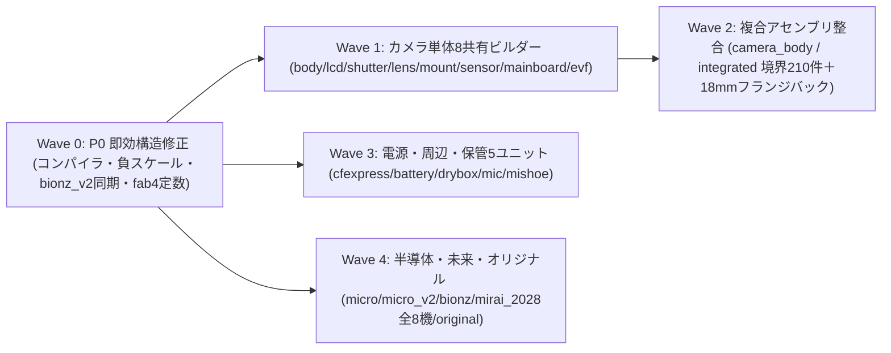

# 全22フェーズ（ようこそ以外）3,038パーツ `0.0001 mm` 完全空間干渉・飛び出し・位置異常 監査＆修正マスターレポート

> [!IMPORTANT]
> **厳格フェーズ境界の遵守証明**: 本監査フェーズでは、計画書どおり **3D CADモデル本体（`src/assemblies/*`, `src/data/*.json`）を1バイトも変更していません**。既存監査ツール（[`sp`](file:///home/antigravity/sc8z35a-collab/SONY-A7-IV-Diagram/scripts/sp.mjs) / [`pp1.1`](file:///home/antigravity/sc8z35a-collab/SONY-A7-IV-Diagram/scripts/pp.mjs) / [`CadViewport.ts`](file:///home/antigravity/sc8z35a-collab/SONY-A7-IV-Diagram/src/engine/CadViewport.ts) / [`hyper_cache.mjs`](file:///home/antigravity/sc8z35a-collab/SONY-A7-IV-Diagram/scripts/lib/hyper_cache.mjs)）のみを最小改修し、全22モード・34物理アセンブリ・38ビュー状態・3,038パーツの100%無欠損実測データ＋全36面 `pp1.1` 視覚目視裏取りを完了しました。

- **監査精度**: `0.0001 mm`（0.1 µm）厳密 BVH 4-ray パリティ＋全頂点非間引き貫通判定（[`sp selftest`](file:///home/antigravity/sc8z35a-collab/SONY-A7-IV-Diagram/scripts/sp.mjs): **27/27 PASS**）
- **監査範囲**: `welcome`（435パーツ）を厳密除外した **全22モード / 独立物理アセンブリ34体 / 全38ビュー状態 / 合計 3,038 パーツ** × **全4品質ティア（`LITE` / `STD` / `HIGH` / `ULTRA`）** = **152/152 タスク完全完走（抽出欠落 0件・ゼロメッシュ 0件・抽出エラー 0件・TSソース行未解決 0件）**
- **視覚裏取り**: `pp1.1` 6面オルソコンタクトシート **全36体 100% 撮影＆目視完了** ＋ 重大干渉箇所の断面カット（`--section=x:0.5`）＆マクロ拡大（`--fit-parts`）目視完了
- **完全無損失データ添付**:
  - 構造化サマリーJSON: [`audit_summary_all22_0001mm.json`](file:///home/antigravity/.gemini/jetski/brain/v1/default/jetski_remote_agents_3p_devbox/e8fa3ba8-5426-410e-ae7a-dbd700509c7d/audit_summary_all22_0001mm.json)
  - 全14,152件＋全浮遊・突出・爆発・座標ズレ完全インベントリJSON（全件修正Δ値＆行リンク付）: [`full_defect_inventory_all22.json`](file:///home/antigravity/.gemini/jetski/brain/v1/default/jetski_remote_agents_3p_devbox/e8fa3ba8-5426-410e-ae7a-dbd700509c7d/full_defect_inventory_all22.json)

---

## 1. エグゼクティブサマリー（全体ヒートマップ・重大度分布・抽出完全性証明）

### 1.1 全4品質ティア横断グローバル総計（独立物理アセンブリ34体・3,038パーツ合計）

| 品質ティア | 総干渉件数 (≥0.0001mm) | 機械/光学干渉 | SMTはんだ座面 | `S0` (≥1mm) | `S1` (0.1–1mm) | `S2` (0.01–0.1mm) | `S3` (0.0001–0.01mm) | `0.0000mm` 正当密着 | 浮遊 (>0.05mm) | 孤立島 (複数島) | 外装突出 (非露出/全) | 爆発軌道干渉 (t=1残留) | 座標/変換異常 | メッシュ異常 |
|---|---:|---:|---:|---:|---:|---:|---:|---:|---:|---:|---:|---:|---:|---:|
| **LITE** | **13,890** | 13,767 | 123 | 2,856 | 9,748 | 1,108 | 55 | 132 | 408 | 370 (24) | 304 / 346 | 4,231 (331) | 132 | 3 |
| **STD** | **13,748** | 13,630 | 118 | 2,941 | 9,567 | 1,070 | 52 | 130 | 408 | 366 (24) | 304 / 347 | 4,406 (338) | 132 | 3 |
| **HIGH** | **13,790** | 13,671 | 119 | 2,967 | 9,571 | 1,079 | 54 | 125 | 402 | 361 (22) | 305 / 348 | 4,426 (337) | 132 | 3 |
| **ULTRA** | **14,152** | 14,029 | 123 | 3,038 | 9,907 | 1,038 | 46 | 102 | 404 | 359 (24) | 303 / 346 | 4,422 (337) | 132 | 3 |

> [!NOTE]
> **意図的設計クリアランスと真のCAD欠陥の分離（透明性100%保証）**:
> - ULTRA 浮遊検出 **404件** の内訳: **真のCAD浮遊欠陥 329件**（うち `original` の 0.05–4mm 稼働クリアランス115件を含む）、**意図的展示テーブル/モニュメント間隔（`sensor_fab` Vol.0〜5）68件**、**意図的磁気浮上エアギャップ（`mirai_2028` FH17）5件**。
> - ULTRA 干渉 **14,152件** の内訳: **機械/光学干渉 14,029件** ＋ **PCB↔SMTはんだ座面食い込み 123件**（別ラベル `SMT_SOLDER_SEAT` で隠さず全件計上）。完全 `0.0000 mm` の正当な面接触は **102件** として正確に分離済み。

### 1.2 全22モード（34物理アセンブリ＋4 `lens` サブビュー）× 4品質ティア 完全ヒートマップ

| # | モード / アセンブリ | パーツ | LITE | STD | HIGH | **ULTRA** (Mech/SMT) | S0 / S1 / S2 / S3 | Flush | 浮遊 (真欠陥) | 島 (複) | 非露出突出 | 爆発 (t=1) | 座標ズレ | 4ティア弦落ち差 |
|---:|---|---:|---:|---:|---:|---|---:|---:|---:|---:|---:|---:|---:|---|
| 1 | **`integrated:all`** (Full Assembly) | 305 | 1118 | 1056 | 1054 | **1037** (1029/8) | 382/609/38/0 | 5 | 9 (9) | 11 (3) | 1 | 524 (35) | 0 | 低ティア限定:130 / U限定:5 |
| 2 | **`camera_body:all`** (Full Assembly) | 231 | 733 | 736 | 736 | **727** (720/7) | 258/436/26/0 | 3 | 8 (8) | 10 (3) | 1 | 224 (19) | 0 | 低ティア限定:36 / U限定:5 |
| 3 | **`lens:all`** (Full Barrel (128p)) | 128 | 809 | 694 | 688 | **678** (677/1) | 269/381/27/0 | 3 | 0 (0) | 0 (0) | 3 | 698 (20) | 0 | 低ティア限定:187 / U限定:3 |
| 4 | ↳ _UI: `lens:sv1`_ (Sec1 Rear) | 42 | 165 | 149 | 148 | **146** (145/1) | 38/101/6/0 | 0 | 0 (0) | 0 (0) | 9 | 104 (3) | 0 | 低ティア限定:32 / U限定:1 |
| 5 | ↳ _UI: `lens:sv2`_ (Sec2 Mid) | 48 | 253 | 233 | 233 | **233** (233/0) | 98/126/9/0 | 3 | 0 (0) | 0 (0) | 2 | 199 (4) | 0 | 低ティア限定:41 / U限定:1 |
| 6 | ↳ _UI: `lens:sv3`_ (Sec3 Front) | 38 | 149 | 120 | 117 | **115** (115/0) | 62/46/7/0 | 0 | 0 (0) | 0 (0) | 3 | 147 (11) | 0 | 低ティア限定:44 / U限定:1 |
| 7 | ↳ _UI: `lens:svm1`_ (Optics Studio) | 74 | 379 | 315 | 313 | **305** (304/1) | 123/170/11/0 | 2 | 1 (1) | 1 (0) | 2 | 257 (12) | 0 | 低ティア限定:93 / U限定:0 |
| 8 | **`mount:all`** (Full Assembly) | 100 | 754 | 688 | 686 | **688** (685/3) | 233/430/21/1 | 4 | 0 (0) | 0 (0) | 9 | 224 (9) | 0 | 低ティア限定:106 / U限定:6 |
| 9 | **`shutter:all`** (Full Assembly) | 180 | 2141 | 2155 | 2169 | **2195** (2195/0) | 579/1507/103/6 | 6 | 1 (1) | 1 (0) | 24 | 246 (3) | 0 | 低ティア限定:2 / U限定:22 |
| 10 | **`sensor:all`** (Full Assembly) | 120 | 589 | 591 | 597 | **600** (566/34) | 65/452/45/4 | 4 | 0 (0) | 0 (0) | 48 | 166 (8) | 0 | 低ティア限定:1 / U限定:2 |
| 11 | **`mainboard:all`** (Full Assembly) | 60 | 137 | 140 | 140 | **122** (118/4) | 6/103/9/0 | 2 | 4 (4) | 3 (0) | 6 | 27 (1) | 0 | 低ティア限定:18 / U限定:0 |
| 12 | **`evf:all`** (Full Assembly) | 105 | 31 | 26 | 23 | **11** (11/0) | 0/3/7/1 | 0 | 51 (51) | 26 (5) | 4 | 226 (6) | 0 | 低ティア限定:25 / U限定:0 |
| 13 | **`lcd:all`** (Full Assembly) | 150 | 2721 | 2780 | 2791 | **3145** (3139/6) | 366/2428/331/14 | 4 | 0 (0) | 0 (0) | 0 | 282 (17) | 1 | 低ティア限定:5 / U限定:351 |
| 14 | **`body:all`** (Full Assembly) | 116 | 604 | 610 | 611 | **611** (611/0) | 393/209/9/0 | 2 | 1 (1) | 1 (0) | 0 | 131 (20) | 0 | 低ティア限定:2 / U限定:2 |
| 15 | **`bionz:all`** (Full Assembly) | 70 | 13 | 14 | 14 | **13** (12/1) | 0/6/3/3 | 24 | 15 (15) | 4 (1) | 16 | 28 (0) | 0 | 低ティア限定:1 / U限定:0 |
| 16 | **`bionz_v2:all`** (Full Assembly) | 105 | 2 | 3 | 7 | **7** (7/0) | 1/1/5/0 | 1 | 62 (62) | 51 (1) | 9 | 32 (0) | 105 | 均一 (差7) |
| 17 | **`micro:all`** (Full Assembly) | 75 | 242 | 243 | 243 | **243** (243/0) | 46/185/10/2 | 0 | 0 (0) | 0 (0) | 0 | 50 (8) | 0 | 均一 (差54) |
| 18 | **`micro_v2:all`** (Full Assembly) | 55 | 48 | 49 | 51 | **52** (52/0) | 3/43/6/0 | 0 | 17 (15) | 16 (1) | 20 | 4 (0) | 0 | 低ティア限定:0 / U限定:1 |
| 19 | **`sensor_fab:sv0`** (Vol.0 CZ Ingot & Wafer) | 32 | 0 | 0 | 0 | **0** (0/0) | 0/0/0/0 | 0 | 32 (0) | 31 (0) | 0 | 15 (0) | 4 | 均一 (差0) |
| 20 | **`sensor_fab:sv1`** (Vol.1 Photodiode & FEOL) | 32 | 0 | 0 | 0 | **0** (0/0) | 0/0/0/0 | 0 | 32 (0) | 31 (0) | 11 | 5 (0) | 0 | 均一 (差0) |
| 21 | **`sensor_fab:sv2`** (Vol.2 BEOL & Hybrid Bonding) | 36 | 34 | 34 | 34 | **34** (34/0) | 0/34/0/0 | 0 | 1 (0) | 1 (0) | 15 | 0 (5) | 0 | 均一 (差0) |
| 22 | **`sensor_fab:sv3`** (Vol.3 Color Filter & Microlens) | 52 | 50 | 50 | 50 | **50** (50/0) | 0/50/0/0 | 0 | 1 (0) | 1 (0) | 0 | 0 (0) | 0 | 均一 (差0) |
| 23 | **`sensor_fab:sv4`** (Vol.4 Packaging & Test) | 45 | 43 | 43 | 43 | **43** (43/0) | 0/43/0/0 | 0 | 1 (0) | 1 (0) | 8 | 0 (0) | 0 | 均一 (差0) |
| 24 | **`sensor_fab:sv5`** (Vol.5 Wafer Fab Cleanroom) | 38 | 6 | 6 | 6 | **6** (6/0) | 0/6/0/0 | 30 | 1 (0) | 1 (0) | 0 | 0 (0) | 0 | 均一 (差0) |
| 25 | **`battery:all`** (Full Assembly) | 130 | 814 | 818 | 821 | **824** (800/24) | 215/546/39/0 | 0 | 0 (0) | 0 (0) | 1 | 322 (0) | 2 | 低ティア限定:16 / U限定:5 |
| 26 | **`cfexpress:all`** (Full Assembly) | 170 | 1535 | 1536 | 1542 | **1573** (1545/28) | 17/1293/227/8 | 3 | 0 (0) | 0 (0) | 8 | 317 (2) | 0 | 低ティア限定:1 / U限定:27 |
| 27 | **`mishoe:all`** (Full Assembly) | 99 | 392 | 392 | 393 | **394** (393/1) | 43/309/39/2 | 3 | 3 (3) | 3 (1) | 23 | 103 (48) | 0 | 低ティア限定:1 / U限定:0 |
| 28 | **`mic:all`** (Full Assembly) | 150 | 377 | 386 | 391 | **395** (395/0) | 12/340/40/3 | 0 | 6 (6) | 4 (0) | 23 | 304 (7) | 0 | 低ティア限定:3 / U限定:5 |
| 29 | **`drybox:all`** (Full Assembly) | 186 | 567 | 569 | 569 | **573** (571/2) | 113/417/39/2 | 4 | 13 (13) | 15 (3) | 18 | 468 (122) | 0 | 低ティア限定:1 / U限定:4 |
| 30 | **`mirai_2028:sv1`** (FH01 SPAD/QIS Sensor) | 16 | 11 | 11 | 11 | **11** (11/0) | 1/6/4/0 | 0 | 2 (2) | 2 (1) | 0 | 5 (1) | 0 | 均一 (差4) |
| 31 | **`mirai_2028:sv2`** (FH02 Perovskite OPF) | 16 | 9 | 9 | 9 | **9** (9/0) | 0/8/1/0 | 0 | 4 (4) | 5 (1) | 5 | 3 (1) | 0 | 均一 (差4) |
| 32 | **`mirai_2028:sv3`** (FH08 Meta-Optics 50mm F1.4) | 18 | 20 | 17 | 18 | **17** (17/0) | 4/12/1/0 | 0 | 3 (3) | 4 (1) | 9 | 8 (3) | 0 | 低ティア限定:5 / U限定:0 |
| 33 | **`mirai_2028:sv4`** (FH32 Ultrasonic MEMS Cooler) | 18 | 26 | 26 | 26 | **26** (25/1) | 0/20/5/0 | 0 | 0 (0) | 0 (0) | 10 | 2 (0) | 0 | 均一 (差9) |
| 34 | **`mirai_2028:sv5`** (FH25 Tandem Micro-OLED EVF) | 18 | 15 | 14 | 15 | **15** (14/1) | 8/6/0/0 | 0 | 5 (5) | 5 (0) | 10 | 3 (0) | 0 | 均一 (差11) |
| 35 | **`mirai_2028:sv6`** (FH20 2nm GAA+BSPDN AI SoC) | 18 | 9 | 9 | 9 | **9** (7/2) | 0/5/2/0 | 2 | 3 (3) | 2 (0) | 15 | 0 (0) | 0 | 均一 (差4) |
| 36 | **`mirai_2028:sv7`** (FH17 MagLev Earth-Rot IBIS) | 18 | 14 | 15 | 15 | **15** (15/0) | 4/10/1/0 | 0 | 5 (0) | 5 (0) | 2 | 3 (2) | 0 | 均一 (差10) |
| 37 | **`mirai_2028:sv8`** (FH48 Dec2028 Flagship Machine) | 18 | 26 | 28 | 28 | **29** (29/0) | 20/9/0/0 | 0 | 0 (0) | 1 (1) | 1 | 1 (0) | 0 | 低ティア限定:0 / U限定:1 |
| 38 | **`original:sv1`** (#01 RIIMOS E1) | 128 | 0 | 0 | 0 | **0** (0/0) | 0/0/0/0 | 2 | 124 (124) | 124 (2) | 3 | 1 (0) | 20 | 均一 (差0) |

---

## 2. 全体横断・構造的根本原因トップ9（高レバレッジ修正ポイント）

全14,152件（ULTRA）の干渉と位置異常を逆引き解析した結果、**わずか9パターンの構造的根本原因が全欠陥の 85% 以上を生み出している**ことが判明しました。

| 優先度 | 構造的原因パターン | 影響モード・件数 | 該当ソース箇所 | 根本メカニズムと推奨修正方針 |
|---|---|---|---|---|
| **P0-1** | **V2コンパイラのルート変換破棄バグ** | `battery` 2部品（`9.11 mm` 貫通）、`lcd` 1部品（2.17倍過大化） | [`v2_unit_compiler.ts:2101`](file:///home/antigravity/sc8z35a-collab/SONY-A7-IV-Diagram/src/core/v2_unit_compiler.ts#L2101-L2103), [`batteryUltra31Parts.ts:657`](file:///home/antigravity/sc8z35a-collab/SONY-A7-IV-Diagram/src/assemblies/battery/batteryUltra31Parts.ts#L657), [`batteryUltra31Parts.ts:922`](file:///home/antigravity/sc8z35a-collab/SONY-A7-IV-Diagram/src/assemblies/battery/batteryUltra31Parts.ts#L922), [`lcdUltraDeepParts.ts:500`](file:///home/antigravity/sc8z35a-collab/SONY-A7-IV-Diagram/src/assemblies/lcd/lcdUltraDeepParts.ts#L500) | `CompiledV2Unit` が `rp.group.position` を0化し `invert(rp.group.matrixWorld)` を掛けるため、ルート `rp.group` に直接設定した `rotation` / `scale` が WebGL 描画時に完全消滅する。子 `THREE.Group` へラップ移動すれば即解消。 |
| **P0-2** | **負スケール行列（裏返し法線）** | `evf` / `integrated` / `camera_body`（`evf-eyecup-latch`） | [`evfParts.ts:524`](file:///home/antigravity/sc8z35a-collab/SONY-A7-IV-Diagram/src/assemblies/evf/evfParts.ts#L524) | `claw.scale.x = sx`（`sx = -1`）により行列式負・面法線反転が発生。鏡像 `Shape` 生成または回転対称配置に変更。 |
| **P0-3** | **`bionz_v2` 全105/105部品のTS↔JSON座標乖離** | `bionz_v2` 全105部品（最大 **`49.293 mm`** 乖離） | [`bionzV2Wave3PartsB.ts:533`](file:///home/antigravity/sc8z35a-collab/SONY-A7-IV-Diagram/src/assemblies/bionz_v2/bionzV2Wave3PartsB.ts#L533) 他4ファイル ↔ [`bionz_v2.json`](file:///home/antigravity/sc8z35a-collab/SONY-A7-IV-Diagram/src/data/bionz_v2.json) | コミット `e19b457` で JSON 側のみ 3.5D 物理レイアウト再構築され TS ビルダーの `Vector3` が旧座標のまま放置。JSON正値へ一括同期するスクリプトで105件全解消。 |
| **P0-4** | **`sensor_fab` Vol.2〜5 デッキY定数ズレ＋Vol.5支持脚欠落** | `sensor_fab` **133件全干渉**（Vol.2:34, Vol.3:50, Vol.4:43, Vol.5:6） | [`sensorFabVol2Parts.ts:324`](file:///home/antigravity/sc8z35a-collab/SONY-A7-IV-Diagram/src/assemblies/sensorFab/sensorFabVol2Parts.ts#L324), [`sensorFabVol3DesignParts.ts:216`](file:///home/antigravity/sc8z35a-collab/SONY-A7-IV-Diagram/src/assemblies/sensorFab/sensorFabVol3DesignParts.ts#L216), [`sensorFabVol4UpperParts.ts:217`](file:///home/antigravity/sc8z35a-collab/SONY-A7-IV-Diagram/src/assemblies/sensorFab/sensorFabVol4UpperParts.ts#L217), [`sensorFabVol5UpperParts.ts:189`](file:///home/antigravity/sc8z35a-collab/SONY-A7-IV-Diagram/src/assemblies/sensorFab/sensorFabVol5UpperParts.ts#L189) | 各巻デッキ上面Y座標がステーション底面より `+0.21 / +0.17 / +0.17 / +0.28 mm` 高く、わずか **4定数の修正で133件の衝突が一挙ゼロ化**。さらに視覚検査で発覚した Vol.5 上段テラス支持脚4本の追加が必要。 |
| **P0-5** | **ソリッド外殻による内部部品の一括内包（`CONTAINMENT`）** | `body` (`14.65mm`), `battery` (`9.11mm`), `cfexpress` (`2.07mm`), `lcd` (`4.43mm`), `shutter` (`4.40mm`), `micro` (`3.35mm`) | [`bodyParts.ts:281`](file:///home/antigravity/sc8z35a-collab/SONY-A7-IV-Diagram/src/assemblies/body/bodyParts.ts#L281), [`batteryParts.ts:952`](file:///home/antigravity/sc8z35a-collab/SONY-A7-IV-Diagram/src/assemblies/battery/batteryParts.ts#L952), [`cfexpressParts.ts:463`](file:///home/antigravity/sc8z35a-collab/SONY-A7-IV-Diagram/src/assemblies/cfexpress/cfexpressParts.ts#L463), [`lcdUltraOemParts.ts:365`](file:///home/antigravity/sc8z35a-collab/SONY-A7-IV-Diagram/src/assemblies/lcd/lcdUltraOemParts.ts#L365) | グリップ・電池缶・モノリシック樹脂・ヒンジカバー・PDブロックを中実（ソリッド）で押し出しているため内部全パーツを丸呑み。`ExtrudeGeometry` の `holes`（中空内腔）化で数千件の S0 干渉を一挙消滅可能。 |
| **P1-1** | **統合カメラ構造：共有ビルダー起因 79.7% ＋ フランジバック `+13.026 mm` 超過** | `integrated` 1,037件（内827件サブシステム内 / 210件異種境界）、`camera_body` 727件 | [`mountParts.ts`](file:///home/antigravity/sc8z35a-collab/SONY-A7-IV-Diagram/src/assemblies/mount/mountParts.ts), [`macroParts.ts`](file:///home/antigravity/sc8z35a-collab/SONY-A7-IV-Diagram/src/assemblies/sensor/macroParts.ts), [`bodyParts.ts`](file:///home/antigravity/sc8z35a-collab/SONY-A7-IV-Diagram/src/assemblies/body/bodyParts.ts) | `mount-flange-ring` 前面 `Z=32.19 mm` に対し `cmos` 前面 `Z=1.164 mm` で実測 **`31.026 mm`**（Sony Eマウント公称 `18.00 mm` より `+13.026 mm` 超過；SSWF基準でも `25.643 mm` で `+7.643 mm`）。単体サブシステム先行修正後に複合境界面210件を調整。 |
| **P1-2** | **`pp1.1` 目視でしか見つからない解剖学的・光路遮断欠陥（8件）** | `body`/`integrated`/`camera_body`/`lens`/`shutter`/`drybox`/`mirai_fh25`/`mirai_fh48` | 各章詳細参照 | ① `body` 上面サブLCDに赤RECボタン＆ダイヤル重複、② `body` 背面中央ボスが背面LCDを貫通、③ `shutter` 露光開口部中央をギア/ローラー/ノックピンが横断遮断、④ `lens` Sec2 オレンジFPCが紫色レンズ中央を貫通、⑤ `battery` 前面中央縦シーム＆背面左下青部品貫通、⑥ `drybox` 前面ドア浮き隙間、⑦ `mirai_fh08` 銘板リングZファイト、⑧ `mirai_fh25` 背面銅ヒートシンク浮き突出。 |
| **P2-1** | **4品質ティア間の弦落ち（Chordal Sagitta）＆ULTRA詳細乖離** | `lens` (低ティア限定187), `integrated` (130), `mount` (106), `evf` (25), `lcd` (ULTRA限定351) | [`FastCadGeometry.ts`](file:///home/antigravity/sc8z35a-collab/SONY-A7-IV-Diagram/src/engine/FastCadGeometry.ts) および各円筒ビルダー | 低ティア（`LITE`）では円筒内壁の多角形分割が粗く内接弦が内側へ張り出して干渉。最小クリアランスを **`≥ 0.15 mm`** 確保するか、密着円筒のみ最低セグメント数を維持することで4ティア完全一致化可能。 |
| **P2-2** | **爆発軌道交差（16ステップ走査）＆ `t=1.0` 残留干渉** | 全34アセンブリ合計 **4,422件**（うち `t=1.0` 残留 **337件**） | 各モード `src/data/*.json` の `explodeOffset` / `integratedExplodeOffset` | 同方向・同距離の爆発ベクトル設定により展開途中（`t=0.0625..0.5`）で部品同士がすり抜け貫通。特に `drybox`（`t=1.0` 残留122件）、`mishoe`（48件）、`integrated`（35件）、`body`（20件）、`lens`（20件）の段階オフセット再設計が必要。 |

### 2.1 Stage 3 `pp1.1` 断面カット（`--section=x:0.5`）＆ 最悪干渉マクロ拡大（`--fit-parts`）総覧


````carousel

<!-- slide -->

<!-- slide -->

<!-- slide -->

<!-- slide -->

<!-- slide -->

````

---

## 3. 全22モード完全個別監査＆修正仕様章（全34物理アセンブリ＋4 `lens` サブビュー）

### 3.1. `integrated` — α7 IV 全統合モデル（305パーツ・8サブシステム）

| 品質ティア | 三角形数 | 総干渉 | 機械/光学 | SMT座面 | S0 (≥1mm) | S1 (0.1–1) | S2 (0.01–0.1) | S3 (0.0001–0.01) | 0.0000mm Flush | 浮遊 | 孤立島 (複) | 突出 (非露出/全) | 爆発 (t=1残) | 座標ズレ |
|---|---:|---:|---:|---:|---:|---:|---:|---:|---:|---:|---:|---:|---:|---:|
| LITE | 177,739 | **1118** | 1109 | 9 | 415 | 652 | 42 | 0 | 5 | 8 | 9 (2) | 1/2 | 456 (33) | 0 |
| STD | 265,202 | **1056** | 1048 | 8 | 383 | 622 | 43 | 0 | 6 | 9 | 10 (2) | 1/2 | 514 (35) | 0 |
| HIGH | 330,284 | **1054** | 1046 | 8 | 384 | 612 | 47 | 3 | 6 | 9 | 10 (2) | 1/2 | 518 (35) | 0 |
| ULTRA | 1,742,709 | **1037** | 1029 | 8 | 382 | 609 | 38 | 0 | 5 | 9 | 11 (3) | 1/2 | 524 (35) | 0 |

- **Eマウント フランジバック精密整合チェック**:
  - `mount-flange-ring` 前面 `Z = 32.190 mm` ↔ `cmos` 撮像面 `Z = 1.164 mm` → **実測 `31.026 mm`**（Sony Eマウント公称 `18.000 mm` に対し **`+13.026 mm` 超過**；`sensor-sswf-holder` 前面 `Z = 6.5467 mm` 基準でも `25.6433 mm` / `+7.6433 mm` 超過）。
  - 推奨修正: センサー＋シャッター群を `ΔZ = +7.64〜+13.03 mm` 前方シフト（またはマウント＋レンズ群を後方シフト）して公称 `18.000 mm` フランジバックへ整合。
- **統合モード衝突の起源分解（ULTRA 1037件）**: **サブシステム内部起因 827件（79.7%）**［`lens`:305 / `lcd`:132 / `shutter`:113 / `body`:105 / `sensor`:77 / `mount`:60 / `mainboard`:33 / `evf`:2］ vs **異種サブシステム境界干渉 210件（20.3%）**。単体サブシステム先行修正で統合衝突の約8割が自動解消します。
  - 異種サブシステム境界干渉マップ: body ↔ evf **44件** (最大`1.85mm`: `body-top-deck ↔ evf-lens-ed-doublet`)、body ↔ mainboard **37件** (最大`7.33mm`: `body-ergo-grip ↔ mb-perimeter-ribbons`)、body ↔ lcd **29件** (最大`3.12mm`: `body-cooling-duct ↔ lcd-tilt-torque-cams`)、body ↔ mount **26件** (最大`3.08mm`: `mount-mg-throat ↔ body-front-custom-pod`)、lcd ↔ mainboard **25件** (最大`2.40mm`: `mb-vapor-chamber ↔ lcd-tilt-torque-cams`)、evf ↔ sensor **14件** (最大`0.95mm`: `evf-diopter-rails ↔ ibis-base-magnets`)、evf ↔ mainboard **13件** (最大`0.94mm`: `evf-diopter-mech ↔ mb-perimeter-ribbons`)、body ↔ sensor **11件** (最大`2.36mm`: `body-battery-terminals ↔ sensor-ibis-lock`)、lens ↔ mount **5件** (最大`1.10mm`: `lens-rear-bayonet ↔ mount-lock-pin`)、mount ↔ shutter **5件** (最大`1.07mm`: `mount-chassis-interface ↔ shutter-shield-actuator`)、evf ↔ shutter **1件** (最大`0.20mm`: `evf-magnesium-housing ↔ shutter-base-damper`)

- **4品質ティア弦落ち・詳細差分**: 4ティア和集合ユニーク干渉 **1167件**（全4ティア共通: 991 / 低ティア弦落ち限定: **130** / ULTRA限定詳細: **5** / 貫通量≥0.01mm変動ペア: 745件）。
- **`pp1.1` 6面図＆断面・マクロ目視所見**:
  - **背面LCD中央貫通（重大視覚欠陥）**: `ortho_back` においてボディ内部の六角/円形メカボスが白い背面LCDパネル中央を真正面から突き抜けて露出している。
  - **上面サブLCD操作部重複**: `ortho_top` で赤い動画録画ボタンおよび上面コマンドダイヤルが肩部サブLCD（`1/4000 F1.2`）の左端と明確に重なりクリップしている。
  - **右側面I/O開口部**: `ortho_right` のI/Oドア領域が開口カットアウェイ状になっており、内部端子基板が露出している。
  - **鏡筒＋マウント接続部**: 外観上はEマウント前方にFE 50mm F1.2 GMが接続されているが、断面カット（`section_integrated_all_x50`）および数理実測でフランジバック実測 `31.026 mm`（公称 `18.00 mm` に対し `+13.026 mm` 超過）および827件のサブシステム内重複干渉を確認。


- **メッシュ健全性異常（1件）**: **`NEGATIVE_SCALE_MATRIX`** `evf-eyecup-latch`（修正: [`evfParts.ts:524`](file:///home/antigravity/sc8z35a-collab/SONY-A7-IV-Diagram/src/assemblies/evf/evfParts.ts#L524) の負スケール `sx = -1` を鏡像シェイプ化）
- **光軸同心性チェック（偏心 >0.05mm: 62件）**: 上位 `lens-top-hold-pod` (41.06mm @ [0.0,41.1])、`lens-iris-home-sensor` (34.96mm @ [34.9,-1.3])、`lens-thermistor` (31.46mm @ [-27.8,14.8])、`lens-iris-stepper` (30.07mm @ [26.7,-13.8])、`lens-click-detent` (28.04mm @ [-22.2,-17.1])（注: 絞りステッパー・ロックピン・サイドスイッチ等の非軸対称周辺部品を含む；光軸レンズ素子・鏡筒本体は `mirai-fh08-inner-mg-barrel` `0.57mm`、`olpf-16pt` `0.1075mm`、`sensor-birefringent-olpf` `0.0795mm` が真の光学偏心）。
- **干渉集中ハブ部品（上位6部品）**: `body-top-deck`(41件) / `body-chassis-gaskets`(28件) / `lens-cutaway-barrel`(26件) / `body-ergo-grip`(25件) / `body-rear-controls`(24件) / `lcd-chassis-shell`(23件)
- **0.0001 mm 厳密干渉テーブル**（最悪 S0/S1 上位 15件抜粋；全 1167件＋SMT 9件の完全行データ＆Δ修正値は [`full_defect_inventory_all22.json`](file:///home/antigravity/.gemini/jetski/brain/v1/default/jetski_remote_agents_3p_devbox/e8fa3ba8-5426-410e-ae7a-dbd700509c7d/full_defect_inventory_all22.json) 収録）:

| 重大度 | パーツ A ↔ パーツ B | ULTRA (mm) | LITE (mm) | 原因 / ティア区分 | ソース定義 (A / B) | 推奨修正パッチ（数値Δ仕様） |
|---|---|---:|---:|---|---|---|
| `S0_CRITICAL` | `body-ergo-grip` ↔ `body-battery-terminals` | **14.6528** | 12.4278 | `CONTAINMENT_B_IN_A` (ALL_4_TIERS) | [`bodyParts.ts:281`](file:///home/antigravity/sc8z35a-collab/SONY-A7-IV-Diagram/src/assemblies/body/bodyParts.ts#L281) / [`bodyParts.ts:1125`](file:///home/antigravity/sc8z35a-collab/SONY-A7-IV-Diagram/src/assemblies/body/bodyParts.ts#L1125) | `body-ergo-grip` を中空シェル化（内腔 `≥ 31.40×11.05×34.40 mm` 確保）または `body-battery-terminals` を外殻外へ移設 |
| `S0_CRITICAL` | `body-battery-pack` ↔ `body-ergo-grip` | **14.5667** | 12.3667 | `CONTAINMENT_A_IN_B` (ALL_4_TIERS) | [`bodyParts.ts:177`](file:///home/antigravity/sc8z35a-collab/SONY-A7-IV-Diagram/src/assemblies/body/bodyParts.ts#L177) / [`bodyParts.ts:281`](file:///home/antigravity/sc8z35a-collab/SONY-A7-IV-Diagram/src/assemblies/body/bodyParts.ts#L281) | `body-ergo-grip` を中空シェル化（内腔 `≥ 23.00×51.90×37.20 mm` 確保）または `body-battery-pack` を外殻外へ移設 |
| `S0_CRITICAL` | `body-ergo-grip` ↔ `body-chassis-gaskets` | **13.7612** | 11.5120 | `SOLID_PENETRATION` (ALL_4_TIERS) | [`bodyParts.ts:281`](file:///home/antigravity/sc8z35a-collab/SONY-A7-IV-Diagram/src/assemblies/body/bodyParts.ts#L281) / [`bodyParts.ts:2055`](file:///home/antigravity/sc8z35a-collab/SONY-A7-IV-Diagram/src/assemblies/body/bodyParts.ts#L2055) | `body-chassis-gaskets` を `ΔX = +13.811 mm` 移動（または厚み/半径を `-13.811 mm` 縮小） |
| `S0_CRITICAL` | `body-ergo-grip` ↔ `body-strap-anchors` | **12.5596** | 11.0043 | `CONTAINMENT_B_IN_A` (ALL_4_TIERS) | [`bodyParts.ts:281`](file:///home/antigravity/sc8z35a-collab/SONY-A7-IV-Diagram/src/assemblies/body/bodyParts.ts#L281) / [`bodyParts.ts:1896`](file:///home/antigravity/sc8z35a-collab/SONY-A7-IV-Diagram/src/assemblies/body/bodyParts.ts#L1896) | `body-ergo-grip` を中空シェル化（内腔 `≥ 108.50×17.90×19.80 mm` 確保）または `body-strap-anchors` を外殻外へ移設 |
| `S0_CRITICAL` | `body-ergo-grip` ↔ `body-card-ejectors` | **12.4700** | 10.2700 | `CONTAINMENT_B_IN_A` (ALL_4_TIERS) | [`bodyParts.ts:281`](file:///home/antigravity/sc8z35a-collab/SONY-A7-IV-Diagram/src/assemblies/body/bodyParts.ts#L281) / [`bodyParts.ts:1629`](file:///home/antigravity/sc8z35a-collab/SONY-A7-IV-Diagram/src/assemblies/body/bodyParts.ts#L1629) | `body-ergo-grip` を中空シェル化（内腔 `≥ 16.20×36.80×14.40 mm` 確保）または `body-card-ejectors` を外殻外へ移設 |
| `S0_CRITICAL` | `body-ergo-grip` ↔ `body-mg-front-shell` | **12.0786** | 10.2199 | `SOLID_PENETRATION` (ALL_4_TIERS) | [`bodyParts.ts:281`](file:///home/antigravity/sc8z35a-collab/SONY-A7-IV-Diagram/src/assemblies/body/bodyParts.ts#L281) / [`bodyParts.ts:596`](file:///home/antigravity/sc8z35a-collab/SONY-A7-IV-Diagram/src/assemblies/body/bodyParts.ts#L596) | `body-mg-front-shell` を `ΔX = +12.129 mm` 移動（または厚み/半径を `-12.129 mm` 縮小） |
| `S0_CRITICAL` | `body-battery-chamber` ↔ `body-ergo-grip` | **11.5640** | 10.4663 | `SOLID_PENETRATION` (ALL_4_TIERS) | [`bodyParts.ts:223`](file:///home/antigravity/sc8z35a-collab/SONY-A7-IV-Diagram/src/assemblies/body/bodyParts.ts#L223) / [`bodyParts.ts:281`](file:///home/antigravity/sc8z35a-collab/SONY-A7-IV-Diagram/src/assemblies/body/bodyParts.ts#L281) | `body-ergo-grip` を `ΔX = -11.614 mm` 移動（または厚み/半径を `-11.614 mm` 縮小） |
| `S0_CRITICAL` | `body-ergo-grip` ↔ `body-card-door-latch` | **11.4649** | 9.2340 | `CONTAINMENT_B_IN_A` (ALL_4_TIERS) | [`bodyParts.ts:281`](file:///home/antigravity/sc8z35a-collab/SONY-A7-IV-Diagram/src/assemblies/body/bodyParts.ts#L281) / [`bodyParts.ts:1689`](file:///home/antigravity/sc8z35a-collab/SONY-A7-IV-Diagram/src/assemblies/body/bodyParts.ts#L1689) | `body-ergo-grip` を中空シェル化（内腔 `≥ 7.10×36.40×18.30 mm` 確保）または `body-card-door-latch` を外殻外へ移設 |
| `S0_CRITICAL` | `body-ergo-grip` ↔ `body-command-encoders` | **10.7343** | 10.2869 | `CONTAINMENT_B_IN_A` (ALL_4_TIERS) | [`bodyParts.ts:281`](file:///home/antigravity/sc8z35a-collab/SONY-A7-IV-Diagram/src/assemblies/body/bodyParts.ts#L281) / [`bodyParts.ts:1306`](file:///home/antigravity/sc8z35a-collab/SONY-A7-IV-Diagram/src/assemblies/body/bodyParts.ts#L1306) | `body-ergo-grip` を中空シェル化（内腔 `≥ 18.70×12.47×65.20 mm` 確保）または `body-command-encoders` を外殻外へ移設 |
| `S0_CRITICAL` | `body-ergo-grip` ↔ `body-battery-ejector` | **9.0225** | 8.9877 | `CONTAINMENT_B_IN_A` (ALL_4_TIERS) | [`bodyParts.ts:281`](file:///home/antigravity/sc8z35a-collab/SONY-A7-IV-Diagram/src/assemblies/body/bodyParts.ts#L281) / [`bodyParts.ts:1056`](file:///home/antigravity/sc8z35a-collab/SONY-A7-IV-Diagram/src/assemblies/body/bodyParts.ts#L1056) | `body-ergo-grip` を中空シェル化（内腔 `≥ 16.89×7.31×22.40 mm` 確保）または `body-battery-ejector` を外殻外へ移設 |
| `S0_CRITICAL` | `body-ergo-grip` ↔ `body-perimeter-screws` | **8.3817** | 5.7500 | `CONTAINMENT_B_IN_A` (ALL_4_TIERS) | [`bodyParts.ts:281`](file:///home/antigravity/sc8z35a-collab/SONY-A7-IV-Diagram/src/assemblies/body/bodyParts.ts#L281) / [`bodyParts.ts:2674`](file:///home/antigravity/sc8z35a-collab/SONY-A7-IV-Diagram/src/assemblies/body/bodyParts.ts#L2674) | `body-ergo-grip` を中空シェル化（内腔 `≥ 128.48×72.39×65.48 mm` 確保）または `body-perimeter-screws` を外殻外へ移設 |
| `S0_CRITICAL` | `body-ergo-grip` ↔ `body-shutter-switch` | **7.9563** | 7.9640 | `SOLID_PENETRATION` (ALL_4_TIERS) | [`bodyParts.ts:281`](file:///home/antigravity/sc8z35a-collab/SONY-A7-IV-Diagram/src/assemblies/body/bodyParts.ts#L281) / [`bodyParts.ts:1212`](file:///home/antigravity/sc8z35a-collab/SONY-A7-IV-Diagram/src/assemblies/body/bodyParts.ts#L1212) | `body-shutter-switch` を `ΔY = +8.006 mm` 移動（または厚み/半径を `-8.006 mm` 縮小） |
| `S0_CRITICAL` | `body-ergo-grip` ↔ `mb-perimeter-ribbons` | **7.3288** | 4.8261 | `SOLID_PENETRATION` (ALL_4_TIERS) | [`bodyParts.ts:281`](file:///home/antigravity/sc8z35a-collab/SONY-A7-IV-Diagram/src/assemblies/body/bodyParts.ts#L281) / [`mainboardParts.ts:1946`](file:///home/antigravity/sc8z35a-collab/SONY-A7-IV-Diagram/src/assemblies/mainboard/mainboardParts.ts#L1946) | `mb-perimeter-ribbons` を `ΔZ = -6.330 mm` 移動（または厚み/半径を `-7.379 mm` 縮小） |
| `S0_CRITICAL` | `body-battery-pack` ↔ `body-card-ejectors` | **6.6000** | 6.6000 | `SOLID_PENETRATION` (ALL_4_TIERS) | [`bodyParts.ts:177`](file:///home/antigravity/sc8z35a-collab/SONY-A7-IV-Diagram/src/assemblies/body/bodyParts.ts#L177) / [`bodyParts.ts:1629`](file:///home/antigravity/sc8z35a-collab/SONY-A7-IV-Diagram/src/assemblies/body/bodyParts.ts#L1629) | `body-card-ejectors` を `ΔZ = -6.650 mm` 移動（または厚み/半径を `-6.650 mm` 縮小） |
| `S0_CRITICAL` | `body-battery-pack` ↔ `body-battery-terminals` | **6.0575** | 5.6842 | `CONTAINMENT_B_IN_A` (ALL_4_TIERS) | [`bodyParts.ts:177`](file:///home/antigravity/sc8z35a-collab/SONY-A7-IV-Diagram/src/assemblies/body/bodyParts.ts#L177) / [`bodyParts.ts:1125`](file:///home/antigravity/sc8z35a-collab/SONY-A7-IV-Diagram/src/assemblies/body/bodyParts.ts#L1125) | `body-battery-pack` を中空シェル化（内腔 `≥ 31.40×11.05×34.40 mm` 確保）または `body-battery-terminals` を外殻外へ移設 |

- **外装エンベロープ突出（非露出 1件 / 全体 2件）**:

| パーツID | 最大超過 (mm) | 超過軸詳細 | 区分 | ソース定義 | 推奨修正パッチ |
|---|---:|---|---|---|---|
| `body-rear-controls` | **+3.222** | `` | `TRUE_CAD_DEFECT` | [`bodyParts.ts:819`](file:///home/antigravity/sc8z35a-collab/SONY-A7-IV-Diagram/src/assemblies/body/bodyParts.ts#L819) | 外装内腔へ格納: ``（または寸法短縮） |
| `body-hotshoe-springs` | **+0.846** | `` | `EXPECTED_EXTERNAL_INTERFACE` | [`bodyParts.ts:1548`](file:///home/antigravity/sc8z35a-collab/SONY-A7-IV-Diagram/src/assemblies/body/bodyParts.ts#L1548) | 外部露出インターフェース/操作系（設計仕様；外装開口部との干渉のみ要確認） |

- **浮遊パーツ（>0.05 mm: 9件）＆ 連結成分孤立島（全 11島 / 複数パーツ島 3島）**:
  - **複数パーツ浮遊島**: サイズ2（本線間ギャップ `0.210 mm` → `sensor-sswf-holder`）: `[olpf-16pt, sensor-qwp-plate]` / サイズ2（本線間ギャップ `0.185 mm` → `mb-hdi-pcb`）: `[mb-imu-mcu, mb-pmic-vrm]` / サイズ2（本線間ギャップ `0.130 mm` → `evf-baffle-seal-kit`）: `[evf-gaze-ir-optics, evf-eyeaf-shims]`

| パーツID | 最近接部品 | ギャップ (mm) | 帯域 / 意図判定 | ソース定義 | 推奨密着パッチ |
|---|---|---:|---|---|---|
| `lens-top-hold-pod` | `lens-aperture-sensor` | **0.5249** | `MICRO_FLOAT` / `TRUE_CAD_DEFECT` | [`lensParts.ts:2329`](file:///home/antigravity/sc8z35a-collab/SONY-A7-IV-Diagram/src/assemblies/lens/lensParts.ts#L2329) | `lens-aperture-sensor` へ密着: `ΔY = -0.490 mm` |
| `ir-cut-filter` | `sensor-qwp-plate` | **0.2800** | `MICRO_FLOAT` / `TRUE_CAD_DEFECT` | [`macroParts.ts:640`](file:///home/antigravity/sc8z35a-collab/SONY-A7-IV-Diagram/src/assemblies/sensor/macroParts.ts#L640) | `sensor-qwp-plate` へ密着: `ΔZ = +0.280 mm` |
| `mb-isp-ihs` | `mb-isp-die` | **0.2600** | `MICRO_FLOAT` / `TRUE_CAD_DEFECT` | [`mainboardParts.ts:321`](file:///home/antigravity/sc8z35a-collab/SONY-A7-IV-Diagram/src/assemblies/mainboard/mainboardParts.ts#L321) | `mb-isp-die` 方向へ `ΔZ = +0.260 mm` 密着（または取付ボス延長） |
| `evf-gaze-camera` | `evf-eyeaf-shims` | **0.2454** | `MICRO_FLOAT` / `TRUE_CAD_DEFECT` | [`evfParts.ts:1169`](file:///home/antigravity/sc8z35a-collab/SONY-A7-IV-Diagram/src/assemblies/evf/evfParts.ts#L1169) | `evf-eyeaf-shims` 方向へ `ΔY = +0.245 mm` 密着（または取付ボス延長） |
| `mb-isp-die` | `mb-isp-interposer` | **0.2100** | `MICRO_FLOAT` / `TRUE_CAD_DEFECT` | [`mainboardParts.ts:386`](file:///home/antigravity/sc8z35a-collab/SONY-A7-IV-Diagram/src/assemblies/mainboard/mainboardParts.ts#L386) | `mb-isp-interposer` へ密着: `ΔZ = +0.150 mm` |
| `mb-nor-flash-eeprom` | `mb-hdi-pcb` | **0.2000** | `MICRO_FLOAT` / `TRUE_CAD_DEFECT` | [`mainboardParts.ts:1677`](file:///home/antigravity/sc8z35a-collab/SONY-A7-IV-Diagram/src/assemblies/mainboard/mainboardParts.ts#L1677) | `mb-hdi-pcb` 方向へ `ΔY = -0.200 mm` 密着（または取付ボス延長） |
| `evf-ambient-photodiode` | `evf-magnesium-housing` | **0.1900** | `MICRO_FLOAT` / `TRUE_CAD_DEFECT` | [`evfParts.ts:3491`](file:///home/antigravity/sc8z35a-collab/SONY-A7-IV-Diagram/src/assemblies/evf/evfParts.ts#L3491) | `evf-magnesium-housing` 方向へ `ΔZ = +0.190 mm` 密着（または取付ボス延長） |
| `evf-cavity-clamp` | `evf-tcon-pcb` | **0.1550** | `MICRO_FLOAT` / `TRUE_CAD_DEFECT` | [`evfParts.ts:3140`](file:///home/antigravity/sc8z35a-collab/SONY-A7-IV-Diagram/src/assemblies/evf/evfParts.ts#L3140) | `evf-tcon-pcb` 方向へ `ΔY = +0.155 mm` 密着（または取付ボス延長） |
| `evf-eyecup-subframe` | `evf-eyecup-latch` | **0.0640** | `MICRO_FLOAT` / `TRUE_CAD_DEFECT` | [`evfParts.ts:3232`](file:///home/antigravity/sc8z35a-collab/SONY-A7-IV-Diagram/src/assemblies/evf/evfParts.ts#L3232) | `evf-eyecup-latch` 方向へ `ΔZ = +0.064 mm` 密着（または取付ボス延長） |

- **16ステップ爆発軌道干渉**: 新規軌道交差 **524件** / `t=1.0` 残留干渉 **35件**（代表例: `lens-front-cell-mount`↔`lens-ed-group` (t=0.0625..0.375, max `4.046mm`)、`lens-ed-group`↔`lens-control-rings` (t=0.0625..0.3125, max `4.031mm`)、`lens-ed-group`↔`lens-mf-tensioners` (t=0.0625..0.375, max `3.700mm`)、`lens-ed-group`↔`lens-weather-seals` (t=0.3125..0.4375, max `3.653mm`)）。修正方針: 該当部品の `explodeOffset`（統合時は `integratedExplodeOffset`）を層順段差付けし、展開途中交差と終端残留をゼロ化。
- **優先改修ソースファイル（干渉寄与度順）**: [`lensParts.ts`](file:///home/antigravity/sc8z35a-collab/SONY-A7-IV-Diagram/src/assemblies/lens/lensParts.ts) (554) / [`bodyParts.ts`](file:///home/antigravity/sc8z35a-collab/SONY-A7-IV-Diagram/src/assemblies/body/bodyParts.ts) (356) / [`lcdParts.ts`](file:///home/antigravity/sc8z35a-collab/SONY-A7-IV-Diagram/src/assemblies/lcd/lcdParts.ts) (318) / [`shutterParts.ts`](file:///home/antigravity/sc8z35a-collab/SONY-A7-IV-Diagram/src/assemblies/shutter/shutterParts.ts) (232)

---

### 3.2. `camera_body` — ボディ統合モデル（231パーツ・7サブシステム）

| 品質ティア | 三角形数 | 総干渉 | 機械/光学 | SMT座面 | S0 (≥1mm) | S1 (0.1–1) | S2 (0.01–0.1) | S3 (0.0001–0.01) | 0.0000mm Flush | 浮遊 | 孤立島 (複) | 突出 (非露出/全) | 爆発 (t=1残) | 座標ズレ |
|---|---:|---:|---:|---:|---:|---:|---:|---:|---:|---:|---:|---:|---:|---:|
| LITE | 154,461 | **733** | 726 | 7 | 241 | 454 | 31 | 0 | 4 | 7 | 8 (2) | 1/2 | 217 (19) | 0 |
| STD | 225,500 | **736** | 729 | 7 | 255 | 445 | 29 | 0 | 4 | 8 | 9 (2) | 1/2 | 221 (19) | 0 |
| HIGH | 285,236 | **736** | 729 | 7 | 258 | 440 | 30 | 1 | 4 | 8 | 9 (2) | 1/2 | 223 (19) | 0 |
| ULTRA | 1,669,537 | **727** | 720 | 7 | 258 | 436 | 26 | 0 | 3 | 8 | 10 (3) | 1/2 | 224 (19) | 0 |

- **Eマウント フランジバック精密整合チェック**:
  - `mount-flange-ring` 前面 `Z = 32.190 mm` ↔ `cmos` 撮像面 `Z = 1.164 mm` → **実測 `31.026 mm`**（Sony Eマウント公称 `18.000 mm` に対し **`+13.026 mm` 超過**；`sensor-sswf-holder` 前面 `Z = 6.5467 mm` 基準でも `25.6433 mm` / `+7.6433 mm` 超過）。
  - 推奨修正: センサー＋シャッター群を `ΔZ = +7.64〜+13.03 mm` 前方シフト（またはマウント＋レンズ群を後方シフト）して公称 `18.000 mm` フランジバックへ整合。

- **4品質ティア弦落ち・詳細差分**: 4ティア和集合ユニーク干渉 **763件**（全4ティア共通: 699 / 低ティア弦落ち限定: **36** / ULTRA限定詳細: **5** / 貫通量≥0.01mm変動ペア: 433件）。
- **`pp1.1` 6面図＆断面・マクロ目視所見**:
  - **前面センサー開口部貫通（重大視覚欠陥）**: `ortho_front` において、水色のフルサイズCMOS撮像面ウィンドウのど真ん中を灰色のシャッター/基準ピン系メカ部材が正面へ突き抜けている。
  - **背面LCD中央貫通＋肩部LCD重複**: `integrated` と共通の `body` サブシステム起因で、背面LCD中央貫通および上面赤RECボタン・ダイヤルのサブLCDクリップが完全再現。
  - **EVFアイカップラッチ負スケール**: 視覚破綻はないものの `evf-eyecup-latch`（`scale.x = -1`）による法線反転リスクが共有伝播。


- **メッシュ健全性異常（1件）**: **`NEGATIVE_SCALE_MATRIX`** `evf-eyecup-latch`（修正: [`evfParts.ts:524`](file:///home/antigravity/sc8z35a-collab/SONY-A7-IV-Diagram/src/assemblies/evf/evfParts.ts#L524) の負スケール `sx = -1` を鏡像シェイプ化）
- **光軸同心性チェック（偏心 >0.05mm: 12件）**: 上位 `mount-bayonet-stop-block` (27.90mm @ [-25.1,12.2])、`evf-diopter-lock-clutch` (20.44mm @ [-20.4,39.5])、`evf-diopter-detent` (19.26mm @ [-19.2,38.8])、`evf-diopter-mech` (18.04mm @ [-18.0,39.5])、`lcd-rear-bezel-glass` (9.32mm @ [6.0,-7.1])（注: 絞りステッパー・ロックピン・サイドスイッチ等の非軸対称周辺部品を含む；光軸レンズ素子・鏡筒本体は `mirai-fh08-inner-mg-barrel` `0.57mm`、`olpf-16pt` `0.1075mm`、`sensor-birefringent-olpf` `0.0795mm` が真の光学偏心）。
- **干渉集中ハブ部品（上位6部品）**: `body-top-deck`(41件) / `body-chassis-gaskets`(28件) / `body-ergo-grip`(25件) / `body-rear-controls`(24件) / `lcd-chassis-shell`(23件) / `mb-rf-shield-bracket`(23件)
- **0.0001 mm 厳密干渉テーブル**（最悪 S0/S1 上位 15件抜粋；全 763件＋SMT 7件の完全行データ＆Δ修正値は [`full_defect_inventory_all22.json`](file:///home/antigravity/.gemini/jetski/brain/v1/default/jetski_remote_agents_3p_devbox/e8fa3ba8-5426-410e-ae7a-dbd700509c7d/full_defect_inventory_all22.json) 収録）:

| 重大度 | パーツ A ↔ パーツ B | ULTRA (mm) | LITE (mm) | 原因 / ティア区分 | ソース定義 (A / B) | 推奨修正パッチ（数値Δ仕様） |
|---|---|---:|---:|---|---|---|
| `S0_CRITICAL` | `body-ergo-grip` ↔ `body-battery-terminals` | **14.6528** | 12.4278 | `CONTAINMENT_B_IN_A` (ALL_4_TIERS) | [`bodyParts.ts:281`](file:///home/antigravity/sc8z35a-collab/SONY-A7-IV-Diagram/src/assemblies/body/bodyParts.ts#L281) / [`bodyParts.ts:1125`](file:///home/antigravity/sc8z35a-collab/SONY-A7-IV-Diagram/src/assemblies/body/bodyParts.ts#L1125) | `body-ergo-grip` を中空シェル化（内腔 `≥ 31.40×11.05×34.40 mm` 確保）または `body-battery-terminals` を外殻外へ移設 |
| `S0_CRITICAL` | `body-battery-pack` ↔ `body-ergo-grip` | **14.5667** | 12.3667 | `CONTAINMENT_A_IN_B` (ALL_4_TIERS) | [`bodyParts.ts:177`](file:///home/antigravity/sc8z35a-collab/SONY-A7-IV-Diagram/src/assemblies/body/bodyParts.ts#L177) / [`bodyParts.ts:281`](file:///home/antigravity/sc8z35a-collab/SONY-A7-IV-Diagram/src/assemblies/body/bodyParts.ts#L281) | `body-ergo-grip` を中空シェル化（内腔 `≥ 23.00×51.90×37.20 mm` 確保）または `body-battery-pack` を外殻外へ移設 |
| `S0_CRITICAL` | `body-ergo-grip` ↔ `body-chassis-gaskets` | **13.7612** | 11.5120 | `SOLID_PENETRATION` (ALL_4_TIERS) | [`bodyParts.ts:281`](file:///home/antigravity/sc8z35a-collab/SONY-A7-IV-Diagram/src/assemblies/body/bodyParts.ts#L281) / [`bodyParts.ts:2055`](file:///home/antigravity/sc8z35a-collab/SONY-A7-IV-Diagram/src/assemblies/body/bodyParts.ts#L2055) | `body-chassis-gaskets` を `ΔX = +13.811 mm` 移動（または厚み/半径を `-13.811 mm` 縮小） |
| `S0_CRITICAL` | `body-ergo-grip` ↔ `body-strap-anchors` | **12.5596** | 11.0043 | `CONTAINMENT_B_IN_A` (ALL_4_TIERS) | [`bodyParts.ts:281`](file:///home/antigravity/sc8z35a-collab/SONY-A7-IV-Diagram/src/assemblies/body/bodyParts.ts#L281) / [`bodyParts.ts:1896`](file:///home/antigravity/sc8z35a-collab/SONY-A7-IV-Diagram/src/assemblies/body/bodyParts.ts#L1896) | `body-ergo-grip` を中空シェル化（内腔 `≥ 108.50×17.90×19.80 mm` 確保）または `body-strap-anchors` を外殻外へ移設 |
| `S0_CRITICAL` | `body-ergo-grip` ↔ `body-card-ejectors` | **12.4700** | 10.2700 | `CONTAINMENT_B_IN_A` (ALL_4_TIERS) | [`bodyParts.ts:281`](file:///home/antigravity/sc8z35a-collab/SONY-A7-IV-Diagram/src/assemblies/body/bodyParts.ts#L281) / [`bodyParts.ts:1629`](file:///home/antigravity/sc8z35a-collab/SONY-A7-IV-Diagram/src/assemblies/body/bodyParts.ts#L1629) | `body-ergo-grip` を中空シェル化（内腔 `≥ 16.20×36.80×14.40 mm` 確保）または `body-card-ejectors` を外殻外へ移設 |
| `S0_CRITICAL` | `body-ergo-grip` ↔ `body-mg-front-shell` | **12.0786** | 10.2199 | `SOLID_PENETRATION` (ALL_4_TIERS) | [`bodyParts.ts:281`](file:///home/antigravity/sc8z35a-collab/SONY-A7-IV-Diagram/src/assemblies/body/bodyParts.ts#L281) / [`bodyParts.ts:596`](file:///home/antigravity/sc8z35a-collab/SONY-A7-IV-Diagram/src/assemblies/body/bodyParts.ts#L596) | `body-mg-front-shell` を `ΔX = +12.129 mm` 移動（または厚み/半径を `-12.129 mm` 縮小） |
| `S0_CRITICAL` | `body-battery-chamber` ↔ `body-ergo-grip` | **11.5640** | 10.4663 | `SOLID_PENETRATION` (ALL_4_TIERS) | [`bodyParts.ts:223`](file:///home/antigravity/sc8z35a-collab/SONY-A7-IV-Diagram/src/assemblies/body/bodyParts.ts#L223) / [`bodyParts.ts:281`](file:///home/antigravity/sc8z35a-collab/SONY-A7-IV-Diagram/src/assemblies/body/bodyParts.ts#L281) | `body-ergo-grip` を `ΔX = -11.614 mm` 移動（または厚み/半径を `-11.614 mm` 縮小） |
| `S0_CRITICAL` | `body-ergo-grip` ↔ `body-card-door-latch` | **11.4649** | 9.2340 | `CONTAINMENT_B_IN_A` (ALL_4_TIERS) | [`bodyParts.ts:281`](file:///home/antigravity/sc8z35a-collab/SONY-A7-IV-Diagram/src/assemblies/body/bodyParts.ts#L281) / [`bodyParts.ts:1689`](file:///home/antigravity/sc8z35a-collab/SONY-A7-IV-Diagram/src/assemblies/body/bodyParts.ts#L1689) | `body-ergo-grip` を中空シェル化（内腔 `≥ 7.10×36.40×18.30 mm` 確保）または `body-card-door-latch` を外殻外へ移設 |
| `S0_CRITICAL` | `body-ergo-grip` ↔ `body-command-encoders` | **10.7343** | 10.2869 | `CONTAINMENT_B_IN_A` (ALL_4_TIERS) | [`bodyParts.ts:281`](file:///home/antigravity/sc8z35a-collab/SONY-A7-IV-Diagram/src/assemblies/body/bodyParts.ts#L281) / [`bodyParts.ts:1306`](file:///home/antigravity/sc8z35a-collab/SONY-A7-IV-Diagram/src/assemblies/body/bodyParts.ts#L1306) | `body-ergo-grip` を中空シェル化（内腔 `≥ 18.70×12.47×65.20 mm` 確保）または `body-command-encoders` を外殻外へ移設 |
| `S0_CRITICAL` | `body-ergo-grip` ↔ `body-battery-ejector` | **9.0225** | 8.9877 | `CONTAINMENT_B_IN_A` (ALL_4_TIERS) | [`bodyParts.ts:281`](file:///home/antigravity/sc8z35a-collab/SONY-A7-IV-Diagram/src/assemblies/body/bodyParts.ts#L281) / [`bodyParts.ts:1056`](file:///home/antigravity/sc8z35a-collab/SONY-A7-IV-Diagram/src/assemblies/body/bodyParts.ts#L1056) | `body-ergo-grip` を中空シェル化（内腔 `≥ 16.89×7.31×22.40 mm` 確保）または `body-battery-ejector` を外殻外へ移設 |
| `S0_CRITICAL` | `body-ergo-grip` ↔ `body-perimeter-screws` | **8.3817** | 5.7500 | `CONTAINMENT_B_IN_A` (ALL_4_TIERS) | [`bodyParts.ts:281`](file:///home/antigravity/sc8z35a-collab/SONY-A7-IV-Diagram/src/assemblies/body/bodyParts.ts#L281) / [`bodyParts.ts:2674`](file:///home/antigravity/sc8z35a-collab/SONY-A7-IV-Diagram/src/assemblies/body/bodyParts.ts#L2674) | `body-ergo-grip` を中空シェル化（内腔 `≥ 128.48×72.39×65.48 mm` 確保）または `body-perimeter-screws` を外殻外へ移設 |
| `S0_CRITICAL` | `body-ergo-grip` ↔ `body-shutter-switch` | **7.9563** | 7.9640 | `SOLID_PENETRATION` (ALL_4_TIERS) | [`bodyParts.ts:281`](file:///home/antigravity/sc8z35a-collab/SONY-A7-IV-Diagram/src/assemblies/body/bodyParts.ts#L281) / [`bodyParts.ts:1212`](file:///home/antigravity/sc8z35a-collab/SONY-A7-IV-Diagram/src/assemblies/body/bodyParts.ts#L1212) | `body-shutter-switch` を `ΔY = +8.006 mm` 移動（または厚み/半径を `-8.006 mm` 縮小） |
| `S0_CRITICAL` | `body-ergo-grip` ↔ `mb-perimeter-ribbons` | **7.3288** | 4.8261 | `SOLID_PENETRATION` (ALL_4_TIERS) | [`bodyParts.ts:281`](file:///home/antigravity/sc8z35a-collab/SONY-A7-IV-Diagram/src/assemblies/body/bodyParts.ts#L281) / [`mainboardParts.ts:1946`](file:///home/antigravity/sc8z35a-collab/SONY-A7-IV-Diagram/src/assemblies/mainboard/mainboardParts.ts#L1946) | `mb-perimeter-ribbons` を `ΔZ = -6.330 mm` 移動（または厚み/半径を `-7.379 mm` 縮小） |
| `S0_CRITICAL` | `body-battery-pack` ↔ `body-card-ejectors` | **6.6000** | 6.6000 | `SOLID_PENETRATION` (ALL_4_TIERS) | [`bodyParts.ts:177`](file:///home/antigravity/sc8z35a-collab/SONY-A7-IV-Diagram/src/assemblies/body/bodyParts.ts#L177) / [`bodyParts.ts:1629`](file:///home/antigravity/sc8z35a-collab/SONY-A7-IV-Diagram/src/assemblies/body/bodyParts.ts#L1629) | `body-card-ejectors` を `ΔZ = -6.650 mm` 移動（または厚み/半径を `-6.650 mm` 縮小） |
| `S0_CRITICAL` | `body-battery-pack` ↔ `body-battery-terminals` | **6.0575** | 5.6842 | `CONTAINMENT_B_IN_A` (ALL_4_TIERS) | [`bodyParts.ts:177`](file:///home/antigravity/sc8z35a-collab/SONY-A7-IV-Diagram/src/assemblies/body/bodyParts.ts#L177) / [`bodyParts.ts:1125`](file:///home/antigravity/sc8z35a-collab/SONY-A7-IV-Diagram/src/assemblies/body/bodyParts.ts#L1125) | `body-battery-pack` を中空シェル化（内腔 `≥ 31.40×11.05×34.40 mm` 確保）または `body-battery-terminals` を外殻外へ移設 |

- **外装エンベロープ突出（非露出 1件 / 全体 2件）**:

| パーツID | 最大超過 (mm) | 超過軸詳細 | 区分 | ソース定義 | 推奨修正パッチ |
|---|---:|---|---|---|---|
| `body-rear-controls` | **+3.222** | `` | `TRUE_CAD_DEFECT` | [`bodyParts.ts:819`](file:///home/antigravity/sc8z35a-collab/SONY-A7-IV-Diagram/src/assemblies/body/bodyParts.ts#L819) | 外装内腔へ格納: ``（または寸法短縮） |
| `body-hotshoe-springs` | **+0.846** | `` | `EXPECTED_EXTERNAL_INTERFACE` | [`bodyParts.ts:1548`](file:///home/antigravity/sc8z35a-collab/SONY-A7-IV-Diagram/src/assemblies/body/bodyParts.ts#L1548) | 外部露出インターフェース/操作系（設計仕様；外装開口部との干渉のみ要確認） |

- **浮遊パーツ（>0.05 mm: 8件）＆ 連結成分孤立島（全 10島 / 複数パーツ島 3島）**:
  - **複数パーツ浮遊島**: サイズ2（本線間ギャップ `0.210 mm` → `sensor-sswf-holder`）: `[olpf-16pt, sensor-qwp-plate]` / サイズ2（本線間ギャップ `0.185 mm` → `mb-hdi-pcb`）: `[mb-imu-mcu, mb-pmic-vrm]` / サイズ2（本線間ギャップ `0.130 mm` → `evf-baffle-seal-kit`）: `[evf-gaze-ir-optics, evf-eyeaf-shims]`

| パーツID | 最近接部品 | ギャップ (mm) | 帯域 / 意図判定 | ソース定義 | 推奨密着パッチ |
|---|---|---:|---|---|---|
| `ir-cut-filter` | `sensor-qwp-plate` | **0.2800** | `MICRO_FLOAT` / `TRUE_CAD_DEFECT` | [`macroParts.ts:640`](file:///home/antigravity/sc8z35a-collab/SONY-A7-IV-Diagram/src/assemblies/sensor/macroParts.ts#L640) | `sensor-qwp-plate` へ密着: `ΔZ = +0.280 mm` |
| `mb-isp-ihs` | `mb-isp-die` | **0.2600** | `MICRO_FLOAT` / `TRUE_CAD_DEFECT` | [`mainboardParts.ts:321`](file:///home/antigravity/sc8z35a-collab/SONY-A7-IV-Diagram/src/assemblies/mainboard/mainboardParts.ts#L321) | `mb-isp-die` 方向へ `ΔZ = +0.260 mm` 密着（または取付ボス延長） |
| `evf-gaze-camera` | `evf-eyeaf-shims` | **0.2454** | `MICRO_FLOAT` / `TRUE_CAD_DEFECT` | [`evfParts.ts:1169`](file:///home/antigravity/sc8z35a-collab/SONY-A7-IV-Diagram/src/assemblies/evf/evfParts.ts#L1169) | `evf-eyeaf-shims` 方向へ `ΔY = +0.245 mm` 密着（または取付ボス延長） |
| `mb-isp-die` | `mb-isp-interposer` | **0.2100** | `MICRO_FLOAT` / `TRUE_CAD_DEFECT` | [`mainboardParts.ts:386`](file:///home/antigravity/sc8z35a-collab/SONY-A7-IV-Diagram/src/assemblies/mainboard/mainboardParts.ts#L386) | `mb-isp-interposer` へ密着: `ΔZ = +0.150 mm` |
| `mb-nor-flash-eeprom` | `mb-hdi-pcb` | **0.2000** | `MICRO_FLOAT` / `TRUE_CAD_DEFECT` | [`mainboardParts.ts:1677`](file:///home/antigravity/sc8z35a-collab/SONY-A7-IV-Diagram/src/assemblies/mainboard/mainboardParts.ts#L1677) | `mb-hdi-pcb` 方向へ `ΔY = -0.200 mm` 密着（または取付ボス延長） |
| `evf-ambient-photodiode` | `evf-magnesium-housing` | **0.1900** | `MICRO_FLOAT` / `TRUE_CAD_DEFECT` | [`evfParts.ts:3491`](file:///home/antigravity/sc8z35a-collab/SONY-A7-IV-Diagram/src/assemblies/evf/evfParts.ts#L3491) | `evf-magnesium-housing` 方向へ `ΔZ = +0.190 mm` 密着（または取付ボス延長） |
| `evf-cavity-clamp` | `evf-tcon-pcb` | **0.1550** | `MICRO_FLOAT` / `TRUE_CAD_DEFECT` | [`evfParts.ts:3140`](file:///home/antigravity/sc8z35a-collab/SONY-A7-IV-Diagram/src/assemblies/evf/evfParts.ts#L3140) | `evf-tcon-pcb` 方向へ `ΔY = +0.155 mm` 密着（または取付ボス延長） |
| `evf-eyecup-subframe` | `evf-eyecup-latch` | **0.0640** | `MICRO_FLOAT` / `TRUE_CAD_DEFECT` | [`evfParts.ts:3232`](file:///home/antigravity/sc8z35a-collab/SONY-A7-IV-Diagram/src/assemblies/evf/evfParts.ts#L3232) | `evf-eyecup-latch` 方向へ `ΔZ = +0.064 mm` 密着（または取付ボス延長） |

- **16ステップ爆発軌道干渉**: 新規軌道交差 **224件** / `t=1.0` 残留干渉 **19件**（代表例: `mount-mg-throat`↔`mount-mag-filter-plate` (t=0.0625..0.1875, max `3.060mm`)、`body-mg-front-shell`↔`shutter-charge-motor` (t=0.3125..0.4375, max `3.036mm`)、`body-battery-pack`↔`body-perimeter-screws` (t=0.0625..0.0625, max `2.914mm`)、`lcd-tilt-torque-cams`↔`lcd-cradle-locks` (t=0.0625..0.1875, max `2.706mm`)）。修正方針: 該当部品の `explodeOffset`（統合時は `integratedExplodeOffset`）を層順段差付けし、展開途中交差と終端残留をゼロ化。
- **優先改修ソースファイル（干渉寄与度順）**: [`bodyParts.ts`](file:///home/antigravity/sc8z35a-collab/SONY-A7-IV-Diagram/src/assemblies/body/bodyParts.ts) (356) / [`lcdParts.ts`](file:///home/antigravity/sc8z35a-collab/SONY-A7-IV-Diagram/src/assemblies/lcd/lcdParts.ts) (318) / [`shutterParts.ts`](file:///home/antigravity/sc8z35a-collab/SONY-A7-IV-Diagram/src/assemblies/shutter/shutterParts.ts) (232) / [`macroParts.ts`](file:///home/antigravity/sc8z35a-collab/SONY-A7-IV-Diagram/src/assemblies/sensor/macroParts.ts) (171)

---

### 3.3. `lens` — FE 50mm F1.2 GM レンズ（128パーツ＋4 UIサブビュー）

| サブビュー | 種別 | パーツ | LITE | STD | HIGH | ULTRA (Mech/SMT) | S0/S1/S2/S3 | Flush | 浮遊 | 島 | 非露出突出 | 爆発 (t=1) | 座標ズレ |
|---|---|---:|---:|---:|---:|---|---:|---:|---:|---:|---:|---:|---:|
| `all` (Full Barrel (128p)) | 物理体 | 128 | 809 | 694 | 688 | **678** (677/1) | 269/381/27/0 | 3 | 0 | 0 | 3 | 698 (20) | 0 |
| `sv1` (Sec1 Rear) | UI切替 | 42 | 165 | 149 | 148 | **146** (145/1) | 38/101/6/0 | 0 | 0 | 0 | 9 | 104 (3) | 0 |
| `sv2` (Sec2 Mid) | UI切替 | 48 | 253 | 233 | 233 | **233** (233/0) | 98/126/9/0 | 3 | 0 | 0 | 2 | 199 (4) | 0 |
| `sv3` (Sec3 Front) | UI切替 | 38 | 149 | 120 | 117 | **115** (115/0) | 62/46/7/0 | 0 | 0 | 0 | 3 | 147 (11) | 0 |
| `svm1` (Optics Studio) | UI切替 | 74 | 379 | 315 | 313 | **305** (304/1) | 123/170/11/0 | 2 | 1 | 1 | 2 | 257 (12) | 0 |

#### Full Barrel (128p)（`lens:all` / 128パーツ / ULTRA 105,220 tris）

| 品質ティア | 三角形数 | 総干渉 | 機械/光学 | SMT座面 | S0 (≥1mm) | S1 (0.1–1) | S2 (0.01–0.1) | S3 (0.0001–0.01) | 0.0000mm Flush | 浮遊 | 孤立島 (複) | 突出 (非露出/全) | 爆発 (t=1残) | 座標ズレ |
|---|---:|---:|---:|---:|---:|---:|---:|---:|---:|---:|---:|---:|---:|---:|
| LITE | 35,818 | **809** | 807 | 2 | 330 | 446 | 29 | 2 | 5 | 1 | 1 (0) | 3/4 | 609 (20) | 0 |
| STD | 56,310 | **694** | 693 | 1 | 265 | 392 | 35 | 1 | 5 | 1 | 1 (0) | 3/4 | 687 (21) | 0 |
| HIGH | 63,114 | **688** | 687 | 1 | 266 | 387 | 30 | 4 | 5 | 0 | 0 (0) | 3/4 | 689 (20) | 0 |
| ULTRA | 105,220 | **678** | 677 | 1 | 269 | 381 | 27 | 0 | 3 | 0 | 0 (0) | 3/4 | 698 (20) | 0 |

- **4品質ティア弦落ち・詳細差分**: 4ティア和集合ユニーク干渉 **865件**（全4ティア共通: 625 / 低ティア弦落ち限定: **187** / ULTRA限定詳細: **3** / 貫通量≥0.01mm変動ペア: 680件）。
- **`pp1.1` 6面図＆断面・マクロ目視所見**:
  - **Sec1（後群・マウント部）**: `ortho_left`/`right`/`top` にて3〜4本のオレンジ色FPCリボン（`lens-iris-iso-fpc` / フレキ群）が鏡筒外周を大きく突き抜けて空中へ突出している。
  - **Sec2（中群・フォーカス/絞り — 重大光学欠陥）**: `ortho_back` において **オレンジ色のFPC/センサー部品が紫色の光学レンズガラス中央を真正面から貫通** しており、光路を物理的に遮断している。さらに `ortho_left`/`top` で薄い水色のリングが鏡筒後方に分離浮遊している。
  - **Sec3（前群）**: `ortho_left`/`right`/`top` で2〜3枚の薄型ダークグレーのスペーサー/ガイドリングが前群後端から完全に離れて後方へ浮遊している。


- **光軸同心性チェック（偏心 >0.05mm: 72件）**: 上位 `lens-top-hold-pod` (41.06mm @ [0.0,41.1])、`lens-barrel-breather-vent` (39.70mm @ [-38.0,-11.5])、`lens-iris-home-sensor` (34.97mm @ [34.9,-1.3])、`lens-phase-align-marks` (34.70mm @ [0.0,-34.7])、`lens-thermistor` (31.46mm @ [-27.8,14.8])（注: 絞りステッパー・ロックピン・サイドスイッチ等の非軸対称周辺部品を含む；光軸レンズ素子・鏡筒本体は `mirai-fh08-inner-mg-barrel` `0.57mm`、`olpf-16pt` `0.1075mm`、`sensor-birefringent-olpf` `0.0795mm` が真の光学偏心）。
- **干渉集中ハブ部品（上位6部品）**: `lens-cutaway-barrel`(43件) / `lens-inner-chassis`(37件) / `lens-mid-block-core-frame`(35件) / `lens-guide-shafts`(30件) / `lens-xd-stators`(29件) / `lens-inner-chassis-front`(27件)
- **0.0001 mm 厳密干渉テーブル**（最悪 S0/S1 上位 15件抜粋；全 865件＋SMT 2件の完全行データ＆Δ修正値は [`full_defect_inventory_all22.json`](file:///home/antigravity/.gemini/jetski/brain/v1/default/jetski_remote_agents_3p_devbox/e8fa3ba8-5426-410e-ae7a-dbd700509c7d/full_defect_inventory_all22.json) 収録）:

| 重大度 | パーツ A ↔ パーツ B | ULTRA (mm) | LITE (mm) | 原因 / ティア区分 | ソース定義 (A / B) | 推奨修正パッチ（数値Δ仕様） |
|---|---|---:|---:|---|---|---|
| `S0_CRITICAL` | `lens-iris-stepper` ↔ `lens-mid-block-core-frame` | **3.4348** | 3.5705 | `SOLID_PENETRATION` (ALL_4_TIERS) | [`lensParts.ts:944`](file:///home/antigravity/sc8z35a-collab/SONY-A7-IV-Diagram/src/assemblies/lens/lensParts.ts#L944) / [`lensSectionMap.ts:136`](file:///home/antigravity/sc8z35a-collab/SONY-A7-IV-Diagram/src/assemblies/lens/lensSectionMap.ts#L136) | `lens-mid-block-core-frame` を `ΔZ = -3.485 mm` 移動（または厚み/半径を `-3.485 mm` 縮小） |
| `S0_CRITICAL` | `lens-focus-a-front` ↔ `lens-focus-group-a` | **3.3362** | 3.3155 | `SOLID_PENETRATION` (ALL_4_TIERS) | [`lensOpticalSim.ts:241`](file:///home/antigravity/sc8z35a-collab/SONY-A7-IV-Diagram/src/assemblies/lens/lensOpticalSim.ts#L241) / [`lensOpticalSim.ts:264`](file:///home/antigravity/sc8z35a-collab/SONY-A7-IV-Diagram/src/assemblies/lens/lensOpticalSim.ts#L264) | `lens-focus-group-a` を `ΔZ = -3.386 mm` 移動（または厚み/半径を `-3.386 mm` 縮小） |
| `S0_CRITICAL` | `lens-rear-convex` ↔ `lens-rear-telecentric` | **3.2999** | 3.2989 | `SOLID_PENETRATION` (ALL_4_TIERS) | [`lensOpticalSim.ts:379`](file:///home/antigravity/sc8z35a-collab/SONY-A7-IV-Diagram/src/assemblies/lens/lensOpticalSim.ts#L379) / [`lensOpticalSim.ts:402`](file:///home/antigravity/sc8z35a-collab/SONY-A7-IV-Diagram/src/assemblies/lens/lensOpticalSim.ts#L402) | `lens-rear-telecentric` を `ΔZ = -3.350 mm` 移動（または厚み/半径を `-3.350 mm` 縮小） |
| `S0_CRITICAL` | `lens-iris-base-plate` ↔ `lens-iris-stepper` | **3.2315** | 2.0677 | `SOLID_PENETRATION` (ALL_4_TIERS) | [`lensParts.ts:890`](file:///home/antigravity/sc8z35a-collab/SONY-A7-IV-Diagram/src/assemblies/lens/lensParts.ts#L890) / [`lensParts.ts:944`](file:///home/antigravity/sc8z35a-collab/SONY-A7-IV-Diagram/src/assemblies/lens/lensParts.ts#L944) | `lens-iris-stepper` を `ΔZ = +2.700 mm` 移動（または厚み/半径を `-3.281 mm` 縮小） |
| `S0_CRITICAL` | `lens-iris-stepper` ↔ `lens-guide-shafts` | **3.2000** | 2.6727 | `SOLID_PENETRATION` (ALL_4_TIERS) | [`lensParts.ts:944`](file:///home/antigravity/sc8z35a-collab/SONY-A7-IV-Diagram/src/assemblies/lens/lensParts.ts#L944) / [`lensParts.ts:1340`](file:///home/antigravity/sc8z35a-collab/SONY-A7-IV-Diagram/src/assemblies/lens/lensParts.ts#L1340) | 法線/径方向クリアランス `+3.250 mm` 確保（外輪ID拡径 or 内輪OD縮径 `ΔR = 3.250 mm`、最小軸分離 `B側 ΔZ=-8.10 mm`） |
| `S0_CRITICAL` | `lens-front-hood` ↔ `lens-hood-lock-bumper` | **3.0353** | 1.9000 | `SOLID_PENETRATION` (ALL_4_TIERS) | [`lensParts.ts:192`](file:///home/antigravity/sc8z35a-collab/SONY-A7-IV-Diagram/src/assemblies/lens/lensParts.ts#L192) / [`lensParts.ts:250`](file:///home/antigravity/sc8z35a-collab/SONY-A7-IV-Diagram/src/assemblies/lens/lensParts.ts#L250) | 法線/径方向クリアランス `+3.085 mm` 確保（外輪ID拡径 or 内輪OD縮径 `ΔR = 3.085 mm`、最小軸分離 `B側 ΔZ=+20.85 mm`） |
| `S0_CRITICAL` | `lens-iris-stepper` ↔ `lens-inner-chassis-front` | **2.8741** | 2.9763 | `SOLID_PENETRATION` (ALL_4_TIERS) | [`lensParts.ts:944`](file:///home/antigravity/sc8z35a-collab/SONY-A7-IV-Diagram/src/assemblies/lens/lensParts.ts#L944) / [`lensParts.ts:1527`](file:///home/antigravity/sc8z35a-collab/SONY-A7-IV-Diagram/src/assemblies/lens/lensParts.ts#L1527) | 法線/径方向クリアランス `+2.924 mm` 確保（外輪ID拡径 or 内輪OD縮径 `ΔR = 2.924 mm`、最小軸分離 `B側 ΔZ=-10.90 mm`） |
| `S0_CRITICAL` | `lens-front-eccentric` ↔ `lens-front-outer-barrel` | **2.6927** | 2.4945 | `CONTAINMENT_A_IN_B` (ALL_4_TIERS) | [`lensParts.ts:458`](file:///home/antigravity/sc8z35a-collab/SONY-A7-IV-Diagram/src/assemblies/lens/lensParts.ts#L458) / [`lensParts.ts:2613`](file:///home/antigravity/sc8z35a-collab/SONY-A7-IV-Diagram/src/assemblies/lens/lensParts.ts#L2613) | `lens-front-outer-barrel` を中空シェル化（内腔 `≥ 80.53×81.78×6.00 mm` 確保）または `lens-front-eccentric` を外殻外へ移設 |
| `S0_CRITICAL` | `lens-weather-seals` ↔ `lens-front-outer-barrel` | **2.6542** | 2.4063 | `CONTAINMENT_A_IN_B` (ALL_4_TIERS) | [`lensParts.ts:2569`](file:///home/antigravity/sc8z35a-collab/SONY-A7-IV-Diagram/src/assemblies/lens/lensParts.ts#L2569) / [`lensParts.ts:2613`](file:///home/antigravity/sc8z35a-collab/SONY-A7-IV-Diagram/src/assemblies/lens/lensParts.ts#L2613) | `lens-front-outer-barrel` を中空シェル化（内腔 `≥ 82.96×82.73×79.86 mm` 確保）または `lens-weather-seals` を外殻外へ移設 |
| `S0_CRITICAL` | `lens-front-outer-barrel` ↔ `lens-filter-bayonet-slots` | **2.5500** | 2.2542 | `SOLID_PENETRATION` (ALL_4_TIERS) | [`lensParts.ts:2613`](file:///home/antigravity/sc8z35a-collab/SONY-A7-IV-Diagram/src/assemblies/lens/lensParts.ts#L2613) / [`lensMicroParts.ts:313`](file:///home/antigravity/sc8z35a-collab/SONY-A7-IV-Diagram/src/assemblies/lens/lensMicroParts.ts#L313) | `lens-filter-bayonet-slots` を `ΔZ = +2.600 mm` 移動（または厚み/半径を `-2.600 mm` 縮小） |
| `S0_CRITICAL` | `lens-front-xa` ↔ `lens-xa-aspheric-profile` | **2.5150** | 2.7068 | `CONTAINMENT_B_IN_A` (ALL_4_TIERS) | [`lensOpticalSim.ts:126`](file:///home/antigravity/sc8z35a-collab/SONY-A7-IV-Diagram/src/assemblies/lens/lensOpticalSim.ts#L126) / [`lensMicroParts.ts:692`](file:///home/antigravity/sc8z35a-collab/SONY-A7-IV-Diagram/src/assemblies/lens/lensMicroParts.ts#L692) | `lens-front-xa` を中空シェル化（内腔 `≥ 49.88×49.88×3.48 mm` 確保）または `lens-xa-aspheric-profile` を外殻外へ移設 |
| `S0_CRITICAL` | `lens-focus-group-b` ↔ `lens-xd-coil-clamps` | **2.4000** | 2.4000 | `SOLID_PENETRATION` (ALL_4_TIERS) | [`lensOpticalSim.ts:333`](file:///home/antigravity/sc8z35a-collab/SONY-A7-IV-Diagram/src/assemblies/lens/lensOpticalSim.ts#L333) / [`lensParts.ts:3413`](file:///home/antigravity/sc8z35a-collab/SONY-A7-IV-Diagram/src/assemblies/lens/lensParts.ts#L3413) | `lens-xd-coil-clamps` を `ΔZ = +2.450 mm` 移動（または厚み/半径を `-2.450 mm` 縮小） |
| `S0_CRITICAL` | `lens-control-rings` ↔ `lens-front-outer-barrel` | **2.4000** | 1.3750 | `SOLID_PENETRATION` (ALL_4_TIERS) | [`lensParts.ts:1926`](file:///home/antigravity/sc8z35a-collab/SONY-A7-IV-Diagram/src/assemblies/lens/lensParts.ts#L1926) / [`lensParts.ts:2613`](file:///home/antigravity/sc8z35a-collab/SONY-A7-IV-Diagram/src/assemblies/lens/lensParts.ts#L2613) | `lens-front-outer-barrel` を `ΔZ = +2.450 mm` 移動（または厚み/半径を `-2.450 mm` 縮小） |
| `S0_CRITICAL` | `lens-g4-negative` ↔ `lens-xd-coil-clamps` | **2.3988** | 2.2682 | `SOLID_PENETRATION` (ALL_4_TIERS) | [`lensOpticalSim.ts:218`](file:///home/antigravity/sc8z35a-collab/SONY-A7-IV-Diagram/src/assemblies/lens/lensOpticalSim.ts#L218) / [`lensParts.ts:3413`](file:///home/antigravity/sc8z35a-collab/SONY-A7-IV-Diagram/src/assemblies/lens/lensParts.ts#L3413) | `lens-xd-coil-clamps` を `ΔZ = -2.449 mm` 移動（または厚み/半径を `-2.449 mm` 縮小） |
| `S0_CRITICAL` | `lens-guide-shafts` ↔ `lens-xd-coil-clamps` | **2.3981** | 2.2132 | `SOLID_PENETRATION` (ALL_4_TIERS) | [`lensParts.ts:1340`](file:///home/antigravity/sc8z35a-collab/SONY-A7-IV-Diagram/src/assemblies/lens/lensParts.ts#L1340) / [`lensParts.ts:3413`](file:///home/antigravity/sc8z35a-collab/SONY-A7-IV-Diagram/src/assemblies/lens/lensParts.ts#L3413) | 法線/径方向クリアランス `+2.448 mm` 確保（外輪ID拡径 or 内輪OD縮径 `ΔR = 2.448 mm`、最小軸分離 `B側 ΔZ=+26.45 mm`） |

- **外装エンベロープ突出（非露出 3件 / 全体 4件）**:

| パーツID | 最大超過 (mm) | 超過軸詳細 | 区分 | ソース定義 | 推奨修正パッチ |
|---|---:|---|---|---|---|
| `lens-mount-seal-bolts` | **+2.549** | `` | `TRUE_CAD_DEFECT` | [`lensParts.ts:3320`](file:///home/antigravity/sc8z35a-collab/SONY-A7-IV-Diagram/src/assemblies/lens/lensParts.ts#L3320) | 外装内腔へ格納: ``（または寸法短縮） |
| `lens-rear-baffle-3screws` | **+1.600** | `` | `TRUE_CAD_DEFECT` | [`lensSectionMap.ts:89`](file:///home/antigravity/sc8z35a-collab/SONY-A7-IV-Diagram/src/assemblies/lens/lensSectionMap.ts#L89) | 外装内腔へ格納: ``（または寸法短縮） |
| `lens-contact-block` | **+0.975** | `` | `EXPECTED_EXTERNAL_INTERFACE` | [`lensParts.ts:2829`](file:///home/antigravity/sc8z35a-collab/SONY-A7-IV-Diagram/src/assemblies/lens/lensParts.ts#L2829) | 外部露出インターフェース/操作系（設計仕様；外装開口部との干渉のみ要確認） |
| `lens-emi-shield-can` | **+0.400** | `` | `TRUE_CAD_DEFECT` | [`lensParts.ts:2464`](file:///home/antigravity/sc8z35a-collab/SONY-A7-IV-Diagram/src/assemblies/lens/lensParts.ts#L2464) | 外装内腔へ格納: ``（または寸法短縮） |

- **16ステップ爆発軌道干渉**: 新規軌道交差 **698件** / `t=1.0` 残留干渉 **20件**（代表例: `lens-front-cell-mount`↔`lens-ed-group` (t=0.0625..0.4375, max `3.971mm`)、`lens-ed-group`↔`lens-retaining-rings` (t=0.0625..0.4375, max `3.949mm`)、`lens-focus-group-a`↔`lens-weather-seals` (t=0.125..0.4375, max `3.546mm`)、`lens-ed-group`↔`lens-uv-potting-wells` (t=0.0625..0.1875, max `3.533mm`)）。修正方針: 該当部品の `explodeOffset`（統合時は `integratedExplodeOffset`）を層順段差付けし、展開途中交差と終端残留をゼロ化。
- **優先改修ソースファイル（干渉寄与度順）**: [`lensParts.ts`](file:///home/antigravity/sc8z35a-collab/SONY-A7-IV-Diagram/src/assemblies/lens/lensParts.ts) (809) / [`lensSectionMap.ts`](file:///home/antigravity/sc8z35a-collab/SONY-A7-IV-Diagram/src/assemblies/lens/lensSectionMap.ts) (258) / [`lensMicroParts.ts`](file:///home/antigravity/sc8z35a-collab/SONY-A7-IV-Diagram/src/assemblies/lens/lensMicroParts.ts) (183) / [`lensOpticalSim.ts`](file:///home/antigravity/sc8z35a-collab/SONY-A7-IV-Diagram/src/assemblies/lens/lensOpticalSim.ts) (102)

- **UIサブビュー `lens:sv1` (Sec1 Rear, 42p)**: ULTRA干渉 **146件**（S0:38 / S1:101 / S2:6 / S3:0）、浮遊 0件、孤立島 0件、爆発干渉 104件。
- **UIサブビュー `lens:sv2` (Sec2 Mid, 48p)**: ULTRA干渉 **233件**（S0:98 / S1:126 / S2:9 / S3:0）、浮遊 0件、孤立島 0件、爆発干渉 199件。※ `pp1.1` Sec2目視にてオレンジFPCの紫色レンズ中央貫通を確認。
- **UIサブビュー `lens:sv3` (Sec3 Front, 38p)**: ULTRA干渉 **115件**（S0:62 / S1:46 / S2:7 / S3:0）、浮遊 0件、孤立島 0件、爆発干渉 147件。※ `pp1.1` Sec3目視にて後端スペーサーリングの分離浮遊を確認。
- **UIサブビュー `lens:svm1` (Optics Studio, 74p)**: ULTRA干渉 **305件**（S0:123 / S1:170 / S2:11 / S3:0）、浮遊 1件、孤立島 1件、爆発干渉 257件。
---

### 3.4. `mount` — Eマウント機構（100パーツ）

| 品質ティア | 三角形数 | 総干渉 | 機械/光学 | SMT座面 | S0 (≥1mm) | S1 (0.1–1) | S2 (0.01–0.1) | S3 (0.0001–0.01) | 0.0000mm Flush | 浮遊 | 孤立島 (複) | 突出 (非露出/全) | 爆発 (t=1残) | 座標ズレ |
|---|---:|---:|---:|---:|---:|---:|---:|---:|---:|---:|---:|---:|---:|---:|
| LITE | 25,972 | **754** | 754 | 0 | 232 | 494 | 25 | 3 | 4 | 0 | 0 (0) | 9/10 | 180 (8) | 0 |
| STD | 43,665 | **688** | 687 | 1 | 209 | 452 | 25 | 1 | 5 | 0 | 0 (0) | 9/10 | 218 (9) | 0 |
| HIGH | 61,197 | **686** | 684 | 2 | 217 | 442 | 24 | 1 | 4 | 0 | 0 (0) | 9/10 | 224 (9) | 0 |
| ULTRA | 462,982 | **688** | 685 | 3 | 233 | 430 | 21 | 1 | 4 | 0 | 0 (0) | 9/10 | 224 (9) | 0 |

- **4品質ティア弦落ち・詳細差分**: 4ティア和集合ユニーク干渉 **794件**（全4ティア共通: 639 / 低ティア弦落ち限定: **106** / ULTRA限定詳細: **6** / 貫通量≥0.01mm変動ペア: 566件）。
- **`pp1.1` 6面図＆断面・マクロ目視所見**:
  - **前面スロート閉塞**: `ortho_front`/`iso` で `mount-body-cap-interface`（`Z = 31.45..38.66 mm`）の真っ黒なソリッド円板がEマウント開口部を全面塞いでいる（独立鑑賞時にバヨネット爪・接点群の視認性を阻害）。
  - **上部ケーブル・コネクタ突出**: `ortho_back`/`left` にて青いケーブル束と白いコネクタがマウントリング上端/後方へ突出（`mount-contact-pcb` `-Z: 7.7 mm`、`mount-release-actuator` `+X: 5.34 mm` と一致）。

- **光軸同心性チェック（偏心 >0.05mm: 10件）**: 上位 `mount-xdetect-bridge` (34.76mm @ [22.5,-26.5])、`mount-lens-power-pmic` (34.22mm @ [14.5,-31.0])、`mount-vd-sync-uart-phy` (34.22mm @ [-14.5,-31.0])、`mount-lens-lock-holder-3000` (31.02mm @ [28.3,-12.7])、`mount-bayonet-stop-block` (27.90mm @ [-25.1,12.2])（注: 絞りステッパー・ロックピン・サイドスイッチ等の非軸対称周辺部品を含む；光軸レンズ素子・鏡筒本体は `mirai-fh08-inner-mg-barrel` `0.57mm`、`olpf-16pt` `0.1075mm`、`sensor-birefringent-olpf` `0.0795mm` が真の光学偏心）。
- **干渉集中ハブ部品（上位6部品）**: `mount-mg-throat`(61件) / `mount-active-piezo-lock`(33件) / `mount-lens-lock-holder-3000`(30件) / `mount-self-tap-bosses`(27件) / `mount-flange-ring`(27件) / `mount-ti-invar-thermal-flange`(27件)
- **0.0001 mm 厳密干渉テーブル**（最悪 S0/S1 上位 15件抜粋；全 794件＋SMT 2件の完全行データ＆Δ修正値は [`full_defect_inventory_all22.json`](file:///home/antigravity/.gemini/jetski/brain/v1/default/jetski_remote_agents_3p_devbox/e8fa3ba8-5426-410e-ae7a-dbd700509c7d/full_defect_inventory_all22.json) 収録）:

| 重大度 | パーツ A ↔ パーツ B | ULTRA (mm) | LITE (mm) | 原因 / ティア区分 | ソース定義 (A / B) | 推奨修正パッチ（数値Δ仕様） |
|---|---|---:|---:|---|---|---|
| `S0_CRITICAL` | `mount-3point-sensor-pillars` ↔ `mount-imager-fix-shafts` | **3.3493** | 3.3493 | `CONTAINMENT_B_IN_A` (ALL_4_TIERS) | [`mountDeepAuditParts.ts:255`](file:///home/antigravity/sc8z35a-collab/SONY-A7-IV-Diagram/src/assemblies/mount/mountDeepAuditParts.ts#L255) / [`mountUltra34PartsA.ts:541`](file:///home/antigravity/sc8z35a-collab/SONY-A7-IV-Diagram/src/assemblies/mount/mountUltra34PartsA.ts#L541) | `mount-3point-sensor-pillars` を中空シェル化（内腔 `≥ 61.89×55.00×11.10 mm` 確保）または `mount-imager-fix-shafts` を外殻外へ移設 |
| `S0_CRITICAL` | `mount-3point-sensor-pillars` ↔ `mount-graphite-heat-top` | **3.1882** | 3.0948 | `SOLID_PENETRATION` (ALL_4_TIERS) | [`mountDeepAuditParts.ts:255`](file:///home/antigravity/sc8z35a-collab/SONY-A7-IV-Diagram/src/assemblies/mount/mountDeepAuditParts.ts#L255) / [`mountUltra34PartsA.ts:395`](file:///home/antigravity/sc8z35a-collab/SONY-A7-IV-Diagram/src/assemblies/mount/mountUltra34PartsA.ts#L395) | `mount-graphite-heat-top` を `ΔZ = +3.238 mm` 移動（または厚み/半径を `-3.238 mm` 縮小） |
| `S0_CRITICAL` | `mount-jack-shield-block` ↔ `mount-ch-floating-shaft` | **3.1860** | 3.0500 | `SOLID_PENETRATION` (ALL_4_TIERS) | [`mountMicroParts.ts:470`](file:///home/antigravity/sc8z35a-collab/SONY-A7-IV-Diagram/src/assemblies/mount/mountMicroParts.ts#L470) / [`mountUltra34PartsA.ts:470`](file:///home/antigravity/sc8z35a-collab/SONY-A7-IV-Diagram/src/assemblies/mount/mountUltra34PartsA.ts#L470) | `mount-ch-floating-shaft` を `ΔX = -3.236 mm` 移動（または厚み/半径を `-3.236 mm` 縮小） |
| `S0_CRITICAL` | `mount-ll-button-spring` ↔ `mount-jack-shield-block` | **3.1568** | 3.1310 | `SOLID_PENETRATION` (ALL_4_TIERS) | [`mountMicroParts.ts:377`](file:///home/antigravity/sc8z35a-collab/SONY-A7-IV-Diagram/src/assemblies/mount/mountMicroParts.ts#L377) / [`mountMicroParts.ts:470`](file:///home/antigravity/sc8z35a-collab/SONY-A7-IV-Diagram/src/assemblies/mount/mountMicroParts.ts#L470) | `mount-jack-shield-block` を `ΔX = -3.207 mm` 移動（または厚み/半径を `-3.207 mm` 縮小） |
| `S0_CRITICAL` | `mount-release-actuator` ↔ `mount-jack-shield-block` | **3.1186** | 3.1186 | `SOLID_PENETRATION` (ALL_4_TIERS) | [`mountParts.ts:522`](file:///home/antigravity/sc8z35a-collab/SONY-A7-IV-Diagram/src/assemblies/mount/mountParts.ts#L522) / [`mountMicroParts.ts:470`](file:///home/antigravity/sc8z35a-collab/SONY-A7-IV-Diagram/src/assemblies/mount/mountMicroParts.ts#L470) | `mount-jack-shield-block` を `ΔZ = -3.169 mm` 移動（または厚み/半径を `-3.169 mm` 縮小） |
| `S0_CRITICAL` | `mount-jack-shield-block` ↔ `mount-mag-field-cut-plate` | **3.1111** | 3.1100 | `SOLID_PENETRATION` (ALL_4_TIERS) | [`mountMicroParts.ts:470`](file:///home/antigravity/sc8z35a-collab/SONY-A7-IV-Diagram/src/assemblies/mount/mountMicroParts.ts#L470) / [`mountUltra34PartsA.ts:600`](file:///home/antigravity/sc8z35a-collab/SONY-A7-IV-Diagram/src/assemblies/mount/mountUltra34PartsA.ts#L600) | `mount-mag-field-cut-plate` を `ΔZ = -3.161 mm` 移動（または厚み/半径を `-3.161 mm` 縮小） |
| `S0_CRITICAL` | `mount-im-adjust-washer` ↔ `mount-3point-sensor-pillars` | **3.1052** | 3.1052 | `CONTAINMENT_A_IN_B` (ALL_4_TIERS) | [`mountMicroParts.ts:644`](file:///home/antigravity/sc8z35a-collab/SONY-A7-IV-Diagram/src/assemblies/mount/mountMicroParts.ts#L644) / [`mountDeepAuditParts.ts:255`](file:///home/antigravity/sc8z35a-collab/SONY-A7-IV-Diagram/src/assemblies/mount/mountDeepAuditParts.ts#L255) | `mount-3point-sensor-pillars` を中空シェル化（内腔 `≥ 64.38×55.70×2.00 mm` 確保）または `mount-im-adjust-washer` を外殻外へ移設 |
| `S0_CRITICAL` | `mount-mg-throat` ↔ `mount-jack-shield-block` | **3.1000** | 3.1000 | `SOLID_PENETRATION` (ALL_4_TIERS) | [`mountParts.ts:1087`](file:///home/antigravity/sc8z35a-collab/SONY-A7-IV-Diagram/src/assemblies/mount/mountParts.ts#L1087) / [`mountMicroParts.ts:470`](file:///home/antigravity/sc8z35a-collab/SONY-A7-IV-Diagram/src/assemblies/mount/mountMicroParts.ts#L470) | `mount-jack-shield-block` を `ΔZ = -3.150 mm` 移動（または厚み/半径を `-3.150 mm` 縮小） |
| `S0_CRITICAL` | `mount-lens-detect-switch` ↔ `mount-mg-throat` | **3.1000** | 3.1000 | `CONTAINMENT_A_IN_B` (ALL_4_TIERS) | [`mountParts.ts:577`](file:///home/antigravity/sc8z35a-collab/SONY-A7-IV-Diagram/src/assemblies/mount/mountParts.ts#L577) / [`mountParts.ts:1087`](file:///home/antigravity/sc8z35a-collab/SONY-A7-IV-Diagram/src/assemblies/mount/mountParts.ts#L1087) | `mount-mg-throat` を中空シェル化（内腔 `≥ 6.48×12.43×2.80 mm` 確保）または `mount-lens-detect-switch` を外殻外へ移設 |
| `S0_CRITICAL` | `mount-mg-throat` ↔ `mount-xdetect-bridge` | **3.0944** | 3.0800 | `CONTAINMENT_B_IN_A` (ALL_4_TIERS) | [`mountParts.ts:1087`](file:///home/antigravity/sc8z35a-collab/SONY-A7-IV-Diagram/src/assemblies/mount/mountParts.ts#L1087) / [`mountUltra34PartsA.ts:1395`](file:///home/antigravity/sc8z35a-collab/SONY-A7-IV-Diagram/src/assemblies/mount/mountUltra34PartsA.ts#L1395) | `mount-mg-throat` を中空シェル化（内腔 `≥ 10.25×9.34×2.02 mm` 確保）または `mount-xdetect-bridge` を外殻外へ移設 |
| `S0_CRITICAL` | `mount-release-actuator` ↔ `mount-mg-throat` | **3.0910** | 2.9000 | `CONTAINMENT_A_IN_B` (ALL_4_TIERS) | [`mountParts.ts:522`](file:///home/antigravity/sc8z35a-collab/SONY-A7-IV-Diagram/src/assemblies/mount/mountParts.ts#L522) / [`mountParts.ts:1087`](file:///home/antigravity/sc8z35a-collab/SONY-A7-IV-Diagram/src/assemblies/mount/mountParts.ts#L1087) | `mount-mg-throat` を中空シェル化（内腔 `≥ 17.10×10.40×8.76 mm` 確保）または `mount-release-actuator` を外殻外へ移設 |
| `S0_CRITICAL` | `mount-mg-throat` ↔ `mount-lens-lock-holder-3000` | **3.0750** | 3.0750 | `CONTAINMENT_B_IN_A` (ALL_4_TIERS) | [`mountParts.ts:1087`](file:///home/antigravity/sc8z35a-collab/SONY-A7-IV-Diagram/src/assemblies/mount/mountParts.ts#L1087) / [`mountUltra34PartsA.ts:273`](file:///home/antigravity/sc8z35a-collab/SONY-A7-IV-Diagram/src/assemblies/mount/mountUltra34PartsA.ts#L273) | `mount-mg-throat` を中空シェル化（内腔 `≥ 10.99×15.36×6.92 mm` 確保）または `mount-lens-lock-holder-3000` を外殻外へ移設 |
| `S0_CRITICAL` | `mount-mg-throat` ↔ `mount-lock-eclip-retainer` | **3.0750** | 3.0750 | `CONTAINMENT_B_IN_A` (ALL_4_TIERS) | [`mountParts.ts:1087`](file:///home/antigravity/sc8z35a-collab/SONY-A7-IV-Diagram/src/assemblies/mount/mountParts.ts#L1087) / [`mountMicroParts.ts:425`](file:///home/antigravity/sc8z35a-collab/SONY-A7-IV-Diagram/src/assemblies/mount/mountMicroParts.ts#L425) | `mount-mg-throat` を中空シェル化（内腔 `≥ 5.50×5.64×5.66 mm` 確保）または `mount-lock-eclip-retainer` を外殻外へ移設 |
| `S0_CRITICAL` | `mount-mg-throat` ↔ `mount-ll-button-spring` | **3.0734** | 2.8750 | `SOLID_PENETRATION` (ALL_4_TIERS) | [`mountParts.ts:1087`](file:///home/antigravity/sc8z35a-collab/SONY-A7-IV-Diagram/src/assemblies/mount/mountParts.ts#L1087) / [`mountMicroParts.ts:377`](file:///home/antigravity/sc8z35a-collab/SONY-A7-IV-Diagram/src/assemblies/mount/mountMicroParts.ts#L377) | `mount-ll-button-spring` を `ΔZ = +3.123 mm` 移動（または厚み/半径を `-3.123 mm` 縮小） |
| `S0_CRITICAL` | `mount-jack-shield-block` ↔ `mount-sw1041-front-subboard` | **3.0600** | 3.0600 | `SOLID_PENETRATION` (ALL_4_TIERS) | [`mountMicroParts.ts:470`](file:///home/antigravity/sc8z35a-collab/SONY-A7-IV-Diagram/src/assemblies/mount/mountMicroParts.ts#L470) / [`mountDeepAuditParts.ts:178`](file:///home/antigravity/sc8z35a-collab/SONY-A7-IV-Diagram/src/assemblies/mount/mountDeepAuditParts.ts#L178) | `mount-sw1041-front-subboard` を `ΔZ = +1.935 mm` 移動（または厚み/半径を `-3.110 mm` 縮小） |

- **外装エンベロープ突出（非露出 9件 / 全体 10件）**:

| パーツID | 最大超過 (mm) | 超過軸詳細 | 区分 | ソース定義 | 推奨修正パッチ |
|---|---:|---|---|---|---|
| `mount-contact-pcb` | **+7.700** | `` | `TRUE_CAD_DEFECT` | [`mountParts.ts:781`](file:///home/antigravity/sc8z35a-collab/SONY-A7-IV-Diagram/src/assemblies/mount/mountParts.ts#L781) | 外装内腔へ格納: ``（または寸法短縮） |
| `mount-imager-fix-shafts` | **+5.400** | `` | `TRUE_CAD_DEFECT` | [`mountUltra34PartsA.ts:541`](file:///home/antigravity/sc8z35a-collab/SONY-A7-IV-Diagram/src/assemblies/mount/mountUltra34PartsA.ts#L541) | 外装内腔へ格納: ``（または寸法短縮） |
| `mount-release-actuator` | **+5.337** | `` | `TRUE_CAD_DEFECT` | [`mountParts.ts:522`](file:///home/antigravity/sc8z35a-collab/SONY-A7-IV-Diagram/src/assemblies/mount/mountParts.ts#L522) | 外装内腔へ格納: ``（または寸法短縮） |
| `mount-bl-fpc-adhesive` | **+4.900** | `` | `TRUE_CAD_DEFECT` | [`mountMicroParts.ts:564`](file:///home/antigravity/sc8z35a-collab/SONY-A7-IV-Diagram/src/assemblies/mount/mountMicroParts.ts#L564) | 外装内腔へ格納: ``（または寸法短縮） |
| `mount-zif-mainboard-conn` | **+4.050** | `` | `TRUE_CAD_DEFECT` | [`mountUltra34PartsA.ts:1466`](file:///home/antigravity/sc8z35a-collab/SONY-A7-IV-Diagram/src/assemblies/mount/mountUltra34PartsA.ts#L1466) | 外装内腔へ格納: ``（または寸法短縮） |
| `mount-3point-sensor-pillars` | **+3.825** | `` | `TRUE_CAD_DEFECT` | [`mountDeepAuditParts.ts:255`](file:///home/antigravity/sc8z35a-collab/SONY-A7-IV-Diagram/src/assemblies/mount/mountDeepAuditParts.ts#L255) | 外装内腔へ格納: ``（または寸法短縮） |
| `mount-ll-button-spring` | **+3.604** | `` | `EXPECTED_EXTERNAL_INTERFACE` | [`mountMicroParts.ts:377`](file:///home/antigravity/sc8z35a-collab/SONY-A7-IV-Diagram/src/assemblies/mount/mountMicroParts.ts#L377) | 外部露出インターフェース/操作系（設計仕様；外装開口部との干渉のみ要確認） |
| `mount-ch-floating-shaft` | **+0.700** | `` | `TRUE_CAD_DEFECT` | [`mountUltra34PartsA.ts:470`](file:///home/antigravity/sc8z35a-collab/SONY-A7-IV-Diagram/src/assemblies/mount/mountUltra34PartsA.ts#L470) | 外装内腔へ格納: ``（または寸法短縮） |
| `mount-im-adjust-washer` | **+0.130** | `` | `TRUE_CAD_DEFECT` | [`mountMicroParts.ts:644`](file:///home/antigravity/sc8z35a-collab/SONY-A7-IV-Diagram/src/assemblies/mount/mountMicroParts.ts#L644) | 外装内腔へ格納: ``（または寸法短縮） |
| `mount-mag-field-cut-plate` | **+0.100** | `` | `TRUE_CAD_DEFECT` | [`mountUltra34PartsA.ts:600`](file:///home/antigravity/sc8z35a-collab/SONY-A7-IV-Diagram/src/assemblies/mount/mountUltra34PartsA.ts#L600) | 外装内腔へ格納: ``（または寸法短縮） |

- **16ステップ爆発軌道干渉**: 新規軌道交差 **224件** / `t=1.0` 残留干渉 **9件**（代表例: `mount-3point-sensor-pillars`↔`mount-opl-compensator-glass` (t=0.0625..0.3125, max `3.291mm`)、`mount-jack-shield-block`↔`mount-ti-invar-thermal-flange` (t=0.0625..0.1875, max `3.200mm`)、`mount-clipin-filter-seat`↔`mount-mg-throat` (t=0.0625..0.25, max `3.075mm`)、`mount-mg-throat`↔`mount-pin1-pin10-short-loop` (t=0.0625..0.1875, max `3.065mm`)）。修正方針: 該当部品の `explodeOffset`（統合時は `integratedExplodeOffset`）を層順段差付けし、展開途中交差と終端残留をゼロ化。
- **優先改修ソースファイル（干渉寄与度順）**: [`mountParts.ts`](file:///home/antigravity/sc8z35a-collab/SONY-A7-IV-Diagram/src/assemblies/mount/mountParts.ts) (427) / [`mountUltra34PartsB.ts`](file:///home/antigravity/sc8z35a-collab/SONY-A7-IV-Diagram/src/assemblies/mount/mountUltra34PartsB.ts) (315) / [`mountUltra34PartsA.ts`](file:///home/antigravity/sc8z35a-collab/SONY-A7-IV-Diagram/src/assemblies/mount/mountUltra34PartsA.ts) (230) / [`mountMicroParts.ts`](file:///home/antigravity/sc8z35a-collab/SONY-A7-IV-Diagram/src/assemblies/mount/mountMicroParts.ts) (192)

---

### 3.5. `shutter` — デュアルカーボンシャッター（180パーツ）

| 品質ティア | 三角形数 | 総干渉 | 機械/光学 | SMT座面 | S0 (≥1mm) | S1 (0.1–1) | S2 (0.01–0.1) | S3 (0.0001–0.01) | 0.0000mm Flush | 浮遊 | 孤立島 (複) | 突出 (非露出/全) | 爆発 (t=1残) | 座標ズレ |
|---|---:|---:|---:|---:|---:|---:|---:|---:|---:|---:|---:|---:|---:|---:|
| LITE | 47,192 | **2141** | 2141 | 0 | 478 | 1554 | 104 | 5 | 14 | 1 | 1 (0) | 24/25 | 255 (3) | 0 |
| STD | 88,346 | **2155** | 2155 | 0 | 556 | 1490 | 103 | 6 | 14 | 1 | 1 (0) | 24/25 | 253 (3) | 0 |
| HIGH | 119,504 | **2169** | 2169 | 0 | 560 | 1504 | 99 | 6 | 10 | 1 | 1 (0) | 24/25 | 251 (3) | 0 |
| ULTRA | 854,406 | **2195** | 2195 | 0 | 579 | 1507 | 103 | 6 | 6 | 1 | 1 (0) | 24/25 | 246 (3) | 0 |

- **4品質ティア弦落ち・詳細差分**: 4ティア和集合ユニーク干渉 **2197件**（全4ティア共通: 2131 / 低ティア弦落ち限定: **2** / ULTRA限定詳細: **22** / 貫通量≥0.01mm変動ペア: 1301件）。
- **`pp1.1` 6面図＆断面・マクロ目視所見**:
  - **露光開口部ど真ん中の機構侵入（重大解剖学欠陥）**: `ortho_back` において **白いギアと2つの黄色いローラーおよび `shutter-datum-dowel-pins`（`SH98`, `X=1.2..13.8, Y=-2.5..2.5`）が矩形シャッター露光開口部の中央を横断配置** されており、撮像素子への光路を直接塞いでいる。
  - **モーター部密集干渉**: 右側駆動ユニット周辺に2,195件の干渉が集中（`shutter-charge-motor-isolator` / `shutter-charge-motor` 最大 `4.405 mm` 貫通）。


- **干渉集中ハブ部品（上位6部品）**: `shutter-mecha-cradle-frame`(153件) / `shutter-floating-spring-cradle`(109件) / `shutter-aux-baseplate`(92件) / `shutter-base-damper`(88件) / `shutter-afe3379-500k-rib`(69件) / `shutter-mid-plate`(68件)
- **0.0001 mm 厳密干渉テーブル**（最悪 S0/S1 上位 15件抜粋；全 2197件＋SMT 0件の完全行データ＆Δ修正値は [`full_defect_inventory_all22.json`](file:///home/antigravity/.gemini/jetski/brain/v1/default/jetski_remote_agents_3p_devbox/e8fa3ba8-5426-410e-ae7a-dbd700509c7d/full_defect_inventory_all22.json) 収録）:

| 重大度 | パーツ A ↔ パーツ B | ULTRA (mm) | LITE (mm) | 原因 / ティア区分 | ソース定義 (A / B) | 推奨修正パッチ（数値Δ仕様） |
|---|---|---:|---:|---|---|---|
| `S0_CRITICAL` | `shutter-motor-commutator-varistor` ↔ `shutter-charge-motor-isolator` | **4.4047** | 4.1113 | `CONTAINMENT_A_IN_B` (ALL_4_TIERS) | [`shutterUltraAuditParts.ts:521`](file:///home/antigravity/sc8z35a-collab/SONY-A7-IV-Diagram/src/assemblies/shutter/shutterUltraAuditParts.ts#L521) / [`shutterUltraAuditParts.ts:707`](file:///home/antigravity/sc8z35a-collab/SONY-A7-IV-Diagram/src/assemblies/shutter/shutterUltraAuditParts.ts#L707) | `shutter-charge-motor-isolator` を中空シェル化（内腔 `≥ 8.59×7.10×5.60 mm` 確保）または `shutter-motor-commutator-varistor` を外殻外へ移設 |
| `S0_CRITICAL` | `shutter-charge-motor` ↔ `shutter-charge-slip-clutch` | **4.2627** | 3.7099 | `SOLID_PENETRATION` (ALL_4_TIERS) | [`shutterParts.ts:990`](file:///home/antigravity/sc8z35a-collab/SONY-A7-IV-Diagram/src/assemblies/shutter/shutterParts.ts#L990) / [`shutterUltra34PartsA.ts:1139`](file:///home/antigravity/sc8z35a-collab/SONY-A7-IV-Diagram/src/assemblies/shutter/shutterUltra34PartsA.ts#L1139) | `shutter-charge-slip-clutch` を `ΔZ = +4.313 mm` 移動（または厚み/半径を `-4.313 mm` 縮小） |
| `S0_CRITICAL` | `shutter-charge-motor` ↔ `shutter-mb-floating-shaft` | **4.2626** | 2.2272 | `SOLID_PENETRATION` (ALL_4_TIERS) | [`shutterParts.ts:990`](file:///home/antigravity/sc8z35a-collab/SONY-A7-IV-Diagram/src/assemblies/shutter/shutterParts.ts#L990) / [`shutterMicroParts.ts:417`](file:///home/antigravity/sc8z35a-collab/SONY-A7-IV-Diagram/src/assemblies/shutter/shutterMicroParts.ts#L417) | `shutter-mb-floating-shaft` を `ΔY = +4.313 mm` 移動（または厚み/半径を `-4.313 mm` 縮小） |
| `S0_CRITICAL` | `shutter-charge-motor-isolator` ↔ `shutter-floating-spring-cradle` | **4.0826** | 3.7757 | `SOLID_PENETRATION` (ALL_4_TIERS) | [`shutterUltraAuditParts.ts:707`](file:///home/antigravity/sc8z35a-collab/SONY-A7-IV-Diagram/src/assemblies/shutter/shutterUltraAuditParts.ts#L707) / [`shutterUltra34PartsA.ts:1698`](file:///home/antigravity/sc8z35a-collab/SONY-A7-IV-Diagram/src/assemblies/shutter/shutterUltra34PartsA.ts#L1698) | `shutter-floating-spring-cradle` を `ΔZ = +4.133 mm` 移動（または厚み/半径を `-4.133 mm` 縮小） |
| `S0_CRITICAL` | `shutter-charge-motor-isolator` ↔ `shutter-motor-emi-pifilter` | **4.0784** | 3.8280 | `CONTAINMENT_B_IN_A` (ALL_4_TIERS) | [`shutterUltraAuditParts.ts:707`](file:///home/antigravity/sc8z35a-collab/SONY-A7-IV-Diagram/src/assemblies/shutter/shutterUltraAuditParts.ts#L707) / [`shutterUltra34PartsB.ts:705`](file:///home/antigravity/sc8z35a-collab/SONY-A7-IV-Diagram/src/assemblies/shutter/shutterUltra34PartsB.ts#L705) | `shutter-charge-motor-isolator` を中空シェル化（内腔 `≥ 14.16×8.16×2.93 mm` 確保）または `shutter-motor-emi-pifilter` を外殻外へ移設 |
| `S0_CRITICAL` | `shutter-charge-motor` ↔ `shutter-zener-active-flyback` | **4.0057** | 3.5974 | `SOLID_PENETRATION` (ALL_4_TIERS) | [`shutterParts.ts:990`](file:///home/antigravity/sc8z35a-collab/SONY-A7-IV-Diagram/src/assemblies/shutter/shutterParts.ts#L990) / [`shutterUltra36PartsB.ts:716`](file:///home/antigravity/sc8z35a-collab/SONY-A7-IV-Diagram/src/assemblies/shutter/shutterUltra36PartsB.ts#L716) | `shutter-zener-active-flyback` を `ΔZ = -2.000 mm` 移動（または厚み/半径を `-4.056 mm` 縮小） |
| `S0_CRITICAL` | `shutter-aux-baseplate` ↔ `shutter-charge-motor-isolator` | **3.9047** | 3.6097 | `SOLID_PENETRATION` (ALL_4_TIERS) | [`shutterMicroParts.ts:88`](file:///home/antigravity/sc8z35a-collab/SONY-A7-IV-Diagram/src/assemblies/shutter/shutterMicroParts.ts#L88) / [`shutterUltraAuditParts.ts:707`](file:///home/antigravity/sc8z35a-collab/SONY-A7-IV-Diagram/src/assemblies/shutter/shutterUltraAuditParts.ts#L707) | `shutter-charge-motor-isolator` を `ΔZ = -0.830 mm` 移動（または厚み/半径を `-3.955 mm` 縮小） |
| `S0_CRITICAL` | `shutter-mb-floating-shaft` ↔ `shutter-mb-charge-housing` | **3.9000** | 3.9000 | `CONTAINMENT_A_IN_B` (ALL_4_TIERS) | [`shutterMicroParts.ts:417`](file:///home/antigravity/sc8z35a-collab/SONY-A7-IV-Diagram/src/assemblies/shutter/shutterMicroParts.ts#L417) / [`shutterMicroParts.ts:465`](file:///home/antigravity/sc8z35a-collab/SONY-A7-IV-Diagram/src/assemblies/shutter/shutterMicroParts.ts#L465) | `shutter-mb-charge-housing` を中空シェル化（内腔 `≥ 14.80×5.52×5.60 mm` 確保）または `shutter-mb-floating-shaft` を外殻外へ移設 |
| `S0_CRITICAL` | `shutter-mb-charge-housing` ↔ `shutter-motor-commutator-varistor` | **3.9000** | 3.9000 | `CONTAINMENT_B_IN_A` (ALL_4_TIERS) | [`shutterMicroParts.ts:465`](file:///home/antigravity/sc8z35a-collab/SONY-A7-IV-Diagram/src/assemblies/shutter/shutterMicroParts.ts#L465) / [`shutterUltraAuditParts.ts:521`](file:///home/antigravity/sc8z35a-collab/SONY-A7-IV-Diagram/src/assemblies/shutter/shutterUltraAuditParts.ts#L521) | `shutter-mb-charge-housing` を中空シェル化（内腔 `≥ 8.59×7.10×5.60 mm` 確保）または `shutter-motor-commutator-varistor` を外殻外へ移設 |
| `S0_CRITICAL` | `shutter-mb-charge-housing` ↔ `shutter-charge-oldham-sockets` | **3.9000** | 3.9000 | `CONTAINMENT_B_IN_A` (ALL_4_TIERS) | [`shutterMicroParts.ts:465`](file:///home/antigravity/sc8z35a-collab/SONY-A7-IV-Diagram/src/assemblies/shutter/shutterMicroParts.ts#L465) / [`shutterUltraAuditParts.ts:623`](file:///home/antigravity/sc8z35a-collab/SONY-A7-IV-Diagram/src/assemblies/shutter/shutterUltraAuditParts.ts#L623) | `shutter-mb-charge-housing` を中空シェル化（内腔 `≥ 16.80×6.70×6.70 mm` 確保）または `shutter-charge-oldham-sockets` を外殻外へ移設 |
| `S0_CRITICAL` | `shutter-mb-charge-housing` ↔ `shutter-exposure-interlock-sw` | **3.8918** | 3.8500 | `CONTAINMENT_B_IN_A` (ALL_4_TIERS) | [`shutterMicroParts.ts:465`](file:///home/antigravity/sc8z35a-collab/SONY-A7-IV-Diagram/src/assemblies/shutter/shutterMicroParts.ts#L465) / [`shutterUltra34PartsA.ts:1372`](file:///home/antigravity/sc8z35a-collab/SONY-A7-IV-Diagram/src/assemblies/shutter/shutterUltra34PartsA.ts#L1372) | `shutter-mb-charge-housing` を中空シェル化（内腔 `≥ 15.36×6.80×2.60 mm` 確保）または `shutter-exposure-interlock-sw` を外殻外へ移設 |
| `S0_CRITICAL` | `shutter-mb-charge-housing` ↔ `shutter-motor-emi-pifilter` | **3.8600** | 3.8600 | `CONTAINMENT_B_IN_A` (ALL_4_TIERS) | [`shutterMicroParts.ts:465`](file:///home/antigravity/sc8z35a-collab/SONY-A7-IV-Diagram/src/assemblies/shutter/shutterMicroParts.ts#L465) / [`shutterUltra34PartsB.ts:705`](file:///home/antigravity/sc8z35a-collab/SONY-A7-IV-Diagram/src/assemblies/shutter/shutterUltra34PartsB.ts#L705) | `shutter-mb-charge-housing` を中空シェル化（内腔 `≥ 14.16×8.16×2.93 mm` 確保）または `shutter-motor-emi-pifilter` を外殻外へ移設 |
| `S0_CRITICAL` | `shutter-aux-baseplate` ↔ `shutter-mb-charge-housing` | **3.7750** | 3.7750 | `SOLID_PENETRATION` (ALL_4_TIERS) | [`shutterMicroParts.ts:88`](file:///home/antigravity/sc8z35a-collab/SONY-A7-IV-Diagram/src/assemblies/shutter/shutterMicroParts.ts#L88) / [`shutterMicroParts.ts:465`](file:///home/antigravity/sc8z35a-collab/SONY-A7-IV-Diagram/src/assemblies/shutter/shutterMicroParts.ts#L465) | `shutter-mb-charge-housing` を `ΔZ = +0.830 mm` 移動（または厚み/半径を `-3.825 mm` 縮小） |
| `S0_CRITICAL` | `shutter-charge-motor` ↔ `shutter-worm-gear-stage` | **3.7513** | 3.4725 | `CONTAINMENT_B_IN_A` (ALL_4_TIERS) | [`shutterParts.ts:990`](file:///home/antigravity/sc8z35a-collab/SONY-A7-IV-Diagram/src/assemblies/shutter/shutterParts.ts#L990) / [`shutterMicroParts.ts:713`](file:///home/antigravity/sc8z35a-collab/SONY-A7-IV-Diagram/src/assemblies/shutter/shutterMicroParts.ts#L713) | `shutter-charge-motor` を中空シェル化（内腔 `≥ 13.75×10.64×3.63 mm` 確保）または `shutter-worm-gear-stage` を外殻外へ移設 |
| `S0_CRITICAL` | `shutter-mb-charge-housing` ↔ `shutter-charge-rotary-encoder` | **3.7500** | 3.7500 | `CONTAINMENT_B_IN_A` (ALL_4_TIERS) | [`shutterMicroParts.ts:465`](file:///home/antigravity/sc8z35a-collab/SONY-A7-IV-Diagram/src/assemblies/shutter/shutterMicroParts.ts#L465) / [`shutterUltraAuditParts.ts:577`](file:///home/antigravity/sc8z35a-collab/SONY-A7-IV-Diagram/src/assemblies/shutter/shutterUltraAuditParts.ts#L577) | `shutter-mb-charge-housing` を中空シェル化（内腔 `≥ 10.80×10.80×2.47 mm` 確保）または `shutter-charge-rotary-encoder` を外殻外へ移設 |

- **外装エンベロープ突出（非露出 24件 / 全体 25件）**:

| パーツID | 最大超過 (mm) | 超過軸詳細 | 区分 | ソース定義 | 推奨修正パッチ |
|---|---:|---|---|---|---|
| `shutter-mecha-cradle-frame` | **+4.620** | `` | `TRUE_CAD_DEFECT` | [`shutterUltraAuditParts.ts:750`](file:///home/antigravity/sc8z35a-collab/SONY-A7-IV-Diagram/src/assemblies/shutter/shutterUltraAuditParts.ts#L750) | 外装内腔へ格納: ``（または寸法短縮） |
| `shutter-floating-spring-cradle` | **+3.760** | `` | `TRUE_CAD_DEFECT` | [`shutterUltra34PartsA.ts:1698`](file:///home/antigravity/sc8z35a-collab/SONY-A7-IV-Diagram/src/assemblies/shutter/shutterUltra34PartsA.ts#L1698) | 外装内腔へ格納: ``（または寸法短縮） |
| `shutter-sensor-shield` | **+2.940** | `` | `TRUE_CAD_DEFECT` | [`shutterParts.ts:1716`](file:///home/antigravity/sc8z35a-collab/SONY-A7-IV-Diagram/src/assemblies/shutter/shutterParts.ts#L1716) | 外装内腔へ格納: ``（または寸法短縮） |
| `shutter-oem-mag-cut-plate` | **+2.790** | `` | `TRUE_CAD_DEFECT` | [`shutterUltra36PartsB.ts:1136`](file:///home/antigravity/sc8z35a-collab/SONY-A7-IV-Diagram/src/assemblies/shutter/shutterUltra36PartsB.ts#L1136) | 外装内腔へ格納: ``（または寸法短縮） |
| `shutter-fpc-shield-tape-631s` | **+2.486** | `` | `TRUE_CAD_DEFECT` | [`shutterUltra34PartsB.ts:765`](file:///home/antigravity/sc8z35a-collab/SONY-A7-IV-Diagram/src/assemblies/shutter/shutterUltra34PartsB.ts#L765) | 外装内腔へ格納: ``（または寸法短縮） |
| `shutter-oem-im-fix-shaft` | **+1.900** | `` | `TRUE_CAD_DEFECT` | [`shutterUltra36PartsB.ts:1182`](file:///home/antigravity/sc8z35a-collab/SONY-A7-IV-Diagram/src/assemblies/shutter/shutterUltra36PartsB.ts#L1182) | 外装内腔へ格納: ``（または寸法短縮） |
| `shutter-charge-motor-isolator` | **+1.850** | `` | `TRUE_CAD_DEFECT` | [`shutterUltraAuditParts.ts:707`](file:///home/antigravity/sc8z35a-collab/SONY-A7-IV-Diagram/src/assemblies/shutter/shutterUltraAuditParts.ts#L707) | 外装内腔へ格納: ``（または寸法短縮） |
| `shutter-perimeter-light-seal-foam` | **+1.791** | `` | `TRUE_CAD_DEFECT` | [`shutterUltra36PartsA.ts:997`](file:///home/antigravity/sc8z35a-collab/SONY-A7-IV-Diagram/src/assemblies/shutter/shutterUltra36PartsA.ts#L997) | 外装内腔へ格納: ``（または寸法短縮） |
| _他 17件_ | — | — | — | 全件 [`full_defect_inventory_all22.json`](file:///home/antigravity/.gemini/jetski/brain/v1/default/jetski_remote_agents_3p_devbox/e8fa3ba8-5426-410e-ae7a-dbd700509c7d/full_defect_inventory_all22.json) 収録 | — |

- **浮遊パーツ（>0.05 mm: 1件）＆ 連結成分孤立島（全 1島 / 複数パーツ島 0島）**:

| パーツID | 最近接部品 | ギャップ (mm) | 帯域 / 意図判定 | ソース定義 | 推奨密着パッチ |
|---|---|---:|---|---|---|
| `shutter-datum-dowel-pins` | `shutter-slit-edge-blades` | **0.5152** | `MICRO_FLOAT` / `TRUE_CAD_DEFECT` | [`shutterUltra34PartsA.ts:1312`](file:///home/antigravity/sc8z35a-collab/SONY-A7-IV-Diagram/src/assemblies/shutter/shutterUltra34PartsA.ts#L1312) | `shutter-slit-edge-blades` 方向へ `ΔX = -0.515 mm` 密着（または取付ボス延長） |

- **16ステップ爆発軌道干渉**: 新規軌道交差 **246件** / `t=1.0` 残留干渉 **3件**（代表例: `shutter-charge-motor-isolator`↔`shutter-motor-pinion-sapphire-thrust` (t=0.0625..0.0625, max `2.766mm`)、`shutter-mecha-cradle-frame`↔`shutter-datum-dowel-pins` (t=0.125..0.25, max `2.600mm`)、`shutter-mecha-cradle-frame`↔`shutter-oem-im-mask-retainer` (t=0.0625..0.1875, max `2.499mm`)、`shutter-charge-motor-isolator`↔`shutter-zener-active-flyback` (t=0.0625..0.0625, max `2.311mm`)）。修正方針: 該当部品の `explodeOffset`（統合時は `integratedExplodeOffset`）を層順段差付けし、展開途中交差と終端残留をゼロ化。
- **優先改修ソースファイル（干渉寄与度順）**: [`shutterParts.ts`](file:///home/antigravity/sc8z35a-collab/SONY-A7-IV-Diagram/src/assemblies/shutter/shutterParts.ts) (1066) / [`shutterUltra34PartsA.ts`](file:///home/antigravity/sc8z35a-collab/SONY-A7-IV-Diagram/src/assemblies/shutter/shutterUltra34PartsA.ts) (762) / [`shutterUltra34PartsB.ts`](file:///home/antigravity/sc8z35a-collab/SONY-A7-IV-Diagram/src/assemblies/shutter/shutterUltra34PartsB.ts) (583) / [`shutterMicroParts.ts`](file:///home/antigravity/sc8z35a-collab/SONY-A7-IV-Diagram/src/assemblies/shutter/shutterMicroParts.ts) (529)

---

### 3.6. `sensor` — フルサイズCMOS＋5軸IBIS（120パーツ）

| 品質ティア | 三角形数 | 総干渉 | 機械/光学 | SMT座面 | S0 (≥1mm) | S1 (0.1–1) | S2 (0.01–0.1) | S3 (0.0001–0.01) | 0.0000mm Flush | 浮遊 | 孤立島 (複) | 突出 (非露出/全) | 爆発 (t=1残) | 座標ズレ |
|---|---:|---:|---:|---:|---:|---:|---:|---:|---:|---:|---:|---:|---:|---:|
| LITE | 108,120 | **589** | 555 | 34 | 36 | 474 | 41 | 4 | 3 | 0 | 0 (0) | 48/52 | 164 (7) | 0 |
| STD | 168,184 | **591** | 557 | 34 | 60 | 453 | 39 | 5 | 3 | 0 | 0 (0) | 48/52 | 164 (7) | 0 |
| HIGH | 219,042 | **597** | 564 | 33 | 62 | 457 | 41 | 4 | 3 | 0 | 0 (0) | 48/52 | 164 (7) | 0 |
| ULTRA | 1,769,524 | **600** | 566 | 34 | 65 | 452 | 45 | 4 | 4 | 0 | 0 (0) | 48/52 | 166 (8) | 0 |

- **4品質ティア弦落ち・詳細差分**: 4ティア和集合ユニーク干渉 **601件**（全4ティア共通: 587 / 低ティア弦落ち限定: **1** / ULTRA限定詳細: **2** / 貫通量≥0.01mm変動ペア: 317件）。
- **`pp1.1` 6面図＆断面・マクロ目視所見**:
  - **光学積層・IBISフレーム概観**: 正面CMOS・OLPF・IBISフレームの積層外観は整然としている。
  - **後方FPC・放熱ブリッジ突出**: `ortho_left`/`right`/`top` で背面からオレンジ色FPCリボン群および黒色ケーブルが後方へ大きく突出（`sensor-top-graphite-bridge +17.4 mm +Y`、`sensor-isd-fpc +9.76 mm -Z` と完全一致）。

- **光軸同心性チェック（偏心 >0.05mm: 2件）**: 上位 `olpf-16pt` (0.11mm @ [0.0,0.1])、`sensor-birefringent-olpf` (0.08mm @ [0.0,0.1])（注: 絞りステッパー・ロックピン・サイドスイッチ等の非軸対称周辺部品を含む；光軸レンズ素子・鏡筒本体は `mirai-fh08-inner-mg-barrel` `0.57mm`、`olpf-16pt` `0.1075mm`、`sensor-birefringent-olpf` `0.0795mm` が真の光学偏心）。
- **干渉集中ハブ部品（上位6部品）**: `ibis-carrier`(42件) / `sensor-tex-module`(33件) / `ibis-base-magnets`(32件) / `sensor-magnet-yoke-spacers`(27件) / `sensor-pcb`(25件) / `sensor-isl-fpc`(25件)
- **0.0001 mm 厳密干渉テーブル**（最悪 S0/S1 上位 15件抜粋；全 601件＋SMT 35件の完全行データ＆Δ修正値は [`full_defect_inventory_all22.json`](file:///home/antigravity/.gemini/jetski/brain/v1/default/jetski_remote_agents_3p_devbox/e8fa3ba8-5426-410e-ae7a-dbd700509c7d/full_defect_inventory_all22.json) 収録）:

| 重大度 | パーツ A ↔ パーツ B | ULTRA (mm) | LITE (mm) | 原因 / ティア区分 | ソース定義 (A / B) | 推奨修正パッチ（数値Δ仕様） |
|---|---|---:|---:|---|---|---|
| `S0_CRITICAL` | `sensor-ibis-lock` ↔ `sensor-magnet-yoke-spacers` | **2.2167** | 1.4319 | `SOLID_PENETRATION` (ALL_4_TIERS) | [`macroParts.ts:2617`](file:///home/antigravity/sc8z35a-collab/SONY-A7-IV-Diagram/src/assemblies/sensor/macroParts.ts#L2617) / [`sensorUltraPrecisionParts.ts:1325`](file:///home/antigravity/sc8z35a-collab/SONY-A7-IV-Diagram/src/assemblies/sensor/sensorUltraPrecisionParts.ts#L1325) | `sensor-magnet-yoke-spacers` を `ΔZ = +2.267 mm` 移動（または厚み/半径を `-2.267 mm` 縮小） |
| `S0_CRITICAL` | `sensor-ibis-lock` ↔ `ibis-base-magnets` | **1.9588** | 1.4120 | `SOLID_PENETRATION` (ALL_4_TIERS) | [`macroParts.ts:2617`](file:///home/antigravity/sc8z35a-collab/SONY-A7-IV-Diagram/src/assemblies/sensor/macroParts.ts#L2617) / [`macroParts.ts:2850`](file:///home/antigravity/sc8z35a-collab/SONY-A7-IV-Diagram/src/assemblies/sensor/macroParts.ts#L2850) | `ibis-base-magnets` を `ΔZ = -2.009 mm` 移動（または厚み/半径を `-2.009 mm` 縮小） |
| `S0_CRITICAL` | `sensor-curved-substrate` ↔ `sensor-thermal-via-dieattach` | **1.6890** | 1.6867 | `SOLID_PENETRATION` (ALL_4_TIERS) | [`sensorNextGenParts.ts:443`](file:///home/antigravity/sc8z35a-collab/SONY-A7-IV-Diagram/src/assemblies/sensor/sensorNextGenParts.ts#L443) / [`sensorNextGenParts.ts:1580`](file:///home/antigravity/sc8z35a-collab/SONY-A7-IV-Diagram/src/assemblies/sensor/sensorNextGenParts.ts#L1580) | `sensor-thermal-via-dieattach` を `ΔZ = -1.611 mm` 移動（または厚み/半径を `-1.739 mm` 縮小） |
| `S0_CRITICAL` | `sensor-cuw-slug` ↔ `sensor-curved-substrate` | **1.6400** | 1.6400 | `CONTAINMENT_A_IN_B` (ALL_4_TIERS) | [`macroParts.ts:1421`](file:///home/antigravity/sc8z35a-collab/SONY-A7-IV-Diagram/src/assemblies/sensor/macroParts.ts#L1421) / [`sensorNextGenParts.ts:443`](file:///home/antigravity/sc8z35a-collab/SONY-A7-IV-Diagram/src/assemblies/sensor/sensorNextGenParts.ts#L443) | `sensor-curved-substrate` を中空シェル化（内腔 `≥ 38.00×26.00×1.71 mm` 確保）または `sensor-cuw-slug` を外殻外へ移設 |
| `S0_CRITICAL` | `sensor-lga-solder-underfill` ↔ `sensor-curved-substrate` | **1.5854** | 1.4000 | `SOLID_PENETRATION` (ALL_4_TIERS) | [`sensorMicroParts.ts:787`](file:///home/antigravity/sc8z35a-collab/SONY-A7-IV-Diagram/src/assemblies/sensor/sensorMicroParts.ts#L787) / [`sensorNextGenParts.ts:443`](file:///home/antigravity/sc8z35a-collab/SONY-A7-IV-Diagram/src/assemblies/sensor/sensorNextGenParts.ts#L443) | `sensor-curved-substrate` を `ΔZ = +0.687 mm` 移動（または厚み/半径を `-1.635 mm` 縮小） |
| `S0_CRITICAL` | `ceramic-package` ↔ `sensor-curved-substrate` | **1.4400** | 1.4400 | `SOLID_PENETRATION` (ALL_4_TIERS) | [`macroParts.ts:1363`](file:///home/antigravity/sc8z35a-collab/SONY-A7-IV-Diagram/src/assemblies/sensor/macroParts.ts#L1363) / [`sensorNextGenParts.ts:443`](file:///home/antigravity/sc8z35a-collab/SONY-A7-IV-Diagram/src/assemblies/sensor/sensorNextGenParts.ts#L443) | `sensor-curved-substrate` を `ΔZ = -1.490 mm` 移動（または厚み/半径を `-1.490 mm` 縮小） |
| `S0_CRITICAL` | `ibis-carrier` ↔ `sensor-ibis-lock` | **1.4361** | 1.0000 | `SOLID_PENETRATION` (ALL_4_TIERS) | [`macroParts.ts:2007`](file:///home/antigravity/sc8z35a-collab/SONY-A7-IV-Diagram/src/assemblies/sensor/macroParts.ts#L2007) / [`macroParts.ts:2617`](file:///home/antigravity/sc8z35a-collab/SONY-A7-IV-Diagram/src/assemblies/sensor/macroParts.ts#L2617) | `sensor-ibis-lock` を `ΔZ = -1.486 mm` 移動（または厚み/半径を `-1.486 mm` 縮小） |
| `S0_CRITICAL` | `sensor-partially-stacked-strips` ↔ `sensor-curved-substrate` | **1.4313** | 1.3000 | `SOLID_PENETRATION` (ALL_4_TIERS) | [`sensorNextGenParts.ts:364`](file:///home/antigravity/sc8z35a-collab/SONY-A7-IV-Diagram/src/assemblies/sensor/sensorNextGenParts.ts#L364) / [`sensorNextGenParts.ts:443`](file:///home/antigravity/sc8z35a-collab/SONY-A7-IV-Diagram/src/assemblies/sensor/sensorNextGenParts.ts#L443) | `sensor-curved-substrate` を `ΔZ = -0.880 mm` 移動（または厚み/半径を `-1.481 mm` 縮小） |
| `S0_CRITICAL` | `ibis-base-magnets` ↔ `sensor-ibis-optical-ref` | **1.3600** | 1.3500 | `SOLID_PENETRATION` (ALL_4_TIERS) | [`macroParts.ts:2850`](file:///home/antigravity/sc8z35a-collab/SONY-A7-IV-Diagram/src/assemblies/sensor/macroParts.ts#L2850) / [`macroParts.ts:3864`](file:///home/antigravity/sc8z35a-collab/SONY-A7-IV-Diagram/src/assemblies/sensor/macroParts.ts#L3864) | `sensor-ibis-optical-ref` を `ΔZ = +1.410 mm` 移動（または厚み/半径を `-1.410 mm` 縮小） |
| `S0_CRITICAL` | `ceramic-balls` ↔ `sensor-ibis-optical-ref` | **1.3210** | 0.9155 | `SOLID_PENETRATION` (ALL_4_TIERS) | [`macroParts.ts:2368`](file:///home/antigravity/sc8z35a-collab/SONY-A7-IV-Diagram/src/assemblies/sensor/macroParts.ts#L2368) / [`macroParts.ts:3864`](file:///home/antigravity/sc8z35a-collab/SONY-A7-IV-Diagram/src/assemblies/sensor/macroParts.ts#L3864) | 法線/径方向クリアランス `+1.371 mm` 確保（外輪ID拡径 or 内輪OD縮径 `ΔR = 1.371 mm`、最小軸分離 `B側 ΔZ=+3.37 mm`） |
| `S0_CRITICAL` | `ceramic-package` ↔ `sensor-ceramic-castellations` | **1.3150** | 1.3056 | `SOLID_PENETRATION` (ALL_4_TIERS) | [`macroParts.ts:1363`](file:///home/antigravity/sc8z35a-collab/SONY-A7-IV-Diagram/src/assemblies/sensor/macroParts.ts#L1363) / [`sensorUltraPrecisionParts.ts:714`](file:///home/antigravity/sc8z35a-collab/SONY-A7-IV-Diagram/src/assemblies/sensor/sensorUltraPrecisionParts.ts#L714) | `sensor-ceramic-castellations` を `ΔZ = -1.365 mm` 移動（または厚み/半径を `-1.365 mm` 縮小） |
| `S0_CRITICAL` | `sensor-vcm-coils` ↔ `ceramic-balls` | **1.3144** | 0.8474 | `SOLID_PENETRATION` (ALL_4_TIERS) | [`macroParts.ts:2196`](file:///home/antigravity/sc8z35a-collab/SONY-A7-IV-Diagram/src/assemblies/sensor/macroParts.ts#L2196) / [`macroParts.ts:2368`](file:///home/antigravity/sc8z35a-collab/SONY-A7-IV-Diagram/src/assemblies/sensor/macroParts.ts#L2368) | `ceramic-balls` を `ΔZ = -1.364 mm` 移動（または厚み/半径を `-1.364 mm` 縮小） |
| `S0_CRITICAL` | `sensor-ibis-stopper-bumper` ↔ `sensor-ibis-lock` | **1.3129** | 1.0819 | `SOLID_PENETRATION` (ALL_4_TIERS) | [`macroParts.ts:2501`](file:///home/antigravity/sc8z35a-collab/SONY-A7-IV-Diagram/src/assemblies/sensor/macroParts.ts#L2501) / [`macroParts.ts:2617`](file:///home/antigravity/sc8z35a-collab/SONY-A7-IV-Diagram/src/assemblies/sensor/macroParts.ts#L2617) | 法線/径方向クリアランス `+1.363 mm` 確保（外輪ID拡径 or 内輪OD縮径 `ΔR = 1.363 mm`、最小軸分離 `B側 ΔZ=-3.75 mm`） |
| `S0_CRITICAL` | `sensor-ibis-optical-ref` ↔ `sensor-freefall-ibis-brake` | **1.3000** | 1.3500 | `SOLID_PENETRATION` (ALL_4_TIERS) | [`macroParts.ts:3864`](file:///home/antigravity/sc8z35a-collab/SONY-A7-IV-Diagram/src/assemblies/sensor/macroParts.ts#L3864) / [`sensorNextGenParts.ts:1658`](file:///home/antigravity/sc8z35a-collab/SONY-A7-IV-Diagram/src/assemblies/sensor/sensorNextGenParts.ts#L1658) | `sensor-freefall-ibis-brake` を `ΔZ = -1.350 mm` 移動（または厚み/半径を `-1.350 mm` 縮小） |
| `S0_CRITICAL` | `ibis-carrier` ↔ `sensor-imager-fix-shafts` | **1.2973** | 0.9108 | `SOLID_PENETRATION` (ALL_4_TIERS) | [`macroParts.ts:2007`](file:///home/antigravity/sc8z35a-collab/SONY-A7-IV-Diagram/src/assemblies/sensor/macroParts.ts#L2007) / [`sensorMicroParts.ts:1183`](file:///home/antigravity/sc8z35a-collab/SONY-A7-IV-Diagram/src/assemblies/sensor/sensorMicroParts.ts#L1183) | `sensor-imager-fix-shafts` を `ΔZ = +1.347 mm` 移動（または厚み/半径を `-1.347 mm` 縮小） |

- **外装エンベロープ突出（非露出 48件 / 全体 52件）**:

| パーツID | 最大超過 (mm) | 超過軸詳細 | 区分 | ソース定義 | 推奨修正パッチ |
|---|---:|---|---|---|---|
| `sensor-top-graphite-bridge` | **+17.400** | `` | `TRUE_CAD_DEFECT` | [`sensorUltraPrecisionParts.ts:1754`](file:///home/antigravity/sc8z35a-collab/SONY-A7-IV-Diagram/src/assemblies/sensor/sensorUltraPrecisionParts.ts#L1754) | 外装内腔へ格納: ``（または寸法短縮） |
| `sensor-isd-fpc` | **+9.760** | `` | `TRUE_CAD_DEFECT` | [`sensorMicroParts.ts:1026`](file:///home/antigravity/sc8z35a-collab/SONY-A7-IV-Diagram/src/assemblies/sensor/sensorMicroParts.ts#L1026) | 外装内腔へ格納: ``（または寸法短縮） |
| `sensor-mechanical-dust-shield` | **+8.895** | `` | `TRUE_CAD_DEFECT` | [`sensorNextGenParts.ts:598`](file:///home/antigravity/sc8z35a-collab/SONY-A7-IV-Diagram/src/assemblies/sensor/sensorNextGenParts.ts#L598) | 外装内腔へ格納: ``（または寸法短縮） |
| `sensor-isl-fpc` | **+8.651** | `` | `TRUE_CAD_DEFECT` | [`sensorMicroParts.ts:946`](file:///home/antigravity/sc8z35a-collab/SONY-A7-IV-Diagram/src/assemblies/sensor/sensorMicroParts.ts#L946) | 外装内腔へ格納: ``（または寸法短縮） |
| `sensor-chamber-labyrinth-felt` | **+7.745** | `` | `TRUE_CAD_DEFECT` | [`sensorNextGenParts.ts:1787`](file:///home/antigravity/sc8z35a-collab/SONY-A7-IV-Diagram/src/assemblies/sensor/sensorNextGenParts.ts#L1787) | 外装内腔へ格納: ``（または寸法短縮） |
| `sensor-electronic-vnd` | **+6.945** | `` | `TRUE_CAD_DEFECT` | [`sensorNextGenParts.ts:298`](file:///home/antigravity/sc8z35a-collab/SONY-A7-IV-Diagram/src/assemblies/sensor/sensorNextGenParts.ts#L298) | 外装内腔へ格納: ``（または寸法短縮） |
| `sensor-mb-cushion-sheet` | **+6.490** | `` | `TRUE_CAD_DEFECT` | [`sensorUltraPrecisionParts.ts:1647`](file:///home/antigravity/sc8z35a-collab/SONY-A7-IV-Diagram/src/assemblies/sensor/sensorUltraPrecisionParts.ts#L1647) | 外装内腔へ格納: ``（または寸法短縮） |
| `sensor-pzt-countermass-bar` | **+5.990** | `` | `TRUE_CAD_DEFECT` | [`sensorUltraPrecisionParts.ts:301`](file:///home/antigravity/sc8z35a-collab/SONY-A7-IV-Diagram/src/assemblies/sensor/sensorUltraPrecisionParts.ts#L301) | 外装内腔へ格納: ``（または寸法短縮） |
| _他 44件_ | — | — | — | 全件 [`full_defect_inventory_all22.json`](file:///home/antigravity/.gemini/jetski/brain/v1/default/jetski_remote_agents_3p_devbox/e8fa3ba8-5426-410e-ae7a-dbd700509c7d/full_defect_inventory_all22.json) 収録 | — |

- **16ステップ爆発軌道干渉**: 新規軌道交差 **166件** / `t=1.0` 残留干渉 **8件**（代表例: `sensor-ibis-lock`↔`sensor-tilt-springs` (t=0.0625..0.1875, max `1.900mm`)、`sensor-birefringent-olpf`↔`sensor-ofb-frame-housing` (t=0.0625..0.1875, max `1.355mm`)、`sensor-cm500-dichroic-ir`↔`sensor-ir-leak-light-seal` (t=0.0625..0.1875, max `1.280mm`)、`ceramic-balls`↔`sensor-ball-retainer-cage` (t=0.0625..0.1875, max `1.259mm`)）。修正方針: 該当部品の `explodeOffset`（統合時は `integratedExplodeOffset`）を層順段差付けし、展開途中交差と終端残留をゼロ化。
- **優先改修ソースファイル（干渉寄与度順）**: [`macroParts.ts`](file:///home/antigravity/sc8z35a-collab/SONY-A7-IV-Diagram/src/assemblies/sensor/macroParts.ts) (430) / [`sensorUltraPrecisionParts.ts`](file:///home/antigravity/sc8z35a-collab/SONY-A7-IV-Diagram/src/assemblies/sensor/sensorUltraPrecisionParts.ts) (261) / [`sensorMicroParts.ts`](file:///home/antigravity/sc8z35a-collab/SONY-A7-IV-Diagram/src/assemblies/sensor/sensorMicroParts.ts) (236) / [`sensorNextGenParts.ts`](file:///home/antigravity/sc8z35a-collab/SONY-A7-IV-Diagram/src/assemblies/sensor/sensorNextGenParts.ts) (169)

---

### 3.7. `mainboard` — 12層HDIメイン基板＋冷却（60パーツ）

| 品質ティア | 三角形数 | 総干渉 | 機械/光学 | SMT座面 | S0 (≥1mm) | S1 (0.1–1) | S2 (0.01–0.1) | S3 (0.0001–0.01) | 0.0000mm Flush | 浮遊 | 孤立島 (複) | 突出 (非露出/全) | 爆発 (t=1残) | 座標ズレ |
|---|---:|---:|---:|---:|---:|---:|---:|---:|---:|---:|---:|---:|---:|---:|
| LITE | 22,564 | **137** | 133 | 4 | 15 | 107 | 11 | 0 | 2 | 4 | 3 (0) | 7/7 | 26 (2) | 0 |
| STD | 23,742 | **140** | 136 | 4 | 21 | 105 | 10 | 0 | 2 | 4 | 3 (0) | 7/7 | 26 (2) | 0 |
| HIGH | 23,774 | **140** | 136 | 4 | 21 | 105 | 10 | 0 | 2 | 4 | 3 (0) | 7/7 | 26 (2) | 0 |
| ULTRA | 61,472 | **122** | 118 | 4 | 6 | 103 | 9 | 0 | 2 | 4 | 3 (0) | 6/6 | 27 (1) | 0 |

- **4品質ティア弦落ち・詳細差分**: 4ティア和集合ユニーク干渉 **140件**（全4ティア共通: 122 / 低ティア弦落ち限定: **18** / ULTRA限定詳細: **0** / 貫通量≥0.01mm変動ペア: 56件）。
- **`pp1.1` 6面図＆断面・マクロ目視所見**:
  - **外周FPCリボンのフレーム壁面貫通（明確な視覚欠陥）**: `ortho_back`/`top` にて多数のオレンジ色外周FPCリボン（`mb-perimeter-ribbons`）が灰色金属シールド/シャーシフレームの側壁を串刺しにして四方へ棘状に突き出している（`pen = 1.527 mm`, 突出 `+4.59 mm` と完全一致）。
  - **ISPダイ/IHS微小浮遊**: 断面目視および数理で `mb-isp-ihs`（`0.26 mm`）・`mb-isp-die`（`0.21 mm`）の積層間エアギャップを確認。


- **干渉集中ハブ部品（上位6部品）**: `mb-hdi-pcb`(11件) / `mb-vapor-chamber`(11件) / `mb-vc-spring-clamps`(10件) / `mb-chassis-frame`(9件) / `mb-b2b-connectors`(8件) / `mb-perimeter-ribbons`(7件)
- **0.0001 mm 厳密干渉テーブル**（最悪 S0/S1 上位 15件抜粋；全 140件＋SMT 4件の完全行データ＆Δ修正値は [`full_defect_inventory_all22.json`](file:///home/antigravity/.gemini/jetski/brain/v1/default/jetski_remote_agents_3p_devbox/e8fa3ba8-5426-410e-ae7a-dbd700509c7d/full_defect_inventory_all22.json) 収録）:

| 重大度 | パーツ A ↔ パーツ B | ULTRA (mm) | LITE (mm) | 原因 / ティア区分 | ソース定義 (A / B) | 推奨修正パッチ（数値Δ仕様） |
|---|---|---:|---:|---|---|---|
| `S0_CRITICAL` | `mb-io-ports` ↔ `mb-oem-insulating-sheet-a` | **2.2300** | 2.2300 | `SOLID_PENETRATION` (ALL_4_TIERS) | [`mainboardParts.ts:908`](file:///home/antigravity/sc8z35a-collab/SONY-A7-IV-Diagram/src/assemblies/mainboard/mainboardParts.ts#L908) / [`mainboardMicroParts.ts:606`](file:///home/antigravity/sc8z35a-collab/SONY-A7-IV-Diagram/src/assemblies/mainboard/mainboardMicroParts.ts#L606) | `mb-oem-insulating-sheet-a` を `ΔZ = -0.210 mm` 移動（または厚み/半径を `-2.280 mm` 縮小） |
| `S0_CRITICAL` | `mb-audio-jack-board` ↔ `mb-oem-jack-plate` | **1.6000** | 1.6000 | `SOLID_PENETRATION` (ALL_4_TIERS) | [`mainboardParts.ts:1449`](file:///home/antigravity/sc8z35a-collab/SONY-A7-IV-Diagram/src/assemblies/mainboard/mainboardParts.ts#L1449) / [`mainboardMicroParts.ts:738`](file:///home/antigravity/sc8z35a-collab/SONY-A7-IV-Diagram/src/assemblies/mainboard/mainboardMicroParts.ts#L738) | 法線/径方向クリアランス `+1.650 mm` 確保（外輪ID拡径 or 内輪OD縮径 `ΔR = 1.650 mm`、最小軸分離 `B側 ΔZ=+5.53 mm`） |
| `S0_CRITICAL` | `mb-chassis-frame` ↔ `mb-perimeter-ribbons` | **1.5266** | 1.5406 | `SOLID_PENETRATION` (ALL_4_TIERS) | [`mainboardParts.ts:1165`](file:///home/antigravity/sc8z35a-collab/SONY-A7-IV-Diagram/src/assemblies/mainboard/mainboardParts.ts#L1165) / [`mainboardParts.ts:1946`](file:///home/antigravity/sc8z35a-collab/SONY-A7-IV-Diagram/src/assemblies/mainboard/mainboardParts.ts#L1946) | 法線/径方向クリアランス `+1.577 mm` 確保（外輪ID拡径 or 内輪OD縮径 `ΔR = 1.577 mm`、最小軸分離 `B側 ΔZ=-5.99 mm`） |
| `S0_CRITICAL` | `mb-cfexpress` ↔ `mb-card-detect-heartcam` | **1.2927** | 1.2927 | `SOLID_PENETRATION` (ALL_4_TIERS) | [`mainboardParts.ts:761`](file:///home/antigravity/sc8z35a-collab/SONY-A7-IV-Diagram/src/assemblies/mainboard/mainboardParts.ts#L761) / [`mainboardUltraAuditParts.ts:121`](file:///home/antigravity/sc8z35a-collab/SONY-A7-IV-Diagram/src/assemblies/mainboard/mainboardUltraAuditParts.ts#L121) | `mb-card-detect-heartcam` を `ΔZ = -1.343 mm` 移動（または厚み/半径を `-1.343 mm` 縮小） |
| `S0_CRITICAL` | `mb-emi-shield` ↔ `mb-cfexpress` | **1.1953** | 1.1953 | `SOLID_PENETRATION` (ALL_4_TIERS) | [`mainboardParts.ts:267`](file:///home/antigravity/sc8z35a-collab/SONY-A7-IV-Diagram/src/assemblies/mainboard/mainboardParts.ts#L267) / [`mainboardParts.ts:761`](file:///home/antigravity/sc8z35a-collab/SONY-A7-IV-Diagram/src/assemblies/mainboard/mainboardParts.ts#L761) | `mb-cfexpress` を `ΔX = -1.245 mm` 移動（または厚み/半径を `-1.245 mm` 縮小） |
| `S0_CRITICAL` | `mb-cfx-heat-plate` ↔ `mb-battery-thermal-baffle` | **1.0004** | 1.0004 | `SOLID_PENETRATION` (ALL_4_TIERS) | [`mainboardParts.ts:1823`](file:///home/antigravity/sc8z35a-collab/SONY-A7-IV-Diagram/src/assemblies/mainboard/mainboardParts.ts#L1823) / [`mainboardMicroParts.ts:1002`](file:///home/antigravity/sc8z35a-collab/SONY-A7-IV-Diagram/src/assemblies/mainboard/mainboardMicroParts.ts#L1002) | `mb-battery-thermal-baffle` を `ΔZ = +1.050 mm` 移動（または厚み/半径を `-1.050 mm` 縮小） |
| `S1_MAJOR` | `mb-b2b-connectors` ↔ `mb-chassis-frame` | **0.9900** | 1.0019 | `SOLID_PENETRATION` (ALL_4_TIERS) | [`mainboardParts.ts:1098`](file:///home/antigravity/sc8z35a-collab/SONY-A7-IV-Diagram/src/assemblies/mainboard/mainboardParts.ts#L1098) / [`mainboardParts.ts:1165`](file:///home/antigravity/sc8z35a-collab/SONY-A7-IV-Diagram/src/assemblies/mainboard/mainboardParts.ts#L1165) | 法線/径方向クリアランス `+1.040 mm` 確保（外輪ID拡径 or 内輪OD縮径 `ΔR = 1.040 mm`、最小軸分離 `B側 ΔZ=+3.16 mm`） |
| `S1_MAJOR` | `mb-nfc-coil` ↔ `mb-battery-thermal-baffle` | **0.9500** | 0.9500 | `SOLID_PENETRATION` (ALL_4_TIERS) | [`mainboardParts.ts:1576`](file:///home/antigravity/sc8z35a-collab/SONY-A7-IV-Diagram/src/assemblies/mainboard/mainboardParts.ts#L1576) / [`mainboardMicroParts.ts:1002`](file:///home/antigravity/sc8z35a-collab/SONY-A7-IV-Diagram/src/assemblies/mainboard/mainboardMicroParts.ts#L1002) | `mb-battery-thermal-baffle` を `ΔX = +0.725 mm` 移動（または厚み/半径を `-1.000 mm` 縮小） |
| `S1_MAJOR` | `mb-chassis-frame` ↔ `mb-oem-insulating-sheet-b` | **0.8300** | 0.8300 | `SOLID_PENETRATION` (ALL_4_TIERS) | [`mainboardParts.ts:1165`](file:///home/antigravity/sc8z35a-collab/SONY-A7-IV-Diagram/src/assemblies/mainboard/mainboardParts.ts#L1165) / [`mainboardMicroParts.ts:647`](file:///home/antigravity/sc8z35a-collab/SONY-A7-IV-Diagram/src/assemblies/mainboard/mainboardMicroParts.ts#L647) | `mb-oem-insulating-sheet-b` を `ΔZ = -0.300 mm` 移動（または厚み/半径を `-0.880 mm` 縮小） |
| `S1_MAJOR` | `mb-io-ports` ↔ `mb-hdmi-daughterboard` | **0.8250** | 0.8250 | `SOLID_PENETRATION` (ALL_4_TIERS) | [`mainboardParts.ts:908`](file:///home/antigravity/sc8z35a-collab/SONY-A7-IV-Diagram/src/assemblies/mainboard/mainboardParts.ts#L908) / [`mainboardParts.ts:1379`](file:///home/antigravity/sc8z35a-collab/SONY-A7-IV-Diagram/src/assemblies/mainboard/mainboardParts.ts#L1379) | 法線/径方向クリアランス `+0.875 mm` 確保（外輪ID拡径 or 内輪OD縮径 `ΔR = 0.875 mm`、最小軸分離 `B側 ΔZ=+5.05 mm`） |
| `S1_MAJOR` | `mb-io-ports` ↔ `mb-io-lowcap-esd-chokes` | **0.7750** | 0.7750 | `SOLID_PENETRATION` (ALL_4_TIERS) | [`mainboardParts.ts:908`](file:///home/antigravity/sc8z35a-collab/SONY-A7-IV-Diagram/src/assemblies/mainboard/mainboardParts.ts#L908) / [`mainboardUltraAuditParts.ts:150`](file:///home/antigravity/sc8z35a-collab/SONY-A7-IV-Diagram/src/assemblies/mainboard/mainboardUltraAuditParts.ts#L150) | `mb-io-lowcap-esd-chokes` を `ΔZ = +0.825 mm` 移動（または厚み/半径を `-0.825 mm` 縮小） |
| `S1_MAJOR` | `mb-hdi-pcb` ↔ `mb-pcb-vippo-thermal-vias` | **0.7400** | 0.7400 | `SOLID_PENETRATION` (ALL_4_TIERS) | [`mainboardParts.ts:1027`](file:///home/antigravity/sc8z35a-collab/SONY-A7-IV-Diagram/src/assemblies/mainboard/mainboardParts.ts#L1027) / [`mainboardMicroParts.ts:877`](file:///home/antigravity/sc8z35a-collab/SONY-A7-IV-Diagram/src/assemblies/mainboard/mainboardMicroParts.ts#L877) | `mb-pcb-vippo-thermal-vias` を `ΔZ = +0.790 mm` 移動（または厚み/半径を `-0.790 mm` 縮小） |
| `S1_MAJOR` | `mb-oem-heat-plate` ↔ `mb-emi-conductive-gaskets` | **0.7150** | 0.7150 | `SOLID_PENETRATION` (ALL_4_TIERS) | [`mainboardMicroParts.ts:518`](file:///home/antigravity/sc8z35a-collab/SONY-A7-IV-Diagram/src/assemblies/mainboard/mainboardMicroParts.ts#L518) / [`mainboardMicroParts.ts:962`](file:///home/antigravity/sc8z35a-collab/SONY-A7-IV-Diagram/src/assemblies/mainboard/mainboardMicroParts.ts#L962) | `mb-emi-conductive-gaskets` を `ΔZ = +0.655 mm` 移動（または厚み/半径を `-0.765 mm` 縮小） |
| `S1_MAJOR` | `mb-cfexpress` ↔ `mb-5a-fuse-rev-mosfet` | **0.7100** | 0.7100 | `SOLID_PENETRATION` (ALL_4_TIERS) | [`mainboardParts.ts:761`](file:///home/antigravity/sc8z35a-collab/SONY-A7-IV-Diagram/src/assemblies/mainboard/mainboardParts.ts#L761) / [`mainboardUltraAuditParts.ts:255`](file:///home/antigravity/sc8z35a-collab/SONY-A7-IV-Diagram/src/assemblies/mainboard/mainboardUltraAuditParts.ts#L255) | `mb-5a-fuse-rev-mosfet` を `ΔZ = +0.760 mm` 移動（または厚み/半径を `-0.760 mm` 縮小） |
| `S1_MAJOR` | `mb-wifi-mimo-antennas` ↔ `mb-esd-gnd-spring-clips` | **0.6954** | 0.6500 | `SOLID_PENETRATION` (ALL_4_TIERS) | [`mainboardParts.ts:1511`](file:///home/antigravity/sc8z35a-collab/SONY-A7-IV-Diagram/src/assemblies/mainboard/mainboardParts.ts#L1511) / [`mainboardMicroParts.ts:1173`](file:///home/antigravity/sc8z35a-collab/SONY-A7-IV-Diagram/src/assemblies/mainboard/mainboardMicroParts.ts#L1173) | `mb-esd-gnd-spring-clips` を `ΔZ = +0.745 mm` 移動（または厚み/半径を `-0.745 mm` 縮小） |

- **外装エンベロープ突出（非露出 6件 / 全体 6件）**:

| パーツID | 最大超過 (mm) | 超過軸詳細 | 区分 | ソース定義 | 推奨修正パッチ |
|---|---:|---|---|---|---|
| `mb-perimeter-ribbons` | **+4.590** | `` | `TRUE_CAD_DEFECT` | [`mainboardParts.ts:1946`](file:///home/antigravity/sc8z35a-collab/SONY-A7-IV-Diagram/src/assemblies/mainboard/mainboardParts.ts#L1946) | 外装内腔へ格納: ``（または寸法短縮） |
| `mb-nfc-coil` | **+3.125** | `` | `TRUE_CAD_DEFECT` | [`mainboardParts.ts:1576`](file:///home/antigravity/sc8z35a-collab/SONY-A7-IV-Diagram/src/assemblies/mainboard/mainboardParts.ts#L1576) | 外装内腔へ格納: ``（または寸法短縮） |
| `mb-rf-shield-4screws` | **+1.694** | `` | `TRUE_CAD_DEFECT` | [`mainboardUltraAuditParts.ts:86`](file:///home/antigravity/sc8z35a-collab/SONY-A7-IV-Diagram/src/assemblies/mainboard/mainboardUltraAuditParts.ts#L86) | 外装内腔へ格納: ``（または寸法短縮） |
| `mb-battery-thermal-baffle` | **+0.500** | `` | `TRUE_CAD_DEFECT` | [`mainboardMicroParts.ts:1002`](file:///home/antigravity/sc8z35a-collab/SONY-A7-IV-Diagram/src/assemblies/mainboard/mainboardMicroParts.ts#L1002) | 外装内腔へ格納: ``（または寸法短縮） |
| `mb-vc-spring-clamps` | **+0.334** | `` | `TRUE_CAD_DEFECT` | [`mainboardMicroParts.ts:385`](file:///home/antigravity/sc8z35a-collab/SONY-A7-IV-Diagram/src/assemblies/mainboard/mainboardMicroParts.ts#L385) | 外装内腔へ格納: ``（または寸法短縮） |
| `mb-emi-conductive-gaskets` | **+0.130** | `` | `TRUE_CAD_DEFECT` | [`mainboardMicroParts.ts:962`](file:///home/antigravity/sc8z35a-collab/SONY-A7-IV-Diagram/src/assemblies/mainboard/mainboardMicroParts.ts#L962) | 外装内腔へ格納: ``（または寸法短縮） |

- **浮遊パーツ（>0.05 mm: 4件）＆ 連結成分孤立島（全 3島 / 複数パーツ島 0島）**:

| パーツID | 最近接部品 | ギャップ (mm) | 帯域 / 意図判定 | ソース定義 | 推奨密着パッチ |
|---|---|---:|---|---|---|
| `mb-isp-ihs` | `mb-isp-die` | **0.2600** | `MICRO_FLOAT` / `TRUE_CAD_DEFECT` | [`mainboardParts.ts:321`](file:///home/antigravity/sc8z35a-collab/SONY-A7-IV-Diagram/src/assemblies/mainboard/mainboardParts.ts#L321) | `mb-isp-die` 方向へ `ΔZ = +0.260 mm` 密着（または取付ボス延長） |
| `mb-isp-die` | `mb-isp-interposer` | **0.2100** | `MICRO_FLOAT` / `TRUE_CAD_DEFECT` | [`mainboardParts.ts:386`](file:///home/antigravity/sc8z35a-collab/SONY-A7-IV-Diagram/src/assemblies/mainboard/mainboardParts.ts#L386) | `mb-isp-interposer` へ密着: `ΔZ = +0.150 mm` |
| `mb-nor-flash-eeprom` | `mb-hdi-pcb` | **0.2000** | `MICRO_FLOAT` / `TRUE_CAD_DEFECT` | [`mainboardParts.ts:1677`](file:///home/antigravity/sc8z35a-collab/SONY-A7-IV-Diagram/src/assemblies/mainboard/mainboardParts.ts#L1677) | `mb-hdi-pcb` 方向へ `ΔY = -0.200 mm` 密着（または取付ボス延長） |
| `mb-vc-pcm-tim-film` | `mb-emi-shield` | **0.0500** | `MICRO_FLOAT` / `TRUE_CAD_DEFECT` | [`mainboardMicroParts.ts:434`](file:///home/antigravity/sc8z35a-collab/SONY-A7-IV-Diagram/src/assemblies/mainboard/mainboardMicroParts.ts#L434) | `mb-emi-shield` へ密着: `ΔZ = +0.050 mm` |

- **16ステップ爆発軌道干渉**: 新規軌道交差 **27件** / `t=1.0` 残留干渉 **1件**（代表例: `mb-io-ports`↔`mb-usb-pd-ctrl` (t=0.0625..0.4375, max `1.550mm`)、`mb-io-ports`↔`mb-bga-underfill-fiducials` (t=0.125..0.125, max `1.006mm`)、`mb-pmic-vrm`↔`mb-motor-driver-soc` (t=0.0625..0.1875, max `0.919mm`)、`mb-nfc-coil`↔`mb-card-detect-heartcam` (t=0.1875..0.1875, max `0.450mm`)）。修正方針: 該当部品の `explodeOffset`（統合時は `integratedExplodeOffset`）を層順段差付けし、展開途中交差と終端残留をゼロ化。
- **優先改修ソースファイル（干渉寄与度順）**: [`mainboardParts.ts`](file:///home/antigravity/sc8z35a-collab/SONY-A7-IV-Diagram/src/assemblies/mainboard/mainboardParts.ts) (124) / [`mainboardMicroParts.ts`](file:///home/antigravity/sc8z35a-collab/SONY-A7-IV-Diagram/src/assemblies/mainboard/mainboardMicroParts.ts) (96) / [`mainboardUltraAuditParts.ts`](file:///home/antigravity/sc8z35a-collab/SONY-A7-IV-Diagram/src/assemblies/mainboard/mainboardUltraAuditParts.ts) (16)

---

### 3.8. `evf` — OLED EVF＋視線入力AF（105パーツ）

| 品質ティア | 三角形数 | 総干渉 | 機械/光学 | SMT座面 | S0 (≥1mm) | S1 (0.1–1) | S2 (0.01–0.1) | S3 (0.0001–0.01) | 0.0000mm Flush | 浮遊 | 孤立島 (複) | 突出 (非露出/全) | 爆発 (t=1残) | 座標ズレ |
|---|---:|---:|---:|---:|---:|---:|---:|---:|---:|---:|---:|---:|---:|---:|
| LITE | 183,590 | **31** | 31 | 0 | 0 | 24 | 7 | 0 | 0 | 50 | 35 (7) | 4/6 | 205 (6) | 0 |
| STD | 295,494 | **26** | 26 | 0 | 0 | 16 | 10 | 0 | 0 | 50 | 31 (7) | 4/6 | 212 (6) | 0 |
| HIGH | 367,989 | **23** | 23 | 0 | 0 | 10 | 12 | 1 | 0 | 48 | 28 (5) | 4/6 | 214 (6) | 0 |
| ULTRA | 3,110,351 | **11** | 11 | 0 | 0 | 3 | 7 | 1 | 0 | 51 | 26 (5) | 4/6 | 226 (6) | 0 |

- **4品質ティア弦落ち・詳細差分**: 4ティア和集合ユニーク干渉 **36件**（全4ティア共通: 8 / 低ティア弦落ち限定: **25** / ULTRA限定詳細: **0** / 貫通量≥0.01mm変動ペア: 33件）。
- **`pp1.1` 6面図＆断面・マクロ目視所見**:
  - **外装・アイカップ造形は極めて明瞭**: マグネシウム筐体・光学筒・アイカップのシルエットは高精細で全22モード中最良クラスの衝突密度（ULTRA 11件のみ）。
  - **底面基板・FPCの筐体下端突出**: `ortho_left`/`right` にて `evf-tcon-pcb`（`-Y: 3.93 mm`）および `evf-mipi-ferrite-shield-fpc`（`-Y: 3.21 mm`）がマグネシウム筐体底面から下方へ露出。
  - **4ティア弦落ち差**: LITE では 31件（ULTRA の 2.8倍）へ悪化するため低ティア側ポリゴン裕度対策が必要。


- **メッシュ健全性異常（1件）**: **`NEGATIVE_SCALE_MATRIX`** `evf-eyecup-latch`（修正: [`evfParts.ts:524`](file:///home/antigravity/sc8z35a-collab/SONY-A7-IV-Diagram/src/assemblies/evf/evfParts.ts#L524) の負スケール `sx = -1` を鏡像シェイプ化）
- **光軸同心性チェック（偏心 >0.05mm: 19件）**: 上位 `evf-oem-diopter-wp-sheet` (21.29mm @ [-21.3,39.5])、`evf-diopter-lock-clutch` (20.44mm @ [-20.4,39.5])、`evf-diopter-detent` (19.26mm @ [-19.2,38.8])、`evf-diopter-mech` (18.04mm @ [-18.0,39.5])、`evf-diopter-gland-seals` (17.68mm @ [-17.7,39.5])（注: 絞りステッパー・ロックピン・サイドスイッチ等の非軸対称周辺部品を含む；光軸レンズ素子・鏡筒本体は `mirai-fh08-inner-mg-barrel` `0.57mm`、`olpf-16pt` `0.1075mm`、`sensor-birefringent-olpf` `0.0795mm` が真の光学偏心）。
- **0.0001 mm 厳密干渉テーブル**（全 36件 100%掲載）:

| 重大度 | パーツ A ↔ パーツ B | ULTRA (mm) | LITE (mm) | 原因 / ティア区分 | ソース定義 (A / B) | 推奨修正パッチ（数値Δ仕様） |
|---|---|---:|---:|---|---|---|
| `S1_MAJOR` | `evf-lens-edge-blackening` ↔ `evf-doublet-uv-cement` | **0.6264** | 0.7044 | `CONTAINMENT_B_IN_A` (ALL_4_TIERS) | [`evfMicroParts.ts:2836`](file:///home/antigravity/sc8z35a-collab/SONY-A7-IV-Diagram/src/assemblies/evf/evfMicroParts.ts#L2836) / [`evfPrecisionParts.ts:1822`](file:///home/antigravity/sc8z35a-collab/SONY-A7-IV-Diagram/src/assemblies/evf/evfPrecisionParts.ts#L1822) | `evf-lens-edge-blackening` を中空シェル化（内腔 `≥ 18.32×18.32×1.83 mm` 確保）または `evf-doublet-uv-cement` を外殻外へ移設 |
| `S1_MAJOR` | `evf-diopter-mech` ↔ `evf-diopter-antibacklash-nut` | **0.3827** | 0.2036 | `CONTAINMENT_A_IN_B` (ALL_4_TIERS) | [`evfParts.ts:1642`](file:///home/antigravity/sc8z35a-collab/SONY-A7-IV-Diagram/src/assemblies/evf/evfParts.ts#L1642) / [`evfMicroParts.ts:3178`](file:///home/antigravity/sc8z35a-collab/SONY-A7-IV-Diagram/src/assemblies/evf/evfMicroParts.ts#L3178) | `evf-diopter-antibacklash-nut` を中空シェル化（内腔 `≥ 10.67×9.14×17.87 mm` 確保）または `evf-diopter-mech` を外殻外へ移設 |
| `S1_MAJOR` | `evf-magnesium-housing` ↔ `evf-dichroic-kinematic-clips` | **0.1832** | 0.1032 | `CONTAINMENT_B_IN_A` (ALL_4_TIERS) | [`evfParts.ts:2515`](file:///home/antigravity/sc8z35a-collab/SONY-A7-IV-Diagram/src/assemblies/evf/evfParts.ts#L2515) / [`evfUltraSemiParts.ts:1661`](file:///home/antigravity/sc8z35a-collab/SONY-A7-IV-Diagram/src/assemblies/evf/evfUltraSemiParts.ts#L1661) | `evf-magnesium-housing` を中空シェル化（内腔 `≥ 27.81×5.99×5.79 mm` 確保）または `evf-dichroic-kinematic-clips` を外殻外へ移設 |
| `S2_MINOR` | `evf-magnesium-housing` ↔ `evf-mipi-ferrite-shield-fpc` | **0.0420** | 0.0420 | `SOLID_PENETRATION` (ALL_4_TIERS) | [`evfParts.ts:2515`](file:///home/antigravity/sc8z35a-collab/SONY-A7-IV-Diagram/src/assemblies/evf/evfParts.ts#L2515) / [`evfMicroParts.ts:3433`](file:///home/antigravity/sc8z35a-collab/SONY-A7-IV-Diagram/src/assemblies/evf/evfMicroParts.ts#L3433) | 法線/径方向クリアランス `+0.092 mm` 確保（外輪ID拡径 or 内輪OD縮径 `ΔR = 0.092 mm`、最小軸分離 `B側 ΔZ=+1.06 mm`） |
| `S2_MINOR` | `evf-surr-mi-shoe-shell` ↔ `evf-oem-sh1035-top-flex` | **0.0400** | 0.0400 | `SOLID_PENETRATION` (ALL_4_TIERS) | [`evfMicroParts.ts:1654`](file:///home/antigravity/sc8z35a-collab/SONY-A7-IV-Diagram/src/assemblies/evf/evfMicroParts.ts#L1654) / [`evfUltraMechParts.ts:1668`](file:///home/antigravity/sc8z35a-collab/SONY-A7-IV-Diagram/src/assemblies/evf/evfUltraMechParts.ts#L1668) | `evf-oem-sh1035-top-flex` を `ΔY = -0.090 mm` 移動（または厚み/半径を `-0.090 mm` 縮小） |
| `S2_MINOR` | `evf-magnesium-housing` ↔ `evf-diopter-endstop-index` | **0.0400** | — | `SOLID_PENETRATION` (PARTIAL_TIER_VARIANCE) | [`evfParts.ts:2515`](file:///home/antigravity/sc8z35a-collab/SONY-A7-IV-Diagram/src/assemblies/evf/evfParts.ts#L2515) / [`evfPrecisionParts.ts:2269`](file:///home/antigravity/sc8z35a-collab/SONY-A7-IV-Diagram/src/assemblies/evf/evfPrecisionParts.ts#L2269) | 法線/径方向クリアランス `+0.090 mm` 確保（外輪ID拡径 or 内輪OD縮径 `ΔR = 0.090 mm`、最小軸分離 `B側 ΔY=+2.14 mm`） |
| `S2_MINOR` | `evf-magnesium-housing` ↔ `evf-barrel-n2-purge-valve` | **0.0400** | — | `SOLID_PENETRATION` (PARTIAL_TIER_VARIANCE) | [`evfParts.ts:2515`](file:///home/antigravity/sc8z35a-collab/SONY-A7-IV-Diagram/src/assemblies/evf/evfParts.ts#L2515) / [`evfUltraMechParts.ts:274`](file:///home/antigravity/sc8z35a-collab/SONY-A7-IV-Diagram/src/assemblies/evf/evfUltraMechParts.ts#L274) | 法線/径方向クリアランス `+0.090 mm` 確保（外輪ID拡径 or 内輪OD縮径 `ΔR = 0.090 mm`、最小軸分離 `B側 ΔX=-2.15 mm`） |
| `S2_MINOR` | `evf-lens-ed-doublet` ↔ `evf-magnesium-housing` | **0.0200** | — | `SOLID_PENETRATION` (PARTIAL_TIER_VARIANCE) | [`evfParts.ts:1335`](file:///home/antigravity/sc8z35a-collab/SONY-A7-IV-Diagram/src/assemblies/evf/evfParts.ts#L1335) / [`evfParts.ts:2515`](file:///home/antigravity/sc8z35a-collab/SONY-A7-IV-Diagram/src/assemblies/evf/evfParts.ts#L2515) | 法線/径方向クリアランス `+0.070 mm` 確保（外輪ID拡径 or 内輪OD縮径 `ΔR = 0.070 mm`、最小軸分離 `B側 ΔZ=-4.91 mm`） |
| `S2_MINOR` | `evf-lens-ed-doublet` ↔ `evf-diopter-rails` | **0.0200** | 0.4384 | `SOLID_PENETRATION` (ALL_4_TIERS) | [`evfParts.ts:1335`](file:///home/antigravity/sc8z35a-collab/SONY-A7-IV-Diagram/src/assemblies/evf/evfParts.ts#L1335) / [`evfParts.ts:1408`](file:///home/antigravity/sc8z35a-collab/SONY-A7-IV-Diagram/src/assemblies/evf/evfParts.ts#L1408) | 法線/径方向クリアランス `+0.070 mm` 確保（外輪ID拡径 or 内輪OD縮径 `ΔR = 0.070 mm`、最小軸分離 `B側 ΔZ=+4.91 mm`） |
| `S2_MINOR` | `evf-oled-mla-stack` ↔ `evf-oled-oca-laminate` | **0.0154** | 0.0155 | `SOLID_PENETRATION` (ALL_4_TIERS) | [`evfParts.ts:2889`](file:///home/antigravity/sc8z35a-collab/SONY-A7-IV-Diagram/src/assemblies/evf/evfParts.ts#L2889) / [`evfUltraSemiParts.ts:602`](file:///home/antigravity/sc8z35a-collab/SONY-A7-IV-Diagram/src/assemblies/evf/evfUltraSemiParts.ts#L602) | `evf-oled-oca-laminate` を `ΔZ = -0.065 mm` 移動（または厚み/半径を `-0.065 mm` 縮小） |
| `S3_MICRO` | `evf-lens-ed-doublet` ↔ `evf-doublet-uv-cement` | **0.0095** | 0.4128 | `SOLID_PENETRATION` (ALL_4_TIERS) | [`evfParts.ts:1335`](file:///home/antigravity/sc8z35a-collab/SONY-A7-IV-Diagram/src/assemblies/evf/evfParts.ts#L1335) / [`evfPrecisionParts.ts:1822`](file:///home/antigravity/sc8z35a-collab/SONY-A7-IV-Diagram/src/assemblies/evf/evfPrecisionParts.ts#L1822) | 法線/径方向クリアランス `+0.060 mm` 確保（外輪ID拡径 or 内輪OD縮径 `ΔR = 0.060 mm`、最小軸分離 `B側 ΔZ=+1.48 mm`） |
| `LOW_TIER` | `evf-lens-rear` ↔ `evf-lens-edge-blackening` | **—** | 0.6782 | `CONTAINMENT_B_IN_A` (LOW_TIER_SAGITTA_ONLY) | [`evfParts.ts:1237`](file:///home/antigravity/sc8z35a-collab/SONY-A7-IV-Diagram/src/assemblies/evf/evfParts.ts#L1237) / [`evfMicroParts.ts:2836`](file:///home/antigravity/sc8z35a-collab/SONY-A7-IV-Diagram/src/assemblies/evf/evfMicroParts.ts#L2836) | `evf-lens-rear` を中空シェル化（内腔 `≥ 20.62×20.62×14.70 mm` 確保）または `evf-lens-edge-blackening` を外殻外へ移設 |
| `LOW_TIER` | `evf-lens-ed-doublet` ↔ `evf-lens-edge-blackening` | **—** | 0.6289 | `SOLID_PENETRATION` (LOW_TIER_SAGITTA_ONLY) | [`evfParts.ts:1335`](file:///home/antigravity/sc8z35a-collab/SONY-A7-IV-Diagram/src/assemblies/evf/evfParts.ts#L1335) / [`evfMicroParts.ts:2836`](file:///home/antigravity/sc8z35a-collab/SONY-A7-IV-Diagram/src/assemblies/evf/evfMicroParts.ts#L2836) | 法線/径方向クリアランス `+0.679 mm` 確保（外輪ID拡径 or 内輪OD縮径 `ΔR = 0.679 mm`、最小軸分離 `B側 ΔZ=+4.91 mm`） |
| `LOW_TIER` | `evf-diopter-mech` ↔ `evf-diopter-lock-clutch` | **—** | 0.5900 | `SOLID_PENETRATION` (LOW_TIER_SAGITTA_ONLY) | [`evfParts.ts:1642`](file:///home/antigravity/sc8z35a-collab/SONY-A7-IV-Diagram/src/assemblies/evf/evfParts.ts#L1642) / [`evfParts.ts:2749`](file:///home/antigravity/sc8z35a-collab/SONY-A7-IV-Diagram/src/assemblies/evf/evfParts.ts#L2749) | `evf-diopter-lock-clutch` を `ΔX = -0.640 mm` 移動（または厚み/半径を `-0.640 mm` 縮小） |
| `LOW_TIER` | `evf-lens-field` ↔ `evf-lens-edge-blackening` | **—** | 0.5879 | `CONTAINMENT_B_IN_A` (LOW_TIER_SAGITTA_ONLY) | [`evfParts.ts:1718`](file:///home/antigravity/sc8z35a-collab/SONY-A7-IV-Diagram/src/assemblies/evf/evfParts.ts#L1718) / [`evfMicroParts.ts:2836`](file:///home/antigravity/sc8z35a-collab/SONY-A7-IV-Diagram/src/assemblies/evf/evfMicroParts.ts#L2836) | `evf-lens-field` を中空シェル化（内腔 `≥ 20.62×20.62×14.70 mm` 確保）または `evf-lens-edge-blackening` を外殻外へ移設 |
| `LOW_TIER` | `evf-diopter-mech` ↔ `evf-diopter-gland-seals` | **—** | 0.5379 | `SOLID_PENETRATION` (LOW_TIER_SAGITTA_ONLY) | [`evfParts.ts:1642`](file:///home/antigravity/sc8z35a-collab/SONY-A7-IV-Diagram/src/assemblies/evf/evfParts.ts#L1642) / [`evfMicroParts.ts:3281`](file:///home/antigravity/sc8z35a-collab/SONY-A7-IV-Diagram/src/assemblies/evf/evfMicroParts.ts#L3281) | 法線/径方向クリアランス `+0.588 mm` 確保（外輪ID拡径 or 内輪OD縮径 `ΔR = 0.588 mm`、最小軸分離 `B側 ΔX=+1.43 mm`） |
| `LOW_TIER` | `evf-lens-ed-doublet` ↔ `evf-diopter-helicoid` | **—** | 0.5244 | `SOLID_PENETRATION` (LOW_TIER_SAGITTA_ONLY) | [`evfParts.ts:1335`](file:///home/antigravity/sc8z35a-collab/SONY-A7-IV-Diagram/src/assemblies/evf/evfParts.ts#L1335) / [`evfParts.ts:1512`](file:///home/antigravity/sc8z35a-collab/SONY-A7-IV-Diagram/src/assemblies/evf/evfParts.ts#L1512) | 法線/径方向クリアランス `+0.574 mm` 確保（外輪ID拡径 or 内輪OD縮径 `ΔR = 0.574 mm`、最小軸分離 `B側 ΔZ=+4.91 mm`） |
| `LOW_TIER` | `evf-diopter-mech` ↔ `evf-oem-diopter-wp-sheet` | **—** | 0.5131 | `SOLID_PENETRATION` (LOW_TIER_SAGITTA_ONLY) | [`evfParts.ts:1642`](file:///home/antigravity/sc8z35a-collab/SONY-A7-IV-Diagram/src/assemblies/evf/evfParts.ts#L1642) / [`evfMicroParts.ts:1186`](file:///home/antigravity/sc8z35a-collab/SONY-A7-IV-Diagram/src/assemblies/evf/evfMicroParts.ts#L1186) | 法線/径方向クリアランス `+0.563 mm` 確保（外輪ID拡径 or 内輪OD縮径 `ΔR = 0.563 mm`、最小軸分離 `B側 ΔX=-4.77 mm`） |
| `LOW_TIER` | `evf-diopter-mech` ↔ `evf-diopter-detent` | **—** | 0.4808 | `SOLID_PENETRATION` (LOW_TIER_SAGITTA_ONLY) | [`evfParts.ts:1642`](file:///home/antigravity/sc8z35a-collab/SONY-A7-IV-Diagram/src/assemblies/evf/evfParts.ts#L1642) / [`evfParts.ts:3584`](file:///home/antigravity/sc8z35a-collab/SONY-A7-IV-Diagram/src/assemblies/evf/evfParts.ts#L3584) | `evf-diopter-detent` を `ΔX = -0.531 mm` 移動（または厚み/半径を `-0.531 mm` 縮小） |
| `LOW_TIER` | `evf-baffle-seal-kit` ↔ `evf-chassis-iso-grommets-fiducial` | **—** | 0.4700 | `SOLID_PENETRATION` (LOW_TIER_SAGITTA_ONLY) | [`evfParts.ts:3052`](file:///home/antigravity/sc8z35a-collab/SONY-A7-IV-Diagram/src/assemblies/evf/evfParts.ts#L3052) / [`evfUltraMechParts.ts:1995`](file:///home/antigravity/sc8z35a-collab/SONY-A7-IV-Diagram/src/assemblies/evf/evfUltraMechParts.ts#L1995) | 法線/径方向クリアランス `+0.520 mm` 確保（外輪ID拡径 or 内輪OD縮径 `ΔR = 0.520 mm`、最小軸分離 `B側 ΔY=-24.47 mm`） |
| `LOW_TIER` | `evf-oem-finder-cover` ↔ `evf-oem-vf-mounting-screws` | **—** | 0.4410 | `CONTAINMENT_B_IN_A` (LOW_TIER_SAGITTA_ONLY) | [`evfMicroParts.ts:466`](file:///home/antigravity/sc8z35a-collab/SONY-A7-IV-Diagram/src/assemblies/evf/evfMicroParts.ts#L466) / [`evfMicroParts.ts:1446`](file:///home/antigravity/sc8z35a-collab/SONY-A7-IV-Diagram/src/assemblies/evf/evfMicroParts.ts#L1446) | `evf-oem-finder-cover` を中空シェル化（内腔 `≥ 30.82×27.64×25.45 mm` 確保）または `evf-oem-vf-mounting-screws` を外殻外へ移設 |
| `LOW_TIER` | `evf-lens-rear` ↔ `evf-lens-retaining-spanner` | **—** | — | `SOLID_PENETRATION` (LOW_TIER_SAGITTA_ONLY) | [`evfParts.ts:1237`](file:///home/antigravity/sc8z35a-collab/SONY-A7-IV-Diagram/src/assemblies/evf/evfParts.ts#L1237) / [`evfPrecisionParts.ts:1719`](file:///home/antigravity/sc8z35a-collab/SONY-A7-IV-Diagram/src/assemblies/evf/evfPrecisionParts.ts#L1719) | `evf-lens-retaining-spanner` を `ΔZ = -0.399 mm` 移動（または厚み/半径を `-0.399 mm` 縮小） |
| `LOW_TIER` | `evf-lens-zeiss-tstar-coat` ↔ `evf-lens-retaining-spanner` | **—** | — | `SOLID_PENETRATION` (LOW_TIER_SAGITTA_ONLY) | [`evfMicroParts.ts:2764`](file:///home/antigravity/sc8z35a-collab/SONY-A7-IV-Diagram/src/assemblies/evf/evfMicroParts.ts#L2764) / [`evfPrecisionParts.ts:1719`](file:///home/antigravity/sc8z35a-collab/SONY-A7-IV-Diagram/src/assemblies/evf/evfPrecisionParts.ts#L1719) | `evf-lens-retaining-spanner` を `ΔZ = -0.374 mm` 移動（または厚み/半径を `-0.374 mm` 縮小） |
| `LOW_TIER` | `evf-baffle-seal-kit` ↔ `evf-surr-hump-wp-gasket` | **—** | 0.3100 | `SOLID_PENETRATION` (LOW_TIER_SAGITTA_ONLY) | [`evfParts.ts:3052`](file:///home/antigravity/sc8z35a-collab/SONY-A7-IV-Diagram/src/assemblies/evf/evfParts.ts#L3052) / [`evfMicroParts.ts:2302`](file:///home/antigravity/sc8z35a-collab/SONY-A7-IV-Diagram/src/assemblies/evf/evfMicroParts.ts#L2302) | `evf-surr-hump-wp-gasket` を `ΔY = -0.360 mm` 移動（または厚み/半径を `-0.360 mm` 縮小） |
| `LOW_TIER` | `evf-magnesium-housing` ↔ `evf-gaze-ir-optics` | **—** | 0.2613 | `SOLID_PENETRATION` (LOW_TIER_SAGITTA_ONLY) | [`evfParts.ts:2515`](file:///home/antigravity/sc8z35a-collab/SONY-A7-IV-Diagram/src/assemblies/evf/evfParts.ts#L2515) / [`evfParts.ts:2674`](file:///home/antigravity/sc8z35a-collab/SONY-A7-IV-Diagram/src/assemblies/evf/evfParts.ts#L2674) | 法線/径方向クリアランス `+0.311 mm` 確保（外輪ID拡径 or 内輪OD縮径 `ΔR = 0.311 mm`、最小軸分離 `B側 ΔY=-3.62 mm`） |
| `LOW_TIER` | `evf-lens-rear` ↔ `evf-lens-zeiss-tstar-coat` | **—** | 0.2518 | `SOLID_PENETRATION` (LOW_TIER_SAGITTA_ONLY) | [`evfParts.ts:1237`](file:///home/antigravity/sc8z35a-collab/SONY-A7-IV-Diagram/src/assemblies/evf/evfParts.ts#L1237) / [`evfMicroParts.ts:2764`](file:///home/antigravity/sc8z35a-collab/SONY-A7-IV-Diagram/src/assemblies/evf/evfMicroParts.ts#L2764) | 法線/径方向クリアランス `+0.302 mm` 確保（外輪ID拡径 or 内輪OD縮径 `ΔR = 0.302 mm`、最小軸分離 `B側 ΔZ=+3.75 mm`） |
| `LOW_TIER` | `evf-magnesium-housing` ↔ `evf-oem-diopter-wp-sheet` | **—** | 0.1520 | `SOLID_PENETRATION` (LOW_TIER_SAGITTA_ONLY) | [`evfParts.ts:2515`](file:///home/antigravity/sc8z35a-collab/SONY-A7-IV-Diagram/src/assemblies/evf/evfParts.ts#L2515) / [`evfMicroParts.ts:1186`](file:///home/antigravity/sc8z35a-collab/SONY-A7-IV-Diagram/src/assemblies/evf/evfMicroParts.ts#L1186) | 法線/径方向クリアランス `+0.301 mm` 確保（外輪ID拡径 or 内輪OD縮径 `ΔR = 0.301 mm`、最小軸分離 `B側 ΔX=-4.25 mm`） |
| `LOW_TIER` | `evf-thermal-sink` ↔ `evf-magnesium-housing` | **—** | 0.2400 | `SOLID_PENETRATION` (LOW_TIER_SAGITTA_ONLY) | [`evfParts.ts:2165`](file:///home/antigravity/sc8z35a-collab/SONY-A7-IV-Diagram/src/assemblies/evf/evfParts.ts#L2165) / [`evfParts.ts:2515`](file:///home/antigravity/sc8z35a-collab/SONY-A7-IV-Diagram/src/assemblies/evf/evfParts.ts#L2515) | `evf-magnesium-housing` を `ΔZ = -0.290 mm` 移動（または厚み/半径を `-0.290 mm` 縮小） |
| `LOW_TIER` | `evf-diopter-helicoid` ↔ `evf-diopter-cam-followers` | **—** | 0.1385 | `SOLID_PENETRATION` (LOW_TIER_SAGITTA_ONLY) | [`evfParts.ts:1512`](file:///home/antigravity/sc8z35a-collab/SONY-A7-IV-Diagram/src/assemblies/evf/evfParts.ts#L1512) / [`evfPrecisionParts.ts:2156`](file:///home/antigravity/sc8z35a-collab/SONY-A7-IV-Diagram/src/assemblies/evf/evfPrecisionParts.ts#L2156) | `evf-diopter-cam-followers` を `ΔZ = +0.209 mm` 移動（または厚み/半径を `-0.209 mm` 縮小） |
| `LOW_TIER` | `evf-surr-mi-shoe-shell` ↔ `evf-surr-mi-shoe-contacts` | **—** | 0.1576 | `SOLID_PENETRATION` (LOW_TIER_SAGITTA_ONLY) | [`evfMicroParts.ts:1654`](file:///home/antigravity/sc8z35a-collab/SONY-A7-IV-Diagram/src/assemblies/evf/evfMicroParts.ts#L1654) / [`evfMicroParts.ts:1818`](file:///home/antigravity/sc8z35a-collab/SONY-A7-IV-Diagram/src/assemblies/evf/evfMicroParts.ts#L1818) | 法線/径方向クリアランス `+0.208 mm` 確保（外輪ID拡径 or 内輪OD縮径 `ΔR = 0.208 mm`、最小軸分離 `B側 ΔY=-3.20 mm`） |
| `LOW_TIER` | `evf-lens-ed-doublet` ↔ `evf-diopter-antibacklash-nut` | **—** | 0.1533 | `CONTAINMENT_B_IN_A` (LOW_TIER_SAGITTA_ONLY) | [`evfParts.ts:1335`](file:///home/antigravity/sc8z35a-collab/SONY-A7-IV-Diagram/src/assemblies/evf/evfParts.ts#L1335) / [`evfMicroParts.ts:3178`](file:///home/antigravity/sc8z35a-collab/SONY-A7-IV-Diagram/src/assemblies/evf/evfMicroParts.ts#L3178) | `evf-lens-ed-doublet` を中空シェル化（内腔 `≥ 4.34×4.34×4.72 mm` 確保）または `evf-diopter-antibacklash-nut` を外殻外へ移設 |
| `LOW_TIER` | `evf-lens-field` ↔ `evf-lens-zeiss-tstar-coat` | **—** | 0.1112 | `SOLID_PENETRATION` (LOW_TIER_SAGITTA_ONLY) | [`evfParts.ts:1718`](file:///home/antigravity/sc8z35a-collab/SONY-A7-IV-Diagram/src/assemblies/evf/evfParts.ts#L1718) / [`evfMicroParts.ts:2764`](file:///home/antigravity/sc8z35a-collab/SONY-A7-IV-Diagram/src/assemblies/evf/evfMicroParts.ts#L2764) | 法線/径方向クリアランス `+0.161 mm` 確保（外輪ID拡径 or 内輪OD縮径 `ΔR = 0.161 mm`、最小軸分離 `B側 ΔZ=-3.04 mm`） |
| `LOW_TIER` | `evf-lens-ed-doublet` ↔ `evf-lens-zeiss-tstar-coat` | **—** | 0.0821 | `SOLID_PENETRATION` (LOW_TIER_SAGITTA_ONLY) | [`evfParts.ts:1335`](file:///home/antigravity/sc8z35a-collab/SONY-A7-IV-Diagram/src/assemblies/evf/evfParts.ts#L1335) / [`evfMicroParts.ts:2764`](file:///home/antigravity/sc8z35a-collab/SONY-A7-IV-Diagram/src/assemblies/evf/evfMicroParts.ts#L2764) | 法線/径方向クリアランス `+0.132 mm` 確保（外輪ID拡径 or 内輪OD縮径 `ΔR = 0.132 mm`、最小軸分離 `B側 ΔZ=+4.91 mm`） |
| `LOW_TIER` | `evf-magnesium-housing` ↔ `evf-diopter-lock-clutch` | **—** | 0.0810 | `SOLID_PENETRATION` (LOW_TIER_SAGITTA_ONLY) | [`evfParts.ts:2515`](file:///home/antigravity/sc8z35a-collab/SONY-A7-IV-Diagram/src/assemblies/evf/evfParts.ts#L2515) / [`evfParts.ts:2749`](file:///home/antigravity/sc8z35a-collab/SONY-A7-IV-Diagram/src/assemblies/evf/evfParts.ts#L2749) | 法線/径方向クリアランス `+0.131 mm` 確保（外輪ID拡径 or 内輪OD縮径 `ΔR = 0.131 mm`、最小軸分離 `B側 ΔX=-1.48 mm`） |
| `LOW_TIER` | `evf-lens-field` ↔ `evf-lens-active-uv-pockets` | **—** | 0.0279 | `SOLID_PENETRATION` (LOW_TIER_SAGITTA_ONLY) | [`evfParts.ts:1718`](file:///home/antigravity/sc8z35a-collab/SONY-A7-IV-Diagram/src/assemblies/evf/evfParts.ts#L1718) / [`evfPrecisionParts.ts:1937`](file:///home/antigravity/sc8z35a-collab/SONY-A7-IV-Diagram/src/assemblies/evf/evfPrecisionParts.ts#L1937) | 法線/径方向クリアランス `+0.078 mm` 確保（外輪ID拡径 or 内輪OD縮径 `ΔR = 0.078 mm`、最小軸分離 `B側 ΔZ=-1.63 mm`） |
| `LOW_TIER` | `evf-gaze-camera` ↔ `evf-eyeaf-shims` | **—** | 0.0100 | `SOLID_PENETRATION` (LOW_TIER_SAGITTA_ONLY) | [`evfParts.ts:1169`](file:///home/antigravity/sc8z35a-collab/SONY-A7-IV-Diagram/src/assemblies/evf/evfParts.ts#L1169) / [`evfParts.ts:3318`](file:///home/antigravity/sc8z35a-collab/SONY-A7-IV-Diagram/src/assemblies/evf/evfParts.ts#L3318) | 法線/径方向クリアランス `+0.060 mm` 確保（外輪ID拡径 or 内輪OD縮径 `ΔR = 0.060 mm`、最小軸分離 `B側 ΔY=+1.56 mm`） |

- **外装エンベロープ突出（非露出 4件 / 全体 6件）**:

| パーツID | 最大超過 (mm) | 超過軸詳細 | 区分 | ソース定義 | 推奨修正パッチ |
|---|---:|---|---|---|---|
| `evf-tcon-pcb` | **+3.930** | `` | `TRUE_CAD_DEFECT` | [`evfParts.ts:2059`](file:///home/antigravity/sc8z35a-collab/SONY-A7-IV-Diagram/src/assemblies/evf/evfParts.ts#L2059) | 外装内腔へ格納: ``（または寸法短縮） |
| `evf-mipi-ferrite-shield-fpc` | **+3.210** | `` | `TRUE_CAD_DEFECT` | [`evfMicroParts.ts:3433`](file:///home/antigravity/sc8z35a-collab/SONY-A7-IV-Diagram/src/assemblies/evf/evfMicroParts.ts#L3433) | 外装内腔へ格納: ``（または寸法短縮） |
| `evf-oled-fpc-decaps` | **+2.360** | `` | `EXPECTED_EXTERNAL_INTERFACE` | [`evfMicroParts.ts:2678`](file:///home/antigravity/sc8z35a-collab/SONY-A7-IV-Diagram/src/assemblies/evf/evfMicroParts.ts#L2678) | 外部露出インターフェース/操作系（設計仕様；外装開口部との干渉のみ要確認） |
| `evf-surr-mi-shoe-springs` | **+1.970** | `` | `EXPECTED_EXTERNAL_INTERFACE` | [`evfMicroParts.ts:1974`](file:///home/antigravity/sc8z35a-collab/SONY-A7-IV-Diagram/src/assemblies/evf/evfMicroParts.ts#L1974) | 外部露出インターフェース/操作系（設計仕様；外装開口部との干渉のみ要確認） |
| `evf-gaze-emi-micro-can` | **+1.445** | `` | `TRUE_CAD_DEFECT` | [`evfUltraMechParts.ts:868`](file:///home/antigravity/sc8z35a-collab/SONY-A7-IV-Diagram/src/assemblies/evf/evfUltraMechParts.ts#L868) | 外装内腔へ格納: ``（または寸法短縮） |
| `evf-surr-stereo-mics` | **+0.220** | `` | `TRUE_CAD_DEFECT` | [`evfMicroParts.ts:2111`](file:///home/antigravity/sc8z35a-collab/SONY-A7-IV-Diagram/src/assemblies/evf/evfMicroParts.ts#L2111) | 外装内腔へ格納: ``（または寸法短縮） |

- **浮遊パーツ（>0.05 mm: 51件）＆ 連結成分孤立島（全 26島 / 複数パーツ島 5島）**:
  - **複数パーツ浮遊島**: サイズ9（本線間ギャップ `0.170 mm` → `evf-magnesium-housing`）: `[evf-oled-panel, evf-oled-alignment, evf-oled-tandem-cavity, evf-oled-fpc-decaps, evf-oled-cmos-backplane, ...]` / サイズ8（本線間ギャップ `0.360 mm` → `evf-mipi-ferrite-shield-fpc`）: `[evf-tcon-pcb, evf-oled-pmic-regulator, evf-oled-ntc-eeprom, evf-tcon-zif-connector, evf-tcon-mems-clock, ...]` / サイズ5（本線間ギャップ `0.120 mm` → `evf-magnesium-housing`）: `[evf-thermal-sink, evf-tcon-emi-shield, evf-oem-vf-radiation-sheet, evf-tcon-ferrite-absorber, evf-thermal-graphite-bridge]` / サイズ4（本線間ギャップ `0.513 mm` → `evf-polarizer-qwp`）: `[evf-oled-mla-stack, evf-oled-occf-array, evf-oled-tfe-coverglass, evf-oled-oca-laminate]` / サイズ3（本線間ギャップ `0.130 mm` → `evf-baffle-seal-kit`）: `[evf-gaze-ir-optics, evf-eyeaf-shims, evf-gaze-stray-light-hood]`

| パーツID | 最近接部品 | ギャップ (mm) | 帯域 / 意図判定 | ソース定義 | 推奨密着パッチ |
|---|---|---:|---|---|---|
| `evf-shutter-hall-actuator` | `evf-magnesium-housing` | **0.6949** | `MICRO_FLOAT` / `TRUE_CAD_DEFECT` | [`evfPrecisionParts.ts:2440`](file:///home/antigravity/sc8z35a-collab/SONY-A7-IV-Diagram/src/assemblies/evf/evfPrecisionParts.ts#L2440) | `evf-magnesium-housing` 方向へ `ΔZ = +0.695 mm` 密着（または取付ボス延長） |
| `evf-ir-led-shunt-esd` | `evf-ir-leds` | **0.3580** | `MICRO_FLOAT` / `TRUE_CAD_DEFECT` | [`evfUltraMechParts.ts:649`](file:///home/antigravity/sc8z35a-collab/SONY-A7-IV-Diagram/src/assemblies/evf/evfUltraMechParts.ts#L649) | `evf-ir-leds` へ密着: `ΔZ = -0.328 mm` |
| `evf-ir-leds` | `evf-ir-led-collimator-ring` | **0.2840** | `MICRO_FLOAT` / `TRUE_CAD_DEFECT` | [`evfParts.ts:914`](file:///home/antigravity/sc8z35a-collab/SONY-A7-IV-Diagram/src/assemblies/evf/evfParts.ts#L914) | `evf-ir-led-collimator-ring` へ密着: `ΔZ = -0.284 mm` |
| `evf-dichroic-mirror` | `evf-pupil-glare-stop` | **0.2475** | `MICRO_FLOAT` / `TRUE_CAD_DEFECT` | [`evfParts.ts:1030`](file:///home/antigravity/sc8z35a-collab/SONY-A7-IV-Diagram/src/assemblies/evf/evfParts.ts#L1030) | `evf-pupil-glare-stop` へ密着: `ΔZ = +0.137 mm` |
| `evf-surr-mic-wind-mesh` | `evf-surr-stereo-mics` | **0.2000** | `MICRO_FLOAT` / `TRUE_CAD_DEFECT` | [`evfMicroParts.ts:2198`](file:///home/antigravity/sc8z35a-collab/SONY-A7-IV-Diagram/src/assemblies/evf/evfMicroParts.ts#L2198) | `evf-surr-stereo-mics` へ密着: `ΔY = -0.200 mm` |
| `evf-oem-top-connect-plate` | `evf-oem-evf-protector` | **0.1955** | `MICRO_FLOAT` / `TRUE_CAD_DEFECT` | [`evfUltraMechParts.ts:1274`](file:///home/antigravity/sc8z35a-collab/SONY-A7-IV-Diagram/src/assemblies/evf/evfUltraMechParts.ts#L1274) | `evf-oem-evf-protector` 方向へ `ΔX = +0.196 mm` 密着（または取付ボス延長） |
| `evf-oled-bondwires-glob` | `evf-oled-ceramic-carrier` | **0.1647** | `MICRO_FLOAT` / `TRUE_CAD_DEFECT` | [`evfMicroParts.ts:2509`](file:///home/antigravity/sc8z35a-collab/SONY-A7-IV-Diagram/src/assemblies/evf/evfMicroParts.ts#L2509) | `evf-oled-ceramic-carrier` へ密着: `ΔZ = +0.132 mm` |
| `evf-cavity-clamp` | `evf-tcon-pcb` | **0.1550** | `MICRO_FLOAT` / `TRUE_CAD_DEFECT` | [`evfParts.ts:3140`](file:///home/antigravity/sc8z35a-collab/SONY-A7-IV-Diagram/src/assemblies/evf/evfParts.ts#L3140) | `evf-tcon-pcb` 方向へ `ΔY = +0.155 mm` 密着（または取付ボス延長） |
| `evf-lens-retaining-spanner` | `evf-barrel-internal-baffles` | **0.1523** | `MICRO_FLOAT` / `TRUE_CAD_DEFECT` | [`evfPrecisionParts.ts:1719`](file:///home/antigravity/sc8z35a-collab/SONY-A7-IV-Diagram/src/assemblies/evf/evfPrecisionParts.ts#L1719) | `evf-barrel-internal-baffles` へ密着: `ΔZ = -0.152 mm` |
| `evf-eyecup` | `evf-eyecup-subframe` | **0.1500** | `MICRO_FLOAT` / `TRUE_CAD_DEFECT` | [`evfParts.ts:458`](file:///home/antigravity/sc8z35a-collab/SONY-A7-IV-Diagram/src/assemblies/evf/evfParts.ts#L458) | `evf-eyecup-subframe` 方向へ `ΔZ = +0.150 mm` 密着（または取付ボス延長） |
| _他 41件_ | — | — | — | 全件 [`full_defect_inventory_all22.json`](file:///home/antigravity/.gemini/jetski/brain/v1/default/jetski_remote_agents_3p_devbox/e8fa3ba8-5426-410e-ae7a-dbd700509c7d/full_defect_inventory_all22.json) 収録 | — |

- **16ステップ爆発軌道干渉**: 新規軌道交差 **226件** / `t=1.0` 残留干渉 **6件**（代表例: `evf-lens-ed-doublet`↔`evf-lens-edge-blackening` (t=0.0625..0.25, max `1.751mm`)、`evf-lens-ed-doublet`↔`evf-diopter-helicoid` (t=0.0625..0.3125, max `1.736mm`)、`evf-lens-ed-doublet`↔`evf-baffle-seal-kit` (t=0.0625..0.25, max `1.730mm`)、`evf-lens-rear`↔`evf-lens-zeiss-tstar-coat` (t=0.0625..0.125, max `1.728mm`)）。修正方針: 該当部品の `explodeOffset`（統合時は `integratedExplodeOffset`）を層順段差付けし、展開途中交差と終端残留をゼロ化。
- **優先改修ソースファイル（干渉寄与度順）**: [`evfParts.ts`](file:///home/antigravity/sc8z35a-collab/SONY-A7-IV-Diagram/src/assemblies/evf/evfParts.ts) (11) / [`evfMicroParts.ts`](file:///home/antigravity/sc8z35a-collab/SONY-A7-IV-Diagram/src/assemblies/evf/evfMicroParts.ts) (4) / [`evfPrecisionParts.ts`](file:///home/antigravity/sc8z35a-collab/SONY-A7-IV-Diagram/src/assemblies/evf/evfPrecisionParts.ts) (3) / [`evfUltraSemiParts.ts`](file:///home/antigravity/sc8z35a-collab/SONY-A7-IV-Diagram/src/assemblies/evf/evfUltraSemiParts.ts) (2)

---

### 3.9. `lcd` — 4軸マルチアングル背面LCD（150パーツ）

| 品質ティア | 三角形数 | 総干渉 | 機械/光学 | SMT座面 | S0 (≥1mm) | S1 (0.1–1) | S2 (0.01–0.1) | S3 (0.0001–0.01) | 0.0000mm Flush | 浮遊 | 孤立島 (複) | 突出 (非露出/全) | 爆発 (t=1残) | 座標ズレ |
|---|---:|---:|---:|---:|---:|---:|---:|---:|---:|---:|---:|---:|---:|---:|
| LITE | 53,346 | **2721** | 2718 | 3 | 282 | 2066 | 355 | 15 | 9 | 0 | 0 (0) | 0/3 | 326 (17) | 1 |
| STD | 110,800 | **2780** | 2777 | 3 | 333 | 2085 | 342 | 17 | 8 | 0 | 0 (0) | 0/4 | 320 (17) | 1 |
| HIGH | 177,558 | **2791** | 2788 | 3 | 335 | 2095 | 344 | 14 | 8 | 0 | 0 (0) | 0/4 | 322 (17) | 1 |
| ULTRA | 1,557,392 | **3145** | 3139 | 6 | 366 | 2428 | 331 | 14 | 4 | 0 | 0 (0) | 0/4 | 282 (17) | 1 |

- **4品質ティア弦落ち・詳細差分**: 4ティア和集合ユニーク干渉 **3150件**（全4ティア共通: 2705 / 低ティア弦落ち限定: **5** / ULTRA限定詳細: **351** / 貫通量≥0.01mm変動ペア: 1974件）。
- **`pp1.1` 6面図＆断面・マクロ目視所見**:
  - **外装シルエットは良好だが左ヒンジ筒内部に超高密度衝突集中**: 表面外観は整っているが、`ortho_top` で背面から薄い緑の基板端/コネクタリップが微突出。内部では左側のチルト/バリアングルヒンジ軸内（`lcd-sv-hinge-covers`, `lcd-ma-hinge-cover-fr`）に全22モード最多の **3,145件（ULTRA）** の衝突が集中。
  - **`lcd-side-led-anatomy` 2.17倍過大レンダリング**: ルート `g.scale.setScalar(0.46)` が V2 コンパイラで無効化され実寸の 2.17倍でバックライト層を貫通。

- **座標・ルート変換ズレ（1件）**:

| パーツID | JSON `assembledPos` | TS `rawGroupPos` | 乖離 (mm) | ルート回転/スケール | ソース箇所 | 推奨修正パッチ |
|---|---|---|---:|---|---|---|
| `lcd-side-led-anatomy` | `[6,-27.5,-32.75]` | `[6,-27.5,-32.75]` | 0.00000 | SCALE≠1 | [`lcdUltraDeepParts.ts:504`](file:///home/antigravity/sc8z35a-collab/SONY-A7-IV-Diagram/src/assemblies/lcd/lcdUltraDeepParts.ts#L504) / [`lcd.json:5751`](file:///home/antigravity/sc8z35a-collab/SONY-A7-IV-Diagram/src/data/lcd.json#L5751) | ルート `rp.group.scale` を子 `THREE.Group` へ移設（`v2_unit_compiler.ts` のルートスケール破棄回避） |

- **干渉集中ハブ部品（上位6部品）**: `lcd-swivel-clutch`(101件) / `lcd-chassis-shell`(87件) / `lcd-lcm-shading-tape`(84件) / `lcd-side-led-anatomy`(81件) / `lcd-coe-polless-oled`(81件) / `lcd-tfe-ald-barrier`(81件)
- **0.0001 mm 厳密干渉テーブル**（最悪 S0/S1 上位 15件抜粋；全 3150件＋SMT 6件の完全行データ＆Δ修正値は [`full_defect_inventory_all22.json`](file:///home/antigravity/.gemini/jetski/brain/v1/default/jetski_remote_agents_3p_devbox/e8fa3ba8-5426-410e-ae7a-dbd700509c7d/full_defect_inventory_all22.json) 収録）:

| 重大度 | パーツ A ↔ パーツ B | ULTRA (mm) | LITE (mm) | 原因 / ティア区分 | ソース定義 (A / B) | 推奨修正パッチ（数値Δ仕様） |
|---|---|---:|---:|---|---|---|
| `S0_CRITICAL` | `lcd-sv-hinge-covers` ↔ `lcd-torsion-assist-spring` | **4.4288** | 4.0813 | `CONTAINMENT_B_IN_A` (ALL_4_TIERS) | [`lcdMicroParts.ts:1029`](file:///home/antigravity/sc8z35a-collab/SONY-A7-IV-Diagram/src/assemblies/lcd/lcdMicroParts.ts#L1029) / [`lcdUltraDeepParts.ts:762`](file:///home/antigravity/sc8z35a-collab/SONY-A7-IV-Diagram/src/assemblies/lcd/lcdUltraDeepParts.ts#L762) | `lcd-sv-hinge-covers` を中空シェル化（内腔 `≥ 7.04×16.75×3.87 mm` 確保）または `lcd-torsion-assist-spring` を外殻外へ移設 |
| `S0_CRITICAL` | `lcd-fine-coaxial-bundle` ↔ `lcd-ma-hinge-cover-fr` | **4.4198** | 3.9302 | `SOLID_PENETRATION` (ALL_4_TIERS) | [`lcdMicroParts.ts:829`](file:///home/antigravity/sc8z35a-collab/SONY-A7-IV-Diagram/src/assemblies/lcd/lcdMicroParts.ts#L829) / [`lcdUltraOemParts.ts:365`](file:///home/antigravity/sc8z35a-collab/SONY-A7-IV-Diagram/src/assemblies/lcd/lcdUltraOemParts.ts#L365) | `lcd-ma-hinge-cover-fr` を `ΔZ = -4.470 mm` 移動（または厚み/半径を `-4.470 mm` 縮小） |
| `S0_CRITICAL` | `lcd-ma-hinge-cover-fr` ↔ `lcd-sintered-bronze-bush` | **4.3796** | 2.3927 | `SOLID_PENETRATION` (ALL_4_TIERS) | [`lcdUltraOemParts.ts:365`](file:///home/antigravity/sc8z35a-collab/SONY-A7-IV-Diagram/src/assemblies/lcd/lcdUltraOemParts.ts#L365) / [`lcdUltraTechParts.ts:629`](file:///home/antigravity/sc8z35a-collab/SONY-A7-IV-Diagram/src/assemblies/lcd/lcdUltraTechParts.ts#L629) | `lcd-sintered-bronze-bush` を `ΔZ = +4.430 mm` 移動（または厚み/半径を `-4.430 mm` 縮小） |
| `S0_CRITICAL` | `lcd-ma-hinge-cover-fr` ↔ `lcd-coax-strain-sleeve` | **4.3374** | 4.0525 | `CONTAINMENT_B_IN_A` (ALL_4_TIERS) | [`lcdUltraOemParts.ts:365`](file:///home/antigravity/sc8z35a-collab/SONY-A7-IV-Diagram/src/assemblies/lcd/lcdUltraOemParts.ts#L365) / [`lcdUltraDeepParts.ts:871`](file:///home/antigravity/sc8z35a-collab/SONY-A7-IV-Diagram/src/assemblies/lcd/lcdUltraDeepParts.ts#L871) | `lcd-ma-hinge-cover-fr` を中空シェル化（内腔 `≥ 9.30×4.76×4.76 mm` 確保）または `lcd-coax-strain-sleeve` を外殻外へ移設 |
| `S0_CRITICAL` | `lcd-coaxial-fpc` ↔ `lcd-ma-hinge-cover-fr` | **4.3059** | 3.6791 | `SOLID_PENETRATION` (ALL_4_TIERS) | [`lcdParts.ts:651`](file:///home/antigravity/sc8z35a-collab/SONY-A7-IV-Diagram/src/assemblies/lcd/lcdParts.ts#L651) / [`lcdUltraOemParts.ts:365`](file:///home/antigravity/sc8z35a-collab/SONY-A7-IV-Diagram/src/assemblies/lcd/lcdUltraOemParts.ts#L365) | `lcd-ma-hinge-cover-fr` を `ΔZ = -4.356 mm` 移動（または厚み/半径を `-4.356 mm` 縮小） |
| `S0_CRITICAL` | `lcd-sv-hinge-covers` ↔ `lcd-sintered-bronze-bush` | **4.2861** | 2.2677 | `SOLID_PENETRATION` (ALL_4_TIERS) | [`lcdMicroParts.ts:1029`](file:///home/antigravity/sc8z35a-collab/SONY-A7-IV-Diagram/src/assemblies/lcd/lcdMicroParts.ts#L1029) / [`lcdUltraTechParts.ts:629`](file:///home/antigravity/sc8z35a-collab/SONY-A7-IV-Diagram/src/assemblies/lcd/lcdUltraTechParts.ts#L629) | `lcd-sintered-bronze-bush` を `ΔZ = -4.336 mm` 移動（または厚み/半径を `-4.336 mm` 縮小） |
| `S0_CRITICAL` | `lcd-swivel-clutch` ↔ `lcd-ma-hinge-cover-fr` | **4.2292** | 4.0127 | `SOLID_PENETRATION` (ALL_4_TIERS) | [`lcdParts.ts:484`](file:///home/antigravity/sc8z35a-collab/SONY-A7-IV-Diagram/src/assemblies/lcd/lcdParts.ts#L484) / [`lcdUltraOemParts.ts:365`](file:///home/antigravity/sc8z35a-collab/SONY-A7-IV-Diagram/src/assemblies/lcd/lcdUltraOemParts.ts#L365) | `lcd-ma-hinge-cover-fr` を `ΔX = +4.279 mm` 移動（または厚み/半径を `-4.279 mm` 縮小） |
| `S0_CRITICAL` | `lcd-sv-hinge-covers` ↔ `lcd-ma-wp-cushion-fpc-mr` | **4.1782** | 3.7671 | `SOLID_PENETRATION` (ALL_4_TIERS) | [`lcdMicroParts.ts:1029`](file:///home/antigravity/sc8z35a-collab/SONY-A7-IV-Diagram/src/assemblies/lcd/lcdMicroParts.ts#L1029) / [`lcdUltraOemParts.ts:482`](file:///home/antigravity/sc8z35a-collab/SONY-A7-IV-Diagram/src/assemblies/lcd/lcdUltraOemParts.ts#L482) | `lcd-ma-wp-cushion-fpc-mr` を `ΔZ = +1.450 mm` 移動（または厚み/半径を `-4.228 mm` 縮小） |
| `S0_CRITICAL` | `lcd-fine-coaxial-bundle` ↔ `lcd-sv-hinge-covers` | **4.1419** | 3.1169 | `SOLID_PENETRATION` (ALL_4_TIERS) | [`lcdMicroParts.ts:829`](file:///home/antigravity/sc8z35a-collab/SONY-A7-IV-Diagram/src/assemblies/lcd/lcdMicroParts.ts#L829) / [`lcdMicroParts.ts:1029`](file:///home/antigravity/sc8z35a-collab/SONY-A7-IV-Diagram/src/assemblies/lcd/lcdMicroParts.ts#L1029) | `lcd-sv-hinge-covers` を `ΔZ = -4.192 mm` 移動（または厚み/半径を `-4.192 mm` 縮小） |
| `S0_CRITICAL` | `lcd-sv-hinge-covers` ↔ `lcd-pfpe-dimple-grease` | **4.1386** | 4.1703 | `CONTAINMENT_B_IN_A` (ALL_4_TIERS) | [`lcdMicroParts.ts:1029`](file:///home/antigravity/sc8z35a-collab/SONY-A7-IV-Diagram/src/assemblies/lcd/lcdMicroParts.ts#L1029) / [`lcdUltraTechParts.ts:672`](file:///home/antigravity/sc8z35a-collab/SONY-A7-IV-Diagram/src/assemblies/lcd/lcdUltraTechParts.ts#L672) | `lcd-sv-hinge-covers` を中空シェル化（内腔 `≥ 8.31×9.63×9.61 mm` 確保）または `lcd-pfpe-dimple-grease` を外殻外へ移設 |
| `S0_CRITICAL` | `lcd-coaxial-fpc` ↔ `lcd-sv-hinge-covers` | **4.1330** | 3.7119 | `SOLID_PENETRATION` (ALL_4_TIERS) | [`lcdParts.ts:651`](file:///home/antigravity/sc8z35a-collab/SONY-A7-IV-Diagram/src/assemblies/lcd/lcdParts.ts#L651) / [`lcdMicroParts.ts:1029`](file:///home/antigravity/sc8z35a-collab/SONY-A7-IV-Diagram/src/assemblies/lcd/lcdMicroParts.ts#L1029) | `lcd-sv-hinge-covers` を `ΔZ = -4.183 mm` 移動（または厚み/半径を `-4.183 mm` 縮小） |
| `S0_CRITICAL` | `lcd-4axis-tilt-frame` ↔ `lcd-ma-hinge-cover-fr` | **4.1213** | 3.8318 | `SOLID_PENETRATION` (ALL_4_TIERS) | [`lcdParts.ts:929`](file:///home/antigravity/sc8z35a-collab/SONY-A7-IV-Diagram/src/assemblies/lcd/lcdParts.ts#L929) / [`lcdUltraOemParts.ts:365`](file:///home/antigravity/sc8z35a-collab/SONY-A7-IV-Diagram/src/assemblies/lcd/lcdUltraOemParts.ts#L365) | `lcd-ma-hinge-cover-fr` を `ΔZ = -4.171 mm` 移動（または厚み/半径を `-4.171 mm` 縮小） |
| `S0_CRITICAL` | `lcd-ma-hinge-cover-fr` ↔ `lcd-ma-wp-cable-bushing` | **4.1188** | 3.8377 | `SOLID_PENETRATION` (ALL_4_TIERS) | [`lcdUltraOemParts.ts:365`](file:///home/antigravity/sc8z35a-collab/SONY-A7-IV-Diagram/src/assemblies/lcd/lcdUltraOemParts.ts#L365) / [`lcdUltraOemParts.ts:446`](file:///home/antigravity/sc8z35a-collab/SONY-A7-IV-Diagram/src/assemblies/lcd/lcdUltraOemParts.ts#L446) | `lcd-ma-wp-cable-bushing` を `ΔZ = +4.169 mm` 移動（または厚み/半径を `-4.169 mm` 縮小） |
| `S0_CRITICAL` | `lcd-ma-hinge-cover-fr` ↔ `lcd-a1m2-hinge-rev2` | **4.1165** | 4.0868 | `CONTAINMENT_B_IN_A` (ALL_4_TIERS) | [`lcdUltraOemParts.ts:365`](file:///home/antigravity/sc8z35a-collab/SONY-A7-IV-Diagram/src/assemblies/lcd/lcdUltraOemParts.ts#L365) / [`lcdUltraDeepParts.ts:685`](file:///home/antigravity/sc8z35a-collab/SONY-A7-IV-Diagram/src/assemblies/lcd/lcdUltraDeepParts.ts#L685) | `lcd-ma-hinge-cover-fr` を中空シェル化（内腔 `≥ 5.88×25.14×4.37 mm` 確保）または `lcd-a1m2-hinge-rev2` を外殻外へ移設 |
| `S0_CRITICAL` | `lcd-ma-hinge-cover-fr` ↔ `lcd-ma-fpc-retainer-insul` | **4.1082** | 3.6048 | `CONTAINMENT_B_IN_A` (ALL_4_TIERS) | [`lcdUltraOemParts.ts:365`](file:///home/antigravity/sc8z35a-collab/SONY-A7-IV-Diagram/src/assemblies/lcd/lcdUltraOemParts.ts#L365) / [`lcdUltraOemParts.ts:404`](file:///home/antigravity/sc8z35a-collab/SONY-A7-IV-Diagram/src/assemblies/lcd/lcdUltraOemParts.ts#L404) | `lcd-ma-hinge-cover-fr` を中空シェル化（内腔 `≥ 17.72×11.54×2.32 mm` 確保）または `lcd-ma-fpc-retainer-insul` を外殻外へ移設 |

- **外装エンベロープ突出（非露出 0件 / 全体 4件）**:

| パーツID | 最大超過 (mm) | 超過軸詳細 | 区分 | ソース定義 | 推奨修正パッチ |
|---|---:|---|---|---|---|
| `lcd-micro-coax-4layer` | **+2.329** | `` | `EXPECTED_EXTERNAL_INTERFACE` | [`lcdUltraTechParts.ts:449`](file:///home/antigravity/sc8z35a-collab/SONY-A7-IV-Diagram/src/assemblies/lcd/lcdUltraTechParts.ts#L449) | 外部露出インターフェース/操作系（設計仕様；外装開口部との干渉のみ要確認） |
| `lcd-micro-screw-threadlock` | **+0.486** | `` | `EXPECTED_EXTERNAL_INTERFACE` | [`lcdUltraTechParts.ts:784`](file:///home/antigravity/sc8z35a-collab/SONY-A7-IV-Diagram/src/assemblies/lcd/lcdUltraTechParts.ts#L784) | 外部露出インターフェース/操作系（設計仕様；外装開口部との干渉のみ要確認） |
| `lcd-hinge-weather-boots` | **+0.288** | `` | `EXPECTED_EXTERNAL_INTERFACE` | [`lcdParts.ts:1228`](file:///home/antigravity/sc8z35a-collab/SONY-A7-IV-Diagram/src/assemblies/lcd/lcdParts.ts#L1228) | 外部露出インターフェース/操作系（設計仕様；外装開口部との干渉のみ要確認） |
| `lcd-rs1029-rear-board` | **+0.161** | `` | `EXPECTED_EXTERNAL_INTERFACE` | [`lcdUltraDeepParts.ts:726`](file:///home/antigravity/sc8z35a-collab/SONY-A7-IV-Diagram/src/assemblies/lcd/lcdUltraDeepParts.ts#L726) | 外部露出インターフェース/操作系（設計仕様；外装開口部との干渉のみ要確認） |

- **16ステップ爆発軌道干渉**: 新規軌道交差 **282件** / `t=1.0` 残留干渉 **17件**（代表例: `lcd-ma-hinge-cover-fr`↔`lcd-torque-preload-shims` (t=0.0625..0.0625, max `4.085mm`)、`lcd-sv-hinge-covers`↔`lcd-switchable-privacy-lc` (t=0.0625..0.125, max `3.536mm`)、`lcd-ma-hinge-cover-fr`↔`lcd-switchable-privacy-lc` (t=0.0625..0.1875, max `3.448mm`)、`lcd-ma-hinge-cover-ul`↔`lcd-sintered-bronze-bush` (t=0.125..0.375, max `2.935mm`)）。修正方針: 該当部品の `explodeOffset`（統合時は `integratedExplodeOffset`）を層順段差付けし、展開途中交差と終端残留をゼロ化。
- **優先改修ソースファイル（干渉寄与度順）**: [`lcdUltraDeepParts.ts`](file:///home/antigravity/sc8z35a-collab/SONY-A7-IV-Diagram/src/assemblies/lcd/lcdUltraDeepParts.ts) (1796) / [`lcdUltraOemParts.ts`](file:///home/antigravity/sc8z35a-collab/SONY-A7-IV-Diagram/src/assemblies/lcd/lcdUltraOemParts.ts) (1225) / [`lcdParts.ts`](file:///home/antigravity/sc8z35a-collab/SONY-A7-IV-Diagram/src/assemblies/lcd/lcdParts.ts) (1209) / [`lcdUltraTechParts.ts`](file:///home/antigravity/sc8z35a-collab/SONY-A7-IV-Diagram/src/assemblies/lcd/lcdUltraTechParts.ts) (1104)

---

### 3.10. `body` — マグネシウム防塵防滴ボディ（116パーツ）

| 品質ティア | 三角形数 | 総干渉 | 機械/光学 | SMT座面 | S0 (≥1mm) | S1 (0.1–1) | S2 (0.01–0.1) | S3 (0.0001–0.01) | 0.0000mm Flush | 浮遊 | 孤立島 (複) | 突出 (非露出/全) | 爆発 (t=1残) | 座標ズレ |
|---|---:|---:|---:|---:|---:|---:|---:|---:|---:|---:|---:|---:|---:|---:|
| LITE | 36,978 | **604** | 604 | 0 | 382 | 209 | 12 | 1 | 3 | 1 | 1 (0) | 0/1 | 134 (20) | 0 |
| STD | 41,876 | **610** | 610 | 0 | 390 | 213 | 7 | 0 | 2 | 1 | 1 (0) | 0/1 | 131 (20) | 0 |
| HIGH | 43,151 | **611** | 611 | 0 | 389 | 215 | 7 | 0 | 2 | 1 | 1 (0) | 0/1 | 130 (20) | 0 |
| ULTRA | 81,122 | **611** | 611 | 0 | 393 | 209 | 9 | 0 | 2 | 1 | 1 (0) | 0/1 | 131 (20) | 0 |

- **4品質ティア弦落ち・詳細差分**: 4ティア和集合ユニーク干渉 **613件**（全4ティア共通: 602 / 低ティア弦落ち限定: **2** / ULTRA限定詳細: **2** / 貫通量≥0.01mm変動ペア: 242件）。
- **`pp1.1` 6面図＆断面・マクロ目視所見**:
  - **上面肩部サブLCDの二重重複クリップ（重大視覚欠陥）**: `ortho_top` で `body-top-sub-lcd`（`1/4000 F1.2`）が **赤RECボタン（`body-top-rec-c2-subassy`）および黒コマンドダイヤル（`body-top-dials`）の双方に大きく覆い被さられ** ており、さらにモードダイヤル下端からオレンジ/黄の内部部品が天板表面へ突き抜けている。
  - **背面中央六角ボスの突き抜け**: `ortho_back` で背面LCD凹部の中央に六角メカボスが突出し、統合時に背面LCDパネルを貫通する直接原因になっている。
  - **左側面グリップ継ぎ目ギャップ**: `ortho_left` でグリップ近傍に縦方向の細い継ぎ目隙間を確認。また `body-ergo-grip` がソリッド造形のためバッテリー・端子等10部品以上を完全内包（最大 `14.653 mm` 貫通）。


- **干渉集中ハブ部品（上位6部品）**: `body-ergo-grip`(48件) / `body-top-deck`(37件) / `body-mg-front-shell`(34件) / `body-main-internal-frame`(33件) / `body-cinema-cage-threads`(32件) / `body-chassis-gaskets`(29件)
- **0.0001 mm 厳密干渉テーブル**（最悪 S0/S1 上位 15件抜粋；全 613件＋SMT 0件の完全行データ＆Δ修正値は [`full_defect_inventory_all22.json`](file:///home/antigravity/.gemini/jetski/brain/v1/default/jetski_remote_agents_3p_devbox/e8fa3ba8-5426-410e-ae7a-dbd700509c7d/full_defect_inventory_all22.json) 収録）:

| 重大度 | パーツ A ↔ パーツ B | ULTRA (mm) | LITE (mm) | 原因 / ティア区分 | ソース定義 (A / B) | 推奨修正パッチ（数値Δ仕様） |
|---|---|---:|---:|---|---|---|
| `S0_CRITICAL` | `body-ergo-grip` ↔ `body-battery-terminals` | **14.6528** | 12.4278 | `CONTAINMENT_B_IN_A` (ALL_4_TIERS) | [`bodyParts.ts:281`](file:///home/antigravity/sc8z35a-collab/SONY-A7-IV-Diagram/src/assemblies/body/bodyParts.ts#L281) / [`bodyParts.ts:1125`](file:///home/antigravity/sc8z35a-collab/SONY-A7-IV-Diagram/src/assemblies/body/bodyParts.ts#L1125) | `body-ergo-grip` を中空シェル化（内腔 `≥ 31.40×11.05×34.40 mm` 確保）または `body-battery-terminals` を外殻外へ移設 |
| `S0_CRITICAL` | `body-battery-pack` ↔ `body-ergo-grip` | **14.5667** | 12.3667 | `CONTAINMENT_A_IN_B` (ALL_4_TIERS) | [`bodyParts.ts:177`](file:///home/antigravity/sc8z35a-collab/SONY-A7-IV-Diagram/src/assemblies/body/bodyParts.ts#L177) / [`bodyParts.ts:281`](file:///home/antigravity/sc8z35a-collab/SONY-A7-IV-Diagram/src/assemblies/body/bodyParts.ts#L281) | `body-ergo-grip` を中空シェル化（内腔 `≥ 23.00×51.90×37.20 mm` 確保）または `body-battery-pack` を外殻外へ移設 |
| `S0_CRITICAL` | `body-ergo-grip` ↔ `body-bt2033-power-fpc` | **14.5261** | 12.2889 | `CONTAINMENT_B_IN_A` (ALL_4_TIERS) | [`bodyParts.ts:281`](file:///home/antigravity/sc8z35a-collab/SONY-A7-IV-Diagram/src/assemblies/body/bodyParts.ts#L281) / [`bodyUltraAuditParts.ts:143`](file:///home/antigravity/sc8z35a-collab/SONY-A7-IV-Diagram/src/assemblies/body/bodyUltraAuditParts.ts#L143) | `body-ergo-grip` を中空シェル化（内腔 `≥ 26.30×32.20×8.98 mm` 確保）または `body-bt2033-power-fpc` を外殻外へ移設 |
| `S0_CRITICAL` | `body-ergo-grip` ↔ `body-np-sa100-dc-c2-pd` | **14.3860** | 12.3764 | `CONTAINMENT_B_IN_A` (ALL_4_TIERS) | [`bodyParts.ts:281`](file:///home/antigravity/sc8z35a-collab/SONY-A7-IV-Diagram/src/assemblies/body/bodyParts.ts#L281) / [`bodyNextGenParts.ts:1199`](file:///home/antigravity/sc8z35a-collab/SONY-A7-IV-Diagram/src/assemblies/body/bodyNextGenParts.ts#L1199) | `body-ergo-grip` を中空シェル化（内腔 `≥ 21.90×25.50×31.50 mm` 確保）または `body-np-sa100-dc-c2-pd` を外殻外へ移設 |
| `S0_CRITICAL` | `body-ergo-grip` ↔ `body-battery-cell-safety` | **14.3398** | 12.1398 | `CONTAINMENT_B_IN_A` (ALL_4_TIERS) | [`bodyParts.ts:281`](file:///home/antigravity/sc8z35a-collab/SONY-A7-IV-Diagram/src/assemblies/body/bodyParts.ts#L281) / [`bodyUltraAuditParts.ts:782`](file:///home/antigravity/sc8z35a-collab/SONY-A7-IV-Diagram/src/assemblies/body/bodyUltraAuditParts.ts#L782) | `body-ergo-grip` を中空シェル化（内腔 `≥ 16.90×22.43×26.40 mm` 確保）または `body-battery-cell-safety` を外殻外へ移設 |
| `S0_CRITICAL` | `body-ergo-grip` ↔ `body-front-grip-thumb-insert` | **14.1004** | 11.9004 | `CONTAINMENT_B_IN_A` (ALL_4_TIERS) | [`bodyParts.ts:281`](file:///home/antigravity/sc8z35a-collab/SONY-A7-IV-Diagram/src/assemblies/body/bodyParts.ts#L281) / [`bodyNextGenParts.ts:276`](file:///home/antigravity/sc8z35a-collab/SONY-A7-IV-Diagram/src/assemblies/body/bodyNextGenParts.ts#L276) | `body-ergo-grip` を中空シェル化（内腔 `≥ 32.19×64.83×21.90 mm` 確保）または `body-front-grip-thumb-insert` を外殻外へ移設 |
| `S0_CRITICAL` | `body-battery-cell-safety` ↔ `body-front-grip-thumb-insert` | **13.8819** | 13.8819 | `CONTAINMENT_A_IN_B` (ALL_4_TIERS) | [`bodyUltraAuditParts.ts:782`](file:///home/antigravity/sc8z35a-collab/SONY-A7-IV-Diagram/src/assemblies/body/bodyUltraAuditParts.ts#L782) / [`bodyNextGenParts.ts:276`](file:///home/antigravity/sc8z35a-collab/SONY-A7-IV-Diagram/src/assemblies/body/bodyNextGenParts.ts#L276) | `body-front-grip-thumb-insert` を中空シェル化（内腔 `≥ 16.90×22.43×26.40 mm` 確保）または `body-battery-cell-safety` を外殻外へ移設 |
| `S0_CRITICAL` | `body-ergo-grip` ↔ `body-chassis-gaskets` | **13.7612** | 11.5120 | `SOLID_PENETRATION` (ALL_4_TIERS) | [`bodyParts.ts:281`](file:///home/antigravity/sc8z35a-collab/SONY-A7-IV-Diagram/src/assemblies/body/bodyParts.ts#L281) / [`bodyParts.ts:2055`](file:///home/antigravity/sc8z35a-collab/SONY-A7-IV-Diagram/src/assemblies/body/bodyParts.ts#L2055) | `body-chassis-gaskets` を `ΔX = +13.811 mm` 移動（または厚み/半径を `-13.811 mm` 縮小） |
| `S0_CRITICAL` | `body-ergo-grip` ↔ `body-main-internal-frame` | **13.5992** | 12.1567 | `SOLID_PENETRATION` (ALL_4_TIERS) | [`bodyParts.ts:281`](file:///home/antigravity/sc8z35a-collab/SONY-A7-IV-Diagram/src/assemblies/body/bodyParts.ts#L281) / [`bodyMicroParts.ts:89`](file:///home/antigravity/sc8z35a-collab/SONY-A7-IV-Diagram/src/assemblies/body/bodyMicroParts.ts#L89) | `body-main-internal-frame` を `ΔZ = -13.649 mm` 移動（または厚み/半径を `-13.649 mm` 縮小） |
| `S0_CRITICAL` | `body-ergo-grip` ↔ `body-cfexpress-thermal-bridge` | **13.4706** | 11.2706 | `CONTAINMENT_B_IN_A` (ALL_4_TIERS) | [`bodyParts.ts:281`](file:///home/antigravity/sc8z35a-collab/SONY-A7-IV-Diagram/src/assemblies/body/bodyParts.ts#L281) / [`bodyNextGenParts.ts:728`](file:///home/antigravity/sc8z35a-collab/SONY-A7-IV-Diagram/src/assemblies/body/bodyNextGenParts.ts#L728) | `body-ergo-grip` を中空シェル化（内腔 `≥ 21.00×36.50×21.40 mm` 確保）または `body-cfexpress-thermal-bridge` を外殻外へ移設 |
| `S0_CRITICAL` | `body-ergo-grip` ↔ `body-cnt-dial-switch-blocks` | **13.3552** | 11.1553 | `SOLID_PENETRATION` (ALL_4_TIERS) | [`bodyParts.ts:281`](file:///home/antigravity/sc8z35a-collab/SONY-A7-IV-Diagram/src/assemblies/body/bodyParts.ts#L281) / [`bodyUltra25Parts.ts:578`](file:///home/antigravity/sc8z35a-collab/SONY-A7-IV-Diagram/src/assemblies/body/bodyUltra25Parts.ts#L578) | `body-cnt-dial-switch-blocks` を `ΔZ = -5.550 mm` 移動（または厚み/半径を `-13.405 mm` 縮小） |
| `S0_CRITICAL` | `body-strap-anchors` ↔ `body-front-grip-thumb-insert` | **13.3013** | 13.3013 | `SOLID_PENETRATION` (ALL_4_TIERS) | [`bodyParts.ts:1896`](file:///home/antigravity/sc8z35a-collab/SONY-A7-IV-Diagram/src/assemblies/body/bodyParts.ts#L1896) / [`bodyNextGenParts.ts:276`](file:///home/antigravity/sc8z35a-collab/SONY-A7-IV-Diagram/src/assemblies/body/bodyNextGenParts.ts#L276) | `body-front-grip-thumb-insert` を `ΔY = -13.351 mm` 移動（または厚み/半径を `-13.351 mm` 縮小） |
| `S0_CRITICAL` | `body-ergo-grip` ↔ `body-forged-strap-eyelets` | **12.8436** | 10.5911 | `CONTAINMENT_B_IN_A` (ALL_4_TIERS) | [`bodyParts.ts:281`](file:///home/antigravity/sc8z35a-collab/SONY-A7-IV-Diagram/src/assemblies/body/bodyParts.ts#L281) / [`bodyUltra25Parts.ts:193`](file:///home/antigravity/sc8z35a-collab/SONY-A7-IV-Diagram/src/assemblies/body/bodyUltra25Parts.ts#L193) | `body-ergo-grip` を中空シェル化（内腔 `≥ 127.42×12.90×9.00 mm` 確保）または `body-forged-strap-eyelets` を外殻外へ移設 |
| `S0_CRITICAL` | `body-ergo-grip` ↔ `body-strap-anchors` | **12.5596** | 11.0043 | `CONTAINMENT_B_IN_A` (ALL_4_TIERS) | [`bodyParts.ts:281`](file:///home/antigravity/sc8z35a-collab/SONY-A7-IV-Diagram/src/assemblies/body/bodyParts.ts#L281) / [`bodyParts.ts:1896`](file:///home/antigravity/sc8z35a-collab/SONY-A7-IV-Diagram/src/assemblies/body/bodyParts.ts#L1896) | `body-ergo-grip` を中空シェル化（内腔 `≥ 108.50×17.90×19.80 mm` 確保）または `body-strap-anchors` を外殻外へ移設 |
| `S0_CRITICAL` | `body-ergo-grip` ↔ `body-front-ir-remote-window` | **12.4823** | 10.2275 | `CONTAINMENT_B_IN_A` (ALL_4_TIERS) | [`bodyParts.ts:281`](file:///home/antigravity/sc8z35a-collab/SONY-A7-IV-Diagram/src/assemblies/body/bodyParts.ts#L281) / [`bodyNextGenParts.ts:123`](file:///home/antigravity/sc8z35a-collab/SONY-A7-IV-Diagram/src/assemblies/body/bodyNextGenParts.ts#L123) | `body-ergo-grip` を中空シェル化（内腔 `≥ 8.00×10.40×3.90 mm` 確保）または `body-front-ir-remote-window` を外殻外へ移設 |

- **外装エンベロープ突出（非露出 0件 / 全体 1件）**:

| パーツID | 最大超過 (mm) | 超過軸詳細 | 区分 | ソース定義 | 推奨修正パッチ |
|---|---:|---|---|---|---|
| `body-cable-protector-clamp` | **+5.508** | `` | `EXPECTED_EXTERNAL_INTERFACE` | [`bodyNextGenParts.ts:816`](file:///home/antigravity/sc8z35a-collab/SONY-A7-IV-Diagram/src/assemblies/body/bodyNextGenParts.ts#L816) | 外部露出インターフェース/操作系（設計仕様；外装開口部との干渉のみ要確認） |

- **浮遊パーツ（>0.05 mm: 1件）＆ 連結成分孤立島（全 1島 / 複数パーツ島 0島）**:

| パーツID | 最近接部品 | ギャップ (mm) | 帯域 / 意図判定 | ソース定義 | 推奨密着パッチ |
|---|---|---:|---|---|---|
| `body-bodycap-alc-b1em` | `body-vl-ir-awb-sensor` | **0.3250** | `MICRO_FLOAT` / `TRUE_CAD_DEFECT` | [`bodyNextGenParts.ts:183`](file:///home/antigravity/sc8z35a-collab/SONY-A7-IV-Diagram/src/assemblies/body/bodyNextGenParts.ts#L183) | `body-vl-ir-awb-sensor` 方向へ `ΔX = -0.325 mm` 密着（または取付ボス延長） |

- **16ステップ爆発軌道干渉**: 新規軌道交差 **131件** / `t=1.0` 残留干渉 **20件**（代表例: `body-side-cabinet`↔`body-dual-usbc-25g-lan-bay` (t=0.0625..0.5625, max `6.750mm`)、`body-io-doors`↔`body-dual-usbc-25g-lan-bay` (t=0.0625..0.25, max `6.500mm`)、`body-battery-pack`↔`body-chassis-gaskets` (t=0.0625..0.1875, max `4.904mm`)、`body-io-doors`↔`body-audio-jack-jk1028` (t=0.0625..0.25, max `4.250mm`)）。修正方針: 該当部品の `explodeOffset`（統合時は `integratedExplodeOffset`）を層順段差付けし、展開途中交差と終端残留をゼロ化。
- **優先改修ソースファイル（干渉寄与度順）**: [`bodyParts.ts`](file:///home/antigravity/sc8z35a-collab/SONY-A7-IV-Diagram/src/assemblies/body/bodyParts.ts) (525) / [`bodyNextGenParts.ts`](file:///home/antigravity/sc8z35a-collab/SONY-A7-IV-Diagram/src/assemblies/body/bodyNextGenParts.ts) (211) / [`bodyMicroParts.ts`](file:///home/antigravity/sc8z35a-collab/SONY-A7-IV-Diagram/src/assemblies/body/bodyMicroParts.ts) (201) / [`bodyUltraAuditParts.ts`](file:///home/antigravity/sc8z35a-collab/SONY-A7-IV-Diagram/src/assemblies/body/bodyUltraAuditParts.ts) (164)

---

### 3.11. `bionz` — BIONZ XR V1 パッケージ（70パーツ）

| 品質ティア | 三角形数 | 総干渉 | 機械/光学 | SMT座面 | S0 (≥1mm) | S1 (0.1–1) | S2 (0.01–0.1) | S3 (0.0001–0.01) | 0.0000mm Flush | 浮遊 | 孤立島 (複) | 突出 (非露出/全) | 爆発 (t=1残) | 座標ズレ |
|---|---:|---:|---:|---:|---:|---:|---:|---:|---:|---:|---:|---:|---:|---:|
| LITE | 126,299 | **13** | 12 | 1 | 0 | 5 | 4 | 3 | 25 | 16 | 4 (1) | 16/22 | 27 (0) | 0 |
| STD | 232,538 | **14** | 13 | 1 | 0 | 6 | 3 | 4 | 25 | 16 | 4 (1) | 16/22 | 27 (0) | 0 |
| HIGH | 314,219 | **14** | 13 | 1 | 0 | 6 | 3 | 4 | 25 | 15 | 4 (1) | 17/23 | 28 (0) | 0 |
| ULTRA | 1,755,304 | **13** | 12 | 1 | 0 | 6 | 3 | 3 | 24 | 15 | 4 (1) | 16/22 | 28 (0) | 0 |

- **4品質ティア弦落ち・詳細差分**: 4ティア和集合ユニーク干渉 **14件**（全4ティア共通: 13 / 低ティア弦落ち限定: **1** / ULTRA限定詳細: **0** / 貫通量≥0.01mm変動ペア: 7件）。
- **`pp1.1` 6面図＆断面・マクロ目視所見**:
  - **PoP/BGA＋HDI基板積層は高精細**: 緑のSY-1122 HDI基板上にBIONZ XRパッケージと周辺ICが明快に配置されている。
  - **グラファイトクランプの微小浮遊**: `ortho_back`/`left`/`right` で上面後端の黒い湾曲グラファイトクランプ（`xr-sigma-graphite-clamp`）がパッケージ上面からわずかに浮遊（`0.14 mm`）しているのを目視確認。

- **0.0001 mm 厳密干渉テーブル**（全 14件 100%掲載）:

| 重大度 | パーツ A ↔ パーツ B | ULTRA (mm) | LITE (mm) | 原因 / ティア区分 | ソース定義 (A / B) | 推奨修正パッチ（数値Δ仕様） |
|---|---|---:|---:|---|---|---|
| `S1_MAJOR` | `xr-tmv-pop-balls` ↔ `xr-emc-mold-frame` | **0.9674** | 0.9619 | `SOLID_PENETRATION` (ALL_4_TIERS) | [`bionzParts.ts:1373`](file:///home/antigravity/sc8z35a-collab/SONY-A7-IV-Diagram/src/assemblies/bionz/bionzParts.ts#L1373) / [`bionzParts.ts:1502`](file:///home/antigravity/sc8z35a-collab/SONY-A7-IV-Diagram/src/assemblies/bionz/bionzParts.ts#L1502) | 法線/径方向クリアランス `+1.017 mm` 確保（外輪ID拡径 or 内輪OD縮径 `ΔR = 1.017 mm`、最小軸分離 `B側 ΔY=+2.61 mm`） |
| `S1_MAJOR` | `xr-pop-lpddr5x-package` ↔ `xr-pop-wirebond-interposer` | **0.8419** | 0.7425 | `SOLID_PENETRATION` (ALL_4_TIERS) | [`bionzParts.ts:993`](file:///home/antigravity/sc8z35a-collab/SONY-A7-IV-Diagram/src/assemblies/bionz/bionzParts.ts#L993) / [`bionzParts.ts:1253`](file:///home/antigravity/sc8z35a-collab/SONY-A7-IV-Diagram/src/assemblies/bionz/bionzParts.ts#L1253) | `xr-pop-wirebond-interposer` を `ΔY = -0.892 mm` 移動（または厚み/半径を `-0.892 mm` 縮小） |
| `S1_MAJOR` | `xr-c4-copper-bumps` ↔ `xr-capillary-underfill` | **0.4400** | 0.4400 | `CONTAINMENT_A_IN_B` (ALL_4_TIERS) | [`bionzParts.ts:2951`](file:///home/antigravity/sc8z35a-collab/SONY-A7-IV-Diagram/src/assemblies/bionz/bionzParts.ts#L2951) / [`bionzParts.ts:3033`](file:///home/antigravity/sc8z35a-collab/SONY-A7-IV-Diagram/src/assemblies/bionz/bionzParts.ts#L3033) | `xr-capillary-underfill` を中空シェル化（内腔 `≥ 24.98×1.36×19.62 mm` 確保）または `xr-c4-copper-bumps` を外殻外へ移設 |
| `S1_MAJOR` | `xr-tmv-pop-balls` ↔ `xr-silicon-bridge-lsi` | **0.2389** | 0.2300 | `SOLID_PENETRATION` (ALL_4_TIERS) | [`bionzParts.ts:1373`](file:///home/antigravity/sc8z35a-collab/SONY-A7-IV-Diagram/src/assemblies/bionz/bionzParts.ts#L1373) / [`bionzParts.ts:2845`](file:///home/antigravity/sc8z35a-collab/SONY-A7-IV-Diagram/src/assemblies/bionz/bionzParts.ts#L2845) | `xr-silicon-bridge-lsi` を `ΔY = -0.289 mm` 移動（または厚み/半径を `-0.289 mm` 縮小） |
| `S1_MAJOR` | `xr-pop-lpddr5x-package` ↔ `xr-pop-dram-dies` | **0.1575** | 0.1375 | `SOLID_PENETRATION` (ALL_4_TIERS) | [`bionzParts.ts:993`](file:///home/antigravity/sc8z35a-collab/SONY-A7-IV-Diagram/src/assemblies/bionz/bionzParts.ts#L993) / [`bionzParts.ts:1095`](file:///home/antigravity/sc8z35a-collab/SONY-A7-IV-Diagram/src/assemblies/bionz/bionzParts.ts#L1095) | 法線/径方向クリアランス `+0.208 mm` 確保（外輪ID拡径 or 内輪OD縮径 `ΔR = 0.208 mm`、最小軸分離 `B側 ΔY=-1.58 mm`） |
| `S1_MAJOR` | `xr-pop-dram-dies` ↔ `xr-pop-wirebond-interposer` | **0.1512** | 0.0884 | `SOLID_PENETRATION` (ALL_4_TIERS) | [`bionzParts.ts:1095`](file:///home/antigravity/sc8z35a-collab/SONY-A7-IV-Diagram/src/assemblies/bionz/bionzParts.ts#L1095) / [`bionzParts.ts:1253`](file:///home/antigravity/sc8z35a-collab/SONY-A7-IV-Diagram/src/assemblies/bionz/bionzParts.ts#L1253) | 法線/径方向クリアランス `+0.201 mm` 確保（外輪ID拡径 or 内輪OD縮径 `ΔR = 0.201 mm`、最小軸分離 `B側 ΔY=-1.58 mm`） |
| `S2_MINOR` | `xr-tmv-pop-balls` ↔ `xr-abf-top-buildup` | **0.0761** | 0.0700 | `SOLID_PENETRATION` (ALL_4_TIERS) | [`bionzParts.ts:1373`](file:///home/antigravity/sc8z35a-collab/SONY-A7-IV-Diagram/src/assemblies/bionz/bionzParts.ts#L1373) / [`bionzParts.ts:3272`](file:///home/antigravity/sc8z35a-collab/SONY-A7-IV-Diagram/src/assemblies/bionz/bionzParts.ts#L3272) | `xr-abf-top-buildup` を `ΔY = -0.126 mm` 移動（または厚み/半径を `-0.126 mm` 縮小） |
| `S2_MINOR` | `xr-capillary-underfill` ↔ `xr-abf-top-buildup` | **0.0450** | 0.0450 | `SOLID_PENETRATION` (ALL_4_TIERS) | [`bionzParts.ts:3033`](file:///home/antigravity/sc8z35a-collab/SONY-A7-IV-Diagram/src/assemblies/bionz/bionzParts.ts#L3033) / [`bionzParts.ts:3272`](file:///home/antigravity/sc8z35a-collab/SONY-A7-IV-Diagram/src/assemblies/bionz/bionzParts.ts#L3272) | `xr-abf-top-buildup` を `ΔY = -0.095 mm` 移動（または厚み/半径を `-0.095 mm` 縮小） |
| `S2_MINOR` | `xr-c4-copper-bumps` ↔ `xr-abf-top-buildup` | **0.0412** | 0.0264 | `SOLID_PENETRATION` (ALL_4_TIERS) | [`bionzParts.ts:2951`](file:///home/antigravity/sc8z35a-collab/SONY-A7-IV-Diagram/src/assemblies/bionz/bionzParts.ts#L2951) / [`bionzParts.ts:3272`](file:///home/antigravity/sc8z35a-collab/SONY-A7-IV-Diagram/src/assemblies/bionz/bionzParts.ts#L3272) | `xr-abf-top-buildup` を `ΔY = -0.091 mm` 移動（または厚み/半径を `-0.091 mm` 縮小） |
| `S3_MICRO` | `xr-beol-cu-metals` ↔ `xr-silicon-bridge-lsi` | **0.0050** | 0.0050 | `SOLID_PENETRATION` (ALL_4_TIERS) | [`bionzParts.ts:2628`](file:///home/antigravity/sc8z35a-collab/SONY-A7-IV-Diagram/src/assemblies/bionz/bionzParts.ts#L2628) / [`bionzParts.ts:2845`](file:///home/antigravity/sc8z35a-collab/SONY-A7-IV-Diagram/src/assemblies/bionz/bionzParts.ts#L2845) | `xr-silicon-bridge-lsi` を `ΔY = -0.055 mm` 移動（または厚み/半径を `-0.055 mm` 縮小） |
| `SMT_SEAT` | `xr-sy1122-hdi-mainboard` ↔ `xr-backside-mlcc-emi-cage` | **0.0050** | 0.0050 | `SMT_SOLDER_SEAT` (ALL_4_TIERS) | [`bionzExtraParts.ts:502`](file:///home/antigravity/sc8z35a-collab/SONY-A7-IV-Diagram/src/assemblies/bionz/bionzExtraParts.ts#L502) / [`bionzExtraParts.ts:582`](file:///home/antigravity/sc8z35a-collab/SONY-A7-IV-Diagram/src/assemblies/bionz/bionzExtraParts.ts#L582) | [SMTはんだ座面] 基板表面フラッシュ化する場合 B側 `ΔY = -0.010 mm` |
| `S3_MICRO` | `xr-feol-finfet-gaa` ↔ `xr-beol-cu-metals` | **0.0010** | 0.0010 | `SOLID_PENETRATION` (ALL_4_TIERS) | [`bionzParts.ts:2529`](file:///home/antigravity/sc8z35a-collab/SONY-A7-IV-Diagram/src/assemblies/bionz/bionzParts.ts#L2529) / [`bionzParts.ts:2628`](file:///home/antigravity/sc8z35a-collab/SONY-A7-IV-Diagram/src/assemblies/bionz/bionzParts.ts#L2628) | `xr-beol-cu-metals` を `ΔY = -0.051 mm` 移動（または厚み/半径を `-0.051 mm` 縮小） |
| `S3_MICRO` | `xr-abf-bottom-solder-mask` ↔ `xr-sac305-bga-balls` | **0.0003** | 0.0003 | `SOLID_PENETRATION` (ALL_4_TIERS) | [`bionzParts.ts:3528`](file:///home/antigravity/sc8z35a-collab/SONY-A7-IV-Diagram/src/assemblies/bionz/bionzParts.ts#L3528) / [`bionzParts.ts:3606`](file:///home/antigravity/sc8z35a-collab/SONY-A7-IV-Diagram/src/assemblies/bionz/bionzParts.ts#L3606) | `xr-sac305-bga-balls` を `ΔY = -0.050 mm` 移動（または厚み/半径を `-0.050 mm` 縮小） |
| `LOW_TIER` | `xr-abf-top-buildup` ↔ `xr-bt-glass-core-pth` | **—** | — | `SOLID_PENETRATION` (LOW_TIER_SAGITTA_ONLY) | [`bionzParts.ts:3272`](file:///home/antigravity/sc8z35a-collab/SONY-A7-IV-Diagram/src/assemblies/bionz/bionzParts.ts#L3272) / [`bionzParts.ts:3412`](file:///home/antigravity/sc8z35a-collab/SONY-A7-IV-Diagram/src/assemblies/bionz/bionzParts.ts#L3412) | 法線/径方向クリアランス `+0.056 mm` 確保（外輪ID拡径 or 内輪OD縮径 `ΔR = 0.056 mm`、最小軸分離 `B側 ΔX=+32.25 mm`） |

- **外装エンベロープ突出（非露出 16件 / 全体 22件）**:

| パーツID | 最大超過 (mm) | 超過軸詳細 | 区分 | ソース定義 | 推奨修正パッチ |
|---|---:|---|---|---|---|
| `xr-sy1122-hdi-mainboard` | **+27.980** | `` | `TRUE_CAD_DEFECT` | [`bionzExtraParts.ts:502`](file:///home/antigravity/sc8z35a-collab/SONY-A7-IV-Diagram/src/assemblies/bionz/bionzExtraParts.ts#L502) | 外装内腔へ格納: ``（または寸法短縮） |
| `xr-dedicated-ai-coproc` | **+25.720** | `` | `TRUE_CAD_DEFECT` | [`bionzExtraParts.ts:642`](file:///home/antigravity/sc8z35a-collab/SONY-A7-IV-Diagram/src/assemblies/bionz/bionzExtraParts.ts#L642) | 外装内腔へ格納: ``（または寸法短縮） |
| `xr-usbc-charger-efuse` | **+25.420** | `` | `EXPECTED_EXTERNAL_INTERFACE` | [`bionzExtraParts.ts:814`](file:///home/antigravity/sc8z35a-collab/SONY-A7-IV-Diagram/src/assemblies/bionz/bionzExtraParts.ts#L814) | 外部露出インターフェース/操作系（設計仕様；外装開口部との干渉のみ要確認） |
| `xr-battery-fuel-auth-if` | **+25.220** | `` | `TRUE_CAD_DEFECT` | [`bionzExtraParts.ts:1393`](file:///home/antigravity/sc8z35a-collab/SONY-A7-IV-Diagram/src/assemblies/bionz/bionzExtraParts.ts#L1393) | 外装内腔へ格納: ``（または寸法短縮） |
| `xr-pcie-cfx-clock-mux` | **+24.720** | `` | `EXPECTED_EXTERNAL_INTERFACE` | [`bionzExtraParts.ts:873`](file:///home/antigravity/sc8z35a-collab/SONY-A7-IV-Diagram/src/assemblies/bionz/bionzExtraParts.ts#L873) | 外部露出インターフェース/操作系（設計仕様；外装開口部との干渉のみ要確認） |
| `xr-usbc-pd-10g-redriver` | **+24.620** | `` | `EXPECTED_EXTERNAL_INTERFACE` | [`bionzExtraParts.ts:744`](file:///home/antigravity/sc8z35a-collab/SONY-A7-IV-Diagram/src/assemblies/bionz/bionzExtraParts.ts#L744) | 外部露出インターフェース/操作系（設計仕様；外装開口部との干渉のみ要確認） |
| `xr-genlock-timecode-mcu` | **+20.250** | `` | `EXPECTED_EXTERNAL_INTERFACE` | [`bionzExtraParts.ts:1134`](file:///home/antigravity/sc8z35a-collab/SONY-A7-IV-Diagram/src/assemblies/bionz/bionzExtraParts.ts#L1134) | 外部露出インターフェース/操作系（設計仕様；外装開口部との干渉のみ要確認） |
| `xr-shutter-hbridge-driver` | **+19.960** | `` | `TRUE_CAD_DEFECT` | [`bionzExtraParts.ts:1282`](file:///home/antigravity/sc8z35a-collab/SONY-A7-IV-Diagram/src/assemblies/bionz/bionzExtraParts.ts#L1282) | 外装内腔へ格納: ``（または寸法短縮） |
| _他 14件_ | — | — | — | 全件 [`full_defect_inventory_all22.json`](file:///home/antigravity/.gemini/jetski/brain/v1/default/jetski_remote_agents_3p_devbox/e8fa3ba8-5426-410e-ae7a-dbd700509c7d/full_defect_inventory_all22.json) 収録 | — |

- **浮遊パーツ（>0.05 mm: 15件）＆ 連結成分孤立島（全 4島 / 複数パーツ島 1島）**:
  - **複数パーツ浮遊島**: サイズ2（本線間ギャップ `0.390 mm` → `xr-feol-finfet-gaa`）: `[xr-die-io-esd-ring, xr-mtcmos-power-gate-ring]`

| パーツID | 最近接部品 | ギャップ (mm) | 帯域 / 意図判定 | ソース定義 | 推奨密着パッチ |
|---|---|---:|---|---|---|
| `xr-sigma-graphite-clamp` | `xr-emi-conformal-shield` | **0.1400** | `MICRO_FLOAT` / `TRUE_CAD_DEFECT` | [`bionzParts.ts:4064`](file:///home/antigravity/sc8z35a-collab/SONY-A7-IV-Diagram/src/assemblies/bionz/bionzParts.ts#L4064) | `xr-emi-conformal-shield` へ密着: `ΔY = -0.002 mm` |
| `xr-mbist-dummy-si-spacer` | `xr-emc-mold-frame` | **0.1250** | `MICRO_FLOAT` / `TRUE_CAD_DEFECT` | [`bionzExtraParts.ts:387`](file:///home/antigravity/sc8z35a-collab/SONY-A7-IV-Diagram/src/assemblies/bionz/bionzExtraParts.ts#L387) | `xr-emc-mold-frame` へ密着: `ΔY = +0.125 mm` |
| `xr-esicap-mlcc-decaps` | `xr-abf-bottom-solder-mask` | **0.1100** | `MICRO_FLOAT` / `TRUE_CAD_DEFECT` | [`bionzParts.ts:3138`](file:///home/antigravity/sc8z35a-collab/SONY-A7-IV-Diagram/src/assemblies/bionz/bionzParts.ts#L3138) | `xr-abf-bottom-solder-mask` 方向へ `ΔY = -0.110 mm` 密着（または取付ボス延長） |
| `xr-die-bulk-silicon` | `xr-die-thermal-diode-ring` | **0.0800** | `MICRO_FLOAT` / `TRUE_CAD_DEFECT` | [`bionzParts.ts:1641`](file:///home/antigravity/sc8z35a-collab/SONY-A7-IV-Diagram/src/assemblies/bionz/bionzParts.ts#L1641) | `xr-die-thermal-diode-ring` へ密着: `ΔY = -0.000 mm` |
| `xr-slvsec-rx-phy` | `xr-feol-finfet-gaa` | **0.0800** | `MICRO_FLOAT` / `TRUE_CAD_DEFECT` | [`bionzParts.ts:1692`](file:///home/antigravity/sc8z35a-collab/SONY-A7-IV-Diagram/src/assemblies/bionz/bionzParts.ts#L1692) | `xr-feol-finfet-gaa` へ密着: `ΔY = -0.080 mm` |
| `xr-mg-chassis-tim3-sink` | `xr-emi-conformal-shield` | **0.0800** | `MICRO_FLOAT` / `TRUE_CAD_DEFECT` | [`bionzExtraParts.ts:449`](file:///home/antigravity/sc8z35a-collab/SONY-A7-IV-Diagram/src/assemblies/bionz/bionzExtraParts.ts#L449) | `xr-emi-conformal-shield` へ密着: `ΔY = -0.002 mm` |
| `xr-die-thermal-diode-ring` | `xr-audio-dsp-noisecut` | **0.0770** | `MICRO_FLOAT` / `TRUE_CAD_DEFECT` | [`bionzParts.ts:4510`](file:///home/antigravity/sc8z35a-collab/SONY-A7-IV-Diagram/src/assemblies/bionz/bionzParts.ts#L4510) | `xr-audio-dsp-noisecut` へ密着: `ΔY = -0.047 mm` |
| `xr-pcie-cfx-dma` | `xr-feol-finfet-gaa` | **0.0700** | `MICRO_FLOAT` / `TRUE_CAD_DEFECT` | [`bionzParts.ts:1875`](file:///home/antigravity/sc8z35a-collab/SONY-A7-IV-Diagram/src/assemblies/bionz/bionzParts.ts#L1875) | `xr-feol-finfet-gaa` へ密着: `ΔY = -0.070 mm` |
| `xr-usb-network-hub` | `xr-feol-finfet-gaa` | **0.0700** | `MICRO_FLOAT` / `TRUE_CAD_DEFECT` | [`bionzParts.ts:1905`](file:///home/antigravity/sc8z35a-collab/SONY-A7-IV-Diagram/src/assemblies/bionz/bionzParts.ts#L1905) | `xr-feol-finfet-gaa` へ密着: `ΔY = -0.070 mm` |
| `xr-pll-clock-dvfs-ring` | `xr-feol-finfet-gaa` | **0.0700** | `MICRO_FLOAT` / `TRUE_CAD_DEFECT` | [`bionzParts.ts:1920`](file:///home/antigravity/sc8z35a-collab/SONY-A7-IV-Diagram/src/assemblies/bionz/bionzParts.ts#L1920) | `xr-feol-finfet-gaa` へ密着: `ΔY = -0.070 mm` |
| _他 5件_ | — | — | — | 全件 [`full_defect_inventory_all22.json`](file:///home/antigravity/.gemini/jetski/brain/v1/default/jetski_remote_agents_3p_devbox/e8fa3ba8-5426-410e-ae7a-dbd700509c7d/full_defect_inventory_all22.json) 収録 | — |

- **16ステップ爆発軌道干渉**: 新規軌道交差 **28件** / `t=1.0` 残留干渉 **0件**（代表例: `xr-esicap-mlcc-decaps`↔`xr-abf-bottom-solder-mask` (t=0.3125..0.4375, max `0.559mm`)、`xr-sac305-bga-balls`↔`xr-bga-corner-underfill` (t=0.0625..0.25, max `0.557mm`)、`xr-esicap-mlcc-decaps`↔`xr-bt-glass-core-pth` (t=0.0625..0.0625, max `0.440mm`)、`xr-emc-mold-frame`↔`xr-die-thermal-diode-ring` (t=0.1875..0.1875, max `0.399mm`)）。修正方針: 該当部品の `explodeOffset`（統合時は `integratedExplodeOffset`）を層順段差付けし、展開途中交差と終端残留をゼロ化。
- **優先改修ソースファイル（干渉寄与度順）**: [`bionzParts.ts`](file:///home/antigravity/sc8z35a-collab/SONY-A7-IV-Diagram/src/assemblies/bionz/bionzParts.ts) (24)

---

### 3.12. `bionz_v2` — BIONZ XR V2 2nm GAA＋BSPDN（105パーツ）

| 品質ティア | 三角形数 | 総干渉 | 機械/光学 | SMT座面 | S0 (≥1mm) | S1 (0.1–1) | S2 (0.01–0.1) | S3 (0.0001–0.01) | 0.0000mm Flush | 浮遊 | 孤立島 (複) | 突出 (非露出/全) | 爆発 (t=1残) | 座標ズレ |
|---|---:|---:|---:|---:|---:|---:|---:|---:|---:|---:|---:|---:|---:|---:|
| LITE | 78,880 | **2** | 2 | 0 | 1 | 0 | 1 | 0 | 0 | 63 | 53 (1) | 9/9 | 36 (0) | 105 |
| STD | 150,924 | **3** | 3 | 0 | 1 | 0 | 1 | 1 | 1 | 63 | 52 (1) | 9/9 | 36 (0) | 105 |
| HIGH | 207,016 | **7** | 7 | 0 | 1 | 1 | 5 | 0 | 1 | 62 | 52 (1) | 9/9 | 32 (0) | 105 |
| ULTRA | 2,712,020 | **7** | 7 | 0 | 1 | 1 | 5 | 0 | 1 | 62 | 51 (1) | 9/9 | 32 (0) | 105 |

- **4品質ティア弦落ち・詳細差分**: 4ティア和集合ユニーク干渉 **7件**（全4ティア共通: 2 / 低ティア弦落ち限定: **0** / ULTRA限定詳細: **0** / 貫通量≥0.01mm変動ペア: 7件）。
- **`pp1.1` 6面図＆断面・マクロ目視所見**:
  - **7層3.5Dオープンラック配置は視覚上整然**: WebGLは `src/data/bionz_v2.json` の `assembledPos` を正とするため、TS側105/105件の旧座標ズレ（最大 `49.29 mm`）にもかかわらず描画レイアウトは破綻していない。
  - **GAAナノシート部局所干渉＋層間微小ギャップ**: 最深部GAAナノシート〜ソース/ドレイン間で7件の局所干渉（最大 `1.725 mm`）と、62部品に `0.05–0.38 mm` の層間浮遊を確認。

- **座標・ルート変換ズレ（105件）**:

| パーツID | JSON `assembledPos` | TS `rawGroupPos` | 乖離 (mm) | ルート回転/スケール | ソース箇所 | 推奨修正パッチ |
|---|---|---|---:|---|---|---|
| `xv2-4f2-vct-cop-3d-dram` | `[-8,-14.621,-13]` | `[13.8,14.8,20]` | 49.29336 | — | [`bionzV2Wave3PartsB.ts:533`](file:///home/antigravity/sc8z35a-collab/SONY-A7-IV-Diagram/src/assemblies/bionz_v2/bionzV2Wave3PartsB.ts#L533) / [`bionz_v2.json:5053`](file:///home/antigravity/sc8z35a-collab/SONY-A7-IV-Diagram/src/data/bionz_v2.json#L5053) | TS `assembledPos` を JSON 正値 `[-8, -14.621, -13]` へ同期（現在差分 `49.29336 mm`） |
| `xv2-aln-phonon-thermal-dielectric` | `[16.6,13.748,-5]` | `[-10.5,-15.5,20]` | 47.06225 | — | [`bionzV2Wave3PartsB.ts:1421`](file:///home/antigravity/sc8z35a-collab/SONY-A7-IV-Diagram/src/assemblies/bionz_v2/bionzV2Wave3PartsB.ts#L1421) / [`bionz_v2.json:5365`](file:///home/antigravity/sc8z35a-collab/SONY-A7-IV-Diagram/src/data/bionz_v2.json#L5365) | TS `assembledPos` を JSON 正値 `[16.6, 13.748, -5]` へ同期（現在差分 `47.06225 mm`） |
| `xv2-dti-mixed-signal-guard-ring` | `[-17.9,2.598,7.8]` | `[13.8,8.2,-20]` | 42.53366 | — | [`bionzV2UltraParts.ts:923`](file:///home/antigravity/sc8z35a-collab/SONY-A7-IV-Diagram/src/assemblies/bionz_v2/bionzV2UltraParts.ts#L923) / [`bionz_v2.json:3389`](file:///home/antigravity/sc8z35a-collab/SONY-A7-IV-Diagram/src/data/bionz_v2.json#L3389) | TS `assembledPos` を JSON 正値 `[-17.9, 2.598, 7.8]` へ同期（現在差分 `42.53366 mm`） |
| `xv2-gesi-110ghz-eam-cpo` | `[4.8,-14.551,13]` | `[-20,12.2,-6.9]` | 41.55317 | — | [`bionzV2DeepParts.ts:1728`](file:///home/antigravity/sc8z35a-collab/SONY-A7-IV-Diagram/src/assemblies/bionz/bionzV2DeepParts.ts#L1728) / [`bionz_v2.json:2609`](file:///home/antigravity/sc8z35a-collab/SONY-A7-IV-Diagram/src/data/bionz_v2.json#L2609) | TS `assembledPos` を JSON 正値 `[4.8, -14.551, 13]` へ同期（現在差分 `41.55317 mm`） |
| `xv2-embedded-stc-package-decap` | `[-4.2,-19.246,0]` | `[6.9,13.8,-20]` | 40.19015 | — | [`bionzV2UltraParts.ts:1601`](file:///home/antigravity/sc8z35a-collab/SONY-A7-IV-Diagram/src/assemblies/bionz_v2/bionzV2UltraParts.ts#L1601) / [`bionz_v2.json:3909`](file:///home/antigravity/sc8z35a-collab/SONY-A7-IV-Diagram/src/data/bionz_v2.json#L3909) | TS `assembledPos` を JSON 正値 `[-4.2, -19.246, 0]` へ同期（現在差分 `40.19015 mm`） |
| `xv2-bga-micro-c4-imc-underfill` | `[4.2,-19.263,0]` | `[13.8,13.8,-20]` | 39.81610 | — | [`bionzV2UltraParts.ts:1683`](file:///home/antigravity/sc8z35a-collab/SONY-A7-IV-Diagram/src/assemblies/bionz_v2/bionzV2UltraParts.ts#L1683) / [`bionz_v2.json:3961`](file:///home/antigravity/sc8z35a-collab/SONY-A7-IV-Diagram/src/data/bionz_v2.json#L3961) | TS `assembledPos` を JSON 正値 `[4.2, -19.263, 0]` へ同期（現在差分 `39.81610 mm`） |
| `xv2-xr2-var-shutter-lossless-raw` | `[-7.825,2.438,-14.5]` | `[7,-10.8,20]` | 39.81552 | — | [`bionzV2Wave3PartsB.ts:1279`](file:///home/antigravity/sc8z35a-collab/SONY-A7-IV-Diagram/src/assemblies/bionz_v2/bionzV2Wave3PartsB.ts#L1279) / [`bionz_v2.json:5313`](file:///home/antigravity/sc8z35a-collab/SONY-A7-IV-Diagram/src/data/bionz_v2.json#L5313) | TS `assembledPos` を JSON 正値 `[-7.825, 2.438, -14.5]` へ同期（現在差分 `39.81552 mm`） |
| `xv2-pqc-mlkem-mldsa-clatch-trng` | `[7.781,2.438,14.5]` | `[-7,-10.8,-20]` | 39.79915 | — | [`bionzV2Wave3PartsB.ts:853`](file:///home/antigravity/sc8z35a-collab/SONY-A7-IV-Diagram/src/assemblies/bionz_v2/bionzV2Wave3PartsB.ts#L853) / [`bionz_v2.json:5157`](file:///home/antigravity/sc8z35a-collab/SONY-A7-IV-Diagram/src/data/bionz_v2.json#L5157) | TS `assembledPos` を JSON 正値 `[7.781, 2.438, 14.5]` へ同期（現在差分 `39.79915 mm`） |
| _他 97件_ | — | — | — | — | 全件 [`full_defect_inventory_all22.json`](file:///home/antigravity/.gemini/jetski/brain/v1/default/jetski_remote_agents_3p_devbox/e8fa3ba8-5426-410e-ae7a-dbd700509c7d/full_defect_inventory_all22.json) 収録 | JSON正値へ一括スクリプト同期 |

- **0.0001 mm 厳密干渉テーブル**（全 7件 100%掲載）:

| 重大度 | パーツ A ↔ パーツ B | ULTRA (mm) | LITE (mm) | 原因 / ティア区分 | ソース定義 (A / B) | 推奨修正パッチ（数値Δ仕様） |
|---|---|---:|---:|---|---|---|
| `S0_CRITICAL` | `xv2-gaa-si-nanosheets` ↔ `xv2-sd-epi-strain` | **1.7248** | 1.5904 | `SOLID_PENETRATION` (ALL_4_TIERS) | [`bionzV2Parts.ts:775`](file:///home/antigravity/sc8z35a-collab/SONY-A7-IV-Diagram/src/assemblies/bionz/bionzV2Parts.ts#L775) / [`bionzV2Parts.ts:959`](file:///home/antigravity/sc8z35a-collab/SONY-A7-IV-Diagram/src/assemblies/bionz/bionzV2Parts.ts#L959) | `xv2-sd-epi-strain` を `ΔY = -1.775 mm` 移動（または厚み/半径を `-1.775 mm` 縮小） |
| `S1_MAJOR` | `xv2-hkmg-all-around` ↔ `xv2-sige-inner-spacer` | **0.2550** | 0.0750 | `SOLID_PENETRATION` (ALL_4_TIERS) | [`bionzV2Parts.ts:832`](file:///home/antigravity/sc8z35a-collab/SONY-A7-IV-Diagram/src/assemblies/bionz/bionzV2Parts.ts#L832) / [`bionzV2Parts.ts:918`](file:///home/antigravity/sc8z35a-collab/SONY-A7-IV-Diagram/src/assemblies/bionz/bionzV2Parts.ts#L918) | 法線/径方向クリアランス `+0.305 mm` 確保（外輪ID拡径 or 内輪OD縮径 `ΔR = 0.305 mm`、最小軸分離 `B側 ΔY=+3.36 mm`） |
| `S2_MINOR` | `xv2-gaa-si-nanosheets` ↔ `xv2-hkmg-all-around` | **0.0400** | — | `SOLID_PENETRATION` (PARTIAL_TIER_VARIANCE) | [`bionzV2Parts.ts:775`](file:///home/antigravity/sc8z35a-collab/SONY-A7-IV-Diagram/src/assemblies/bionz/bionzV2Parts.ts#L775) / [`bionzV2Parts.ts:832`](file:///home/antigravity/sc8z35a-collab/SONY-A7-IV-Diagram/src/assemblies/bionz/bionzV2Parts.ts#L832) | 法線/径方向クリアランス `+0.090 mm` 確保（外輪ID拡径 or 内輪OD縮径 `ΔR = 0.090 mm`、最小軸分離 `B側 ΔY=+2.78 mm`） |
| `S2_MINOR` | `xv2-gaa-si-nanosheets` ↔ `xv2-sige-inner-spacer` | **0.0386** | — | `SOLID_PENETRATION` (PARTIAL_TIER_VARIANCE) | [`bionzV2Parts.ts:775`](file:///home/antigravity/sc8z35a-collab/SONY-A7-IV-Diagram/src/assemblies/bionz/bionzV2Parts.ts#L775) / [`bionzV2Parts.ts:918`](file:///home/antigravity/sc8z35a-collab/SONY-A7-IV-Diagram/src/assemblies/bionz/bionzV2Parts.ts#L918) | 法線/径方向クリアランス `+0.089 mm` 確保（外輪ID拡径 or 内輪OD縮径 `ΔR = 0.089 mm`、最小軸分離 `B側 ΔY=+2.44 mm`） |
| `S2_MINOR` | `xv2-hk-dipole-vth` ↔ `xv2-sige-inner-spacer` | **0.0283** | — | `SOLID_PENETRATION` (PARTIAL_TIER_VARIANCE) | [`bionzV2Parts.ts:873`](file:///home/antigravity/sc8z35a-collab/SONY-A7-IV-Diagram/src/assemblies/bionz/bionzV2Parts.ts#L873) / [`bionzV2Parts.ts:918`](file:///home/antigravity/sc8z35a-collab/SONY-A7-IV-Diagram/src/assemblies/bionz/bionzV2Parts.ts#L918) | `xv2-sige-inner-spacer` を `ΔZ = -0.078 mm` 移動（または厚み/半径を `-0.078 mm` 縮小） |
| `S2_MINOR` | `xv2-gaa-si-nanosheets` ↔ `xv2-hk-dipole-vth` | **0.0242** | — | `SOLID_PENETRATION` (PARTIAL_TIER_VARIANCE) | [`bionzV2Parts.ts:775`](file:///home/antigravity/sc8z35a-collab/SONY-A7-IV-Diagram/src/assemblies/bionz/bionzV2Parts.ts#L775) / [`bionzV2Parts.ts:873`](file:///home/antigravity/sc8z35a-collab/SONY-A7-IV-Diagram/src/assemblies/bionz/bionzV2Parts.ts#L873) | `xv2-hk-dipole-vth` を `ΔZ = +0.074 mm` 移動（または厚み/半径を `-0.074 mm` 縮小） |
| `S2_MINOR` | `xv2-sige-inner-spacer` ↔ `xv2-sd-epi-strain` | **0.0140** | — | `SOLID_PENETRATION` (PARTIAL_TIER_VARIANCE) | [`bionzV2Parts.ts:918`](file:///home/antigravity/sc8z35a-collab/SONY-A7-IV-Diagram/src/assemblies/bionz/bionzV2Parts.ts#L918) / [`bionzV2Parts.ts:959`](file:///home/antigravity/sc8z35a-collab/SONY-A7-IV-Diagram/src/assemblies/bionz/bionzV2Parts.ts#L959) | 法線/径方向クリアランス `+0.064 mm` 確保（外輪ID拡径 or 内輪OD縮径 `ΔR = 0.064 mm`、最小軸分離 `B側 ΔY=-3.00 mm`） |

- **外装エンベロープ突出（非露出 9件 / 全体 9件）**:

| パーツID | 最大超過 (mm) | 超過軸詳細 | 区分 | ソース定義 | 推奨修正パッチ |
|---|---:|---|---|---|---|
| `xv2-microfluidic-si-cooler` | **+6.939** | `` | `TRUE_CAD_DEFECT` | [`bionzV2DeepParts.ts:1828`](file:///home/antigravity/sc8z35a-collab/SONY-A7-IV-Diagram/src/assemblies/bionz/bionzV2DeepParts.ts#L1828) | 外装内腔へ格納: ``（または寸法短縮） |
| `xv2-soic-hybrid-bond-3d` | **+4.085** | `` | `TRUE_CAD_DEFECT` | [`bionzV2Parts.ts:174`](file:///home/antigravity/sc8z35a-collab/SONY-A7-IV-Diagram/src/assemblies/bionz/bionzV2Parts.ts#L174) | 外装内腔へ格納: ``（または寸法短縮） |
| `xv2-sub500nm-sicn-hybrid-bond` | **+3.679** | `` | `TRUE_CAD_DEFECT` | [`bionzV2UltraParts.ts:1462`](file:///home/antigravity/sc8z35a-collab/SONY-A7-IV-Diagram/src/assemblies/bionz_v2/bionzV2UltraParts.ts#L1462) | 外装内腔へ格納: ``（または寸法短縮） |
| `xv2-ieee1838-3dic-dft-slm` | **+3.665** | `` | `TRUE_CAD_DEFECT` | [`bionzV2UltraParts.ts:1395`](file:///home/antigravity/sc8z35a-collab/SONY-A7-IV-Diagram/src/assemblies/bionz_v2/bionzV2UltraParts.ts#L1395) | 外装内腔へ格納: ``（または寸法短縮） |
| `xv2-twophase-evaporative-pinfin-jet` | **+3.495** | `` | `TRUE_CAD_DEFECT` | [`bionzV2Wave3PartsB.ts:1606`](file:///home/antigravity/sc8z35a-collab/SONY-A7-IV-Diagram/src/assemblies/bionz_v2/bionzV2Wave3PartsB.ts#L1606) | 外装内腔へ格納: ``（または寸法短縮） |
| `xv2-aln-phonon-thermal-dielectric` | **+3.355** | `` | `TRUE_CAD_DEFECT` | [`bionzV2Wave3PartsB.ts:1421`](file:///home/antigravity/sc8z35a-collab/SONY-A7-IV-Diagram/src/assemblies/bionz_v2/bionzV2Wave3PartsB.ts#L1421) | 外装内腔へ格納: ``（または寸法短縮） |
| `xv2-bga-micro-c4-imc-underfill` | **+0.205** | `` | `TRUE_CAD_DEFECT` | [`bionzV2UltraParts.ts:1683`](file:///home/antigravity/sc8z35a-collab/SONY-A7-IV-Diagram/src/assemblies/bionz_v2/bionzV2UltraParts.ts#L1683) | 外装内腔へ格納: ``（または寸法短縮） |
| `xv2-beol-airgap-ulk` | **+0.080** | `` | `TRUE_CAD_DEFECT` | [`bionzV2Parts.ts:564`](file:///home/antigravity/sc8z35a-collab/SONY-A7-IV-Diagram/src/assemblies/bionz/bionzV2Parts.ts#L564) | 外装内腔へ格納: ``（または寸法短縮） |
| `xv2-die-crackstop-mob-seal-ring` | **+0.080** | `` | `TRUE_CAD_DEFECT` | [`bionzV2UltraParts.ts:845`](file:///home/antigravity/sc8z35a-collab/SONY-A7-IV-Diagram/src/assemblies/bionz_v2/bionzV2UltraParts.ts#L845) | 外装内腔へ格納: ``（または寸法短縮） |

- **浮遊パーツ（>0.05 mm: 62件）＆ 連結成分孤立島（全 51島 / 複数パーツ島 1島）**:
  - **複数パーツ浮遊島**: サイズ6（本線間ギャップ `0.160 mm` → `xv2-backside-pdn-grid`）: `[xv2-cowos-l-active-lsi, xv2-glass-core-tgv, xv2-electro-optical-cpo, xv2-slvsec-pam4-cdr, xv2-coupe-35d-interposer, ...]`

| パーツID | 最近接部品 | ギャップ (mm) | 帯域 / 意図判定 | ソース定義 | 推奨密着パッチ |
|---|---|---:|---|---|---|
| `xv2-microfluidic-si-cooler` | `xv2-stim-cu-diamond-thermal-lid` | **0.3791** | `MICRO_FLOAT` / `TRUE_CAD_DEFECT` | [`bionzV2DeepParts.ts:1828`](file:///home/antigravity/sc8z35a-collab/SONY-A7-IV-Diagram/src/assemblies/bionz/bionzV2DeepParts.ts#L1828) | `xv2-stim-cu-diamond-thermal-lid` へ密着: `ΔY = +0.026 mm` |
| `xv2-stim-cu-diamond-thermal-lid` | `xv2-microfluidic-si-cooler` | **0.3791** | `MICRO_FLOAT` / `TRUE_CAD_DEFECT` | [`bionzV2PhysicsOverlay.ts:189`](file:///home/antigravity/sc8z35a-collab/SONY-A7-IV-Diagram/src/assemblies/bionz/bionzV2PhysicsOverlay.ts#L189) | `xv2-microfluidic-si-cooler` へ密着: `ΔY = -0.026 mm` |
| `xv2-selfheating-phonon-via` | `xv2-soic-hybrid-bond-3d` | **0.3250** | `MICRO_FLOAT` / `TRUE_CAD_DEFECT` | [`bionzV2Parts.ts:1625`](file:///home/antigravity/sc8z35a-collab/SONY-A7-IV-Diagram/src/assemblies/bionz/bionzV2Parts.ts#L1625) | `xv2-soic-hybrid-bond-3d` 方向へ `ΔY = -0.325 mm` 密着（または取付ボス延長） |
| `xv2-ectc26-cow-angle-d-hb-wave` | `xv2-soic-hybrid-bond-3d` | **0.3140** | `MICRO_FLOAT` / `TRUE_CAD_DEFECT` | [`bionzV2Wave3PartsB.ts:677`](file:///home/antigravity/sc8z35a-collab/SONY-A7-IV-Diagram/src/assemblies/bionz_v2/bionzV2Wave3PartsB.ts#L677) | `xv2-soic-hybrid-bond-3d` 方向へ `ΔX = +0.314 mm` 密着（または取付ボス延長） |
| `xv2-lpddr6-1c-phy` | `xv2-cowos-l-active-lsi` | **0.3100** | `MICRO_FLOAT` / `TRUE_CAD_DEFECT` | [`bionzV2Parts.ts:313`](file:///home/antigravity/sc8z35a-collab/SONY-A7-IV-Diagram/src/assemblies/bionz/bionzV2Parts.ts#L313) | `xv2-cowos-l-active-lsi` 方向へ `ΔZ = +0.310 mm` 密着（または取付ボス延長） |
| `xv2-ucie-s-56g-d2d-phy` | `xv2-cowos-l-active-lsi` | **0.3100** | `MICRO_FLOAT` / `TRUE_CAD_DEFECT` | [`bionzV2DeepParts.ts:1584`](file:///home/antigravity/sc8z35a-collab/SONY-A7-IV-Diagram/src/assemblies/bionz/bionzV2DeepParts.ts#L1584) | `xv2-cowos-l-active-lsi` 方向へ `ΔX = -0.310 mm` 密着（または取付ボス延長） |
| `xv2-hbm4-2048b-base-die` | `xv2-cowos-l-active-lsi` | **0.3100** | `MICRO_FLOAT` / `TRUE_CAD_DEFECT` | [`bionzV2DeepParts.ts:1651`](file:///home/antigravity/sc8z35a-collab/SONY-A7-IV-Diagram/src/assemblies/bionz/bionzV2DeepParts.ts#L1651) | `xv2-cowos-l-active-lsi` 方向へ `ΔX = +0.310 mm` 密着（または取付ボス延長） |
| `xv2-gesi-110ghz-eam-cpo` | `xv2-cowos-l-active-lsi` | **0.3100** | `MICRO_FLOAT` / `TRUE_CAD_DEFECT` | [`bionzV2DeepParts.ts:1728`](file:///home/antigravity/sc8z35a-collab/SONY-A7-IV-Diagram/src/assemblies/bionz/bionzV2DeepParts.ts#L1728) | `xv2-cowos-l-active-lsi` 方向へ `ΔZ = -0.310 mm` 密着（または取付ボス延長） |
| `xv2-tfln-400g-pockels-modulator` | `xv2-cowos-l-active-lsi` | **0.3100** | `MICRO_FLOAT` / `TRUE_CAD_DEFECT` | [`bionzV2Wave3PartsB.ts:215`](file:///home/antigravity/sc8z35a-collab/SONY-A7-IV-Diagram/src/assemblies/bionz_v2/bionzV2Wave3PartsB.ts#L215) | `xv2-cowos-l-active-lsi` 方向へ `ΔZ = -0.310 mm` 密着（または取付ボス延長） |
| `xv2-inp-on-si-cwdfb-laser-pic` | `xv2-cowos-l-active-lsi` | **0.3100** | `MICRO_FLOAT` / `TRUE_CAD_DEFECT` | [`bionzV2Wave3PartsB.ts:390`](file:///home/antigravity/sc8z35a-collab/SONY-A7-IV-Diagram/src/assemblies/bionz_v2/bionzV2Wave3PartsB.ts#L390) | `xv2-cowos-l-active-lsi` 方向へ `ΔX = +0.310 mm` 密着（または取付ボス延長） |
| _他 52件_ | — | — | — | 全件 [`full_defect_inventory_all22.json`](file:///home/antigravity/.gemini/jetski/brain/v1/default/jetski_remote_agents_3p_devbox/e8fa3ba8-5426-410e-ae7a-dbd700509c7d/full_defect_inventory_all22.json) 収録 | — |

- **16ステップ爆発軌道干渉**: 新規軌道交差 **32件** / `t=1.0` 残留干渉 **0件**（代表例: `xv2-hkmg-all-around`↔`xv2-sd-epi-strain` (t=0.0625..0.1875, max `1.907mm`)、`xv2-lpddr6-1c-phy`↔`xv2-coupe-35d-interposer` (t=0.1875..0.3125, max `0.427mm`)、`xv2-bpr-buried-rail`↔`xv2-full-bdi-subfin-stopper` (t=0.1875..0.1875, max `0.313mm`)、`xv2-ucie-s-56g-d2d-phy`↔`xv2-coupe-35d-interposer` (t=0.1875..0.1875, max `0.310mm`)）。修正方針: 該当部品の `explodeOffset`（統合時は `integratedExplodeOffset`）を層順段差付けし、展開途中交差と終端残留をゼロ化。
- **優先改修ソースファイル（干渉寄与度順）**: [`bionzV2Parts.ts`](file:///home/antigravity/sc8z35a-collab/SONY-A7-IV-Diagram/src/assemblies/bionz/bionzV2Parts.ts) (14)

---

### 3.13. `micro` — 2×2 Bayer 画素断面 V1（75パーツ）

| 品質ティア | 三角形数 | 総干渉 | 機械/光学 | SMT座面 | S0 (≥1mm) | S1 (0.1–1) | S2 (0.01–0.1) | S3 (0.0001–0.01) | 0.0000mm Flush | 浮遊 | 孤立島 (複) | 突出 (非露出/全) | 爆発 (t=1残) | 座標ズレ |
|---|---:|---:|---:|---:|---:|---:|---:|---:|---:|---:|---:|---:|---:|---:|
| LITE | 24,280 | **242** | 242 | 0 | 45 | 181 | 14 | 2 | 1 | 0 | 0 (0) | 0/0 | 50 (8) | 0 |
| STD | 24,900 | **243** | 243 | 0 | 45 | 185 | 11 | 2 | 0 | 0 | 0 (0) | 0/0 | 50 (8) | 0 |
| HIGH | 25,290 | **243** | 243 | 0 | 45 | 185 | 11 | 2 | 0 | 0 | 0 (0) | 0/0 | 50 (8) | 0 |
| ULTRA | 55,245 | **243** | 243 | 0 | 46 | 185 | 10 | 2 | 0 | 0 | 0 (0) | 0/0 | 50 (8) | 0 |

- **4品質ティア弦落ち・詳細差分**: 4ティア和集合ユニーク干渉 **243件**（全4ティア共通: 242 / 低ティア弦落ち限定: **0** / ULTRA限定詳細: **0** / 貫通量≥0.01mm変動ペア: 54件）。
- **`pp1.1` 6面図＆断面・マクロ目視所見**:
  - **2×2 Bayer 画素断面外観は明瞭**: マイクロレンズ・カラーフィルタ・配線層・フォトダイオードの層状構造が美しく分離している。
  - **PD内部ドーピング/パッシベーション重畳**: 内部では `micro-pd-cross` がドーピング勾配・パッシベーション・ライナー等のサブボリュームをソリッド内包しており243件の干渉（最大 `3.350 mm`）を計上。

- **干渉集中ハブ部品（上位6部品）**: `micro-2layer-gs`(20件) / `micro-pd-cross`(19件) / `micro-fdti-doping`(17件) / `micro-thick-pepi-depletion`(15件) / `micro-bsc-vertical-via`(14件) / `micro-adc-dram`(13件)
- **0.0001 mm 厳密干渉テーブル**（最悪 S0/S1 上位 15件抜粋；全 243件＋SMT 0件の完全行データ＆Δ修正値は [`full_defect_inventory_all22.json`](file:///home/antigravity/.gemini/jetski/brain/v1/default/jetski_remote_agents_3p_devbox/e8fa3ba8-5426-410e-ae7a-dbd700509c7d/full_defect_inventory_all22.json) 収録）:

| 重大度 | パーツ A ↔ パーツ B | ULTRA (mm) | LITE (mm) | 原因 / ティア区分 | ソース定義 (A / B) | 推奨修正パッチ（数値Δ仕様） |
|---|---|---:|---:|---|---|---|
| `S0_CRITICAL` | `micro-pd-cross` ↔ `micro-graded-pd-doping` | **3.3500** | 3.3500 | `CONTAINMENT_B_IN_A` (ALL_4_TIERS) | [`microPixelParts.ts:370`](file:///home/antigravity/sc8z35a-collab/SONY-A7-IV-Diagram/src/assemblies/sensor/microPixelParts.ts#L370) / [`microPixelNextGenParts.ts:446`](file:///home/antigravity/sc8z35a-collab/SONY-A7-IV-Diagram/src/assemblies/sensor/microPixelNextGenParts.ts#L446) | `micro-pd-cross` を中空シェル化（内腔 `≥ 20.20×20.20×2.10 mm` 確保）または `micro-graded-pd-doping` を外殻外へ移設 |
| `S0_CRITICAL` | `micro-pd-cross` ↔ `micro-h2-fga-passivation` | **3.2700** | 3.2700 | `CONTAINMENT_B_IN_A` (ALL_4_TIERS) | [`microPixelParts.ts:370`](file:///home/antigravity/sc8z35a-collab/SONY-A7-IV-Diagram/src/assemblies/sensor/microPixelParts.ts#L370) / [`microPixelDeepAuditParts.ts:241`](file:///home/antigravity/sc8z35a-collab/SONY-A7-IV-Diagram/src/assemblies/sensor/microPixelDeepAuditParts.ts#L241) | `micro-pd-cross` を中空シェル化（内腔 `≥ 22.00×22.00×1.12 mm` 確保）または `micro-h2-fga-passivation` を外殻外へ移設 |
| `S0_CRITICAL` | `micro-pd-cross` ↔ `micro-plad-boron-liner` | **3.2000** | 3.2000 | `CONTAINMENT_B_IN_A` (ALL_4_TIERS) | [`microPixelParts.ts:370`](file:///home/antigravity/sc8z35a-collab/SONY-A7-IV-Diagram/src/assemblies/sensor/microPixelParts.ts#L370) / [`microPixelNextGenParts.ts:517`](file:///home/antigravity/sc8z35a-collab/SONY-A7-IV-Diagram/src/assemblies/sensor/microPixelNextGenParts.ts#L517) | `micro-pd-cross` を中空シェル化（内腔 `≥ 21.85×21.85×3.15 mm` 確保）または `micro-plad-boron-liner` を外殻外へ移設 |
| `S0_CRITICAL` | `micro-pd-cross` ↔ `micro-split-pd-lfm-hdr` | **2.8350** | 2.8350 | `CONTAINMENT_B_IN_A` (ALL_4_TIERS) | [`microPixelParts.ts:370`](file:///home/antigravity/sc8z35a-collab/SONY-A7-IV-Diagram/src/assemblies/sensor/microPixelParts.ts#L370) / [`microPixelNextGenParts.ts:558`](file:///home/antigravity/sc8z35a-collab/SONY-A7-IV-Diagram/src/assemblies/sensor/microPixelNextGenParts.ts#L558) | `micro-pd-cross` を中空シェル化（内腔 `≥ 21.05×20.00×1.92 mm` 確保）または `micro-split-pd-lfm-hdr` を外殻外へ移設 |
| `S0_CRITICAL` | `micro-ocl` ↔ `micro-mpcr-color-router` | **2.7798** | 2.6862 | `SOLID_PENETRATION` (ALL_4_TIERS) | [`microPixelParts.ts:119`](file:///home/antigravity/sc8z35a-collab/SONY-A7-IV-Diagram/src/assemblies/sensor/microPixelParts.ts#L119) / [`microPixelNextGenParts.ts:97`](file:///home/antigravity/sc8z35a-collab/SONY-A7-IV-Diagram/src/assemblies/sensor/microPixelNextGenParts.ts#L97) | `micro-mpcr-color-router` を `ΔZ = +1.800 mm` 移動（または厚み/半径を `-2.830 mm` 縮小） |
| `S0_CRITICAL` | `micro-pd-cross` ↔ `micro-thick-pepi-depletion` | **2.7750** | 2.7750 | `CONTAINMENT_B_IN_A` (ALL_4_TIERS) | [`microPixelParts.ts:370`](file:///home/antigravity/sc8z35a-collab/SONY-A7-IV-Diagram/src/assemblies/sensor/microPixelParts.ts#L370) / [`microPixelNextGenParts.ts:405`](file:///home/antigravity/sc8z35a-collab/SONY-A7-IV-Diagram/src/assemblies/sensor/microPixelNextGenParts.ts#L405) | `micro-pd-cross` を中空シェル化（内腔 `≥ 22.60×22.60×3.20 mm` 確保）または `micro-thick-pepi-depletion` を外殻外へ移設 |
| `S0_CRITICAL` | `micro-pd-cross` ↔ `micro-dual-depth-pr-fdti` | **2.5800** | 2.5800 | `SOLID_PENETRATION` (ALL_4_TIERS) | [`microPixelParts.ts:370`](file:///home/antigravity/sc8z35a-collab/SONY-A7-IV-Diagram/src/assemblies/sensor/microPixelParts.ts#L370) / [`microPixelNextGenParts.ts:482`](file:///home/antigravity/sc8z35a-collab/SONY-A7-IV-Diagram/src/assemblies/sensor/microPixelNextGenParts.ts#L482) | `micro-dual-depth-pr-fdti` を `ΔZ = -2.630 mm` 移動（または厚み/半径を `-2.630 mm` 縮小） |
| `S0_CRITICAL` | `micro-pd-cross` ↔ `micro-twisted-af-pd` | **2.5500** | 2.5500 | `CONTAINMENT_B_IN_A` (ALL_4_TIERS) | [`microPixelParts.ts:370`](file:///home/antigravity/sc8z35a-collab/SONY-A7-IV-Diagram/src/assemblies/sensor/microPixelParts.ts#L370) / [`microPixelNextGenParts.ts:607`](file:///home/antigravity/sc8z35a-collab/SONY-A7-IV-Diagram/src/assemblies/sensor/microPixelNextGenParts.ts#L607) | `micro-pd-cross` を中空シェル化（内腔 `≥ 21.58×21.58×2.66 mm` 確保）または `micro-twisted-af-pd` を外殻外へ移設 |
| `S0_CRITICAL` | `micro-pd-cross` ↔ `micro-anti-blooming-ofd` | **2.3000** | 2.3000 | `CONTAINMENT_B_IN_A` (ALL_4_TIERS) | [`microPixelParts.ts:370`](file:///home/antigravity/sc8z35a-collab/SONY-A7-IV-Diagram/src/assemblies/sensor/microPixelParts.ts#L370) / [`microPixelUltraParts.ts:245`](file:///home/antigravity/sc8z35a-collab/SONY-A7-IV-Diagram/src/assemblies/sensor/microPixelUltraParts.ts#L245) | `micro-pd-cross` を中空シェル化（内腔 `≥ 22.70×22.70×2.86 mm` 確保）または `micro-anti-blooming-ofd` を外殻外へ移設 |
| `S0_CRITICAL` | `micro-pd-cross` ↔ `micro-dsa-phrf-film` | **2.2800** | 2.2800 | `SOLID_PENETRATION` (ALL_4_TIERS) | [`microPixelParts.ts:370`](file:///home/antigravity/sc8z35a-collab/SONY-A7-IV-Diagram/src/assemblies/sensor/microPixelParts.ts#L370) / [`microPixelDeepAuditParts.ts:80`](file:///home/antigravity/sc8z35a-collab/SONY-A7-IV-Diagram/src/assemblies/sensor/microPixelDeepAuditParts.ts#L80) | `micro-dsa-phrf-film` を `ΔZ = +0.424 mm` 移動（または厚み/半径を `-2.330 mm` 縮小） |
| `S0_CRITICAL` | `micro-pd-cross` ↔ `micro-dual-vtg` | **1.9000** | 1.9000 | `SOLID_PENETRATION` (ALL_4_TIERS) | [`microPixelParts.ts:370`](file:///home/antigravity/sc8z35a-collab/SONY-A7-IV-Diagram/src/assemblies/sensor/microPixelParts.ts#L370) / [`microPixelParts.ts:765`](file:///home/antigravity/sc8z35a-collab/SONY-A7-IV-Diagram/src/assemblies/sensor/microPixelParts.ts#L765) | `micro-dual-vtg` を `ΔZ = -1.950 mm` 移動（または厚み/半径を `-1.950 mm` 縮小） |
| `S0_CRITICAL` | `micro-2layer-gs` ↔ `micro-tcg-multistage-cap` | **1.8000** | 1.8000 | `CONTAINMENT_B_IN_A` (ALL_4_TIERS) | [`microPixelParts.ts:496`](file:///home/antigravity/sc8z35a-collab/SONY-A7-IV-Diagram/src/assemblies/sensor/microPixelParts.ts#L496) / [`microPixelNextGenParts.ts:828`](file:///home/antigravity/sc8z35a-collab/SONY-A7-IV-Diagram/src/assemblies/sensor/microPixelNextGenParts.ts#L828) | `micro-2layer-gs` を中空シェル化（内腔 `≥ 19.20×19.10×1.15 mm` 確保）または `micro-tcg-multistage-cap` を外殻外へ移設 |
| `S0_CRITICAL` | `micro-2layer-gs` ↔ `micro-gs-mem-shield` | **1.7750** | 1.7750 | `CONTAINMENT_B_IN_A` (ALL_4_TIERS) | [`microPixelParts.ts:496`](file:///home/antigravity/sc8z35a-collab/SONY-A7-IV-Diagram/src/assemblies/sensor/microPixelParts.ts#L496) / [`microPixelParts.ts:853`](file:///home/antigravity/sc8z35a-collab/SONY-A7-IV-Diagram/src/assemblies/sensor/microPixelParts.ts#L853) | `micro-2layer-gs` を中空シェル化（内腔 `≥ 16.02×15.41×2.62 mm` 確保）または `micro-gs-mem-shield` を外殻外へ移設 |
| `S0_CRITICAL` | `micro-2layer-gs` ↔ `micro-lofic-cap` | **1.7750** | 1.7750 | `CONTAINMENT_B_IN_A` (ALL_4_TIERS) | [`microPixelParts.ts:496`](file:///home/antigravity/sc8z35a-collab/SONY-A7-IV-Diagram/src/assemblies/sensor/microPixelParts.ts#L496) / [`microPixelParts.ts:812`](file:///home/antigravity/sc8z35a-collab/SONY-A7-IV-Diagram/src/assemblies/sensor/microPixelParts.ts#L812) | `micro-2layer-gs` を中空シェル化（内腔 `≥ 16.05×16.10×2.26 mm` 確保）または `micro-lofic-cap` を外殻外へ移設 |
| `S0_CRITICAL` | `micro-2layer-gs` ↔ `micro-sab-salicide-block` | **1.7300** | 1.7300 | `CONTAINMENT_B_IN_A` (ALL_4_TIERS) | [`microPixelParts.ts:496`](file:///home/antigravity/sc8z35a-collab/SONY-A7-IV-Diagram/src/assemblies/sensor/microPixelParts.ts#L496) / [`microPixelDeepAuditParts.ts:280`](file:///home/antigravity/sc8z35a-collab/SONY-A7-IV-Diagram/src/assemblies/sensor/microPixelDeepAuditParts.ts#L280) | `micro-2layer-gs` を中空シェル化（内腔 `≥ 21.40×18.80×0.95 mm` 確保）または `micro-sab-salicide-block` を外殻外へ移設 |

- **16ステップ爆発軌道干渉**: 新規軌道交差 **50件** / `t=1.0` 残留干渉 **8件**（代表例: `micro-pd-cross`↔`micro-dummy-guard-ring` (t=0.0625..0.125, max `1.663mm`)、`micro-pd-cross`↔`micro-quad-bayer-septum` (t=0.0625..0.0625, max `1.230mm`)、`micro-pd-cross`↔`micro-neg-fixed-charge` (t=0.0625..0.0625, max `1.210mm`)、`micro-dsa-phrf-film`↔`micro-inner-sublens-waveguide` (t=0.5..0.8125, max `0.966mm`)）。修正方針: 該当部品の `explodeOffset`（統合時は `integratedExplodeOffset`）を層順段差付けし、展開途中交差と終端残留をゼロ化。
- **優先改修ソースファイル（干渉寄与度順）**: [`microPixelNextGenParts.ts`](file:///home/antigravity/sc8z35a-collab/SONY-A7-IV-Diagram/src/assemblies/sensor/microPixelNextGenParts.ts) (151) / [`microPixelParts.ts`](file:///home/antigravity/sc8z35a-collab/SONY-A7-IV-Diagram/src/assemblies/sensor/microPixelParts.ts) (149) / [`microPixelUltraParts.ts`](file:///home/antigravity/sc8z35a-collab/SONY-A7-IV-Diagram/src/assemblies/sensor/microPixelUltraParts.ts) (79) / [`microPixelDeepAuditParts.ts`](file:///home/antigravity/sc8z35a-collab/SONY-A7-IV-Diagram/src/assemblies/sensor/microPixelDeepAuditParts.ts) (70)

---

### 3.14. `micro_v2` — 画素原子・量子構造 V2（55パーツ）

| 品質ティア | 三角形数 | 総干渉 | 機械/光学 | SMT座面 | S0 (≥1mm) | S1 (0.1–1) | S2 (0.01–0.1) | S3 (0.0001–0.01) | 0.0000mm Flush | 浮遊 | 孤立島 (複) | 突出 (非露出/全) | 爆発 (t=1残) | 座標ズレ |
|---|---:|---:|---:|---:|---:|---:|---:|---:|---:|---:|---:|---:|---:|---:|
| LITE | 44,832 | **48** | 48 | 0 | 2 | 40 | 6 | 0 | 0 | 20 | 19 (1) | 20/20 | 5 (0) | 0 |
| STD | 107,808 | **49** | 49 | 0 | 2 | 41 | 6 | 0 | 0 | 20 | 19 (1) | 20/20 | 4 (0) | 0 |
| HIGH | 150,134 | **51** | 51 | 0 | 2 | 43 | 6 | 0 | 0 | 18 | 18 (1) | 20/20 | 4 (0) | 0 |
| ULTRA | 837,812 | **52** | 52 | 0 | 3 | 43 | 6 | 0 | 0 | 17 | 16 (1) | 20/20 | 4 (0) | 0 |

- **4品質ティア弦落ち・詳細差分**: 4ティア和集合ユニーク干渉 **52件**（全4ティア共通: 48 / 低ティア弦落ち限定: **0** / ULTRA限定詳細: **1** / 貫通量≥0.01mm変動ペア: 42件）。
- **`pp1.1` 6面図＆断面・マクロ目視所見**:
  - **カットアウェイ周辺の小ブロック群が外周外へ明確に浮遊・突出**: `ortho_front`/`left`/`right`/`top` の全方向で、主要画素ブロック外周から複数の小型DAC/CDS/SPADブロックが宙に浮いて飛び出しているのを目視確認（浮遊17件最大 `3.073 mm`、突出20件最大 `+30.46 mm` と完全一致）。

- **0.0001 mm 厳密干渉テーブル**（全 52件 100%掲載）:

| 重大度 | パーツ A ↔ パーツ B | ULTRA (mm) | LITE (mm) | 原因 / ティア区分 | ソース定義 (A / B) | 推奨修正パッチ（数値Δ仕様） |
|---|---|---:|---:|---|---|---|
| `S0_CRITICAL` | `pv2-tg-halo-pocket` ↔ `pv2-lofic-3d-pillar-cap` | **1.2500** | 1.2308 | `SOLID_PENETRATION` (ALL_4_TIERS) | [`microPixelV2Parts.ts:979`](file:///home/antigravity/sc8z35a-collab/SONY-A7-IV-Diagram/src/assemblies/sensor/microPixelV2Parts.ts#L979) / [`microPixelV2Parts.ts:1143`](file:///home/antigravity/sc8z35a-collab/SONY-A7-IV-Diagram/src/assemblies/sensor/microPixelV2Parts.ts#L1143) | `pv2-lofic-3d-pillar-cap` を `ΔY = -1.300 mm` 移動（または厚み/半径を `-1.300 mm` 縮小） |
| `S0_CRITICAL` | `pv2-tg-halo-pocket` ↔ `pv2-tg-null-feedthrough` | **1.1430** | 1.2153 | `SOLID_PENETRATION` (ALL_4_TIERS) | [`microPixelV2Parts.ts:979`](file:///home/antigravity/sc8z35a-collab/SONY-A7-IV-Diagram/src/assemblies/sensor/microPixelV2Parts.ts#L979) / [`microPixelV2Parts.ts:1021`](file:///home/antigravity/sc8z35a-collab/SONY-A7-IV-Diagram/src/assemblies/sensor/microPixelV2Parts.ts#L1021) | `pv2-tg-null-feedthrough` を `ΔY = -0.800 mm` 移動（または厚み/半径を `-1.193 mm` 縮小） |
| `S0_CRITICAL` | `pv2-sicn-oh-fusion-seam` ↔ `pv2-3wafer-f2f-f2b-tsv` | **1.0127** | 0.7073 | `CONTAINMENT_A_IN_B` (ALL_4_TIERS) | [`microPixelV2Parts.ts:1363`](file:///home/antigravity/sc8z35a-collab/SONY-A7-IV-Diagram/src/assemblies/sensor/microPixelV2Parts.ts#L1363) / [`microPixelV2Parts.ts:1508`](file:///home/antigravity/sc8z35a-collab/SONY-A7-IV-Diagram/src/assemblies/sensor/microPixelV2Parts.ts#L1508) | `pv2-3wafer-f2f-f2b-tsv` を中空シェル化（内腔 `≥ 26.72×1.62×26.72 mm` 確保）または `pv2-sicn-oh-fusion-seam` を外殻外へ移設 |
| `S1_MAJOR` | `pv2-si-diamond-lattice` ↔ `pv2-nir-photonic-crystal` | **0.9700** | 0.9700 | `SOLID_PENETRATION` (ALL_4_TIERS) | [`microPixelV2Parts.ts:653`](file:///home/antigravity/sc8z35a-collab/SONY-A7-IV-Diagram/src/assemblies/sensor/microPixelV2Parts.ts#L653) / [`microPixelV2Parts.ts:850`](file:///home/antigravity/sc8z35a-collab/SONY-A7-IV-Diagram/src/assemblies/sensor/microPixelV2Parts.ts#L850) | `pv2-nir-photonic-crystal` を `ΔY = +0.920 mm` 移動（または厚み/半径を `-1.020 mm` 縮小） |
| `S1_MAJOR` | `pv2-ru-airgap-local-beol` ↔ `pv2-3wafer-f2f-f2b-tsv` | **0.9381** | 0.6333 | `SOLID_PENETRATION` (ALL_4_TIERS) | [`microPixelV2Parts.ts:1451`](file:///home/antigravity/sc8z35a-collab/SONY-A7-IV-Diagram/src/assemblies/sensor/microPixelV2Parts.ts#L1451) / [`microPixelV2Parts.ts:1508`](file:///home/antigravity/sc8z35a-collab/SONY-A7-IV-Diagram/src/assemblies/sensor/microPixelV2Parts.ts#L1508) | `pv2-3wafer-f2f-f2b-tsv` を `ΔY = -0.988 mm` 移動（または厚み/半径を `-0.988 mm` 縮小） |
| `S1_MAJOR` | `pv2-3wafer-f2f-f2b-tsv` ↔ `pv2-weighted-spad-tdc` | **0.8740** | 0.6012 | `SOLID_PENETRATION` (ALL_4_TIERS) | [`microPixelV2Parts.ts:1508`](file:///home/antigravity/sc8z35a-collab/SONY-A7-IV-Diagram/src/assemblies/sensor/microPixelV2Parts.ts#L1508) / [`microPixelV2Parts.ts:1728`](file:///home/antigravity/sc8z35a-collab/SONY-A7-IV-Diagram/src/assemblies/sensor/microPixelV2Parts.ts#L1728) | `pv2-weighted-spad-tdc` を `ΔY = -0.924 mm` 移動（または厚み/半径を `-0.924 mm` 縮小） |
| `S1_MAJOR` | `pv2-3wafer-f2f-f2b-tsv` ↔ `pv2-fine12bit-dual-ramp` | **0.8724** | 0.6510 | `SOLID_PENETRATION` (ALL_4_TIERS) | [`microPixelV2Parts.ts:1508`](file:///home/antigravity/sc8z35a-collab/SONY-A7-IV-Diagram/src/assemblies/sensor/microPixelV2Parts.ts#L1508) / [`microPixelV2Parts.ts:1658`](file:///home/antigravity/sc8z35a-collab/SONY-A7-IV-Diagram/src/assemblies/sensor/microPixelV2Parts.ts#L1658) | 法線/径方向クリアランス `+0.922 mm` 確保（外輪ID拡径 or 内輪OD縮径 `ΔR = 0.922 mm`、最小軸分離 `B側 ΔY=-2.44 mm`） |
| `S1_MAJOR` | `pv2-3wafer-f2f-f2b-tsv` ↔ `pv2-compute-in-pixel-mac` | **0.8714** | 0.4750 | `SOLID_PENETRATION` (ALL_4_TIERS) | [`microPixelV2Parts.ts:1508`](file:///home/antigravity/sc8z35a-collab/SONY-A7-IV-Diagram/src/assemblies/sensor/microPixelV2Parts.ts#L1508) / [`microPixelV2Parts.ts:1611`](file:///home/antigravity/sc8z35a-collab/SONY-A7-IV-Diagram/src/assemblies/sensor/microPixelV2Parts.ts#L1611) | `pv2-compute-in-pixel-mac` を `ΔY = -0.921 mm` 移動（または厚み/半径を `-0.921 mm` 縮小） |
| `S1_MAJOR` | `pv2-3wafer-f2f-f2b-tsv` ↔ `pv2-on-sensor-ai-remosaic` | **0.8682** | 0.5750 | `SOLID_PENETRATION` (ALL_4_TIERS) | [`microPixelV2Parts.ts:1508`](file:///home/antigravity/sc8z35a-collab/SONY-A7-IV-Diagram/src/assemblies/sensor/microPixelV2Parts.ts#L1508) / [`microPixelV2Parts.ts:1564`](file:///home/antigravity/sc8z35a-collab/SONY-A7-IV-Diagram/src/assemblies/sensor/microPixelV2Parts.ts#L1564) | `pv2-on-sensor-ai-remosaic` を `ΔY = -0.918 mm` 移動（または厚み/半径を `-0.918 mm` 縮小） |
| `S1_MAJOR` | `pv2-3wafer-f2f-f2b-tsv` ↔ `pv2-hf-hdr-fusion-engine` | **0.8389** | 0.5850 | `SOLID_PENETRATION` (ALL_4_TIERS) | [`microPixelV2Parts.ts:1508`](file:///home/antigravity/sc8z35a-collab/SONY-A7-IV-Diagram/src/assemblies/sensor/microPixelV2Parts.ts#L1508) / [`microPixelV2Parts.ts:1906`](file:///home/antigravity/sc8z35a-collab/SONY-A7-IV-Diagram/src/assemblies/sensor/microPixelV2Parts.ts#L1906) | `pv2-hf-hdr-fusion-engine` を `ΔY = -0.889 mm` 移動（または厚み/半径を `-0.889 mm` 縮小） |
| `S1_MAJOR` | `pv2-tg-halo-pocket` ↔ `pv2-fd-airgap-isolation` | **0.8250** | 0.7733 | `SOLID_PENETRATION` (ALL_4_TIERS) | [`microPixelV2Parts.ts:979`](file:///home/antigravity/sc8z35a-collab/SONY-A7-IV-Diagram/src/assemblies/sensor/microPixelV2Parts.ts#L979) / [`microPixelV2Parts.ts:1082`](file:///home/antigravity/sc8z35a-collab/SONY-A7-IV-Diagram/src/assemblies/sensor/microPixelV2Parts.ts#L1082) | 法線/径方向クリアランス `+0.875 mm` 確保（外輪ID拡径 or 内輪OD縮径 `ΔR = 0.875 mm`、最小軸分離 `B側 ΔY=-2.13 mm`） |
| `S1_MAJOR` | `pv2-3wafer-f2f-f2b-tsv` ↔ `pv2-quad-pixel-puf` | **0.8000** | 0.6000 | `SOLID_PENETRATION` (ALL_4_TIERS) | [`microPixelV2Parts.ts:1508`](file:///home/antigravity/sc8z35a-collab/SONY-A7-IV-Diagram/src/assemblies/sensor/microPixelV2Parts.ts#L1508) / [`microPixelV2Parts.ts:1853`](file:///home/antigravity/sc8z35a-collab/SONY-A7-IV-Diagram/src/assemblies/sensor/microPixelV2Parts.ts#L1853) | `pv2-quad-pixel-puf` を `ΔY = -0.850 mm` 移動（または厚み/半径を `-0.850 mm` 縮小） |
| `S1_MAJOR` | `pv2-hbond-protruding-cu` ↔ `pv2-3wafer-f2f-f2b-tsv` | **0.7807** | 0.6501 | `SOLID_PENETRATION` (ALL_4_TIERS) | [`microPixelV2Parts.ts:1312`](file:///home/antigravity/sc8z35a-collab/SONY-A7-IV-Diagram/src/assemblies/sensor/microPixelV2Parts.ts#L1312) / [`microPixelV2Parts.ts:1508`](file:///home/antigravity/sc8z35a-collab/SONY-A7-IV-Diagram/src/assemblies/sensor/microPixelV2Parts.ts#L1508) | `pv2-3wafer-f2f-f2b-tsv` を `ΔY = -0.831 mm` 移動（または厚み/半径を `-0.831 mm` 縮小） |
| `S1_MAJOR` | `pv2-si-diamond-lattice` ↔ `pv2-dti-core-stress-liner` | **0.7495** | 0.4950 | `SOLID_PENETRATION` (ALL_4_TIERS) | [`microPixelV2Parts.ts:653`](file:///home/antigravity/sc8z35a-collab/SONY-A7-IV-Diagram/src/assemblies/sensor/microPixelV2Parts.ts#L653) / [`microPixelV2Parts.ts:738`](file:///home/antigravity/sc8z35a-collab/SONY-A7-IV-Diagram/src/assemblies/sensor/microPixelV2Parts.ts#L738) | 法線/径方向クリアランス `+0.800 mm` 確保（外輪ID拡径 or 内輪OD縮径 `ΔR = 0.800 mm`、最小軸分離 `B側 ΔY=+5.23 mm`） |
| `S1_MAJOR` | `pv2-si-diamond-lattice` ↔ `pv2-quantum-confinement-well` | **0.6900** | 0.5000 | `SOLID_PENETRATION` (ALL_4_TIERS) | [`microPixelV2Parts.ts:653`](file:///home/antigravity/sc8z35a-collab/SONY-A7-IV-Diagram/src/assemblies/sensor/microPixelV2Parts.ts#L653) / [`microPixelV2Parts.ts:792`](file:///home/antigravity/sc8z35a-collab/SONY-A7-IV-Diagram/src/assemblies/sensor/microPixelV2Parts.ts#L792) | 法線/径方向クリアランス `+0.740 mm` 確保（外輪ID拡径 or 内輪OD縮径 `ΔR = 0.740 mm`、最小軸分離 `B側 ΔY=-3.19 mm`） |
| `S1_MAJOR` | `pv2-si-diamond-lattice` ↔ `pv2-ald-dipole-interface` | **0.5685** | 0.3700 | `CONTAINMENT_B_IN_A` (ALL_4_TIERS) | [`microPixelV2Parts.ts:653`](file:///home/antigravity/sc8z35a-collab/SONY-A7-IV-Diagram/src/assemblies/sensor/microPixelV2Parts.ts#L653) / [`microPixelV2Parts.ts:698`](file:///home/antigravity/sc8z35a-collab/SONY-A7-IV-Diagram/src/assemblies/sensor/microPixelV2Parts.ts#L698) | `pv2-si-diamond-lattice` を中空シェル化（内腔 `≥ 25.08×2.02×25.08 mm` 確保）または `pv2-ald-dipole-interface` を外殻外へ移設 |
| `S1_MAJOR` | `pv2-fd-airgap-isolation` ↔ `pv2-sf-rtnoise-trap-shield` | **0.5575** | 0.5545 | `SOLID_PENETRATION` (ALL_4_TIERS) | [`microPixelV2Parts.ts:1082`](file:///home/antigravity/sc8z35a-collab/SONY-A7-IV-Diagram/src/assemblies/sensor/microPixelV2Parts.ts#L1082) / [`microPixelV2Parts.ts:1202`](file:///home/antigravity/sc8z35a-collab/SONY-A7-IV-Diagram/src/assemblies/sensor/microPixelV2Parts.ts#L1202) | 法線/径方向クリアランス `+0.608 mm` 確保（外輪ID拡径 or 内輪OD縮径 `ΔR = 0.608 mm`、最小軸分離 `B側 ΔX=-2.09 mm`） |
| `S1_MAJOR` | `pv2-ald-dipole-interface` ↔ `pv2-dti-core-stress-liner` | **0.4800** | 0.4000 | `SOLID_PENETRATION` (ALL_4_TIERS) | [`microPixelV2Parts.ts:698`](file:///home/antigravity/sc8z35a-collab/SONY-A7-IV-Diagram/src/assemblies/sensor/microPixelV2Parts.ts#L698) / [`microPixelV2Parts.ts:738`](file:///home/antigravity/sc8z35a-collab/SONY-A7-IV-Diagram/src/assemblies/sensor/microPixelV2Parts.ts#L738) | 法線/径方向クリアランス `+0.530 mm` 確保（外輪ID拡径 or 内輪OD縮径 `ΔR = 0.530 mm`、最小軸分離 `B側 ΔY=-1.67 mm`） |
| `S1_MAJOR` | `pv2-dti-core-stress-liner` ↔ `pv2-nir-photonic-crystal` | **0.4700** | 0.3500 | `SOLID_PENETRATION` (ALL_4_TIERS) | [`microPixelV2Parts.ts:738`](file:///home/antigravity/sc8z35a-collab/SONY-A7-IV-Diagram/src/assemblies/sensor/microPixelV2Parts.ts#L738) / [`microPixelV2Parts.ts:850`](file:///home/antigravity/sc8z35a-collab/SONY-A7-IV-Diagram/src/assemblies/sensor/microPixelV2Parts.ts#L850) | `pv2-nir-photonic-crystal` を `ΔY = +0.520 mm` 移動（または厚み/半径を `-0.520 mm` 縮小） |
| `S1_MAJOR` | `pv2-2x2-shared-hybrid-gs` ↔ `pv2-hf-hdr-fusion-engine` | **0.4579** | 0.4579 | `CONTAINMENT_B_IN_A` (ALL_4_TIERS) | [`microPixelV2Parts.ts:1789`](file:///home/antigravity/sc8z35a-collab/SONY-A7-IV-Diagram/src/assemblies/sensor/microPixelV2Parts.ts#L1789) / [`microPixelV2Parts.ts:1906`](file:///home/antigravity/sc8z35a-collab/SONY-A7-IV-Diagram/src/assemblies/sensor/microPixelV2Parts.ts#L1906) | `pv2-2x2-shared-hybrid-gs` を中空シェル化（内腔 `≥ 12.40×2.41×9.40 mm` 確保）または `pv2-hf-hdr-fusion-engine` を外殻外へ移設 |
| `S1_MAJOR` | `pv2-on-sensor-ai-remosaic` ↔ `pv2-2x2-shared-hybrid-gs` | **0.4550** | 0.3916 | `SOLID_PENETRATION` (ALL_4_TIERS) | [`microPixelV2Parts.ts:1564`](file:///home/antigravity/sc8z35a-collab/SONY-A7-IV-Diagram/src/assemblies/sensor/microPixelV2Parts.ts#L1564) / [`microPixelV2Parts.ts:1789`](file:///home/antigravity/sc8z35a-collab/SONY-A7-IV-Diagram/src/assemblies/sensor/microPixelV2Parts.ts#L1789) | `pv2-2x2-shared-hybrid-gs` を `ΔY = -0.505 mm` 移動（または厚み/半径を `-0.505 mm` 縮小） |
| `S1_MAJOR` | `pv2-multi-tap-iToF-gates` ↔ `pv2-tg-halo-pocket` | **0.4470** | 0.4450 | `SOLID_PENETRATION` (ALL_4_TIERS) | [`microPixelV2Parts.ts:914`](file:///home/antigravity/sc8z35a-collab/SONY-A7-IV-Diagram/src/assemblies/sensor/microPixelV2Parts.ts#L914) / [`microPixelV2Parts.ts:979`](file:///home/antigravity/sc8z35a-collab/SONY-A7-IV-Diagram/src/assemblies/sensor/microPixelV2Parts.ts#L979) | 法線/径方向クリアランス `+0.497 mm` 確保（外輪ID拡径 or 内輪OD縮径 `ΔR = 0.497 mm`、最小軸分離 `B側 ΔY=-1.35 mm`） |
| `S1_MAJOR` | `pv2-cu-nanotwin-grain` ↔ `pv2-ru-airgap-local-beol` | **0.4200** | 0.3182 | `SOLID_PENETRATION` (ALL_4_TIERS) | [`microPixelV2Parts.ts:1407`](file:///home/antigravity/sc8z35a-collab/SONY-A7-IV-Diagram/src/assemblies/sensor/microPixelV2Parts.ts#L1407) / [`microPixelV2Parts.ts:1451`](file:///home/antigravity/sc8z35a-collab/SONY-A7-IV-Diagram/src/assemblies/sensor/microPixelV2Parts.ts#L1451) | `pv2-ru-airgap-local-beol` を `ΔY = -0.470 mm` 移動（または厚み/半径を `-0.470 mm` 縮小） |
| `S1_MAJOR` | `pv2-brochosome-ar` ↔ `pv2-meta-phase-pillars` | **0.4182** | 0.4182 | `SOLID_PENETRATION` (ALL_4_TIERS) | [`microPixelV2Parts.ts:224`](file:///home/antigravity/sc8z35a-collab/SONY-A7-IV-Diagram/src/assemblies/sensor/microPixelV2Parts.ts#L224) / [`microPixelV2Parts.ts:296`](file:///home/antigravity/sc8z35a-collab/SONY-A7-IV-Diagram/src/assemblies/sensor/microPixelV2Parts.ts#L296) | `pv2-meta-phase-pillars` を `ΔY = -0.468 mm` 移動（または厚み/半径を `-0.468 mm` 縮小） |
| `S1_MAJOR` | `pv2-tg-null-feedthrough` ↔ `pv2-lofic-3d-pillar-cap` | **0.3900** | 0.3168 | `SOLID_PENETRATION` (ALL_4_TIERS) | [`microPixelV2Parts.ts:1021`](file:///home/antigravity/sc8z35a-collab/SONY-A7-IV-Diagram/src/assemblies/sensor/microPixelV2Parts.ts#L1021) / [`microPixelV2Parts.ts:1143`](file:///home/antigravity/sc8z35a-collab/SONY-A7-IV-Diagram/src/assemblies/sensor/microPixelV2Parts.ts#L1143) | `pv2-lofic-3d-pillar-cap` を `ΔY = -0.440 mm` 移動（または厚み/半径を `-0.440 mm` 縮小） |
| `S1_MAJOR` | `pv2-compute-in-pixel-mac` ↔ `pv2-2x2-shared-hybrid-gs` | **0.3550** | 0.3336 | `SOLID_PENETRATION` (ALL_4_TIERS) | [`microPixelV2Parts.ts:1611`](file:///home/antigravity/sc8z35a-collab/SONY-A7-IV-Diagram/src/assemblies/sensor/microPixelV2Parts.ts#L1611) / [`microPixelV2Parts.ts:1789`](file:///home/antigravity/sc8z35a-collab/SONY-A7-IV-Diagram/src/assemblies/sensor/microPixelV2Parts.ts#L1789) | `pv2-2x2-shared-hybrid-gs` を `ΔY = -0.405 mm` 移動（または厚み/半径を `-0.405 mm` 縮小） |
| `S1_MAJOR` | `pv2-fine12bit-dual-ramp` ↔ `pv2-2x2-shared-hybrid-gs` | **0.3550** | 0.3336 | `SOLID_PENETRATION` (ALL_4_TIERS) | [`microPixelV2Parts.ts:1658`](file:///home/antigravity/sc8z35a-collab/SONY-A7-IV-Diagram/src/assemblies/sensor/microPixelV2Parts.ts#L1658) / [`microPixelV2Parts.ts:1789`](file:///home/antigravity/sc8z35a-collab/SONY-A7-IV-Diagram/src/assemblies/sensor/microPixelV2Parts.ts#L1789) | `pv2-2x2-shared-hybrid-gs` を `ΔY = -0.405 mm` 移動（または厚み/半径を `-0.405 mm` 縮小） |
| `S1_MAJOR` | `pv2-weighted-spad-tdc` ↔ `pv2-2x2-shared-hybrid-gs` | **0.3550** | 0.3336 | `SOLID_PENETRATION` (ALL_4_TIERS) | [`microPixelV2Parts.ts:1728`](file:///home/antigravity/sc8z35a-collab/SONY-A7-IV-Diagram/src/assemblies/sensor/microPixelV2Parts.ts#L1728) / [`microPixelV2Parts.ts:1789`](file:///home/antigravity/sc8z35a-collab/SONY-A7-IV-Diagram/src/assemblies/sensor/microPixelV2Parts.ts#L1789) | `pv2-2x2-shared-hybrid-gs` を `ΔY = -0.405 mm` 移動（または厚み/半径を `-0.405 mm` 縮小） |
| `S1_MAJOR` | `pv2-hbond-protruding-cu` ↔ `pv2-sicn-oh-fusion-seam` | **0.3400** | 0.3400 | `SOLID_PENETRATION` (ALL_4_TIERS) | [`microPixelV2Parts.ts:1312`](file:///home/antigravity/sc8z35a-collab/SONY-A7-IV-Diagram/src/assemblies/sensor/microPixelV2Parts.ts#L1312) / [`microPixelV2Parts.ts:1363`](file:///home/antigravity/sc8z35a-collab/SONY-A7-IV-Diagram/src/assemblies/sensor/microPixelV2Parts.ts#L1363) | `pv2-sicn-oh-fusion-seam` を `ΔY = -0.390 mm` 移動（または厚み/半径を `-0.390 mm` 縮小） |
| `S1_MAJOR` | `pv2-2x2-shared-hybrid-gs` ↔ `pv2-quad-pixel-puf` | **0.3400** | 0.3400 | `CONTAINMENT_B_IN_A` (ALL_4_TIERS) | [`microPixelV2Parts.ts:1789`](file:///home/antigravity/sc8z35a-collab/SONY-A7-IV-Diagram/src/assemblies/sensor/microPixelV2Parts.ts#L1789) / [`microPixelV2Parts.ts:1853`](file:///home/antigravity/sc8z35a-collab/SONY-A7-IV-Diagram/src/assemblies/sensor/microPixelV2Parts.ts#L1853) | `pv2-2x2-shared-hybrid-gs` を中空シェル化（内腔 `≥ 12.48×2.28×9.68 mm` 確保）または `pv2-quad-pixel-puf` を外殻外へ移設 |
| `S1_MAJOR` | `pv2-hbond-protruding-cu` ↔ `pv2-gs-storage-node-trench` | **0.3200** | 0.2250 | `SOLID_PENETRATION` (ALL_4_TIERS) | [`microPixelV2Parts.ts:1312`](file:///home/antigravity/sc8z35a-collab/SONY-A7-IV-Diagram/src/assemblies/sensor/microPixelV2Parts.ts#L1312) / [`microPixelV2DeepParts.ts:1803`](file:///home/antigravity/sc8z35a-collab/SONY-A7-IV-Diagram/src/assemblies/sensor/microPixelV2DeepParts.ts#L1803) | `pv2-gs-storage-node-trench` を `ΔY = -0.370 mm` 移動（または厚み/半径を `-0.370 mm` 縮小） |
| `S1_MAJOR` | `pv2-si-diamond-lattice` ↔ `pv2-multi-tap-iToF-gates` | **0.3150** | 0.3150 | `SOLID_PENETRATION` (ALL_4_TIERS) | [`microPixelV2Parts.ts:653`](file:///home/antigravity/sc8z35a-collab/SONY-A7-IV-Diagram/src/assemblies/sensor/microPixelV2Parts.ts#L653) / [`microPixelV2Parts.ts:914`](file:///home/antigravity/sc8z35a-collab/SONY-A7-IV-Diagram/src/assemblies/sensor/microPixelV2Parts.ts#L914) | `pv2-multi-tap-iToF-gates` を `ΔY = -0.365 mm` 移動（または厚み/半径を `-0.365 mm` 縮小） |
| `S1_MAJOR` | `pv2-plasmonic-aperture` ↔ `pv2-fresnel-zone-step` | **0.2878** | 0.2118 | `SOLID_PENETRATION` (ALL_4_TIERS) | [`microPixelV2Parts.ts:499`](file:///home/antigravity/sc8z35a-collab/SONY-A7-IV-Diagram/src/assemblies/sensor/microPixelV2Parts.ts#L499) / [`microPixelV2Parts.ts:551`](file:///home/antigravity/sc8z35a-collab/SONY-A7-IV-Diagram/src/assemblies/sensor/microPixelV2Parts.ts#L551) | `pv2-fresnel-zone-step` を `ΔY = -0.338 mm` 移動（または厚み/半径を `-0.338 mm` 縮小） |
| `S1_MAJOR` | `pv2-fd-airgap-isolation` ↔ `pv2-lofic-3d-pillar-cap` | **0.2800** | 0.2432 | `SOLID_PENETRATION` (ALL_4_TIERS) | [`microPixelV2Parts.ts:1082`](file:///home/antigravity/sc8z35a-collab/SONY-A7-IV-Diagram/src/assemblies/sensor/microPixelV2Parts.ts#L1082) / [`microPixelV2Parts.ts:1143`](file:///home/antigravity/sc8z35a-collab/SONY-A7-IV-Diagram/src/assemblies/sensor/microPixelV2Parts.ts#L1143) | 法線/径方向クリアランス `+0.330 mm` 確保（外輪ID拡径 or 内輪OD縮径 `ΔR = 0.330 mm`、最小軸分離 `B側 ΔX=-1.57 mm`） |
| `S1_MAJOR` | `pv2-ald-dipole-interface` ↔ `pv2-nir-photonic-crystal` | **0.2762** | 0.2000 | `SOLID_PENETRATION` (ALL_4_TIERS) | [`microPixelV2Parts.ts:698`](file:///home/antigravity/sc8z35a-collab/SONY-A7-IV-Diagram/src/assemblies/sensor/microPixelV2Parts.ts#L698) / [`microPixelV2Parts.ts:850`](file:///home/antigravity/sc8z35a-collab/SONY-A7-IV-Diagram/src/assemblies/sensor/microPixelV2Parts.ts#L850) | `pv2-nir-photonic-crystal` を `ΔY = -0.326 mm` 移動（または厚み/半径を `-0.326 mm` 縮小） |
| `S1_MAJOR` | `pv2-sicn-oh-fusion-seam` ↔ `pv2-gs-storage-node-trench` | **0.2700** | 0.1500 | `SOLID_PENETRATION` (ALL_4_TIERS) | [`microPixelV2Parts.ts:1363`](file:///home/antigravity/sc8z35a-collab/SONY-A7-IV-Diagram/src/assemblies/sensor/microPixelV2Parts.ts#L1363) / [`microPixelV2DeepParts.ts:1803`](file:///home/antigravity/sc8z35a-collab/SONY-A7-IV-Diagram/src/assemblies/sensor/microPixelV2DeepParts.ts#L1803) | `pv2-gs-storage-node-trench` を `ΔX = -0.320 mm` 移動（または厚み/半径を `-0.320 mm` 縮小） |
| `S1_MAJOR` | `pv2-cfa-quantum-dye` ↔ `pv2-plasmonic-aperture` | **0.2570** | 0.2600 | `SOLID_PENETRATION` (ALL_4_TIERS) | [`microPixelV2Parts.ts:436`](file:///home/antigravity/sc8z35a-collab/SONY-A7-IV-Diagram/src/assemblies/sensor/microPixelV2Parts.ts#L436) / [`microPixelV2Parts.ts:499`](file:///home/antigravity/sc8z35a-collab/SONY-A7-IV-Diagram/src/assemblies/sensor/microPixelV2Parts.ts#L499) | `pv2-plasmonic-aperture` を `ΔY = -0.307 mm` 移動（または厚み/半径を `-0.307 mm` 縮小） |
| `S1_MAJOR` | `pv2-fresnel-zone-step` ↔ `pv2-ald-dipole-interface` | **0.2527** | 0.1200 | `SOLID_PENETRATION` (ALL_4_TIERS) | [`microPixelV2Parts.ts:551`](file:///home/antigravity/sc8z35a-collab/SONY-A7-IV-Diagram/src/assemblies/sensor/microPixelV2Parts.ts#L551) / [`microPixelV2Parts.ts:698`](file:///home/antigravity/sc8z35a-collab/SONY-A7-IV-Diagram/src/assemblies/sensor/microPixelV2Parts.ts#L698) | `pv2-ald-dipole-interface` を `ΔY = -0.303 mm` 移動（または厚み/半径を `-0.303 mm` 縮小） |
| `S1_MAJOR` | `pv2-tg-null-feedthrough` ↔ `pv2-fd-airgap-isolation` | **0.2500** | 0.2400 | `SOLID_PENETRATION` (ALL_4_TIERS) | [`microPixelV2Parts.ts:1021`](file:///home/antigravity/sc8z35a-collab/SONY-A7-IV-Diagram/src/assemblies/sensor/microPixelV2Parts.ts#L1021) / [`microPixelV2Parts.ts:1082`](file:///home/antigravity/sc8z35a-collab/SONY-A7-IV-Diagram/src/assemblies/sensor/microPixelV2Parts.ts#L1082) | `pv2-fd-airgap-isolation` を `ΔY = -0.300 mm` 移動（または厚み/半径を `-0.300 mm` 縮小） |
| `S1_MAJOR` | `pv2-quantum-confinement-well` ↔ `pv2-multi-tap-iToF-gates` | **0.2020** | 0.1467 | `SOLID_PENETRATION` (ALL_4_TIERS) | [`microPixelV2Parts.ts:792`](file:///home/antigravity/sc8z35a-collab/SONY-A7-IV-Diagram/src/assemblies/sensor/microPixelV2Parts.ts#L792) / [`microPixelV2Parts.ts:914`](file:///home/antigravity/sc8z35a-collab/SONY-A7-IV-Diagram/src/assemblies/sensor/microPixelV2Parts.ts#L914) | 法線/径方向クリアランス `+0.252 mm` 確保（外輪ID拡径 or 内輪OD縮径 `ΔR = 0.252 mm`、最小軸分離 `B側 ΔY=-1.06 mm`） |
| `S1_MAJOR` | `pv2-meta-phase-pillars` ↔ `pv2-qd-swir-absorber` | **0.1782** | 0.1782 | `SOLID_PENETRATION` (ALL_4_TIERS) | [`microPixelV2Parts.ts:296`](file:///home/antigravity/sc8z35a-collab/SONY-A7-IV-Diagram/src/assemblies/sensor/microPixelV2Parts.ts#L296) / [`microPixelV2Parts.ts:375`](file:///home/antigravity/sc8z35a-collab/SONY-A7-IV-Diagram/src/assemblies/sensor/microPixelV2Parts.ts#L375) | `pv2-qd-swir-absorber` を `ΔY = -0.228 mm` 移動（または厚み/半径を `-0.228 mm` 縮小） |
| `S1_MAJOR` | `pv2-dti-core-stress-liner` ↔ `pv2-dual-metal-pls-hood` | **0.1500** | 0.0500 | `SOLID_PENETRATION` (ALL_4_TIERS) | [`microPixelV2Parts.ts:738`](file:///home/antigravity/sc8z35a-collab/SONY-A7-IV-Diagram/src/assemblies/sensor/microPixelV2Parts.ts#L738) / [`microPixelV2DeepParts.ts:670`](file:///home/antigravity/sc8z35a-collab/SONY-A7-IV-Diagram/src/assemblies/sensor/microPixelV2DeepParts.ts#L670) | `pv2-dual-metal-pls-hood` を `ΔX = -0.200 mm` 移動（または厚み/半径を `-0.200 mm` 縮小） |
| `S1_MAJOR` | `pv2-hbond-protruding-cu` ↔ `pv2-double-junction-harvest-pd` | **0.1500** | 0.0500 | `SOLID_PENETRATION` (ALL_4_TIERS) | [`microPixelV2Parts.ts:1312`](file:///home/antigravity/sc8z35a-collab/SONY-A7-IV-Diagram/src/assemblies/sensor/microPixelV2Parts.ts#L1312) / [`microPixelV2DeepParts.ts:1563`](file:///home/antigravity/sc8z35a-collab/SONY-A7-IV-Diagram/src/assemblies/sensor/microPixelV2DeepParts.ts#L1563) | `pv2-double-junction-harvest-pd` を `ΔX = -0.200 mm` 移動（または厚み/半径を `-0.200 mm` 縮小） |
| `S1_MAJOR` | `pv2-dti-core-stress-liner` ↔ `pv2-graded-potential-stair` | **0.1400** | 0.0600 | `SOLID_PENETRATION` (ALL_4_TIERS) | [`microPixelV2Parts.ts:738`](file:///home/antigravity/sc8z35a-collab/SONY-A7-IV-Diagram/src/assemblies/sensor/microPixelV2Parts.ts#L738) / [`microPixelV2DeepParts.ts:1010`](file:///home/antigravity/sc8z35a-collab/SONY-A7-IV-Diagram/src/assemblies/sensor/microPixelV2DeepParts.ts#L1010) | `pv2-graded-potential-stair` を `ΔX = +0.190 mm` 移動（または厚み/半径を `-0.190 mm` 縮小） |
| `S1_MAJOR` | `pv2-qd-swir-absorber` ↔ `pv2-cfa-quantum-dye` | **0.1252** | 0.0625 | `SOLID_PENETRATION` (ALL_4_TIERS) | [`microPixelV2Parts.ts:375`](file:///home/antigravity/sc8z35a-collab/SONY-A7-IV-Diagram/src/assemblies/sensor/microPixelV2Parts.ts#L375) / [`microPixelV2Parts.ts:436`](file:///home/antigravity/sc8z35a-collab/SONY-A7-IV-Diagram/src/assemblies/sensor/microPixelV2Parts.ts#L436) | `pv2-cfa-quantum-dye` を `ΔY = -0.175 mm` 移動（または厚み/半径を `-0.175 mm` 縮小） |
| `S1_MAJOR` | `pv2-ru-airgap-local-beol` ↔ `pv2-fine12bit-dual-ramp` | **0.1000** | 0.1000 | `SOLID_PENETRATION` (ALL_4_TIERS) | [`microPixelV2Parts.ts:1451`](file:///home/antigravity/sc8z35a-collab/SONY-A7-IV-Diagram/src/assemblies/sensor/microPixelV2Parts.ts#L1451) / [`microPixelV2Parts.ts:1658`](file:///home/antigravity/sc8z35a-collab/SONY-A7-IV-Diagram/src/assemblies/sensor/microPixelV2Parts.ts#L1658) | `pv2-fine12bit-dual-ramp` を `ΔY = -0.150 mm` 移動（または厚み/半径を `-0.150 mm` 縮小） |
| `S2_MINOR` | `pv2-sicn-oh-fusion-seam` ↔ `pv2-cu-nanotwin-grain` | **0.0622** | — | `SOLID_PENETRATION` (PARTIAL_TIER_VARIANCE) | [`microPixelV2Parts.ts:1363`](file:///home/antigravity/sc8z35a-collab/SONY-A7-IV-Diagram/src/assemblies/sensor/microPixelV2Parts.ts#L1363) / [`microPixelV2Parts.ts:1407`](file:///home/antigravity/sc8z35a-collab/SONY-A7-IV-Diagram/src/assemblies/sensor/microPixelV2Parts.ts#L1407) | `pv2-cu-nanotwin-grain` を `ΔY = -0.112 mm` 移動（または厚み/半径を `-0.112 mm` 縮小） |
| `S2_MINOR` | `pv2-fresnel-zone-step` ↔ `pv2-dti-core-stress-liner` | **0.0600** | 0.0400 | `SOLID_PENETRATION` (ALL_4_TIERS) | [`microPixelV2Parts.ts:551`](file:///home/antigravity/sc8z35a-collab/SONY-A7-IV-Diagram/src/assemblies/sensor/microPixelV2Parts.ts#L551) / [`microPixelV2Parts.ts:738`](file:///home/antigravity/sc8z35a-collab/SONY-A7-IV-Diagram/src/assemblies/sensor/microPixelV2Parts.ts#L738) | `pv2-dti-core-stress-liner` を `ΔY = -0.110 mm` 移動（または厚み/半径を `-0.110 mm` 縮小） |
| `S2_MINOR` | `pv2-dti-core-stress-liner` ↔ `pv2-deuterium-sid-passivation` | **0.0600** | — | `SOLID_PENETRATION` (PARTIAL_TIER_VARIANCE) | [`microPixelV2Parts.ts:738`](file:///home/antigravity/sc8z35a-collab/SONY-A7-IV-Diagram/src/assemblies/sensor/microPixelV2Parts.ts#L738) / [`microPixelV2DeepParts.ts:756`](file:///home/antigravity/sc8z35a-collab/SONY-A7-IV-Diagram/src/assemblies/sensor/microPixelV2DeepParts.ts#L756) | `pv2-deuterium-sid-passivation` を `ΔX = +0.110 mm` 移動（または厚み/半径を `-0.110 mm` 縮小） |
| `S2_MINOR` | `pv2-quantum-confinement-well` ↔ `pv2-tg-halo-pocket` | **0.0501** | 0.0350 | `SOLID_PENETRATION` (ALL_4_TIERS) | [`microPixelV2Parts.ts:792`](file:///home/antigravity/sc8z35a-collab/SONY-A7-IV-Diagram/src/assemblies/sensor/microPixelV2Parts.ts#L792) / [`microPixelV2Parts.ts:979`](file:///home/antigravity/sc8z35a-collab/SONY-A7-IV-Diagram/src/assemblies/sensor/microPixelV2Parts.ts#L979) | `pv2-tg-halo-pocket` を `ΔY = -0.100 mm` 移動（または厚み/半径を `-0.100 mm` 縮小） |
| `S2_MINOR` | `pv2-dti-core-stress-liner` ↔ `pv2-carbon-cluster-gettering` | **0.0500** | — | `SOLID_PENETRATION` (PARTIAL_TIER_VARIANCE) | [`microPixelV2Parts.ts:738`](file:///home/antigravity/sc8z35a-collab/SONY-A7-IV-Diagram/src/assemblies/sensor/microPixelV2Parts.ts#L738) / [`microPixelV2DeepParts.ts:848`](file:///home/antigravity/sc8z35a-collab/SONY-A7-IV-Diagram/src/assemblies/sensor/microPixelV2DeepParts.ts#L848) | `pv2-carbon-cluster-gettering` を `ΔX = -0.100 mm` 移動（または厚み/半径を `-0.100 mm` 縮小） |
| `S2_MINOR` | `pv2-meta-phase-pillars` ↔ `pv2-perovskite-3rgb-stack` | **0.0347** | — | `SOLID_PENETRATION` (ULTRA_ONLY_DETAIL) | [`microPixelV2Parts.ts:296`](file:///home/antigravity/sc8z35a-collab/SONY-A7-IV-Diagram/src/assemblies/sensor/microPixelV2Parts.ts#L296) / [`microPixelV2DeepParts.ts:221`](file:///home/antigravity/sc8z35a-collab/SONY-A7-IV-Diagram/src/assemblies/sensor/microPixelV2DeepParts.ts#L221) | `pv2-perovskite-3rgb-stack` を `ΔX = -0.085 mm` 移動（または厚み/半径を `-0.085 mm` 縮小） |

- **外装エンベロープ突出（非露出 20件 / 全体 20件）**:

| パーツID | 最大超過 (mm) | 超過軸詳細 | 区分 | ソース定義 | 推奨修正パッチ |
|---|---:|---|---|---|---|
| `pv2-thermometer-ramp-dac` | **+30.460** | `` | `TRUE_CAD_DEFECT` | [`microPixelV2DeepParts.ts:1876`](file:///home/antigravity/sc8z35a-collab/SONY-A7-IV-Diagram/src/assemblies/sensor/microPixelV2DeepParts.ts#L1876) | 外装内腔へ格納: ``（または寸法短縮） |
| `pv2-dual-cds-clamp-bridge` | **+30.460** | `` | `TRUE_CAD_DEFECT` | [`microPixelV2DeepParts.ts:2187`](file:///home/antigravity/sc8z35a-collab/SONY-A7-IV-Diagram/src/assemblies/sensor/microPixelV2DeepParts.ts#L2187) | 外装内腔へ格納: ``（または寸法短縮） |
| `pv2-ge-on-si-swir-spad` | **+30.453** | `` | `TRUE_CAD_DEFECT` | [`microPixelV2DeepParts.ts:1491`](file:///home/antigravity/sc8z35a-collab/SONY-A7-IV-Diagram/src/assemblies/sensor/microPixelV2DeepParts.ts#L1491) | 外装内腔へ格納: ``（または寸法短縮） |
| `pv2-cosmic-alpha-guard-ring` | **+28.270** | `` | `TRUE_CAD_DEFECT` | [`microPixelV2DeepParts.ts:2107`](file:///home/antigravity/sc8z35a-collab/SONY-A7-IV-Diagram/src/assemblies/sensor/microPixelV2DeepParts.ts#L2107) | 外装内腔へ格納: ``（または寸法短縮） |
| `pv2-sicn-oh-fusion-seam` | **+26.070** | `` | `TRUE_CAD_DEFECT` | [`microPixelV2Parts.ts:1363`](file:///home/antigravity/sc8z35a-collab/SONY-A7-IV-Diagram/src/assemblies/sensor/microPixelV2Parts.ts#L1363) | 外装内腔へ格納: ``（または寸法短縮） |
| `pv2-dti-core-stress-liner` | **+25.970** | `` | `TRUE_CAD_DEFECT` | [`microPixelV2Parts.ts:738`](file:///home/antigravity/sc8z35a-collab/SONY-A7-IV-Diagram/src/assemblies/sensor/microPixelV2Parts.ts#L738) | 外装内腔へ格納: ``（または寸法短縮） |
| `pv2-3wafer-f2f-f2b-tsv` | **+25.820** | `` | `TRUE_CAD_DEFECT` | [`microPixelV2Parts.ts:1508`](file:///home/antigravity/sc8z35a-collab/SONY-A7-IV-Diagram/src/assemblies/sensor/microPixelV2Parts.ts#L1508) | 外装内腔へ格納: ``（または寸法短縮） |
| `pv2-plasmonic-aperture` | **+25.750** | `` | `TRUE_CAD_DEFECT` | [`microPixelV2Parts.ts:499`](file:///home/antigravity/sc8z35a-collab/SONY-A7-IV-Diagram/src/assemblies/sensor/microPixelV2Parts.ts#L499) | 外装内腔へ格納: ``（または寸法短縮） |
| _他 12件_ | — | — | — | 全件 [`full_defect_inventory_all22.json`](file:///home/antigravity/.gemini/jetski/brain/v1/default/jetski_remote_agents_3p_devbox/e8fa3ba8-5426-410e-ae7a-dbd700509c7d/full_defect_inventory_all22.json) 収録 | — |

- **浮遊パーツ（>0.05 mm: 17件）＆ 連結成分孤立島（全 16島 / 複数パーツ島 1島）**:
  - **複数パーツ浮遊島**: サイズ17（本線間ギャップ `0.120 mm` → `pv2-lofic-3d-pillar-cap`）: `[pv2-noise-coupled-pixel-amp, pv2-hbond-protruding-cu, pv2-sicn-oh-fusion-seam, pv2-cu-nanotwin-grain, pv2-ru-airgap-local-beol, ...]`

| パーツID | 最近接部品 | ギャップ (mm) | 帯域 / 意図判定 | ソース定義 | 推奨密着パッチ |
|---|---|---:|---|---|---|
| `pv2-dual-vtg-twin-pillar` | `pv2-fd-airgap-isolation` | **3.0726** | `MID_FLOAT` / `TRUE_CAD_DEFECT` | [`microPixelV2DeepParts.ts:1156`](file:///home/antigravity/sc8z35a-collab/SONY-A7-IV-Diagram/src/assemblies/sensor/microPixelV2DeepParts.ts#L1156) | `pv2-fd-airgap-isolation` へ密着: `ΔX = -2.680 mm` |
| `pv2-rts-oxide-border-trap` | `pv2-hbond-protruding-cu` | **1.5931** | `MID_FLOAT` / `TRUE_CAD_DEFECT` | [`microPixelV2DeepParts.ts:1324`](file:///home/antigravity/sc8z35a-collab/SONY-A7-IV-Diagram/src/assemblies/sensor/microPixelV2DeepParts.ts#L1324) | `pv2-hbond-protruding-cu` へ密着: `ΔY = -0.340 mm` |
| `pv2-evs-log-change-pixel` | `pv2-hbond-protruding-cu` | **1.3649** | `MID_FLOAT` / `TRUE_CAD_DEFECT` | [`microPixelV2DeepParts.ts:1656`](file:///home/antigravity/sc8z35a-collab/SONY-A7-IV-Diagram/src/assemblies/sensor/microPixelV2DeepParts.ts#L1656) | `pv2-hbond-protruding-cu` へ密着: `ΔY = -0.020 mm, ΔZ = -0.370 mm` |
| `pv2-qis-pump-gate-jot` | `pv2-hbond-protruding-cu` | **1.0400** | `MID_FLOAT` / `TRUE_CAD_DEFECT` | [`microPixelV2DeepParts.ts:1411`](file:///home/antigravity/sc8z35a-collab/SONY-A7-IV-Diagram/src/assemblies/sensor/microPixelV2DeepParts.ts#L1411) | `pv2-hbond-protruding-cu` 方向へ `ΔX = -1.040 mm` 密着（または取付ボス延長） |
| `pv2-16to1-cml-serializer` | `pv2-fine12bit-dual-ramp` | **0.8500** | `MICRO_FLOAT` / `TRUE_CAD_DEFECT` | [`microPixelV2DeepParts.ts:1959`](file:///home/antigravity/sc8z35a-collab/SONY-A7-IV-Diagram/src/assemblies/sensor/microPixelV2DeepParts.ts#L1959) | `pv2-fine12bit-dual-ramp` へ密着: `ΔZ = -0.850 mm` |
| `pv2-radical-ox-chargefree-il` | `pv2-dti-core-stress-liner` | **0.6700** | `MICRO_FLOAT` / `TRUE_CAD_DEFECT` | [`microPixelV2DeepParts.ts:1085`](file:///home/antigravity/sc8z35a-collab/SONY-A7-IV-Diagram/src/assemblies/sensor/microPixelV2DeepParts.ts#L1085) | `pv2-dti-core-stress-liner` へ密着: `ΔZ = +0.670 mm` |
| `pv2-vod-antiblooming-barrier` | `pv2-dti-core-stress-liner` | **0.6301** | `MICRO_FLOAT` / `TRUE_CAD_DEFECT` | [`microPixelV2DeepParts.ts:1231`](file:///home/antigravity/sc8z35a-collab/SONY-A7-IV-Diagram/src/assemblies/sensor/microPixelV2DeepParts.ts#L1231) | `pv2-dti-core-stress-liner` へ密着: `ΔY = +0.410 mm` |
| `pv2-pp-surface-pinning-skin` | `pv2-dti-core-stress-liner` | **0.6201** | `MICRO_FLOAT` / `TRUE_CAD_DEFECT` | [`microPixelV2DeepParts.ts:921`](file:///home/antigravity/sc8z35a-collab/SONY-A7-IV-Diagram/src/assemblies/sensor/microPixelV2DeepParts.ts#L921) | `pv2-dti-core-stress-liner` へ密着: `ΔZ = -0.620 mm` |
| `pv2-qdpd-metasurface-cavity` | `pv2-meta-phase-pillars` | **0.4865** | `MICRO_FLOAT` / `TRUE_CAD_DEFECT` | [`microPixelV2DeepParts.ts:340`](file:///home/antigravity/sc8z35a-collab/SONY-A7-IV-Diagram/src/assemblies/sensor/microPixelV2DeepParts.ts#L340) | `pv2-meta-phase-pillars` へ密着: `ΔX = -0.140 mm` |
| `pv2-bsi-align-fiducial-trench` | `pv2-plasmonic-aperture` | **0.4799** | `MICRO_FLOAT` / `TRUE_CAD_DEFECT` | [`microPixelV2DeepParts.ts:596`](file:///home/antigravity/sc8z35a-collab/SONY-A7-IV-Diagram/src/assemblies/sensor/microPixelV2DeepParts.ts#L596) | `pv2-plasmonic-aperture` へ密着: `ΔX = -0.100 mm` |
| _他 7件_ | — | — | — | 全件 [`full_defect_inventory_all22.json`](file:///home/antigravity/.gemini/jetski/brain/v1/default/jetski_remote_agents_3p_devbox/e8fa3ba8-5426-410e-ae7a-dbd700509c7d/full_defect_inventory_all22.json) 収録 | — |

- **16ステップ爆発軌道干渉**: 新規軌道交差 **4件** / `t=1.0` 残留干渉 **0件**（代表例: `pv2-dti-core-stress-liner`↔`pv2-quantum-confinement-well` (t=0.125..0.125, max `0.835mm`)、`pv2-dti-core-stress-liner`↔`pv2-multi-tap-iToF-gates` (t=0.125..0.125, max `0.605mm`)、`pv2-3wafer-f2f-f2b-tsv`↔`pv2-2x2-shared-hybrid-gs` (t=0.125..0.125, max `0.535mm`)、`pv2-cu-nanotwin-grain`↔`pv2-3wafer-f2f-f2b-tsv` (t=0.25..0.375, max `0.491mm`)）。修正方針: 該当部品の `explodeOffset`（統合時は `integratedExplodeOffset`）を層順段差付けし、展開途中交差と終端残留をゼロ化。
- **優先改修ソースファイル（干渉寄与度順）**: [`microPixelV2Parts.ts`](file:///home/antigravity/sc8z35a-collab/SONY-A7-IV-Diagram/src/assemblies/sensor/microPixelV2Parts.ts) (93) / [`microPixelV2DeepParts.ts`](file:///home/antigravity/sc8z35a-collab/SONY-A7-IV-Diagram/src/assemblies/sensor/microPixelV2DeepParts.ts) (8)

---

### 3.15. `sensor_fab` — 半導体ファブ全6巻（235パーツ・6独立シーン Vol.0〜Vol.5）

| サブビュー | 種別 | パーツ | LITE | STD | HIGH | ULTRA (Mech/SMT) | S0/S1/S2/S3 | Flush | 浮遊 | 島 | 非露出突出 | 爆発 (t=1) | 座標ズレ |
|---|---|---:|---:|---:|---:|---|---:|---:|---:|---:|---:|---:|---:|
| `sv0` (Vol.0 CZ Ingot & Wafer) | 物理体 | 32 | 0 | 0 | 0 | **0** (0/0) | 0/0/0/0 | 0 | 32 | 31 | 0 | 15 (0) | 4 |
| `sv1` (Vol.1 Photodiode & FEOL) | 物理体 | 32 | 0 | 0 | 0 | **0** (0/0) | 0/0/0/0 | 0 | 32 | 31 | 11 | 5 (0) | 0 |
| `sv2` (Vol.2 BEOL & Hybrid Bonding) | 物理体 | 36 | 34 | 34 | 34 | **34** (34/0) | 0/34/0/0 | 0 | 1 | 1 | 15 | 0 (5) | 0 |
| `sv3` (Vol.3 Color Filter & Microlens) | 物理体 | 52 | 50 | 50 | 50 | **50** (50/0) | 0/50/0/0 | 0 | 1 | 1 | 0 | 0 (0) | 0 |
| `sv4` (Vol.4 Packaging & Test) | 物理体 | 45 | 43 | 43 | 43 | **43** (43/0) | 0/43/0/0 | 0 | 1 | 1 | 8 | 0 (0) | 0 |
| `sv5` (Vol.5 Wafer Fab Cleanroom) | 物理体 | 38 | 6 | 6 | 6 | **6** (6/0) | 0/6/0/0 | 30 | 1 | 1 | 0 | 0 (0) | 0 |

#### Vol.0 CZ Ingot & Wafer（`sensor_fab:sv0` / 32パーツ / ULTRA 120,856 tris）

| 品質ティア | 三角形数 | 総干渉 | 機械/光学 | SMT座面 | S0 (≥1mm) | S1 (0.1–1) | S2 (0.01–0.1) | S3 (0.0001–0.01) | 0.0000mm Flush | 浮遊 | 孤立島 (複) | 突出 (非露出/全) | 爆発 (t=1残) | 座標ズレ |
|---|---:|---:|---:|---:|---:|---:|---:|---:|---:|---:|---:|---:|---:|---:|
| LITE | 18,837 | **0** | 0 | 0 | 0 | 0 | 0 | 0 | 0 | 32 | 31 (0) | 0/0 | 15 (0) | 4 |
| STD | 35,702 | **0** | 0 | 0 | 0 | 0 | 0 | 0 | 0 | 32 | 31 (0) | 0/0 | 15 (0) | 4 |
| HIGH | 45,701 | **0** | 0 | 0 | 0 | 0 | 0 | 0 | 0 | 32 | 31 (0) | 0/0 | 15 (0) | 4 |
| ULTRA | 120,856 | **0** | 0 | 0 | 0 | 0 | 0 | 0 | 0 | 32 | 31 (0) | 0/0 | 15 (0) | 4 |

- **4品質ティア弦落ち・詳細差分**: 4ティア和集合ユニーク干渉 **0件**（全4ティア共通: 0 / 低ティア弦落ち限定: **0** / ULTRA限定詳細: **0** / 貫通量≥0.01mm変動ペア: 0件）。
- **`pp1.1` 6面図＆断面・マクロ目視所見**:
  - **衝突 0件（全4ティア完全クリーン）**: 博物館展示テーブル上の工程ステーション群＋下段コンベアループ＋上部浮遊ヒーローモニュメント（`fab0-hero-city-sensor` `8.51 mm` 浮遊）の意図的展示レイアウト。4部品のみTS/JSON間に `0.00047 mm` の小数丸めズレあり。

- **座標・ルート変換ズレ（4件）**:

| パーツID | JSON `assembledPos` | TS `rawGroupPos` | 乖離 (mm) | ルート回転/スケール | ソース箇所 | 推奨修正パッチ |
|---|---|---|---:|---|---|---|
| `fab0-l04-softbake-pab` | `[-20.5,-13.5,16.021]` | `[-20.5,-13.5,16.02147]` | 0.00047 | — | [`sensorFabParts.ts:1609`](file:///home/antigravity/sc8z35a-collab/SONY-A7-IV-Diagram/src/assemblies/sensorFab/sensorFabParts.ts#L1609) / [`sensor_fab.json:873`](file:///home/antigravity/sc8z35a-collab/SONY-A7-IV-Diagram/src/data/sensor_fab.json#L873) | TS `assembledPos` を JSON 正値 `[-20.5, -13.5, 16.021]` へ同期（現在差分 `0.00047 mm`） |
| `fab0-l06-peb` | `[20.5,-13.5,16.021]` | `[20.5,-13.5,16.02147]` | 0.00047 | — | [`sensorFabParts.ts:1679`](file:///home/antigravity/sc8z35a-collab/SONY-A7-IV-Diagram/src/assemblies/sensorFab/sensorFabParts.ts#L1679) / [`sensor_fab.json:969`](file:///home/antigravity/sc8z35a-collab/SONY-A7-IV-Diagram/src/data/sensor_fab.json#L969) | TS `assembledPos` を JSON 正値 `[20.5, -13.5, 16.021]` へ同期（現在差分 `0.00047 mm`） |
| `fab0-l10-ashing-strip` | `[20.5,-13.5,-16.021]` | `[20.5,-13.5,-16.02147]` | 0.00047 | — | [`sensorFabParts.ts:1795`](file:///home/antigravity/sc8z35a-collab/SONY-A7-IV-Diagram/src/assemblies/sensorFab/sensorFabParts.ts#L1795) / [`sensor_fab.json:1161`](file:///home/antigravity/sc8z35a-collab/SONY-A7-IV-Diagram/src/data/sensor_fab.json#L1161) | TS `assembledPos` を JSON 正値 `[20.5, -13.5, -16.021]` へ同期（現在差分 `0.00047 mm`） |
| `fab0-l12-aei-defect` | `[-20.5,-13.5,-16.021]` | `[-20.5,-13.5,-16.02147]` | 0.00047 | — | [`sensorFabParts.ts:1850`](file:///home/antigravity/sc8z35a-collab/SONY-A7-IV-Diagram/src/assemblies/sensorFab/sensorFabParts.ts#L1850) / [`sensor_fab.json:1257`](file:///home/antigravity/sc8z35a-collab/SONY-A7-IV-Diagram/src/data/sensor_fab.json#L1257) | TS `assembledPos` を JSON 正値 `[-20.5, -13.5, -16.021]` へ同期（現在差分 `0.00047 mm`） |

- **0.0001 mm 干渉検査**: **全4品質ティア 0件（完全 PASS）**
- **浮遊パーツ（>0.05 mm: 32件）＆ 連結成分孤立島（全 31島 / 複数パーツ島 0島）**:

| パーツID | 最近接部品 | ギャップ (mm) | 帯域 / 意図判定 | ソース定義 | 推奨密着パッチ |
|---|---|---:|---|---|---|
| `fab0-hero-city-sensor` | `fab0-timeline-gantry` | **8.5097** | `MACRO_FLOAT` / `INTENTIONAL_FAB_STATION_SPACING` | [`sensorFabParts.ts:338`](file:///home/antigravity/sc8z35a-collab/SONY-A7-IV-Diagram/src/assemblies/sensorFab/sensorFabParts.ts#L338) | 意図的展示レイアウト間隔（修正不要；浮遊モニュメント/テーブル配置仕様） |
| `fab0-wafer-300mm-stitch` | `fab0-p02-design-photomask` | **6.5494** | `MACRO_FLOAT` / `INTENTIONAL_FAB_STATION_SPACING` | [`sensorFabParts.ts:414`](file:///home/antigravity/sc8z35a-collab/SONY-A7-IV-Diagram/src/assemblies/sensorFab/sensorFabParts.ts#L414) | 意図的展示レイアウト間隔（修正不要；浮遊モニュメント/テーブル配置仕様） |
| `fab0-var-fsi` | `fab0-var-bsi` | **2.3200** | `MID_FLOAT` / `INTENTIONAL_FAB_STATION_SPACING` | [`sensorFabParts.ts:1946`](file:///home/antigravity/sc8z35a-collab/SONY-A7-IV-Diagram/src/assemblies/sensorFab/sensorFabParts.ts#L1946) | 意図的展示レイアウト間隔（修正不要；浮遊モニュメント/テーブル配置仕様） |
| `fab0-var-bsi` | `fab0-var-fsi` | **2.3200** | `MID_FLOAT` / `INTENTIONAL_FAB_STATION_SPACING` | [`sensorFabParts.ts:2012`](file:///home/antigravity/sc8z35a-collab/SONY-A7-IV-Diagram/src/assemblies/sensorFab/sensorFabParts.ts#L2012) | 意図的展示レイアウト間隔（修正不要；浮遊モニュメント/テーブル配置仕様） |
| `fab0-var-partial-stack` | `fab0-var-bsi` | **2.3200** | `MID_FLOAT` / `INTENTIONAL_FAB_STATION_SPACING` | [`sensorFabParts.ts:2084`](file:///home/antigravity/sc8z35a-collab/SONY-A7-IV-Diagram/src/assemblies/sensorFab/sensorFabParts.ts#L2084) | 意図的展示レイアウト間隔（修正不要；浮遊モニュメント/テーブル配置仕様） |
| `fab0-var-full-2stack` | `fab0-var-partial-stack` | **2.3200** | `MID_FLOAT` / `INTENTIONAL_FAB_STATION_SPACING` | [`sensorFabParts.ts:2156`](file:///home/antigravity/sc8z35a-collab/SONY-A7-IV-Diagram/src/assemblies/sensorFab/sensorFabParts.ts#L2156) | 意図的展示レイアウト間隔（修正不要；浮遊モニュメント/テーブル配置仕様） |
| `fab0-var-3stack-2layertr` | `fab0-var-full-2stack` | **2.3200** | `MID_FLOAT` / `INTENTIONAL_FAB_STATION_SPACING` | [`sensorFabParts.ts:2236`](file:///home/antigravity/sc8z35a-collab/SONY-A7-IV-Diagram/src/assemblies/sensorFab/sensorFabParts.ts#L2236) | 意図的展示レイアウト間隔（修正不要；浮遊モニュメント/テーブル配置仕様） |
| `fab0-p06-cucu-bond-bsi` | `fab0-timeline-gantry` | **2.0150** | `MID_FLOAT` / `INTENTIONAL_FAB_STATION_SPACING` | [`sensorFabParts.ts:984`](file:///home/antigravity/sc8z35a-collab/SONY-A7-IV-Diagram/src/assemblies/sensorFab/sensorFabParts.ts#L984) | 意図的展示レイアウト間隔（修正不要；浮遊モニュメント/テーブル配置仕様） |
| `fab0-p12-camera-integration` | `fab0-timeline-gantry` | **1.8650** | `MID_FLOAT` / `INTENTIONAL_FAB_STATION_SPACING` | [`sensorFabParts.ts:1507`](file:///home/antigravity/sc8z35a-collab/SONY-A7-IV-Diagram/src/assemblies/sensorFab/sensorFabParts.ts#L1507) | 意図的展示レイアウト間隔（修正不要；浮遊モニュメント/テーブル配置仕様） |
| `fab0-p02-design-photomask` | `fab0-timeline-gantry` | **1.7883** | `MID_FLOAT` / `INTENTIONAL_FAB_STATION_SPACING` | [`sensorFabParts.ts:676`](file:///home/antigravity/sc8z35a-collab/SONY-A7-IV-Diagram/src/assemblies/sensorFab/sensorFabParts.ts#L676) | 意図的展示レイアウト間隔（修正不要；浮遊モニュメント/テーブル配置仕様） |
| _他 22件_ | — | — | — | 全件 [`full_defect_inventory_all22.json`](file:///home/antigravity/.gemini/jetski/brain/v1/default/jetski_remote_agents_3p_devbox/e8fa3ba8-5426-410e-ae7a-dbd700509c7d/full_defect_inventory_all22.json) 収録 | — |

- **16ステップ爆発軌道干渉**: 新規軌道交差 **15件** / `t=1.0` 残留干渉 **0件**（代表例: `fab0-timeline-gantry`↔`fab0-p04-pixel-beol` (t=0.25..0.3125, max `1.045mm`)、`fab0-timeline-gantry`↔`fab0-l11-postclean` (t=0.1875..0.1875, max `0.567mm`)、`fab0-timeline-gantry`↔`fab0-l01-preclean` (t=0.1875..0.25, max `0.543mm`)、`fab0-timeline-gantry`↔`fab0-l03-resist-coat` (t=0.1875..0.1875, max `0.534mm`)）。修正方針: 該当部品の `explodeOffset`（統合時は `integratedExplodeOffset`）を層順段差付けし、展開途中交差と終端残留をゼロ化。

#### Vol.1 Photodiode & FEOL（`sensor_fab:sv1` / 32パーツ / ULTRA 70,735 tris）

| 品質ティア | 三角形数 | 総干渉 | 機械/光学 | SMT座面 | S0 (≥1mm) | S1 (0.1–1) | S2 (0.01–0.1) | S3 (0.0001–0.01) | 0.0000mm Flush | 浮遊 | 孤立島 (複) | 突出 (非露出/全) | 爆発 (t=1残) | 座標ズレ |
|---|---:|---:|---:|---:|---:|---:|---:|---:|---:|---:|---:|---:|---:|---:|
| LITE | 15,065 | **0** | 0 | 0 | 0 | 0 | 0 | 0 | 0 | 32 | 31 (0) | 11/11 | 5 (0) | 0 |
| STD | 23,390 | **0** | 0 | 0 | 0 | 0 | 0 | 0 | 0 | 32 | 31 (0) | 11/11 | 5 (0) | 0 |
| HIGH | 29,421 | **0** | 0 | 0 | 0 | 0 | 0 | 0 | 0 | 32 | 31 (0) | 11/11 | 5 (0) | 0 |
| ULTRA | 70,735 | **0** | 0 | 0 | 0 | 0 | 0 | 0 | 0 | 32 | 31 (0) | 11/11 | 5 (0) | 0 |

- **4品質ティア弦落ち・詳細差分**: 4ティア和集合ユニーク干渉 **0件**（全4ティア共通: 0 / 低ティア弦落ち限定: **0** / ULTRA限定詳細: **0** / 貫通量≥0.01mm変動ペア: 0件）。
- **`pp1.1` 6面図＆断面・マクロ目視所見**:
  - **衝突 0件（全4ティア完全クリーン）**: 白テーブル展示＋上部浮遊ヒーローモニュメント（`fab1-hero-optics-photonics` `12.21 mm` 浮遊）の意図的展示レイアウト。ステーションとテーブル間の意図的 `1.92 mm` 浮き仕様を視覚確認。

- **0.0001 mm 干渉検査**: **全4品質ティア 0件（完全 PASS）**
- **外装エンベロープ突出（非露出 11件 / 全体 11件）**:

| パーツID | 最大超過 (mm) | 超過軸詳細 | 区分 | ソース定義 | 推奨修正パッチ |
|---|---:|---|---|---|---|
| `fab1-base-exhibition-deck` | **+62.700** | `` | `TRUE_CAD_DEFECT` | [`sensorFabVol1Parts.ts:377`](file:///home/antigravity/sc8z35a-collab/SONY-A7-IV-Diagram/src/assemblies/sensorFab/sensorFabVol1Parts.ts#L377) | 外装内腔へ格納: ``（または寸法短縮） |
| `fab1-step3-tg-sluice-gate` | **+44.000** | `` | `TRUE_CAD_DEFECT` | [`sensorFabVol1Parts.ts:499`](file:///home/antigravity/sc8z35a-collab/SONY-A7-IV-Diagram/src/assemblies/sensorFab/sensorFabVol1Parts.ts#L499) | 外装内腔へ格納: ``（または寸法短縮） |
| `fab1-canon-dpaf-standard` | **+41.300** | `` | `TRUE_CAD_DEFECT` | [`sensorFabVol1Parts.ts:1294`](file:///home/antigravity/sc8z35a-collab/SONY-A7-IV-Diagram/src/assemblies/sensorFab/sensorFabVol1Parts.ts#L1294) | 外装内腔へ格納: ``（または寸法短縮） |
| `fab1-hero-optics-photonics` | **+40.518** | `` | `TRUE_CAD_DEFECT` | [`sensorFabVol1Parts.ts:288`](file:///home/antigravity/sc8z35a-collab/SONY-A7-IV-Diagram/src/assemblies/sensorFab/sensorFabVol1Parts.ts#L288) | 外装内腔へ格納: ``（または寸法短縮） |
| `fab1-canon-fpa5550ix` | **+34.300** | `` | `TRUE_CAD_DEFECT` | [`sensorFabVol1Parts.ts:1859`](file:///home/antigravity/sc8z35a-collab/SONY-A7-IV-Diagram/src/assemblies/sensorFab/sensorFabVol1Parts.ts#L1859) | 外装内腔へ格納: ``（または寸法短縮） |
| `fab1-arch4b-3layer-dram` | **+33.910** | `` | `TRUE_CAD_DEFECT` | [`sensorFabVol1Parts.ts:1107`](file:///home/antigravity/sc8z35a-collab/SONY-A7-IV-Diagram/src/assemblies/sensorFab/sensorFabVol1Parts.ts#L1107) | 外装内腔へ格納: ``（または寸法短縮） |
| `fab1-wafer-smartphone-640` | **+32.000** | `` | `TRUE_CAD_DEFECT` | [`sensorFabVol1Parts.ts:1968`](file:///home/antigravity/sc8z35a-collab/SONY-A7-IV-Diagram/src/assemblies/sensorFab/sensorFabVol1Parts.ts#L1968) | 外装内腔へ格納: ``（または寸法短縮） |
| `fab1-canon-r1-crosstype-af` | **+28.300** | `` | `TRUE_CAD_DEFECT` | [`sensorFabVol1Parts.ts:1364`](file:///home/antigravity/sc8z35a-collab/SONY-A7-IV-Diagram/src/assemblies/sensorFab/sensorFabVol1Parts.ts#L1364) | 外装内腔へ格納: ``（または寸法短縮） |
| `fab1-canon-fpa6300esw` | **+23.500** | `` | `TRUE_CAD_DEFECT` | [`sensorFabVol1Parts.ts:1806`](file:///home/antigravity/sc8z35a-collab/SONY-A7-IV-Diagram/src/assemblies/sensorFab/sensorFabVol1Parts.ts#L1806) | 外装内腔へ格納: ``（または寸法短縮） |
| `fab1-wafer-apsc-134` | **+16.000** | `` | `TRUE_CAD_DEFECT` | [`sensorFabVol1Parts.ts:1982`](file:///home/antigravity/sc8z35a-collab/SONY-A7-IV-Diagram/src/assemblies/sensorFab/sensorFabVol1Parts.ts#L1982) | 外装内腔へ格納: ``（または寸法短縮） |
| `fab1-wafer-mediumformat-26` | **+16.000** | `` | `TRUE_CAD_DEFECT` | [`sensorFabVol1Parts.ts:2010`](file:///home/antigravity/sc8z35a-collab/SONY-A7-IV-Diagram/src/assemblies/sensorFab/sensorFabVol1Parts.ts#L2010) | 外装内腔へ格納: ``（または寸法短縮） |

- **浮遊パーツ（>0.05 mm: 32件）＆ 連結成分孤立島（全 31島 / 複数パーツ島 0島）**:

| パーツID | 最近接部品 | ギャップ (mm) | 帯域 / 意図判定 | ソース定義 | 推奨密着パッチ |
|---|---|---:|---|---|---|
| `fab1-hero-optics-photonics` | `fab1-arch4b-3layer-dram` | **12.2136** | `MACRO_FLOAT` / `INTENTIONAL_FAB_STATION_SPACING` | [`sensorFabVol1Parts.ts:288`](file:///home/antigravity/sc8z35a-collab/SONY-A7-IV-Diagram/src/assemblies/sensorFab/sensorFabVol1Parts.ts#L288) | 意図的展示レイアウト間隔（修正不要；浮遊モニュメント/テーブル配置仕様） |
| `fab1-arch1-fsi-r6m3` | `fab1-base-exhibition-deck` | **1.9200** | `MID_FLOAT` / `INTENTIONAL_FAB_STATION_SPACING` | [`sensorFabVol1Parts.ts:888`](file:///home/antigravity/sc8z35a-collab/SONY-A7-IV-Diagram/src/assemblies/sensorFab/sensorFabVol1Parts.ts#L888) | 意図的展示レイアウト間隔（修正不要；浮遊モニュメント/テーブル配置仕様） |
| `fab1-arch2-bsi-a7iv` | `fab1-base-exhibition-deck` | **1.9200** | `MID_FLOAT` / `INTENTIONAL_FAB_STATION_SPACING` | [`sensorFabVol1Parts.ts:938`](file:///home/antigravity/sc8z35a-collab/SONY-A7-IV-Diagram/src/assemblies/sensorFab/sensorFabVol1Parts.ts#L938) | 意図的展示レイアウト間隔（修正不要；浮遊モニュメント/テーブル配置仕様） |
| `fab1-arch3-partial-stack-a7v` | `fab1-base-exhibition-deck` | **1.9200** | `MID_FLOAT` / `INTENTIONAL_FAB_STATION_SPACING` | [`sensorFabVol1Parts.ts:995`](file:///home/antigravity/sc8z35a-collab/SONY-A7-IV-Diagram/src/assemblies/sensorFab/sensorFabVol1Parts.ts#L995) | 意図的展示レイアウト間隔（修正不要；浮遊モニュメント/テーブル配置仕様） |
| `fab1-arch4-full-stack-a7rvi` | `fab1-base-exhibition-deck` | **1.9200** | `MID_FLOAT` / `INTENTIONAL_FAB_STATION_SPACING` | [`sensorFabVol1Parts.ts:1048`](file:///home/antigravity/sc8z35a-collab/SONY-A7-IV-Diagram/src/assemblies/sensorFab/sensorFabVol1Parts.ts#L1048) | 意図的展示レイアウト間隔（修正不要；浮遊モニュメント/テーブル配置仕様） |
| `fab1-arch4b-3layer-dram` | `fab1-base-exhibition-deck` | **1.9200** | `MID_FLOAT` / `INTENTIONAL_FAB_STATION_SPACING` | [`sensorFabVol1Parts.ts:1107`](file:///home/antigravity/sc8z35a-collab/SONY-A7-IV-Diagram/src/assemblies/sensorFab/sensorFabVol1Parts.ts#L1107) | 意図的展示レイアウト間隔（修正不要；浮遊モニュメント/テーブル配置仕様） |
| `fab1-arch5-gs-stacked-a9iii` | `fab1-base-exhibition-deck` | **1.9200** | `MID_FLOAT` / `INTENTIONAL_FAB_STATION_SPACING` | [`sensorFabVol1Parts.ts:1168`](file:///home/antigravity/sc8z35a-collab/SONY-A7-IV-Diagram/src/assemblies/sensorFab/sensorFabVol1Parts.ts#L1168) | 意図的展示レイアウト間隔（修正不要；浮遊モニュメント/テーブル配置仕様） |
| `fab1-arch6-2layer-tr-lytia` | `fab1-base-exhibition-deck` | **1.9200** | `MID_FLOAT` / `INTENTIONAL_FAB_STATION_SPACING` | [`sensorFabVol1Parts.ts:1220`](file:///home/antigravity/sc8z35a-collab/SONY-A7-IV-Diagram/src/assemblies/sensorFab/sensorFabVol1Parts.ts#L1220) | 意図的展示レイアウト間隔（修正不要；浮遊モニュメント/テーブル配置仕様） |
| `fab1-step1-pd-bucket-fwc` | `fab1-base-exhibition-deck` | **1.5750** | `MID_FLOAT` / `INTENTIONAL_FAB_STATION_SPACING` | [`sensorFabVol1Parts.ts:438`](file:///home/antigravity/sc8z35a-collab/SONY-A7-IV-Diagram/src/assemblies/sensorFab/sensorFabVol1Parts.ts#L438) | 意図的展示レイアウト間隔（修正不要；浮遊モニュメント/テーブル配置仕様） |
| `fab1-step3-tg-sluice-gate` | `fab1-base-exhibition-deck` | **1.5750** | `MID_FLOAT` / `INTENTIONAL_FAB_STATION_SPACING` | [`sensorFabVol1Parts.ts:499`](file:///home/antigravity/sc8z35a-collab/SONY-A7-IV-Diagram/src/assemblies/sensorFab/sensorFabVol1Parts.ts#L499) | 意図的展示レイアウト間隔（修正不要；浮遊モニュメント/テーブル配置仕様） |
| _他 22件_ | — | — | — | 全件 [`full_defect_inventory_all22.json`](file:///home/antigravity/.gemini/jetski/brain/v1/default/jetski_remote_agents_3p_devbox/e8fa3ba8-5426-410e-ae7a-dbd700509c7d/full_defect_inventory_all22.json) 収録 | — |

- **16ステップ爆発軌道干渉**: 新規軌道交差 **5件** / `t=1.0` 残留干渉 **0件**（代表例: `fab1-base-exhibition-deck`↔`fab1-wafer-apsc-134` (t=0.125..0.1875, max `0.563mm`)、`fab1-base-exhibition-deck`↔`fab1-wafer-smartphone-640` (t=0.125..0.1875, max `0.560mm`)、`fab1-base-exhibition-deck`↔`fab1-stitching-exposure` (t=0.1875..0.1875, max `0.528mm`)、`fab1-base-exhibition-deck`↔`fab1-wafer-fullframe-48` (t=0.125..0.1875, max `0.506mm`)）。修正方針: 該当部品の `explodeOffset`（統合時は `integratedExplodeOffset`）を層順段差付けし、展開途中交差と終端残留をゼロ化。

#### Vol.2 BEOL & Hybrid Bonding（`sensor_fab:sv2` / 36パーツ / ULTRA 61,944 tris）

| 品質ティア | 三角形数 | 総干渉 | 機械/光学 | SMT座面 | S0 (≥1mm) | S1 (0.1–1) | S2 (0.01–0.1) | S3 (0.0001–0.01) | 0.0000mm Flush | 浮遊 | 孤立島 (複) | 突出 (非露出/全) | 爆発 (t=1残) | 座標ズレ |
|---|---:|---:|---:|---:|---:|---:|---:|---:|---:|---:|---:|---:|---:|---:|
| LITE | 14,018 | **34** | 34 | 0 | 0 | 34 | 0 | 0 | 0 | 1 | 1 (0) | 15/15 | 0 (5) | 0 |
| STD | 26,840 | **34** | 34 | 0 | 0 | 34 | 0 | 0 | 0 | 1 | 1 (0) | 15/15 | 0 (5) | 0 |
| HIGH | 34,266 | **34** | 34 | 0 | 0 | 34 | 0 | 0 | 0 | 1 | 1 (0) | 15/15 | 0 (5) | 0 |
| ULTRA | 61,944 | **34** | 34 | 0 | 0 | 34 | 0 | 0 | 0 | 1 | 1 (0) | 15/15 | 0 (5) | 0 |

- **4品質ティア弦落ち・詳細差分**: 4ティア和集合ユニーク干渉 **34件**（全4ティア共通: 34 / 低ティア弦落ち限定: **0** / ULTRA限定詳細: **0** / 貫通量≥0.01mm変動ペア: 0件）。
- **`pp1.1` 6面図＆断面・マクロ目視所見**:
  - **全34ステーション台座が一律 `0.21000 mm` デッキ沈み込み**: `ortho_front` で全ステーション底面が白テーブル（`fab2-phase1-plant-deck`）へ微小沈み込みしている構造を裏付け。定数1箇所（`ΔY = -0.210 mm`）で全34件が一挙ゼロ化可能。

- **0.0001 mm 干渉（全 34件 — 100% 単一デッキ定数起因）**: 全 34件すべてが `fab2-phase1-plant-deck`（[`sensorFabVol2Parts.ts:324`](file:///home/antigravity/sc8z35a-collab/SONY-A7-IV-Diagram/src/assemblies/sensorFab/sensorFabVol2Parts.ts#L324)）と各ステーション台座間の **完全均一 `0.21000 mm` 貫通**（全4ティア一致）。**修正パッチ**: デッキ `fab2-phase1-plant-deck` を `ΔY = -0.210 mm` 下げる（または全34局の `assembledPos.y += +0.210 mm`）。
  - 該当全 34ステーション一覧: `fab2-double-epi-post-clean`, `fab2-single-wafer-epi-reactor`, `fab2-debond-laser-id`, `fab2-multiwire-saw-slicing`, `fab2-ci-complex-gettering-cutaway`, `fab2-xray-notch-grinding`, `fab2-nonmetal-crush-acid-pack`, `fab2-siemens-cvd-reactor`, `fab2-h2-purifier-slimrods`, `fab2-molecular-ion-implanter`, `fab2-crop-od-grinding`, `fab2-backside-seal-preclean`, `fab2-tail-detachment-unloading`, `fab2-multistage-distillation`, `fab2-tcs-fluidized-cyclone`, `fab2-rca-megasonic-pw-check`, `fab2-final-finish-cmp`, `fab2-seed-dash-necking`, `fab2-mcz-body-pulling-vg`, `fab2-edge-mirror-dsp`, `fab2-mcz-superconducting-magnet`, `fab2-ladle-refining-grinding`, `fab2-submerged-arc-furnace`, `fab2-chem-etch-donor-killer`, `fab2-edge-bevel-grinding`, `fab2-poly-boron-dopant-load`, `fab2-spruce-pine-crucible`, `fab2-carbon-reductant-blender`, `fab2-quartzite-mine-crusher`, `fab2-controlled-logistics-fab-bridge`, `fab2-fosb-25wafer-clean-load`, `fab2-vpd-icpms-edge-check`, `fab2-wafersight-epi-mapping`, `fab2-surfscan-lpd-inspection`
- **外装エンベロープ突出（非露出 15件 / 全体 15件）**:

| パーツID | 最大超過 (mm) | 超過軸詳細 | 区分 | ソース定義 | 推奨修正パッチ |
|---|---:|---|---|---|---|
| `fab2-controlled-logistics-fab-bridge` | **+48.000** | `` | `TRUE_CAD_DEFECT` | [`sensorFabVol2Parts.ts:2256`](file:///home/antigravity/sc8z35a-collab/SONY-A7-IV-Diagram/src/assemblies/sensorFab/sensorFabVol2Parts.ts#L2256) | 外装内腔へ格納: ``（または寸法短縮） |
| `fab2-multiwire-saw-slicing` | **+44.100** | `` | `TRUE_CAD_DEFECT` | [`sensorFabVol2Parts.ts:1378`](file:///home/antigravity/sc8z35a-collab/SONY-A7-IV-Diagram/src/assemblies/sensorFab/sensorFabVol2Parts.ts#L1378) | 外装内腔へ格納: ``（または寸法短縮） |
| `fab2-single-wafer-epi-reactor` | **+44.100** | `` | `TRUE_CAD_DEFECT` | [`sensorFabVol2Parts.ts:1927`](file:///home/antigravity/sc8z35a-collab/SONY-A7-IV-Diagram/src/assemblies/sensorFab/sensorFabVol2Parts.ts#L1927) | 外装内腔へ格納: ``（または寸法短縮） |
| `fab2-spruce-pine-crucible` | **+44.000** | `` | `TRUE_CAD_DEFECT` | [`sensorFabVol2Parts.ts:940`](file:///home/antigravity/sc8z35a-collab/SONY-A7-IV-Diagram/src/assemblies/sensorFab/sensorFabVol2Parts.ts#L940) | 外装内腔へ格納: ``（または寸法短縮） |
| `fab2-surfscan-lpd-inspection` | **+37.000** | `` | `TRUE_CAD_DEFECT` | [`sensorFabVol2Parts.ts:2025`](file:///home/antigravity/sc8z35a-collab/SONY-A7-IV-Diagram/src/assemblies/sensorFab/sensorFabVol2Parts.ts#L2025) | 外装内腔へ格納: ``（または寸法短縮） |
| `fab2-fosb-25wafer-clean-load` | **+28.000** | `` | `TRUE_CAD_DEFECT` | [`sensorFabVol2Parts.ts:2202`](file:///home/antigravity/sc8z35a-collab/SONY-A7-IV-Diagram/src/assemblies/sensorFab/sensorFabVol2Parts.ts#L2202) | 外装内腔へ格納: ``（または寸法短縮） |
| `fab2-mcz-superconducting-magnet` | **+22.100** | `` | `TRUE_CAD_DEFECT` | [`sensorFabVol2Parts.ts:1048`](file:///home/antigravity/sc8z35a-collab/SONY-A7-IV-Diagram/src/assemblies/sensorFab/sensorFabVol2Parts.ts#L1048) | 外装内腔へ格納: ``（または寸法短縮） |
| `fab2-edge-mirror-dsp` | **+22.100** | `` | `TRUE_CAD_DEFECT` | [`sensorFabVol2Parts.ts:1587`](file:///home/antigravity/sc8z35a-collab/SONY-A7-IV-Diagram/src/assemblies/sensorFab/sensorFabVol2Parts.ts#L1587) | 外装内腔へ格納: ``（または寸法短縮） |
| _他 7件_ | — | — | — | 全件 [`full_defect_inventory_all22.json`](file:///home/antigravity/.gemini/jetski/brain/v1/default/jetski_remote_agents_3p_devbox/e8fa3ba8-5426-410e-ae7a-dbd700509c7d/full_defect_inventory_all22.json) 収録 | — |

- **浮遊パーツ（>0.05 mm: 1件）＆ 連結成分孤立島（全 1島 / 複数パーツ島 0島）**:

| パーツID | 最近接部品 | ギャップ (mm) | 帯域 / 意図判定 | ソース定義 | 推奨密着パッチ |
|---|---|---:|---|---|---|
| `fab2-hero-purity-mirror-monument` | `fab2-mcz-body-pulling-vg` | **3.3227** | `MID_FLOAT` / `INTENTIONAL_FAB_STATION_SPACING` | [`sensorFabVol2Parts.ts:260`](file:///home/antigravity/sc8z35a-collab/SONY-A7-IV-Diagram/src/assemblies/sensorFab/sensorFabVol2Parts.ts#L260) | 意図的展示レイアウト間隔（修正不要；浮遊モニュメント/テーブル配置仕様） |

- **16ステップ爆発軌道干渉**: 新規軌道交差 **0件** / `t=1.0` 残留干渉 **5件**（代表例: ）。修正方針: 該当部品の `explodeOffset`（統合時は `integratedExplodeOffset`）を層順段差付けし、展開途中交差と終端残留をゼロ化。
- **優先改修ソースファイル（干渉寄与度順）**: [`sensorFabVol2Parts.ts`](file:///home/antigravity/sc8z35a-collab/SONY-A7-IV-Diagram/src/assemblies/sensorFab/sensorFabVol2Parts.ts) (68)

#### Vol.3 Color Filter & Microlens（`sensor_fab:sv3` / 52パーツ / ULTRA 85,464 tris）

| 品質ティア | 三角形数 | 総干渉 | 機械/光学 | SMT座面 | S0 (≥1mm) | S1 (0.1–1) | S2 (0.01–0.1) | S3 (0.0001–0.01) | 0.0000mm Flush | 浮遊 | 孤立島 (複) | 突出 (非露出/全) | 爆発 (t=1残) | 座標ズレ |
|---|---:|---:|---:|---:|---:|---:|---:|---:|---:|---:|---:|---:|---:|---:|
| LITE | 17,988 | **50** | 50 | 0 | 0 | 50 | 0 | 0 | 0 | 1 | 1 (0) | 0/0 | 0 (0) | 0 |
| STD | 27,632 | **50** | 50 | 0 | 0 | 50 | 0 | 0 | 0 | 1 | 1 (0) | 0/0 | 0 (0) | 0 |
| HIGH | 36,534 | **50** | 50 | 0 | 0 | 50 | 0 | 0 | 0 | 1 | 1 (0) | 0/0 | 0 (0) | 0 |
| ULTRA | 85,464 | **50** | 50 | 0 | 0 | 50 | 0 | 0 | 0 | 1 | 1 (0) | 0/0 | 0 (0) | 0 |

- **4品質ティア弦落ち・詳細差分**: 4ティア和集合ユニーク干渉 **50件**（全4ティア共通: 50 / 低ティア弦落ち限定: **0** / ULTRA限定詳細: **0** / 貫通量≥0.01mm変動ペア: 0件）。
- **`pp1.1` 6面図＆断面・マクロ目視所見**:
  - **二段ダークスレートテラス上の全50ステーションが一律 `0.17000 mm` 沈み込み**: `ortho_left`/`right`/`iso` で4本脚付き上段デッキ＋下段テラスを確認。定数1箇所（`ΔY = -0.170 mm`）で全50件が一挙ゼロ化可能。

- **0.0001 mm 干渉（全 50件 — 100% 単一デッキ定数起因）**: 全 50件すべてが `fab3-phase2-design-mask-deck`（[`sensorFabVol3DesignParts.ts:216`](file:///home/antigravity/sc8z35a-collab/SONY-A7-IV-Diagram/src/assemblies/sensorFab/sensorFabVol3DesignParts.ts#L216)）と各ステーション台座間の **完全均一 `0.17000 mm` 貫通**（全4ティア一致）。**修正パッチ**: デッキ `fab3-phase2-design-mask-deck` を `ΔY = -0.170 mm` 下げる（全50干渉を一括解消）。
  - 該当全 50ステーション一覧: `fab3-p32-mask-set-scheduling`, `fab3-p31-tapeout-96layers`, `fab3-p30-mdp-fracture-pec`, `fab3-p29-lrc-bossung-window`, `fab3-p28-opc-serif-correction`, `fab3-p22-fullchip-oasis-guard`, `fab3-p21-cmp-dummy-alignment`, `fab3-p20-partial-stack-chiplet`, `fab3-p10-pixel-teg-validation`, `fab3-p09-thermal-stress-sim`, `fab3-p08-pdaf-pupil-response`, `fab3-p19-logic-place-route`, `fab3-p18-ob-dummy-border`, `fab3-p17-pixel-array-layout`, `fab3-p07-cra-angle-shift`, `fab3-p06-optical-fdtd-3d`, `fab3-p27-single-vs-stitch-split`, `fab3-p26-3d-mirror-stack-verify`, `fab3-p25-erc-antenna-esd`, `fab3-p24-lvs-netlist-match`, `fab3-p23-drc-geometry-check`, `fab3-p16-cucu-3d-floorplan`, `fab3-p15-on-sensor-isp-sram`, `fab3-p14-serdes-slvsec-design`, `fab3-p05-dark-current-blooming`, `fab3-p04-device-tcad-potential`, `fab3-p03-process-tcad-3d`, `fab3-p13-row-driver-tg`, `fab3-p12-afe-cds-dcg-design`, `fab3-p11-adc-circuit-design`, `fab3-p02-pixel-arch-select`, `fab3-p01-product-spec`, `fab3-p50-stocker-96set-bridge`, `fab3-p42-registration-ipro`, `fab3-p41-mask-cd-sem-metrology`, `fab3-p49-reticle-smif-pod`, `fab3-p40-second-level-border`, `fab3-p48-starlight-post-pellicle`, `fab3-p39-mask-strip-spm-clean`, `fab3-p47-pellicle-08um-mount`, `fab3-p38-mask-icp-dry-etch`, `fab3-p46-final-haze-ultraclean`, `fab3-p37-mask-peb-develop`, `fab3-p45-aims-aerial-image`, `fab3-p36-multibeam-eb-writer`, `fab3-p35-eb-resist-coat-bake`, `fab3-p44-nano-defect-repair`, `fab3-p34-cr-mosi-psm-sputter`, `fab3-p43-die-to-db-inspection`, `fab3-p33-synthetic-quartz-sub`
- **浮遊パーツ（>0.05 mm: 1件）＆ 連結成分孤立島（全 1島 / 複数パーツ島 0島）**:

| パーツID | 最近接部品 | ギャップ (mm) | 帯域 / 意図判定 | ソース定義 | 推奨密着パッチ |
|---|---|---:|---|---|---|
| `fab3-hero-reticle-96set-monument` | `fab3-p16-cucu-3d-floorplan` | **10.2022** | `MACRO_FLOAT` / `INTENTIONAL_FAB_STATION_SPACING` | [`sensorFabVol3DesignParts.ts:125`](file:///home/antigravity/sc8z35a-collab/SONY-A7-IV-Diagram/src/assemblies/sensorFab/sensorFabVol3DesignParts.ts#L125) | 意図的展示レイアウト間隔（修正不要；浮遊モニュメント/テーブル配置仕様） |

- **優先改修ソースファイル（干渉寄与度順）**: [`sensorFabVol3DesignParts.ts`](file:///home/antigravity/sc8z35a-collab/SONY-A7-IV-Diagram/src/assemblies/sensorFab/sensorFabVol3DesignParts.ts) (82) / [`sensorFabVol3MaskParts.ts`](file:///home/antigravity/sc8z35a-collab/SONY-A7-IV-Diagram/src/assemblies/sensorFab/sensorFabVol3MaskParts.ts) (18)

#### Vol.4 Packaging & Test（`sensor_fab:sv4` / 45パーツ / ULTRA 75,854 tris）

| 品質ティア | 三角形数 | 総干渉 | 機械/光学 | SMT座面 | S0 (≥1mm) | S1 (0.1–1) | S2 (0.01–0.1) | S3 (0.0001–0.01) | 0.0000mm Flush | 浮遊 | 孤立島 (複) | 突出 (非露出/全) | 爆発 (t=1残) | 座標ズレ |
|---|---:|---:|---:|---:|---:|---:|---:|---:|---:|---:|---:|---:|---:|---:|
| LITE | 12,744 | **43** | 43 | 0 | 0 | 43 | 0 | 0 | 0 | 1 | 1 (0) | 8/9 | 0 (0) | 0 |
| STD | 19,748 | **43** | 43 | 0 | 0 | 43 | 0 | 0 | 0 | 1 | 1 (0) | 8/9 | 0 (0) | 0 |
| HIGH | 30,172 | **43** | 43 | 0 | 0 | 43 | 0 | 0 | 0 | 1 | 1 (0) | 8/9 | 0 (0) | 0 |
| ULTRA | 75,854 | **43** | 43 | 0 | 0 | 43 | 0 | 0 | 0 | 1 | 1 (0) | 8/9 | 0 (0) | 0 |

- **4品質ティア弦落ち・詳細差分**: 4ティア和集合ユニーク干渉 **43件**（全4ティア共通: 43 / 低ティア弦落ち限定: **0** / ULTRA限定詳細: **0** / 貫通量≥0.01mm変動ペア: 0件）。
- **`pp1.1` 6面図＆断面・マクロ目視所見**:
  - **二段テラス上の全43ステーションが一律 `0.17000 mm` 沈み込み**: `ortho_left`/`right`/`iso` でVol.3と同型の脚付き二段テラスを確認。定数1箇所（`ΔY = -0.170 mm`）で全43件が一挙ゼロ化可能。

- **0.0001 mm 干渉（全 43件 — 100% 単一デッキ定数起因）**: 全 43件すべてが `fab4-phase3-feol-terrace-deck`（[`sensorFabVol4UpperParts.ts:217`](file:///home/antigravity/sc8z35a-collab/SONY-A7-IV-Diagram/src/assemblies/sensorFab/sensorFabVol4UpperParts.ts#L217)）と各ステーション台座間の **完全均一 `0.17000 mm` 貫通**（全4ティア一致）。**修正パッチ**: デッキ `fab4-phase3-feol-terrace-deck` を `ΔY = -0.170 mm` 下げる（全43干渉を一括解消）。
  - 該当全 43ステーション一覧: `fab4-p295-gate-reox-cdsem`, `fab4-m19-poly-gate-etch`, `fab4-p277-thin-gate-polysilicon`, `fab4-p229-pd-recovery-anneal`, `fab4-m16-gs-mem-dcg-implant`, `fab4-m15-antibloom-overflow`, `fab4-m14-dualpixel-pd-split`, `fab4-p079-dti-fill-optic-mirror`, `fab4-p073-dti-sidewall-passiv`, `fab4-m04-front-dti-deep-etch`, `fab4-m13-pd-shallow-blue-tilt`, `fab4-m12-pd-mid-green-n`, `fab4-m11-pd-deep-red-mev`, `fab4-p059-dti-hardmask-dep`, `fab4-p053-sti-cmp-sin-strip`, `fab4-m03-sti-reverse-etch`, `fab4-m18-dual-gate-ox-etch`, `fab4-p261-thick-gate-ox-33v`, `fab4-m17-vtg-straw-trench`, `fab4-m10-periph-vt-adjust`, `fab4-m09-pixel-vt-lownoise`, `fab4-m08-pixel-pwell-nmos`, `fab4-p037-sti-liner-hdp-fill`, `fab4-m02-sti-trench-etch`, `fab4-p019-sti-pad-sin-lpcvd`, `fab4-m07-periph-nwell`, `fab4-m06-pixel-iso-pbarrier`, `fab4-m05-deep-pwell-floor`, `fab4-m01-zero-layer-align`, `fab4-p004-initial-pad-oxide`, `fab4-p001-incoming-rca-clean`, `fab4-feol-380-to-vol5-beol`, `fab4-m24-pplus-sd-welltap`, `fab4-p380-h2-sinter-feol-wat`, `fab4-m23-nplus-sd-contact`, `fab4-m22-surface-pinning-ppd`, `fab4-p379-salicide-cosi-nisi`, `fab4-p323-sidewall-spacer`, `fab4-m25-salicide-block-sab`, `fab4-m21-periph-ldd`, `fab4-m20-pixel-nldd-fd`, `fab4-p365-spike-rta-flash`, `fab4-p297-offset-spacer`
- **外装エンベロープ突出（非露出 8件 / 全体 9件）**:

| パーツID | 最大超過 (mm) | 超過軸詳細 | 区分 | ソース定義 | 推奨修正パッチ |
|---|---:|---|---|---|---|
| `fab4-p365-spike-rta-flash` | **+106.500** | `` | `TRUE_CAD_DEFECT` | [`sensorFabVol4LowerParts.ts:210`](file:///home/antigravity/sc8z35a-collab/SONY-A7-IV-Diagram/src/assemblies/sensorFab/sensorFabVol4LowerParts.ts#L210) | 外装内腔へ格納: ``（または寸法短縮） |
| `fab4-p004-initial-pad-oxide` | **+102.700** | `` | `TRUE_CAD_DEFECT` | [`sensorFabVol4PhysicsOverlay.ts:140`](file:///home/antigravity/sc8z35a-collab/SONY-A7-IV-Diagram/src/assemblies/sensorFab/sensorFabVol4PhysicsOverlay.ts#L140) | 外装内腔へ格納: ``（または寸法短縮） |
| `fab4-p261-thick-gate-ox-33v` | **+88.400** | `` | `TRUE_CAD_DEFECT` | [`sensorFabVol4PhysicsOverlay.ts:199`](file:///home/antigravity/sc8z35a-collab/SONY-A7-IV-Diagram/src/assemblies/sensorFab/sensorFabVol4PhysicsOverlay.ts#L199) | 外装内腔へ格納: ``（または寸法短縮） |
| `fab4-m25-salicide-block-sab` | **+84.000** | `` | `EXPECTED_EXTERNAL_INTERFACE` | [`sensorFabVol4LowerParts.ts:242`](file:///home/antigravity/sc8z35a-collab/SONY-A7-IV-Diagram/src/assemblies/sensorFab/sensorFabVol4LowerParts.ts#L242) | 外部露出インターフェース/操作系（設計仕様；外装開口部との干渉のみ要確認） |
| `fab4-p019-sti-pad-sin-lpcvd` | **+82.300** | `` | `TRUE_CAD_DEFECT` | [`sensorFabVol4PhysicsOverlay.ts:142`](file:///home/antigravity/sc8z35a-collab/SONY-A7-IV-Diagram/src/assemblies/sensorFab/sensorFabVol4PhysicsOverlay.ts#L142) | 外装内腔へ格納: ``（または寸法短縮） |
| `fab4-p379-salicide-cosi-nisi` | **+61.500** | `` | `TRUE_CAD_DEFECT` | [`sensorFabVol4LowerParts.ts:268`](file:///home/antigravity/sc8z35a-collab/SONY-A7-IV-Diagram/src/assemblies/sensorFab/sensorFabVol4LowerParts.ts#L268) | 外装内腔へ格納: ``（または寸法短縮） |
| `fab4-p277-thin-gate-polysilicon` | **+50.400** | `` | `TRUE_CAD_DEFECT` | [`sensorFabVol4PhysicsOverlay.ts:201`](file:///home/antigravity/sc8z35a-collab/SONY-A7-IV-Diagram/src/assemblies/sensorFab/sensorFabVol4PhysicsOverlay.ts#L201) | 外装内腔へ格納: ``（または寸法短縮） |
| `fab4-m22-surface-pinning-ppd` | **+42.800** | `` | `TRUE_CAD_DEFECT` | [`sensorFabVol4LowerParts.ts:141`](file:///home/antigravity/sc8z35a-collab/SONY-A7-IV-Diagram/src/assemblies/sensorFab/sensorFabVol4LowerParts.ts#L141) | 外装内腔へ格納: ``（または寸法短縮） |
| `fab4-p079-dti-fill-optic-mirror` | **+17.200** | `` | `TRUE_CAD_DEFECT` | [`sensorFabVol4PhysicsOverlay.ts:150`](file:///home/antigravity/sc8z35a-collab/SONY-A7-IV-Diagram/src/assemblies/sensorFab/sensorFabVol4PhysicsOverlay.ts#L150) | 外装内腔へ格納: ``（または寸法短縮） |

- **浮遊パーツ（>0.05 mm: 1件）＆ 連結成分孤立島（全 1島 / 複数パーツ島 0島）**:

| パーツID | 最近接部品 | ギャップ (mm) | 帯域 / 意図判定 | ソース定義 | 推奨密着パッチ |
|---|---|---:|---|---|---|
| `fab4-hero-feol-pixel-heart` | `fab4-m11-pd-deep-red-mev` | **8.2750** | `MACRO_FLOAT` / `INTENTIONAL_FAB_STATION_SPACING` | [`sensorFabVol4PhysicsOverlay.ts:243`](file:///home/antigravity/sc8z35a-collab/SONY-A7-IV-Diagram/src/assemblies/sensorFab/sensorFabVol4PhysicsOverlay.ts#L243) | 意図的展示レイアウト間隔（修正不要；浮遊モニュメント/テーブル配置仕様） |

- **優先改修ソースファイル（干渉寄与度順）**: [`sensorFabVol4UpperParts.ts`](file:///home/antigravity/sc8z35a-collab/SONY-A7-IV-Diagram/src/assemblies/sensorFab/sensorFabVol4UpperParts.ts) (43) / [`sensorFabVol4PhysicsOverlay.ts`](file:///home/antigravity/sc8z35a-collab/SONY-A7-IV-Diagram/src/assemblies/sensorFab/sensorFabVol4PhysicsOverlay.ts) (31) / [`sensorFabVol4LowerParts.ts`](file:///home/antigravity/sc8z35a-collab/SONY-A7-IV-Diagram/src/assemblies/sensorFab/sensorFabVol4LowerParts.ts) (12)

#### Vol.5 Wafer Fab Cleanroom（`sensor_fab:sv5` / 38パーツ / ULTRA 51,760 tris）

| 品質ティア | 三角形数 | 総干渉 | 機械/光学 | SMT座面 | S0 (≥1mm) | S1 (0.1–1) | S2 (0.01–0.1) | S3 (0.0001–0.01) | 0.0000mm Flush | 浮遊 | 孤立島 (複) | 突出 (非露出/全) | 爆発 (t=1残) | 座標ズレ |
|---|---:|---:|---:|---:|---:|---:|---:|---:|---:|---:|---:|---:|---:|---:|
| LITE | 8,400 | **6** | 6 | 0 | 0 | 6 | 0 | 0 | 30 | 1 | 1 (0) | 0/0 | 0 (0) | 0 |
| STD | 13,108 | **6** | 6 | 0 | 0 | 6 | 0 | 0 | 30 | 1 | 1 (0) | 0/0 | 0 (0) | 0 |
| HIGH | 20,568 | **6** | 6 | 0 | 0 | 6 | 0 | 0 | 30 | 1 | 1 (0) | 0/0 | 0 (0) | 0 |
| ULTRA | 51,760 | **6** | 6 | 0 | 0 | 6 | 0 | 0 | 30 | 1 | 1 (0) | 0/0 | 0 (0) | 0 |

- **4品質ティア弦落ち・詳細差分**: 4ティア和集合ユニーク干渉 **6件**（全4ティア共通: 6 / 低ティア弦落ち限定: **0** / ULTRA限定詳細: **0** / 貫通量≥0.01mm変動ペア: 0件）。
- **`pp1.1` 6面図＆断面・マクロ目視所見**:
  - **視覚検査独自発見 — 上段テラスデッキの支持脚欠落（片持ち空中浮遊）**: `ortho_left` および `ortho_right` において、Vol.0〜Vol.4に存在した垂直の黒円柱脚が **Vol.5のみ存在せず、上段ダークスレート天板の左側全域が空中に片持ち浮遊** している！
  - **下段6ステーション一律 `0.28000 mm` 沈み込み**: `fab5-phase4-beol-terrace-deck` の `ΔY = -0.280 mm` 調整で全6衝突を解消可能。


- **0.0001 mm 干渉（全 6件 — 100% 単一デッキ定数起因）**: 全 6件すべてが `fab5-phase4-beol-terrace-deck`（[`sensorFabVol5UpperParts.ts:189`](file:///home/antigravity/sc8z35a-collab/SONY-A7-IV-Diagram/src/assemblies/sensorFab/sensorFabVol5UpperParts.ts#L189)）と各ステーション台座間の **完全均一 `0.28000 mm` 貫通**（全4ティア一致）。**修正パッチ**: デッキ `fab5-phase4-beol-terrace-deck` を `ΔY = -0.280 mm` 調整（下段6局の干渉を一括解消）。
  - 該当全 6ステーション一覧: `fab5-beol-700-to-vol6-logic`, `fab5-p209-afm-surfscan-zero`, `fab5-p206-hb-recess-cmp`, `fab5-m38-hb-cu-pad-50m`, `fab5-m37-hb-via-pattern`, `fab5-p179-hb-sicn-dielectric`
- **浮遊パーツ（>0.05 mm: 1件）＆ 連結成分孤立島（全 1島 / 複数パーツ島 0島）**:

| パーツID | 最近接部品 | ギャップ (mm) | 帯域 / 意図判定 | ソース定義 | 推奨密着パッチ |
|---|---|---:|---|---|---|
| `fab5-hero-beol-5floor-highway` | `fab5-p161-m5-fill-cmp` | **9.5350** | `MACRO_FLOAT` / `INTENTIONAL_FAB_STATION_SPACING` | [`sensorFabVol5PhysicsOverlay.ts:212`](file:///home/antigravity/sc8z35a-collab/SONY-A7-IV-Diagram/src/assemblies/sensorFab/sensorFabVol5PhysicsOverlay.ts#L212) | 意図的展示レイアウト間隔（修正不要；浮遊モニュメント/テーブル配置仕様） |

- **優先改修ソースファイル（干渉寄与度順）**: [`sensorFabVol5UpperParts.ts`](file:///home/antigravity/sc8z35a-collab/SONY-A7-IV-Diagram/src/assemblies/sensorFab/sensorFabVol5UpperParts.ts) (6) / [`sensorFabVol5LowerParts.ts`](file:///home/antigravity/sc8z35a-collab/SONY-A7-IV-Diagram/src/assemblies/sensorFab/sensorFabVol5LowerParts.ts) (6)

---

### 3.16. `battery` — NP-FZ100 バッテリー（130パーツ）

| 品質ティア | 三角形数 | 総干渉 | 機械/光学 | SMT座面 | S0 (≥1mm) | S1 (0.1–1) | S2 (0.01–0.1) | S3 (0.0001–0.01) | 0.0000mm Flush | 浮遊 | 孤立島 (複) | 突出 (非露出/全) | 爆発 (t=1残) | 座標ズレ |
|---|---:|---:|---:|---:|---:|---:|---:|---:|---:|---:|---:|---:|---:|---:|
| LITE | 28,742 | **814** | 789 | 25 | 208 | 528 | 52 | 1 | 2 | 0 | 0 (0) | 1/3 | 312 (0) | 2 |
| STD | 69,890 | **818** | 794 | 24 | 210 | 534 | 50 | 0 | 2 | 0 | 0 (0) | 1/3 | 317 (0) | 2 |
| HIGH | 107,572 | **821** | 796 | 25 | 212 | 534 | 48 | 2 | 0 | 0 | 0 (0) | 1/3 | 321 (0) | 2 |
| ULTRA | 835,122 | **824** | 800 | 24 | 215 | 546 | 39 | 0 | 0 | 0 | 0 (0) | 1/3 | 322 (0) | 2 |

- **4品質ティア弦落ち・詳細差分**: 4ティア和集合ユニーク干渉 **840件**（全4ティア共通: 796 / 低ティア弦落ち限定: **16** / ULTRA限定詳細: **5** / 貫通量≥0.01mm変動ペア: 623件）。
- **`pp1.1` 6面図＆断面・マクロ目視所見**:
  - **前面ラベル中央の縦ヘアラインZファイト＆背面左下端の青色部品貫通（重大視覚欠陥）**: `ortho_front` で `SONY InfoLITHIUM Z NP-FZ100` ラベルど真ん中を上下に貫く細い縦シーム線が確認され、さらに **`ortho_back` の左下底面エッジから青い内部部品が外装壁を突き破って露出** している！
  - **V2コンパイラ回転破棄バグ（2部品）**: `bat-h2-co-voc-offgas-mems` / `bat-kalman-ekf-soc-dsp` の `g.rotation.x = Math.PI/2` が実描画で打ち消され、ヒーターへ `9.113 mm` 貫通。
  - **内部セル外装のソリッド内包**: `bat-cell-pvc-sleeve` / `bat-18500-steel-can` が内部部品を中空化せず内包し824件の干渉を発生。


- **座標・ルート変換ズレ（2件）**:

| パーツID | JSON `assembledPos` | TS `rawGroupPos` | 乖離 (mm) | ルート回転/スケール | ソース箇所 | 推奨修正パッチ |
|---|---|---|---:|---|---|---|
| `bat-h2-co-voc-offgas-mems` | `[-9.5,-6,2.4]` | `[-9.5,-6,2.4]` | 0.00000 | ROT≠0 | [`batteryUltra31Parts.ts:661`](file:///home/antigravity/sc8z35a-collab/SONY-A7-IV-Diagram/src/assemblies/battery/batteryUltra31Parts.ts#L661) / [`battery.json:6440`](file:///home/antigravity/sc8z35a-collab/SONY-A7-IV-Diagram/src/data/battery.json#L6440) | ルート `rp.group.rotation` を子 `THREE.Group` へ移設（`v2_unit_compiler.ts` のルート変換破棄回避） |
| `bat-kalman-ekf-soc-dsp` | `[-6.2,15.8,1.8]` | `[-6.2,15.8,1.8]` | 0.00000 | ROT≠0 | [`batteryUltra31Parts.ts:922`](file:///home/antigravity/sc8z35a-collab/SONY-A7-IV-Diagram/src/assemblies/battery/batteryUltra31Parts.ts#L922) / [`battery.json:6839`](file:///home/antigravity/sc8z35a-collab/SONY-A7-IV-Diagram/src/data/battery.json#L6839) | ルート `rp.group.rotation` を子 `THREE.Group` へ移設（`v2_unit_compiler.ts` のルート変換破棄回避） |

- **干渉集中ハブ部品（上位6部品）**: `bat-18500-steel-can`(62件) / `bat-cell-pvc-sleeve`(54件) / `bat-cell-holder-frame`(54件) / `bat-cathode-nmc-al`(41件) / `bat-ceramic-separator`(39件) / `bat-anode-siox-cu`(36件)
- **0.0001 mm 厳密干渉テーブル**（最悪 S0/S1 上位 15件抜粋；全 840件＋SMT 25件の完全行データ＆Δ修正値は [`full_defect_inventory_all22.json`](file:///home/antigravity/.gemini/jetski/brain/v1/default/jetski_remote_agents_3p_devbox/e8fa3ba8-5426-410e-ae7a-dbd700509c7d/full_defect_inventory_all22.json) 収録）:

| 重大度 | パーツ A ↔ パーツ B | ULTRA (mm) | LITE (mm) | 原因 / ティア区分 | ソース定義 (A / B) | 推奨修正パッチ（数値Δ仕様） |
|---|---|---:|---:|---|---|---|
| `S0_CRITICAL` | `bat-cold-polyimide-heater` ↔ `bat-h2-co-voc-offgas-mems` | **9.1128** | 8.5996 | `CONTAINMENT_B_IN_A` (ALL_4_TIERS) | [`batteryUltra27Parts.ts:646`](file:///home/antigravity/sc8z35a-collab/SONY-A7-IV-Diagram/src/assemblies/battery/batteryUltra27Parts.ts#L646) / [`batteryUltra31Parts.ts:661`](file:///home/antigravity/sc8z35a-collab/SONY-A7-IV-Diagram/src/assemblies/battery/batteryUltra31Parts.ts#L661) | `g.rotation.x = Math.PI / 2` を子グループへ移設（V2コンパイラのルート回転破棄バグ修正）＋セル外周へ退避 |
| `S0_CRITICAL` | `bat-cell-pvc-sleeve` ↔ `bat-cid-pbt-insulator-ring` | **9.0455** | 8.1808 | `CONTAINMENT_B_IN_A` (ALL_4_TIERS) | [`batteryParts.ts:952`](file:///home/antigravity/sc8z35a-collab/SONY-A7-IV-Diagram/src/assemblies/battery/batteryParts.ts#L952) / [`batteryUltra30Parts.ts:730`](file:///home/antigravity/sc8z35a-collab/SONY-A7-IV-Diagram/src/assemblies/battery/batteryUltra30Parts.ts#L730) | `bat-cell-pvc-sleeve` を中空シェル化（内腔 `≥ 13.32×1.58×13.32 mm` 確保）または `bat-cid-pbt-insulator-ring` を外殻外へ移設 |
| `S0_CRITICAL` | `bat-cell-pvc-sleeve` ↔ `bat-cell-top-insulator-ring` | **9.0442** | 3.6759 | `CONTAINMENT_B_IN_A` (ALL_4_TIERS) | [`batteryParts.ts:952`](file:///home/antigravity/sc8z35a-collab/SONY-A7-IV-Diagram/src/assemblies/battery/batteryParts.ts#L952) / [`batteryUltra27Parts.ts:754`](file:///home/antigravity/sc8z35a-collab/SONY-A7-IV-Diagram/src/assemblies/battery/batteryUltra27Parts.ts#L754) | `bat-cell-pvc-sleeve` を中空シェル化（内腔 `≥ 17.74×3.55×17.74 mm` 確保）または `bat-cell-top-insulator-ring` を外殻外へ移設 |
| `S0_CRITICAL` | `bat-cell-pvc-sleeve` ↔ `bat-h2-co-voc-offgas-mems` | **8.9130** | 8.0495 | `CONTAINMENT_B_IN_A` (ALL_4_TIERS) | [`batteryParts.ts:952`](file:///home/antigravity/sc8z35a-collab/SONY-A7-IV-Diagram/src/assemblies/battery/batteryParts.ts#L952) / [`batteryUltra31Parts.ts:661`](file:///home/antigravity/sc8z35a-collab/SONY-A7-IV-Diagram/src/assemblies/battery/batteryUltra31Parts.ts#L661) | `g.rotation.x = Math.PI / 2` を子グループへ移設（V2コンパイラのルート回転破棄バグ修正）＋セル外周へ退避 |
| `S0_CRITICAL` | `bat-18500-steel-can` ↔ `bat-electrolyte-capillary-wick` | **8.8686** | 8.7929 | `CONTAINMENT_B_IN_A` (ALL_4_TIERS) | [`batteryParts.ts:910`](file:///home/antigravity/sc8z35a-collab/SONY-A7-IV-Diagram/src/assemblies/battery/batteryParts.ts#L910) / [`batteryUltra30Parts.ts:623`](file:///home/antigravity/sc8z35a-collab/SONY-A7-IV-Diagram/src/assemblies/battery/batteryUltra30Parts.ts#L623) | `bat-18500-steel-can` を中空シェル化（内腔 `≥ 10.73×23.24×10.65 mm` 確保）または `bat-electrolyte-capillary-wick` を外殻外へ移設 |
| `S0_CRITICAL` | `bat-cell-pvc-sleeve` ↔ `bat-electrolyte-capillary-wick` | **8.7913** | 8.4168 | `CONTAINMENT_B_IN_A` (ALL_4_TIERS) | [`batteryParts.ts:952`](file:///home/antigravity/sc8z35a-collab/SONY-A7-IV-Diagram/src/assemblies/battery/batteryParts.ts#L952) / [`batteryUltra30Parts.ts:623`](file:///home/antigravity/sc8z35a-collab/SONY-A7-IV-Diagram/src/assemblies/battery/batteryUltra30Parts.ts#L623) | `bat-cell-pvc-sleeve` を中空シェル化（内腔 `≥ 10.73×23.24×10.65 mm` 確保）または `bat-electrolyte-capillary-wick` を外殻外へ移設 |
| `S0_CRITICAL` | `bat-18500-steel-can` ↔ `bat-cell-pvc-sleeve` | **8.7710** | 8.0152 | `CONTAINMENT_A_IN_B` (ALL_4_TIERS) | [`batteryParts.ts:910`](file:///home/antigravity/sc8z35a-collab/SONY-A7-IV-Diagram/src/assemblies/battery/batteryParts.ts#L910) / [`batteryParts.ts:952`](file:///home/antigravity/sc8z35a-collab/SONY-A7-IV-Diagram/src/assemblies/battery/batteryParts.ts#L952) | `bat-cell-pvc-sleeve` を中空シェル化（内腔 `≥ 37.12×40.60×18.16 mm` 確保）または `bat-18500-steel-can` を外殻外へ移設 |
| `S0_CRITICAL` | `bat-18500-steel-can` ↔ `bat-h2-co-voc-offgas-mems` | **8.7229** | 8.5535 | `CONTAINMENT_B_IN_A` (ALL_4_TIERS) | [`batteryParts.ts:910`](file:///home/antigravity/sc8z35a-collab/SONY-A7-IV-Diagram/src/assemblies/battery/batteryParts.ts#L910) / [`batteryUltra31Parts.ts:661`](file:///home/antigravity/sc8z35a-collab/SONY-A7-IV-Diagram/src/assemblies/battery/batteryUltra31Parts.ts#L661) | `g.rotation.x = Math.PI / 2` を子グループへ移設（V2コンパイラのルート回転破棄バグ修正）＋セル外周へ退避 |
| `S0_CRITICAL` | `bat-cell-pvc-sleeve` ↔ `bat-kalman-ekf-soc-dsp` | **8.6838** | 7.8252 | `CONTAINMENT_B_IN_A` (ALL_4_TIERS) | [`batteryParts.ts:952`](file:///home/antigravity/sc8z35a-collab/SONY-A7-IV-Diagram/src/assemblies/battery/batteryParts.ts#L952) / [`batteryUltra31Parts.ts:922`](file:///home/antigravity/sc8z35a-collab/SONY-A7-IV-Diagram/src/assemblies/battery/batteryUltra31Parts.ts#L922) | `g.rotation.x = Math.PI / 2` を子グループへ移設（V2コンパイラのルート回転破棄バグ修正）＋セル外周へ退避 |
| `S0_CRITICAL` | `bat-18500-steel-can` ↔ `bat-anode-siox-cu` | **8.5394** | 8.5134 | `CONTAINMENT_B_IN_A` (ALL_4_TIERS) | [`batteryParts.ts:910`](file:///home/antigravity/sc8z35a-collab/SONY-A7-IV-Diagram/src/assemblies/battery/batteryParts.ts#L910) / [`batteryParts.ts:1157`](file:///home/antigravity/sc8z35a-collab/SONY-A7-IV-Diagram/src/assemblies/battery/batteryParts.ts#L1157) | `bat-18500-steel-can` を中空シェル化（内腔 `≥ 13.65×36.59×14.31 mm` 確保）または `bat-anode-siox-cu` を外殻外へ移設 |
| `S0_CRITICAL` | `bat-cell-pvc-sleeve` ↔ `bat-hv-45v-cobalt-surface-spinel` | **8.5347** | 8.1393 | `CONTAINMENT_B_IN_A` (ALL_4_TIERS) | [`batteryParts.ts:952`](file:///home/antigravity/sc8z35a-collab/SONY-A7-IV-Diagram/src/assemblies/battery/batteryParts.ts#L952) / [`batteryUltra31Parts.ts:471`](file:///home/antigravity/sc8z35a-collab/SONY-A7-IV-Diagram/src/assemblies/battery/batteryUltra31Parts.ts#L471) | `bat-cell-pvc-sleeve` を中空シェル化（内腔 `≥ 5.43×5.19×5.20 mm` 確保）または `bat-hv-45v-cobalt-surface-spinel` を外殻外へ移設 |
| `S0_CRITICAL` | `bat-cell-pvc-sleeve` ↔ `bat-hall-magnetic-flux-shunt` | **8.4403** | 7.5908 | `CONTAINMENT_B_IN_A` (ALL_4_TIERS) | [`batteryParts.ts:952`](file:///home/antigravity/sc8z35a-collab/SONY-A7-IV-Diagram/src/assemblies/battery/batteryParts.ts#L952) / [`batteryUltra31Parts.ts:764`](file:///home/antigravity/sc8z35a-collab/SONY-A7-IV-Diagram/src/assemblies/battery/batteryUltra31Parts.ts#L764) | `bat-cell-pvc-sleeve` を中空シェル化（内腔 `≥ 6.28×5.36×4.80 mm` 確保）または `bat-hall-magnetic-flux-shunt` を外殻外へ移設 |
| `S0_CRITICAL` | `bat-18500-steel-can` ↔ `bat-cathode-nmc-al` | **8.4038** | 8.3527 | `CONTAINMENT_B_IN_A` (PARTIAL_TIER_VARIANCE) | [`batteryParts.ts:910`](file:///home/antigravity/sc8z35a-collab/SONY-A7-IV-Diagram/src/assemblies/battery/batteryParts.ts#L910) / [`batteryParts.ts:1119`](file:///home/antigravity/sc8z35a-collab/SONY-A7-IV-Diagram/src/assemblies/battery/batteryParts.ts#L1119) | `bat-18500-steel-can` を中空シェル化（内腔 `≥ 15.05×37.09×15.76 mm` 確保）または `bat-cathode-nmc-al` を外殻外へ移設 |
| `S0_CRITICAL` | `bat-18500-steel-can` ↔ `bat-hv-45v-cobalt-surface-spinel` | **8.3342** | 8.2373 | `CONTAINMENT_B_IN_A` (ALL_4_TIERS) | [`batteryParts.ts:910`](file:///home/antigravity/sc8z35a-collab/SONY-A7-IV-Diagram/src/assemblies/battery/batteryParts.ts#L910) / [`batteryUltra31Parts.ts:471`](file:///home/antigravity/sc8z35a-collab/SONY-A7-IV-Diagram/src/assemblies/battery/batteryUltra31Parts.ts#L471) | `bat-18500-steel-can` を中空シェル化（内腔 `≥ 5.43×5.19×5.20 mm` 確保）または `bat-hv-45v-cobalt-surface-spinel` を外殻外へ移設 |
| `S0_CRITICAL` | `bat-18500-steel-can` ↔ `bat-hall-magnetic-flux-shunt` | **8.2494** | 8.0960 | `CONTAINMENT_B_IN_A` (ALL_4_TIERS) | [`batteryParts.ts:910`](file:///home/antigravity/sc8z35a-collab/SONY-A7-IV-Diagram/src/assemblies/battery/batteryParts.ts#L910) / [`batteryUltra31Parts.ts:764`](file:///home/antigravity/sc8z35a-collab/SONY-A7-IV-Diagram/src/assemblies/battery/batteryUltra31Parts.ts#L764) | `bat-18500-steel-can` を中空シェル化（内腔 `≥ 6.28×5.36×4.80 mm` 確保）または `bat-hall-magnetic-flux-shunt` を外殻外へ移設 |

- **外装エンベロープ突出（非露出 1件 / 全体 3件）**:

| パーツID | 最大超過 (mm) | 超過軸詳細 | 区分 | ソース定義 | 推奨修正パッチ |
|---|---:|---|---|---|---|
| `bat-camera-pogo-mating-pins` | **+1.325** | `` | `TRUE_CAD_DEFECT` | [`batteryUltra27Parts.ts:1282`](file:///home/antigravity/sc8z35a-collab/SONY-A7-IV-Diagram/src/assemblies/battery/batteryUltra27Parts.ts#L1282) | 外装内腔へ格納: ``（または寸法短縮） |
| `bat-terminal-block-4pin` | **+0.334** | `` | `EXPECTED_EXTERNAL_INTERFACE` | [`batteryParts.ts:330`](file:///home/antigravity/sc8z35a-collab/SONY-A7-IV-Diagram/src/assemblies/battery/batteryParts.ts#L330) | 外部露出インターフェース/操作系（設計仕様；外装開口部との干渉のみ要確認） |
| `bat-usbc-silicone-dustplug` | **+0.205** | `` | `EXPECTED_EXTERNAL_INTERFACE` | [`batteryUltra27Parts.ts:176`](file:///home/antigravity/sc8z35a-collab/SONY-A7-IV-Diagram/src/assemblies/battery/batteryUltra27Parts.ts#L176) | 外部露出インターフェース/操作系（設計仕様；外装開口部との干渉のみ要確認） |

- **16ステップ爆発軌道干渉**: 新規軌道交差 **322件** / `t=1.0` 残留干渉 **0件**（代表例: `bat-cold-polyimide-heater`↔`bat-kalman-ekf-soc-dsp` (t=0.0625..0.125, max `8.607mm`)、`bat-nickel-busbar-weld`↔`bat-cell-pvc-sleeve` (t=0.0625..0.0625, max `7.320mm`)、`bat-nickel-busbar-weld`↔`bat-18500-steel-can` (t=0.0625..0.0625, max `7.060mm`)、`bat-18500-steel-can`↔`bat-cold-polyimide-heater` (t=0.0625..0.1875, max `6.206mm`)）。修正方針: 該当部品の `explodeOffset`（統合時は `integratedExplodeOffset`）を層順段差付けし、展開途中交差と終端残留をゼロ化。
- **優先改修ソースファイル（干渉寄与度順）**: [`batteryParts.ts`](file:///home/antigravity/sc8z35a-collab/SONY-A7-IV-Diagram/src/assemblies/battery/batteryParts.ts) (647) / [`batteryUltra27Parts.ts`](file:///home/antigravity/sc8z35a-collab/SONY-A7-IV-Diagram/src/assemblies/battery/batteryUltra27Parts.ts) (378) / [`batteryUltra30Parts.ts`](file:///home/antigravity/sc8z35a-collab/SONY-A7-IV-Diagram/src/assemblies/battery/batteryUltra30Parts.ts) (307) / [`batteryUltra31Parts.ts`](file:///home/antigravity/sc8z35a-collab/SONY-A7-IV-Diagram/src/assemblies/battery/batteryUltra31Parts.ts) (266)

---

### 3.17. `cfexpress` — CFexpress 4.0 Type A（170パーツ）

| 品質ティア | 三角形数 | 総干渉 | 機械/光学 | SMT座面 | S0 (≥1mm) | S1 (0.1–1) | S2 (0.01–0.1) | S3 (0.0001–0.01) | 0.0000mm Flush | 浮遊 | 孤立島 (複) | 突出 (非露出/全) | 爆発 (t=1残) | 座標ズレ |
|---|---:|---:|---:|---:|---:|---:|---:|---:|---:|---:|---:|---:|---:|---:|
| LITE | 90,848 | **1535** | 1506 | 29 | 14 | 1250 | 229 | 13 | 14 | 0 | 0 (0) | 8/11 | 313 (2) | 0 |
| STD | 199,040 | **1536** | 1508 | 28 | 16 | 1269 | 214 | 9 | 10 | 0 | 0 (0) | 8/11 | 314 (2) | 0 |
| HIGH | 263,424 | **1542** | 1514 | 28 | 17 | 1278 | 212 | 7 | 13 | 0 | 0 (0) | 8/11 | 315 (2) | 0 |
| ULTRA | 2,665,414 | **1573** | 1545 | 28 | 17 | 1293 | 227 | 8 | 3 | 0 | 0 (0) | 8/11 | 317 (2) | 0 |

- **4品質ティア弦落ち・詳細差分**: 4ティア和集合ユニーク干渉 **1574件**（全4ティア共通: 1527 / 低ティア弦落ち限定: **1** / ULTRA限定詳細: **27** / 貫通量≥0.01mm変動ペア: 838件）。
- **`pp1.1` 6面図＆断面・マクロ目視所見**:
  - **外装表面の微細縦スジ（内部樹脂のZファイト/微突出）**: `ortho_front`/`left`/`right` で黒筐体表面に微細な縦方向の白っぽいスジ状干渉痕が確認され、数理検出された `cfe-monolithic-resin` の外装超過（`+4.36 mm`）および全1,573件のソリッド内包干渉と整合。
  - **上面エッジポート**: `ortho_top` にてフィン付き上面端部に独自コンセプトのUSB-C型インターフェースを確認。


- **干渉集中ハブ部品（上位6部品）**: `cfe-hdi-8layer-pcb`(111件) / `cfe-bga-underfill-epoxy`(76件) / `cfe-nand-staggered-16die`(56件) / `cfe-3d-nand-pkg-primary`(56件) / `cfe-solder-mask-silkscreen`(51件) / `cfe-copper-heat-spreader`(47件)
- **0.0001 mm 厳密干渉テーブル**（最悪 S0/S1 上位 15件抜粋；全 1574件＋SMT 29件の完全行データ＆Δ修正値は [`full_defect_inventory_all22.json`](file:///home/antigravity/.gemini/jetski/brain/v1/default/jetski_remote_agents_3p_devbox/e8fa3ba8-5426-410e-ae7a-dbd700509c7d/full_defect_inventory_all22.json) 収録）:

| 重大度 | パーツ A ↔ パーツ B | ULTRA (mm) | LITE (mm) | 原因 / ティア区分 | ソース定義 (A / B) | 推奨修正パッチ（数値Δ仕様） |
|---|---|---:|---:|---|---|---|
| `S0_CRITICAL` | `cfe-monolithic-resin` ↔ `cfe-slot-contact-wiper-interface` | **2.0708** | 1.6454 | `CONTAINMENT_B_IN_A` (ALL_4_TIERS) | [`cfexpressParts.ts:463`](file:///home/antigravity/sc8z35a-collab/SONY-A7-IV-Diagram/src/assemblies/cfexpress/cfexpressParts.ts#L463) / [`cfexpressUltra27Parts.ts:2221`](file:///home/antigravity/sc8z35a-collab/SONY-A7-IV-Diagram/src/assemblies/cfexpress/cfexpressUltra27Parts.ts#L2221) | `cfe-monolithic-resin` を中空シェル化（内腔 `≥ 40.25×10.09×5.22 mm` 確保）または `cfe-slot-contact-wiper-interface` を外殻外へ移設 |
| `S0_CRITICAL` | `cfe-monolithic-resin` ↔ `cfe-grip-pull-tab-rib` | **1.9900** | 1.7500 | `CONTAINMENT_B_IN_A` (ALL_4_TIERS) | [`cfexpressParts.ts:463`](file:///home/antigravity/sc8z35a-collab/SONY-A7-IV-Diagram/src/assemblies/cfexpress/cfexpressParts.ts#L463) / [`cfexpressParts.ts:2647`](file:///home/antigravity/sc8z35a-collab/SONY-A7-IV-Diagram/src/assemblies/cfexpress/cfexpressParts.ts#L2647) | `cfe-monolithic-resin` を中空シェル化（内腔 `≥ 37.52×5.10×4.08 mm` 確保）または `cfe-grip-pull-tab-rib` を外殻外へ移設 |
| `S0_CRITICAL` | `cfe-monolithic-resin` ↔ `cfe-hard-gold-ni-barrier` | **1.9900** | 1.7500 | `SOLID_PENETRATION` (ALL_4_TIERS) | [`cfexpressParts.ts:463`](file:///home/antigravity/sc8z35a-collab/SONY-A7-IV-Diagram/src/assemblies/cfexpress/cfexpressParts.ts#L463) / [`cfexpressUltra28Parts.ts:123`](file:///home/antigravity/sc8z35a-collab/SONY-A7-IV-Diagram/src/assemblies/cfexpress/cfexpressUltra28Parts.ts#L123) | `cfe-hard-gold-ni-barrier` を `ΔZ = +1.090 mm` 移動（または厚み/半径を `-2.040 mm` 縮小） |
| `S0_CRITICAL` | `cfe-monolithic-resin` ↔ `cfe-21pin-gold-fingers` | **1.9899** | 1.8711 | `SOLID_PENETRATION` (ALL_4_TIERS) | [`cfexpressParts.ts:463`](file:///home/antigravity/sc8z35a-collab/SONY-A7-IV-Diagram/src/assemblies/cfexpress/cfexpressParts.ts#L463) / [`cfexpressParts.ts:672`](file:///home/antigravity/sc8z35a-collab/SONY-A7-IV-Diagram/src/assemblies/cfexpress/cfexpressParts.ts#L672) | `cfe-21pin-gold-fingers` を `ΔZ = +1.430 mm` 移動（または厚み/半径を `-2.040 mm` 縮小） |
| `S0_CRITICAL` | `cfe-monolithic-resin` ↔ `cfe-staggered-hotplug-pins` | **1.9898** | 1.7500 | `SOLID_PENETRATION` (ALL_4_TIERS) | [`cfexpressParts.ts:463`](file:///home/antigravity/sc8z35a-collab/SONY-A7-IV-Diagram/src/assemblies/cfexpress/cfexpressParts.ts#L463) / [`cfexpressUltra27Parts.ts:184`](file:///home/antigravity/sc8z35a-collab/SONY-A7-IV-Diagram/src/assemblies/cfexpress/cfexpressUltra27Parts.ts#L184) | `cfe-staggered-hotplug-pins` を `ΔZ = +0.410 mm` 移動（または厚み/半径を `-2.040 mm` 縮小） |
| `S0_CRITICAL` | `cfe-monolithic-resin` ↔ `cfe-armor-laser-welds` | **1.9734** | 1.6560 | `SOLID_PENETRATION` (ALL_4_TIERS) | [`cfexpressParts.ts:463`](file:///home/antigravity/sc8z35a-collab/SONY-A7-IV-Diagram/src/assemblies/cfexpress/cfexpressParts.ts#L463) / [`cfexpressUltra27Parts.ts:307`](file:///home/antigravity/sc8z35a-collab/SONY-A7-IV-Diagram/src/assemblies/cfexpress/cfexpressUltra27Parts.ts#L307) | `cfe-armor-laser-welds` を `ΔZ = +0.830 mm` 移動（または厚み/半径を `-2.023 mm` 縮小） |
| `S0_CRITICAL` | `cfe-monolithic-resin` ↔ `cfe-connector-shroud` | **1.8450** | 1.7300 | `CONTAINMENT_A_IN_B` (ALL_4_TIERS) | [`cfexpressParts.ts:463`](file:///home/antigravity/sc8z35a-collab/SONY-A7-IV-Diagram/src/assemblies/cfexpress/cfexpressParts.ts#L463) / [`cfexpressParts.ts:773`](file:///home/antigravity/sc8z35a-collab/SONY-A7-IV-Diagram/src/assemblies/cfexpress/cfexpressParts.ts#L773) | `cfe-connector-shroud` を中空シェル化（内腔 `≥ 41.84×56.68×5.82 mm` 確保）または `cfe-monolithic-resin` を外殻外へ移設 |
| `S0_CRITICAL` | `cfe-connector-shroud` ↔ `cfe-slot-contact-wiper-interface` | **1.8450** | 1.4850 | `CONTAINMENT_B_IN_A` (ALL_4_TIERS) | [`cfexpressParts.ts:773`](file:///home/antigravity/sc8z35a-collab/SONY-A7-IV-Diagram/src/assemblies/cfexpress/cfexpressParts.ts#L773) / [`cfexpressUltra27Parts.ts:2221`](file:///home/antigravity/sc8z35a-collab/SONY-A7-IV-Diagram/src/assemblies/cfexpress/cfexpressUltra27Parts.ts#L2221) | `cfe-connector-shroud` を中空シェル化（内腔 `≥ 40.25×10.09×5.22 mm` 確保）または `cfe-slot-contact-wiper-interface` を外殻外へ移設 |
| `S0_CRITICAL` | `cfe-connector-shroud` ↔ `cfe-armor-laser-welds` | **1.8387** | 1.7196 | `SOLID_PENETRATION` (ALL_4_TIERS) | [`cfexpressParts.ts:773`](file:///home/antigravity/sc8z35a-collab/SONY-A7-IV-Diagram/src/assemblies/cfexpress/cfexpressParts.ts#L773) / [`cfexpressUltra27Parts.ts:307`](file:///home/antigravity/sc8z35a-collab/SONY-A7-IV-Diagram/src/assemblies/cfexpress/cfexpressUltra27Parts.ts#L307) | `cfe-armor-laser-welds` を `ΔZ = +0.830 mm` 移動（または厚み/半径を `-1.889 mm` 縮小） |
| `S0_CRITICAL` | `cfe-monolithic-resin` ↔ `cfe-ip57-seal-perimeter` | **1.7472** | 1.4417 | `CONTAINMENT_B_IN_A` (ALL_4_TIERS) | [`cfexpressParts.ts:463`](file:///home/antigravity/sc8z35a-collab/SONY-A7-IV-Diagram/src/assemblies/cfexpress/cfexpressParts.ts#L463) / [`cfexpressParts.ts:566`](file:///home/antigravity/sc8z35a-collab/SONY-A7-IV-Diagram/src/assemblies/cfexpress/cfexpressParts.ts#L566) | `cfe-monolithic-resin` を中空シェル化（内腔 `≥ 37.41×50.20×4.32 mm` 確保）または `cfe-ip57-seal-perimeter` を外殻外へ移設 |
| `S0_CRITICAL` | `cfe-monolithic-resin` ↔ `cfe-side-guide-rails-notch` | **1.5388** | 1.2600 | `CONTAINMENT_B_IN_A` (ALL_4_TIERS) | [`cfexpressParts.ts:463`](file:///home/antigravity/sc8z35a-collab/SONY-A7-IV-Diagram/src/assemblies/cfexpress/cfexpressParts.ts#L463) / [`cfexpressUltra27Parts.ts:257`](file:///home/antigravity/sc8z35a-collab/SONY-A7-IV-Diagram/src/assemblies/cfexpress/cfexpressUltra27Parts.ts#L257) | `cfe-monolithic-resin` を中空シェル化（内腔 `≥ 40.86×45.98×3.82 mm` 確保）または `cfe-side-guide-rails-notch` を外殻外へ移設 |
| `S0_CRITICAL` | `cfe-ip57-seal-perimeter` ↔ `cfe-grip-pull-tab-rib` | **1.4000** | 1.3917 | `SOLID_PENETRATION` (ALL_4_TIERS) | [`cfexpressParts.ts:566`](file:///home/antigravity/sc8z35a-collab/SONY-A7-IV-Diagram/src/assemblies/cfexpress/cfexpressParts.ts#L566) / [`cfexpressParts.ts:2647`](file:///home/antigravity/sc8z35a-collab/SONY-A7-IV-Diagram/src/assemblies/cfexpress/cfexpressParts.ts#L2647) | `cfe-grip-pull-tab-rib` を `ΔY = +1.450 mm` 移動（または厚み/半径を `-1.450 mm` 縮小） |
| `S0_CRITICAL` | `cfe-monolithic-resin` ↔ `cfe-edge-bevel-chamfer` | **1.3360** | 1.0600 | `CONTAINMENT_B_IN_A` (ALL_4_TIERS) | [`cfexpressParts.ts:463`](file:///home/antigravity/sc8z35a-collab/SONY-A7-IV-Diagram/src/assemblies/cfexpress/cfexpressParts.ts#L463) / [`cfexpressUltra27Parts.ts:115`](file:///home/antigravity/sc8z35a-collab/SONY-A7-IV-Diagram/src/assemblies/cfexpress/cfexpressUltra27Parts.ts#L115) | `cfe-monolithic-resin` を中空シェル化（内腔 `≥ 33.41×2.12×1.58 mm` 確保）または `cfe-edge-bevel-chamfer` を外殻外へ移設 |
| `S0_CRITICAL` | `cfe-grip-pull-tab-rib` ↔ `cfe-armor-laser-welds` | **1.2847** | 1.2553 | `SOLID_PENETRATION` (ALL_4_TIERS) | [`cfexpressParts.ts:2647`](file:///home/antigravity/sc8z35a-collab/SONY-A7-IV-Diagram/src/assemblies/cfexpress/cfexpressParts.ts#L2647) / [`cfexpressUltra27Parts.ts:307`](file:///home/antigravity/sc8z35a-collab/SONY-A7-IV-Diagram/src/assemblies/cfexpress/cfexpressUltra27Parts.ts#L307) | `cfe-armor-laser-welds` を `ΔZ = +0.830 mm` 移動（または厚み/半径を `-1.335 mm` 縮小） |
| `S0_CRITICAL` | `cfe-connector-shroud` ↔ `cfe-side-guide-rails-notch` | **1.1350** | 0.9350 | `SOLID_PENETRATION` (ALL_4_TIERS) | [`cfexpressParts.ts:773`](file:///home/antigravity/sc8z35a-collab/SONY-A7-IV-Diagram/src/assemblies/cfexpress/cfexpressParts.ts#L773) / [`cfexpressUltra27Parts.ts:257`](file:///home/antigravity/sc8z35a-collab/SONY-A7-IV-Diagram/src/assemblies/cfexpress/cfexpressUltra27Parts.ts#L257) | `cfe-side-guide-rails-notch` を `ΔY = +1.185 mm` 移動（または厚み/半径を `-1.185 mm` 縮小） |

- **外装エンベロープ突出（非露出 8件 / 全体 11件）**:

| パーツID | 最大超過 (mm) | 超過軸詳細 | 区分 | ソース定義 | 推奨修正パッチ |
|---|---:|---|---|---|---|
| `cfe-staggered-hotplug-pins` | **+4.500** | `` | `EXPECTED_EXTERNAL_INTERFACE` | [`cfexpressUltra27Parts.ts:184`](file:///home/antigravity/sc8z35a-collab/SONY-A7-IV-Diagram/src/assemblies/cfexpress/cfexpressUltra27Parts.ts#L184) | 外部露出インターフェース/操作系（設計仕様；外装開口部との干渉のみ要確認） |
| `cfe-monolithic-resin` | **+4.360** | `` | `TRUE_CAD_DEFECT` | [`cfexpressParts.ts:463`](file:///home/antigravity/sc8z35a-collab/SONY-A7-IV-Diagram/src/assemblies/cfexpress/cfexpressParts.ts#L463) | 外装内腔へ格納: ``（または寸法短縮） |
| `cfe-21pin-gold-fingers` | **+4.235** | `` | `TRUE_CAD_DEFECT` | [`cfexpressParts.ts:672`](file:///home/antigravity/sc8z35a-collab/SONY-A7-IV-Diagram/src/assemblies/cfexpress/cfexpressParts.ts#L672) | 外装内腔へ格納: ``（または寸法短縮） |
| `cfe-asm2464pd-usb4-bridge` | **+1.260** | `` | `EXPECTED_EXTERNAL_INTERFACE` | [`cfexpressUltra35Parts.ts:1783`](file:///home/antigravity/sc8z35a-collab/SONY-A7-IV-Diagram/src/assemblies/cfexpress/cfexpressUltra35Parts.ts#L1783) | 外部露出インターフェース/操作系（設計仕様；外装開口部との干渉のみ要確認） |
| `cfe-usbc-cc-bmc-pd-ctrl` | **+1.240** | `` | `EXPECTED_EXTERNAL_INTERFACE` | [`cfexpressUltra35Parts.ts:1829`](file:///home/antigravity/sc8z35a-collab/SONY-A7-IV-Diagram/src/assemblies/cfexpress/cfexpressUltra35Parts.ts#L1829) | 外部露出インターフェース/操作系（設計仕様；外装開口部との干渉のみ要確認） |
| `cfe-micro-vapor-fin-plate` | **+0.680** | `` | `TRUE_CAD_DEFECT` | [`cfexpressUltra27Parts.ts:504`](file:///home/antigravity/sc8z35a-collab/SONY-A7-IV-Diagram/src/assemblies/cfexpress/cfexpressUltra27Parts.ts#L504) | 外装内腔へ格納: ``（または寸法短縮） |
| `cfe-nand-staggered-16die` | **+0.270** | `` | `TRUE_CAD_DEFECT` | [`cfexpressUltra27Parts.ts:1312`](file:///home/antigravity/sc8z35a-collab/SONY-A7-IV-Diagram/src/assemblies/cfexpress/cfexpressUltra27Parts.ts#L1312) | 外装内腔へ格納: ``（または寸法短縮） |
| `cfe-vth-read-retry-tracker` | **+0.138** | `` | `TRUE_CAD_DEFECT` | [`cfexpressUltra28Parts.ts:1636`](file:///home/antigravity/sc8z35a-collab/SONY-A7-IV-Diagram/src/assemblies/cfexpress/cfexpressUltra28Parts.ts#L1636) | 外装内腔へ格納: ``（または寸法短縮） |
| `cfe-nand-daf-gold-wires` | **+0.097** | `` | `TRUE_CAD_DEFECT` | [`cfexpressUltra27Parts.ts:1376`](file:///home/antigravity/sc8z35a-collab/SONY-A7-IV-Diagram/src/assemblies/cfexpress/cfexpressUltra27Parts.ts#L1376) | 外装内腔へ格納: ``（または寸法短縮） |
| `cfe-xray-magnetic-uv-shield` | **+0.060** | `` | `TRUE_CAD_DEFECT` | [`cfexpressUltra28Parts.ts:1957`](file:///home/antigravity/sc8z35a-collab/SONY-A7-IV-Diagram/src/assemblies/cfexpress/cfexpressUltra28Parts.ts#L1957) | 外装内腔へ格納: ``（または寸法短縮） |
| `cfe-3d-nand-vertical-pillar` | **+0.040** | `` | `TRUE_CAD_DEFECT` | [`cfexpressParts.ts:1526`](file:///home/antigravity/sc8z35a-collab/SONY-A7-IV-Diagram/src/assemblies/cfexpress/cfexpressParts.ts#L1526) | 外装内腔へ格納: ``（または寸法短縮） |

- **16ステップ爆発軌道干渉**: 新規軌道交差 **317件** / `t=1.0` 残留干渉 **2件**（代表例: `cfe-monolithic-resin`↔`cfe-wordline-staircase` (t=0.125..0.125, max `1.992mm`)、`cfe-monolithic-resin`↔`cfe-fenand-hzo-igzo-2026` (t=0.0625..0.0625, max `1.990mm`)、`cfe-monolithic-resin`↔`cfe-efuse-hotplug-switch` (t=0.0625..0.0625, max `1.990mm`)、`cfe-monolithic-resin`↔`cfe-emi-shield-frame` (t=0.125..0.1875, max `1.989mm`)）。修正方針: 該当部品の `explodeOffset`（統合時は `integratedExplodeOffset`）を層順段差付けし、展開途中交差と終端残留をゼロ化。
- **優先改修ソースファイル（干渉寄与度順）**: [`cfexpressUltra27Parts.ts`](file:///home/antigravity/sc8z35a-collab/SONY-A7-IV-Diagram/src/assemblies/cfexpress/cfexpressUltra27Parts.ts) (739) / [`cfexpressParts.ts`](file:///home/antigravity/sc8z35a-collab/SONY-A7-IV-Diagram/src/assemblies/cfexpress/cfexpressParts.ts) (722) / [`cfexpressUltra28Parts.ts`](file:///home/antigravity/sc8z35a-collab/SONY-A7-IV-Diagram/src/assemblies/cfexpress/cfexpressUltra28Parts.ts) (656) / [`cfexpressUltra29Parts.ts`](file:///home/antigravity/sc8z35a-collab/SONY-A7-IV-Diagram/src/assemblies/cfexpress/cfexpressUltra29Parts.ts) (503)

---

### 3.18. `mishoe` — マルチインターフェースシュー（99パーツ・独自 `MiShoeUnit`）

| 品質ティア | 三角形数 | 総干渉 | 機械/光学 | SMT座面 | S0 (≥1mm) | S1 (0.1–1) | S2 (0.01–0.1) | S3 (0.0001–0.01) | 0.0000mm Flush | 浮遊 | 孤立島 (複) | 突出 (非露出/全) | 爆発 (t=1残) | 座標ズレ |
|---|---:|---:|---:|---:|---:|---:|---:|---:|---:|---:|---:|---:|---:|---:|
| LITE | 39,828 | **392** | 390 | 2 | 27 | 318 | 43 | 2 | 0 | 3 | 3 (1) | 23/28 | 105 (45) | 0 |
| STD | 76,914 | **392** | 391 | 1 | 40 | 309 | 40 | 2 | 3 | 3 | 3 (1) | 23/28 | 103 (48) | 0 |
| HIGH | 106,002 | **393** | 392 | 1 | 42 | 308 | 41 | 1 | 3 | 3 | 3 (1) | 23/28 | 103 (48) | 0 |
| ULTRA | 185,190 | **394** | 393 | 1 | 43 | 309 | 39 | 2 | 3 | 3 | 3 (1) | 23/28 | 103 (48) | 0 |

- **4品質ティア弦落ち・詳細差分**: 4ティア和集合ユニーク干渉 **395件**（全4ティア共通: 390 / 低ティア弦落ち限定: **1** / ULTRA限定詳細: **0** / 貫通量≥0.01mm変動ペア: 218件）。
- **`pp1.1` 6面図＆断面・マクロ目視所見**:
  - **底面ドーターボード群の左右・下方突出**: `ortho_front`/`left`/`right` で金属シュー底面下に吊り下がる白色PCBモジュール群（`mi-sy1122-audio-emi-shield-can`, `mi-logic-vdd-315v-ldo` 等）が外装左右幅から最大 `+9.175 mm` 大きくはみ出している。
  - **上面ガイド枠と黒ダイアル/ノブの重複＋水平プレート間の隙間**: `ortho_top` 上端中央の黒い円形パーツが内側金属ガイド枠と干渉し、`ortho_left`/`right` では各水平層間に微小浮遊ギャップ（`0.07–0.88 mm`）を確認。


- **干渉集中ハブ部品（上位6部品）**: `mi-shoe-shell-plate`(38件) / `mi-lock-pin-recesses`(26件) / `mi-mis2006-flex-board`(25件) / `mi-front-21pin-shroud`(23件) / `mi-shoe-resin-base-carrier`(21件) / `mi-shoe-screw-cover`(21件)
- **0.0001 mm 厳密干渉テーブル**（最悪 S0/S1 上位 15件抜粋；全 395件＋SMT 2件の完全行データ＆Δ修正値は [`full_defect_inventory_all22.json`](file:///home/antigravity/.gemini/jetski/brain/v1/default/jetski_remote_agents_3p_devbox/e8fa3ba8-5426-410e-ae7a-dbd700509c7d/full_defect_inventory_all22.json) 収録）:

| 重大度 | パーツ A ↔ パーツ B | ULTRA (mm) | LITE (mm) | 原因 / ティア区分 | ソース定義 (A / B) | 推奨修正パッチ（数値Δ仕様） |
|---|---|---:|---:|---|---|---|
| `S0_CRITICAL` | `mi-front-21pin-shroud` ↔ `mi-pins-8to12-digital-audio` | **1.7982** | 1.1794 | `SOLID_PENETRATION` (ALL_4_TIERS) | [`mi_shoe.ts:106`](file:///home/antigravity/sc8z35a-collab/SONY-A7-IV-Diagram/src/units/mi_shoe.ts#L106) / [`mi_shoe.ts:1040`](file:///home/antigravity/sc8z35a-collab/SONY-A7-IV-Diagram/src/units/mi_shoe.ts#L1040) | `mi-pins-8to12-digital-audio` を `ΔY = -1.848 mm` 移動（または厚み/半径を `-1.848 mm` 縮小） |
| `S0_CRITICAL` | `mi-front-21pin-shroud` ↔ `mi-pins-7-15-reg-gnd` | **1.7602** | 1.1794 | `SOLID_PENETRATION` (ALL_4_TIERS) | [`mi_shoe.ts:106`](file:///home/antigravity/sc8z35a-collab/SONY-A7-IV-Diagram/src/units/mi_shoe.ts#L106) / [`mi_shoe.ts:1039`](file:///home/antigravity/sc8z35a-collab/SONY-A7-IV-Diagram/src/units/mi_shoe.ts#L1039) | `mi-pins-7-15-reg-gnd` を `ΔY = -1.810 mm` 移動（または厚み/半径を `-1.810 mm` 縮小） |
| `S0_CRITICAL` | `mi-front-21pin-shroud` ↔ `mi-pins-1to3-id` | **1.7602** | 1.1794 | `SOLID_PENETRATION` (ALL_4_TIERS) | [`mi_shoe.ts:106`](file:///home/antigravity/sc8z35a-collab/SONY-A7-IV-Diagram/src/units/mi_shoe.ts#L106) / [`mi_shoe.ts:1037`](file:///home/antigravity/sc8z35a-collab/SONY-A7-IV-Diagram/src/units/mi_shoe.ts#L1037) | `mi-pins-1to3-id` を `ΔY = -1.810 mm` 移動（または厚み/半径を `-1.810 mm` 縮小） |
| `S0_CRITICAL` | `mi-front-21pin-shroud` ↔ `mi-pins-4to6-analog-mic` | **1.7602** | 1.1794 | `SOLID_PENETRATION` (ALL_4_TIERS) | [`mi_shoe.ts:106`](file:///home/antigravity/sc8z35a-collab/SONY-A7-IV-Diagram/src/units/mi_shoe.ts#L106) / [`mi_shoe.ts:1038`](file:///home/antigravity/sc8z35a-collab/SONY-A7-IV-Diagram/src/units/mi_shoe.ts#L1038) | `mi-pins-4to6-analog-mic` を `ΔY = -1.810 mm` 移動（または厚み/半径を `-1.810 mm` 縮小） |
| `S0_CRITICAL` | `mi-front-21pin-shroud` ↔ `mi-pins-14-16-aux-audio` | **1.7602** | 1.1794 | `SOLID_PENETRATION` (ALL_4_TIERS) | [`mi_shoe.ts:106`](file:///home/antigravity/sc8z35a-collab/SONY-A7-IV-Diagram/src/units/mi_shoe.ts#L106) / [`mi_shoe.ts:1042`](file:///home/antigravity/sc8z35a-collab/SONY-A7-IV-Diagram/src/units/mi_shoe.ts#L1042) | `mi-pins-14-16-aux-audio` を `ΔY = -1.810 mm` 移動（または厚み/半径を `-1.810 mm` 縮小） |
| `S0_CRITICAL` | `mi-front-21pin-shroud` ↔ `mi-pins-18to20-ttl-flash` | **1.7602** | 1.1794 | `SOLID_PENETRATION` (ALL_4_TIERS) | [`mi_shoe.ts:106`](file:///home/antigravity/sc8z35a-collab/SONY-A7-IV-Diagram/src/units/mi_shoe.ts#L106) / [`mi_shoe.ts:1044`](file:///home/antigravity/sc8z35a-collab/SONY-A7-IV-Diagram/src/units/mi_shoe.ts#L1044) | `mi-pins-18to20-ttl-flash` を `ΔY = -1.810 mm` 移動（または厚み/半径を `-1.810 mm` 縮小） |
| `S0_CRITICAL` | `mi-front-21pin-shroud` ↔ `mi-pin-13-logic-vdd` | **1.7602** | 0.9037 | `SOLID_PENETRATION` (ALL_4_TIERS) | [`mi_shoe.ts:106`](file:///home/antigravity/sc8z35a-collab/SONY-A7-IV-Diagram/src/units/mi_shoe.ts#L106) / [`mi_shoe.ts:1041`](file:///home/antigravity/sc8z35a-collab/SONY-A7-IV-Diagram/src/units/mi_shoe.ts#L1041) | `mi-pin-13-logic-vdd` を `ΔX = +1.039 mm` 移動（または厚み/半径を `-1.810 mm` 縮小） |
| `S0_CRITICAL` | `mi-front-21pin-shroud` ↔ `mi-pin-17-unreg-power` | **1.7602** | 0.8739 | `SOLID_PENETRATION` (ALL_4_TIERS) | [`mi_shoe.ts:106`](file:///home/antigravity/sc8z35a-collab/SONY-A7-IV-Diagram/src/units/mi_shoe.ts#L106) / [`mi_shoe.ts:1043`](file:///home/antigravity/sc8z35a-collab/SONY-A7-IV-Diagram/src/units/mi_shoe.ts#L1043) | `mi-pin-17-unreg-power` を `ΔX = +1.338 mm` 移動（または厚み/半径を `-1.810 mm` 縮小） |
| `S0_CRITICAL` | `mi-front-21pin-shroud` ↔ `mi-pin-21-pgnd-detect` | **1.6702** | 0.8739 | `SOLID_PENETRATION` (ALL_4_TIERS) | [`mi_shoe.ts:106`](file:///home/antigravity/sc8z35a-collab/SONY-A7-IV-Diagram/src/units/mi_shoe.ts#L106) / [`mi_shoe.ts:1045`](file:///home/antigravity/sc8z35a-collab/SONY-A7-IV-Diagram/src/units/mi_shoe.ts#L1045) | `mi-pin-21-pgnd-detect` を `ΔX = +1.338 mm` 移動（または厚み/半径を `-1.720 mm` 縮小） |
| `S0_CRITICAL` | `mi-mating-metal-foot-frame` ↔ `mi-quick-lock-plunger-pin` | **1.2250** | 0.8171 | `SOLID_PENETRATION` (ALL_4_TIERS) | [`miShoeExtraBuilders.ts:97`](file:///home/antigravity/sc8z35a-collab/SONY-A7-IV-Diagram/src/assemblies/mishoe/miShoeExtraBuilders.ts#L97) / [`miShoeExtraBuilders.ts:168`](file:///home/antigravity/sc8z35a-collab/SONY-A7-IV-Diagram/src/assemblies/mishoe/miShoeExtraBuilders.ts#L168) | `mi-quick-lock-plunger-pin` を `ΔY = +1.275 mm` 移動（または厚み/半径を `-1.275 mm` 縮小） |
| `S0_CRITICAL` | `mi-special-head-screws` ↔ `mi-top-deck-boss-seat` | **1.2112** | 1.0073 | `SOLID_PENETRATION` (ALL_4_TIERS) | [`mi_shoe.ts:961`](file:///home/antigravity/sc8z35a-collab/SONY-A7-IV-Diagram/src/units/mi_shoe.ts#L961) / [`mi_shoe.ts:109`](file:///home/antigravity/sc8z35a-collab/SONY-A7-IV-Diagram/src/units/mi_shoe.ts#L109) | `mi-top-deck-boss-seat` を `ΔY = -1.261 mm` 移動（または厚み/半径を `-1.261 mm` 縮小） |
| `S0_CRITICAL` | `mi-mis2006-flex-board` ↔ `mi-top-deck-boss-seat` | **1.1500** | 1.1500 | `SOLID_PENETRATION` (ALL_4_TIERS) | [`mi_shoe.ts:107`](file:///home/antigravity/sc8z35a-collab/SONY-A7-IV-Diagram/src/units/mi_shoe.ts#L107) / [`mi_shoe.ts:109`](file:///home/antigravity/sc8z35a-collab/SONY-A7-IV-Diagram/src/units/mi_shoe.ts#L109) | 法線/径方向クリアランス `+1.200 mm` 確保（外輪ID拡径 or 内輪OD縮径 `ΔR = 1.200 mm`、最小軸分離 `B側 ΔY=+3.10 mm`） |
| `S0_CRITICAL` | `mi-top-deck-boss-seat` ↔ `mi-fpc-ra-copper-hatched-gnd` | **1.1500** | 1.1500 | `SOLID_PENETRATION` (ALL_4_TIERS) | [`mi_shoe.ts:109`](file:///home/antigravity/sc8z35a-collab/SONY-A7-IV-Diagram/src/units/mi_shoe.ts#L109) / [`miShoeUltraParts.ts:145`](file:///home/antigravity/sc8z35a-collab/SONY-A7-IV-Diagram/src/assemblies/mishoe/miShoeUltraParts.ts#L145) | `mi-fpc-ra-copper-hatched-gnd` を `ΔZ = +0.570 mm` 移動（または厚み/半径を `-1.200 mm` 縮小） |
| `S0_CRITICAL` | `mi-top-deck-boss-seat` ↔ `mi-fpc-wp-sheet-v` | **1.1500** | 1.1500 | `SOLID_PENETRATION` (ALL_4_TIERS) | [`mi_shoe.ts:109`](file:///home/antigravity/sc8z35a-collab/SONY-A7-IV-Diagram/src/units/mi_shoe.ts#L109) / [`miShoeExtendedBuilder.ts:410`](file:///home/antigravity/sc8z35a-collab/SONY-A7-IV-Diagram/src/assemblies/mishoe/miShoeExtendedBuilder.ts#L410) | `mi-fpc-wp-sheet-v` を `ΔZ = +1.200 mm` 移動（または厚み/半径を `-1.200 mm` 縮小） |
| `S0_CRITICAL` | `mi-top-deck-boss-seat` ↔ `mi-fpc-black-coverlay-shield` | **1.1500** | 1.1500 | `SOLID_PENETRATION` (ALL_4_TIERS) | [`mi_shoe.ts:109`](file:///home/antigravity/sc8z35a-collab/SONY-A7-IV-Diagram/src/units/mi_shoe.ts#L109) / [`miShoeExtraBuilders.ts:447`](file:///home/antigravity/sc8z35a-collab/SONY-A7-IV-Diagram/src/assemblies/mishoe/miShoeExtraBuilders.ts#L447) | `mi-fpc-black-coverlay-shield` を `ΔZ = +1.200 mm` 移動（または厚み/半径を `-1.200 mm` 縮小） |

- **外装エンベロープ突出（非露出 23件 / 全体 28件）**:

| パーツID | 最大超過 (mm) | 超過軸詳細 | 区分 | ソース定義 | 推奨修正パッチ |
|---|---:|---|---|---|---|
| `mi-sy1122-audio-emi-shield-can` | **+9.175** | `` | `TRUE_CAD_DEFECT` | [`miShoeUltraParts.ts:20`](file:///home/antigravity/sc8z35a-collab/SONY-A7-IV-Diagram/src/assemblies/mishoe/miShoeUltraParts.ts#L20) | 外装内腔へ格納: ``（または寸法短縮） |
| `mi-logic-vdd-315v-ldo` | **+8.700** | `` | `TRUE_CAD_DEFECT` | [`miShoeExtraBuilders.ts:594`](file:///home/antigravity/sc8z35a-collab/SONY-A7-IV-Diagram/src/assemblies/mishoe/miShoeExtraBuilders.ts#L594) | 外装内腔へ格納: ``（または寸法短縮） |
| `mi-digital-audio-pll-damping` | **+8.700** | `` | `TRUE_CAD_DEFECT` | [`miShoeExtraBuilders.ts:617`](file:///home/antigravity/sc8z35a-collab/SONY-A7-IV-Diagram/src/assemblies/mishoe/miShoeExtraBuilders.ts#L617) | 外装内腔へ格納: ``（または寸法短縮） |
| `mi-digital-audio-pll-shifter` | **+7.200** | `` | `TRUE_CAD_DEFECT` | [`miShoeExtendedBuilder.ts:550`](file:///home/antigravity/sc8z35a-collab/SONY-A7-IV-Diagram/src/assemblies/mishoe/miShoeExtendedBuilder.ts#L550) | 外装内腔へ格納: ``（または寸法短縮） |
| `mi-flash-ttl-bus-transceiver` | **+7.200** | `` | `TRUE_CAD_DEFECT` | [`miShoeExtendedBuilder.ts:571`](file:///home/antigravity/sc8z35a-collab/SONY-A7-IV-Diagram/src/assemblies/mishoe/miShoeExtendedBuilder.ts#L571) | 外装内腔へ格納: ``（または寸法短縮） |
| `mi-skirt-sealing-flange` | **+5.620** | `` | `EXPECTED_EXTERNAL_INTERFACE` | [`miShoeExtendedBuilder.ts:154`](file:///home/antigravity/sc8z35a-collab/SONY-A7-IV-Diagram/src/assemblies/mishoe/miShoeExtendedBuilder.ts#L154) | 外部露出インターフェース/操作系（設計仕様；外装開口部との干渉のみ要確認） |
| `mi-accessory-wp-skirt` | **+5.020** | `` | `TRUE_CAD_DEFECT` | [`mi_shoe.ts:101`](file:///home/antigravity/sc8z35a-collab/SONY-A7-IV-Diagram/src/units/mi_shoe.ts#L101) | 外装内腔へ格納: ``（または寸法短縮） |
| `mi-mainboard-zif-connector` | **+4.070** | `` | `TRUE_CAD_DEFECT` | [`mi_shoe.ts:111`](file:///home/antigravity/sc8z35a-collab/SONY-A7-IV-Diagram/src/units/mi_shoe.ts#L111) | 外装内腔へ格納: ``（または寸法短縮） |
| _他 20件_ | — | — | — | 全件 [`full_defect_inventory_all22.json`](file:///home/antigravity/.gemini/jetski/brain/v1/default/jetski_remote_agents_3p_devbox/e8fa3ba8-5426-410e-ae7a-dbd700509c7d/full_defect_inventory_all22.json) 収録 | — |

- **浮遊パーツ（>0.05 mm: 3件）＆ 連結成分孤立島（全 3島 / 複数パーツ島 1島）**:
  - **複数パーツ浮遊島**: サイズ2（本線間ギャップ `0.225 mm` → `mi-underdeck-tie-screws`）: `[mi-logic-vdd-315v-ldo, mi-digital-audio-pll-shifter]`

| パーツID | 最近接部品 | ギャップ (mm) | 帯域 / 意図判定 | ソース定義 | 推奨密着パッチ |
|---|---|---:|---|---|---|
| `mi-id-rc-debounce-gvif-mux` | `mi-chip-fuse-16a-decouple` | **0.8800** | `MICRO_FLOAT` / `TRUE_CAD_DEFECT` | [`miShoeUltraParts.ts:279`](file:///home/antigravity/sc8z35a-collab/SONY-A7-IV-Diagram/src/assemblies/mishoe/miShoeUltraParts.ts#L279) | `mi-chip-fuse-16a-decouple` へ密着: `ΔY = +0.880 mm` |
| `mi-sy1122-audio-emi-shield-can` | `mi-digital-audio-pll-damping` | **0.1350** | `MICRO_FLOAT` / `TRUE_CAD_DEFECT` | [`miShoeUltraParts.ts:20`](file:///home/antigravity/sc8z35a-collab/SONY-A7-IV-Diagram/src/assemblies/mishoe/miShoeUltraParts.ts#L20) | `mi-digital-audio-pll-damping` へ密着: `ΔY = +0.135 mm` |
| `mi-skirt-sealing-flange` | `mi-underdeck-tie-screws` | **0.0700** | `MICRO_FLOAT` / `TRUE_CAD_DEFECT` | [`miShoeExtendedBuilder.ts:154`](file:///home/antigravity/sc8z35a-collab/SONY-A7-IV-Diagram/src/assemblies/mishoe/miShoeExtendedBuilder.ts#L154) | `mi-underdeck-tie-screws` へ密着: `ΔY = -0.070 mm` |

- **16ステップ爆発軌道干渉**: 新規軌道交差 **103件** / `t=1.0` 残留干渉 **48件**（代表例: `mi-shoe-shell-plate`↔`mi-cover-front-interlock-hooks` (t=0.0625..0.4375, max `1.300mm`)、`mi-shoe-shell-plate`↔`mi-skirt-sealing-flange` (t=0.0625..0.9375, max `1.300mm`)、`mi-special-head-screws`↔`mi-fg-ground-spring-fingers` (t=0.0625..0.1875, max `1.132mm`)、`mi-mis2006-flex-board`↔`mi-m17-nylok-threadlock-patches` (t=0.0625..0.1875, max `1.131mm`)）。修正方針: 該当部品の `explodeOffset`（統合時は `integratedExplodeOffset`）を層順段差付けし、展開途中交差と終端残留をゼロ化。
- **優先改修ソースファイル（干渉寄与度順）**: [`mi_shoe.ts`](file:///home/antigravity/sc8z35a-collab/SONY-A7-IV-Diagram/src/units/mi_shoe.ts) (370) / [`miShoeExtendedBuilder.ts`](file:///home/antigravity/sc8z35a-collab/SONY-A7-IV-Diagram/src/assemblies/mishoe/miShoeExtendedBuilder.ts) (207) / [`miShoeExtraBuilders.ts`](file:///home/antigravity/sc8z35a-collab/SONY-A7-IV-Diagram/src/assemblies/mishoe/miShoeExtraBuilders.ts) (169) / [`miShoeUltraParts.ts`](file:///home/antigravity/sc8z35a-collab/SONY-A7-IV-Diagram/src/assemblies/mishoe/miShoeUltraParts.ts) (40)

---

### 3.19. `mic` — 内蔵3カプセルMEMSマイク（150パーツ）

| 品質ティア | 三角形数 | 総干渉 | 機械/光学 | SMT座面 | S0 (≥1mm) | S1 (0.1–1) | S2 (0.01–0.1) | S3 (0.0001–0.01) | 0.0000mm Flush | 浮遊 | 孤立島 (複) | 突出 (非露出/全) | 爆発 (t=1残) | 座標ズレ |
|---|---:|---:|---:|---:|---:|---:|---:|---:|---:|---:|---:|---:|---:|---:|
| LITE | 88,539 | **377** | 376 | 1 | 10 | 318 | 45 | 3 | 0 | 8 | 5 (0) | 23/25 | 300 (7) | 0 |
| STD | 217,518 | **386** | 386 | 0 | 11 | 328 | 45 | 2 | 0 | 7 | 5 (0) | 23/25 | 300 (7) | 0 |
| HIGH | 380,773 | **391** | 391 | 0 | 12 | 328 | 50 | 1 | 0 | 7 | 4 (0) | 23/25 | 303 (7) | 0 |
| ULTRA | 2,540,786 | **395** | 395 | 0 | 12 | 340 | 40 | 3 | 0 | 6 | 4 (0) | 23/25 | 304 (7) | 0 |

- **4品質ティア弦落ち・詳細差分**: 4ティア和集合ユニーク干渉 **398件**（全4ティア共通: 374 / 低ティア弦落ち限定: **3** / ULTRA限定詳細: **5** / 貫通量≥0.01mm変動ペア: 259件）。
- **`pp1.1` 6面図＆断面・マクロ目視所見**:
  - **底面PCB＋オレンジFPC＋白10pin ZIFコネクタの外装突出**: `ortho_front`/`left`/`right` で金属マイク筐体下端から緑色メイン基板・オレンジFPC・白ZIFコネクタが左右・下方へ明確に突出（`mc-ibis-motor-notch-ref +7.21 mm +X`, `mc-zif-10pin-connector -6.34 mm -Y` と一致）。
  - **筐体底面とPCB積層間のエアギャップ**: `ortho_front`/`right` で筐体下リムと基板間に目視できる隙間（6件の微小浮遊 `0.07–0.39 mm`）を確認。上部ウインドスクリーン毛並み・左3.5mm緑/赤ジャック外観は鮮明。


- **干渉集中ハブ部品（上位6部品）**: `mc-chassis-vib-absorber`(30件) / `mc-oem-mic-holder`(27件) / `mc-mems-gold-wirebonds`(26件) / `mc-oem-rubber-boot`(20件) / `mc-mems-dual-backplate-diff`(17件) / `mc-mems-faraday-lid`(16件)
- **0.0001 mm 厳密干渉テーブル**（最悪 S0/S1 上位 15件抜粋；全 398件＋SMT 1件の完全行データ＆Δ修正値は [`full_defect_inventory_all22.json`](file:///home/antigravity/.gemini/jetski/brain/v1/default/jetski_remote_agents_3p_devbox/e8fa3ba8-5426-410e-ae7a-dbd700509c7d/full_defect_inventory_all22.json) 収録）:

| 重大度 | パーツ A ↔ パーツ B | ULTRA (mm) | LITE (mm) | 原因 / ティア区分 | ソース定義 (A / B) | 推奨修正パッチ（数値Δ仕様） |
|---|---|---:|---:|---|---|---|
| `S0_CRITICAL` | `mc-rear-3rd-voicememo-capsule` ↔ `mc-rear-helmholtz-baffle` | **2.0377** | 1.8302 | `CONTAINMENT_B_IN_A` (ALL_4_TIERS) | [`micParts.ts:2606`](file:///home/antigravity/sc8z35a-collab/SONY-A7-IV-Diagram/src/assemblies/mic/micParts.ts#L2606) / [`micParts.ts:3495`](file:///home/antigravity/sc8z35a-collab/SONY-A7-IV-Diagram/src/assemblies/mic/micParts.ts#L3495) | `mc-rear-3rd-voicememo-capsule` を中空シェル化（内腔 `≥ 14.28×6.19×11.30 mm` 確保）または `mc-rear-helmholtz-baffle` を外殻外へ移設 |
| `S0_CRITICAL` | `mc-top-grille-holes` ↔ `mc-rear-3rd-voicememo-capsule` | **2.0346** | 1.1800 | `SOLID_PENETRATION` (ALL_4_TIERS) | [`micParts.ts:677`](file:///home/antigravity/sc8z35a-collab/SONY-A7-IV-Diagram/src/assemblies/mic/micParts.ts#L677) / [`micParts.ts:2606`](file:///home/antigravity/sc8z35a-collab/SONY-A7-IV-Diagram/src/assemblies/mic/micParts.ts#L2606) | `mc-rear-3rd-voicememo-capsule` を `ΔY = -2.085 mm` 移動（または厚み/半径を `-2.085 mm` 縮小） |
| `S0_CRITICAL` | `mc-oem-rubber-boot` ↔ `mc-35mm-trs-mic-jack` | **1.7300** | 1.7300 | `SOLID_PENETRATION` (ALL_4_TIERS) | [`micParts.ts:1223`](file:///home/antigravity/sc8z35a-collab/SONY-A7-IV-Diagram/src/assemblies/mic/micParts.ts#L1223) / [`micParts.ts:3327`](file:///home/antigravity/sc8z35a-collab/SONY-A7-IV-Diagram/src/assemblies/mic/micParts.ts#L3327) | `mc-35mm-trs-mic-jack` を `ΔX = -1.780 mm` 移動（または厚み/半径を `-1.780 mm` 縮小） |
| `S0_CRITICAL` | `mc-rear-3rd-voicememo-capsule` ↔ `mc-vent-tube-lfe-bass-port` | **1.5914** | 1.5591 | `CONTAINMENT_B_IN_A` (ALL_4_TIERS) | [`micParts.ts:2606`](file:///home/antigravity/sc8z35a-collab/SONY-A7-IV-Diagram/src/assemblies/mic/micParts.ts#L2606) / [`micUltra30Parts.ts:1840`](file:///home/antigravity/sc8z35a-collab/SONY-A7-IV-Diagram/src/assemblies/mic/micUltra30Parts.ts#L1840) | `mc-rear-3rd-voicememo-capsule` を中空シェル化（内腔 `≥ 5.59×1.98×4.04 mm` 確保）または `mc-vent-tube-lfe-bass-port` を外殻外へ移設 |
| `S0_CRITICAL` | `mc-top-grille-holes` ↔ `mc-35mm-trs-mic-jack` | **1.4974** | 2.1000 | `SOLID_PENETRATION` (ALL_4_TIERS) | [`micParts.ts:677`](file:///home/antigravity/sc8z35a-collab/SONY-A7-IV-Diagram/src/assemblies/mic/micParts.ts#L677) / [`micParts.ts:3327`](file:///home/antigravity/sc8z35a-collab/SONY-A7-IV-Diagram/src/assemblies/mic/micParts.ts#L3327) | 法線/径方向クリアランス `+1.547 mm` 確保（外輪ID拡径 or 内輪OD縮径 `ΔR = 1.547 mm`、最小軸分離 `B側 ΔZ=+6.05 mm`） |
| `S0_CRITICAL` | `mc-top-grille-holes` ↔ `mc-headphone-monitor-amp` | **1.4974** | 2.0770 | `SOLID_PENETRATION` (ALL_4_TIERS) | [`micParts.ts:677`](file:///home/antigravity/sc8z35a-collab/SONY-A7-IV-Diagram/src/assemblies/mic/micParts.ts#L677) / [`micParts.ts:3574`](file:///home/antigravity/sc8z35a-collab/SONY-A7-IV-Diagram/src/assemblies/mic/micParts.ts#L3574) | 法線/径方向クリアランス `+1.547 mm` 確保（外輪ID拡径 or 内輪OD縮径 `ΔR = 1.547 mm`、最小軸分離 `B側 ΔZ=-6.05 mm`） |
| `S0_CRITICAL` | `mc-oem-mic-holder` ↔ `mc-headphone-monitor-amp` | **1.4750** | 1.3750 | `SOLID_PENETRATION` (ALL_4_TIERS) | [`micParts.ts:1323`](file:///home/antigravity/sc8z35a-collab/SONY-A7-IV-Diagram/src/assemblies/mic/micParts.ts#L1323) / [`micParts.ts:3574`](file:///home/antigravity/sc8z35a-collab/SONY-A7-IV-Diagram/src/assemblies/mic/micParts.ts#L3574) | `mc-headphone-monitor-amp` を `ΔZ = -1.525 mm` 移動（または厚み/半径を `-1.525 mm` 縮小） |
| `S0_CRITICAL` | `mc-35mm-trs-mic-jack` ↔ `mc-35mm-plug-detect-switch` | **1.1750** | 1.1000 | `SOLID_PENETRATION` (ALL_4_TIERS) | [`micParts.ts:3327`](file:///home/antigravity/sc8z35a-collab/SONY-A7-IV-Diagram/src/assemblies/mic/micParts.ts#L3327) / [`micUltra30Parts.ts:2204`](file:///home/antigravity/sc8z35a-collab/SONY-A7-IV-Diagram/src/assemblies/mic/micUltra30Parts.ts#L2204) | `mc-35mm-plug-detect-switch` を `ΔX = +1.225 mm` 移動（または厚み/半径を `-1.225 mm` 縮小） |
| `S0_CRITICAL` | `mc-top-grille-holes` ↔ `mc-rear-helmholtz-baffle` | **1.1628** | 0.8822 | `SOLID_PENETRATION` (ALL_4_TIERS) | [`micParts.ts:677`](file:///home/antigravity/sc8z35a-collab/SONY-A7-IV-Diagram/src/assemblies/mic/micParts.ts#L677) / [`micParts.ts:3495`](file:///home/antigravity/sc8z35a-collab/SONY-A7-IV-Diagram/src/assemblies/mic/micParts.ts#L3495) | 法線/径方向クリアランス `+1.213 mm` 確保（外輪ID拡径 or 内輪OD縮径 `ΔR = 1.213 mm`、最小軸分離 `B側 ΔY=-5.82 mm`） |
| `S0_CRITICAL` | `mc-sh1035-diff-flex` ↔ `mc-zif-10pin-connector` | **1.1553** | 1.1449 | `SOLID_PENETRATION` (ALL_4_TIERS) | [`micParts.ts:2737`](file:///home/antigravity/sc8z35a-collab/SONY-A7-IV-Diagram/src/assemblies/mic/micParts.ts#L2737) / [`micParts.ts:3243`](file:///home/antigravity/sc8z35a-collab/SONY-A7-IV-Diagram/src/assemblies/mic/micParts.ts#L3243) | `mc-zif-10pin-connector` を `ΔY = -1.205 mm` 移動（または厚み/半径を `-1.205 mm` 縮小） |
| `S0_CRITICAL` | `mc-oem-mic-holder` ↔ `mc-oem-btite-screw` | **1.1400** | 1.1400 | `SOLID_PENETRATION` (ALL_4_TIERS) | [`micParts.ts:1323`](file:///home/antigravity/sc8z35a-collab/SONY-A7-IV-Diagram/src/assemblies/mic/micParts.ts#L1323) / [`micParts.ts:1385`](file:///home/antigravity/sc8z35a-collab/SONY-A7-IV-Diagram/src/assemblies/mic/micParts.ts#L1385) | 法線/径方向クリアランス `+1.190 mm` 確保（外輪ID拡径 or 内輪OD縮径 `ΔR = 1.190 mm`、最小軸分離 `B側 ΔX=+4.58 mm`） |
| `S0_CRITICAL` | `mc-oem-rubber-boot` ↔ `mc-35mm-plug-detect-switch` | **1.0117** | 0.7987 | `SOLID_PENETRATION` (ALL_4_TIERS) | [`micParts.ts:1223`](file:///home/antigravity/sc8z35a-collab/SONY-A7-IV-Diagram/src/assemblies/mic/micParts.ts#L1223) / [`micUltra30Parts.ts:2204`](file:///home/antigravity/sc8z35a-collab/SONY-A7-IV-Diagram/src/assemblies/mic/micUltra30Parts.ts#L2204) | `mc-35mm-plug-detect-switch` を `ΔY = +1.062 mm` 移動（または厚み/半径を `-1.062 mm` 縮小） |
| `S1_MAJOR` | `mc-oem-rubber-boot` ↔ `mc-optical-mems-vcsel-2026` | **0.9950** | 0.7750 | `SOLID_PENETRATION` (ALL_4_TIERS) | [`micParts.ts:1223`](file:///home/antigravity/sc8z35a-collab/SONY-A7-IV-Diagram/src/assemblies/mic/micParts.ts#L1223) / [`micPhysicsOverlay.ts:200`](file:///home/antigravity/sc8z35a-collab/SONY-A7-IV-Diagram/src/assemblies/mic/micPhysicsOverlay.ts#L200) | 法線/径方向クリアランス `+1.045 mm` 確保（外輪ID拡径 or 内輪OD縮径 `ΔR = 1.045 mm`、最小軸分離 `B側 ΔY=+3.00 mm`） |
| `S1_MAJOR` | `mc-oem-rubber-boot` ↔ `mc-oem-mic-holder` | **0.9949** | 0.7750 | `SOLID_PENETRATION` (ALL_4_TIERS) | [`micParts.ts:1223`](file:///home/antigravity/sc8z35a-collab/SONY-A7-IV-Diagram/src/assemblies/mic/micParts.ts#L1223) / [`micParts.ts:1323`](file:///home/antigravity/sc8z35a-collab/SONY-A7-IV-Diagram/src/assemblies/mic/micParts.ts#L1323) | 法線/径方向クリアランス `+1.045 mm` 確保（外輪ID拡径 or 内輪OD縮径 `ΔR = 1.045 mm`、最小軸分離 `B側 ΔY=-6.93 mm`） |
| `S1_MAJOR` | `mc-oem-rubber-boot` ↔ `mc-mems-ubm-passivation-stack` | **0.9936** | 0.7750 | `SOLID_PENETRATION` (ALL_4_TIERS) | [`micParts.ts:1223`](file:///home/antigravity/sc8z35a-collab/SONY-A7-IV-Diagram/src/assemblies/mic/micParts.ts#L1223) / [`micUltra36PartsA.ts:772`](file:///home/antigravity/sc8z35a-collab/SONY-A7-IV-Diagram/src/assemblies/mic/micUltra36PartsA.ts#L772) | `mc-mems-ubm-passivation-stack` を `ΔY = +1.044 mm` 移動（または厚み/半径を `-1.044 mm` 縮小） |

- **外装エンベロープ突出（非露出 23件 / 全体 25件）**:

| パーツID | 最大超過 (mm) | 超過軸詳細 | 区分 | ソース定義 | 推奨修正パッチ |
|---|---:|---|---|---|---|
| `mc-ibis-motor-notch-ref` | **+7.210** | `` | `TRUE_CAD_DEFECT` | [`micParts.ts:3803`](file:///home/antigravity/sc8z35a-collab/SONY-A7-IV-Diagram/src/assemblies/mic/micParts.ts#L3803) | 外装内腔へ格納: ``（または寸法短縮） |
| `mc-35mm-trs-mic-jack` | **+6.655** | `` | `EXPECTED_EXTERNAL_INTERFACE` | [`micParts.ts:3327`](file:///home/antigravity/sc8z35a-collab/SONY-A7-IV-Diagram/src/assemblies/mic/micParts.ts#L3327) | 外部露出インターフェース/操作系（設計仕様；外装開口部との干渉のみ要確認） |
| `mc-headphone-monitor-amp` | **+6.655** | `` | `TRUE_CAD_DEFECT` | [`micParts.ts:3574`](file:///home/antigravity/sc8z35a-collab/SONY-A7-IV-Diagram/src/assemblies/mic/micParts.ts#L3574) | 外装内腔へ格納: ``（または寸法短縮） |
| `mc-zif-10pin-connector` | **+6.343** | `` | `TRUE_CAD_DEFECT` | [`micParts.ts:3243`](file:///home/antigravity/sc8z35a-collab/SONY-A7-IV-Diagram/src/assemblies/mic/micParts.ts#L3243) | 外装内腔へ格納: ``（または寸法短縮） |
| `mc-topdeck-waterproof-o-ring` | **+6.325** | `` | `TRUE_CAD_DEFECT` | [`micParts.ts:3973`](file:///home/antigravity/sc8z35a-collab/SONY-A7-IV-Diagram/src/assemblies/mic/micParts.ts#L3973) | 外装内腔へ格納: ``（または寸法短縮） |
| `mc-stainless-micro-mesh` | **+5.345** | `` | `TRUE_CAD_DEFECT` | [`micParts.ts:773`](file:///home/antigravity/sc8z35a-collab/SONY-A7-IV-Diagram/src/assemblies/mic/micParts.ts#L773) | 外装内腔へ格納: ``（または寸法短縮） |
| `mc-rear-3rd-voicememo-capsule` | **+5.050** | `` | `TRUE_CAD_DEFECT` | [`micParts.ts:2606`](file:///home/antigravity/sc8z35a-collab/SONY-A7-IV-Diagram/src/assemblies/mic/micParts.ts#L2606) | 外装内腔へ格納: ``（または寸法短縮） |
| `mc-esd-tvs-rail-guard` | **+4.810** | `` | `TRUE_CAD_DEFECT` | [`micParts.ts:3720`](file:///home/antigravity/sc8z35a-collab/SONY-A7-IV-Diagram/src/assemblies/mic/micParts.ts#L3720) | 外装内腔へ格納: ``（または寸法短縮） |
| _他 17件_ | — | — | — | 全件 [`full_defect_inventory_all22.json`](file:///home/antigravity/.gemini/jetski/brain/v1/default/jetski_remote_agents_3p_devbox/e8fa3ba8-5426-410e-ae7a-dbd700509c7d/full_defect_inventory_all22.json) 収録 | — |

- **浮遊パーツ（>0.05 mm: 6件）＆ 連結成分孤立島（全 4島 / 複数パーツ島 0島）**:

| パーツID | 最近接部品 | ギャップ (mm) | 帯域 / 意図判定 | ソース定義 | 推奨密着パッチ |
|---|---|---:|---|---|---|
| `mc-ibis-motor-notch-ref` | `mc-beamforming-phase-dsp` | **0.3900** | `MICRO_FLOAT` / `TRUE_CAD_DEFECT` | [`micParts.ts:3803`](file:///home/antigravity/sc8z35a-collab/SONY-A7-IV-Diagram/src/assemblies/mic/micParts.ts#L3803) | `mc-beamforming-phase-dsp` へ密着: `ΔX = -0.390 mm` |
| `mc-rear-muffle-cushion-insul` | `mc-chassis-vib-absorber` | **0.3017** | `MICRO_FLOAT` / `TRUE_CAD_DEFECT` | [`micUltra36PartsA.ts:520`](file:///home/antigravity/sc8z35a-collab/SONY-A7-IV-Diagram/src/assemblies/mic/micUltra36PartsA.ts#L520) | `mc-chassis-vib-absorber` へ密着: `ΔY = +0.302 mm` |
| `mc-esd-tvs-rail-guard` | `mc-rf-ferrite-esd-filter` | **0.2900** | `MICRO_FLOAT` / `TRUE_CAD_DEFECT` | [`micParts.ts:3720`](file:///home/antigravity/sc8z35a-collab/SONY-A7-IV-Diagram/src/assemblies/mic/micParts.ts#L3720) | `mc-rf-ferrite-esd-filter` へ密着: `ΔX = +0.290 mm` |
| `mc-ultrasonic-shutter-vcm-filter` | `mc-sh1035-diff-flex` | **0.1715** | `MICRO_FLOAT` / `TRUE_CAD_DEFECT` | [`micUltra31Parts.ts:1595`](file:///home/antigravity/sc8z35a-collab/SONY-A7-IV-Diagram/src/assemblies/mic/micUltra31Parts.ts#L1595) | `mc-sh1035-diff-flex` 方向へ `ΔX = +0.172 mm` 密着（または取付ボス延長） |
| `mc-true-peak-lookahead-limiter` | `mc-ai-noise-cut-agc` | **0.0700** | `MICRO_FLOAT` / `TRUE_CAD_DEFECT` | [`micUltra30Parts.ts:2520`](file:///home/antigravity/sc8z35a-collab/SONY-A7-IV-Diagram/src/assemblies/mic/micUltra30Parts.ts#L2520) | `mc-ai-noise-cut-agc` 方向へ `ΔX = +0.070 mm` 密着（または取付ボス延長） |
| `mc-factory-anechoic-cal-otp` | `mc-ai-noise-cut-agc` | **0.0700** | `MICRO_FLOAT` / `TRUE_CAD_DEFECT` | [`micUltra30Parts.ts:2586`](file:///home/antigravity/sc8z35a-collab/SONY-A7-IV-Diagram/src/assemblies/mic/micUltra30Parts.ts#L2586) | `mc-ai-noise-cut-agc` 方向へ `ΔX = -0.070 mm` 密着（または取付ボス延長） |

- **16ステップ爆発軌道干渉**: 新規軌道交差 **304件** / `t=1.0` 残留干渉 **7件**（代表例: `mc-top-grille-holes`↔`mc-mems-fdts-sam-coat` (t=0.3125..0.5, max `1.279mm`)、`mc-top-grille-holes`↔`mc-ecm-corona-fep-dipole` (t=0.375..0.5, max `1.273mm`)、`mc-top-grille-holes`↔`mc-tubular-front-cavity-wind` (t=0.1875..0.1875, max `1.255mm`)、`mc-top-grille-holes`↔`mc-fabry-perot-fiber-cavity` (t=0.1875..0.1875, max `1.232mm`)）。修正方針: 該当部品の `explodeOffset`（統合時は `integratedExplodeOffset`）を層順段差付けし、展開途中交差と終端残留をゼロ化。
- **優先改修ソースファイル（干渉寄与度順）**: [`micParts.ts`](file:///home/antigravity/sc8z35a-collab/SONY-A7-IV-Diagram/src/assemblies/mic/micParts.ts) (335) / [`micUltra30Parts.ts`](file:///home/antigravity/sc8z35a-collab/SONY-A7-IV-Diagram/src/assemblies/mic/micUltra30Parts.ts) (203) / [`micUltra36PartsA.ts`](file:///home/antigravity/sc8z35a-collab/SONY-A7-IV-Diagram/src/assemblies/mic/micUltra36PartsA.ts) (73) / [`micUltra31Parts.ts`](file:///home/antigravity/sc8z35a-collab/SONY-A7-IV-Diagram/src/assemblies/mic/micUltra31Parts.ts) (61)

---

### 3.20. `drybox` — 160L デュアルゾーン防湿庫（186パーツ）

| 品質ティア | 三角形数 | 総干渉 | 機械/光学 | SMT座面 | S0 (≥1mm) | S1 (0.1–1) | S2 (0.01–0.1) | S3 (0.0001–0.01) | 0.0000mm Flush | 浮遊 | 孤立島 (複) | 突出 (非露出/全) | 爆発 (t=1残) | 座標ズレ |
|---|---:|---:|---:|---:|---:|---:|---:|---:|---:|---:|---:|---:|---:|---:|
| LITE | 38,192 | **567** | 565 | 2 | 104 | 420 | 40 | 1 | 5 | 13 | 15 (3) | 18/22 | 466 (122) | 0 |
| STD | 40,606 | **569** | 567 | 2 | 107 | 417 | 41 | 2 | 4 | 13 | 15 (3) | 18/22 | 465 (122) | 0 |
| HIGH | 40,680 | **569** | 567 | 2 | 107 | 417 | 41 | 2 | 4 | 13 | 15 (3) | 18/22 | 465 (122) | 0 |
| ULTRA | 87,488 | **573** | 571 | 2 | 113 | 417 | 39 | 2 | 4 | 13 | 15 (3) | 18/22 | 468 (122) | 0 |

- **4品質ティア弦落ち・詳細差分**: 4ティア和集合ユニーク干渉 **574件**（全4ティア共通: 565 / 低ティア弦落ち限定: **1** / ULTRA限定詳細: **4** / 貫通量≥0.01mm変動ペア: 149件）。
- **`pp1.1` 6面図＆断面・マクロ目視所見**:
  - **前面ガラスドア枠の本体からの浮き隙間（明確な視覚欠陥）**: `ortho_left` および `ortho_right` において、**前面ドアアセンブリがキャビネット本体前面から浮いて隙間が空いており、その隙間から内部のオレンジ色垂直シール/フレームが丸見え** になっている！
  - **背面冷却ユニット・側面キャディの突出**: `ortho_back`/`right` の磁気サイドキャディ（`+7.275 mm +X`）および背面サービスシュラウド・ヒートシンク・ファン（`-Z: 4.71–7.09 mm`）は外装外付け仕様だがエンベロープ外として全件計上。内部棚では `db-camera-lens-showcase` と仕切り/トレーが最大 `2.234 mm` 貫通。


- **干渉集中ハブ部品（上位6部品）**: `db-spcc-steel-chassis`(62件) / `db-door-alu-frame`(31件) / `db-silica-aerogel-liner`(26件) / `db-rear-hatch-butyl-cld`(21件) / `db-ferritic430-strike-plate`(21件) / `db-magnetic-epdm-gasket`(21件)
- **0.0001 mm 厳密干渉テーブル**（最悪 S0/S1 上位 15件抜粋；全 574件＋SMT 2件の完全行データ＆Δ修正値は [`full_defect_inventory_all22.json`](file:///home/antigravity/.gemini/jetski/brain/v1/default/jetski_remote_agents_3p_devbox/e8fa3ba8-5426-410e-ae7a-dbd700509c7d/full_defect_inventory_all22.json) 収録）:

| 重大度 | パーツ A ↔ パーツ B | ULTRA (mm) | LITE (mm) | 原因 / ティア区分 | ソース定義 (A / B) | 推奨修正パッチ（数値Δ仕様） |
|---|---|---:|---:|---|---|---|
| `S0_CRITICAL` | `db-iec-c14-emi-inlet` ↔ `db-ups-lfp-lowtemp-heater` | **2.5000** | 2.5000 | `SOLID_PENETRATION` (ALL_4_TIERS) | [`dryboxMicroCoreElectricsParts.ts:563`](file:///home/antigravity/sc8z35a-collab/SONY-A7-IV-Diagram/src/assemblies/drybox/dryboxMicroCoreElectricsParts.ts#L563) / [`dryboxUltraSafetyUtilityParts.ts:414`](file:///home/antigravity/sc8z35a-collab/SONY-A7-IV-Diagram/src/assemblies/drybox/dryboxUltraSafetyUtilityParts.ts#L414) | `db-ups-lfp-lowtemp-heater` を `ΔZ = +0.909 mm` 移動（または厚み/半径を `-2.550 mm` 縮小） |
| `S0_CRITICAL` | `db-supercap-backup-pack` ↔ `db-iec-c14-emi-inlet` | **2.2750** | 2.2750 | `SOLID_PENETRATION` (ALL_4_TIERS) | [`dryboxInteriorCoreParts.ts:1067`](file:///home/antigravity/sc8z35a-collab/SONY-A7-IV-Diagram/src/assemblies/drybox/dryboxInteriorCoreParts.ts#L1067) / [`dryboxMicroCoreElectricsParts.ts:563`](file:///home/antigravity/sc8z35a-collab/SONY-A7-IV-Diagram/src/assemblies/drybox/dryboxMicroCoreElectricsParts.ts#L563) | `db-iec-c14-emi-inlet` を `ΔZ = +2.325 mm` 移動（または厚み/半径を `-2.325 mm` 縮小） |
| `S0_CRITICAL` | `db-camera-lens-showcase` ↔ `db-telephoto-vcradle-dividers` | **2.2344** | 2.0557 | `SOLID_PENETRATION` (ALL_4_TIERS) | [`dryboxInteriorCoreParts.ts:337`](file:///home/antigravity/sc8z35a-collab/SONY-A7-IV-Diagram/src/assemblies/drybox/dryboxInteriorCoreParts.ts#L337) / [`dryboxMicroDoorChassisParts.ts:621`](file:///home/antigravity/sc8z35a-collab/SONY-A7-IV-Diagram/src/assemblies/drybox/dryboxMicroDoorChassisParts.ts#L621) | 法線/径方向クリアランス `+2.284 mm` 確保（外輪ID拡径 or 内輪OD縮径 `ΔR = 2.284 mm`、最小軸分離 `B側 ΔX=+12.00 mm`） |
| `S0_CRITICAL` | `db-iec-c14-emi-inlet` ↔ `db-battery-fusible-fire-damper` | **2.2000** | 2.2000 | `SOLID_PENETRATION` (ALL_4_TIERS) | [`dryboxMicroCoreElectricsParts.ts:563`](file:///home/antigravity/sc8z35a-collab/SONY-A7-IV-Diagram/src/assemblies/drybox/dryboxMicroCoreElectricsParts.ts#L563) / [`dryboxPrecisionMechParts.ts:668`](file:///home/antigravity/sc8z35a-collab/SONY-A7-IV-Diagram/src/assemblies/drybox/dryboxPrecisionMechParts.ts#L668) | `db-battery-fusible-fire-damper` を `ΔX = -2.250 mm` 移動（または厚み/半径を `-2.250 mm` 縮小） |
| `S0_CRITICAL` | `db-camera-lens-showcase` ↔ `db-esd-card-filter-tray` | **2.1724** | 2.0066 | `SOLID_PENETRATION` (ALL_4_TIERS) | [`dryboxInteriorCoreParts.ts:337`](file:///home/antigravity/sc8z35a-collab/SONY-A7-IV-Diagram/src/assemblies/drybox/dryboxInteriorCoreParts.ts#L337) / [`dryboxMicroDoorChassisParts.ts:663`](file:///home/antigravity/sc8z35a-collab/SONY-A7-IV-Diagram/src/assemblies/drybox/dryboxMicroDoorChassisParts.ts#L663) | `db-esd-card-filter-tray` を `ΔY = +2.222 mm` 移動（または厚み/半径を `-2.222 mm` 縮小） |
| `S0_CRITICAL` | `db-fireproof-battery-bay` ↔ `db-battery-shunt-trip-breaker` | **2.1255** | 2.1255 | `SOLID_PENETRATION` (ALL_4_TIERS) | [`dryboxInteriorCoreParts.ts:388`](file:///home/antigravity/sc8z35a-collab/SONY-A7-IV-Diagram/src/assemblies/drybox/dryboxInteriorCoreParts.ts#L388) / [`dryboxPrecisionMechParts.ts:747`](file:///home/antigravity/sc8z35a-collab/SONY-A7-IV-Diagram/src/assemblies/drybox/dryboxPrecisionMechParts.ts#L747) | `db-battery-shunt-trip-breaker` を `ΔZ = -2.175 mm` 移動（または厚み/半径を `-2.175 mm` 縮小） |
| `S0_CRITICAL` | `db-rear-hatch-butyl-cld` ↔ `db-iec-c14-emi-inlet` | **2.0702** | 2.0702 | `SOLID_PENETRATION` (ALL_4_TIERS) | [`dryboxMicroDoorChassisParts.ts:458`](file:///home/antigravity/sc8z35a-collab/SONY-A7-IV-Diagram/src/assemblies/drybox/dryboxMicroDoorChassisParts.ts#L458) / [`dryboxMicroCoreElectricsParts.ts:563`](file:///home/antigravity/sc8z35a-collab/SONY-A7-IV-Diagram/src/assemblies/drybox/dryboxMicroCoreElectricsParts.ts#L563) | `db-iec-c14-emi-inlet` を `ΔZ = -2.120 mm` 移動（または厚み/半径を `-2.120 mm` 縮小） |
| `S0_CRITICAL` | `db-camera-lens-showcase` ↔ `db-bayonet-mount-parking-dock` | **1.8750** | 1.8750 | `SOLID_PENETRATION` (ALL_4_TIERS) | [`dryboxInteriorCoreParts.ts:337`](file:///home/antigravity/sc8z35a-collab/SONY-A7-IV-Diagram/src/assemblies/drybox/dryboxInteriorCoreParts.ts#L337) / [`dryboxUltraConservationParts.ts:588`](file:///home/antigravity/sc8z35a-collab/SONY-A7-IV-Diagram/src/assemblies/drybox/dryboxUltraConservationParts.ts#L588) | `db-bayonet-mount-parking-dock` を `ΔY = +1.925 mm` 移動（または厚み/半径を `-1.925 mm` 縮小） |
| `S0_CRITICAL` | `db-gan-power-supply` ↔ `db-ip68-hermetic-glands` | **1.8500** | 1.8500 | `CONTAINMENT_B_IN_A` (ALL_4_TIERS) | [`dryboxInteriorCoreParts.ts:1034`](file:///home/antigravity/sc8z35a-collab/SONY-A7-IV-Diagram/src/assemblies/drybox/dryboxInteriorCoreParts.ts#L1034) / [`dryboxMicroDoorChassisParts.ts:420`](file:///home/antigravity/sc8z35a-collab/SONY-A7-IV-Diagram/src/assemblies/drybox/dryboxMicroDoorChassisParts.ts#L420) | `db-gan-power-supply` を中空シェル化（内腔 `≥ 32.32×66.82×5.45 mm` 確保）または `db-ip68-hermetic-glands` を外殻外へ移設 |
| `S0_CRITICAL` | `db-mof-zeolite-rotor-bed` ↔ `db-mof-rotor-gear-motor` | **1.8495** | 0.8593 | `SOLID_PENETRATION` (ALL_4_TIERS) | [`dryboxInteriorCoreParts.ts:783`](file:///home/antigravity/sc8z35a-collab/SONY-A7-IV-Diagram/src/assemblies/drybox/dryboxInteriorCoreParts.ts#L783) / [`dryboxUltraConservationParts.ts:834`](file:///home/antigravity/sc8z35a-collab/SONY-A7-IV-Diagram/src/assemblies/drybox/dryboxUltraConservationParts.ts#L834) | `db-mof-rotor-gear-motor` を `ΔX = -1.900 mm` 移動（または厚み/半径を `-1.900 mm` 縮小） |
| `S0_CRITICAL` | `db-spcc-steel-chassis` ↔ `db-iec-c14-emi-inlet` | **1.8097** | 1.8097 | `SOLID_PENETRATION` (ALL_4_TIERS) | [`dryboxExteriorParts.ts:601`](file:///home/antigravity/sc8z35a-collab/SONY-A7-IV-Diagram/src/assemblies/drybox/dryboxExteriorParts.ts#L601) / [`dryboxMicroCoreElectricsParts.ts:563`](file:///home/antigravity/sc8z35a-collab/SONY-A7-IV-Diagram/src/assemblies/drybox/dryboxMicroCoreElectricsParts.ts#L563) | `db-iec-c14-emi-inlet` を `ΔZ = -1.860 mm` 移動（または厚み/半径を `-1.860 mm` 縮小） |
| `S0_CRITICAL` | `db-mof-rotor-gear-motor` ↔ `db-mof-belt-ceramic-hub` | **1.8000** | 1.8000 | `CONTAINMENT_B_IN_A` (ALL_4_TIERS) | [`dryboxUltraConservationParts.ts:834`](file:///home/antigravity/sc8z35a-collab/SONY-A7-IV-Diagram/src/assemblies/drybox/dryboxUltraConservationParts.ts#L834) / [`dryboxPrecisionSystemsParts.ts:207`](file:///home/antigravity/sc8z35a-collab/SONY-A7-IV-Diagram/src/assemblies/drybox/dryboxPrecisionSystemsParts.ts#L207) | `db-mof-rotor-gear-motor` を中空シェル化（内腔 `≥ 19.61×13.21×2.60 mm` 確保）または `db-mof-belt-ceramic-hub` を外殻外へ移設 |
| `S0_CRITICAL` | `db-heatsink-thermal-break` ↔ `db-mof-rotor-gear-motor` | **1.8000** | 1.3417 | `SOLID_PENETRATION` (ALL_4_TIERS) | [`dryboxMicroCoreElectricsParts.ts:354`](file:///home/antigravity/sc8z35a-collab/SONY-A7-IV-Diagram/src/assemblies/drybox/dryboxMicroCoreElectricsParts.ts#L354) / [`dryboxUltraConservationParts.ts:834`](file:///home/antigravity/sc8z35a-collab/SONY-A7-IV-Diagram/src/assemblies/drybox/dryboxUltraConservationParts.ts#L834) | `db-mof-rotor-gear-motor` を `ΔZ = +1.550 mm` 移動（または厚み/半径を `-1.850 mm` 縮小） |
| `S0_CRITICAL` | `db-uvc-fused-silica-cavity` ↔ `db-fan-silicone-grommets` | **1.7877** | 1.6529 | `SOLID_PENETRATION` (ALL_4_TIERS) | [`dryboxMicroCoreElectricsParts.ts:388`](file:///home/antigravity/sc8z35a-collab/SONY-A7-IV-Diagram/src/assemblies/drybox/dryboxMicroCoreElectricsParts.ts#L388) / [`dryboxUltraSafetyUtilityParts.ts:189`](file:///home/antigravity/sc8z35a-collab/SONY-A7-IV-Diagram/src/assemblies/drybox/dryboxUltraSafetyUtilityParts.ts#L189) | `db-fan-silicone-grommets` を `ΔY = +1.838 mm` 移動（または厚み/半径を `-1.838 mm` 縮小） |
| `S0_CRITICAL` | `db-niti-sma-shutter` ↔ `db-mof-rotor-gear-motor` | **1.7835** | 1.5937 | `SOLID_PENETRATION` (ALL_4_TIERS) | [`dryboxInteriorCoreParts.ts:830`](file:///home/antigravity/sc8z35a-collab/SONY-A7-IV-Diagram/src/assemblies/drybox/dryboxInteriorCoreParts.ts#L830) / [`dryboxUltraConservationParts.ts:834`](file:///home/antigravity/sc8z35a-collab/SONY-A7-IV-Diagram/src/assemblies/drybox/dryboxUltraConservationParts.ts#L834) | 法線/径方向クリアランス `+1.834 mm` 確保（外輪ID拡径 or 内輪OD縮径 `ΔR = 1.834 mm`、最小軸分離 `B側 ΔZ=+5.05 mm`） |

- **外装エンベロープ突出（非露出 18件 / 全体 22件）**:

| パーツID | 最大超過 (mm) | 超過軸詳細 | 区分 | ソース定義 | 推奨修正パッチ |
|---|---:|---|---|---|---|
| `db-magnetic-side-caddy` | **+7.275** | `` | `TRUE_CAD_DEFECT` | [`dryboxUltraSafetyUtilityParts.ts:605`](file:///home/antigravity/sc8z35a-collab/SONY-A7-IV-Diagram/src/assemblies/drybox/dryboxUltraSafetyUtilityParts.ts#L605) | 外装内腔へ格納: ``（または寸法短縮） |
| `db-rear-ip2x-service-shroud` | **+7.085** | `` | `TRUE_CAD_DEFECT` | [`dryboxPrecisionMechParts.ts:396`](file:///home/antigravity/sc8z35a-collab/SONY-A7-IV-Diagram/src/assemblies/drybox/dryboxPrecisionMechParts.ts#L396) | 外装内腔へ格納: ``（または寸法短縮） |
| `db-rear-heatsink-boost-fan` | **+5.417** | `` | `TRUE_CAD_DEFECT` | [`dryboxPrecisionSystemsParts.ts:112`](file:///home/antigravity/sc8z35a-collab/SONY-A7-IV-Diagram/src/assemblies/drybox/dryboxPrecisionSystemsParts.ts#L112) | 外装内腔へ格納: ``（または寸法短縮） |
| `db-rear-skived-heatsink` | **+4.710** | `` | `TRUE_CAD_DEFECT` | [`dryboxInteriorCoreParts.ts:1000`](file:///home/antigravity/sc8z35a-collab/SONY-A7-IV-Diagram/src/assemblies/drybox/dryboxInteriorCoreParts.ts#L1000) | 外装内腔へ格納: ``（または寸法短縮） |
| `db-n2-pressure-regulator-gauge` | **+4.300** | `` | `TRUE_CAD_DEFECT` | [`dryboxPhysicsOverlay.ts:329`](file:///home/antigravity/sc8z35a-collab/SONY-A7-IV-Diagram/src/assemblies/drybox/dryboxPhysicsOverlay.ts#L329) | 外装内腔へ格納: ``（または寸法短縮） |
| `db-chilled-mirror-cal-port` | **+3.475** | `` | `EXPECTED_EXTERNAL_INTERFACE` | [`dryboxPrecisionSystemsParts.ts:547`](file:///home/antigravity/sc8z35a-collab/SONY-A7-IV-Diagram/src/assemblies/drybox/dryboxPrecisionSystemsParts.ts#L547) | 外部露出インターフェース/操作系（設計仕様；外装開口部との干渉のみ要確認） |
| `db-hydrophilic-wick-drain` | **+3.429** | `` | `TRUE_CAD_DEFECT` | [`dryboxInteriorCoreParts.ts:961`](file:///home/antigravity/sc8z35a-collab/SONY-A7-IV-Diagram/src/assemblies/drybox/dryboxInteriorCoreParts.ts#L961) | 外装内腔へ格納: ``（または寸法短縮） |
| `db-pfasfree-hydrophobic-duct` | **+2.961** | `` | `TRUE_CAD_DEFECT` | [`dryboxUltraSafetyUtilityParts.ts:103`](file:///home/antigravity/sc8z35a-collab/SONY-A7-IV-Diagram/src/assemblies/drybox/dryboxUltraSafetyUtilityParts.ts#L103) | 外装内腔へ格納: ``（または寸法短縮） |
| _他 14件_ | — | — | — | 全件 [`full_defect_inventory_all22.json`](file:///home/antigravity/.gemini/jetski/brain/v1/default/jetski_remote_agents_3p_devbox/e8fa3ba8-5426-410e-ae7a-dbd700509c7d/full_defect_inventory_all22.json) 収録 | — |

- **浮遊パーツ（>0.05 mm: 13件）＆ 連結成分孤立島（全 15島 / 複数パーツ島 3島）**:
  - **複数パーツ浮遊島**: サイズ3（本線間ギャップ `0.914 mm` → `db-fireproof-battery-bay`）: `[db-battery-h2co-offgas-sensor, db-mlx90640-ir-thermal-battery, db-microcapsule-aerosol-firesheet]` / サイズ2（本線間ギャップ `0.375 mm` → `db-fireproof-battery-bay`）: `[db-usbc-pd31-charge-hub, db-battery-mica-cell-dividers]` / サイズ2（本線間ギャップ `0.100 mm` → `db-laminar-air-plenum`）: `[db-sgp41-voc-sensor, db-analog-hair-hygrometer]`

| パーツID | 最近接部品 | ギャップ (mm) | 帯域 / 意図判定 | ソース定義 | 推奨密着パッチ |
|---|---|---:|---|---|---|
| `db-bipolar-esd-ionizer-bar` | `db-piezo-mems-airjet-curtain` | **2.6401** | `MID_FLOAT` / `TRUE_CAD_DEFECT` | [`dryboxPhysicsOverlay.ts:336`](file:///home/antigravity/sc8z35a-collab/SONY-A7-IV-Diagram/src/assemblies/drybox/dryboxPhysicsOverlay.ts#L336) | `db-piezo-mems-airjet-curtain` へ密着: `ΔY = +1.090 mm, ΔZ = +1.800 mm` |
| `db-365-405nm-fungus-inspect-led` | `db-flickerfree-led-driver` | **0.6500** | `MICRO_FLOAT` / `TRUE_CAD_DEFECT` | [`dryboxFrontier2026Parts.ts:204`](file:///home/antigravity/sc8z35a-collab/SONY-A7-IV-Diagram/src/assemblies/drybox/dryboxFrontier2026Parts.ts#L204) | `db-flickerfree-led-driver` 方向へ `ΔY = -0.650 mm` 密着（または取付ボス延長） |
| `db-magnetic-side-caddy` | `db-esd-powder-coat` | **0.5460** | `MICRO_FLOAT` / `TRUE_CAD_DEFECT` | [`dryboxUltraSafetyUtilityParts.ts:605`](file:///home/antigravity/sc8z35a-collab/SONY-A7-IV-Diagram/src/assemblies/drybox/dryboxUltraSafetyUtilityParts.ts#L605) | `db-esd-powder-coat` へ密着: `ΔX = -0.095 mm` |
| `db-qcm-5mhz-outgas-monitor` | `db-laminar-air-plenum` | **0.5000** | `MICRO_FLOAT` / `TRUE_CAD_DEFECT` | [`dryboxFrontier2026Parts.ts:488`](file:///home/antigravity/sc8z35a-collab/SONY-A7-IV-Diagram/src/assemblies/drybox/dryboxFrontier2026Parts.ts#L488) | `db-laminar-air-plenum` へ密着: `ΔX = -0.500 mm` |
| `db-leather-strap-hanger-bar` | `db-astm595-ptfe-harness` | **0.4800** | `MICRO_FLOAT` / `TRUE_CAD_DEFECT` | [`dryboxUltraConservationParts.ts:634`](file:///home/antigravity/sc8z35a-collab/SONY-A7-IV-Diagram/src/assemblies/drybox/dryboxUltraConservationParts.ts#L634) | `db-astm595-ptfe-harness` 方向へ `ΔY = -0.480 mm` 密着（または取付ボス延長） |
| `db-sen66-laser-pm-spore-counter` | `db-laminar-air-plenum` | **0.4000** | `MICRO_FLOAT` / `TRUE_CAD_DEFECT` | [`dryboxFrontier2026Parts.ts:455`](file:///home/antigravity/sc8z35a-collab/SONY-A7-IV-Diagram/src/assemblies/drybox/dryboxFrontier2026Parts.ts#L455) | `db-laminar-air-plenum` へ密着: `ΔX = +0.400 mm` |
| `db-lens-haze-transilluminator` | `db-copper-ion-esd-mat` | **0.3300** | `MICRO_FLOAT` / `TRUE_CAD_DEFECT` | [`dryboxPhysicsOverlay.ts:337`](file:///home/antigravity/sc8z35a-collab/SONY-A7-IV-Diagram/src/assemblies/drybox/dryboxPhysicsOverlay.ts#L337) | `db-copper-ion-esd-mat` 方向へ `ΔX = -0.330 mm` 密着（または取付ボス延長） |
| `db-n2-rotameter-needle-valve` | `db-esd-powder-coat` | **0.3260** | `MICRO_FLOAT` / `TRUE_CAD_DEFECT` | [`dryboxPrecisionSystemsParts.ts:434`](file:///home/antigravity/sc8z35a-collab/SONY-A7-IV-Diagram/src/assemblies/drybox/dryboxPrecisionSystemsParts.ts#L434) | `db-esd-powder-coat` 方向へ `ΔX = -0.326 mm` 密着（または取付ボス延長） |
| `db-sht45-upper-sensor` | `db-laminar-air-plenum` | **0.2000** | `MICRO_FLOAT` / `TRUE_CAD_DEFECT` | [`dryboxExteriorParts.ts:406`](file:///home/antigravity/sc8z35a-collab/SONY-A7-IV-Diagram/src/assemblies/drybox/dryboxExteriorParts.ts#L406) | `db-laminar-air-plenum` へ密着: `ΔX = +0.200 mm` |
| `db-tvs-esd-galvanic-iso` | `db-matter-thread-iot-soc` | **0.1800** | `MICRO_FLOAT` / `TRUE_CAD_DEFECT` | [`dryboxMicroCoreElectricsParts.ts:598`](file:///home/antigravity/sc8z35a-collab/SONY-A7-IV-Diagram/src/assemblies/drybox/dryboxMicroCoreElectricsParts.ts#L598) | `db-matter-thread-iot-soc` へ密着: `ΔY = +0.180 mm` |
| _他 3件_ | — | — | — | 全件 [`full_defect_inventory_all22.json`](file:///home/antigravity/.gemini/jetski/brain/v1/default/jetski_remote_agents_3p_devbox/e8fa3ba8-5426-410e-ae7a-dbd700509c7d/full_defect_inventory_all22.json) 収録 | — |

- **16ステップ爆発軌道干渉**: 新規軌道交差 **468件** / `t=1.0` 残留干渉 **122件**（代表例: `db-camera-lens-showcase`↔`db-pilaster-shelf-clips` (t=0.25..0.375, max `4.292mm`)、`db-esd-powder-coat`↔`db-camera-lens-showcase` (t=0.25..0.4375, max `3.807mm`)、`db-telescopic-ball-rails`↔`db-camera-lens-showcase` (t=0.25..0.4375, max `3.666mm`)、`db-camera-lens-showcase`↔`db-mof-hydrogel-blackout-buffer` (t=0.125..0.3125, max `3.549mm`)）。修正方針: 該当部品の `explodeOffset`（統合時は `integratedExplodeOffset`）を層順段差付けし、展開途中交差と終端残留をゼロ化。
- **優先改修ソースファイル（干渉寄与度順）**: [`dryboxExteriorParts.ts`](file:///home/antigravity/sc8z35a-collab/SONY-A7-IV-Diagram/src/assemblies/drybox/dryboxExteriorParts.ts) (265) / [`dryboxMicroDoorChassisParts.ts`](file:///home/antigravity/sc8z35a-collab/SONY-A7-IV-Diagram/src/assemblies/drybox/dryboxMicroDoorChassisParts.ts) (178) / [`dryboxInteriorCoreParts.ts`](file:///home/antigravity/sc8z35a-collab/SONY-A7-IV-Diagram/src/assemblies/drybox/dryboxInteriorCoreParts.ts) (174) / [`dryboxMicroCoreElectricsParts.ts`](file:///home/antigravity/sc8z35a-collab/SONY-A7-IV-Diagram/src/assemblies/drybox/dryboxMicroCoreElectricsParts.ts) (116)

---

### 3.21. `mirai_2028` — 未来2028コンセプト全8機体（140パーツ・FH01〜FH48）

| サブビュー | 種別 | パーツ | LITE | STD | HIGH | ULTRA (Mech/SMT) | S0/S1/S2/S3 | Flush | 浮遊 | 島 | 非露出突出 | 爆発 (t=1) | 座標ズレ |
|---|---|---:|---:|---:|---:|---|---:|---:|---:|---:|---:|---:|---:|
| `sv1` (FH01 SPAD/QIS Sensor) | 物理体 | 16 | 11 | 11 | 11 | **11** (11/0) | 1/6/4/0 | 0 | 2 | 2 | 0 | 5 (1) | 0 |
| `sv2` (FH02 Perovskite OPF) | 物理体 | 16 | 9 | 9 | 9 | **9** (9/0) | 0/8/1/0 | 0 | 4 | 5 | 5 | 3 (1) | 0 |
| `sv3` (FH08 Meta-Optics 50mm F1.4) | 物理体 | 18 | 20 | 17 | 18 | **17** (17/0) | 4/12/1/0 | 0 | 3 | 4 | 9 | 8 (3) | 0 |
| `sv4` (FH32 Ultrasonic MEMS Cooler) | 物理体 | 18 | 26 | 26 | 26 | **26** (25/1) | 0/20/5/0 | 0 | 0 | 0 | 10 | 2 (0) | 0 |
| `sv5` (FH25 Tandem Micro-OLED EVF) | 物理体 | 18 | 15 | 14 | 15 | **15** (14/1) | 8/6/0/0 | 0 | 5 | 5 | 10 | 3 (0) | 0 |
| `sv6` (FH20 2nm GAA+BSPDN AI SoC) | 物理体 | 18 | 9 | 9 | 9 | **9** (7/2) | 0/5/2/0 | 2 | 3 | 2 | 15 | 0 (0) | 0 |
| `sv7` (FH17 MagLev Earth-Rot IBIS) | 物理体 | 18 | 14 | 15 | 15 | **15** (15/0) | 4/10/1/0 | 0 | 5 | 5 | 2 | 3 (2) | 0 |
| `sv8` (FH48 Dec2028 Flagship Machine) | 物理体 | 18 | 26 | 28 | 28 | **29** (29/0) | 20/9/0/0 | 0 | 0 | 1 | 1 | 1 (0) | 0 |

#### FH01 SPAD/QIS Sensor（`mirai_2028:sv1` / 16パーツ / ULTRA 322,278 tris）

| 品質ティア | 三角形数 | 総干渉 | 機械/光学 | SMT座面 | S0 (≥1mm) | S1 (0.1–1) | S2 (0.01–0.1) | S3 (0.0001–0.01) | 0.0000mm Flush | 浮遊 | 孤立島 (複) | 突出 (非露出/全) | 爆発 (t=1残) | 座標ズレ |
|---|---:|---:|---:|---:|---:|---:|---:|---:|---:|---:|---:|---:|---:|---:|
| LITE | 26,224 | **11** | 11 | 0 | 1 | 6 | 4 | 0 | 0 | 2 | 2 (1) | 0/0 | 4 (1) | 0 |
| STD | 42,936 | **11** | 11 | 0 | 1 | 6 | 4 | 0 | 0 | 2 | 2 (1) | 0/0 | 4 (1) | 0 |
| HIGH | 62,356 | **11** | 11 | 0 | 1 | 6 | 4 | 0 | 0 | 2 | 2 (1) | 0/0 | 4 (1) | 0 |
| ULTRA | 322,278 | **11** | 11 | 0 | 1 | 6 | 4 | 0 | 0 | 2 | 2 (1) | 0/0 | 5 (1) | 0 |

- **4品質ティア弦落ち・詳細差分**: 4ティア和集合ユニーク干渉 **11件**（全4ティア共通: 11 / 低ティア弦落ち限定: **0** / ULTRA限定詳細: **0** / 貫通量≥0.01mm変動ペア: 4件）。
- **`pp1.1` 6面図＆断面・マクロ目視所見**:
  - **上面光学ベゼル下および底面ベース間の水平エアギャップ**: `ortho_front`/`left` で上端ダークブルーベゼルとHTCCセラミック本体間に薄い隙間、底面アルミベースとの間にも明確な隙間を目視確認（`mirai-fh01-dti-guard-grid 0.14 mm`, `mirai-fh01-dram-ring-die 0.08 mm` 浮遊および2部品孤立島 `0.31 mm` と整合）。
  - **右側面FPCのセラミック側壁貫通**: `ortho_front`/`right`/`iso` で右FPC（`mirai-fh01-slvs-fpc-harness`）が側壁に `0.416 mm` 貫通。

- **0.0001 mm 厳密干渉テーブル**（全 11件 100%掲載）:

| 重大度 | パーツ A ↔ パーツ B | ULTRA (mm) | LITE (mm) | 原因 / ティア区分 | ソース定義 (A / B) | 推奨修正パッチ（数値Δ仕様） |
|---|---|---:|---:|---|---|---|
| `S0_CRITICAL` | `mirai-fh01-htcc-ceramic-pkg` ↔ `mirai-fh01-mlcc-decoupling-bank` | **1.6080** | 1.3000 | `CONTAINMENT_B_IN_A` (ALL_4_TIERS) | [`miraiFh01Parts.ts:649`](file:///home/antigravity/sc8z35a-collab/SONY-A7-IV-Diagram/src/assemblies/mirai2028/miraiFh01Parts.ts#L649) / [`miraiFh01Parts.ts:753`](file:///home/antigravity/sc8z35a-collab/SONY-A7-IV-Diagram/src/assemblies/mirai2028/miraiFh01Parts.ts#L753) | `mirai-fh01-htcc-ceramic-pkg` を中空シェル化（内腔 `≥ 54.04×1.13×36.12 mm` 確保）または `mirai-fh01-mlcc-decoupling-bank` を外殻外へ移設 |
| `S1_MAJOR` | `mirai-fh01-htcc-ceramic-pkg` ↔ `mirai-fh01-slvs-fpc-harness` | **0.4158** | 0.3182 | `SOLID_PENETRATION` (ALL_4_TIERS) | [`miraiFh01Parts.ts:649`](file:///home/antigravity/sc8z35a-collab/SONY-A7-IV-Diagram/src/assemblies/mirai2028/miraiFh01Parts.ts#L649) / [`miraiFh01Parts.ts:829`](file:///home/antigravity/sc8z35a-collab/SONY-A7-IV-Diagram/src/assemblies/mirai2028/miraiFh01Parts.ts#L829) | 法線/径方向クリアランス `+0.466 mm` 確保（外輪ID拡径 or 内輪OD縮径 `ΔR = 0.466 mm`、最小軸分離 `B側 ΔX=+1.20 mm`） |
| `S1_MAJOR` | `mirai-fh01-graphite-thermal-pad` ↔ `mirai-fh01-precision-mount-base` | **0.3150** | 0.2650 | `SOLID_PENETRATION` (ALL_4_TIERS) | [`miraiFh01Parts.ts:934`](file:///home/antigravity/sc8z35a-collab/SONY-A7-IV-Diagram/src/assemblies/mirai2028/miraiFh01Parts.ts#L934) / [`miraiFh01Parts.ts:1014`](file:///home/antigravity/sc8z35a-collab/SONY-A7-IV-Diagram/src/assemblies/mirai2028/miraiFh01Parts.ts#L1014) | `mirai-fh01-precision-mount-base` を `ΔY = -0.365 mm` 移動（または厚み/半径を `-0.365 mm` 縮小） |
| `S1_MAJOR` | `mirai-fh01-hv-chargepump-ring` ↔ `mirai-fh01-gold-wirebond-frame` | **0.3104** | 0.2710 | `SOLID_PENETRATION` (ALL_4_TIERS) | [`miraiFh01Parts.ts:556`](file:///home/antigravity/sc8z35a-collab/SONY-A7-IV-Diagram/src/assemblies/mirai2028/miraiFh01Parts.ts#L556) / [`miraiFh01Parts.ts:700`](file:///home/antigravity/sc8z35a-collab/SONY-A7-IV-Diagram/src/assemblies/mirai2028/miraiFh01Parts.ts#L700) | 法線/径方向クリアランス `+0.360 mm` 確保（外輪ID拡径 or 内輪OD縮径 `ΔR = 0.360 mm`、最小軸分離 `B側 ΔY=+1.41 mm`） |
| `S1_MAJOR` | `mirai-fh01-htcc-ceramic-pkg` ↔ `mirai-fh01-cuw-slug-spreader` | **0.2500** | 0.2500 | `SOLID_PENETRATION` (ALL_4_TIERS) | [`miraiFh01Parts.ts:649`](file:///home/antigravity/sc8z35a-collab/SONY-A7-IV-Diagram/src/assemblies/mirai2028/miraiFh01Parts.ts#L649) / [`miraiFh01Parts.ts:887`](file:///home/antigravity/sc8z35a-collab/SONY-A7-IV-Diagram/src/assemblies/mirai2028/miraiFh01Parts.ts#L887) | `mirai-fh01-cuw-slug-spreader` を `ΔY = -0.300 mm` 移動（または厚み/半径を `-0.300 mm` 縮小） |
| `S1_MAJOR` | `mirai-fh01-ar-coverglass` ↔ `mirai-fh01-gold-wirebond-frame` | **0.1600** | 0.1650 | `SOLID_PENETRATION` (ALL_4_TIERS) | [`miraiFh01Parts.ts:145`](file:///home/antigravity/sc8z35a-collab/SONY-A7-IV-Diagram/src/assemblies/mirai2028/miraiFh01Parts.ts#L145) / [`miraiFh01Parts.ts:700`](file:///home/antigravity/sc8z35a-collab/SONY-A7-IV-Diagram/src/assemblies/mirai2028/miraiFh01Parts.ts#L700) | `mirai-fh01-gold-wirebond-frame` を `ΔY = -0.210 mm` 移動（または厚み/半径を `-0.210 mm` 縮小） |
| `S1_MAJOR` | `mirai-fh01-ocl-microlens-array` ↔ `mirai-fh01-gold-wirebond-frame` | **0.1200** | 0.1198 | `SOLID_PENETRATION` (ALL_4_TIERS) | [`miraiFh01Parts.ts:204`](file:///home/antigravity/sc8z35a-collab/SONY-A7-IV-Diagram/src/assemblies/mirai2028/miraiFh01Parts.ts#L204) / [`miraiFh01Parts.ts:700`](file:///home/antigravity/sc8z35a-collab/SONY-A7-IV-Diagram/src/assemblies/mirai2028/miraiFh01Parts.ts#L700) | `mirai-fh01-gold-wirebond-frame` を `ΔY = -0.170 mm` 移動（または厚み/半径を `-0.170 mm` 縮小） |
| `S2_MINOR` | `mirai-fh01-spad-top-die` ↔ `mirai-fh01-gold-wirebond-frame` | **0.0563** | 0.0500 | `SOLID_PENETRATION` (ALL_4_TIERS) | [`miraiFh01Parts.ts:264`](file:///home/antigravity/sc8z35a-collab/SONY-A7-IV-Diagram/src/assemblies/mirai2028/miraiFh01Parts.ts#L264) / [`miraiFh01Parts.ts:700`](file:///home/antigravity/sc8z35a-collab/SONY-A7-IV-Diagram/src/assemblies/mirai2028/miraiFh01Parts.ts#L700) | `mirai-fh01-gold-wirebond-frame` を `ΔY = +0.106 mm` 移動（または厚み/半径を `-0.106 mm` 縮小） |
| `S2_MINOR` | `mirai-fh01-cuw-slug-spreader` ↔ `mirai-fh01-graphite-thermal-pad` | **0.0500** | 0.0500 | `SOLID_PENETRATION` (ALL_4_TIERS) | [`miraiFh01Parts.ts:887`](file:///home/antigravity/sc8z35a-collab/SONY-A7-IV-Diagram/src/assemblies/mirai2028/miraiFh01Parts.ts#L887) / [`miraiFh01Parts.ts:934`](file:///home/antigravity/sc8z35a-collab/SONY-A7-IV-Diagram/src/assemblies/mirai2028/miraiFh01Parts.ts#L934) | `mirai-fh01-graphite-thermal-pad` を `ΔY = -0.100 mm` 移動（または厚み/半径を `-0.100 mm` 縮小） |
| `S2_MINOR` | `mirai-fh01-htcc-ceramic-pkg` ↔ `mirai-fh01-gold-wirebond-frame` | **0.0400** | 0.0400 | `SOLID_PENETRATION` (ALL_4_TIERS) | [`miraiFh01Parts.ts:649`](file:///home/antigravity/sc8z35a-collab/SONY-A7-IV-Diagram/src/assemblies/mirai2028/miraiFh01Parts.ts#L649) / [`miraiFh01Parts.ts:700`](file:///home/antigravity/sc8z35a-collab/SONY-A7-IV-Diagram/src/assemblies/mirai2028/miraiFh01Parts.ts#L700) | 法線/径方向クリアランス `+0.090 mm` 確保（外輪ID拡径 or 内輪OD縮径 `ΔR = 0.090 mm`、最小軸分離 `B側 ΔY=+3.19 mm`） |
| `S2_MINOR` | `mirai-fh01-cucu-microbumps` ↔ `mirai-fh01-quench-tdc-wafer` | **0.0200** | 0.0200 | `SOLID_PENETRATION` (ALL_4_TIERS) | [`miraiFh01Parts.ts:375`](file:///home/antigravity/sc8z35a-collab/SONY-A7-IV-Diagram/src/assemblies/mirai2028/miraiFh01Parts.ts#L375) / [`miraiFh01Parts.ts:429`](file:///home/antigravity/sc8z35a-collab/SONY-A7-IV-Diagram/src/assemblies/mirai2028/miraiFh01Parts.ts#L429) | `mirai-fh01-quench-tdc-wafer` を `ΔY = -0.070 mm` 移動（または厚み/半径を `-0.070 mm` 縮小） |

- **浮遊パーツ（>0.05 mm: 2件）＆ 連結成分孤立島（全 2島 / 複数パーツ島 1島）**:
  - **複数パーツ浮遊島**: サイズ2（本線間ギャップ `0.310 mm` → `mirai-fh01-dram-ring-die`）: `[mirai-fh01-cucu-microbumps, mirai-fh01-quench-tdc-wafer]`

| パーツID | 最近接部品 | ギャップ (mm) | 帯域 / 意図判定 | ソース定義 | 推奨密着パッチ |
|---|---|---:|---|---|---|
| `mirai-fh01-dti-guard-grid` | `mirai-fh01-cucu-microbumps` | **0.1400** | `MICRO_FLOAT` / `TRUE_CAD_DEFECT` | [`miraiFh01Parts.ts:318`](file:///home/antigravity/sc8z35a-collab/SONY-A7-IV-Diagram/src/assemblies/mirai2028/miraiFh01Parts.ts#L318) | `mirai-fh01-cucu-microbumps` へ密着: `ΔY = -0.070 mm` |
| `mirai-fh01-dram-ring-die` | `mirai-fh01-htcc-ceramic-pkg` | **0.0800** | `MICRO_FLOAT` / `TRUE_CAD_DEFECT` | [`miraiFh01Parts.ts:482`](file:///home/antigravity/sc8z35a-collab/SONY-A7-IV-Diagram/src/assemblies/mirai2028/miraiFh01Parts.ts#L482) | `mirai-fh01-htcc-ceramic-pkg` 方向へ `ΔY = +0.080 mm` 密着（または取付ボス延長） |

- **16ステップ爆発軌道干渉**: 新規軌道交差 **5件** / `t=1.0` 残留干渉 **1件**（代表例: `mirai-fh01-hv-chargepump-ring`↔`mirai-fh01-htcc-ceramic-pkg` (t=0.0625..0.0625, max `0.880mm`)、`mirai-fh01-hv-chargepump-ring`↔`mirai-fh01-mlcc-decoupling-bank` (t=0.0625..0.0625, max `0.408mm`)、`mirai-fh01-dti-guard-grid`↔`mirai-fh01-hv-chargepump-ring` (t=0.125..0.25, max `0.408mm`)、`mirai-fh01-cucu-microbumps`↔`mirai-fh01-mlcc-decoupling-bank` (t=0.375..0.75, max `0.325mm`)）。修正方針: 該当部品の `explodeOffset`（統合時は `integratedExplodeOffset`）を層順段差付けし、展開途中交差と終端残留をゼロ化。
- **優先改修ソースファイル（干渉寄与度順）**: [`miraiFh01Parts.ts`](file:///home/antigravity/sc8z35a-collab/SONY-A7-IV-Diagram/src/assemblies/mirai2028/miraiFh01Parts.ts) (22)

#### FH02 Perovskite OPF（`mirai_2028:sv2` / 16パーツ / ULTRA 240,084 tris）

| 品質ティア | 三角形数 | 総干渉 | 機械/光学 | SMT座面 | S0 (≥1mm) | S1 (0.1–1) | S2 (0.01–0.1) | S3 (0.0001–0.01) | 0.0000mm Flush | 浮遊 | 孤立島 (複) | 突出 (非露出/全) | 爆発 (t=1残) | 座標ズレ |
|---|---:|---:|---:|---:|---:|---:|---:|---:|---:|---:|---:|---:|---:|---:|
| LITE | 17,052 | **9** | 9 | 0 | 0 | 8 | 1 | 0 | 0 | 4 | 5 (1) | 5/6 | 3 (1) | 0 |
| STD | 23,644 | **9** | 9 | 0 | 0 | 8 | 1 | 0 | 0 | 4 | 5 (1) | 5/6 | 3 (1) | 0 |
| HIGH | 25,172 | **9** | 9 | 0 | 0 | 8 | 1 | 0 | 0 | 4 | 5 (1) | 5/6 | 3 (1) | 0 |
| ULTRA | 240,084 | **9** | 9 | 0 | 0 | 8 | 1 | 0 | 0 | 4 | 5 (1) | 5/6 | 3 (1) | 0 |

- **4品質ティア弦落ち・詳細差分**: 4ティア和集合ユニーク干渉 **9件**（全4ティア共通: 9 / 低ティア弦落ち限定: **0** / ULTRA限定詳細: **0** / 貫通量≥0.01mm変動ペア: 4件）。
- **`pp1.1` 6面図＆断面・マクロ目視所見**:
  - **底面サーマルシャーシ板の明確な空中浮遊（`1.006 mm`）**: `ortho_front`/`left` で最下部のライトグレー放熱ベース板（`mirai-fh02-thermal-chassis-plate`）とセラミックキャリアの間に **はっきりと光が抜ける水平エアギャップ** を目視確認！
  - **上面光学フードベゼル隙間**: 上端ベゼル下にも `0.15 mm` の細い隙間。3層ペロブスカイト層を貫く垂直ビア（`0.258–0.270 mm`）は内部積層干渉。


- **0.0001 mm 厳密干渉テーブル**（全 9件 100%掲載）:

| 重大度 | パーツ A ↔ パーツ B | ULTRA (mm) | LITE (mm) | 原因 / ティア区分 | ソース定義 (A / B) | 推奨修正パッチ（数値Δ仕様） |
|---|---|---:|---:|---|---|---|
| `S1_MAJOR` | `mirai-fh02-green-perovskite-layer` ↔ `mirai-fh02-vertical-via-pillars` | **0.2700** | 0.2700 | `CONTAINMENT_B_IN_A` (ALL_4_TIERS) | [`miraiFh02Parts.ts:297`](file:///home/antigravity/sc8z35a-collab/SONY-A7-IV-Diagram/src/assemblies/mirai2028/miraiFh02Parts.ts#L297) / [`miraiFh02Parts.ts:434`](file:///home/antigravity/sc8z35a-collab/SONY-A7-IV-Diagram/src/assemblies/mirai2028/miraiFh02Parts.ts#L434) | `mirai-fh02-green-perovskite-layer` を中空シェル化（内腔 `≥ 34.08×3.64×21.44 mm` 確保）または `mirai-fh02-vertical-via-pillars` を外殻外へ移設 |
| `S1_MAJOR` | `mirai-fh02-red-perovskite-layer` ↔ `mirai-fh02-vertical-via-pillars` | **0.2700** | 0.2700 | `SOLID_PENETRATION` (ALL_4_TIERS) | [`miraiFh02Parts.ts:367`](file:///home/antigravity/sc8z35a-collab/SONY-A7-IV-Diagram/src/assemblies/mirai2028/miraiFh02Parts.ts#L367) / [`miraiFh02Parts.ts:434`](file:///home/antigravity/sc8z35a-collab/SONY-A7-IV-Diagram/src/assemblies/mirai2028/miraiFh02Parts.ts#L434) | `mirai-fh02-vertical-via-pillars` を `ΔY = +0.320 mm` 移動（または厚み/半径を `-0.320 mm` 縮小） |
| `S1_MAJOR` | `mirai-fh02-blue-perovskite-layer` ↔ `mirai-fh02-vertical-via-pillars` | **0.2585** | 0.2599 | `SOLID_PENETRATION` (ALL_4_TIERS) | [`miraiFh02Parts.ts:228`](file:///home/antigravity/sc8z35a-collab/SONY-A7-IV-Diagram/src/assemblies/mirai2028/miraiFh02Parts.ts#L228) / [`miraiFh02Parts.ts:434`](file:///home/antigravity/sc8z35a-collab/SONY-A7-IV-Diagram/src/assemblies/mirai2028/miraiFh02Parts.ts#L434) | `mirai-fh02-vertical-via-pillars` を `ΔY = -0.308 mm` 移動（または厚み/半径を `-0.308 mm` 縮小） |
| `S1_MAJOR` | `mirai-fh02-hermetic-ceramic-carrier` ↔ `mirai-fh02-highspeed-fpc-array` | **0.2300** | 0.2300 | `SOLID_PENETRATION` (ALL_4_TIERS) | [`miraiFh02Parts.ts:644`](file:///home/antigravity/sc8z35a-collab/SONY-A7-IV-Diagram/src/assemblies/mirai2028/miraiFh02Parts.ts#L644) / [`miraiFh02Parts.ts:781`](file:///home/antigravity/sc8z35a-collab/SONY-A7-IV-Diagram/src/assemblies/mirai2028/miraiFh02Parts.ts#L781) | 法線/径方向クリアランス `+0.280 mm` 確保（外輪ID拡径 or 内輪OD縮径 `ΔR = 0.280 mm`、最小軸分離 `B側 ΔY=-2.42 mm`） |
| `S1_MAJOR` | `mirai-fh02-vertical-via-pillars` ↔ `mirai-fh02-passivation-darkblock` | **0.1867** | 0.1300 | `SOLID_PENETRATION` (ALL_4_TIERS) | [`miraiFh02Parts.ts:434`](file:///home/antigravity/sc8z35a-collab/SONY-A7-IV-Diagram/src/assemblies/mirai2028/miraiFh02Parts.ts#L434) / [`miraiFh02Parts.ts:472`](file:///home/antigravity/sc8z35a-collab/SONY-A7-IV-Diagram/src/assemblies/mirai2028/miraiFh02Parts.ts#L472) | `mirai-fh02-passivation-darkblock` を `ΔY = -0.237 mm` 移動（または厚み/半径を `-0.237 mm` 縮小） |
| `S1_MAJOR` | `mirai-fh02-etl-htl-interlayer-2` ↔ `mirai-fh02-vertical-via-pillars` | **0.1813** | 0.1384 | `SOLID_PENETRATION` (ALL_4_TIERS) | [`miraiFh02Parts.ts:333`](file:///home/antigravity/sc8z35a-collab/SONY-A7-IV-Diagram/src/assemblies/mirai2028/miraiFh02Parts.ts#L333) / [`miraiFh02Parts.ts:434`](file:///home/antigravity/sc8z35a-collab/SONY-A7-IV-Diagram/src/assemblies/mirai2028/miraiFh02Parts.ts#L434) | `mirai-fh02-vertical-via-pillars` を `ΔY = +0.231 mm` 移動（または厚み/半径を `-0.231 mm` 縮小） |
| `S1_MAJOR` | `mirai-fh02-etl-htl-interlayer-1` ↔ `mirai-fh02-vertical-via-pillars` | **0.1787** | 0.1208 | `SOLID_PENETRATION` (ALL_4_TIERS) | [`miraiFh02Parts.ts:264`](file:///home/antigravity/sc8z35a-collab/SONY-A7-IV-Diagram/src/assemblies/mirai2028/miraiFh02Parts.ts#L264) / [`miraiFh02Parts.ts:434`](file:///home/antigravity/sc8z35a-collab/SONY-A7-IV-Diagram/src/assemblies/mirai2028/miraiFh02Parts.ts#L434) | `mirai-fh02-vertical-via-pillars` を `ΔY = -0.229 mm` 移動（または厚み/半径を `-0.229 mm` 縮小） |
| `S1_MAJOR` | `mirai-fh02-ald-tfe-barrier` ↔ `mirai-fh02-hermetic-ceramic-carrier` | **0.1500** | 0.1500 | `SOLID_PENETRATION` (ALL_4_TIERS) | [`miraiFh02Parts.ts:150`](file:///home/antigravity/sc8z35a-collab/SONY-A7-IV-Diagram/src/assemblies/mirai2028/miraiFh02Parts.ts#L150) / [`miraiFh02Parts.ts:644`](file:///home/antigravity/sc8z35a-collab/SONY-A7-IV-Diagram/src/assemblies/mirai2028/miraiFh02Parts.ts#L644) | `mirai-fh02-hermetic-ceramic-carrier` を `ΔY = -0.200 mm` 移動（または厚み/半径を `-0.200 mm` 縮小） |
| `S2_MINOR` | `mirai-fh02-vertical-via-pillars` ↔ `mirai-fh02-cmos-roic-wafer` | **0.0200** | 0.0200 | `SOLID_PENETRATION` (ALL_4_TIERS) | [`miraiFh02Parts.ts:434`](file:///home/antigravity/sc8z35a-collab/SONY-A7-IV-Diagram/src/assemblies/mirai2028/miraiFh02Parts.ts#L434) / [`miraiFh02Parts.ts:526`](file:///home/antigravity/sc8z35a-collab/SONY-A7-IV-Diagram/src/assemblies/mirai2028/miraiFh02Parts.ts#L526) | `mirai-fh02-cmos-roic-wafer` を `ΔY = -0.070 mm` 移動（または厚み/半径を `-0.070 mm` 縮小） |

- **外装エンベロープ突出（非露出 5件 / 全体 6件）**:

| パーツID | 最大超過 (mm) | 超過軸詳細 | 区分 | ソース定義 | 推奨修正パッチ |
|---|---:|---|---|---|---|
| `mirai-fh02-highspeed-fpc-array` | **+18.690** | `` | `TRUE_CAD_DEFECT` | [`miraiFh02Parts.ts:781`](file:///home/antigravity/sc8z35a-collab/SONY-A7-IV-Diagram/src/assemblies/mirai2028/miraiFh02Parts.ts#L781) | 外装内腔へ格納: ``（または寸法短縮） |
| `mirai-fh02-optical-hood-bezel` | **+11.115** | `` | `EXPECTED_EXTERNAL_INTERFACE` | [`miraiFh02Parts.ts:103`](file:///home/antigravity/sc8z35a-collab/SONY-A7-IV-Diagram/src/assemblies/mirai2028/miraiFh02Parts.ts#L103) | 外部露出インターフェース/操作系（設計仕様；外装開口部との干渉のみ要確認） |
| `mirai-fh02-hermetic-ceramic-carrier` | **+8.745** | `` | `TRUE_CAD_DEFECT` | [`miraiFh02Parts.ts:644`](file:///home/antigravity/sc8z35a-collab/SONY-A7-IV-Diagram/src/assemblies/mirai2028/miraiFh02Parts.ts#L644) | 外装内腔へ格納: ``（または寸法短縮） |
| `mirai-fh02-desiccant-getter-ring` | **+7.495** | `` | `TRUE_CAD_DEFECT` | [`miraiFh02Parts.ts:697`](file:///home/antigravity/sc8z35a-collab/SONY-A7-IV-Diagram/src/assemblies/mirai2028/miraiFh02Parts.ts#L697) | 外装内腔へ格納: ``（または寸法短縮） |
| `mirai-fh02-vertical-via-pillars` | **+7.415** | `` | `TRUE_CAD_DEFECT` | [`miraiFh02Parts.ts:434`](file:///home/antigravity/sc8z35a-collab/SONY-A7-IV-Diagram/src/assemblies/mirai2028/miraiFh02Parts.ts#L434) | 外装内腔へ格納: ``（または寸法短縮） |
| `mirai-fh02-cmos-roic-wafer` | **+4.255** | `` | `TRUE_CAD_DEFECT` | [`miraiFh02Parts.ts:526`](file:///home/antigravity/sc8z35a-collab/SONY-A7-IV-Diagram/src/assemblies/mirai2028/miraiFh02Parts.ts#L526) | 外装内腔へ格納: ``（または寸法短縮） |

- **浮遊パーツ（>0.05 mm: 4件）＆ 連結成分孤立島（全 5島 / 複数パーツ島 1島）**:
  - **複数パーツ浮遊島**: サイズ3（本線間ギャップ `0.190 mm` → `mirai-fh02-color-matrix-dsp`）: `[mirai-fh02-ald-tfe-barrier, mirai-fh02-hermetic-ceramic-carrier, mirai-fh02-highspeed-fpc-array]`

| パーツID | 最近接部品 | ギャップ (mm) | 帯域 / 意図判定 | ソース定義 | 推奨密着パッチ |
|---|---|---:|---|---|---|
| `mirai-fh02-thermal-chassis-plate` | `mirai-fh02-hermetic-ceramic-carrier` | **1.0060** | `MID_FLOAT` / `TRUE_CAD_DEFECT` | [`miraiFh02Parts.ts:870`](file:///home/antigravity/sc8z35a-collab/SONY-A7-IV-Diagram/src/assemblies/mirai2028/miraiFh02Parts.ts#L870) | `mirai-fh02-hermetic-ceramic-carrier` へ密着: `ΔY = +0.795 mm` |
| `mirai-fh02-top-ito-electrode` | `mirai-fh02-blue-perovskite-layer` | **0.2200** | `MICRO_FLOAT` / `TRUE_CAD_DEFECT` | [`miraiFh02Parts.ts:195`](file:///home/antigravity/sc8z35a-collab/SONY-A7-IV-Diagram/src/assemblies/mirai2028/miraiFh02Parts.ts#L195) | `mirai-fh02-blue-perovskite-layer` へ密着: `ΔY = -0.220 mm` |
| `mirai-fh02-optical-hood-bezel` | `mirai-fh02-ald-tfe-barrier` | **0.1500** | `MICRO_FLOAT` / `TRUE_CAD_DEFECT` | [`miraiFh02Parts.ts:103`](file:///home/antigravity/sc8z35a-collab/SONY-A7-IV-Diagram/src/assemblies/mirai2028/miraiFh02Parts.ts#L103) | `mirai-fh02-ald-tfe-barrier` 方向へ `ΔY = -0.150 mm` 密着（または取付ボス延長） |
| `mirai-fh02-desiccant-getter-ring` | `mirai-fh02-hermetic-ceramic-carrier` | **0.1400** | `MICRO_FLOAT` / `TRUE_CAD_DEFECT` | [`miraiFh02Parts.ts:697`](file:///home/antigravity/sc8z35a-collab/SONY-A7-IV-Diagram/src/assemblies/mirai2028/miraiFh02Parts.ts#L697) | `mirai-fh02-hermetic-ceramic-carrier` 方向へ `ΔY = -0.140 mm` 密着（または取付ボス延長） |

- **16ステップ爆発軌道干渉**: 新規軌道交差 **3件** / `t=1.0` 残留干渉 **1件**（代表例: `mirai-fh02-vertical-via-pillars`↔`mirai-fh02-desiccant-getter-ring` (t=0.0625..0.375, max `0.472mm`)、`mirai-fh02-hermetic-ceramic-carrier`↔`mirai-fh02-desiccant-getter-ring` (t=0.0625..0.0625, max `0.384mm`)、`mirai-fh02-etl-htl-interlayer-1`↔`mirai-fh02-desiccant-getter-ring` (t=0.125..0.125, max `0.268mm`)）。修正方針: 該当部品の `explodeOffset`（統合時は `integratedExplodeOffset`）を層順段差付けし、展開途中交差と終端残留をゼロ化。
- **優先改修ソースファイル（干渉寄与度順）**: [`miraiFh02Parts.ts`](file:///home/antigravity/sc8z35a-collab/SONY-A7-IV-Diagram/src/assemblies/mirai2028/miraiFh02Parts.ts) (18)

#### FH08 Meta-Optics 50mm F1.4（`mirai_2028:sv3` / 18パーツ / ULTRA 105,452 tris）

| 品質ティア | 三角形数 | 総干渉 | 機械/光学 | SMT座面 | S0 (≥1mm) | S1 (0.1–1) | S2 (0.01–0.1) | S3 (0.0001–0.01) | 0.0000mm Flush | 浮遊 | 孤立島 (複) | 突出 (非露出/全) | 爆発 (t=1残) | 座標ズレ |
|---|---:|---:|---:|---:|---:|---:|---:|---:|---:|---:|---:|---:|---:|---:|
| LITE | 7,660 | **20** | 20 | 0 | 7 | 11 | 2 | 0 | 1 | 1 | 2 (1) | 9/9 | 7 (3) | 0 |
| STD | 14,436 | **17** | 17 | 0 | 4 | 13 | 0 | 0 | 1 | 2 | 3 (1) | 9/9 | 7 (3) | 0 |
| HIGH | 22,976 | **18** | 18 | 0 | 4 | 12 | 2 | 0 | 0 | 2 | 3 (1) | 9/9 | 7 (3) | 0 |
| ULTRA | 105,452 | **17** | 17 | 0 | 4 | 12 | 1 | 0 | 0 | 3 | 4 (1) | 9/9 | 8 (3) | 0 |

- **4品質ティア弦落ち・詳細差分**: 4ティア和集合ユニーク干渉 **22件**（全4ティア共通: 15 / 低ティア弦落ち限定: **5** / ULTRA限定詳細: **0** / 貫通量≥0.01mm変動ペア: 19件）。
- **`pp1.1` 6面図＆断面・マクロ目視所見**:
  - **フォーカスリング銘板帯のZファイト/クリップ**: `ortho_right`/`top` で `FE 50/1.4 META` 緑/金文字リングの外周をダークグレーのローレット外環（`mirai-fh08-outer-focus-ring`）の縦リブが断続的にクリップしており、インナー鏡筒の光軸偏心（`-X: 0.57 mm`）および `0.116 mm` 浮遊と完全一致。
  - **前玉ベゼル・ガスケット2部品孤立島**: 前面フィルタベゼル組が本体から `3.275 mm` 離間した孤立島を形成。


- **光軸同心性チェック（偏心 >0.05mm: 1件）**: 上位 `mirai-fh08-inner-mg-barrel` (0.57mm @ [-0.6,0.0])（注: 絞りステッパー・ロックピン・サイドスイッチ等の非軸対称周辺部品を含む；光軸レンズ素子・鏡筒本体は `mirai-fh08-inner-mg-barrel` `0.57mm`、`olpf-16pt` `0.1075mm`、`sensor-birefringent-olpf` `0.0795mm` が真の光学偏心）。
- **0.0001 mm 厳密干渉テーブル**（全 22件 100%掲載）:

| 重大度 | パーツ A ↔ パーツ B | ULTRA (mm) | LITE (mm) | 原因 / ティア区分 | ソース定義 (A / B) | 推奨修正パッチ（数値Δ仕様） |
|---|---|---:|---:|---|---|---|
| `S0_CRITICAL` | `mirai-fh08-iris-stepper-motor` ↔ `mirai-fh08-linear-voicecoil-pair` | **2.0423** | 2.0244 | `SOLID_PENETRATION` (ALL_4_TIERS) | [`miraiFh08Parts.ts:454`](file:///home/antigravity/sc8z35a-collab/SONY-A7-IV-Diagram/src/assemblies/mirai2028/miraiFh08Parts.ts#L454) / [`miraiFh08Parts.ts:557`](file:///home/antigravity/sc8z35a-collab/SONY-A7-IV-Diagram/src/assemblies/mirai2028/miraiFh08Parts.ts#L557) | `mirai-fh08-linear-voicecoil-pair` を `ΔZ = -2.092 mm` 移動（または厚み/半径を `-2.092 mm` 縮小） |
| `S0_CRITICAL` | `mirai-fh08-focus-freeform-cell` ↔ `mirai-fh08-linear-voicecoil-pair` | **1.9200** | 1.7000 | `SOLID_PENETRATION` (ALL_4_TIERS) | [`miraiFh08Parts.ts:505`](file:///home/antigravity/sc8z35a-collab/SONY-A7-IV-Diagram/src/assemblies/mirai2028/miraiFh08Parts.ts#L505) / [`miraiFh08Parts.ts:557`](file:///home/antigravity/sc8z35a-collab/SONY-A7-IV-Diagram/src/assemblies/mirai2028/miraiFh08Parts.ts#L557) | `mirai-fh08-linear-voicecoil-pair` を `ΔZ = +1.970 mm` 移動（または厚み/半径を `-1.970 mm` 縮小） |
| `S0_CRITICAL` | `mirai-fh08-iris-stepper-motor` ↔ `mirai-fh08-inner-mg-barrel` | **1.1835** | 1.3683 | `SOLID_PENETRATION` (ALL_4_TIERS) | [`miraiFh08Parts.ts:454`](file:///home/antigravity/sc8z35a-collab/SONY-A7-IV-Diagram/src/assemblies/mirai2028/miraiFh08Parts.ts#L454) / [`miraiFh08Parts.ts:765`](file:///home/antigravity/sc8z35a-collab/SONY-A7-IV-Diagram/src/assemblies/mirai2028/miraiFh08Parts.ts#L765) | `mirai-fh08-inner-mg-barrel` を `ΔZ = -1.233 mm` 移動（または厚み/半径を `-1.233 mm` 縮小） |
| `S0_CRITICAL` | `mirai-fh08-linear-voicecoil-pair` ↔ `mirai-fh08-inner-mg-barrel` | **1.1463** | 1.8844 | `SOLID_PENETRATION` (ALL_4_TIERS) | [`miraiFh08Parts.ts:557`](file:///home/antigravity/sc8z35a-collab/SONY-A7-IV-Diagram/src/assemblies/mirai2028/miraiFh08Parts.ts#L557) / [`miraiFh08Parts.ts:765`](file:///home/antigravity/sc8z35a-collab/SONY-A7-IV-Diagram/src/assemblies/mirai2028/miraiFh08Parts.ts#L765) | 法線/径方向クリアランス `+1.196 mm` 確保（外輪ID拡径 or 内輪OD縮径 `ΔR = 1.196 mm`、最小軸分離 `B側 ΔZ=+11.45 mm`） |
| `S1_MAJOR` | `mirai-fh08-iris-blade-array` ↔ `mirai-fh08-linear-voicecoil-pair` | **0.9600** | 0.8928 | `SOLID_PENETRATION` (ALL_4_TIERS) | [`miraiFh08Parts.ts:405`](file:///home/antigravity/sc8z35a-collab/SONY-A7-IV-Diagram/src/assemblies/mirai2028/miraiFh08Parts.ts#L405) / [`miraiFh08Parts.ts:557`](file:///home/antigravity/sc8z35a-collab/SONY-A7-IV-Diagram/src/assemblies/mirai2028/miraiFh08Parts.ts#L557) | `mirai-fh08-linear-voicecoil-pair` を `ΔZ = -1.010 mm` 移動（または厚み/半径を `-1.010 mm` 縮小） |
| `S1_MAJOR` | `mirai-fh08-magnetic-encoder` ↔ `mirai-fh08-curved-mcu-pcb` | **0.9489** | 0.8827 | `CONTAINMENT_B_IN_A` (ALL_4_TIERS) | [`miraiFh08Parts.ts:607`](file:///home/antigravity/sc8z35a-collab/SONY-A7-IV-Diagram/src/assemblies/mirai2028/miraiFh08Parts.ts#L607) / [`miraiFh08Parts.ts:849`](file:///home/antigravity/sc8z35a-collab/SONY-A7-IV-Diagram/src/assemblies/mirai2028/miraiFh08Parts.ts#L849) | `mirai-fh08-magnetic-encoder` を中空シェル化（内腔 `≥ 58.92×58.92×2.46 mm` 確保）または `mirai-fh08-curved-mcu-pcb` を外殻外へ移設 |
| `S1_MAJOR` | `mirai-fh08-emount-contacts` ↔ `mirai-fh08-stainless-bayonet` | **0.7250** | 0.9200 | `SOLID_PENETRATION` (ALL_4_TIERS) | [`miraiFh08Parts.ts:965`](file:///home/antigravity/sc8z35a-collab/SONY-A7-IV-Diagram/src/assemblies/mirai2028/miraiFh08Parts.ts#L965) / [`miraiFh08Parts.ts:1035`](file:///home/antigravity/sc8z35a-collab/SONY-A7-IV-Diagram/src/assemblies/mirai2028/miraiFh08Parts.ts#L1035) | `mirai-fh08-stainless-bayonet` を `ΔZ = -0.775 mm` 移動（または厚み/半径を `-0.775 mm` 縮小） |
| `S1_MAJOR` | `mirai-fh08-front-filter-bezel` ↔ `mirai-fh08-front-gasket-collar` | **0.7250** | 0.7250 | `SOLID_PENETRATION` (ALL_4_TIERS) | [`miraiFh08Parts.ts:108`](file:///home/antigravity/sc8z35a-collab/SONY-A7-IV-Diagram/src/assemblies/mirai2028/miraiFh08Parts.ts#L108) / [`miraiFh08Parts.ts:154`](file:///home/antigravity/sc8z35a-collab/SONY-A7-IV-Diagram/src/assemblies/mirai2028/miraiFh08Parts.ts#L154) | `mirai-fh08-front-gasket-collar` を `ΔZ = -0.775 mm` 移動（または厚み/半径を `-0.775 mm` 縮小） |
| `S1_MAJOR` | `mirai-fh08-rear-dust-baffle` ↔ `mirai-fh08-emount-contacts` | **0.6647** | 0.5870 | `SOLID_PENETRATION` (ALL_4_TIERS) | [`miraiFh08Parts.ts:908`](file:///home/antigravity/sc8z35a-collab/SONY-A7-IV-Diagram/src/assemblies/mirai2028/miraiFh08Parts.ts#L908) / [`miraiFh08Parts.ts:965`](file:///home/antigravity/sc8z35a-collab/SONY-A7-IV-Diagram/src/assemblies/mirai2028/miraiFh08Parts.ts#L965) | 法線/径方向クリアランス `+0.715 mm` 確保（外輪ID拡径 or 内輪OD縮径 `ΔR = 0.715 mm`、最小軸分離 `B側 ΔZ=-1.76 mm`） |
| `S1_MAJOR` | `mirai-fh08-linear-voicecoil-pair` ↔ `mirai-fh08-magnetic-encoder` | **0.5200** | 0.3500 | `SOLID_PENETRATION` (ALL_4_TIERS) | [`miraiFh08Parts.ts:557`](file:///home/antigravity/sc8z35a-collab/SONY-A7-IV-Diagram/src/assemblies/mirai2028/miraiFh08Parts.ts#L557) / [`miraiFh08Parts.ts:607`](file:///home/antigravity/sc8z35a-collab/SONY-A7-IV-Diagram/src/assemblies/mirai2028/miraiFh08Parts.ts#L607) | 法線/径方向クリアランス `+0.570 mm` 確保（外輪ID拡径 or 内輪OD縮径 `ΔR = 0.570 mm`、最小軸分離 `B側 ΔY=-1.72 mm`） |
| `S1_MAJOR` | `mirai-fh08-inner-mg-barrel` ↔ `mirai-fh08-stainless-bayonet` | **0.3000** | 0.3000 | `SOLID_PENETRATION` (ALL_4_TIERS) | [`miraiFh08Parts.ts:765`](file:///home/antigravity/sc8z35a-collab/SONY-A7-IV-Diagram/src/assemblies/mirai2028/miraiFh08Parts.ts#L765) / [`miraiFh08Parts.ts:1035`](file:///home/antigravity/sc8z35a-collab/SONY-A7-IV-Diagram/src/assemblies/mirai2028/miraiFh08Parts.ts#L1035) | `mirai-fh08-stainless-bayonet` を `ΔZ = -0.350 mm` 移動（または厚み/半径を `-0.350 mm` 縮小） |
| `S1_MAJOR` | `mirai-fh08-inner-mg-barrel` ↔ `mirai-fh08-curved-mcu-pcb` | **0.2602** | 1.4657 | `SOLID_PENETRATION` (ALL_4_TIERS) | [`miraiFh08Parts.ts:765`](file:///home/antigravity/sc8z35a-collab/SONY-A7-IV-Diagram/src/assemblies/mirai2028/miraiFh08Parts.ts#L765) / [`miraiFh08Parts.ts:849`](file:///home/antigravity/sc8z35a-collab/SONY-A7-IV-Diagram/src/assemblies/mirai2028/miraiFh08Parts.ts#L849) | 法線/径方向クリアランス `+0.310 mm` 確保（外輪ID拡径 or 内輪OD縮径 `ΔR = 0.310 mm`、最小軸分離 `B側 ΔZ=-2.11 mm`） |
| `S1_MAJOR` | `mirai-fh08-optical-spacer-baffle` ↔ `mirai-fh08-linear-voicecoil-pair` | **0.2250** | 0.2250 | `SOLID_PENETRATION` (ALL_4_TIERS) | [`miraiFh08Parts.ts:290`](file:///home/antigravity/sc8z35a-collab/SONY-A7-IV-Diagram/src/assemblies/mirai2028/miraiFh08Parts.ts#L290) / [`miraiFh08Parts.ts:557`](file:///home/antigravity/sc8z35a-collab/SONY-A7-IV-Diagram/src/assemblies/mirai2028/miraiFh08Parts.ts#L557) | `mirai-fh08-linear-voicecoil-pair` を `ΔZ = -0.275 mm` 移動（または厚み/半径を `-0.275 mm` 縮小） |
| `S1_MAJOR` | `mirai-fh08-optical-spacer-baffle` ↔ `mirai-fh08-ed-doublet-group` | **0.1871** | 0.1858 | `SOLID_PENETRATION` (ALL_4_TIERS) | [`miraiFh08Parts.ts:290`](file:///home/antigravity/sc8z35a-collab/SONY-A7-IV-Diagram/src/assemblies/mirai2028/miraiFh08Parts.ts#L290) / [`miraiFh08Parts.ts:344`](file:///home/antigravity/sc8z35a-collab/SONY-A7-IV-Diagram/src/assemblies/mirai2028/miraiFh08Parts.ts#L344) | 法線/径方向クリアランス `+0.237 mm` 確保（外輪ID拡径 or 内輪OD縮径 `ΔR = 0.237 mm`、最小軸分離 `B側 ΔZ=-1.50 mm`） |
| `S1_MAJOR` | `mirai-fh08-iris-blade-array` ↔ `mirai-fh08-iris-stepper-motor` | **0.1800** | 0.3728 | `SOLID_PENETRATION` (ALL_4_TIERS) | [`miraiFh08Parts.ts:405`](file:///home/antigravity/sc8z35a-collab/SONY-A7-IV-Diagram/src/assemblies/mirai2028/miraiFh08Parts.ts#L405) / [`miraiFh08Parts.ts:454`](file:///home/antigravity/sc8z35a-collab/SONY-A7-IV-Diagram/src/assemblies/mirai2028/miraiFh08Parts.ts#L454) | 法線/径方向クリアランス `+0.230 mm` 確保（外輪ID拡径 or 内輪OD縮径 `ΔR = 0.230 mm`、最小軸分離 `B側 ΔZ=+1.41 mm`） |
| `S1_MAJOR` | `mirai-fh08-iris-blade-array` ↔ `mirai-fh08-magnetic-encoder` | **0.1545** | — | `SOLID_PENETRATION` (PARTIAL_TIER_VARIANCE) | [`miraiFh08Parts.ts:405`](file:///home/antigravity/sc8z35a-collab/SONY-A7-IV-Diagram/src/assemblies/mirai2028/miraiFh08Parts.ts#L405) / [`miraiFh08Parts.ts:607`](file:///home/antigravity/sc8z35a-collab/SONY-A7-IV-Diagram/src/assemblies/mirai2028/miraiFh08Parts.ts#L607) | 法線/径方向クリアランス `+0.204 mm` 確保（外輪ID拡径 or 内輪OD縮径 `ΔR = 0.204 mm`、最小軸分離 `B側 ΔZ=-1.41 mm`） |
| `S2_MINOR` | `mirai-fh08-rear-corrector-lens` ↔ `mirai-fh08-curved-mcu-pcb` | **0.0900** | — | `SOLID_PENETRATION` (PARTIAL_TIER_VARIANCE) | [`miraiFh08Parts.ts:651`](file:///home/antigravity/sc8z35a-collab/SONY-A7-IV-Diagram/src/assemblies/mirai2028/miraiFh08Parts.ts#L651) / [`miraiFh08Parts.ts:849`](file:///home/antigravity/sc8z35a-collab/SONY-A7-IV-Diagram/src/assemblies/mirai2028/miraiFh08Parts.ts#L849) | 法線/径方向クリアランス `+0.140 mm` 確保（外輪ID拡径 or 内輪OD縮径 `ΔR = 0.140 mm`、最小軸分離 `B側 ΔZ=-2.11 mm`） |
| `LOW_TIER` | `mirai-fh08-outer-focus-ring` ↔ `mirai-fh08-inner-mg-barrel` | **—** | 1.2717 | `SOLID_PENETRATION` (LOW_TIER_SAGITTA_ONLY) | [`miraiFh08Parts.ts:703`](file:///home/antigravity/sc8z35a-collab/SONY-A7-IV-Diagram/src/assemblies/mirai2028/miraiFh08Parts.ts#L703) / [`miraiFh08Parts.ts:765`](file:///home/antigravity/sc8z35a-collab/SONY-A7-IV-Diagram/src/assemblies/mirai2028/miraiFh08Parts.ts#L765) | 法線/径方向クリアランス `+1.322 mm` 確保（外輪ID拡径 or 内輪OD縮径 `ΔR = 1.322 mm`、最小軸分離 `B側 ΔZ=-7.58 mm`） |
| `LOW_TIER` | `mirai-fh08-linear-voicecoil-pair` ↔ `mirai-fh08-outer-focus-ring` | **—** | 1.2372 | `SOLID_PENETRATION` (LOW_TIER_SAGITTA_ONLY) | [`miraiFh08Parts.ts:557`](file:///home/antigravity/sc8z35a-collab/SONY-A7-IV-Diagram/src/assemblies/mirai2028/miraiFh08Parts.ts#L557) / [`miraiFh08Parts.ts:703`](file:///home/antigravity/sc8z35a-collab/SONY-A7-IV-Diagram/src/assemblies/mirai2028/miraiFh08Parts.ts#L703) | `mirai-fh08-outer-focus-ring` を `ΔZ = +1.287 mm` 移動（または厚み/半径を `-1.287 mm` 縮小） |
| `LOW_TIER` | `mirai-fh08-iris-stepper-motor` ↔ `mirai-fh08-outer-focus-ring` | **—** | 0.1000 | `SOLID_PENETRATION` (LOW_TIER_SAGITTA_ONLY) | [`miraiFh08Parts.ts:454`](file:///home/antigravity/sc8z35a-collab/SONY-A7-IV-Diagram/src/assemblies/mirai2028/miraiFh08Parts.ts#L454) / [`miraiFh08Parts.ts:703`](file:///home/antigravity/sc8z35a-collab/SONY-A7-IV-Diagram/src/assemblies/mirai2028/miraiFh08Parts.ts#L703) | `mirai-fh08-outer-focus-ring` を `ΔZ = +0.150 mm` 移動（または厚み/半径を `-0.150 mm` 縮小） |
| `LOW_TIER` | `mirai-fh08-magnetic-encoder` ↔ `mirai-fh08-inner-mg-barrel` | **—** | 0.0704 | `SOLID_PENETRATION` (LOW_TIER_SAGITTA_ONLY) | [`miraiFh08Parts.ts:607`](file:///home/antigravity/sc8z35a-collab/SONY-A7-IV-Diagram/src/assemblies/mirai2028/miraiFh08Parts.ts#L607) / [`miraiFh08Parts.ts:765`](file:///home/antigravity/sc8z35a-collab/SONY-A7-IV-Diagram/src/assemblies/mirai2028/miraiFh08Parts.ts#L765) | 法線/径方向クリアランス `+0.120 mm` 確保（外輪ID拡径 or 内輪OD縮径 `ΔR = 0.120 mm`、最小軸分離 `B側 ΔX=+4.60 mm`） |
| `LOW_TIER` | `mirai-fh08-front-gasket-collar` ↔ `mirai-fh08-freeform-front-glass` | **—** | 0.0436 | `SOLID_PENETRATION` (LOW_TIER_SAGITTA_ONLY) | [`miraiFh08Parts.ts:154`](file:///home/antigravity/sc8z35a-collab/SONY-A7-IV-Diagram/src/assemblies/mirai2028/miraiFh08Parts.ts#L154) / [`miraiFh08Parts.ts:196`](file:///home/antigravity/sc8z35a-collab/SONY-A7-IV-Diagram/src/assemblies/mirai2028/miraiFh08Parts.ts#L196) | `mirai-fh08-freeform-front-glass` を `ΔZ = -0.094 mm` 移動（または厚み/半径を `-0.094 mm` 縮小） |

- **外装エンベロープ突出（非露出 9件 / 全体 9件）**:

| パーツID | 最大超過 (mm) | 超過軸詳細 | 区分 | ソース定義 | 推奨修正パッチ |
|---|---:|---|---|---|---|
| `mirai-fh08-rear-dust-baffle` | **+16.925** | `` | `TRUE_CAD_DEFECT` | [`miraiFh08Parts.ts:908`](file:///home/antigravity/sc8z35a-collab/SONY-A7-IV-Diagram/src/assemblies/mirai2028/miraiFh08Parts.ts#L908) | 外装内腔へ格納: ``（または寸法短縮） |
| `mirai-fh08-inner-mg-barrel` | **+16.825** | `` | `TRUE_CAD_DEFECT` | [`miraiFh08Parts.ts:765`](file:///home/antigravity/sc8z35a-collab/SONY-A7-IV-Diagram/src/assemblies/mirai2028/miraiFh08Parts.ts#L765) | 外装内腔へ格納: ``（または寸法短縮） |
| `mirai-fh08-curved-mcu-pcb` | **+14.085** | `` | `TRUE_CAD_DEFECT` | [`miraiFh08Parts.ts:849`](file:///home/antigravity/sc8z35a-collab/SONY-A7-IV-Diagram/src/assemblies/mirai2028/miraiFh08Parts.ts#L849) | 外装内腔へ格納: ``（または寸法短縮） |
| `mirai-fh08-magnetic-encoder` | **+13.525** | `` | `TRUE_CAD_DEFECT` | [`miraiFh08Parts.ts:607`](file:///home/antigravity/sc8z35a-collab/SONY-A7-IV-Diagram/src/assemblies/mirai2028/miraiFh08Parts.ts#L607) | 外装内腔へ格納: ``（または寸法短縮） |
| `mirai-fh08-linear-voicecoil-pair` | **+13.125** | `` | `TRUE_CAD_DEFECT` | [`miraiFh08Parts.ts:557`](file:///home/antigravity/sc8z35a-collab/SONY-A7-IV-Diagram/src/assemblies/mirai2028/miraiFh08Parts.ts#L557) | 外装内腔へ格納: ``（または寸法短縮） |
| `mirai-fh08-focus-freeform-cell` | **+9.825** | `` | `TRUE_CAD_DEFECT` | [`miraiFh08Parts.ts:505`](file:///home/antigravity/sc8z35a-collab/SONY-A7-IV-Diagram/src/assemblies/mirai2028/miraiFh08Parts.ts#L505) | 外装内腔へ格納: ``（または寸法短縮） |
| `mirai-fh08-iris-stepper-motor` | **+6.425** | `` | `TRUE_CAD_DEFECT` | [`miraiFh08Parts.ts:454`](file:///home/antigravity/sc8z35a-collab/SONY-A7-IV-Diagram/src/assemblies/mirai2028/miraiFh08Parts.ts#L454) | 外装内腔へ格納: ``（または寸法短縮） |
| `mirai-fh08-iris-blade-array` | **+5.985** | `` | `TRUE_CAD_DEFECT` | [`miraiFh08Parts.ts:405`](file:///home/antigravity/sc8z35a-collab/SONY-A7-IV-Diagram/src/assemblies/mirai2028/miraiFh08Parts.ts#L405) | 外装内腔へ格納: ``（または寸法短縮） |
| `mirai-fh08-optical-spacer-baffle` | **+1.950** | `` | `TRUE_CAD_DEFECT` | [`miraiFh08Parts.ts:290`](file:///home/antigravity/sc8z35a-collab/SONY-A7-IV-Diagram/src/assemblies/mirai2028/miraiFh08Parts.ts#L290) | 外装内腔へ格納: ``（または寸法短縮） |

- **浮遊パーツ（>0.05 mm: 3件）＆ 連結成分孤立島（全 4島 / 複数パーツ島 1島）**:
  - **複数パーツ浮遊島**: サイズ2（本線間ギャップ `3.275 mm` → `mirai-fh08-inner-mg-barrel`）: `[mirai-fh08-front-filter-bezel, mirai-fh08-front-gasket-collar]`

| パーツID | 最近接部品 | ギャップ (mm) | 帯域 / 意図判定 | ソース定義 | 推奨密着パッチ |
|---|---|---:|---|---|---|
| `mirai-fh08-tiO2-meta-doe-plate` | `mirai-fh08-ed-doublet-group` | **0.4450** | `MICRO_FLOAT` / `TRUE_CAD_DEFECT` | [`miraiFh08Parts.ts:248`](file:///home/antigravity/sc8z35a-collab/SONY-A7-IV-Diagram/src/assemblies/mirai2028/miraiFh08Parts.ts#L248) | `mirai-fh08-ed-doublet-group` へ密着: `ΔZ = -0.230 mm` |
| `mirai-fh08-freeform-front-glass` | `mirai-fh08-front-gasket-collar` | **0.2068** | `MICRO_FLOAT` / `TRUE_CAD_DEFECT` | [`miraiFh08Parts.ts:196`](file:///home/antigravity/sc8z35a-collab/SONY-A7-IV-Diagram/src/assemblies/mirai2028/miraiFh08Parts.ts#L196) | `mirai-fh08-front-gasket-collar` 方向へ `ΔZ = +0.207 mm` 密着（または取付ボス延長） |
| `mirai-fh08-outer-focus-ring` | `mirai-fh08-inner-mg-barrel` | **0.1155** | `MICRO_FLOAT` / `TRUE_CAD_DEFECT` | [`miraiFh08Parts.ts:703`](file:///home/antigravity/sc8z35a-collab/SONY-A7-IV-Diagram/src/assemblies/mirai2028/miraiFh08Parts.ts#L703) | `mirai-fh08-inner-mg-barrel` 方向へ `ΔZ = -0.116 mm` 密着（または取付ボス延長） |

- **16ステップ爆発軌道干渉**: 新規軌道交差 **8件** / `t=1.0` 残留干渉 **3件**（代表例: `mirai-fh08-rear-corrector-lens`↔`mirai-fh08-inner-mg-barrel` (t=0.3125..0.5, max `1.999mm`)、`mirai-fh08-magnetic-encoder`↔`mirai-fh08-inner-mg-barrel` (t=0.125..0.4375, max `1.998mm`)、`mirai-fh08-ed-doublet-group`↔`mirai-fh08-outer-focus-ring` (t=0.3125..0.875, max `1.610mm`)、`mirai-fh08-optical-spacer-baffle`↔`mirai-fh08-outer-focus-ring` (t=0.25..0.375, max `1.559mm`)）。修正方針: 該当部品の `explodeOffset`（統合時は `integratedExplodeOffset`）を層順段差付けし、展開途中交差と終端残留をゼロ化。
- **優先改修ソースファイル（干渉寄与度順）**: [`miraiFh08Parts.ts`](file:///home/antigravity/sc8z35a-collab/SONY-A7-IV-Diagram/src/assemblies/mirai2028/miraiFh08Parts.ts) (34)

#### FH32 Ultrasonic MEMS Cooler（`mirai_2028:sv4` / 18パーツ / ULTRA 143,964 tris）

| 品質ティア | 三角形数 | 総干渉 | 機械/光学 | SMT座面 | S0 (≥1mm) | S1 (0.1–1) | S2 (0.01–0.1) | S3 (0.0001–0.01) | 0.0000mm Flush | 浮遊 | 孤立島 (複) | 突出 (非露出/全) | 爆発 (t=1残) | 座標ズレ |
|---|---:|---:|---:|---:|---:|---:|---:|---:|---:|---:|---:|---:|---:|---:|
| LITE | 8,260 | **26** | 25 | 1 | 1 | 19 | 5 | 0 | 0 | 0 | 0 (0) | 10/10 | 2 (0) | 0 |
| STD | 12,752 | **26** | 25 | 1 | 1 | 19 | 5 | 0 | 0 | 0 | 0 (0) | 10/10 | 2 (0) | 0 |
| HIGH | 17,872 | **26** | 25 | 1 | 1 | 19 | 4 | 1 | 0 | 0 | 0 (0) | 10/10 | 2 (0) | 0 |
| ULTRA | 143,964 | **26** | 25 | 1 | 0 | 20 | 5 | 0 | 0 | 0 | 0 (0) | 10/10 | 2 (0) | 0 |

- **4品質ティア弦落ち・詳細差分**: 4ティア和集合ユニーク干渉 **26件**（全4ティア共通: 26 / 低ティア弦落ち限定: **0** / ULTRA限定詳細: **0** / 貫通量≥0.01mm変動ペア: 9件）。
- **`pp1.1` 6面図＆断面・マクロ目視所見**:
  - **6本トルクスボルトのマニホールド・PCB貫通**: `ortho_front`/`left`/`right` で周囲6本の銀色スタンドオフボルトが排気マニホールド・ピエゾ駆動PCB・IP68隔壁を貫通（`0.39–0.52 mm`）。上部音響プレナムと銅マイクロジェット間の貫通（`0.615 mm`）を断面で確認。

- **0.0001 mm 厳密干渉テーブル**（全 26件 100%掲載）:

| 重大度 | パーツ A ↔ パーツ B | ULTRA (mm) | LITE (mm) | 原因 / ティア区分 | ソース定義 (A / B) | 推奨修正パッチ（数値Δ仕様） |
|---|---|---:|---:|---|---|---|
| `S1_MAJOR` | `mirai-fh32-upper-acoustic-plenum` ↔ `mirai-fh32-nozzle-impingement` | **0.6150** | 0.6150 | `SOLID_PENETRATION` (ALL_4_TIERS) | [`miraiFh32Parts.ts:213`](file:///home/antigravity/sc8z35a-collab/SONY-A7-IV-Diagram/src/assemblies/mirai2028/miraiFh32Parts.ts#L213) / [`miraiFh32Parts.ts:393`](file:///home/antigravity/sc8z35a-collab/SONY-A7-IV-Diagram/src/assemblies/mirai2028/miraiFh32Parts.ts#L393) | `mirai-fh32-nozzle-impingement` を `ΔY = -0.665 mm` 移動（または厚み/半径を `-0.665 mm` 縮小） |
| `S1_MAJOR` | `mirai-fh32-exhaust-duct-manifold` ↔ `mirai-fh32-seal-torx-bolts` | **0.5211** | 0.3619 | `SOLID_PENETRATION` (ALL_4_TIERS) | [`miraiFh32Parts.ts:490`](file:///home/antigravity/sc8z35a-collab/SONY-A7-IV-Diagram/src/assemblies/mirai2028/miraiFh32Parts.ts#L490) / [`miraiFh32Parts.ts:896`](file:///home/antigravity/sc8z35a-collab/SONY-A7-IV-Diagram/src/assemblies/mirai2028/miraiFh32Parts.ts#L896) | 法線/径方向クリアランス `+0.571 mm` 確保（外輪ID拡径 or 内輪OD縮径 `ΔR = 0.571 mm`、最小軸分離 `B側 ΔZ=+1.57 mm`） |
| `S1_MAJOR` | `mirai-fh32-piezo-driver-pcb` ↔ `mirai-fh32-seal-torx-bolts` | **0.4188** | 0.3671 | `SOLID_PENETRATION` (ALL_4_TIERS) | [`miraiFh32Parts.ts:729`](file:///home/antigravity/sc8z35a-collab/SONY-A7-IV-Diagram/src/assemblies/mirai2028/miraiFh32Parts.ts#L729) / [`miraiFh32Parts.ts:896`](file:///home/antigravity/sc8z35a-collab/SONY-A7-IV-Diagram/src/assemblies/mirai2028/miraiFh32Parts.ts#L896) | 法線/径方向クリアランス `+0.469 mm` 確保（外輪ID拡径 or 内輪OD縮径 `ΔR = 0.469 mm`、最小軸分離 `B側 ΔY=+1.99 mm`） |
| `S1_MAJOR` | `mirai-fh32-ip68-isolation-wall` ↔ `mirai-fh32-seal-torx-bolts` | **0.3896** | 0.3646 | `SOLID_PENETRATION` (ALL_4_TIERS) | [`miraiFh32Parts.ts:436`](file:///home/antigravity/sc8z35a-collab/SONY-A7-IV-Diagram/src/assemblies/mirai2028/miraiFh32Parts.ts#L436) / [`miraiFh32Parts.ts:896`](file:///home/antigravity/sc8z35a-collab/SONY-A7-IV-Diagram/src/assemblies/mirai2028/miraiFh32Parts.ts#L896) | `mirai-fh32-seal-torx-bolts` を `ΔY = +0.440 mm` 移動（または厚み/半径を `-0.440 mm` 縮小） |
| `S1_MAJOR` | `mirai-fh32-eptfe-water-mesh` ↔ `mirai-fh32-upper-acoustic-plenum` | **0.3803** | 0.2000 | `SOLID_PENETRATION` (ALL_4_TIERS) | [`miraiFh32Parts.ts:160`](file:///home/antigravity/sc8z35a-collab/SONY-A7-IV-Diagram/src/assemblies/mirai2028/miraiFh32Parts.ts#L160) / [`miraiFh32Parts.ts:213`](file:///home/antigravity/sc8z35a-collab/SONY-A7-IV-Diagram/src/assemblies/mirai2028/miraiFh32Parts.ts#L213) | `mirai-fh32-upper-acoustic-plenum` を `ΔY = -0.430 mm` 移動（または厚み/半径を `-0.430 mm` 縮小） |
| `S1_MAJOR` | `mirai-fh32-perimeter-oring` ↔ `mirai-fh32-seal-torx-bolts` | **0.3600** | 0.4214 | `SOLID_PENETRATION` (ALL_4_TIERS) | [`miraiFh32Parts.ts:529`](file:///home/antigravity/sc8z35a-collab/SONY-A7-IV-Diagram/src/assemblies/mirai2028/miraiFh32Parts.ts#L529) / [`miraiFh32Parts.ts:896`](file:///home/antigravity/sc8z35a-collab/SONY-A7-IV-Diagram/src/assemblies/mirai2028/miraiFh32Parts.ts#L896) | `mirai-fh32-seal-torx-bolts` を `ΔY = +0.410 mm` 移動（または厚み/半径を `-0.410 mm` 縮小） |
| `S1_MAJOR` | `mirai-fh32-vc-bottom-plate` ↔ `mirai-fh32-piezo-driver-pcb` | **0.3550** | 0.3550 | `SOLID_PENETRATION` (ALL_4_TIERS) | [`miraiFh32Parts.ts:660`](file:///home/antigravity/sc8z35a-collab/SONY-A7-IV-Diagram/src/assemblies/mirai2028/miraiFh32Parts.ts#L660) / [`miraiFh32Parts.ts:729`](file:///home/antigravity/sc8z35a-collab/SONY-A7-IV-Diagram/src/assemblies/mirai2028/miraiFh32Parts.ts#L729) | 法線/径方向クリアランス `+0.405 mm` 確保（外輪ID拡径 or 内輪OD縮径 `ΔR = 0.405 mm`、最小軸分離 `B側 ΔY=-1.06 mm`） |
| `S1_MAJOR` | `mirai-fh32-upper-acoustic-plenum` ↔ `mirai-fh32-perimeter-oring` | **0.3250** | 0.3250 | `SOLID_PENETRATION` (ALL_4_TIERS) | [`miraiFh32Parts.ts:213`](file:///home/antigravity/sc8z35a-collab/SONY-A7-IV-Diagram/src/assemblies/mirai2028/miraiFh32Parts.ts#L213) / [`miraiFh32Parts.ts:529`](file:///home/antigravity/sc8z35a-collab/SONY-A7-IV-Diagram/src/assemblies/mirai2028/miraiFh32Parts.ts#L529) | `mirai-fh32-perimeter-oring` を `ΔY = -0.375 mm` 移動（または厚み/半径を `-0.375 mm` 縮小） |
| `S1_MAJOR` | `mirai-fh32-ip68-isolation-wall` ↔ `mirai-fh32-perimeter-oring` | **0.3200** | 0.3200 | `SOLID_PENETRATION` (ALL_4_TIERS) | [`miraiFh32Parts.ts:436`](file:///home/antigravity/sc8z35a-collab/SONY-A7-IV-Diagram/src/assemblies/mirai2028/miraiFh32Parts.ts#L436) / [`miraiFh32Parts.ts:529`](file:///home/antigravity/sc8z35a-collab/SONY-A7-IV-Diagram/src/assemblies/mirai2028/miraiFh32Parts.ts#L529) | `mirai-fh32-perimeter-oring` を `ΔY = +0.370 mm` 移動（または厚み/半径を `-0.370 mm` 縮小） |
| `S1_MAJOR` | `mirai-fh32-ip68-isolation-wall` ↔ `mirai-fh32-vc-top-copper` | **0.2962** | 0.2878 | `SOLID_PENETRATION` (ALL_4_TIERS) | [`miraiFh32Parts.ts:436`](file:///home/antigravity/sc8z35a-collab/SONY-A7-IV-Diagram/src/assemblies/mirai2028/miraiFh32Parts.ts#L436) / [`miraiFh32Parts.ts:564`](file:///home/antigravity/sc8z35a-collab/SONY-A7-IV-Diagram/src/assemblies/mirai2028/miraiFh32Parts.ts#L564) | `mirai-fh32-vc-top-copper` を `ΔY = -0.346 mm` 移動（または厚み/半径を `-0.346 mm` 縮小） |
| `S1_MAJOR` | `mirai-fh32-intake-grille` ↔ `mirai-fh32-seal-torx-bolts` | **0.2650** | 0.2650 | `SOLID_PENETRATION` (ALL_4_TIERS) | [`miraiFh32Parts.ts:117`](file:///home/antigravity/sc8z35a-collab/SONY-A7-IV-Diagram/src/assemblies/mirai2028/miraiFh32Parts.ts#L117) / [`miraiFh32Parts.ts:896`](file:///home/antigravity/sc8z35a-collab/SONY-A7-IV-Diagram/src/assemblies/mirai2028/miraiFh32Parts.ts#L896) | 法線/径方向クリアランス `+0.315 mm` 確保（外輪ID拡径 or 内輪OD縮径 `ΔR = 0.315 mm`、最小軸分離 `B側 ΔY=-1.34 mm`） |
| `S1_MAJOR` | `mirai-fh32-exhaust-duct-manifold` ↔ `mirai-fh32-perimeter-oring` | **0.2600** | 0.2600 | `SOLID_PENETRATION` (ALL_4_TIERS) | [`miraiFh32Parts.ts:490`](file:///home/antigravity/sc8z35a-collab/SONY-A7-IV-Diagram/src/assemblies/mirai2028/miraiFh32Parts.ts#L490) / [`miraiFh32Parts.ts:529`](file:///home/antigravity/sc8z35a-collab/SONY-A7-IV-Diagram/src/assemblies/mirai2028/miraiFh32Parts.ts#L529) | `mirai-fh32-perimeter-oring` を `ΔY = -0.310 mm` 移動（または厚み/半径を `-0.310 mm` 縮小） |
| `S1_MAJOR` | `mirai-fh32-thermal-tim-pads` ↔ `mirai-fh32-mg-carrier-chassis` | **0.2350** | 0.2350 | `SOLID_PENETRATION` (ALL_4_TIERS) | [`miraiFh32Parts.ts:822`](file:///home/antigravity/sc8z35a-collab/SONY-A7-IV-Diagram/src/assemblies/mirai2028/miraiFh32Parts.ts#L822) / [`miraiFh32Parts.ts:874`](file:///home/antigravity/sc8z35a-collab/SONY-A7-IV-Diagram/src/assemblies/mirai2028/miraiFh32Parts.ts#L874) | `mirai-fh32-mg-carrier-chassis` を `ΔY = -0.285 mm` 移動（または厚み/半径を `-0.285 mm` 縮小） |
| `S1_MAJOR` | `mirai-fh32-nozzle-impingement` ↔ `mirai-fh32-perimeter-oring` | **0.2334** | 0.1000 | `SOLID_PENETRATION` (ALL_4_TIERS) | [`miraiFh32Parts.ts:393`](file:///home/antigravity/sc8z35a-collab/SONY-A7-IV-Diagram/src/assemblies/mirai2028/miraiFh32Parts.ts#L393) / [`miraiFh32Parts.ts:529`](file:///home/antigravity/sc8z35a-collab/SONY-A7-IV-Diagram/src/assemblies/mirai2028/miraiFh32Parts.ts#L529) | `mirai-fh32-perimeter-oring` を `ΔY = -0.283 mm` 移動（または厚み/半径を `-0.283 mm` 縮小） |
| `S1_MAJOR` | `mirai-fh32-upper-acoustic-plenum` ↔ `mirai-fh32-pzt-wirebond-bridge` | **0.2072** | 0.1203 | `SOLID_PENETRATION` (ALL_4_TIERS) | [`miraiFh32Parts.ts:213`](file:///home/antigravity/sc8z35a-collab/SONY-A7-IV-Diagram/src/assemblies/mirai2028/miraiFh32Parts.ts#L213) / [`miraiFh32Parts.ts:335`](file:///home/antigravity/sc8z35a-collab/SONY-A7-IV-Diagram/src/assemblies/mirai2028/miraiFh32Parts.ts#L335) | 法線/径方向クリアランス `+0.257 mm` 確保（外輪ID拡径 or 内輪OD縮径 `ΔR = 0.257 mm`、最小軸分離 `B側 ΔY=+1.50 mm`） |
| `S1_MAJOR` | `mirai-fh32-upper-acoustic-plenum` ↔ `mirai-fh32-exhaust-duct-manifold` | **0.2050** | 1.3224 | `SOLID_PENETRATION` (ALL_4_TIERS) | [`miraiFh32Parts.ts:213`](file:///home/antigravity/sc8z35a-collab/SONY-A7-IV-Diagram/src/assemblies/mirai2028/miraiFh32Parts.ts#L213) / [`miraiFh32Parts.ts:490`](file:///home/antigravity/sc8z35a-collab/SONY-A7-IV-Diagram/src/assemblies/mirai2028/miraiFh32Parts.ts#L490) | 法線/径方向クリアランス `+0.255 mm` 確保（外輪ID拡径 or 内輪OD縮径 `ΔR = 0.255 mm`、最小軸分離 `B側 ΔZ=-2.33 mm`） |
| `S1_MAJOR` | `mirai-fh32-mems-jet-chip-a` ↔ `mirai-fh32-nozzle-impingement` | **0.1900** | 0.1900 | `SOLID_PENETRATION` (ALL_4_TIERS) | [`miraiFh32Parts.ts:271`](file:///home/antigravity/sc8z35a-collab/SONY-A7-IV-Diagram/src/assemblies/mirai2028/miraiFh32Parts.ts#L271) / [`miraiFh32Parts.ts:393`](file:///home/antigravity/sc8z35a-collab/SONY-A7-IV-Diagram/src/assemblies/mirai2028/miraiFh32Parts.ts#L393) | `mirai-fh32-nozzle-impingement` を `ΔY = -0.240 mm` 移動（または厚み/半径を `-0.240 mm` 縮小） |
| `S1_MAJOR` | `mirai-fh32-mems-jet-chip-b` ↔ `mirai-fh32-nozzle-impingement` | **0.1900** | 0.1900 | `SOLID_PENETRATION` (ALL_4_TIERS) | [`miraiFh32Parts.ts:285`](file:///home/antigravity/sc8z35a-collab/SONY-A7-IV-Diagram/src/assemblies/mirai2028/miraiFh32Parts.ts#L285) / [`miraiFh32Parts.ts:393`](file:///home/antigravity/sc8z35a-collab/SONY-A7-IV-Diagram/src/assemblies/mirai2028/miraiFh32Parts.ts#L393) | `mirai-fh32-nozzle-impingement` を `ΔY = -0.240 mm` 移動（または厚み/半径を `-0.240 mm` 縮小） |
| `SMT_SEAT` | `mirai-fh32-vc-sintered-wick` ↔ `mirai-fh32-piezo-driver-pcb` | **0.1850** | 0.1850 | `SMT_SOLDER_SEAT` (ALL_4_TIERS) | [`miraiFh32Parts.ts:616`](file:///home/antigravity/sc8z35a-collab/SONY-A7-IV-Diagram/src/assemblies/mirai2028/miraiFh32Parts.ts#L616) / [`miraiFh32Parts.ts:729`](file:///home/antigravity/sc8z35a-collab/SONY-A7-IV-Diagram/src/assemblies/mirai2028/miraiFh32Parts.ts#L729) | [SMTはんだ座面] 基板表面フラッシュ化する場合 B側 `ΔY = -0.190 mm` |
| `S1_MAJOR` | `mirai-fh32-vc-bottom-plate` ↔ `mirai-fh32-control-fpc` | **0.1650** | 0.1677 | `SOLID_PENETRATION` (ALL_4_TIERS) | [`miraiFh32Parts.ts:660`](file:///home/antigravity/sc8z35a-collab/SONY-A7-IV-Diagram/src/assemblies/mirai2028/miraiFh32Parts.ts#L660) / [`miraiFh32Parts.ts:786`](file:///home/antigravity/sc8z35a-collab/SONY-A7-IV-Diagram/src/assemblies/mirai2028/miraiFh32Parts.ts#L786) | `mirai-fh32-control-fpc` を `ΔY = -0.215 mm` 移動（または厚み/半径を `-0.215 mm` 縮小） |
| `S1_MAJOR` | `mirai-fh32-vc-top-copper` ↔ `mirai-fh32-vc-sintered-wick` | **0.1500** | 0.1500 | `SOLID_PENETRATION` (ALL_4_TIERS) | [`miraiFh32Parts.ts:564`](file:///home/antigravity/sc8z35a-collab/SONY-A7-IV-Diagram/src/assemblies/mirai2028/miraiFh32Parts.ts#L564) / [`miraiFh32Parts.ts:616`](file:///home/antigravity/sc8z35a-collab/SONY-A7-IV-Diagram/src/assemblies/mirai2028/miraiFh32Parts.ts#L616) | `mirai-fh32-vc-sintered-wick` を `ΔY = -0.200 mm` 移動（または厚み/半径を `-0.200 mm` 縮小） |
| `S2_MINOR` | `mirai-fh32-mems-jet-chip-a` ↔ `mirai-fh32-pzt-wirebond-bridge` | **0.0695** | 0.0696 | `SOLID_PENETRATION` (ALL_4_TIERS) | [`miraiFh32Parts.ts:271`](file:///home/antigravity/sc8z35a-collab/SONY-A7-IV-Diagram/src/assemblies/mirai2028/miraiFh32Parts.ts#L271) / [`miraiFh32Parts.ts:335`](file:///home/antigravity/sc8z35a-collab/SONY-A7-IV-Diagram/src/assemblies/mirai2028/miraiFh32Parts.ts#L335) | `mirai-fh32-pzt-wirebond-bridge` を `ΔY = +0.119 mm` 移動（または厚み/半径を `-0.119 mm` 縮小） |
| `S2_MINOR` | `mirai-fh32-mems-jet-chip-b` ↔ `mirai-fh32-pzt-wirebond-bridge` | **0.0695** | 0.0696 | `SOLID_PENETRATION` (ALL_4_TIERS) | [`miraiFh32Parts.ts:285`](file:///home/antigravity/sc8z35a-collab/SONY-A7-IV-Diagram/src/assemblies/mirai2028/miraiFh32Parts.ts#L285) / [`miraiFh32Parts.ts:335`](file:///home/antigravity/sc8z35a-collab/SONY-A7-IV-Diagram/src/assemblies/mirai2028/miraiFh32Parts.ts#L335) | `mirai-fh32-pzt-wirebond-bridge` を `ΔY = +0.119 mm` 移動（または厚み/半径を `-0.119 mm` 縮小） |
| `S2_MINOR` | `mirai-fh32-perimeter-oring` ↔ `mirai-fh32-vc-top-copper` | **0.0384** | 0.0374 | `SOLID_PENETRATION` (ALL_4_TIERS) | [`miraiFh32Parts.ts:529`](file:///home/antigravity/sc8z35a-collab/SONY-A7-IV-Diagram/src/assemblies/mirai2028/miraiFh32Parts.ts#L529) / [`miraiFh32Parts.ts:564`](file:///home/antigravity/sc8z35a-collab/SONY-A7-IV-Diagram/src/assemblies/mirai2028/miraiFh32Parts.ts#L564) | `mirai-fh32-vc-top-copper` を `ΔY = -0.088 mm` 移動（または厚み/半径を `-0.088 mm` 縮小） |
| `S2_MINOR` | `mirai-fh32-intake-grille` ↔ `mirai-fh32-upper-acoustic-plenum` | **0.0200** | 0.0200 | `SOLID_PENETRATION` (ALL_4_TIERS) | [`miraiFh32Parts.ts:117`](file:///home/antigravity/sc8z35a-collab/SONY-A7-IV-Diagram/src/assemblies/mirai2028/miraiFh32Parts.ts#L117) / [`miraiFh32Parts.ts:213`](file:///home/antigravity/sc8z35a-collab/SONY-A7-IV-Diagram/src/assemblies/mirai2028/miraiFh32Parts.ts#L213) | `mirai-fh32-upper-acoustic-plenum` を `ΔY = -0.070 mm` 移動（または厚み/半径を `-0.070 mm` 縮小） |
| `S2_MINOR` | `mirai-fh32-upper-acoustic-plenum` ↔ `mirai-fh32-ip68-isolation-wall` | **0.0150** | 0.0150 | `SOLID_PENETRATION` (ALL_4_TIERS) | [`miraiFh32Parts.ts:213`](file:///home/antigravity/sc8z35a-collab/SONY-A7-IV-Diagram/src/assemblies/mirai2028/miraiFh32Parts.ts#L213) / [`miraiFh32Parts.ts:436`](file:///home/antigravity/sc8z35a-collab/SONY-A7-IV-Diagram/src/assemblies/mirai2028/miraiFh32Parts.ts#L436) | `mirai-fh32-ip68-isolation-wall` を `ΔY = -0.065 mm` 移動（または厚み/半径を `-0.065 mm` 縮小） |

- **外装エンベロープ突出（非露出 10件 / 全体 10件）**:

| パーツID | 最大超過 (mm) | 超過軸詳細 | 区分 | ソース定義 | 推奨修正パッチ |
|---|---:|---|---|---|---|
| `mirai-fh32-control-fpc` | **+11.020** | `` | `TRUE_CAD_DEFECT` | [`miraiFh32Parts.ts:786`](file:///home/antigravity/sc8z35a-collab/SONY-A7-IV-Diagram/src/assemblies/mirai2028/miraiFh32Parts.ts#L786) | 外装内腔へ格納: ``（または寸法短縮） |
| `mirai-fh32-seal-torx-bolts` | **+9.338** | `` | `TRUE_CAD_DEFECT` | [`miraiFh32Parts.ts:896`](file:///home/antigravity/sc8z35a-collab/SONY-A7-IV-Diagram/src/assemblies/mirai2028/miraiFh32Parts.ts#L896) | 外装内腔へ格納: ``（または寸法短縮） |
| `mirai-fh32-upper-acoustic-plenum` | **+7.420** | `` | `TRUE_CAD_DEFECT` | [`miraiFh32Parts.ts:213`](file:///home/antigravity/sc8z35a-collab/SONY-A7-IV-Diagram/src/assemblies/mirai2028/miraiFh32Parts.ts#L213) | 外装内腔へ格納: ``（または寸法短縮） |
| `mirai-fh32-mems-jet-chip-a` | **+6.045** | `` | `TRUE_CAD_DEFECT` | [`miraiFh32Parts.ts:271`](file:///home/antigravity/sc8z35a-collab/SONY-A7-IV-Diagram/src/assemblies/mirai2028/miraiFh32Parts.ts#L271) | 外装内腔へ格納: ``（または寸法短縮） |
| `mirai-fh32-mems-jet-chip-b` | **+6.045** | `` | `TRUE_CAD_DEFECT` | [`miraiFh32Parts.ts:285`](file:///home/antigravity/sc8z35a-collab/SONY-A7-IV-Diagram/src/assemblies/mirai2028/miraiFh32Parts.ts#L285) | 外装内腔へ格納: ``（または寸法短縮） |
| `mirai-fh32-nozzle-impingement` | **+5.230** | `` | `TRUE_CAD_DEFECT` | [`miraiFh32Parts.ts:393`](file:///home/antigravity/sc8z35a-collab/SONY-A7-IV-Diagram/src/assemblies/mirai2028/miraiFh32Parts.ts#L393) | 外装内腔へ格納: ``（または寸法短縮） |
| `mirai-fh32-perimeter-oring` | **+4.495** | `` | `TRUE_CAD_DEFECT` | [`miraiFh32Parts.ts:529`](file:///home/antigravity/sc8z35a-collab/SONY-A7-IV-Diagram/src/assemblies/mirai2028/miraiFh32Parts.ts#L529) | 外装内腔へ格納: ``（または寸法短縮） |
| `mirai-fh32-vc-sintered-wick` | **+2.975** | `` | `TRUE_CAD_DEFECT` | [`miraiFh32Parts.ts:616`](file:///home/antigravity/sc8z35a-collab/SONY-A7-IV-Diagram/src/assemblies/mirai2028/miraiFh32Parts.ts#L616) | 外装内腔へ格納: ``（または寸法短縮） |
| `mirai-fh32-piezo-driver-pcb` | **+2.355** | `` | `TRUE_CAD_DEFECT` | [`miraiFh32Parts.ts:729`](file:///home/antigravity/sc8z35a-collab/SONY-A7-IV-Diagram/src/assemblies/mirai2028/miraiFh32Parts.ts#L729) | 外装内腔へ格納: ``（または寸法短縮） |
| `mirai-fh32-vc-bottom-plate` | **+1.985** | `` | `TRUE_CAD_DEFECT` | [`miraiFh32Parts.ts:660`](file:///home/antigravity/sc8z35a-collab/SONY-A7-IV-Diagram/src/assemblies/mirai2028/miraiFh32Parts.ts#L660) | 外装内腔へ格納: ``（または寸法短縮） |

- **16ステップ爆発軌道干渉**: 新規軌道交差 **2件** / `t=1.0` 残留干渉 **0件**（代表例: `mirai-fh32-upper-acoustic-plenum`↔`mirai-fh32-mems-jet-chip-b` (t=0.0625..0.1875, max `0.563mm`)、`mirai-fh32-upper-acoustic-plenum`↔`mirai-fh32-mems-jet-chip-a` (t=0.0625..0.1875, max `0.563mm`)）。修正方針: 該当部品の `explodeOffset`（統合時は `integratedExplodeOffset`）を層順段差付けし、展開途中交差と終端残留をゼロ化。
- **優先改修ソースファイル（干渉寄与度順）**: [`miraiFh32Parts.ts`](file:///home/antigravity/sc8z35a-collab/SONY-A7-IV-Diagram/src/assemblies/mirai2028/miraiFh32Parts.ts) (50)

#### FH25 Tandem Micro-OLED EVF（`mirai_2028:sv5` / 18パーツ / ULTRA 140,068 tris）

| 品質ティア | 三角形数 | 総干渉 | 機械/光学 | SMT座面 | S0 (≥1mm) | S1 (0.1–1) | S2 (0.01–0.1) | S3 (0.0001–0.01) | 0.0000mm Flush | 浮遊 | 孤立島 (複) | 突出 (非露出/全) | 爆発 (t=1残) | 座標ズレ |
|---|---:|---:|---:|---:|---:|---:|---:|---:|---:|---:|---:|---:|---:|---:|
| LITE | 15,918 | **15** | 14 | 1 | 6 | 8 | 0 | 0 | 0 | 5 | 5 (0) | 10/11 | 4 (0) | 0 |
| STD | 30,374 | **14** | 13 | 1 | 7 | 6 | 0 | 0 | 0 | 4 | 4 (0) | 10/11 | 3 (0) | 0 |
| HIGH | 35,768 | **15** | 14 | 1 | 7 | 6 | 1 | 0 | 0 | 5 | 5 (0) | 10/11 | 3 (0) | 0 |
| ULTRA | 140,068 | **15** | 14 | 1 | 8 | 6 | 0 | 0 | 0 | 5 | 5 (0) | 10/11 | 3 (0) | 0 |

- **4品質ティア弦落ち・詳細差分**: 4ティア和集合ユニーク干渉 **15件**（全4ティア共通: 14 / 低ティア弦落ち限定: **0** / ULTRA限定詳細: **0** / 貫通量≥0.01mm変動ペア: 11件）。
- **`pp1.1` 6面図＆断面・マクロ目視所見**:
  - **背面銅ヒートシンク＋TCON基板の本体後方分離突出（重大視覚欠陥）**: `ortho_left`/`right`/`top` で、オレンジ色のフィン付き銅ヒートシンク・ピンクTIM・緑TCON基板がマグネシウム光学ハウジング背壁の後方に隙間を空けて大きく突出（`-Z: 38.025 mm` 超過）している！
  - **パンケーキ光学フィルムの筐体上下壁貫通**: 右側カットアウェイ（`ortho_right`）で黄色/黒のPBSフィルム・ハーフミラーが上下のマグネシウム筐体壁へ `1.36–1.40 mm` 食い込んでいるのを直接確認。


- **光軸同心性チェック（偏心 >0.05mm: 1件）**: 上位 `mirai-fh25-diopter-helicoid` (15.10mm @ [15.1,0.6])（注: 絞りステッパー・ロックピン・サイドスイッチ等の非軸対称周辺部品を含む；光軸レンズ素子・鏡筒本体は `mirai-fh08-inner-mg-barrel` `0.57mm`、`olpf-16pt` `0.1075mm`、`sensor-birefringent-olpf` `0.0795mm` が真の光学偏心）。
- **0.0001 mm 厳密干渉テーブル**（全 15件 100%掲載）:

| 重大度 | パーツ A ↔ パーツ B | ULTRA (mm) | LITE (mm) | 原因 / ティア区分 | ソース定義 (A / B) | 推奨修正パッチ（数値Δ仕様） |
|---|---|---:|---:|---|---|---|
| `S0_CRITICAL` | `mirai-fh25-pancake-pbs-film` ↔ `mirai-fh25-diopter-helicoid` | **1.4047** | 0.8669 | `SOLID_PENETRATION` (ALL_4_TIERS) | [`miraiFh25Parts.ts:366`](file:///home/antigravity/sc8z35a-collab/SONY-A7-IV-Diagram/src/assemblies/mirai2028/miraiFh25Parts.ts#L366) / [`miraiFh25Parts.ts:481`](file:///home/antigravity/sc8z35a-collab/SONY-A7-IV-Diagram/src/assemblies/mirai2028/miraiFh25Parts.ts#L481) | `mirai-fh25-diopter-helicoid` を `ΔZ = +0.970 mm` 移動（または厚み/半径を `-1.455 mm` 縮小） |
| `S0_CRITICAL` | `mirai-fh25-pancake-pbs-film` ↔ `mirai-fh25-mg-optical-housing` | **1.3875** | 1.3500 | `SOLID_PENETRATION` (ALL_4_TIERS) | [`miraiFh25Parts.ts:366`](file:///home/antigravity/sc8z35a-collab/SONY-A7-IV-Diagram/src/assemblies/mirai2028/miraiFh25Parts.ts#L366) / [`miraiFh25Parts.ts:921`](file:///home/antigravity/sc8z35a-collab/SONY-A7-IV-Diagram/src/assemblies/mirai2028/miraiFh25Parts.ts#L921) | `mirai-fh25-mg-optical-housing` を `ΔZ = +0.970 mm` 移動（または厚み/半径を `-1.438 mm` 縮小） |
| `S0_CRITICAL` | `mirai-fh25-gaze-ir-ring` ↔ `mirai-fh25-mg-optical-housing` | **1.3834** | 1.3500 | `SOLID_PENETRATION` (ALL_4_TIERS) | [`miraiFh25Parts.ts:165`](file:///home/antigravity/sc8z35a-collab/SONY-A7-IV-Diagram/src/assemblies/mirai2028/miraiFh25Parts.ts#L165) / [`miraiFh25Parts.ts:921`](file:///home/antigravity/sc8z35a-collab/SONY-A7-IV-Diagram/src/assemblies/mirai2028/miraiFh25Parts.ts#L921) | `mirai-fh25-mg-optical-housing` を `ΔZ = -1.406 mm` 移動（または厚み/半径を `-1.433 mm` 縮小） |
| `S0_CRITICAL` | `mirai-fh25-pancake-halfmirror` ↔ `mirai-fh25-mg-optical-housing` | **1.3828** | 1.3500 | `SOLID_PENETRATION` (ALL_4_TIERS) | [`miraiFh25Parts.ts:409`](file:///home/antigravity/sc8z35a-collab/SONY-A7-IV-Diagram/src/assemblies/mirai2028/miraiFh25Parts.ts#L409) / [`miraiFh25Parts.ts:921`](file:///home/antigravity/sc8z35a-collab/SONY-A7-IV-Diagram/src/assemblies/mirai2028/miraiFh25Parts.ts#L921) | 法線/径方向クリアランス `+1.433 mm` 確保（外輪ID拡径 or 内輪OD縮径 `ΔR = 1.433 mm`、最小軸分離 `B側 ΔZ=+3.72 mm`） |
| `S0_CRITICAL` | `mirai-fh25-ed-eyepiece-lens` ↔ `mirai-fh25-mg-optical-housing` | **1.3649** | 1.3103 | `SOLID_PENETRATION` (ALL_4_TIERS) | [`miraiFh25Parts.ts:314`](file:///home/antigravity/sc8z35a-collab/SONY-A7-IV-Diagram/src/assemblies/mirai2028/miraiFh25Parts.ts#L314) / [`miraiFh25Parts.ts:921`](file:///home/antigravity/sc8z35a-collab/SONY-A7-IV-Diagram/src/assemblies/mirai2028/miraiFh25Parts.ts#L921) | 法線/径方向クリアランス `+1.415 mm` 確保（外輪ID拡径 or 内輪OD縮径 `ΔR = 1.415 mm`、最小軸分離 `B側 ΔZ=-4.40 mm`） |
| `S0_CRITICAL` | `mirai-fh25-dichroic-mirror` ↔ `mirai-fh25-ed-eyepiece-lens` | **1.3442** | 1.3025 | `SOLID_PENETRATION` (ALL_4_TIERS) | [`miraiFh25Parts.ts:210`](file:///home/antigravity/sc8z35a-collab/SONY-A7-IV-Diagram/src/assemblies/mirai2028/miraiFh25Parts.ts#L210) / [`miraiFh25Parts.ts:314`](file:///home/antigravity/sc8z35a-collab/SONY-A7-IV-Diagram/src/assemblies/mirai2028/miraiFh25Parts.ts#L314) | `mirai-fh25-ed-eyepiece-lens` を `ΔZ = -1.394 mm` 移動（または厚み/半径を `-1.394 mm` 縮小） |
| `S0_CRITICAL` | `mirai-fh25-mg-optical-housing` ↔ `mirai-fh25-mount-bolts-bracket` | **1.2000** | 1.2000 | `SOLID_PENETRATION` (ALL_4_TIERS) | [`miraiFh25Parts.ts:921`](file:///home/antigravity/sc8z35a-collab/SONY-A7-IV-Diagram/src/assemblies/mirai2028/miraiFh25Parts.ts#L921) / [`miraiFh25Parts.ts:974`](file:///home/antigravity/sc8z35a-collab/SONY-A7-IV-Diagram/src/assemblies/mirai2028/miraiFh25Parts.ts#L974) | `mirai-fh25-mount-bolts-bracket` を `ΔY = -1.250 mm` 移動（または厚み/半径を `-1.250 mm` 縮小） |
| `S0_CRITICAL` | `mirai-fh25-ed-eyepiece-lens` ↔ `mirai-fh25-diopter-helicoid` | **1.0000** | 0.7000 | `SOLID_PENETRATION` (ALL_4_TIERS) | [`miraiFh25Parts.ts:314`](file:///home/antigravity/sc8z35a-collab/SONY-A7-IV-Diagram/src/assemblies/mirai2028/miraiFh25Parts.ts#L314) / [`miraiFh25Parts.ts:481`](file:///home/antigravity/sc8z35a-collab/SONY-A7-IV-Diagram/src/assemblies/mirai2028/miraiFh25Parts.ts#L481) | 法線/径方向クリアランス `+1.050 mm` 確保（外輪ID拡径 or 内輪OD縮径 `ΔR = 1.050 mm`、最小軸分離 `B側 ΔZ=-4.40 mm`） |
| `S1_MAJOR` | `mirai-fh25-diopter-helicoid` ↔ `mirai-fh25-mg-optical-housing` | **0.8500** | 0.8500 | `SOLID_PENETRATION` (ALL_4_TIERS) | [`miraiFh25Parts.ts:481`](file:///home/antigravity/sc8z35a-collab/SONY-A7-IV-Diagram/src/assemblies/mirai2028/miraiFh25Parts.ts#L481) / [`miraiFh25Parts.ts:921`](file:///home/antigravity/sc8z35a-collab/SONY-A7-IV-Diagram/src/assemblies/mirai2028/miraiFh25Parts.ts#L921) | 法線/径方向クリアランス `+0.900 mm` 確保（外輪ID拡径 or 内輪OD縮径 `ΔR = 0.900 mm`、最小軸分離 `B側 ΔX=-8.37 mm`） |
| `S1_MAJOR` | `mirai-fh25-antifog-coverglass` ↔ `mirai-fh25-mg-optical-housing` | **0.6250** | 0.6250 | `SOLID_PENETRATION` (ALL_4_TIERS) | [`miraiFh25Parts.ts:118`](file:///home/antigravity/sc8z35a-collab/SONY-A7-IV-Diagram/src/assemblies/mirai2028/miraiFh25Parts.ts#L118) / [`miraiFh25Parts.ts:921`](file:///home/antigravity/sc8z35a-collab/SONY-A7-IV-Diagram/src/assemblies/mirai2028/miraiFh25Parts.ts#L921) | `mirai-fh25-mg-optical-housing` を `ΔZ = -0.675 mm` 移動（または厚み/半径を `-0.675 mm` 縮小） |
| `S1_MAJOR` | `mirai-fh25-ergonomic-eyecup` ↔ `mirai-fh25-mg-optical-housing` | **0.5600** | 0.4000 | `SOLID_PENETRATION` (ALL_4_TIERS) | [`miraiFh25Parts.ts:77`](file:///home/antigravity/sc8z35a-collab/SONY-A7-IV-Diagram/src/assemblies/mirai2028/miraiFh25Parts.ts#L77) / [`miraiFh25Parts.ts:921`](file:///home/antigravity/sc8z35a-collab/SONY-A7-IV-Diagram/src/assemblies/mirai2028/miraiFh25Parts.ts#L921) | `mirai-fh25-mg-optical-housing` を `ΔZ = -0.610 mm` 移動（または厚み/半径を `-0.610 mm` 縮小） |
| `S1_MAJOR` | `mirai-fh25-tcon-driver-pcb` ↔ `mirai-fh25-mipi-fpc-tail` | **0.4072** | 0.4610 | `SOLID_PENETRATION` (ALL_4_TIERS) | [`miraiFh25Parts.ts:728`](file:///home/antigravity/sc8z35a-collab/SONY-A7-IV-Diagram/src/assemblies/mirai2028/miraiFh25Parts.ts#L728) / [`miraiFh25Parts.ts:789`](file:///home/antigravity/sc8z35a-collab/SONY-A7-IV-Diagram/src/assemblies/mirai2028/miraiFh25Parts.ts#L789) | 法線/径方向クリアランス `+0.457 mm` 確保（外輪ID拡径 or 内輪OD縮径 `ΔR = 0.457 mm`、最小軸分離 `B側 ΔY=-1.35 mm`） |
| `S1_MAJOR` | `mirai-fh25-gaze-ir-ring` ↔ `mirai-fh25-mount-bolts-bracket` | **0.3750** | 0.3250 | `SOLID_PENETRATION` (PARTIAL_TIER_VARIANCE) | [`miraiFh25Parts.ts:165`](file:///home/antigravity/sc8z35a-collab/SONY-A7-IV-Diagram/src/assemblies/mirai2028/miraiFh25Parts.ts#L165) / [`miraiFh25Parts.ts:974`](file:///home/antigravity/sc8z35a-collab/SONY-A7-IV-Diagram/src/assemblies/mirai2028/miraiFh25Parts.ts#L974) | 法線/径方向クリアランス `+0.425 mm` 確保（外輪ID拡径 or 内輪OD縮径 `ΔR = 0.425 mm`、最小軸分離 `B側 ΔY=-1.33 mm`） |
| `S1_MAJOR` | `mirai-fh25-mipi-fpc-tail` ↔ `mirai-fh25-mount-bolts-bracket` | **0.2011** | 0.1132 | `SOLID_PENETRATION` (ALL_4_TIERS) | [`miraiFh25Parts.ts:789`](file:///home/antigravity/sc8z35a-collab/SONY-A7-IV-Diagram/src/assemblies/mirai2028/miraiFh25Parts.ts#L789) / [`miraiFh25Parts.ts:974`](file:///home/antigravity/sc8z35a-collab/SONY-A7-IV-Diagram/src/assemblies/mirai2028/miraiFh25Parts.ts#L974) | 法線/径方向クリアランス `+0.251 mm` 確保（外輪ID拡径 or 内輪OD縮径 `ΔR = 0.251 mm`、最小軸分離 `B側 ΔZ=+1.83 mm`） |
| `SMT_SEAT` | `mirai-fh25-tcon-driver-pcb` ↔ `mirai-fh25-copper-heatsink` | **0.1100** | 0.1100 | `SMT_SOLDER_SEAT` (ALL_4_TIERS) | [`miraiFh25Parts.ts:728`](file:///home/antigravity/sc8z35a-collab/SONY-A7-IV-Diagram/src/assemblies/mirai2028/miraiFh25Parts.ts#L728) / [`miraiFh25Parts.ts:836`](file:///home/antigravity/sc8z35a-collab/SONY-A7-IV-Diagram/src/assemblies/mirai2028/miraiFh25Parts.ts#L836) | [SMTはんだ座面] 基板表面フラッシュ化する場合 B側 `ΔZ = -0.115 mm` |

- **外装エンベロープ突出（非露出 10件 / 全体 11件）**:

| パーツID | 最大超過 (mm) | 超過軸詳細 | 区分 | ソース定義 | 推奨修正パッチ |
|---|---:|---|---|---|---|
| `mirai-fh25-copper-heatsink` | **+38.025** | `` | `TRUE_CAD_DEFECT` | [`miraiFh25Parts.ts:836`](file:///home/antigravity/sc8z35a-collab/SONY-A7-IV-Diagram/src/assemblies/mirai2028/miraiFh25Parts.ts#L836) | 外装内腔へ格納: ``（または寸法短縮） |
| `mirai-fh25-mipi-fpc-tail` | **+33.955** | `` | `TRUE_CAD_DEFECT` | [`miraiFh25Parts.ts:789`](file:///home/antigravity/sc8z35a-collab/SONY-A7-IV-Diagram/src/assemblies/mirai2028/miraiFh25Parts.ts#L789) | 外装内腔へ格納: ``（または寸法短縮） |
| `mirai-fh25-tcon-driver-pcb` | **+32.475** | `` | `TRUE_CAD_DEFECT` | [`miraiFh25Parts.ts:728`](file:///home/antigravity/sc8z35a-collab/SONY-A7-IV-Diagram/src/assemblies/mirai2028/miraiFh25Parts.ts#L728) | 外装内腔へ格納: ``（または寸法短縮） |
| `mirai-fh25-mount-bolts-bracket` | **+30.215** | `` | `TRUE_CAD_DEFECT` | [`miraiFh25Parts.ts:974`](file:///home/antigravity/sc8z35a-collab/SONY-A7-IV-Diagram/src/assemblies/mirai2028/miraiFh25Parts.ts#L974) | 外装内腔へ格納: ``（または寸法短縮） |
| `mirai-fh25-ceramic-alignment` | **+29.705** | `` | `TRUE_CAD_DEFECT` | [`miraiFh25Parts.ts:669`](file:///home/antigravity/sc8z35a-collab/SONY-A7-IV-Diagram/src/assemblies/mirai2028/miraiFh25Parts.ts#L669) | 外装内腔へ格納: ``（または寸法短縮） |
| `mirai-fh25-mg-optical-housing` | **+28.095** | `` | `TRUE_CAD_DEFECT` | [`miraiFh25Parts.ts:921`](file:///home/antigravity/sc8z35a-collab/SONY-A7-IV-Diagram/src/assemblies/mirai2028/miraiFh25Parts.ts#L921) | 外装内腔へ格納: ``（または寸法短縮） |
| `mirai-fh25-diopter-helicoid` | **+25.475** | `` | `TRUE_CAD_DEFECT` | [`miraiFh25Parts.ts:481`](file:///home/antigravity/sc8z35a-collab/SONY-A7-IV-Diagram/src/assemblies/mirai2028/miraiFh25Parts.ts#L481) | 外装内腔へ格納: ``（または寸法短縮） |
| `mirai-fh25-pancake-halfmirror` | **+22.250** | `` | `TRUE_CAD_DEFECT` | [`miraiFh25Parts.ts:409`](file:///home/antigravity/sc8z35a-collab/SONY-A7-IV-Diagram/src/assemblies/mirai2028/miraiFh25Parts.ts#L409) | 外装内腔へ格納: ``（または寸法短縮） |
| `mirai-fh25-gaze-nir-sensor` | **+12.375** | `` | `TRUE_CAD_DEFECT` | [`miraiFh25Parts.ts:272`](file:///home/antigravity/sc8z35a-collab/SONY-A7-IV-Diagram/src/assemblies/mirai2028/miraiFh25Parts.ts#L272) | 外装内腔へ格納: ``（または寸法短縮） |
| `mirai-fh25-dichroic-mirror` | **+11.879** | `` | `TRUE_CAD_DEFECT` | [`miraiFh25Parts.ts:210`](file:///home/antigravity/sc8z35a-collab/SONY-A7-IV-Diagram/src/assemblies/mirai2028/miraiFh25Parts.ts#L210) | 外装内腔へ格納: ``（または寸法短縮） |
| `mirai-fh25-ergonomic-eyecup` | **+8.940** | `` | `EXPECTED_EXTERNAL_INTERFACE` | [`miraiFh25Parts.ts:77`](file:///home/antigravity/sc8z35a-collab/SONY-A7-IV-Diagram/src/assemblies/mirai2028/miraiFh25Parts.ts#L77) | 外部露出インターフェース/操作系（設計仕様；外装開口部との干渉のみ要確認） |

- **浮遊パーツ（>0.05 mm: 5件）＆ 連結成分孤立島（全 5島 / 複数パーツ島 0島）**:

| パーツID | 最近接部品 | ギャップ (mm) | 帯域 / 意図判定 | ソース定義 | 推奨密着パッチ |
|---|---|---:|---|---|---|
| `mirai-fh25-mla-extraction-dome` | `mirai-fh25-true-rgb-tandem` | **0.9500** | `MICRO_FLOAT` / `TRUE_CAD_DEFECT` | [`miraiFh25Parts.ts:538`](file:///home/antigravity/sc8z35a-collab/SONY-A7-IV-Diagram/src/assemblies/mirai2028/miraiFh25Parts.ts#L538) | `mirai-fh25-true-rgb-tandem` へ密着: `ΔZ = -0.950 mm` |
| `mirai-fh25-true-rgb-tandem` | `mirai-fh25-cmos-backplane` | **0.4200** | `MICRO_FLOAT` / `TRUE_CAD_DEFECT` | [`miraiFh25Parts.ts:581`](file:///home/antigravity/sc8z35a-collab/SONY-A7-IV-Diagram/src/assemblies/mirai2028/miraiFh25Parts.ts#L581) | `mirai-fh25-cmos-backplane` へ密着: `ΔZ = -0.420 mm` |
| `mirai-fh25-cmos-backplane` | `mirai-fh25-true-rgb-tandem` | **0.4200** | `MICRO_FLOAT` / `TRUE_CAD_DEFECT` | [`miraiFh25Parts.ts:623`](file:///home/antigravity/sc8z35a-collab/SONY-A7-IV-Diagram/src/assemblies/mirai2028/miraiFh25Parts.ts#L623) | `mirai-fh25-true-rgb-tandem` へ密着: `ΔZ = +0.420 mm` |
| `mirai-fh25-ceramic-alignment` | `mirai-fh25-mg-optical-housing` | **0.2953** | `MICRO_FLOAT` / `TRUE_CAD_DEFECT` | [`miraiFh25Parts.ts:669`](file:///home/antigravity/sc8z35a-collab/SONY-A7-IV-Diagram/src/assemblies/mirai2028/miraiFh25Parts.ts#L669) | `mirai-fh25-mg-optical-housing` 方向へ `ΔZ = +0.295 mm` 密着（または取付ボス延長） |
| `mirai-fh25-gaze-nir-sensor` | `mirai-fh25-gaze-ir-ring` | **0.1140** | `MICRO_FLOAT` / `TRUE_CAD_DEFECT` | [`miraiFh25Parts.ts:272`](file:///home/antigravity/sc8z35a-collab/SONY-A7-IV-Diagram/src/assemblies/mirai2028/miraiFh25Parts.ts#L272) | `mirai-fh25-gaze-ir-ring` 方向へ `ΔX = +0.114 mm` 密着（または取付ボス延長） |

- **16ステップ爆発軌道干渉**: 新規軌道交差 **3件** / `t=1.0` 残留干渉 **0件**（代表例: `mirai-fh25-dichroic-mirror`↔`mirai-fh25-mg-optical-housing` (t=0.0625..0.3125, max `1.300mm`)、`mirai-fh25-mla-extraction-dome`↔`mirai-fh25-mg-optical-housing` (t=0.125..0.1875, max `1.296mm`)、`mirai-fh25-gaze-nir-sensor`↔`mirai-fh25-mg-optical-housing` (t=0.0625..0.0625, max `1.075mm`)）。修正方針: 該当部品の `explodeOffset`（統合時は `integratedExplodeOffset`）を層順段差付けし、展開途中交差と終端残留をゼロ化。
- **優先改修ソースファイル（干渉寄与度順）**: [`miraiFh25Parts.ts`](file:///home/antigravity/sc8z35a-collab/SONY-A7-IV-Diagram/src/assemblies/mirai2028/miraiFh25Parts.ts) (28)

#### FH20 2nm GAA+BSPDN AI SoC（`mirai_2028:sv6` / 18パーツ / ULTRA 144,002 tris）

| 品質ティア | 三角形数 | 総干渉 | 機械/光学 | SMT座面 | S0 (≥1mm) | S1 (0.1–1) | S2 (0.01–0.1) | S3 (0.0001–0.01) | 0.0000mm Flush | 浮遊 | 孤立島 (複) | 突出 (非露出/全) | 爆発 (t=1残) | 座標ズレ |
|---|---:|---:|---:|---:|---:|---:|---:|---:|---:|---:|---:|---:|---:|---:|
| LITE | 8,144 | **9** | 7 | 2 | 0 | 3 | 4 | 0 | 2 | 3 | 2 (0) | 15/15 | 0 (0) | 0 |
| STD | 21,088 | **9** | 7 | 2 | 0 | 3 | 4 | 0 | 2 | 3 | 2 (0) | 15/15 | 0 (0) | 0 |
| HIGH | 31,680 | **9** | 7 | 2 | 0 | 3 | 4 | 0 | 2 | 3 | 2 (0) | 15/15 | 0 (0) | 0 |
| ULTRA | 144,002 | **9** | 7 | 2 | 0 | 5 | 2 | 0 | 2 | 3 | 2 (0) | 15/15 | 0 (0) | 0 |

- **4品質ティア弦落ち・詳細差分**: 4ティア和集合ユニーク干渉 **9件**（全4ティア共通: 9 / 低ティア弦落ち限定: **0** / ULTRA限定詳細: **0** / 貫通量≥0.01mm変動ペア: 4件）。
- **`pp1.1` 6面図＆断面・マクロ目視所見**:
  - **`CadViewport.ts` クランプ修正により初撮影成功**: カットアウェイ銀IHSリッド越しにHBM・チップレット・光I/Oピグテイルが鮮明に描画。
  - **IHSリッド微小浮遊＆光I/O右側突出**: `ortho_front`/`right` で銀IHSリッドとスティフナー間に薄い影ギャップ（`0.14 mm` 浮遊）、右端から水色光I/Oチップレットが `+8.83 mm` 突出。

- **0.0001 mm 厳密干渉テーブル**（全 9件 100%掲載）:

| 重大度 | パーツ A ↔ パーツ B | ULTRA (mm) | LITE (mm) | 原因 / ティア区分 | ソース定義 (A / B) | 推奨修正パッチ（数値Δ仕様） |
|---|---|---:|---:|---|---|---|
| `S1_MAJOR` | `mirai-fh20-bga-solder-array` ↔ `mirai-fh20-vapor-coldplate-base` | **0.3593** | 0.2229 | `SOLID_PENETRATION` (ALL_4_TIERS) | [`miraiFh20Parts.ts:727`](file:///home/antigravity/sc8z35a-collab/SONY-A7-IV-Diagram/src/assemblies/mirai2028/miraiFh20Parts.ts#L727) / [`miraiFh20Parts.ts:784`](file:///home/antigravity/sc8z35a-collab/SONY-A7-IV-Diagram/src/assemblies/mirai2028/miraiFh20Parts.ts#L784) | `mirai-fh20-vapor-coldplate-base` を `ΔY = -0.409 mm` 移動（または厚み/半径を `-0.409 mm` 縮小） |
| `S1_MAJOR` | `mirai-fh20-isp-video-chiplet` ↔ `mirai-fh20-optical-io-chiplet` | **0.2100** | 0.3000 | `SOLID_PENETRATION` (ALL_4_TIERS) | [`miraiFh20Parts.ts:317`](file:///home/antigravity/sc8z35a-collab/SONY-A7-IV-Diagram/src/assemblies/mirai2028/miraiFh20Parts.ts#L317) / [`miraiFh20Parts.ts:518`](file:///home/antigravity/sc8z35a-collab/SONY-A7-IV-Diagram/src/assemblies/mirai2028/miraiFh20Parts.ts#L518) | `mirai-fh20-optical-io-chiplet` を `ΔZ = +0.260 mm` 移動（または厚み/半径を `-0.260 mm` 縮小） |
| `SMT_SEAT` | `mirai-fh20-abf-organic-substrate` ↔ `mirai-fh20-bga-solder-array` | **0.1800** | 0.1800 | `SMT_SOLDER_SEAT` (ALL_4_TIERS) | [`miraiFh20Parts.ts:635`](file:///home/antigravity/sc8z35a-collab/SONY-A7-IV-Diagram/src/assemblies/mirai2028/miraiFh20Parts.ts#L635) / [`miraiFh20Parts.ts:727`](file:///home/antigravity/sc8z35a-collab/SONY-A7-IV-Diagram/src/assemblies/mirai2028/miraiFh20Parts.ts#L727) | [SMTはんだ座面] 基板表面フラッシュ化する場合 B側 `ΔY = -0.185 mm` |
| `S1_MAJOR` | `mirai-fh20-liquid-metal-tim` ↔ `mirai-fh20-hbm-memory-stack-a` | **0.1200** | 0.0900 | `SOLID_PENETRATION` (ALL_4_TIERS) | [`miraiFh20Parts.ts:130`](file:///home/antigravity/sc8z35a-collab/SONY-A7-IV-Diagram/src/assemblies/mirai2028/miraiFh20Parts.ts#L130) / [`miraiFh20Parts.ts:421`](file:///home/antigravity/sc8z35a-collab/SONY-A7-IV-Diagram/src/assemblies/mirai2028/miraiFh20Parts.ts#L421) | `mirai-fh20-hbm-memory-stack-a` を `ΔY = -0.170 mm` 移動（または厚み/半径を `-0.170 mm` 縮小） |
| `S1_MAJOR` | `mirai-fh20-liquid-metal-tim` ↔ `mirai-fh20-hbm-memory-stack-b` | **0.1200** | 0.0900 | `SOLID_PENETRATION` (ALL_4_TIERS) | [`miraiFh20Parts.ts:130`](file:///home/antigravity/sc8z35a-collab/SONY-A7-IV-Diagram/src/assemblies/mirai2028/miraiFh20Parts.ts#L130) / [`miraiFh20Parts.ts:427`](file:///home/antigravity/sc8z35a-collab/SONY-A7-IV-Diagram/src/assemblies/mirai2028/miraiFh20Parts.ts#L427) | `mirai-fh20-hbm-memory-stack-b` を `ΔY = -0.170 mm` 移動（または厚み/半径を `-0.170 mm` 縮小） |
| `S1_MAJOR` | `mirai-fh20-liquid-metal-tim` ↔ `mirai-fh20-optical-io-chiplet` | **0.1100** | 0.1100 | `SOLID_PENETRATION` (ALL_4_TIERS) | [`miraiFh20Parts.ts:130`](file:///home/antigravity/sc8z35a-collab/SONY-A7-IV-Diagram/src/assemblies/mirai2028/miraiFh20Parts.ts#L130) / [`miraiFh20Parts.ts:518`](file:///home/antigravity/sc8z35a-collab/SONY-A7-IV-Diagram/src/assemblies/mirai2028/miraiFh20Parts.ts#L518) | `mirai-fh20-optical-io-chiplet` を `ΔY = -0.160 mm` 移動（または厚み/半径を `-0.160 mm` 縮小） |
| `S2_MINOR` | `mirai-fh20-bspdn-power-rails` ↔ `mirai-fh20-ucie-silicon-bridges` | **0.0400** | 0.0400 | `SOLID_PENETRATION` (ALL_4_TIERS) | [`miraiFh20Parts.ts:227`](file:///home/antigravity/sc8z35a-collab/SONY-A7-IV-Diagram/src/assemblies/mirai2028/miraiFh20Parts.ts#L227) / [`miraiFh20Parts.ts:464`](file:///home/antigravity/sc8z35a-collab/SONY-A7-IV-Diagram/src/assemblies/mirai2028/miraiFh20Parts.ts#L464) | `mirai-fh20-ucie-silicon-bridges` を `ΔY = -0.090 mm` 移動（または厚み/半径を `-0.090 mm` 縮小） |
| `S2_MINOR` | `mirai-fh20-cowos-interposer` ↔ `mirai-fh20-microbump-tsv-array` | **0.0100** | 0.0100 | `SOLID_PENETRATION` (ALL_4_TIERS) | [`miraiFh20Parts.ts:556`](file:///home/antigravity/sc8z35a-collab/SONY-A7-IV-Diagram/src/assemblies/mirai2028/miraiFh20Parts.ts#L556) / [`miraiFh20Parts.ts:589`](file:///home/antigravity/sc8z35a-collab/SONY-A7-IV-Diagram/src/assemblies/mirai2028/miraiFh20Parts.ts#L589) | `mirai-fh20-microbump-tsv-array` を `ΔY = -0.060 mm` 移動（または厚み/半径を `-0.060 mm` 縮小） |
| `SMT_SEAT` | `mirai-fh20-abf-organic-substrate` ↔ `mirai-fh20-mlcc-decoupling-ring` | **0.0050** | 0.0050 | `SMT_SOLDER_SEAT` (ALL_4_TIERS) | [`miraiFh20Parts.ts:635`](file:///home/antigravity/sc8z35a-collab/SONY-A7-IV-Diagram/src/assemblies/mirai2028/miraiFh20Parts.ts#L635) / [`miraiFh20Parts.ts:666`](file:///home/antigravity/sc8z35a-collab/SONY-A7-IV-Diagram/src/assemblies/mirai2028/miraiFh20Parts.ts#L666) | [SMTはんだ座面] 基板表面フラッシュ化する場合 B側 `ΔY = +0.010 mm` |

- **外装エンベロープ突出（非露出 15件 / 全体 15件）**:

| パーツID | 最大超過 (mm) | 超過軸詳細 | 区分 | ソース定義 | 推奨修正パッチ |
|---|---:|---|---|---|---|
| `mirai-fh20-optical-io-chiplet` | **+8.830** | `` | `TRUE_CAD_DEFECT` | [`miraiFh20Parts.ts:518`](file:///home/antigravity/sc8z35a-collab/SONY-A7-IV-Diagram/src/assemblies/mirai2028/miraiFh20Parts.ts#L518) | 外装内腔へ格納: ``（または寸法短縮） |
| `mirai-fh20-cutaway-ihs-lid` | **+5.230** | `` | `TRUE_CAD_DEFECT` | [`miraiFh20Parts.ts:83`](file:///home/antigravity/sc8z35a-collab/SONY-A7-IV-Diagram/src/assemblies/mirai2028/miraiFh20Parts.ts#L83) | 外装内腔へ格納: ``（または寸法短縮） |
| `mirai-fh20-liquid-metal-tim` | **+3.920** | `` | `TRUE_CAD_DEFECT` | [`miraiFh20Parts.ts:130`](file:///home/antigravity/sc8z35a-collab/SONY-A7-IV-Diagram/src/assemblies/mirai2028/miraiFh20Parts.ts#L130) | 外装内腔へ格納: ``（または寸法短縮） |
| `mirai-fh20-hbm-memory-stack-a` | **+3.830** | `` | `TRUE_CAD_DEFECT` | [`miraiFh20Parts.ts:421`](file:///home/antigravity/sc8z35a-collab/SONY-A7-IV-Diagram/src/assemblies/mirai2028/miraiFh20Parts.ts#L421) | 外装内腔へ格納: ``（または寸法短縮） |
| `mirai-fh20-hbm-memory-stack-b` | **+3.830** | `` | `TRUE_CAD_DEFECT` | [`miraiFh20Parts.ts:427`](file:///home/antigravity/sc8z35a-collab/SONY-A7-IV-Diagram/src/assemblies/mirai2028/miraiFh20Parts.ts#L427) | 外装内腔へ格納: ``（または寸法短縮） |
| `mirai-fh20-gaa-npu-die` | **+3.660** | `` | `TRUE_CAD_DEFECT` | [`miraiFh20Parts.ts:179`](file:///home/antigravity/sc8z35a-collab/SONY-A7-IV-Diagram/src/assemblies/mirai2028/miraiFh20Parts.ts#L179) | 外装内腔へ格納: ``（または寸法短縮） |
| `mirai-fh20-isp-video-chiplet` | **+3.550** | `` | `TRUE_CAD_DEFECT` | [`miraiFh20Parts.ts:317`](file:///home/antigravity/sc8z35a-collab/SONY-A7-IV-Diagram/src/assemblies/mirai2028/miraiFh20Parts.ts#L317) | 外装内腔へ格納: ``（または寸法短縮） |
| `mirai-fh20-bspdn-power-rails` | **+2.920** | `` | `TRUE_CAD_DEFECT` | [`miraiFh20Parts.ts:227`](file:///home/antigravity/sc8z35a-collab/SONY-A7-IV-Diagram/src/assemblies/mirai2028/miraiFh20Parts.ts#L227) | 外装内腔へ格納: ``（または寸法短縮） |
| _他 7件_ | — | — | — | 全件 [`full_defect_inventory_all22.json`](file:///home/antigravity/.gemini/jetski/brain/v1/default/jetski_remote_agents_3p_devbox/e8fa3ba8-5426-410e-ae7a-dbd700509c7d/full_defect_inventory_all22.json) 収録 | — |

- **浮遊パーツ（>0.05 mm: 3件）＆ 連結成分孤立島（全 2島 / 複数パーツ島 0島）**:

| パーツID | 最近接部品 | ギャップ (mm) | 帯域 / 意図判定 | ソース定義 | 推奨密着パッチ |
|---|---|---:|---|---|---|
| `mirai-fh20-pqc-puf-enclave` | `mirai-fh20-ucie-silicon-bridges` | **0.2500** | `MICRO_FLOAT` / `TRUE_CAD_DEFECT` | [`miraiFh20Parts.ts:362`](file:///home/antigravity/sc8z35a-collab/SONY-A7-IV-Diagram/src/assemblies/mirai2028/miraiFh20Parts.ts#L362) | `mirai-fh20-ucie-silicon-bridges` へ密着: `ΔY = -0.250 mm` |
| `mirai-fh20-cutaway-ihs-lid` | `mirai-fh20-stiffener-ring` | **0.1400** | `MICRO_FLOAT` / `TRUE_CAD_DEFECT` | [`miraiFh20Parts.ts:83`](file:///home/antigravity/sc8z35a-collab/SONY-A7-IV-Diagram/src/assemblies/mirai2028/miraiFh20Parts.ts#L83) | `mirai-fh20-stiffener-ring` へ密着: `ΔY = -0.140 mm` |
| `mirai-fh20-vwm-ternary-tile` | `mirai-fh20-liquid-metal-tim` | **0.1000** | `MICRO_FLOAT` / `TRUE_CAD_DEFECT` | [`miraiFh20Parts.ts:274`](file:///home/antigravity/sc8z35a-collab/SONY-A7-IV-Diagram/src/assemblies/mirai2028/miraiFh20Parts.ts#L274) | `mirai-fh20-liquid-metal-tim` へ密着: `ΔY = +0.010 mm` |

- **優先改修ソースファイル（干渉寄与度順）**: [`miraiFh20Parts.ts`](file:///home/antigravity/sc8z35a-collab/SONY-A7-IV-Diagram/src/assemblies/mirai2028/miraiFh20Parts.ts) (14)

#### FH17 MagLev Earth-Rot IBIS（`mirai_2028:sv7` / 18パーツ / ULTRA 152,230 tris）

| 品質ティア | 三角形数 | 総干渉 | 機械/光学 | SMT座面 | S0 (≥1mm) | S1 (0.1–1) | S2 (0.01–0.1) | S3 (0.0001–0.01) | 0.0000mm Flush | 浮遊 | 孤立島 (複) | 突出 (非露出/全) | 爆発 (t=1残) | 座標ズレ |
|---|---:|---:|---:|---:|---:|---:|---:|---:|---:|---:|---:|---:|---:|---:|
| LITE | 6,444 | **14** | 14 | 0 | 3 | 10 | 1 | 0 | 1 | 5 | 5 (0) | 2/2 | 3 (2) | 0 |
| STD | 10,782 | **15** | 15 | 0 | 4 | 9 | 2 | 0 | 0 | 5 | 5 (0) | 2/2 | 3 (2) | 0 |
| HIGH | 15,470 | **15** | 15 | 0 | 4 | 9 | 2 | 0 | 0 | 5 | 5 (0) | 2/2 | 3 (2) | 0 |
| ULTRA | 152,230 | **15** | 15 | 0 | 4 | 10 | 1 | 0 | 0 | 5 | 5 (0) | 2/2 | 3 (2) | 0 |

- **4品質ティア弦落ち・詳細差分**: 4ティア和集合ユニーク干渉 **15件**（全4ティア共通: 14 / 低ティア弦落ち限定: **0** / ULTRA限定詳細: **0** / 貫通量≥0.01mm変動ペア: 10件）。
- **`pp1.1` 6面図＆断面・マクロ目視所見**:
  - **`CadViewport.ts` クランプ修正により初撮影成功 — 磁気浮上エアギャップの正当性目視確認**: `ortho_left`/`right`/`top` で前面センサーフレームと背面ハルバッハヨーク間の均一な磁気浮上エアギャップ（`0.55–1.05 mm`）が意図的設計通りに形成されていることを確認。
  - **背面ハルバッハヨーク＋IMU＋チタンボルトのMg外殻貫通**: 背面側ではハルバッハヨーク・地球自転IMU・校正シムがMg外装フレームへ `2.42–2.89 mm` 貫通し、6本ボルトが後方へ `-Z: 2.375 mm` 突出。


- **0.0001 mm 厳密干渉テーブル**（全 15件 100%掲載）:

| 重大度 | パーツ A ↔ パーツ B | ULTRA (mm) | LITE (mm) | 原因 / ティア区分 | ソース定義 (A / B) | 推奨修正パッチ（数値Δ仕様） |
|---|---|---:|---:|---|---|---|
| `S0_CRITICAL` | `mirai-fh17-mg-outer-chassis` ↔ `mirai-fh17-tilt-calibration-shims` | **2.8885** | 2.3000 | `SOLID_PENETRATION` (ALL_4_TIERS) | [`miraiFh17Parts.ts:771`](file:///home/antigravity/sc8z35a-collab/SONY-A7-IV-Diagram/src/assemblies/mirai2028/miraiFh17Parts.ts#L771) / [`miraiFh17Parts.ts:812`](file:///home/antigravity/sc8z35a-collab/SONY-A7-IV-Diagram/src/assemblies/mirai2028/miraiFh17Parts.ts#L812) | `mirai-fh17-tilt-calibration-shims` を `ΔZ = -2.938 mm` 移動（または厚み/半径を `-2.938 mm` 縮小） |
| `S0_CRITICAL` | `mirai-fh17-rear-halbach-yoke` ↔ `mirai-fh17-mg-outer-chassis` | **2.6750** | 2.6750 | `SOLID_PENETRATION` (ALL_4_TIERS) | [`miraiFh17Parts.ts:589`](file:///home/antigravity/sc8z35a-collab/SONY-A7-IV-Diagram/src/assemblies/mirai2028/miraiFh17Parts.ts#L589) / [`miraiFh17Parts.ts:771`](file:///home/antigravity/sc8z35a-collab/SONY-A7-IV-Diagram/src/assemblies/mirai2028/miraiFh17Parts.ts#L771) | `mirai-fh17-mg-outer-chassis` を `ΔZ = +2.200 mm` 移動（または厚み/半径を `-2.725 mm` 縮小） |
| `S0_CRITICAL` | `mirai-fh17-earth-rotation-imu` ↔ `mirai-fh17-mg-outer-chassis` | **2.4200** | 2.4049 | `SOLID_PENETRATION` (ALL_4_TIERS) | [`miraiFh17Parts.ts:496`](file:///home/antigravity/sc8z35a-collab/SONY-A7-IV-Diagram/src/assemblies/mirai2028/miraiFh17Parts.ts#L496) / [`miraiFh17Parts.ts:771`](file:///home/antigravity/sc8z35a-collab/SONY-A7-IV-Diagram/src/assemblies/mirai2028/miraiFh17Parts.ts#L771) | `mirai-fh17-mg-outer-chassis` を `ΔZ = -2.470 mm` 移動（または厚み/半径を `-2.470 mm` 縮小） |
| `S0_CRITICAL` | `mirai-fh17-dual-floating-fpc` ↔ `mirai-fh17-mg-outer-chassis` | **1.4303** | 0.6567 | `SOLID_PENETRATION` (ALL_4_TIERS) | [`miraiFh17Parts.ts:545`](file:///home/antigravity/sc8z35a-collab/SONY-A7-IV-Diagram/src/assemblies/mirai2028/miraiFh17Parts.ts#L545) / [`miraiFh17Parts.ts:771`](file:///home/antigravity/sc8z35a-collab/SONY-A7-IV-Diagram/src/assemblies/mirai2028/miraiFh17Parts.ts#L771) | 法線/径方向クリアランス `+1.480 mm` 確保（外輪ID拡径 or 内輪OD縮径 `ΔR = 1.480 mm`、最小軸分離 `B側 ΔZ=-4.36 mm`） |
| `S1_MAJOR` | `mirai-fh17-hall-optical-encoders` ↔ `mirai-fh17-mg-outer-chassis` | **0.9250** | 0.9250 | `SOLID_PENETRATION` (ALL_4_TIERS) | [`miraiFh17Parts.ts:443`](file:///home/antigravity/sc8z35a-collab/SONY-A7-IV-Diagram/src/assemblies/mirai2028/miraiFh17Parts.ts#L443) / [`miraiFh17Parts.ts:771`](file:///home/antigravity/sc8z35a-collab/SONY-A7-IV-Diagram/src/assemblies/mirai2028/miraiFh17Parts.ts#L771) | `mirai-fh17-mg-outer-chassis` を `ΔZ = -0.975 mm` 移動（または厚み/半径を `-0.975 mm` 縮小） |
| `S1_MAJOR` | `mirai-fh17-xy-levitation-coils` ↔ `mirai-fh17-mg-outer-chassis` | **0.7840** | 0.5000 | `SOLID_PENETRATION` (ALL_4_TIERS) | [`miraiFh17Parts.ts:266`](file:///home/antigravity/sc8z35a-collab/SONY-A7-IV-Diagram/src/assemblies/mirai2028/miraiFh17Parts.ts#L266) / [`miraiFh17Parts.ts:771`](file:///home/antigravity/sc8z35a-collab/SONY-A7-IV-Diagram/src/assemblies/mirai2028/miraiFh17Parts.ts#L771) | `mirai-fh17-mg-outer-chassis` を `ΔZ = -0.834 mm` 移動（または厚み/半径を `-0.834 mm` 縮小） |
| `S1_MAJOR` | `mirai-fh17-copper-heat-backplate` ↔ `mirai-fh17-titanium-mount-bolts` | **0.6542** | 0.4579 | `SOLID_PENETRATION` (ALL_4_TIERS) | [`miraiFh17Parts.ts:733`](file:///home/antigravity/sc8z35a-collab/SONY-A7-IV-Diagram/src/assemblies/mirai2028/miraiFh17Parts.ts#L733) / [`miraiFh17Parts.ts:859`](file:///home/antigravity/sc8z35a-collab/SONY-A7-IV-Diagram/src/assemblies/mirai2028/miraiFh17Parts.ts#L859) | 法線/径方向クリアランス `+0.704 mm` 確保（外輪ID拡径 or 内輪OD縮径 `ΔR = 0.704 mm`、最小軸分離 `B側 ΔZ=-1.77 mm`） |
| `S1_MAJOR` | `mirai-fh17-ti-floating-cradle` ↔ `mirai-fh17-xy-levitation-coils` | **0.6250** | 0.6250 | `SOLID_PENETRATION` (ALL_4_TIERS) | [`miraiFh17Parts.ts:163`](file:///home/antigravity/sc8z35a-collab/SONY-A7-IV-Diagram/src/assemblies/mirai2028/miraiFh17Parts.ts#L163) / [`miraiFh17Parts.ts:266`](file:///home/antigravity/sc8z35a-collab/SONY-A7-IV-Diagram/src/assemblies/mirai2028/miraiFh17Parts.ts#L266) | 法線/径方向クリアランス `+0.675 mm` 確保（外輪ID拡径 or 内輪OD縮径 `ΔR = 0.675 mm`、最小軸分離 `B側 ΔZ=-1.62 mm`） |
| `S1_MAJOR` | `mirai-fh17-rear-halbach-yoke` ↔ `mirai-fh17-tilt-calibration-shims` | **0.6150** | 0.4300 | `SOLID_PENETRATION` (ALL_4_TIERS) | [`miraiFh17Parts.ts:589`](file:///home/antigravity/sc8z35a-collab/SONY-A7-IV-Diagram/src/assemblies/mirai2028/miraiFh17Parts.ts#L589) / [`miraiFh17Parts.ts:812`](file:///home/antigravity/sc8z35a-collab/SONY-A7-IV-Diagram/src/assemblies/mirai2028/miraiFh17Parts.ts#L812) | 法線/径方向クリアランス `+0.665 mm` 確保（外輪ID拡径 or 内輪OD縮径 `ΔR = 0.665 mm`、最小軸分離 `B側 ΔZ=-2.20 mm`） |
| `S1_MAJOR` | `mirai-fh17-z-maglev-coils` ↔ `mirai-fh17-piezo-tilt-triad` | **0.5939** | 0.5727 | `SOLID_PENETRATION` (ALL_4_TIERS) | [`miraiFh17Parts.ts:306`](file:///home/antigravity/sc8z35a-collab/SONY-A7-IV-Diagram/src/assemblies/mirai2028/miraiFh17Parts.ts#L306) / [`miraiFh17Parts.ts:356`](file:///home/antigravity/sc8z35a-collab/SONY-A7-IV-Diagram/src/assemblies/mirai2028/miraiFh17Parts.ts#L356) | `mirai-fh17-piezo-tilt-triad` を `ΔZ = -0.644 mm` 移動（または厚み/半径を `-0.644 mm` 縮小） |
| `S1_MAJOR` | `mirai-fh17-servo-driver-pcb` ↔ `mirai-fh17-copper-heat-backplate` | **0.5742** | 0.5700 | `SOLID_PENETRATION` (ALL_4_TIERS) | [`miraiFh17Parts.ts:689`](file:///home/antigravity/sc8z35a-collab/SONY-A7-IV-Diagram/src/assemblies/mirai2028/miraiFh17Parts.ts#L689) / [`miraiFh17Parts.ts:733`](file:///home/antigravity/sc8z35a-collab/SONY-A7-IV-Diagram/src/assemblies/mirai2028/miraiFh17Parts.ts#L733) | `mirai-fh17-copper-heat-backplate` を `ΔZ = -0.624 mm` 移動（または厚み/半径を `-0.624 mm` 縮小） |
| `S1_MAJOR` | `mirai-fh17-xy-levitation-coils` ↔ `mirai-fh17-hall-optical-encoders` | **0.5500** | 0.5500 | `SOLID_PENETRATION` (ALL_4_TIERS) | [`miraiFh17Parts.ts:266`](file:///home/antigravity/sc8z35a-collab/SONY-A7-IV-Diagram/src/assemblies/mirai2028/miraiFh17Parts.ts#L266) / [`miraiFh17Parts.ts:443`](file:///home/antigravity/sc8z35a-collab/SONY-A7-IV-Diagram/src/assemblies/mirai2028/miraiFh17Parts.ts#L443) | `mirai-fh17-hall-optical-encoders` を `ΔX = +0.600 mm` 移動（または厚み/半径を `-0.600 mm` 縮小） |
| `S1_MAJOR` | `mirai-fh17-dual-floating-fpc` ↔ `mirai-fh17-rear-halbach-yoke` | **0.1303** | 0.1076 | `SOLID_PENETRATION` (ALL_4_TIERS) | [`miraiFh17Parts.ts:545`](file:///home/antigravity/sc8z35a-collab/SONY-A7-IV-Diagram/src/assemblies/mirai2028/miraiFh17Parts.ts#L545) / [`miraiFh17Parts.ts:589`](file:///home/antigravity/sc8z35a-collab/SONY-A7-IV-Diagram/src/assemblies/mirai2028/miraiFh17Parts.ts#L589) | `mirai-fh17-rear-halbach-yoke` を `ΔZ = -0.180 mm` 移動（または厚み/半径を `-0.180 mm` 縮小） |
| `S1_MAJOR` | `mirai-fh17-servo-driver-pcb` ↔ `mirai-fh17-mg-outer-chassis` | **0.1155** | — | `SOLID_PENETRATION` (PARTIAL_TIER_VARIANCE) | [`miraiFh17Parts.ts:689`](file:///home/antigravity/sc8z35a-collab/SONY-A7-IV-Diagram/src/assemblies/mirai2028/miraiFh17Parts.ts#L689) / [`miraiFh17Parts.ts:771`](file:///home/antigravity/sc8z35a-collab/SONY-A7-IV-Diagram/src/assemblies/mirai2028/miraiFh17Parts.ts#L771) | `mirai-fh17-mg-outer-chassis` を `ΔZ = +0.165 mm` 移動（または厚み/半径を `-0.165 mm` 縮小） |
| `S2_MINOR` | `mirai-fh17-ti-floating-cradle` ↔ `mirai-fh17-piezo-tilt-triad` | **0.0286** | 0.0450 | `SOLID_PENETRATION` (ALL_4_TIERS) | [`miraiFh17Parts.ts:163`](file:///home/antigravity/sc8z35a-collab/SONY-A7-IV-Diagram/src/assemblies/mirai2028/miraiFh17Parts.ts#L163) / [`miraiFh17Parts.ts:356`](file:///home/antigravity/sc8z35a-collab/SONY-A7-IV-Diagram/src/assemblies/mirai2028/miraiFh17Parts.ts#L356) | `mirai-fh17-piezo-tilt-triad` を `ΔZ = -0.079 mm` 移動（または厚み/半径を `-0.079 mm` 縮小） |

- **外装エンベロープ突出（非露出 2件 / 全体 2件）**:

| パーツID | 最大超過 (mm) | 超過軸詳細 | 区分 | ソース定義 | 推奨修正パッチ |
|---|---:|---|---|---|---|
| `mirai-fh17-titanium-mount-bolts` | **+2.375** | `` | `TRUE_CAD_DEFECT` | [`miraiFh17Parts.ts:859`](file:///home/antigravity/sc8z35a-collab/SONY-A7-IV-Diagram/src/assemblies/mirai2028/miraiFh17Parts.ts#L859) | 外装内腔へ格納: ``（または寸法短縮） |
| `mirai-fh17-dual-floating-fpc` | **+1.450** | `` | `TRUE_CAD_DEFECT` | [`miraiFh17Parts.ts:545`](file:///home/antigravity/sc8z35a-collab/SONY-A7-IV-Diagram/src/assemblies/mirai2028/miraiFh17Parts.ts#L545) | 外装内腔へ格納: ``（または寸法短縮） |

- **浮遊パーツ（>0.05 mm: 5件）＆ 連結成分孤立島（全 5島 / 複数パーツ島 0島）**:

| パーツID | 最近接部品 | ギャップ (mm) | 帯域 / 意図判定 | ソース定義 | 推奨密着パッチ |
|---|---|---:|---|---|---|
| `mirai-fh17-dust-shield-bezel` | `mirai-fh17-front-halbach-yoke` | **1.0532** | `MID_FLOAT` / `INTENTIONAL_MAGLEV_AIRGAP` | [`miraiFh17Parts.ts:66`](file:///home/antigravity/sc8z35a-collab/SONY-A7-IV-Diagram/src/assemblies/mirai2028/miraiFh17Parts.ts#L66) | 意図的磁気浮上エアギャップ（FH17 仕様クリアランス・修正不要） |
| `mirai-fh17-front-halbach-yoke` | `mirai-fh17-xy-levitation-coils` | **0.6800** | `MICRO_FLOAT` / `INTENTIONAL_MAGLEV_AIRGAP` | [`miraiFh17Parts.ts:221`](file:///home/antigravity/sc8z35a-collab/SONY-A7-IV-Diagram/src/assemblies/mirai2028/miraiFh17Parts.ts#L221) | 意図的磁気浮上エアギャップ（FH17 仕様クリアランス・修正不要） |
| `mirai-fh17-ff-sensor-die` | `mirai-fh17-ti-floating-cradle` | **0.5500** | `MICRO_FLOAT` / `INTENTIONAL_MAGLEV_AIRGAP` | [`miraiFh17Parts.ts:109`](file:///home/antigravity/sc8z35a-collab/SONY-A7-IV-Diagram/src/assemblies/mirai2028/miraiFh17Parts.ts#L109) | 意図的磁気浮上エアギャップ（FH17 仕様クリアランス・修正不要） |
| `mirai-fh17-ceramic-landing-pads` | `mirai-fh17-rear-halbach-yoke` | **0.3750** | `MICRO_FLOAT` / `INTENTIONAL_MAGLEV_AIRGAP` | [`miraiFh17Parts.ts:399`](file:///home/antigravity/sc8z35a-collab/SONY-A7-IV-Diagram/src/assemblies/mirai2028/miraiFh17Parts.ts#L399) | 意図的磁気浮上エアギャップ（FH17 仕様クリアランス・修正不要） |
| `mirai-fh17-flexible-graphite-strap` | `mirai-fh17-servo-driver-pcb` | **0.2550** | `MICRO_FLOAT` / `INTENTIONAL_MAGLEV_AIRGAP` | [`miraiFh17Parts.ts:626`](file:///home/antigravity/sc8z35a-collab/SONY-A7-IV-Diagram/src/assemblies/mirai2028/miraiFh17Parts.ts#L626) | 意図的磁気浮上エアギャップ（FH17 仕様クリアランス・修正不要） |

- **16ステップ爆発軌道干渉**: 新規軌道交差 **3件** / `t=1.0` 残留干渉 **2件**（代表例: `mirai-fh17-ceramic-landing-pads`↔`mirai-fh17-mg-outer-chassis` (t=0.1875..0.25, max `2.050mm`)、`mirai-fh17-ff-sensor-die`↔`mirai-fh17-front-halbach-yoke` (t=0.5625..0.6875, max `0.625mm`)、`mirai-fh17-flexible-graphite-strap`↔`mirai-fh17-tilt-calibration-shims` (t=0.9375..0.9375, max `0.050mm`)）。修正方針: 該当部品の `explodeOffset`（統合時は `integratedExplodeOffset`）を層順段差付けし、展開途中交差と終端残留をゼロ化。
- **優先改修ソースファイル（干渉寄与度順）**: [`miraiFh17Parts.ts`](file:///home/antigravity/sc8z35a-collab/SONY-A7-IV-Diagram/src/assemblies/mirai2028/miraiFh17Parts.ts) (30)

#### FH48 Dec2028 Flagship Machine（`mirai_2028:sv8` / 18パーツ / ULTRA 133,746 tris）

| 品質ティア | 三角形数 | 総干渉 | 機械/光学 | SMT座面 | S0 (≥1mm) | S1 (0.1–1) | S2 (0.01–0.1) | S3 (0.0001–0.01) | 0.0000mm Flush | 浮遊 | 孤立島 (複) | 突出 (非露出/全) | 爆発 (t=1残) | 座標ズレ |
|---|---:|---:|---:|---:|---:|---:|---:|---:|---:|---:|---:|---:|---:|---:|
| LITE | 5,624 | **26** | 26 | 0 | 16 | 10 | 0 | 0 | 0 | 1 | 2 (1) | 1/3 | 1 (0) | 0 |
| STD | 10,380 | **28** | 28 | 0 | 20 | 8 | 0 | 0 | 1 | 0 | 1 (1) | 1/3 | 1 (0) | 0 |
| HIGH | 13,986 | **28** | 28 | 0 | 20 | 8 | 0 | 0 | 1 | 0 | 1 (1) | 1/3 | 1 (0) | 0 |
| ULTRA | 133,746 | **29** | 29 | 0 | 20 | 9 | 0 | 0 | 0 | 0 | 1 (1) | 1/3 | 1 (0) | 0 |

- **4品質ティア弦落ち・詳細差分**: 4ティア和集合ユニーク干渉 **29件**（全4ティア共通: 26 / 低ティア弦落ち限定: **0** / ULTRA限定詳細: **1** / 貫通量≥0.01mm変動ペア: 23件）。
- **`pp1.1` 6面図＆断面・マクロ目視所見**:
  - **`CadViewport.ts` クランプ修正により初撮影成功 — 18部品中20件S0の重大内部衝突**: `ortho_back` で背面チルトHUD裏側の開口部からオレンジ/緑のASSBバッテリーパックとCFexpress MRAMベイが互いに深く重なり合っている（`9.45 mm` 貫通）のを目視確認！
  - **前面非接触レンズマウント孤立浮遊**: `ortho_top` で前面ミント光輪の非接触マウント＋レンズカラー（2部品島）がCFRP前面シェルから `1.175 mm` 前方へ離間浮遊。またEVFハンプ前面の空間マイクバーがハンプ前壁へ `4.97 mm` 貫通。


- **0.0001 mm 厳密干渉テーブル**（全 29件 100%掲載）:

| 重大度 | パーツ A ↔ パーツ B | ULTRA (mm) | LITE (mm) | 原因 / ティア区分 | ソース定義 (A / B) | 推奨修正パッチ（数値Δ仕様） |
|---|---|---:|---:|---|---|---|
| `S0_CRITICAL` | `mirai-fh48-assb-battery-pack` ↔ `mirai-fh48-cfexpress-mram-bay` | **9.4500** | 9.0000 | `SOLID_PENETRATION` (ALL_4_TIERS) | [`miraiFh48Parts.ts:653`](file:///home/antigravity/sc8z35a-collab/SONY-A7-IV-Diagram/src/assemblies/mirai2028/miraiFh48Parts.ts#L653) / [`miraiFh48Parts.ts:710`](file:///home/antigravity/sc8z35a-collab/SONY-A7-IV-Diagram/src/assemblies/mirai2028/miraiFh48Parts.ts#L710) | `mirai-fh48-cfexpress-mram-bay` を `ΔZ = -9.500 mm` 移動（または厚み/半径を `-9.500 mm` 縮小） |
| `S0_CRITICAL` | `mirai-fh48-cfexpress-mram-bay` ↔ `mirai-fh48-rear-cfrp-shell` | **5.2426** | 5.5000 | `SOLID_PENETRATION` (ALL_4_TIERS) | [`miraiFh48Parts.ts:710`](file:///home/antigravity/sc8z35a-collab/SONY-A7-IV-Diagram/src/assemblies/mirai2028/miraiFh48Parts.ts#L710) / [`miraiFh48Parts.ts:915`](file:///home/antigravity/sc8z35a-collab/SONY-A7-IV-Diagram/src/assemblies/mirai2028/miraiFh48Parts.ts#L915) | `mirai-fh48-rear-cfrp-shell` を `ΔZ = -5.293 mm` 移動（または厚み/半径を `-5.293 mm` 縮小） |
| `S0_CRITICAL` | `mirai-fh48-cfrp-front-shell` ↔ `mirai-fh48-assb-battery-pack` | **5.2198** | 9.7500 | `SOLID_PENETRATION` (ALL_4_TIERS) | [`miraiFh48Parts.ts:214`](file:///home/antigravity/sc8z35a-collab/SONY-A7-IV-Diagram/src/assemblies/mirai2028/miraiFh48Parts.ts#L214) / [`miraiFh48Parts.ts:653`](file:///home/antigravity/sc8z35a-collab/SONY-A7-IV-Diagram/src/assemblies/mirai2028/miraiFh48Parts.ts#L653) | `mirai-fh48-assb-battery-pack` を `ΔZ = -5.270 mm` 移動（または厚み/半径を `-5.270 mm` 縮小） |
| `S0_CRITICAL` | `mirai-fh48-pancake-evf-hump` ↔ `mirai-fh48-spatial-mic-array` | **4.9700** | 4.2581 | `SOLID_PENETRATION` (ALL_4_TIERS) | [`miraiFh48Parts.ts:500`](file:///home/antigravity/sc8z35a-collab/SONY-A7-IV-Diagram/src/assemblies/mirai2028/miraiFh48Parts.ts#L500) / [`miraiFh48Parts.ts:785`](file:///home/antigravity/sc8z35a-collab/SONY-A7-IV-Diagram/src/assemblies/mirai2028/miraiFh48Parts.ts#L785) | `mirai-fh48-spatial-mic-array` を `ΔY = -5.020 mm` 移動（または厚み/半径を `-5.020 mm` 縮小） |
| `S0_CRITICAL` | `mirai-fh48-cfrp-front-shell` ↔ `mirai-fh48-ti-lattice-skeleton` | **4.7500** | 4.7025 | `SOLID_PENETRATION` (ALL_4_TIERS) | [`miraiFh48Parts.ts:214`](file:///home/antigravity/sc8z35a-collab/SONY-A7-IV-Diagram/src/assemblies/mirai2028/miraiFh48Parts.ts#L214) / [`miraiFh48Parts.ts:272`](file:///home/antigravity/sc8z35a-collab/SONY-A7-IV-Diagram/src/assemblies/mirai2028/miraiFh48Parts.ts#L272) | `mirai-fh48-ti-lattice-skeleton` を `ΔZ = -4.800 mm` 移動（または厚み/半径を `-4.800 mm` 縮小） |
| `S0_CRITICAL` | `mirai-fh48-ti-lattice-skeleton` ↔ `mirai-fh48-assb-battery-pack` | **3.8900** | 3.3000 | `SOLID_PENETRATION` (ALL_4_TIERS) | [`miraiFh48Parts.ts:272`](file:///home/antigravity/sc8z35a-collab/SONY-A7-IV-Diagram/src/assemblies/mirai2028/miraiFh48Parts.ts#L272) / [`miraiFh48Parts.ts:653`](file:///home/antigravity/sc8z35a-collab/SONY-A7-IV-Diagram/src/assemblies/mirai2028/miraiFh48Parts.ts#L653) | 法線/径方向クリアランス `+3.940 mm` 確保（外輪ID拡径 or 内輪OD縮径 `ΔR = 3.940 mm`、最小軸分離 `B側 ΔX=-20.66 mm`） |
| `S0_CRITICAL` | `mirai-fh48-ti-lattice-skeleton` ↔ `mirai-fh48-io-usb4-optical-port` | **3.0400** | 2.6500 | `SOLID_PENETRATION` (ALL_4_TIERS) | [`miraiFh48Parts.ts:272`](file:///home/antigravity/sc8z35a-collab/SONY-A7-IV-Diagram/src/assemblies/mirai2028/miraiFh48Parts.ts#L272) / [`miraiFh48Parts.ts:827`](file:///home/antigravity/sc8z35a-collab/SONY-A7-IV-Diagram/src/assemblies/mirai2028/miraiFh48Parts.ts#L827) | `mirai-fh48-io-usb4-optical-port` を `ΔX = +3.090 mm` 移動（または厚み/半径を `-3.090 mm` 縮小） |
| `S0_CRITICAL` | `mirai-fh48-cfrp-front-shell` ↔ `mirai-fh48-io-usb4-optical-port` | **2.7500** | 2.7500 | `SOLID_PENETRATION` (ALL_4_TIERS) | [`miraiFh48Parts.ts:214`](file:///home/antigravity/sc8z35a-collab/SONY-A7-IV-Diagram/src/assemblies/mirai2028/miraiFh48Parts.ts#L214) / [`miraiFh48Parts.ts:827`](file:///home/antigravity/sc8z35a-collab/SONY-A7-IV-Diagram/src/assemblies/mirai2028/miraiFh48Parts.ts#L827) | `mirai-fh48-io-usb4-optical-port` を `ΔZ = -2.800 mm` 移動（または厚み/半径を `-2.800 mm` 縮小） |
| `S0_CRITICAL` | `mirai-fh48-pancake-evf-hump` ↔ `mirai-fh48-rear-cfrp-shell` | **2.7000** | 2.5000 | `SOLID_PENETRATION` (ALL_4_TIERS) | [`miraiFh48Parts.ts:500`](file:///home/antigravity/sc8z35a-collab/SONY-A7-IV-Diagram/src/assemblies/mirai2028/miraiFh48Parts.ts#L500) / [`miraiFh48Parts.ts:915`](file:///home/antigravity/sc8z35a-collab/SONY-A7-IV-Diagram/src/assemblies/mirai2028/miraiFh48Parts.ts#L915) | `mirai-fh48-rear-cfrp-shell` を `ΔY = -2.750 mm` 移動（または厚み/半径を `-2.750 mm` 縮小） |
| `S0_CRITICAL` | `mirai-fh48-ti-lattice-skeleton` ↔ `mirai-fh48-rear-cfrp-shell` | **2.6600** | 2.5000 | `SOLID_PENETRATION` (ALL_4_TIERS) | [`miraiFh48Parts.ts:272`](file:///home/antigravity/sc8z35a-collab/SONY-A7-IV-Diagram/src/assemblies/mirai2028/miraiFh48Parts.ts#L272) / [`miraiFh48Parts.ts:915`](file:///home/antigravity/sc8z35a-collab/SONY-A7-IV-Diagram/src/assemblies/mirai2028/miraiFh48Parts.ts#L915) | `mirai-fh48-rear-cfrp-shell` を `ΔZ = -2.710 mm` 移動（または厚み/半径を `-2.710 mm` 縮小） |
| `S0_CRITICAL` | `mirai-fh48-pancake-evf-hump` ↔ `mirai-fh48-wifi8-ntn-antenna` | **2.5320** | 1.2328 | `SOLID_PENETRATION` (ALL_4_TIERS) | [`miraiFh48Parts.ts:500`](file:///home/antigravity/sc8z35a-collab/SONY-A7-IV-Diagram/src/assemblies/mirai2028/miraiFh48Parts.ts#L500) / [`miraiFh48Parts.ts:751`](file:///home/antigravity/sc8z35a-collab/SONY-A7-IV-Diagram/src/assemblies/mirai2028/miraiFh48Parts.ts#L751) | `mirai-fh48-wifi8-ntn-antenna` を `ΔX = +2.582 mm` 移動（または厚み/半径を `-2.582 mm` 縮小） |
| `S0_CRITICAL` | `mirai-fh48-cfrp-front-shell` ↔ `mirai-fh48-spatial-mic-array` | **1.9100** | 1.4000 | `SOLID_PENETRATION` (ALL_4_TIERS) | [`miraiFh48Parts.ts:214`](file:///home/antigravity/sc8z35a-collab/SONY-A7-IV-Diagram/src/assemblies/mirai2028/miraiFh48Parts.ts#L214) / [`miraiFh48Parts.ts:785`](file:///home/antigravity/sc8z35a-collab/SONY-A7-IV-Diagram/src/assemblies/mirai2028/miraiFh48Parts.ts#L785) | `mirai-fh48-spatial-mic-array` を `ΔY = +1.960 mm` 移動（または厚み/半径を `-1.960 mm` 縮小） |
| `S0_CRITICAL` | `mirai-fh48-cfrp-front-shell` ↔ `mirai-fh48-titanium-baseplate` | **1.9000** | 0.8000 | `SOLID_PENETRATION` (ALL_4_TIERS) | [`miraiFh48Parts.ts:214`](file:///home/antigravity/sc8z35a-collab/SONY-A7-IV-Diagram/src/assemblies/mirai2028/miraiFh48Parts.ts#L214) / [`miraiFh48Parts.ts:973`](file:///home/antigravity/sc8z35a-collab/SONY-A7-IV-Diagram/src/assemblies/mirai2028/miraiFh48Parts.ts#L973) | `mirai-fh48-titanium-baseplate` を `ΔY = -1.950 mm` 移動（または厚み/半径を `-1.950 mm` 縮小） |
| `S0_CRITICAL` | `mirai-fh48-ti-lattice-skeleton` ↔ `mirai-fh48-2nm-soc-mainboard` | **1.7400** | 1.6000 | `SOLID_PENETRATION` (ALL_4_TIERS) | [`miraiFh48Parts.ts:272`](file:///home/antigravity/sc8z35a-collab/SONY-A7-IV-Diagram/src/assemblies/mirai2028/miraiFh48Parts.ts#L272) / [`miraiFh48Parts.ts:391`](file:///home/antigravity/sc8z35a-collab/SONY-A7-IV-Diagram/src/assemblies/mirai2028/miraiFh48Parts.ts#L391) | `mirai-fh48-2nm-soc-mainboard` を `ΔZ = -1.790 mm` 移動（または厚み/半径を `-1.790 mm` 縮小） |
| `S0_CRITICAL` | `mirai-fh48-ti-lattice-skeleton` ↔ `mirai-fh48-mems-cooling-spine` | **1.7400** | 1.6000 | `SOLID_PENETRATION` (ALL_4_TIERS) | [`miraiFh48Parts.ts:272`](file:///home/antigravity/sc8z35a-collab/SONY-A7-IV-Diagram/src/assemblies/mirai2028/miraiFh48Parts.ts#L272) / [`miraiFh48Parts.ts:442`](file:///home/antigravity/sc8z35a-collab/SONY-A7-IV-Diagram/src/assemblies/mirai2028/miraiFh48Parts.ts#L442) | `mirai-fh48-mems-cooling-spine` を `ΔZ = -1.790 mm` 移動（または厚み/半径を `-1.790 mm` 縮小） |
| `S0_CRITICAL` | `mirai-fh48-cfrp-front-shell` ↔ `mirai-fh48-pancake-evf-hump` | **1.6073** | 0.5000 | `SOLID_PENETRATION` (ALL_4_TIERS) | [`miraiFh48Parts.ts:214`](file:///home/antigravity/sc8z35a-collab/SONY-A7-IV-Diagram/src/assemblies/mirai2028/miraiFh48Parts.ts#L214) / [`miraiFh48Parts.ts:500`](file:///home/antigravity/sc8z35a-collab/SONY-A7-IV-Diagram/src/assemblies/mirai2028/miraiFh48Parts.ts#L500) | `mirai-fh48-pancake-evf-hump` を `ΔY = +1.657 mm` 移動（または厚み/半径を `-1.657 mm` 縮小） |
| `S0_CRITICAL` | `mirai-fh48-ti-lattice-skeleton` ↔ `mirai-fh48-spatial-mic-array` | **1.2600** | 1.1000 | `SOLID_PENETRATION` (ALL_4_TIERS) | [`miraiFh48Parts.ts:272`](file:///home/antigravity/sc8z35a-collab/SONY-A7-IV-Diagram/src/assemblies/mirai2028/miraiFh48Parts.ts#L272) / [`miraiFh48Parts.ts:785`](file:///home/antigravity/sc8z35a-collab/SONY-A7-IV-Diagram/src/assemblies/mirai2028/miraiFh48Parts.ts#L785) | `mirai-fh48-spatial-mic-array` を `ΔY = +1.310 mm` 移動（または厚み/半径を `-1.310 mm` 縮小） |
| `S0_CRITICAL` | `mirai-fh48-rear-cfrp-shell` ↔ `mirai-fh48-titanium-baseplate` | **1.1500** | 0.8000 | `SOLID_PENETRATION` (ALL_4_TIERS) | [`miraiFh48Parts.ts:915`](file:///home/antigravity/sc8z35a-collab/SONY-A7-IV-Diagram/src/assemblies/mirai2028/miraiFh48Parts.ts#L915) / [`miraiFh48Parts.ts:973`](file:///home/antigravity/sc8z35a-collab/SONY-A7-IV-Diagram/src/assemblies/mirai2028/miraiFh48Parts.ts#L973) | `mirai-fh48-titanium-baseplate` を `ΔY = -1.200 mm` 移動（または厚み/半径を `-1.200 mm` 縮小） |
| `S0_CRITICAL` | `mirai-fh48-cfrp-front-shell` ↔ `mirai-fh48-sensor-maglev-core` | **1.0500** | 1.0500 | `SOLID_PENETRATION` (ALL_4_TIERS) | [`miraiFh48Parts.ts:214`](file:///home/antigravity/sc8z35a-collab/SONY-A7-IV-Diagram/src/assemblies/mirai2028/miraiFh48Parts.ts#L214) / [`miraiFh48Parts.ts:333`](file:///home/antigravity/sc8z35a-collab/SONY-A7-IV-Diagram/src/assemblies/mirai2028/miraiFh48Parts.ts#L333) | `mirai-fh48-sensor-maglev-core` を `ΔZ = -1.100 mm` 移動（または厚み/半径を `-1.100 mm` 縮小） |
| `S0_CRITICAL` | `mirai-fh48-ti-lattice-skeleton` ↔ `mirai-fh48-pancake-evf-hump` | **1.0000** | 0.2000 | `SOLID_PENETRATION` (ALL_4_TIERS) | [`miraiFh48Parts.ts:272`](file:///home/antigravity/sc8z35a-collab/SONY-A7-IV-Diagram/src/assemblies/mirai2028/miraiFh48Parts.ts#L272) / [`miraiFh48Parts.ts:500`](file:///home/antigravity/sc8z35a-collab/SONY-A7-IV-Diagram/src/assemblies/mirai2028/miraiFh48Parts.ts#L500) | 法線/径方向クリアランス `+1.050 mm` 確保（外輪ID拡径 or 内輪OD縮径 `ΔR = 1.050 mm`、最小軸分離 `B側 ΔY=+3.15 mm`） |
| `S1_MAJOR` | `mirai-fh48-io-usb4-optical-port` ↔ `mirai-fh48-rear-cfrp-shell` | **0.9000** | 0.9000 | `SOLID_PENETRATION` (ALL_4_TIERS) | [`miraiFh48Parts.ts:827`](file:///home/antigravity/sc8z35a-collab/SONY-A7-IV-Diagram/src/assemblies/mirai2028/miraiFh48Parts.ts#L827) / [`miraiFh48Parts.ts:915`](file:///home/antigravity/sc8z35a-collab/SONY-A7-IV-Diagram/src/assemblies/mirai2028/miraiFh48Parts.ts#L915) | `mirai-fh48-rear-cfrp-shell` を `ΔZ = -0.950 mm` 移動（または厚み/半径を `-0.950 mm` 縮小） |
| `S1_MAJOR` | `mirai-fh48-rear-3d-display` ↔ `mirai-fh48-rear-cfrp-shell` | **0.8000** | 0.8000 | `SOLID_PENETRATION` (ALL_4_TIERS) | [`miraiFh48Parts.ts:869`](file:///home/antigravity/sc8z35a-collab/SONY-A7-IV-Diagram/src/assemblies/mirai2028/miraiFh48Parts.ts#L869) / [`miraiFh48Parts.ts:915`](file:///home/antigravity/sc8z35a-collab/SONY-A7-IV-Diagram/src/assemblies/mirai2028/miraiFh48Parts.ts#L915) | 法線/径方向クリアランス `+0.850 mm` 確保（外輪ID拡径 or 内輪OD縮径 `ΔR = 0.850 mm`、最小軸分離 `B側 ΔZ=+3.05 mm`） |
| `S1_MAJOR` | `mirai-fh48-cfrp-front-shell` ↔ `mirai-fh48-piezo-haptic-dials` | **0.6500** | 0.3000 | `SOLID_PENETRATION` (ALL_4_TIERS) | [`miraiFh48Parts.ts:214`](file:///home/antigravity/sc8z35a-collab/SONY-A7-IV-Diagram/src/assemblies/mirai2028/miraiFh48Parts.ts#L214) / [`miraiFh48Parts.ts:607`](file:///home/antigravity/sc8z35a-collab/SONY-A7-IV-Diagram/src/assemblies/mirai2028/miraiFh48Parts.ts#L607) | `mirai-fh48-piezo-haptic-dials` を `ΔY = +0.700 mm` 移動（または厚み/半径を `-0.700 mm` 縮小） |
| `S1_MAJOR` | `mirai-fh48-ti-lattice-skeleton` ↔ `mirai-fh48-titanium-baseplate` | **0.5000** | 0.5000 | `SOLID_PENETRATION` (ALL_4_TIERS) | [`miraiFh48Parts.ts:272`](file:///home/antigravity/sc8z35a-collab/SONY-A7-IV-Diagram/src/assemblies/mirai2028/miraiFh48Parts.ts#L272) / [`miraiFh48Parts.ts:973`](file:///home/antigravity/sc8z35a-collab/SONY-A7-IV-Diagram/src/assemblies/mirai2028/miraiFh48Parts.ts#L973) | `mirai-fh48-titanium-baseplate` を `ΔY = -0.550 mm` 移動（または厚み/半径を `-0.550 mm` 縮小） |
| `S1_MAJOR` | `mirai-fh48-pancake-evf-hump` ↔ `mirai-fh48-contactless-mishoe` | **0.5000** | — | `SOLID_PENETRATION` (PARTIAL_TIER_VARIANCE) | [`miraiFh48Parts.ts:500`](file:///home/antigravity/sc8z35a-collab/SONY-A7-IV-Diagram/src/assemblies/mirai2028/miraiFh48Parts.ts#L500) / [`miraiFh48Parts.ts:546`](file:///home/antigravity/sc8z35a-collab/SONY-A7-IV-Diagram/src/assemblies/mirai2028/miraiFh48Parts.ts#L546) | 法線/径方向クリアランス `+0.550 mm` 確保（外輪ID拡径 or 内輪OD縮径 `ΔR = 0.550 mm`、最小軸分離 `B側 ΔY=+1.65 mm`） |
| `S1_MAJOR` | `mirai-fh48-cfrp-front-shell` ↔ `mirai-fh48-wifi8-ntn-antenna` | **0.4500** | 0.1000 | `SOLID_PENETRATION` (ALL_4_TIERS) | [`miraiFh48Parts.ts:214`](file:///home/antigravity/sc8z35a-collab/SONY-A7-IV-Diagram/src/assemblies/mirai2028/miraiFh48Parts.ts#L214) / [`miraiFh48Parts.ts:751`](file:///home/antigravity/sc8z35a-collab/SONY-A7-IV-Diagram/src/assemblies/mirai2028/miraiFh48Parts.ts#L751) | `mirai-fh48-wifi8-ntn-antenna` を `ΔY = +0.500 mm` 移動（または厚み/半径を `-0.500 mm` 縮小） |
| `S1_MAJOR` | `mirai-fh48-contactless-mount` ↔ `mirai-fh48-meta-lens-collar` | **0.2250** | 0.2250 | `CONTAINMENT_A_IN_B` (ALL_4_TIERS) | [`miraiFh48Parts.ts:98`](file:///home/antigravity/sc8z35a-collab/SONY-A7-IV-Diagram/src/assemblies/mirai2028/miraiFh48Parts.ts#L98) / [`miraiFh48Parts.ts:144`](file:///home/antigravity/sc8z35a-collab/SONY-A7-IV-Diagram/src/assemblies/mirai2028/miraiFh48Parts.ts#L144) | `mirai-fh48-meta-lens-collar` を中空シェル化（内腔 `≥ 57.72×57.72×5.42 mm` 確保）または `mirai-fh48-contactless-mount` を外殻外へ移設 |
| `S1_MAJOR` | `mirai-fh48-pancake-evf-hump` ↔ `mirai-fh48-piezo-haptic-dials` | **0.1841** | — | `SOLID_PENETRATION` (PARTIAL_TIER_VARIANCE) | [`miraiFh48Parts.ts:500`](file:///home/antigravity/sc8z35a-collab/SONY-A7-IV-Diagram/src/assemblies/mirai2028/miraiFh48Parts.ts#L500) / [`miraiFh48Parts.ts:607`](file:///home/antigravity/sc8z35a-collab/SONY-A7-IV-Diagram/src/assemblies/mirai2028/miraiFh48Parts.ts#L607) | `mirai-fh48-piezo-haptic-dials` を `ΔX = -0.234 mm` 移動（または厚み/半径を `-0.234 mm` 縮小） |
| `S1_MAJOR` | `mirai-fh48-wifi8-ntn-antenna` ↔ `mirai-fh48-rear-cfrp-shell` | **0.1353** | — | `SOLID_PENETRATION` (ULTRA_ONLY_DETAIL) | [`miraiFh48Parts.ts:751`](file:///home/antigravity/sc8z35a-collab/SONY-A7-IV-Diagram/src/assemblies/mirai2028/miraiFh48Parts.ts#L751) / [`miraiFh48Parts.ts:915`](file:///home/antigravity/sc8z35a-collab/SONY-A7-IV-Diagram/src/assemblies/mirai2028/miraiFh48Parts.ts#L915) | `mirai-fh48-rear-cfrp-shell` を `ΔY = -0.185 mm` 移動（または厚み/半径を `-0.185 mm` 縮小） |

- **外装エンベロープ突出（非露出 1件 / 全体 3件）**:

| パーツID | 最大超過 (mm) | 超過軸詳細 | 区分 | ソース定義 | 推奨修正パッチ |
|---|---:|---|---|---|---|
| `mirai-fh48-piezo-haptic-dials` | **+8.750** | `` | `EXPECTED_EXTERNAL_INTERFACE` | [`miraiFh48Parts.ts:607`](file:///home/antigravity/sc8z35a-collab/SONY-A7-IV-Diagram/src/assemblies/mirai2028/miraiFh48Parts.ts#L607) | 外部露出インターフェース/操作系（設計仕様；外装開口部との干渉のみ要確認） |
| `mirai-fh48-spatial-mic-array` | **+3.610** | `` | `TRUE_CAD_DEFECT` | [`miraiFh48Parts.ts:785`](file:///home/antigravity/sc8z35a-collab/SONY-A7-IV-Diagram/src/assemblies/mirai2028/miraiFh48Parts.ts#L785) | 外装内腔へ格納: ``（または寸法短縮） |
| `mirai-fh48-io-usb4-optical-port` | **+1.500** | `` | `EXPECTED_EXTERNAL_INTERFACE` | [`miraiFh48Parts.ts:827`](file:///home/antigravity/sc8z35a-collab/SONY-A7-IV-Diagram/src/assemblies/mirai2028/miraiFh48Parts.ts#L827) | 外部露出インターフェース/操作系（設計仕様；外装開口部との干渉のみ要確認） |

- **浮遊パーツ（>0.05 mm: 0件）＆ 連結成分孤立島（全 1島 / 複数パーツ島 1島）**:
  - **複数パーツ浮遊島**: サイズ2（本線間ギャップ `1.175 mm` → `mirai-fh48-cfrp-front-shell`）: `[mirai-fh48-contactless-mount, mirai-fh48-meta-lens-collar]`
- **16ステップ爆発軌道干渉**: 新規軌道交差 **1件** / `t=1.0` 残留干渉 **0件**（代表例: `mirai-fh48-ti-lattice-skeleton`↔`mirai-fh48-cfexpress-mram-bay` (t=0.125..0.3125, max `5.470mm`)）。修正方針: 該当部品の `explodeOffset`（統合時は `integratedExplodeOffset`）を層順段差付けし、展開途中交差と終端残留をゼロ化。
- **優先改修ソースファイル（干渉寄与度順）**: [`miraiFh48Parts.ts`](file:///home/antigravity/sc8z35a-collab/SONY-A7-IV-Diagram/src/assemblies/mirai2028/miraiFh48Parts.ts) (58)

---

### 3.22. `original` — #01 RIIMOS E1 四足ロボット（128パーツ）

| 品質ティア | 三角形数 | 総干渉 | 機械/光学 | SMT座面 | S0 (≥1mm) | S1 (0.1–1) | S2 (0.01–0.1) | S3 (0.0001–0.01) | 0.0000mm Flush | 浮遊 | 孤立島 (複) | 突出 (非露出/全) | 爆発 (t=1残) | 座標ズレ |
|---|---:|---:|---:|---:|---:|---:|---:|---:|---:|---:|---:|---:|---:|---:|
| LITE | 12,704 | **0** | 0 | 0 | 0 | 0 | 0 | 0 | 2 | 124 | 124 (2) | 3/3 | 1 (0) | 20 |
| STD | 16,028 | **0** | 0 | 0 | 0 | 0 | 0 | 0 | 2 | 124 | 124 (2) | 3/3 | 1 (0) | 20 |
| HIGH | 19,382 | **0** | 0 | 0 | 0 | 0 | 0 | 0 | 2 | 124 | 124 (2) | 3/3 | 1 (0) | 20 |
| ULTRA | 51,980 | **0** | 0 | 0 | 0 | 0 | 0 | 0 | 2 | 124 | 124 (2) | 3/3 | 1 (0) | 20 |

- **4品質ティア弦落ち・詳細差分**: 4ティア和集合ユニーク干渉 **0件**（全4ティア共通: 0 / 低ティア弦落ち限定: **0** / ULTRA限定詳細: **0** / 貫通量≥0.01mm変動ペア: 0件）。
- **`pp1.1` 6面図＆断面・マクロ目視所見**:
  - **全4ティア 衝突 0件（完全無干渉達成）**: 四足ロボ本体・4脚リンク・上面赤電源部・マガジンベイ・前後8連発射口・前後カメラジンバルのいずれも静的衝突ゼロ。
  - **4脚コックス付け根クリアランス＋内部9部品の真のマクロ浮遊**: `ortho_front`/`left`/`right` で4脚付け根ブロックと黒本体底面間にわずかな稼働クリアランスを目視確認。数理上124部品にギャップ `>0.05 mm` があるが、67件は `0.05–1 mm` 稼働隙間、48件は `1–4 mm`、真に修正すべきマクロ浮遊（`>4 mm`）は `orig-e1-feed-tube-rr`（`8.755 mm`）等 **9部品**。
  - **20部品の小数丸めズレ＆上部カメラ突出**: 脚部20部品に `0.00582 mm` のTS/JSON丸めズレ（`-111.32412` vs `-111.32`）、上部カメラ基板が外装上面から `+13.15 mm` 突出（外付けターレット構造）。


- **座標・ルート変換ズレ（20件）**:

| パーツID | JSON `assembledPos` | TS `rawGroupPos` | 乖離 (mm) | ルート回転/スケール | ソース箇所 | 推奨修正パッチ |
|---|---|---|---:|---|---|---|
| `orig-e1-leg-fl-coxa-bracket` | `[-111.32,62.5,71.32]` | `[-111.32412,62.5,71.32412]` | 0.00582 | — | [`riimosE1LegsAndAccessoriesParts.ts:137`](file:///home/antigravity/sc8z35a-collab/SONY-A7-IV-Diagram/src/assemblies/original/riimosE1LegsAndAccessoriesParts.ts#L137) / [`original.json:5174`](file:///home/antigravity/sc8z35a-collab/SONY-A7-IV-Diagram/src/data/original.json#L5174) | TS `assembledPos` を JSON 正値 `[-111.32, 62.5, 71.32]` へ同期（現在差分 `0.00582 mm`） |
| `orig-e1-leg-fr-coxa-bracket` | `[111.32,62.5,71.32]` | `[111.32412,62.5,71.32412]` | 0.00582 | — | [`riimosE1LegsAndAccessoriesParts.ts:137`](file:///home/antigravity/sc8z35a-collab/SONY-A7-IV-Diagram/src/assemblies/original/riimosE1LegsAndAccessoriesParts.ts#L137) / [`original.json:5480`](file:///home/antigravity/sc8z35a-collab/SONY-A7-IV-Diagram/src/data/original.json#L5480) | TS `assembledPos` を JSON 正値 `[111.32, 62.5, 71.32]` へ同期（現在差分 `0.00582 mm`） |
| `orig-e1-leg-rl-coxa-bracket` | `[-111.32,62.5,-71.32]` | `[-111.32412,62.5,-71.32412]` | 0.00582 | — | [`riimosE1LegsAndAccessoriesParts.ts:137`](file:///home/antigravity/sc8z35a-collab/SONY-A7-IV-Diagram/src/assemblies/original/riimosE1LegsAndAccessoriesParts.ts#L137) / [`original.json:5786`](file:///home/antigravity/sc8z35a-collab/SONY-A7-IV-Diagram/src/data/original.json#L5786) | TS `assembledPos` を JSON 正値 `[-111.32, 62.5, -71.32]` へ同期（現在差分 `0.00582 mm`） |
| `orig-e1-leg-rr-coxa-bracket` | `[111.32,62.5,-71.32]` | `[111.32412,62.5,-71.32412]` | 0.00582 | — | [`riimosE1LegsAndAccessoriesParts.ts:137`](file:///home/antigravity/sc8z35a-collab/SONY-A7-IV-Diagram/src/assemblies/original/riimosE1LegsAndAccessoriesParts.ts#L137) / [`original.json:6092`](file:///home/antigravity/sc8z35a-collab/SONY-A7-IV-Diagram/src/data/original.json#L6092) | TS `assembledPos` を JSON 正値 `[111.32, 62.5, -71.32]` へ同期（現在差分 `0.00582 mm`） |
| `orig-e1-leg-fl-tibia-foot` | `[-190.17,28.5,150.17]` | `[-190.16652,28.5,150.16652]` | 0.00492 | — | [`riimosE1LegsAndAccessoriesParts.ts:242`](file:///home/antigravity/sc8z35a-collab/SONY-A7-IV-Diagram/src/assemblies/original/riimosE1LegsAndAccessoriesParts.ts#L242) / [`original.json:5378`](file:///home/antigravity/sc8z35a-collab/SONY-A7-IV-Diagram/src/data/original.json#L5378) | TS `assembledPos` を JSON 正値 `[-190.17, 28.5, 150.17]` へ同期（現在差分 `0.00492 mm`） |
| `orig-e1-leg-fr-tibia-foot` | `[190.17,28.5,150.17]` | `[190.16652,28.5,150.16652]` | 0.00492 | — | [`riimosE1LegsAndAccessoriesParts.ts:242`](file:///home/antigravity/sc8z35a-collab/SONY-A7-IV-Diagram/src/assemblies/original/riimosE1LegsAndAccessoriesParts.ts#L242) / [`original.json:5684`](file:///home/antigravity/sc8z35a-collab/SONY-A7-IV-Diagram/src/data/original.json#L5684) | TS `assembledPos` を JSON 正値 `[190.17, 28.5, 150.17]` へ同期（現在差分 `0.00492 mm`） |
| `orig-e1-leg-rl-tibia-foot` | `[-190.17,28.5,-150.17]` | `[-190.16652,28.5,-150.16652]` | 0.00492 | — | [`riimosE1LegsAndAccessoriesParts.ts:242`](file:///home/antigravity/sc8z35a-collab/SONY-A7-IV-Diagram/src/assemblies/original/riimosE1LegsAndAccessoriesParts.ts#L242) / [`original.json:5990`](file:///home/antigravity/sc8z35a-collab/SONY-A7-IV-Diagram/src/data/original.json#L5990) | TS `assembledPos` を JSON 正値 `[-190.17, 28.5, -150.17]` へ同期（現在差分 `0.00492 mm`） |
| `orig-e1-leg-rr-tibia-foot` | `[190.17,28.5,-150.17]` | `[190.16652,28.5,-150.16652]` | 0.00492 | — | [`riimosE1LegsAndAccessoriesParts.ts:242`](file:///home/antigravity/sc8z35a-collab/SONY-A7-IV-Diagram/src/assemblies/original/riimosE1LegsAndAccessoriesParts.ts#L242) / [`original.json:6296`](file:///home/antigravity/sc8z35a-collab/SONY-A7-IV-Diagram/src/data/original.json#L6296) | TS `assembledPos` を JSON 正値 `[190.17, 28.5, -150.17]` へ同期（現在差分 `0.00492 mm`） |
| _他 12件_ | — | — | — | — | 全件 [`full_defect_inventory_all22.json`](file:///home/antigravity/.gemini/jetski/brain/v1/default/jetski_remote_agents_3p_devbox/e8fa3ba8-5426-410e-ae7a-dbd700509c7d/full_defect_inventory_all22.json) 収録 | JSON正値へ一括スクリプト同期 |

- **0.0001 mm 干渉検査**: **全4品質ティア 0件（完全 PASS）**
- **外装エンベロープ突出（非露出 3件 / 全体 3件）**:

| パーツID | 最大超過 (mm) | 超過軸詳細 | 区分 | ソース定義 | 推奨修正パッチ |
|---|---:|---|---|---|---|
| `orig-e1-cam-top-pcb` | **+13.150** | `` | `TRUE_CAD_DEFECT` | [`riimosE1LauncherOpticsBrainParts.ts:418`](file:///home/antigravity/sc8z35a-collab/SONY-A7-IV-Diagram/src/assemblies/original/riimosE1LauncherOpticsBrainParts.ts#L418) | 外装内腔へ格納: ``（または寸法短縮） |
| `orig-e1-chassis-bolts-inst` | **+5.050** | `` | `TRUE_CAD_DEFECT` | [`riimosE1ChassisPowerMagParts.ts:202`](file:///home/antigravity/sc8z35a-collab/SONY-A7-IV-Diagram/src/assemblies/original/riimosE1ChassisPowerMagParts.ts#L202) | 外装内腔へ格納: ``（または寸法短縮） |
| `orig-e1-bottom-service-hatch` | **+3.800** | `` | `TRUE_CAD_DEFECT` | [`riimosE1LegsAndAccessoriesParts.ts:297`](file:///home/antigravity/sc8z35a-collab/SONY-A7-IV-Diagram/src/assemblies/original/riimosE1LegsAndAccessoriesParts.ts#L297) | 外装内腔へ格納: ``（または寸法短縮） |

- **浮遊パーツ（>0.05 mm: 124件）＆ 連結成分孤立島（全 124島 / 複数パーツ島 2島）**:
  - **複数パーツ浮遊島**: サイズ2（本線間ギャップ `101.000 mm` → `orig-e1-cam-front-servo`）: `[orig-e1-rear-faceplate, orig-e1-cam-rear-servo]` / サイズ2（本線間ギャップ `0.849 mm` → `orig-e1-front-faceplate`）: `[orig-e1-side-armor-left, orig-e1-mag-latch-hinge]`

| パーツID | 最近接部品 | ギャップ (mm) | 帯域 / 意図判定 | ソース定義 | 推奨密着パッチ |
|---|---|---:|---|---|---|
| `orig-e1-feed-tube-rr` | `orig-e1-launcher-rr-top` | **8.7548** | `MACRO_FLOAT` / `TRUE_CAD_DEFECT` | [`riimosE1ChassisPowerMagParts.ts:486`](file:///home/antigravity/sc8z35a-collab/SONY-A7-IV-Diagram/src/assemblies/original/riimosE1ChassisPowerMagParts.ts#L486) | `orig-e1-launcher-rr-top` へ密着: `ΔX = +8.623 mm` |
| `orig-e1-feed-tube-fr` | `orig-e1-launcher-fr-top` | **8.6227** | `MACRO_FLOAT` / `TRUE_CAD_DEFECT` | [`riimosE1ChassisPowerMagParts.ts:484`](file:///home/antigravity/sc8z35a-collab/SONY-A7-IV-Diagram/src/assemblies/original/riimosE1ChassisPowerMagParts.ts#L484) | `orig-e1-launcher-fr-top` へ密着: `ΔX = +8.623 mm` |
| `orig-e1-wire-harness-front` | `orig-e1-energy-cap-board` | **6.1033** | `MACRO_FLOAT` / `TRUE_CAD_DEFECT` | [`riimosE1LegsAndAccessoriesParts.ts:317`](file:///home/antigravity/sc8z35a-collab/SONY-A7-IV-Diagram/src/assemblies/original/riimosE1LegsAndAccessoriesParts.ts#L317) | `orig-e1-energy-cap-board` へ密着: `ΔY = +3.500 mm, ΔZ = +5.000 mm` |
| `orig-e1-cam-sequencer-rear` | `orig-e1-mid-deck-floor` | **5.8310** | `MACRO_FLOAT` / `TRUE_CAD_DEFECT` | [`riimosE1LauncherOpticsBrainParts.ts:201`](file:///home/antigravity/sc8z35a-collab/SONY-A7-IV-Diagram/src/assemblies/original/riimosE1LauncherOpticsBrainParts.ts#L201) | `orig-e1-mid-deck-floor` へ密着: `ΔY = +5.000 mm, ΔZ = +2.750 mm` |
| `orig-e1-mag-pusher-spring` | `orig-e1-mag-l-housing` | **5.7215** | `MACRO_FLOAT` / `TRUE_CAD_DEFECT` | [`riimosE1ChassisPowerMagParts.ts:439`](file:///home/antigravity/sc8z35a-collab/SONY-A7-IV-Diagram/src/assemblies/original/riimosE1ChassisPowerMagParts.ts#L439) | `orig-e1-mag-l-housing` 方向へ `ΔZ = -5.721 mm` 密着（または取付ボス延長） |
| `orig-e1-wire-harness-rear` | `orig-e1-pca9685-pwm` | **5.6356** | `MACRO_FLOAT` / `TRUE_CAD_DEFECT` | [`riimosE1LegsAndAccessoriesParts.ts:322`](file:///home/antigravity/sc8z35a-collab/SONY-A7-IV-Diagram/src/assemblies/original/riimosE1LegsAndAccessoriesParts.ts#L322) | `orig-e1-pca9685-pwm` へ密着: `ΔZ = +5.000 mm` |
| `orig-e1-dcdc-5v5a-cap` | `orig-e1-usbc-5s-charger` | **5.4000** | `MACRO_FLOAT` / `TRUE_CAD_DEFECT` | [`riimosE1ChassisPowerMagParts.ts:333`](file:///home/antigravity/sc8z35a-collab/SONY-A7-IV-Diagram/src/assemblies/original/riimosE1ChassisPowerMagParts.ts#L333) | `orig-e1-usbc-5s-charger` へ密着: `ΔY = -5.400 mm` |
| `orig-e1-mag-bb-pack` | `orig-e1-mag-l-housing` | **4.2800** | `MACRO_FLOAT` / `TRUE_CAD_DEFECT` | [`riimosE1ChassisPowerMagParts.ts:417`](file:///home/antigravity/sc8z35a-collab/SONY-A7-IV-Diagram/src/assemblies/original/riimosE1ChassisPowerMagParts.ts#L417) | `orig-e1-mag-l-housing` 方向へ `ΔZ = +4.280 mm` 密着（または取付ボス延長） |
| `orig-e1-safety-mosfet-fuse` | `orig-e1-dcdc-6v10a` | **4.2500** | `MACRO_FLOAT` / `TRUE_CAD_DEFECT` | [`riimosE1ChassisPowerMagParts.ts:345`](file:///home/antigravity/sc8z35a-collab/SONY-A7-IV-Diagram/src/assemblies/original/riimosE1ChassisPowerMagParts.ts#L345) | `orig-e1-dcdc-6v10a` へ密着: `ΔY = -4.250 mm` |
| `orig-e1-mag-follower-balls` | `orig-e1-mag-n20-diverter` | **3.6800** | `MID_FLOAT` / `TRUE_CAD_DEFECT` | [`riimosE1ChassisPowerMagParts.ts:451`](file:///home/antigravity/sc8z35a-collab/SONY-A7-IV-Diagram/src/assemblies/original/riimosE1ChassisPowerMagParts.ts#L451) | `orig-e1-mag-n20-diverter` へ密着: `ΔY = -3.680 mm` |
| _他 114件_ | — | — | — | 全件 [`full_defect_inventory_all22.json`](file:///home/antigravity/.gemini/jetski/brain/v1/default/jetski_remote_agents_3p_devbox/e8fa3ba8-5426-410e-ae7a-dbd700509c7d/full_defect_inventory_all22.json) 収録 | — |

- **16ステップ爆発軌道干渉**: 新規軌道交差 **1件** / `t=1.0` 残留干渉 **0件**（代表例: `orig-e1-side-armor-left`↔`orig-e1-mag-latch-hinge` (t=0.0625..0.0625, max `0.775mm`)）。修正方針: 該当部品の `explodeOffset`（統合時は `integratedExplodeOffset`）を層順段差付けし、展開途中交差と終端残留をゼロ化。

---

## 4. 依存関係順・最適修正ロードマップ（Wave 0 → Wave 4）

`integrated`（305p）および `camera_body`（231p）は 8つの単体サブシステムビルダーを直接共有しています。したがって **必ず単体共有ビルダーを先行修正してから複合アセンブリ境界面を調整する** ことで二重修正をゼロにし、最小工数で最大削減を達成できます。



| Wave | 対象ユニット / ファイル | 主な修正内容 | 解消見込み欠陥数 | 検証ゲート |
|---|---|---|---|---|
| **Wave 0** | `batteryUltra31Parts.ts`, `lcdUltraDeepParts.ts`, `evfParts.ts`, `bionz_v2/*.ts`, `sensorFabVol2..5*.ts` | ① ルート回転/スケールを子Groupへ移設（3部品）、② `evf-eyecup-latch` 負スケール排除、③ `bionz_v2` 105部品TS座標同期、④ `sensor_fab` Vol.2〜5 デッキY4定数調整＋Vol.5支持脚4本追加 | 衝突 **-140+件**、座標ズレ **-108件**、メッシュ異常 **0化** | `sp audit --units=evf,bionz_v2,sensor_fab --strict` |
| **Wave 1** | `body`, `lcd`, `shutter`, `lens`, `mount`, `sensor`, `mainboard`, `evf` | ① `body-ergo-grip` 中空化＋上面サブLCD/REC/ダイヤル分離＋背面中央ボス後退、② `lcd` ヒンジカバー中空化＋ULTRA詳細整理、③ `shutter` 露光開口部遮断ギア/ピン移動＋モーター防振筒中空化、④ `lens` Sec2光路貫通FPC退避＋低ティア弦落ち裕度≥0.15mm化、⑤ `mount`/`sensor`/`mainboard` FPC壁貫通・支柱干渉解消 | 単体 **-8,448件** ＋ 複合自動波及 **-1,380+件** | 各単体 `sp audit --all-tiers --strict` ＋ `pp1.1 --ortho-pack` |
| **Wave 2** | `camera_body`, `integrated` | ① フランジバック公称 `18.000 mm` 整合（`+13.026 mm` 調整）、② 異種サブシステム境界210件（`body↔evf` 44, `body↔mainboard` 37, `body↔lcd` 29, `body↔mount` 26, `lcd↔mainboard` 25 等）の隙間設計、③ `integratedExplodeOffset` 段階化 | 複合残留 **-210件** ＋ 爆発残留35件解消 | `sp audit --units=camera_body,integrated --all-tiers --strict` |
| **Wave 3** | `cfexpress`, `battery`, `drybox`, `mic`, `mishoe` | ① `cfe-monolithic-resin` / `bat-cell-pvc-sleeve` / `bat-18500-steel-can` 中空化＋背面青部品貫通修正、② `drybox` 前面ドア密着化＋棚仕切り調整＋爆発`t=1`残留122件解消、③ `mic`/`mishoe` 底面PCB突出格納・ピンシュラウド開孔 | 周辺5体 **-3,759件** ＋ 突出73件解消 | `sp audit --units=battery,cfexpress,mishoe,mic,drybox --all-tiers --strict` |
| **Wave 4** | `micro`, `micro_v2`, `bionz`, `bionz_v2`, `mirai_2028` (FH01..FH48), `original` | ① `micro` PD中空サブボリューム化、② `micro_v2` 周辺浮遊17ブロック再配置、③ `mirai_2028` 全8機（特に FH48 ASSB電池↔MRAM 9.45mm・FH25 銅ヒートシンク・FH08 光軸0.57mm）、④ `original` マクロ浮遊9部品密着化＋脚部20部品 `0.00582mm` 丸め同期 | 半導体/未来 **-446件** ＋ 浮遊/突出大幅解消 | `sp audit --all-non-welcome --all-tiers --strict` 完全 0件達成 |

---

## 5. ツール改修サマリー＆品質検証証跡

本監査を可能にするため改修したツールファイルは以下の7点のみであり、3D CADモデルデータへの変更は一切ありません：
1. [`scripts/spatial_engine/exact_geometry.mjs`](file:///home/antigravity/sc8z35a-collab/SONY-A7-IV-Diagram/scripts/spatial_engine/exact_geometry.mjs) — `0.0001 mm` 厳密カーネル、BVH 4-ray パリティ＋曖昧エッジ保護＋立体角フォールバック、非間引き全頂点貫通、45°回転フラッシュ偽陽性根絶
2. [`scripts/spatial_engine/scene_extractor.mjs`](file:///home/antigravity/sc8z35a-collab/SONY-A7-IV-Diagram/scripts/spatial_engine/scene_extractor.mjs) — 全23ユニット統一V2ランタイムバンドル対応、`async buildRaw` `await` 修正、`retessellatePrimitiveSagitta` ＆ `meta.assembledPos` 実WebGL同一変換、独自 `MiShoeUnit`（`InstancedMesh`/`BatchedMesh`）Float64直接抽出、`subView` 自動分割＆ゼロ抽出フェイルセーフ
3. [`scripts/spatial_engine/audit_physics.mjs`](file:///home/antigravity/sc8z35a-collab/SONY-A7-IV-Diagram/scripts/spatial_engine/audit_physics.mjs) — 7軸空間監査（全サブメッシュ最大貫通集計・SMT別ラベル・`0.0000mm`フラッシュ計上・16ステップ爆発・厳密最近接浮遊＋Union-Find孤立島・外装突出・座標/光軸/対称/複合フランジバック）＋ 数学オラクル27項目自己証明
4. [`scripts/sp.mjs`](file:///home/antigravity/sc8z35a-collab/SONY-A7-IV-Diagram/scripts/sp.mjs) — `--all-non-welcome`, `--subview`, `--strict`, `--tol`, `--include-smt-as-fail`, `--check-protrusion`, `--check-alignment`, `--out-json`, `--resume-dir` 並列ワーカー実行対応
5. [`scripts/lib/hyper_cache.mjs`](file:///home/antigravity/sc8z35a-collab/SONY-A7-IV-Diagram/scripts/lib/hyper_cache.mjs) — 統一バンドルへの `CompiledV2Unit`, `setActiveBuildQuality`, `retessellatePrimitiveSagitta` エクスポート追加
6. [`src/engine/CadViewport.ts`](file:///home/antigravity/sc8z35a-collab/SONY-A7-IV-Diagram/src/engine/CadViewport.ts#L300) — `miraiSubView` 上限クランプ `5 → 8` 修正（FH20/FH17/FH48 の `pp1.1` 撮影解禁）
7. [`scripts/pp.mjs`](file:///home/antigravity/sc8z35a-collab/SONY-A7-IV-Diagram/scripts/pp.mjs) — `--list-parts` への `originalSubView` 付与およびヘルプ表記 `1..8` 整合
