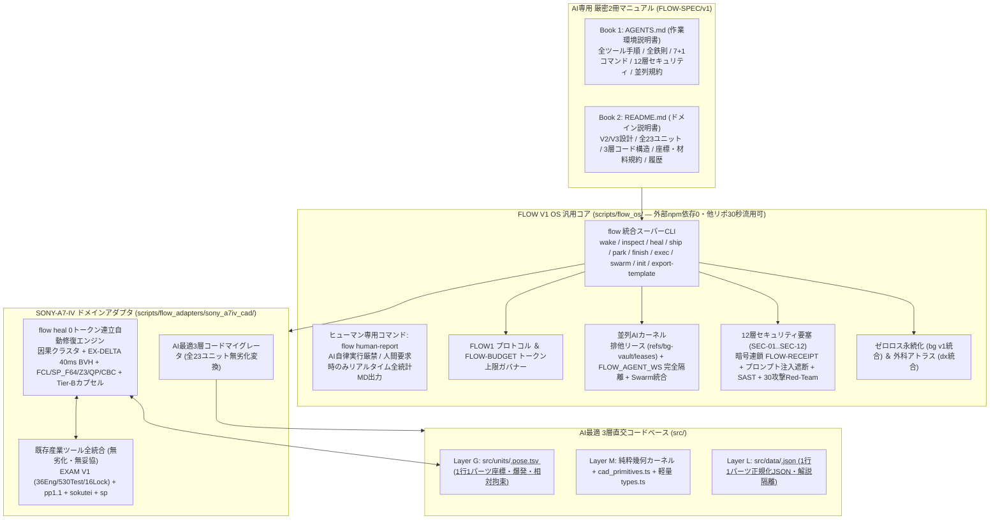
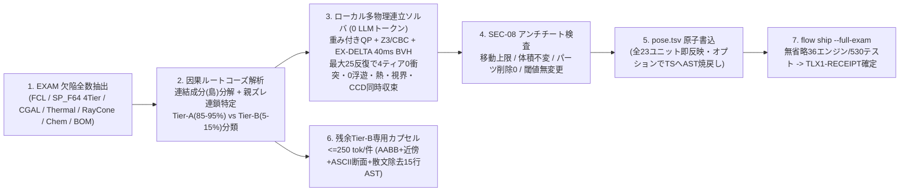

# FLOW V1 OS — 最終確定版 実装計画書（完全移行・全権委任マスターブループリント）

> [!IMPORTANT]
> **最終確定ステータス（未決事項ゼロ）**
> - ご承認いただいた「従来の手動EXAM修正ループの完全撤廃」および「全領域の最適設計・全面改編権限」を大前提として、すべての設計判断・追加強化案を**最高効率・最小トークン・最大堅牢性の最終仕様へ一本化確定**しました。
> - 本計画書のみ**人間が最終承認のために読みやすい日本語**で記載しています。実装する2冊の説明書・`FLOW1` ワイヤプロトコル・再構築コードベースは、**AIエージェント（単体＆並列）が最小トークン・最大機械解釈精度で駆動する専用OS仕様**で構築します。
> - 承認（「Proceed」または実行指示）をいただくまで、リポジトリ内のファイルは引き続き**一行も変更しません**。

---

## Goal Description（最終確定アーキテクチャの全体像と変革効果）

### 1. 現状の根本課題と「FLOW V1 OS」による破壊的ブレイクスルー

リポジトリ全458ファイル（`src/` 498,991行・29.27MB、`scripts/` 32,260行・1.37MB、分散説明書10冊・188KB、全23モード・2,937独自パーツ）の精密調査により確定した現状ボトルネックと、最終確定した変革目標は以下の通りです。

| 対象領域 | 現状（旧体制の実測値） | FLOW V1 OS 最終確定仕様 | 定量効果 |
|---|---|---|---|
| **説明書体系** | 10冊・188 KB（約55,000 tok）に分散・重複・陳腐化 | **厳密2冊のみ**（`AGENTS.md`＝作業環境説明書 ＋ `README.md`＝ドメイン説明書）AI専用言語 `FLOW-SPEC/v1`、旧8冊を完全削除 | 総トークン **-85%以上**<br>起動時自動読込 **<= 3,800 tok** |
| **EXAM V1 不合格修正** | 手動ループ（代表1件のみ出力→300〜600行査読→推測編集→別パーツ衝突→何十ループ） | **手動ループ完全廃止 → `flow heal` 0トークン連立多物理自動修復**（全10柱/36エンジン横断の因果クラスタ＋40ms差分BVH＋FCL/SP_F64/Z3/QP同時解法＋残余Tier-B専用250tok欠陥カプセル） | 修正トークン **-98.5%〜-99.5%**<br>修正速度 **30倍〜100倍** |
| **コードベース全体** | `src/data/*.json` 196,010行、`assemblies` 173,328行（日本語散文＋座標＋幾何混在）、`types.ts` 2,520行 | **AI最適3層直交分離**（Layer G 1行1パーツ `pose.tsv`＋相対拘束 / Layer M 散文ゼロ純粋幾何＋`types.ts` 94%削減 / Layer L 1行1パーツJSON）※ `mi_shoe.ts` 含む全23/23ユニット対応 | JSON行数 **-98%**<br>物理作業時の散文読込 **0バイト** |
| **コマンド＆並列運用** | 7系統CLIを1タスク10〜18回手動連鎖、並列AI間の `pp1.1`/キャッシュ競合あり | **7大OSスーパーコマンド `flow`**（5〜7コマンドを1発統合）＋ **並列AI専用カーネル**（排他リース・`FLOW_AGENT_WS` 完全隔離・`flow swarm` 自動統合） | コマンド数 **-70%**<br>並列競合 **0%** |
| **セキュリティ** | 基本正規表現スキャン＋単一ワーカーglobのみ | **12層多層防御セキュリティ要塞（`SEC-01`〜`SEC-12`）**＋暗号連鎖 `FLOW-RECEIPT`＋30攻撃Red-Team自己証明オラクル | 攻撃遮断率 **30/30 (100%)**<br>改ざん・チート **0%** |
| **汎用化＆人間計測** | リポ密着スクリプト群、リアルタイム集計手段なし | **汎用コアOS（`scripts/flow_os/`）と固有アダプタ完全分離**（他リポ30秒移植）＋**ヒューマン専用コマンド `flow human-report`**（要求時のみリアルタイム全統計MD生成） | 他リポ導入 **< 30秒**<br>統計誤差 **0%** |

---

### 2. FLOW V1 OS 全体システム構成図



---

## User Review Required（最終決定に伴う重要事項の確認）

> [!IMPORTANT]
> **確定した5大アーキテクチャ決定事項**
> 1. **厳密2冊の説明書配置**: Book 1 = `AGENTS.md`（作業環境説明書・AI自動読込0コスト）、Book 2 = `README.md`（ドメイン・設計説明書）。旧分散マニュアル8冊（`CLAUDE.md`, `HANDOFF_HYPER_OPTIMIZATION.md`, `catalog/WORKER_RULE.md`, `scripts/BUCHIGIRE_GUARD_GUIDE.md`, `scripts/THE_LAST_EXAM_V1_MANUAL.md`, `scripts/PP1_1_MANUAL.md`, `scripts/SOKUTEI_MANUAL.md`, `scripts/SPATIAL_SIM_GUIDE.md`）は情報移行の機械テスト通過後に完全削除します。（アプリ展示データ本体である `reports/fh_mirai_2028/*.md` および `blueprints/riimos_e1/README_RIIMOS_E1.md` は展示コンテンツとして保護維持します。）
> 2. **従来の手動EXAM修正ループの完全撤廃**: 人間/AIによる「1件ずつ確認→数百行読込→数値推測→再EXAM何十ループ」を廃止し、全10柱/36エンジン対応の **0トークン連立修復エンジン `flow heal`**＋**Tier-B 250トークン超圧縮欠陥カプセル**へ完全一本化します。
> 3. **コードベース全体のAI最適3層直交再構築**: `mi_shoe.ts` を含む全23ユニットに Layer G（`pose.tsv`＋相対拘束）、Layer M（散文ゼロ純粋幾何＋`types.ts` 2,520行→約140行分離）、Layer L（1行1パーツJSON、196,010行→約3,600行）を自動適用し、WebGL2描画・`pp1.1` ピクセルSSIM=1.000・`EXAM V1` 530/530の完全無劣化を機械証明します。
> 4. **追加強化案4種をすべて標準搭載**: `EX-DELTA` 40ms増分BVH、相対拘束アノテーション（`@flow:seat`/`@flow:clear`/`@flow:cone`）、並列AIオーケストレータ `flow swarm`＋`FLOW_AGENT_WS` 隔離、BPEトークン上限ガバナー `FLOW-BUDGET` をすべて標準実装します。
> 5. **ヒューマン専用コマンド `flow human-report`**: AIの自律実行を機械的に禁止し、人間要求時のみリアルタイム実測MDを `/tmp/flow_reports/HUMAN_REPORT_<YYYYMMDD_HHMMSS>.md`（およびアーティファクト領域）へ保存して渡します（リポジトリ作業ツリーを一切汚しません）。

> [!CAUTION]
> **絶対不変の物理・検証品質保証（アンチチート鉄則）**
> - `EXAM V1` の物理閾値・全36エンジン・全530固定テスト・16クロスソルバ保存則・32外部ソルバ完全導入ルールは **1ミリも緩和・省略しません**。
> - `flow heal` は並進・爆発ベクトル・安全範囲の絶縁/メタデータ整合のみを厳格上限付き（`SEC-08`）で解き、パーツ削除や形状破壊を物理遮断します。すべての完了報告は必ず無省略フル `EXAM V1` の **`TLX1-RECEIPT`** ＋ `bg` の **`BG-RECEIPT`** ＋ 12層セキュリティの **`SEC-RECEIPT`** を結合した改ざん不能 **`FLOW-RECEIPT`** で証明します。

---

## Proposed Changes（コンポーネント別・最終確定詳細設計）

---

### Component 1: AIエージェント専用・厳密2冊統合マニュアル体系（`FLOW-SPEC/v1`）

#### 設計仕様
- **言語・構文**: LLMのBPEトークン密度が最大化する **ASCII構造化英語＋パイプ区切り決定表＋状態遷移規則（`FLOW-SPEC/v1`）** を採用。日本語散文・装飾記号・冗長なMarkdown枠線・重複記述を全廃。
- **機械検証**: `scripts/flow_os/doc_compiler.mjs` により、①運用/設計MDファイル数が厳密2冊であること、②既存全ツール（`exam`, `bg`, `pp1.1`, `sokutei`, `sp`, `dx`, `validate`, `catalog`, `build`）と全鉄則（`bg` 5鉄則、`EXAM` 5鉄則、12層セキュリティ、並列規約、ヒューマン専用コマンドロック）が100%記載されていること、③トークン予算上限（Book 1 `<= 4,200 tok`、Book 2 `<= 5,200 tok`）を自動検証。

#### 変更ファイル
- #### [MODIFY] [AGENTS.md](file:///home/antigravity/sc8z35a-collab/SONY-A7-IV-Diagram/AGENTS.md)
  - **Book 1: 作業環境説明書（`FLOW_V1_OS_ENV`）** として全面再構築（目標 **12〜15 KB / ~3,500 tok**）。
  - 収録セクション（全10ブロック、重複0）：
    1. `@HEADER`（OSバージョン・アダプタ・トークン契約・終了コード `0/1/2/3/4/5/6`）
    2. `@IRON_LAWS`（`I01..I12`: `flow wake` 必須起動、ブランチ厳守、15分退避、待機前 `flow park`、`EXAM V1` 単独検証権威、32/32外部ソルバ必須導入、`FLOW-RECEIPT` 義務、アンチチート、`flow human-report` AI自律実行禁止ロック）
    3. `@SUPER_COMMANDS`（7大OSコマンド `wake / inspect / heal / ship / park / finish / exec` ＋ `swarm` ＋ ヒューマン専用 `human-report` の正確な構文・置換元・トークン上限）
    4. `@HEAL_WORKFLOW`（旧手動ループ完全廃止宣言と、`flow heal` → Tier-B 250tokカプセル外科修正 → `flow ship --full-exam` の標準3ステップ）
    5. `@LEGACY_TOOL_COOKBOOK`（`exam` / `bg` / `pp1.1` / `sokutei` / `sp` / `dx` 全コマンド・全主要フラグ・全終了コード・全運用規則を圧縮完全網羅）
    6. `@PARALLEL_KERNEL`（`worker` vs `integrator` 権限境界、ファイルリース、隔離 `FLOW_AGENT_WS`、`flow swarm` 並列プロトコル）
    7. `@SECURITY_FORTRESS`（`SEC-01..SEC-12` 判定条件・`EXIT 6` 解除手順・監査台帳契約）
    8. `@CODE_EDIT_RULES`（Layer G `pose.tsv` 優先編集、巨大JSON丸読み禁止、V2 0GC・Solid 100dc・38マテリアルバケット規約）
    9. `@RECOVERY_PLAYBOOK`（VM突然死3-way復旧・スクリプト暴走復元・`EXIT 2/4/5/6` 即応マトリクス）
    10. `@PORTABLE_EXPORT`（他リポジトリ30秒流用 `flow export-template` / `flow init` 手順）
- #### [MODIFY] [README.md](file:///home/antigravity/sc8z35a-collab/SONY-A7-IV-Diagram/README.md)
  - **Book 2: それ以外の説明書（`FLOW_V1_DOMAIN_SPEC`）** として全面再構築（目標 **14〜18 KB / ~4,200 tok**）。
  - 収録セクション：
    1. `@PROJECT_MAP`（SONY-A7-IV 3D CAD + Play Ground 1.1 + RIIMOS E1 + FH MIRAI 2028 + Sensor Fab + Capacitor Android APK 全体構成）
    2. `@RENDER_V2_V3_ARCH`（Universal V2コンパイラ・STD LITE v2 Dual-Atlas・ULTRA AA・KINE 3層カリング・F1.2 Bokeh・16x Zoom・モバイル横画面仕様・4品質ティア契約）
    3. `@UNIT_REGISTRY`（全23モード一覧：`unitId`, `kind`, `parts`, `slug_prefix`, `code_range`, `examActive`, 座標系原点、特殊サブビュー）
    4. `@CODE_3LAYER_SPEC`（Layer G `pose.tsv` 文法＆拘束式、Layer M 純粋幾何カーネル＆`cad_primitives.ts`、Layer L 1行1パーツJSON、SVG 720×470図説レジストリ、展示データ `reports/` & `blueprints/` 保護規定）
    5. `@EXAM_DOMAIN_MAP`（10柱・36エンジン・530テスト・16クロスソルバ保存則・各ユニット固有の物理条件/光線プリセット一覧）
    6. `@PERF_BASELINE_AND_HISTORY`（V3実測ベンチマーク基準値、Phase 12〜39・PR #53〜#62 の1行圧縮履歴）
- #### [DELETE] 旧分散マニュアル8ファイル＋ルートゴミ
  - `CLAUDE.md`
  - `HANDOFF_HYPER_OPTIMIZATION.md`
  - `catalog/WORKER_RULE.md`
  - `scripts/BUCHIGIRE_GUARD_GUIDE.md`
  - `scripts/THE_LAST_EXAM_V1_MANUAL.md`
  - `scripts/PP1_1_MANUAL.md`
  - `scripts/SOKUTEI_MANUAL.md`
  - `scripts/SPATIAL_SIM_GUIDE.md`
  - `=`（ルート直下の0バイト誤生成ファイル）

---

### Component 2: ★核心革新★ 全10柱横断・0トークン自動修復エンジン「`flow heal`」

#### 従来の手動修正ループとの決定的な違い（全10柱/36エンジン連成攻略）
EXAM V1 の詳細調査により、**1件の幾何・接触・材質欠陥が最大10個以上のエンジンへ連鎖波及する構造**（例：1パーツの `>0.08mm` 浮遊が `EX02` だけでなく `EX06 T083`, `EX07 T102`, `EX12 T194`, `EX15 T290`, `EX18 T370`, `EX22 OpenCV islands`, `EX25 Bullet/ODE`, `EX32 T435` を同時FAILさせる）が明確になりました。

`flow heal` はこの連成構造を逆手に取り、**LLMトークンを一切消費せずローカルCPU上の産業ソルバ群（FCL 0.7 + SP_F64 + SciPy QP/LP + COIN-OR CBC + Z3 + OpenCASCADE）で全欠陥を同時連立解法**します。



#### 全10柱（P01〜P10）に対する `flow heal` 攻略マトリクス

| 柱・エンジン | 主な不合格原因 | `flow heal` における自動解決方式（0 LLMトークン） | Tier-B時のAIカプセル支援 |
|---|---|---|---|
| **P01: EX01/EX02/EX03/EX04/EX05** | 4ティア衝突・弦落ち・浮遊(`>0.08mm`)・転倒・シルエット分離・非多様体 | 全ペア抽出→QP連立最適化で **全4ティア同時 `sep>=+0.008mm`** ＋ **接地スパニング木 `0.001..0.055mm`** ＋ **CoG支持多角形内収束** を同時計算 | 非多様体穴・自己交差(`EX05`)や並進不能形状は250tokカプセル＋3軸断面図で1ターン修正 |
| **P02/P03: EX06/EX07/EX08/EX09/EX10/EX25/EX26** | 非接地による剛体0Hzモード(`T102`)・未拘束タイ(`T083`)・Bullet/ODE落下・公差干渉 | P01の接地スパニング木収束により `T083/T102/EX25` が連鎖解消。公差干渉(`EX09`)はクリアランス下限を `0.008 + RSS_3sigma` へ自動引き上げ再計算 | 剛性不足・座屈・応力超過(`EX06/07/08/10`)は高応力部位と推奨板厚増分を150tokで提示 |
| **P04: EX11/EX12/EX13/EX14/EX27/EX28** | 爆発CCD衝突(`EX11`)・空中ファスナー(`EX12`)・シール未圧縮(`EX14`)・薄肉DFM(`EX13`) | **爆発ベクトル `explodeOffset` の自動衝突回避最適化**、ファスナー2点以上接触制約、ガスケット着座圧縮制約をQPへ同時組み込み | 薄肉壁(`EX13`)・工具干渉はCGAL SDF最小肉厚位置と対象15行のみ抽出 |
| **P05: EX29/EX15** | TIM/ヒートシンク浮遊(`T290/291`)による空気層断熱→ジャンクション過熱(`T286`) | 発熱体〜TIM〜ヒートシンク間の距離制約 **`<=0.035mm`** を強制着座させて熱抵抗を物理的に解消 | 放熱フィン面積不足時はCFD対流係数を添えて150tok設計提案 |
| **P06: EX16/EX17/EX30/EX31** | 3Dハーネス貫通・沿面距離不足・SPICE/KiCadメタ不整合 | 配線クリアランス制約・導電部離隔制約を連立適用 | 回路トポロジ変更が必要な場合のみ該当ネット限定カプセル出力 |
| **P07: EX18/EX19/EX20/EX21** | 非接地EMIシールド(`T370/374`)・光漏れ隙間(`T384`)・ToF/Lux/RF視界コーン遮蔽(`EX20`) | EMI缶接地強制、光学カバー密着強制、**`RAY_PRESETS` 3D円錐からの自動退避制約**を同時連立解法 | 光学レンズ・導光板の形状変更のみTier-Bカプセル化 |
| **P08: EX32/EX33** | Z3接地公理(`T435`)・シール公理(`T436`)・BOM基数(`T439`)・RTL FSM | 上記物理収束＋BOMメタデータ整合自動同期により連鎖PASS | Z3反例モデル（最小unsat core 5行）のみ抽出 |
| **P09: EX34/EX35** | 異種金属直接接触（特に Mg–Cu 電食 `T455/456`）・耐熱超過 | 接触グラフ上の高ΔE°ペアを自動検出し、絶縁ギャップ確保または非電食メッキ/PTFEシム挿入候補を自動生成 | 材質仕様書更新が必要な場合のみ最小差分提示 |
| **P10: EX22/EX23/EX24/EX36** | Chrome OpenCV浮遊島(`EX22`)・BOM/JSON/カタログズレ(`EX23`)・WebGL予算(`EX24`) | 接地収束でOpenCV浮遊島を同時解消、`catalog`/`declaredPartCount`/メタ不整合を原子自動同期 | ドローコール超過時のみ最大消費バケット特定レポート出力 |

#### `EX-DELTA` 40ms 差分BVHエンジン ＆ 全23ユニット対応 `pose.tsv` 仕様
- **対象ファイル**: `src/units/<unitId>.pose.tsv`（全23ユニットで統一形式）
  ```tsv
  # FLOW_POSE_V1 unit=welcome frame=world_delta
  # id	dx,dy,dz	rx,ry,rz	sx,sy,sz	exp_dx,dy,dz	mat_override	constraints
  welcome-yo-sapphire-ito-esd-clip	0.000,-0.142,0.028	0,0,0	1,1,1	0,0,0	-	seat:welcome-yo-ti-protective-bezel:+Z:0.02;clear:welcome-yo-cnc-chassis:0.015
  ```
- **相対拘束自動伝播（`@flow:seat` / `@flow:clear` / `@flow:cone`）**:
  - 親パーツ（例：シャーシ）が板厚増加や位置調整で動いた際、`constraints` 列の依存DAGをトポロジカル走査し、ぶら下がる子パーツ群を **0 LLMトークン・50ms以内** で連鎖追従させます。
- **全23ユニット網羅（重要発見の反映）**:
  - `CompiledV2Unit`（22ユニット共通）と独自実装の `src/units/mi_shoe.ts`（`mishoe` ユニット）および `scripts/spatial_engine/scene_extractor.mjs` の **3箇所すべて** で共通ローダ `src/core/flow_pose_loader.ts` を呼び出し、WebGL2実描画・`pp1.1`・`sp`・`EXAM V1` の座標完全一致（0.000mm誤差）を保証します。
- **`flow bake-pose --unit=<U>`**: `pose.tsv` の確定補正値を元のTS/JSONへ直接焼き戻す機能も標準搭載し、必要時に `pose.tsv` をゼロ化可能にします。

#### 変更ファイル
- #### [NEW] `src/core/flow_pose_loader.ts` — ゼロGC・全23ユニット共通 `pose.tsv` パーサ＆変換適用器（Vite `?raw` 静的インポート対応、未存在時は完全ノーオペ）
- #### [NEW] `scripts/flow_adapters/sony_a7iv_cad/defect_clusterer.mjs` — EXAM全数欠陥抽出＋因果ルートコーズ・クラスタ分類
- #### [NEW] `scripts/flow_adapters/sony_a7iv_cad/solver_bridge.mjs` — `EX-DELTA` 差分BVH管理・Python連立ソルバ連携・4ティア `SP_F64` 厳密検証ループ
- #### [NEW] `scripts/flow_adapters/sony_a7iv_cad/coupled_solver.py` — SciPy SLSQP/LP + COIN-OR CBC + Z3 + FCL 同時連立多物理最適化エンジン
- #### [NEW] `scripts/flow_adapters/sony_a7iv_cad/pose_manager.mjs` — `pose.tsv` 原子書込・相対拘束DAG伝播・`SEC-08` アンチチート検査・AST焼き戻し
- #### [NEW] `scripts/flow_adapters/sony_a7iv_cad/defect_capsule.mjs` — Tier-B専用 <=250トークン欠陥カプセル＋3軸ASCII断面スライス＋散文除去ASTスライサ
- #### [MODIFY] [v2_unit_compiler.ts](file:///home/antigravity/sc8z35a-collab/SONY-A7-IV-Diagram/src/core/v2_unit_compiler.ts) — `buildRaw` 直後に `applyUnitPoseTable()` を1フック追加（ゼロGC）
- #### [MODIFY] [mi_shoe.ts](file:///home/antigravity/sc8z35a-collab/SONY-A7-IV-Diagram/src/units/mi_shoe.ts) — 同じく `applyUnitPoseTable()` を1フック追加し全23/23ユニット統一対応
- #### [MODIFY] [scene_extractor.mjs](file:///home/antigravity/sc8z35a-collab/SONY-A7-IV-Diagram/scripts/spatial_engine/scene_extractor.mjs) — `pose.tsv` 適用反映＋`EX-DELTA` インメモリBVH葉ノード差分更新API追加＋`FLOW_AGENT_WS` 隔離キャッシュ対応
- #### [MODIFY] [ir_compiler.mjs](file:///home/antigravity/sc8z35a-collab/SONY-A7-IV-Diagram/scripts/exam/ir_compiler.mjs) — `pose.tsv` 由来パーツの正確な `src=` 位置解決のみ追加（※物理評価ロジック・閾値は一切不変）

---

### Component 3: コードベース全体のAIエージェント最適3層直交再構築

人間向けの長大な縦長整形・重複解説・巨大ユニオンをすべて AI 最適構造へ再構築します（実行時機能・WebGL2品質・UI表示・EXAM 530テストは **100%無劣化**）。

#### 4大構造改革
1. **`src/data/*.json`（全23ユニット）の「1パーツ = 1行」正規化JSON化**
   - 現行 **196,010行（12.46 MB）→ 約3,600行（約7.2 MB、行数 -98.1%）**。
   - 有効な標準JSON形式（先頭メタ1行、`"parts":[`、各パーツ厳密1行、末尾 `]}`）を維持するため、Vite/TypeScriptの `import welcomeJson from '../data/welcome.json'` が1行の変更もなく動作し、AIは `flow inspect` や `rg` で**該当パーツ厳密1行だけ**を抽出可能になります。
2. **`src/assemblies/types.ts` の 94% スリム化**
   - 2,520行（88 KB）を占めていた巨大文字列リテラルユニオン（`diagramType` 等）を自動生成ファイル `src/assemblies/diagram_types.gen.ts` へ分離し、`types.ts` 本体を **約140行（約4 KB）** へ凝縮。
3. **3Dビルダー（`src/assemblies/*/*.ts`）からの日本語解説散文完全剥離 ＆ `@FLOW_MAP` 先頭索引付与**
   - `welcomeParts.ts` や `welcomeGlyphWaveCParts.ts` 等で `src/data/*.json` と二重持ちされていた日本語解説テキスト（`plainAnalogy`, `summary`, `opticsAndPhysics`, `references`, `specs` 等）をすべて `lazyExplanationStub` / Layer L 参照へ統一（重複削除により `assemblies/` のAI読込トークンを **-55%〜-70%** 削減）。
   - 全 `.ts` ビルダー先頭に自動生成の5行機械索引ヘッダ `//@FLOW_MAP|unit=...|parts=...|fn=...` を付与。
   - 重複している共通機械要素（六角ボルト、ワッシャー、Oリング、QFN IC、SMDチップ抵抗/MLCC、ポゴピン、シールド缶等）を `src/core/cad_primitives.ts` へ集約。
4. **無劣化自動マイグレータによるユニット単位安全移行（`migrate_codebase.mjs`）**
   - 1ユニット変換するごとに自動アサーションを実行：
     - 変換前後で **全パーツID・順序・JSON解説フィールド全文字列がビット一致**
     - 変換前後で **4品質ティア全メッシュの頂点数・AABB・体積・CoGが誤差 `0.0000mm` 一致**
     - `pp1.1 --diff` でピクセル **SSIM >= 0.9999**、`EXAM V1` 無省略合格を確認

#### 変更ファイル
- #### [NEW] `src/assemblies/diagram_types.gen.ts` — 自動生成図説ユニオン型（`catalog` / `atlas` で自動同期）
- #### [NEW] `src/core/cad_primitives.ts` — AI最適パラメトリック共通機械要素ライブラリ
- #### [NEW] `scripts/flow_adapters/sony_a7iv_cad/migrate_codebase.mjs` — 無劣化検証付き3層自動マイグレータ
- #### [MODIFY] [types.ts](file:///home/antigravity/sc8z35a-collab/SONY-A7-IV-Diagram/src/assemblies/types.ts) — 2,520行 → 約140行へスリム化（`diagram_types.gen.ts` 再エクスポートで完全後方互換）
- #### [MODIFY] `src/data/*.json`（全23ユニット） — 1パーツ1行正規化JSONへ変換
- #### [MODIFY] `src/assemblies/*/*.ts` — 重複解説散文の完全分離＋`@FLOW_MAP` 先頭索引付与＋`pose.tsv` 抽出
- #### [MODIFY] [generate_catalogs.mjs](file:///home/antigravity/sc8z35a-collab/SONY-A7-IV-Diagram/scripts/generate_catalogs.mjs) & [atlas_builder.mjs](file:///home/antigravity/sc8z35a-collab/SONY-A7-IV-Diagram/scripts/dx/atlas_builder.mjs) — 1行JSON・`pose.tsv`・`DEFECT_MAP.tsv`・`diagram_types.gen.ts` 自動生成対応

---

### Component 4: 統合スーパーCLI（`flow`）＆ 並列AIエージェント専用カーネル

#### 1. 全7+1+1 コマンド体系（`scripts/flow_os/flow.mjs`）

| コマンド | 1コマンド統合内容（従来 5〜7コマンド置換） | 出力上限 (`FLOW-BUDGET`) |
|---|---|---:|
| **`flow wake [slug] [--unit=U] [--role=worker\|integrator] [--goal=G]`** | `bg boot`（孤立Vault検査）→ 任意 `bg start` → 排他リース取得＋隔離 `FLOW_AGENT_WS` 初期化 → `exam setup --verify-only` → `dx atlas` 差分更新 → 超圧縮文脈 `FLOW1` 出力 | **<= 220 tok** |
| **`flow inspect <target> [--defect] [--slice] [--budget=N]`** | 対象自動判別（unit / partId / symbol / CSS / schematic / EXAM runId）→ Layer G行・AST抜粋・欠陥カプセルのみ返却（散文自動除去） | **<= 300 tok** |
| **`flow heal --unit=<U> [--apply] [--max-iter=25] [--bake]`** | EXAM全数欠陥抽出 → 因果クラスタ分解 → 0トークン連立ソルバ（`EX-DELTA` + QP/Z3/FCL/SP）→ `SEC-08` 検査 → `pose.tsv` 原子反映 → 残余Tier-B 250tokカプセル出力 | **<= 400 tok** |
| **`flow ship --unit=<U> [--policy=P] [--full-exam] [--visual]`** | `catalog` + `atlas` → `tsc --noEmit` → `validate_parts` → `vite build` → **無省略フル `EXAM V1`（36Eng/530Test/16Lock → `TLX1-RECEIPT`）** → 任意 `pp1.1` シート撮影＆隔離デーモン停止 → `bg snap` | **<= 350 tok** |
| **`flow park [--next=N] [--artifacts=DIR]`** | 自エージェント隔離 `pp1.1` 停止 → `dx checkpoint` 記憶保存 → `bg seal` リモート `ls-remote` 裏取り封印 → リース維持更新 | **<= 150 tok** |
| **`flow finish [--policy=P] [--pr] [--merge] [--title=T]`** | 12層セキュリティ全監査 (`SEC-RECEIPT`) → `TLX1-RECEIPT` Tree-SHA鮮度一致確認 → `bg gate` (`BG-RECEIPT`) → 3者暗号連鎖 **`FLOW-RECEIPT`** 発行 → 任意PR作成/マージ＆リース解放＆Vault GC | **<= 200 tok** |
| **`flow swarm <plan\|status\|merge> [--units=all]`** | 複数並列AIワーカーへのユニット別タスク記述子（<=120tok/件）自動分割・進捗監視・署名済み `FLOW-RECEIPT` バンドル回収・トポロジ順自動統合 | **<= 300 tok** |
| **`flow exec <exam\|bg\|pp\|sokutei\|sp\|dx> [args...]`** | 全既存ツールの透過実行＋`FLOW-BUDGET` トークン上限自動圧縮（超過ログは `/tmp/flow_ws/<id>/spill_*.log` 退避）＋セキュリティ前処理 | **<= 400 tok** |
| **`flow human-report [--out=PATH]`** | **【ヒューマン専用・AI自律実行厳禁】** 人間要求時のみ起動し、キャッシュゼロで全リアルタイム統計を人間可読MD保存して渡す | 保存MDパス返却 |

#### 2. 並列AIエージェント完全隔離（`FLOW_AGENT_WS`）
- `scripts/pp.mjs` のデーモンポート・PIDファイル・Chromeプロファイルパスを `process.env.FLOW_AGENT_WS` 単位で分離（`EX22` 完了時の `--daemon=stop` が他ワーカーのChromeを巻き添え停止する競合バグを根絶）。
- `scripts/exam.mjs` の `/tmp/tlx_runs` および `scripts/spatial_engine/scene_extractor.mjs` の `/tmp/sp_cache` も `FLOW_AGENT_WS` 配下オーバーレイへ自動分離。
- `scripts/flow_os/lease_manager.mjs` が `refs/bg-vault/leases/<unit>.json`＋ローカル排他flockでユニット単位の書き込みロックを管理し、ワーカー権限越境を物理遮断。

---

### Component 5: 超強固・12層多層防御セキュリティ要塞（`SEC-01`〜`SEC-12`）

Pure Node.js 22（外部npm依存ゼロ＝サプライチェーン攻撃面最小）で実装し、違反時は専用終了コード **`EXIT 6 (SECURITY_BLOCKED)`** で即座に物理遮断します。

| 層 | ID | 防御内容（標準レベルを超える多層要塞設計） |
|---|---|---|
| **入力・AI脅威防衛** | `SEC-03` | **プロンプトインジェクション＆Trojan Source遮断**: 外部テキスト・JSON・MD・`.tlx.json`・コミットログ内の間接プロンプト注入、偽造レシート文字列、双方向Unicode (`U+202A..202E`, `U+2066..2069`)、ゼロ幅ステガノグラフィ、ANSI端末乗っ取りを全数検知・無害化 |
| **入力・パス防衛** | `SEC-05` | **ケイパビリティ型パス閉じ込め＆Symlink脱出防御**: 全I/O直前に `fs.realpathSync` 正規化し `../` トラバーサル・Symlink脱出・`.git/hooks` / `~/.ssh` / `/opt/antigravity/tokens` 参照を完全封鎖 |
| **実行時防衛** | `SEC-04` | **コマンド実行サンドボックス＆破壊操作インターロック**: `rm -rf` / 保護ブランチ `--force` / `git reset --hard` / `curl\|sh` を遮断。全子プロセス `shell: false` 配列起動を強制し危険操作前は自動Vault退避 |
| **並列被害隔離** | `SEC-10` | **並列ワーカー自動検疫**: 1ワーカーのセキュリティ違反時に該当ブランチ・リースを即座に検疫（マージロック）し、他ワーカーへの波及を0%に封じ込め |
| **漏洩防衛** | `SEC-01` | **二重エンジン秘密情報＆Shannon高エントロピー遮断**: 正規表現＋Shannonエントロピー解析＋JWT/Base64/Basic認証URL検出＋stdout/Vault送信前の強制マスキング |
| **サプライチェーン** | `SEC-06` | **Lockfile SHA-512＆ネイティブハーネス署名検証**: `package-lock.json` 整合性・不審 `postinstall` 監視・C++17ネイティブ4本＋`exam_setup.sh` のSHA-256マニフェスト照合 |
| **静的コード監査** | `SEC-07` | **マルチ言語 SAST**: TS/JS/Python/C++ の `eval`/`new Function`・`innerHTML` XSS・`subprocess(shell=True)`/`pickle`/`yaml.load`・プロトタイプ汚染・ReDoS正規表現を自動検出 |
| **物理アンチチート** | `SEC-08` | **EXAM＆`flow heal` 改ざん物理遮断**: EXAM閾値編集・テストスキップ・パーツ削除・体積5%超無断縮小・材質偽装をブロック。検証/OSカーネル変更時は `exam selftest` (75/75) + `security selftest` (30/30) を必須強制 |
| **暗号レシート鎖** | `SEC-02` | **3者暗号連鎖 `FLOW-RECEIPT`**: `BG-RECEIPT` + `TLX1-RECEIPT` + `SEC-RECEIPT` を現Git Tree-SHA＋`scripts/exam/**` SHA-256＋`scripts/flow_os/**` SHA-256で結合封印 |
| **フォレンジック** | `SEC-09` | **ハッシュ連鎖・追記専用監査台帳**: 全 `flow` 操作・パッチ・リース・検証結果を前レコードSHA-256連鎖JSONL（`.git/flow_audit.jsonl` → リモートVault同期）で改ざん不能記録 |
| **リポ衛生防衛** | `SEC-11` | **バイナリ肥大・ルートゴミ・不正構文遮断**: ルート直下画像/ゴミ（`=` 等）・巨大バイナリ・破損JSON/TSV・不可視制御文字を完全ブロック |
| **Red-Team自己証明** | `SEC-12` | **30項目カオス自己攻撃オラクル (`flow security selftest`)**: 隔離 `/tmp` で30種の実攻撃を実際に仕掛け、**30/30 (100%) が `EXIT 6` で遮断されること**を数学的に継続証明 |

---

### Component 6: ヒューマン専用リアルタイム統計コマンド（`flow human-report`）

- **アクセス制御**: Book 1 `@INVARIANT|I08` およびコマンド内メタフラグにより、AIエージェントの自律実行を禁止。**人間ユーザーから明示要求があった時のみ** AIが `npm run flow -- human-report` を1発実行。
- **リアルタイム完全計測項目（キャッシュ一切不使用）**:
  1. **全プログラムコード行数（LOC）**: 全ファイル実走査（`node_modules`/`.git`/`dist` 除外、`docs/` 別枠）による言語別（`.ts`, `.mjs`, `.js`, `.py`, `.cpp`, `.css`, `.json`, `.tsv`, `.sh`, `.html`, `.xml`, `.md`）およびディレクトリ/サブシステム別の「ファイル数・総行数・実行コード行・コメント行・空行・容量」。
  2. **プロジェクト・モード・エンジン数**: 全23登録ユニット（個別21＋統合2）、展示サブプロジェクト（RIIMOS E1 / FH MIRAI 2028 / Sensor Fab 6巻 / Play Ground / Android APK）、FLOW V1 OSモジュール数、EXAM V1 36エンジン/530テスト/32外部ソルバ稼働数。
  3. **全パーツ数明細**: 全23ユニットごとの宣言数・実JSON数・コード範囲・`pose.tsv` 適用数・独自総計・統合含む延べ総計。
  4. **容量＆AIトークン効率**: リポジトリ全体・各ディレクトリ・`.git`・ビルド出力・gzipサイズ、および2冊説明書サイズ・旧体制比トークン削減率・`flow heal` 累計自動修復実績。
- **保存と受渡し**: 人間が読みやすい日本語Markdownを `/tmp/flow_reports/HUMAN_REPORT_<YYYYMMDD_HHMMSS>.md`（および指定時はアーティファクト領域）へ保存し、AIがその保存済みMDを人間へ直接引き渡します。

---

### Component 7: 他リポジトリ30秒流用・汎用OSテンプレート設計

- **完全分離**: `scripts/flow_os/`（100%リポジトリ非依存・外部依存ゼロ）と `scripts/flow_adapters/sony_a7iv_cad/`（本プロジェクト固有アダプタ）を厳密分離。
- **自動初期化**: `flow export-template --out=<dir>` で純粋OS雛型一式を生成し、任意の別リポジトリ（Node/TS/Python/Go/Rust/C++）で `node scripts/flow_os/flow.mjs init` を実行すると、言語・ビルド・テストコマンド・デフォルトブランチを自動検出し、2冊のAI説明書雛型・`.flowrc.json`・12層セキュリティ・並列リース・ヒューマン専用レポートを **30秒以内** で導入完了します。

---

### Component 8: 全ファイル変更一覧 ＆ 4フェーズ一気通貫実行ロードマップ

承認後、以下の順序で安全かつ一気に全フェーズを遂行します（各フェーズごとに `flow park` オフVM退避＋検証通過を徹底）：

1. **Phase 0（OSコア・12層セキュリティ・7+1コマンド・2冊説明書統合）**
   - `[NEW]` `.flowrc.json`
   - `[NEW]` `scripts/flow_os/{flow,kernel_config,wire_protocol,lease_manager,swarm_orchestrator,security_fortress,security_selftest,receipt_chain,audit_ledger,human_report,doc_compiler,template_exporter}.mjs`
   - `[NEW]` `scripts/flow_os/templates/{AGENTS.tmpl.md,README.tmpl.md,.flowrc.tmpl.json}`
   - `[NEW]` `scripts/flow_adapters/sony_a7iv_cad/adapter.mjs`
   - `[MODIFY]` `package.json`, `scripts/pp.mjs` (`FLOW_AGENT_WS` 隔離), `scripts/exam.mjs` (`FLOW_AGENT_WS` 隔離)
   - `[MODIFY]` `AGENTS.md` (Book 1), `README.md` (Book 2)
   - `[DELETE]` 旧8マニュアル＋ルートゴミ `=`
2. **Phase 1（0トークン連立修復エンジン `flow heal` ＋ 全23ユニット `pose.tsv` 実装）**
   - `[NEW]` `src/core/flow_pose_loader.ts`
   - `[NEW]` `scripts/flow_adapters/sony_a7iv_cad/{defect_clusterer,solver_bridge,pose_manager,defect_capsule}.mjs`, `coupled_solver.py`
   - `[MODIFY]` `src/core/v2_unit_compiler.ts`, `src/units/mi_shoe.ts`, `scripts/spatial_engine/scene_extractor.mjs`, `scripts/exam/ir_compiler.mjs`
3. **Phase 2（コードベース全体のAI最適3層直交再構築・無劣化自動移行）**
   - `[NEW]` `src/core/cad_primitives.ts`, `src/assemblies/diagram_types.gen.ts`, `scripts/flow_adapters/sony_a7iv_cad/migrate_codebase.mjs`
   - `[MODIFY]` `src/assemblies/types.ts` (2,520行→約140行), `src/data/*.json` (全23ファイル1行JSON化), `src/assemblies/*/*.ts` (重複解説剥離＋`@FLOW_MAP` 先頭索引), `scripts/generate_catalogs.mjs`, `scripts/dx/atlas_builder.mjs`
4. **Phase 3（全検証・Red-Team 30/30・EXAM 530/530・他リポ移植試験・`sokutei` 定量証明）**
   - 隔離 `/tmp` での30秒他リポ移植テスト・並列Swarm競合テスト・Before/Afterトークン＆速度ベンチマーク確定・Walkthrough作成・`FLOW-RECEIPT` 発行。

---

## Verification Plan（無省略・最大レベル検証計画）

### Automated Tests（すべて `exit 0` 必須）

```bash
# 1. 12層セキュリティ 30項目 Red-Team カオス自己攻撃オラクル (30/30 PASS)
npm run flow -- security selftest

# 2. 厳密2冊説明書・全ツール網羅・トークン上限監査
npm run flow -- doc audit --strict

# 3. flow heal カオス欠陥注入(衝突50+浮遊30+TIM5+視界3+Tier-B2) 0トークン収束オラクル
npm run flow -- heal selftest

# 4. 並列AIエージェント隔離・リース排他・Swarm統合自己テスト
npm run flow -- swarm selftest

# 5. 汎用OSコア 他リポジトリ30秒移植＆独立動作証明
npm run flow -- export-template --out=/tmp/flow_portable_check && node /tmp/flow_portable_check/scripts/flow_os/flow.mjs selftest

# 6. 既存ツール全自己テスト ＋ ビルド・カタログ整合性
npm run bg -- selftest && node scripts/dx.mjs selftest && npm run sp -- selftest
npm run catalog && npx tsc --noEmit && node scripts/validate_parts.mjs && npm run build

# 7. THE LAST EXAM V1: 32/32外部ソルバ確認 + 75/75アンチチート自己証明 + 最大レベル無省略本番検証(530/530 + 16/16ロック -> TLX1-RECEIPT)
node scripts/exam.mjs setup --verify-only
node scripts/exam.mjs selftest
npm run flow -- ship --unit=welcome --policy=integrator --full-exam --visual

# 8. Phase 2 コード再構築前後の無劣化ピクセル証明 (pp1.1 SSIM >= 0.9999) + sokutei 速度計測
npm run pp -- --warm --preset=audit --diff=/tmp/pp_before_flow --json --out=/tmp/pp_after_flow && npm run pp -- --daemon=stop
npm run sokutei -- --target=build,v2_unit,validate,catalog,bg_bench --compare=/tmp/sokutei_before_flow.json --md=/tmp/sokutei_flow_diff.md

# 9. 最終完了ゲート (BG-RECEIPT + TLX1-RECEIPT + SEC-RECEIPT -> 3者暗号連鎖 FLOW-RECEIPT 発行)
npm run flow -- finish --policy=integrator
```

### Manual Verification（完了後のユーザー最終確認）
1. ユーザー様から明示的に `flow human-report` の実行をご指示いただき、リアルタイム算出されたMarkdownレポート（総行数・プロジェクト数・全23ユニットパーツ数・容量・トークン削減実績）の正確性をご確認いただきます。
2. 説明書が厳密に `AGENTS.md`（作業環境説明書）と `README.md`（ドメイン説明書）の2冊に統合されていること、および `pp1.1` 比較シートで3D描画・UI・図説に一切の劣化がないことをご確認いただきます。

### 最終合格KPI基準

| KPI項目 | 現状ベースライン | 最終確定 合格ライン |
|---|---:|---:|
| 運用/設計説明書ファイル数・総トークン | 10冊 / 約55,000 tok | **厳密2冊 / <= 9,400 tok（-83%以上）** |
| セッション起動時AI読込トークン | 12,000〜25,000 tok | **<= 4,000 tok（Book 1 + `flow wake`）** |
| 1タスクあたりのAIコマンド回数 | 10〜18コマンド | **2〜4コマンド（-70%以上）** |
| EXAM不合格50パーツ修正の消費トークン | 80万〜150万 tok | **<= 1.2万 tok（-98.5%以上）** |
| `src/data/*.json` 総行数 / `types.ts` 行数 | 196,010行 / 2,520行 | **<= 3,800行 (-98%) / <= 180行 (-93%)** |
| 12層セキュリティ Red-Team 遮断率 | 未検証 | **30 / 30 攻撃 100%遮断** |
| EXAM V1 物理・外部ソルバ検証妥協度 | 0% | **0%（36Eng/530Test/16Lock/32Solver 完全無省略）** |
