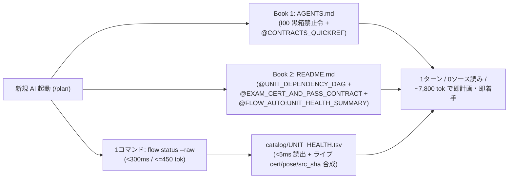

# AI 1発環境把握・0ソース読み・1秒コールドスタート改革 実装計画書

## Goal Description

新規 AI エージェントが `/plan` やユニット作業に着手する際、内部インフラ（`scripts/flow_os/*`, `scripts/exam/*`, `scripts/spatial_engine/*` 等）約 35 ファイルのソース読み込み・6 回の個別環境調査コマンド・21 ユニット生 `sp audit`（2〜3 分待ち）で 15 ターン以上・80,000〜120,000 tok を浪費している構造問題を根絶します。

本計画では以下 4 本柱を実装し、**Book 1（`AGENTS.md`）+ Book 2（`README.md`）+ 1 コマンド（`npm run flow -- status --raw`, `<300ms` / `<=450 tok`）のみ** で 1 ターン・0 ソース読み・`<0.5 秒` の完全環境把握を実現します。



### 事前調査で確認した現行ベースラインと整合事項
- **現行 2 冊の実トークン数**（[wire_protocol.mjs](file:///home/antigravity/sc8z35a-collab/SONY-A7-IV-Diagram/scripts/flow_os/wire_protocol.mjs) `estimateTokens` 実測）：
  - [AGENTS.md](file:///home/antigravity/sc8z35a-collab/SONY-A7-IV-Diagram/AGENTS.md): **1,864 tok**（現行上限 2,200 → 改定上限 **2,850**、実装見込 **~2,600 tok**）
  - [README.md](file:///home/antigravity/sc8z35a-collab/SONY-A7-IV-Diagram/README.md): **4,144 tok**（現行上限 5,500 → 改定上限 **5,800**、実装見込 **~4,900 tok**）
  - [AGENTS.tmpl.md](file:///home/antigravity/sc8z35a-collab/SONY-A7-IV-Diagram/scripts/flow_os/templates/AGENTS.tmpl.md): **1,431 tok**（ポータブル展開先でも新 `requiredEnvTokens` に完全適合させる）
- **依存 DAG の実コード裏付け**（[camera_macro_shared.ts](file:///home/antigravity/sc8z35a-collab/SONY-A7-IV-Diagram/src/units/camera_macro_shared.ts), [camera_body.ts](file:///home/antigravity/sc8z35a-collab/SONY-A7-IV-Diagram/src/units/camera_body.ts), [integrated.ts](file:///home/antigravity/sc8z35a-collab/SONY-A7-IV-Diagram/src/units/integrated.ts)）：
  - `camera_macro_shared.ts` は `lens, mount, body, evf, shutter, sensor(macroParts), mainboard, lcd` の 8 ビルダーを静的 import。
  - `camera_body`（`includeLens=false`, 231p）は上記のうち 7 ユニット、`integrated`（`includeLens=true`, 305p）は全 8 ユニットを使用。
- **EXAM V1.1 数値閾値のコード裏付け**：
  - `T055`: `foot_coplanar_mm <= 0.10` (FAIL)、`T127`: `datum_flat_mm <= 0.05` (**WARN → V1.1証明 発行拒否**)
  - `T042-045`: `tip >= 15°` (lat `>= 20°`) FAIL、`T139`: `tan(tipMin) >= 0.5` (`>= 26.6°`) **WARN**
  - `T145`: `cog_h_ratio <= 0.55` **WARN**、`EX02`: `SEAT_MAX_MM = 0.08mm`
  - `T457`: `dew_margin_c >= 5.0°C`、`T460`: `galv_mod_cnt <= 20` **WARN**、`T469`: `mtbf_hr >= 50,000h`、`T510`: `docs/index.html` **WARN**、`T514`: `gpu_mem_mb <= 64.0MB`、`EX43-48`: `Cp/Cpk >= 1.33`
- **`generate_catalogs.mjs` との共存**：`npm run catalog` は `catalog/INDEX.tsv` / `ALL_NAMES.txt` / `names/` / `spatial/` のみ書き出し、`catalog/UNIT_HEALTH.tsv` を削除・上書きしないことを確認済み。

---

## User Review Required

> [!IMPORTANT]
> **1. 2 冊のトークン上限引き上げ（`.flowrc.json` / `kernel_config.mjs`）**
> - `books.maxEnvTokens`: `2200 -> 2850`（`AGENTS.md` を ~2,550–2,700 tok に収め、`I00 NO_INFRA_DIVE` と契約クイックリファレンスを完全搭載）
> - `books.maxDomainTokens`: `5500 -> 5800`（`README.md` に依存 DAG・EXAM 閾値契約・`@FLOW_AUTO:UNIT_HEALTH_SUMMARY` を搭載）

> [!NOTE]
> **2. `catalog/UNIT_HEALTH.tsv` の初回ベースライン生成とコミット**
> 承認後の実装フェーズで、全 21 EXAM 対象ユニット（+ 除外 2 ユニットのメタ行）に対し `sp ultra` + `explodeSteps=8` + `checkFloating=true` の空間健康計測を 1 回実行し（約 1〜2 分）、結果を `catalog/UNIT_HEALTH.tsv` に保存・コミットします。以後の全セッションは **<5ms** で読み出します。

> [!WARNING]
> **3. `worker` ロール時の `catalog/UNIT_HEALTH.tsv` 自動更新境界（SEC-10 保護との両立）**
> `.flowrc.json` の `policies.worker.protectedPaths` に `catalog/**` が含まれているため、**`worker` が `flow heal --apply` / `flow ship` を実行した際に `catalog/UNIT_HEALTH.tsv` や `README.md` を自動書換すると `SEC-10 PERMIT_SCOPE_BREACH`（自動隔離）になります**。
> そのため以下の設計とします：
> - **`integrator` 実行時**（または `integrator` Permit 保有時）：`flow heal --apply` / `flow ship` 完了時に対象 1 ユニットの `catalog/UNIT_HEALTH.tsv` 行を自動更新し、続けて `syncTwoBooks` で `README.md` の `@FLOW_AUTO:UNIT_HEALTH_SUMMARY` も自動同期（ドリフト 0 を維持）。
> - **`worker` 実行時**：`catalog/`・`README.md` には一切触れず、`SEC-10` 隔離を維持。代わりに `flow status` がソース SHA-256（`src_sha`）の差分からライブで `!STALE` を自動検知し、統合時に `flow status --refresh-health --unit=<U>` + `flow doc sync` で更新する運用とします。

> [!IMPORTANT]
> **4. 実装から PR 作成・CI 検証・`main` マージまで一気通貫で実施**
> 作業は `main` 直編集禁止（`I02`）に従い、機能ブランチ `feat/instant-comprehension-os` 上で `integrator` Edit Permit を発行して実装・検証後、PR を作成し、GitHub Actions `FLOW Security & Integrity Gate`（Keyless OIDC + Sigstore 含む）の全緑通過を確認してから `main` へマージします。

---

## Proposed Changes

依存層の下位から上位へ、以下の 4 コンポーネントを順に実装します。

### コンポーネント 1：設定・テンプレート・高速サンドボックスプローブ・ツール仕様（OS 基盤層）

#### [MODIFY] [kernel_config.mjs](file:///home/antigravity/sc8z35a-collab/SONY-A7-IV-Diagram/scripts/flow_os/kernel_config.mjs)
- `DEFAULT_FLOW_CONFIG.books.maxEnvTokens`: `2200` → `2850`
- `DEFAULT_FLOW_CONFIG.books.maxDomainTokens`: `5500` → `5800`
- `DEFAULT_FLOW_CONFIG.books.requiredEnvTokens`: `'NO_INFRA_DIVE'`, `'flow status'` を追加
- `DEFAULT_FLOW_CONFIG.budgets`: `status: 450` を追加

#### [MODIFY] [.flowrc.json](file:///home/antigravity/sc8z35a-collab/SONY-A7-IV-Diagram/.flowrc.json)
- `books.maxEnvTokens`: `2200` → `2850`
- `books.maxDomainTokens`: `5500` → `5800`
- `books.requiredEnvTokens`: `'NO_INFRA_DIVE'`, `'flow status'` を追加
- `budgets.status`: `450` を追加

#### [MODIFY] [solver_sandbox.mjs](file:///home/antigravity/sc8z35a-collab/SONY-A7-IV-Diagram/scripts/flow_os/solver_sandbox.mjs)
- `detectSandboxCapabilities({ checkDocker = true } = {})` を拡張し、`flow status` 向けに `checkDocker: false`（または `/var/run/docker.sock` 不在時に `docker` スポーンを省略する）高速パスを追加。`unshare --user --map-root-user --net /bin/true` を ~3ms で確認し、`<300ms` 予算を確実に守る。

#### [MODIFY] [tool_specs.mjs](file:///home/antigravity/sc8z35a-collab/SONY-A7-IV-Diagram/scripts/flow_os/tool_specs.mjs)
- `TOOL_SPECS` に `status` エントリを追加（`USAGE|flow status [--unit=U] [--refresh-health] [--raw]`・`<300ms`・`<=450 tok`・`catalog/UNIT_HEALTH.tsv` 参照契約）。

#### [MODIFY] [test_cache.mjs](file:///home/antigravity/sc8z35a-collab/SONY-A7-IV-Diagram/scripts/flow_os/test_cache.mjs)
- `flow_selftest` の入力ハッシュ対象に `'catalog/UNIT_HEALTH.tsv'` を追加し、健康台帳更新時のキャッシュ不整合を防止。

#### [MODIFY] [AGENTS.tmpl.md](file:///home/antigravity/sc8z35a-collab/SONY-A7-IV-Diagram/scripts/flow_os/templates/AGENTS.tmpl.md)
- `@IRON_LAWS` 最上部に汎用版 `I00|NO_INFRA_DIVE` を追加（`scripts/flow_os/*`・`.github/workflows/*` を黒箱化し、Book 1 + Book 2 + `flow status --raw` で即計画・即着手）。
- `@SUPER_COMMANDS` 表に `status`（`flow status [--raw]`, MAX_TOK `450`）を追加。
- `flow export-template` 先で `flow selftest`（48/48 + `doc audit --strict`）と `flow status` がそのまま PASS することを保証。

---

### コンポーネント 2：事前計算済み健康台帳 `catalog/UNIT_HEALTH.tsv` ＆ `unit_health.mjs`

#### [NEW] [unit_health.mjs](file:///home/antigravity/sc8z35a-collab/SONY-A7-IV-Diagram/scripts/flow_adapters/sony_a7iv_cad/unit_health.mjs)
- **依存 DAG 定数（SSOT）**：
  - `EXCLUDED_EXAM_UNITS = new Set(['mirai_2028', 'sensor_fab'])`
  - `COMPOSITE_DEPS = { camera_body: ['mount', 'body', 'evf', 'shutter', 'sensor', 'mainboard', 'lcd'], integrated: ['lens', 'mount', 'body', 'evf', 'shutter', 'sensor', 'mainboard', 'lcd'] }`
- **ソース SHA-256 フィンガープリント `computeUnitSourceSha(repoRoot, unitRow)`**：
  - 対象ユニットの `unitFile`, `dataFile`, `src/units/<U>.pose.tsv`（存在時）, `src/assemblies/<dir>/*.ts`（コンポジットの場合は `src/units/camera_macro_shared.ts` + 依存 7〜8 ユニットのソース含む）の結合 SHA-256 先頭 12 桁を高速算出（全 23 モード合計 `<15ms`）。
- **`refreshUnitHealthCatalog(ctx, { unit = null } = {})`**：
  - `catalog/INDEX.tsv` から全 23 モードを読出。
  - 対象ユニット（指定時は該当 1 ユニットのみ更新、未指定時は全 21 EXAM 対象ユニットを計測、除外 2 ユニットは `exam=NO`・`cert=EXCL`・`-` 埋め）に対し、インプロセスで `loadSpatialScene(unitId, { quality: 'ultra' })` + `runUnitAudit(scene, { explodeSteps: 8, checkFloating: true })` を実行。
  - `pose_rows`（`src/units/<U>.pose.tsv` 非コメント行数）・`cert`（`verification/certificates/<U>.v1_1.cert.json` 状態）・`deps`・`src_sha` を集計し、`atomicWriteSync` で `catalog/UNIT_HEALTH.tsv` に原子保存。
- **`readUnitHealthCatalog(ctx)`**（目標 `<15ms`）：
  - `catalog/UNIT_HEALTH.tsv` を読出、ライブの `verification/certificates/*.v1_1.cert.json`・`src/units/*.pose.tsv`・`computeUnitSourceSha` を合成し、各行に `liveCert`, `livePoseRows`, `stale` フラグを付与して返却。
  - 集計サマリー（`certifiedCount`, `examTotal`, `cleanUnits`, `dirtyUnits`, `staleUnits`, `topClashes`, `totals`）も同時生成。
- **`formatCompactHealthLines(summary, { unit = null } = {})`**：
  - 全体モード：`CERT|...`, `HEALTH|clean=...|dirty_geom=...|stale=...|top_clash=...`, `FMT|unit:parts/clash/float/smt/exp[+pN][*CERT][!STALE]`, および 3〜4 ユニット/行にパックした `U|...` 行（全 21 ユニット網羅で合計 ~210〜240 tok、`flow status` 全体 `<=450 tok`・スピル 0 を厳守）。
  - 単体モード（`--unit=<U>`）：該当ユニットの詳細 1 行（`UNIT_HEALTH|unit=...|kind=...|exam=...|parts=...|cert=...|pose=...|clash=...|float=...|smt=...|exp=...|deps=...|stale=...`）。

#### [NEW] [UNIT_HEALTH.tsv](file:///home/antigravity/sc8z35a-collab/SONY-A7-IV-Diagram/catalog/UNIT_HEALTH.tsv)
- 列構成（TSV）：
  `unit	kind	exam	parts	pose_rows	cert	sp_clash	sp_float	sp_smt	sp_explode	deps	src_sha`
- 初回ベースライン計測結果をコミットし、以後は 5ms 即時読出を実現。

---

### コンポーネント 3：1撃 `<300ms` コマンド `flow status`・`wake --brief`・自動鮮度更新・`doc_sync`

#### [MODIFY] [adapter.mjs](file:///home/antigravity/sc8z35a-collab/SONY-A7-IV-Diagram/scripts/flow_adapters/sony_a7iv_cad/adapter.mjs)
- **`onStatus({ unit, refreshHealth, agent })` を追加**：
  - `refreshHealth` 指定時は `refreshUnitHealthCatalog(ctx, { unit })` を実行して `catalog/UNIT_HEALTH.tsv` を最新化。
  - ツールチェーン高速プローブ（`<5ms`, 外部コマンド 0）：
    - `chrome`: 標準パス（`/usr/bin/google-chrome`, `/usr/bin/google-chrome-stable`, `/usr/bin/chromium`, `/usr/bin/chromium-browser`, `CHROME_PATH`）の `fs.existsSync`
    - `solvers`: `/tmp/tlx_env_manifest.json` 読出（`ok_count/total_count`）
    - `prebuild_cache`: `scripts/exam/native/bin/` および `/opt/tlx_env/bin`・`~/.cache/tlx_env/bin` の 6 C++17 ハーネス実在確認（`READY(6/6)` / `PARTIAL(X/6)` / `COLD`）
  - `readUnitHealthCatalog(ctx)` から認証スコアカード・依存 DAG・21 ユニット圧縮健康マップを生成して返却。
- **`onWake` に `brief` サポートを追加**：
  - `brief: true` 時は `readUnitHealthCatalog(ctx)` の 1 行サマリー（`HEALTH|clean=...|dirty=...|cert=...`）と VM 要約を `briefLines` に追記。
- **`onHeal` / `onShip` の自動鮮度更新フック**：
  - `onHeal`: `opts.apply` 成功かつ `integrator` 権限（`opts.role === 'integrator'` または `readPermit(ctx.stateDir, opts.agent?.agentId)?.role === 'integrator'`）の場合、`refreshUnitHealthCatalog(ctx, { unit: opts.unit })` + `syncTwoBooks(ctx)` を自動実行。`worker` 時は変更せず `HEALTH_HINT` 行のみ出力。
  - `onShip`: `policy === 'integrator'` かつ EXAM 完了後、`refreshUnitHealthCatalog(ctx, { unit })` + `syncTwoBooks(ctx)` を自動実行。

#### [MODIFY] [flow.mjs](file:///home/antigravity/sc8z35a-collab/SONY-A7-IV-Diagram/scripts/flow_os/flow.mjs)
- **新スーパーコマンド `status`（`flow status [--unit=U] [--refresh-health] [--raw]`）を追加**：
  1. OS / Git / Security ライブ状態：`branch`, `head`, `dirty`, `role`, `permit`（`ACTIVE(<role>)/EXPIRED/NONE`）, `oidc`（`KEYLESS_OIDC_READY/LOCAL_ONLY`）, `sandbox`（`userns:1/0`, `docker:1/0`）, `books`（`2/2 PASS` or `DRIFT/FAIL`）。
  2. VM リソース即答（Node 22 標準 API のみ、0ms）：`cpu`（`os.cpus().length`）, `ram_gb`（`os.totalmem()`）, `disk_free_gb`（`fs.statfsSync(ctx.repoRoot)`）, およびアダプタ経由の `chrome`, `sv`, `prebuild_cache`（ポータブル環境ではアダプタなしでもエラーにならず綺麗に動作）。
  3. アダプタ `onStatus` 出力（認証スコアカード、依存 DAG、全 21 ユニット圧縮健康マップ）。
  4. 強制終了ヒント：`NEXT|All env/spec facts loaded in <N>ms. DO NOT read scripts/flow_os/* or scripts/exam/*. Proceed directly to /plan or flow wake.`
- **`wake` コマンド**：`--brief` フラグを `adapter.onWake` へ転送。
- **`heal` コマンド**：`role` を `adapter.onHeal` へ転送。
- **`printHelp()`**：`CMD|status [--unit=U] [--refresh-health]` を追加し、テスト数表記 `46 attacks` → `48 attacks` も整合。

#### [MODIFY] [doc_sync.mjs](file:///home/antigravity/sc8z35a-collab/SONY-A7-IV-Diagram/scripts/flow_os/doc_sync.mjs)
- `collectLiveDocMetrics(repoRoot)` に `catalog/UNIT_HEALTH.tsv` + `verification/certificates/*.v1_1.cert.json` + `src/units/*.pose.tsv` のライブ集計を追加（`catalog/UNIT_HEALTH.tsv` 不在のポータブルリポジトリでは `unitHealth: null` とし無害化）。
- `renderAutoBlocks(m)` に `blocks.UNIT_HEALTH_SUMMARY` を追加：
  - 認証数（`certified/21`）・クリーン/要修復ユニット数・`pose.tsv` 行数合計・衝突/浮遊/SMT/展開干渉の総数・衝突上位 5 ユニットを SSOT 自動生成。
  - `verifyAutoDocBlocks()` が自動検証するため、`UNIT_HEALTH.tsv` や証明書・pose 変更後のドリフトを `EXIT 2` で完全検知。

---

### コンポーネント 4：2 冊の AI 説明書（`AGENTS.md` ＆ `README.md`）の完結化

#### [MODIFY] [AGENTS.md](file:///home/antigravity/sc8z35a-collab/SONY-A7-IV-Diagram/AGENTS.md)
- `@IRON_LAWS` 先頭に **`I00 NO_INFRA_DIVE`** を新設：
  - `scripts/flow_os/*`, `scripts/exam/*`, `scripts/buchigire_guard/*`, `scripts/spatial_engine/*`, `src/core/*`, `.github/workflows/*` を事前検証済みブラックボックスと明記。
  - OS/EXAM 改修の明示依頼がない限り `/plan` やユニット作業中にソースを読むことを禁止。
  - コールドスタート手順を `Book 1 + Book 2 (README.md) + npm run flow -- status --raw (<300ms)` の 3 点完結と明記し、`/plan` 中の 21 ユニット生 `sp audit` ループを禁止。
- `@COMMANDS` に `flow status [--unit=U] [--refresh-health]`・`flow wake --brief`・`flow doc tool status` を追記。
- **`## @CONTRACTS_QUICKREF`** を新設（約 12 行・ソース逆引き根絶）：
  - **Permit**：既定 `worker`（許可パス `src/units/<U>.{ts,pose.tsv}`, `src/data/<U>.json`, `src/assemblies/<U>/**` のみ / TTL `1800s` / `main` 禁止）。`integrator` は `--elevate-integrator --reason="<6+>"` 必須。違反時は自動隔離（復帰: `flow security recover`）。
  - **`SEC-08` 数値上限**：単体移動 `<=3.0mm`、シャーシ移動 `<=0.6mm`、体積変動 `<=5.0%`（累積サラミ監視）、パーツ削除禁止、`core_immutable_manifest.json`（48e/`T001..T1080`/6 組込 DAG/コアファイル）削除禁止（削除可は `ai-*` マクロと `scripts/exam/custom/ai_*.mjs` のみ）。
  - **`flow heal` 正確仕様**：0-LLM-tok（SciPy HiGHS LP + EX-DELTA `<40ms`）で Tier-A（4 ティア衝突・浮遊・SMT・展開干渉・視線コーン）を自動修復し `src/units/<U>.pose.tsv` + `flow_poses.gen.ts` へ書出（`--bake` で TS 焼込）。Tier-B（`>3.0mm` 重複・内包貫通・非多様体・材質/ガルバニック/熱/メタデータ）は `<=250 tok` 外科カプセルを出力。
  - **`flow auto` 6 種契約**：`bootstrap`(16歩・非キャッシュ・48sv+全selftest) / `research`(14歩・読取専用) / `dev`(18歩・差分検知・`src/**`変更時のみpp) / `certify`(24歩・非キャッシュ・snap→heal→build→EXAM 1080t→V1.1証明→finish) / `fabricate`(22歩・新規ユニット) / `factory`(30歩・複数並列)。
  - **隔離・署名・CI**：2ms Linux UserNS/NetNS（`lo` のみ・外部通信 0・`NoNewPrivs=1`・`prlimit`・`env -i`）＋1 ラン 1 コンテナ Docker `:ro`；GitHub Actions `FLOW Security Gate` でキーレス OIDC+Sigstore（Fulcio+Rekor・静的秘密鍵 0）。
- 目標トークン数：**2,500〜2,750 tok**（`<= 2,850`）。

#### [MODIFY] [README.md](file:///home/antigravity/sc8z35a-collab/SONY-A7-IV-Diagram/README.md)
- `@UNIT_REGISTRY` 直下に **`## @UNIT_DEPENDENCY_DAG`** を追加：
  - Stage 1（独立 19 ユニット・並列実行可）
  - Stage 2（コンポジット 2 ユニット・Stage 1 完了後に必須実行）：`camera_body` (231p, 7 ビルダー依存) / `integrated` (305p, 8 ビルダー依存) via `src/units/camera_macro_shared.ts`
  - EXAM 除外 (`EXCLUDED_EXAM_UNITS`)：`mirai_2028` (140p), `sensor_fab` (235p)
  - 直下に自動同期ブロック `<!-- @FLOW_AUTO:UNIT_HEALTH_SUMMARY -->` を配置。
- `@EXAM_V11_DOMAIN` 内に **`### @EXAM_CERT_AND_PASS_CONTRACT`** を追加：
  - **`V1.1証明` 発行絶対条件**：`fullRun=1` かつ `48/48`e・`1080/1080`t・`28/28`x・`48/48`sv READY かつ **`FAIL=0` AND `WARN=0` AND `ERR=0` AND `SKIP=0`**（WARN 1 件でも発行拒否）。`0.0001mm` 形状変更またはカーネル変更で即座に自動失効。
  - **主要 FAIL / WARN 判定閾値一覧**（コード裏付け済み正確な数値）：幾何/接地（`EX01-05`）、構造/展開/熱（`EX06-15,25-29`）、電気/化学/視覚/BOM/製造（`EX16-24,30-48`）。
  - **実行時間・リソース目安（2 vCPU / 8GB RAM VM）**：`exam setup`（初回 ~3〜5 分 / ウォーム `<5s` / `--verify-only` `<0.3s`）、`exam --unit=<U>`（約 15〜45 秒/ユニット、`scheduler.mjs` 自動制御＋チェックポイント再開）。
- `@PERF_AND_HISTORY` に本改革（PR#67）の 1 行履歴を追記。
- 目標トークン数：**~4,800〜5,050 tok**（`<= 5,800`）。

---

## Verification Plan

### Automated Tests（実装後、非キャッシュで全件実行）

1. **初回ベースライン生成 ＆ `<300ms`・`<=450 tok` 速度・容量計測**：
   ```bash
   npm run flow -- status --refresh-health --raw
   time -p npm run flow -- status --raw
   npm run flow -- status
   npm run flow -- status --unit=battery --raw
   npm run flow -- wake --brief --raw
   ```
   - 合格基準：`time -p npm run flow -- status --raw` が **`real < 0.5s`（目標 `<0.3s`）**、出力トークン **`<= 450 tok`**、スピル 0、全 21 ユニットの実衝突/浮遊/SMT/展開干渉数・VM・Chrome・48 ソルバー・キャッシュ・Permit・Sandbox・OIDC・DAG が 1 回で出力されること。

2. **2 冊自動同期・厳格監査・全セキュリティテスト**：
   ```bash
   FLOW_NO_CACHE=1 npm run flow -- doc sync --raw
   FLOW_NO_CACHE=1 npm run flow -- doc audit --strict --raw
   FLOW_NO_CACHE=1 npm run flow -- doc tool status --raw
   FLOW_NO_CACHE=1 npm run flow -- selftest --raw
   FLOW_NO_CACHE=1 npm run flow -- security audit --full --raw --role=integrator --elevate-integrator --reason="verify instant comprehension OS"
   ```
   - 合格基準：`AGENTS.md <= 2,850 tok`、`README.md <= 5,800 tok`、`auto_blocks=4`、`doc audit --strict` `EXIT 0`、`flow selftest` 全項目 PASS（`sec13=48/48 | permit=6/6 | sandbox=3/3 | oidc=4/4 | swarm=8/8 | macro=12/12 | books=2/2`）、`security audit --full` 13 層 PASS。

3. **ビルド・カタログ・型・整合チェック（非キャッシュ）**：
   ```bash
   FLOW_NO_CACHE=1 npm run catalog
   FLOW_NO_CACHE=1 ./node_modules/.bin/tsc --noEmit
   FLOW_NO_CACHE=1 node scripts/validate_parts.mjs --ai
   FLOW_NO_CACHE=1 npm run build
   ```
   - 併せて `npm run catalog` 実行後も `catalog/UNIT_HEALTH.tsv` が維持されることを確認。

4. **ポータブルテンプレート出力互換テスト**：
   ```bash
   npm run flow -- export-template --out=/tmp/flow_ic_test
   (cd /tmp/flow_ic_test && git init -q && node scripts/flow_os/flow.mjs selftest --raw && node scripts/flow_os/flow.mjs status --raw)
   rm -rf /tmp/flow_ic_test
   ```
   - 合格基準：アダプタ・EXAM・catalog 不在の空リポジトリでも `selftest`（48/48 + `doc audit --strict`）および `status` が `EXIT 0` で完走。

5. **コールドスタート `/plan` 実効性シミュレーション**：
   - 「FH2028 とセンサー製造工程以外の全フェーズで EXAM 合格・認証書発行する計画を立てて」という問いに対し、**`AGENTS.md` + `README.md` + `flow status --raw` の 3 点のみ** から以下全 10 項目が 100% 過不足なく揃うことを突合検証：
     1. 対象 21 ユニット＆除外 2 ユニット
     2. Stage 1（19 独立）→ Stage 2（`camera_body`, `integrated` 依存 7〜8 ビルダー）DAG
     3. `V1.1証明` 発行条件（`WARN=0` 必須・`0.0001mm` 自動失効）
     4. 主要 FAIL/WARN 閾値（浮遊 `0.08mm`・コプラナリティ `0.05mm`・重心比 `0.55`・転倒角 `26.6°`・MTBF・Cpk 等）
     5. `SEC-08` 制限（`3.0mm / 0.6mm / 5.0%`・パーツ削除禁止・コア不変）
     6. `flow heal` 修復範囲と Tier-B 限界
     7. VM リソース（CPU/RAM/空きディスク）
     8. Chrome / 48 ソルバー / プリビルドキャッシュ / Sandbox / OIDC / Permit 状態
     9. 全 21 ユニットの現在衝突・浮遊・SMT・展開干渉・pose・認証数
     10. 所要時間見積り（`exam setup`・`exam --unit=<U>`）

6. **PR・CI・マージ・最終 `FLOW-RECEIPT`**：
   - `flow finish --policy=integrator --elevate-integrator --reason="..."` で `FLOW-RECEIPT` を取得し PR 作成。
   - GitHub Actions `FLOW Security & Integrity Gate`（Keyless OIDC + Sigstore 含む）の全 PASS を確認後、`main` へマージしてローカル `main` を同期。

### Manual Verification
- 必要に応じて `npm run flow -- status` を単体実行し、人間・AI 双方にとって 1 画面で環境・全 21 ユニット健全性が視認できること、および `AGENTS.md`・`README.md` の記載に過不足がないことをご確認ください。
