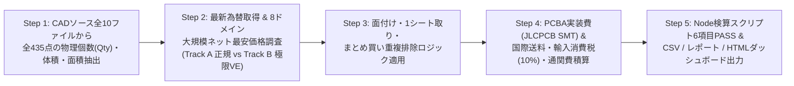

# WLK-435 全435パーツ「1台試作・最安実費」調達コスト算出 実行計画書（確定版）

## Goal Description
`WLK-435`（[welcome.json](file:///home/antigravity/sc8z35a-collab/SONY-A7-IV-Diagram/src/data/welcome.json) `version 3.8.0` / 全 435 実動作パーツ：`glyph_yo` 62 + `glyph_u` 62 + `glyph_ko` 62 + `glyph_so` 62 + `optical_plinth` 187）の**実際に 1 台だけ最安で買い集めて組み上げる現実コスト（Qty = 1 試作・最安実費）**を、世界中の電子部品・光学・CNC 加工・特殊材料チャネルの大規模ネット調査に基づき精密に算出します。

### 確定済み前提条件（ユーザー回答反映済）
1. **数量条件**: **1台試作の最安実費のみ**（実際に 1 台だけ最安で買い集める際の現実的な支払総額＝MOQ・段取り費・1シート最小購入単位込み。なおシート取り・複数個パック購入による余剰分については参考値として「1台正味消費按分」も各行へ併記し、透明性を担保）。
2. **価格比較の 2 本立て**:
   - **【Track A：厳密正規仕様・世界最安】**: 全 435 点の指定メーカー・型番・材質・規格（`TI`, `Infineon`, `Qorvo`, `ADI`, `HARTING`, `Omron`, `Labsphere Spectralon SRM-99`, `Acktar Metal Velvet`, `Thorlabs PS974M`, `Permendur 49`, 単結晶サファイア曲面レンズ, 5軸CNC `Ti-6Al-4V` / `AZ91D` / `A6061-T6`, `Parker CHO-SEAL 1285`, `Parylene-C` 等）を**一切妥協せず**、世界最安ルート（LCSC / DigiKey / Mouser / JLCPCB / JLCCNC / 1688 / Alibaba / AliExpress / MISUMI / モノタロウ / 直販）を徹底探索。
   - **【Track B：機能100%維持・極限VE超最安】**: 電気・光学・機構の**実動作機能を 100% 維持**しつつ、ピン互換・機能等価 IC、中国 OEM 光学部品・焼結 PTFE 白基準、材料・加工法最適化（例：ダイカスト/3軸＋簡易治具、高透過 AR 強化ガラス or フラットサファイア分割、汎用品 EMI/TIM/ファスナ等）へ置換した場合の**究極の底値**を算出。
3. **コスト計上範囲 & 出力先**:
   - **主集計**: 全 435 点の「部品代＋カスタム加工費（CNC / PCB / 光学研磨 / 表面処理）」合計（USD & 最新為替 JPY 併記）。
   - **別枠併記**: ① **PCBA 実装費**（JLCPCB SMT 基本料・拡張パーツ料・ステンシル・実装費） ② **国際送料・輸入消費税（10%）・通関手数料** の現実総額。
   - **出力先**: リポジトリのファイルは変更せず、すべて成果物アーティファクトとして出力。

### Step 0 完了済：現状 435 点の完全把握とリスト化
全 435 点の仕様・外寸（[welcome.tsv](file:///home/antigravity/sc8z35a-collab/SONY-A7-IV-Diagram/catalog/spatial/welcome.tsv)）・KiCad 実機型番（[generate_kicad_wlk220.py](file:///home/antigravity/sc8z35a-collab/SONY-A7-IV-Diagram/verification/wlk220/generate_kicad_wlk220.py)）を機械抽出し、重複 0・欠落 0 のマスターリストを作成済みです。

- **完全 435 点マスターリスト**: [wlk435_part_inventory.md](file:///home/antigravity/.gemini/jetski/brain/v1/default/jetski_remote_agents_3p_devbox/76419f02-f40b-4479-b55c-8c6e8877c700/wlk435_part_inventory.md)

| 調達ドメイン | 点数 (`W`ID) | 主な最安探索チャネル |
| :--- | :---: | :--- |
| ① 半導体・アクティブIC・RF/通信モジュール | **46** | LCSC / DigiKey / Mouser / AliExpress / 1688 |
| ② センサー・高演色LED・OLED・音響・HMI | **38** | LCSC / DigiKey / Mouser / Omron・WINSTAR / AliExpress / 1688 |
| ③ PCB・MCPCB・FPC・コネクタ・ハーネス | **43** | JLCPCB（面付け統合）/ LCSC / DigiKey / Mouser |
| ④ 受動部品・保護素子・電池・スーパーキャパシタ | **28** | LCSC / DigiKey / 1688（カスタムLiFePO4 2Sセル） |
| ⑤ サファイア窓・石英支柱・プリズム・特殊光学フィルム | **56** | 深セン光学工場（Alibaba/1688）/ Thorlabs / Edmund / Labsphere / Acktar |
| ⑥ 5軸CNC金属筐体・チタン/Mg/銅・ヒートパイプ・リギング | **92** | JLCCNC / PCBWay CNC / 深セン5軸工場（Alibaba/1688）/ Xometry |
| ⑦ EMI遮蔽・ガスケット・TIM・ePTFEベント・吸音・防湿 | **79** | LCSC / Parker / GORE / Honeywell / MISUMI / 1688シート取り |
| ⑧ 精密ねじ・ばね・軸受・メトロロジー基準器・銘板 | **53** | MISUMI / モノタロウ / McMaster / Nord-Lock / Smalley / AliExpress |
| **合計** | **435** | **全 435 点 100% カバー（4文字間共通 32 系統＋台座固有 187 点）** |

---

## User Review Required

> [!IMPORTANT]
> **1台試作・最安実費における「現実的な極限コスト圧縮ルール」**
> 単純に 435 件をバラバラに 1 点ずつ特注すると、セットアップ費だけで数百万円規模に膨らみます。本算出ではプロのハードウェア試作調達と同じ以下の現実的最適化を **Track A / Track B 双方で明示適用** します：
> 1. **PCB・MCPCB の面付け統合（Panelization）**: 10 種の文字用 2oz アルミ MCPCB を 1 枚の JLCPCB アルミパネルへ面付け、4 種の 4 層ドライバ基板＋ポゴ基板＋PD/PMIC/BMS を最小パネル数へ統合し、初期費を劇的圧縮。
> 2. **機能シートの「1シート取り（Sheet Nesting）」**: `BEF` / `98% PET反射` / `サーマルギャップパッド` / `Acktar Metal Velvet` / `Nitto NPF` / `Luminit LSD` / `3M ALCF` / `PTM7950` / `Kapton 500HN` / `PGSグラファイト` / `エアロゲル+マイカ` / `Basotect` / `Turcite B` / `CHO-SEAL` を最小販売シート 1 枚から全部位を切り出す前提で、**シート購入実費を重複計上せず 1 回のみ計上**（2箇所目以降は 0 円＋参照元シート明記）。
> 3. **同一型番・共通ねじ/ピンのまとめ購入**: 例：4 文字共通の `M2×6`・`H7ノックピン`・`Schnorr座金`・`Heli-Coil`・`GORE VE8`・`CRI97 2835 LED` は 1 台合計必要個数で最小パック/カットテープ購入し、重複 MOQ を排除。

---

## Proposed Changes（承認後の実行ステップ＆成果物）

### Step 1: 全435点の厳密な物理個数（`Qty`）・体積・表面積の機械抽出
- `src/assemblies/welcome/*.ts`（全 10 ファイル）と `sp`（`loadSpatialScene`）から、各 `W001`–`W435` の実際の部品点数（例：2835 LED 総チップ数、各ボルト本数、4基/8基アレイ数、CNC 切削体積 `cm³`、光学窓面積 `mm²`）を完全確定。

### Step 2: 8ドメイン並列・超大規模ネット最安リサーチ
- 最新為替（USD/JPY, CNY/JPY, EUR/JPY）を Web 検索で取得。
- 8 ドメイン全固有 SKU について、**Track A（厳密正規仕様・世界最安）** と **Track B（機能等価・極限VE最安）** の実勢単価・最小購入単位（MOQ）・調達先 URL を徹底的に Web 検索・裏取り。
  - 特に超高額ドライバー（異形サファイア 9 形状、5軸CNC A6061/AZ91D/Ti-6Al-4V 約 40 形状、`Labsphere SRM-99`, `Acktar Metal Velvet`, `Thorlabs PS974M`, `Permendur 49`, `Parylene-C`, `Omron D6T-44L-06`, `Infineon BGT60TR13C`, `Qorvo DW3120`, `ADI LT4295/LT4321/LTC3350/LT3045/ADM2587E`, `TI REF7025/ISO1042/DP83867IR`, `HARTING ix Industrial`, `Laird OptoTEC OTX`, `Minco Thermofoil`, `Parker CHO-SEAL 1285`, `Smalley CS-S17`, `Nord-Lock NL3`）は複数サイト相見積もりで実売価格を厳密に特定。

### Step 3: PCBA実装費＆国際送料・関税の別枠積算
- **PCBA 実装費**: JLCPCB Economic/Standard PCBA 料金体系（Setup Fee、Stencil、Extended Parts Fee × 種類数、はんだポイント費、BGA/QFN X線検査費、両面実装費）を最新公式料金表から実測積算。
- **国際送料・輸入諸掛**: 調達ルート集約後（LCSC+JLCPCB+JLCCNC 混載便、DigiKey/Mouser 送料無料ライン判定、Thorlabs/Edmund/専門材料便、深セン光学・1688 代行便）の送料＋日本輸入消費税（CIF × 10%、電子部品・光学部品の関税率 0% 確認）＋通関手数料を別枠で現実積算。

### Step 4: 最終成果物（すべて `<ARTIFACT_DIR>` へ出力・リポジトリ無改変）
- #### [NEW] `wlk435_bom_full.csv`
  全 435 行（`W001`–`W435`）完全明細 CSV（Part ID, サブアセンブリ, 調達ドメイン, 名称, 物理個数 Qty, 採用型番/加工仕様, Track A 最安調達先・MOQ実費 USD/JPY・正味按分 JPY, Track B 互換VE代替品・調達先・MOQ実費 USD/JPY・削減額, 出典URL/根拠区分）。
- #### [NEW] `wlk435_cost_report.md`
  Track A vs Track B 合計金額比較（純粋 BOM 合計 / PCBA 実装費 / 送料・輸入消費税 / 総合計）、8ドメイン別＆サブアセンブリ別（よ/う/こ/そ/台座）内訳、コスト上位 25 部品パレート分析、1シート取り＆面付けによる節約効果、全 435 点完全価格一覧表。
- #### [NEW] `wlk435_cost_dashboard.html`
  `generative_ui` 準拠のインタラクティブ BOM コスト探索ダッシュボード（Track A / Track B 切替、435 点リアルタイム検索・ドメイン別絞り込み、パレート上位バーチャート、PCBA・送料トグル）。

---

## Verification Plan

### Automated Tests（専用検算スクリプトによる 6 項目 100% PASS 検証）
`<ARTIFACT_DIR>/scratch/verify_bom_435.mjs` を実行し、以下を機械検証：
1. **435/435 完全一致**: CSV 全行の ID が `src/data/welcome.json` の全 435 ID と 1対1 完全一致（欠落 0・重複 0）。
2. **数値健全性**: 全 435 行で `qty > 0`、`NaN` / `Infinity` / 負値 / 未記入が 0 件。
3. **重複MOQ排除整合**: シート共有・パック共有の参照先行が存在し、実費重複計上がないことを機械チェック。
4. **不等式整合**: 全 435 行で `Track B (VE最安) <= Track A (厳密正規最安)` および `正味按分 <= MOQ支払実費` が成立。
5. **集計誤差ゼロ**: CSV 全 435 行単純合算 ＝ ドメイン別集計合計 ＝ サブアセンブリ別集計合計 ＝ レポート記載総額（誤差 ±1 円以内）。
6. **リポジトリ無汚染**: `git status` クリーン（差分ゼロ）。

### Manual Verification
- ユーザーにて [wlk435_part_inventory.md](file:///home/antigravity/.gemini/jetski/brain/v1/default/jetski_remote_agents_3p_devbox/76419f02-f40b-4479-b55c-8c6e8877c700/wlk435_part_inventory.md)（435点棚卸し済）および最終成果物（`wlk435_cost_report.md`, `wlk435_bom_full.csv`, `wlk435_cost_dashboard.html`）の内容を確認。
