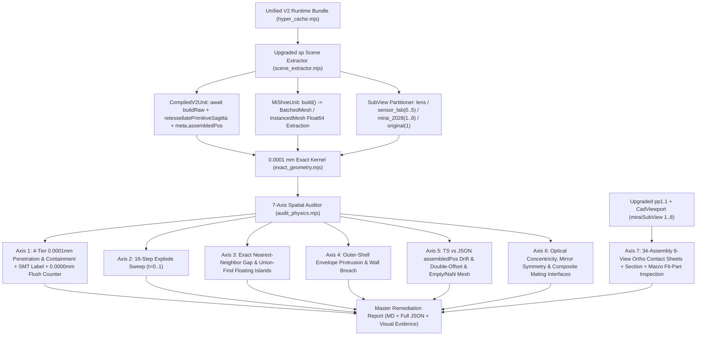

# 全22フェーズ（ようこそ以外）3,038パーツ `0.0001 mm` 完全空間干渉・飛び出し・位置異常 洗い出し＆修正レポート作成 実装計画書

## Goal Description

`welcome`（ようこそ）を除く **全22モード（独立物理アセンブリ34体・全37ビュー状態・合計3,038パーツ）** について、既存ツール群（[`sp`](file:///home/antigravity/sc8z35a-collab/SONY-A7-IV-Diagram/scripts/sp.mjs) / [`pp1.1`](file:///home/antigravity/sc8z35a-collab/SONY-A7-IV-Diagram/scripts/pp.mjs) / [`validate_parts.mjs`](file:///home/antigravity/sc8z35a-collab/SONY-A7-IV-Diagram/scripts/validate_parts.mjs)）を用いて以下の異常を **1件の漏れもなく 100% 洗い出し**、開発者・AIが即座に修正着手できる **「完全修正レポート（Audit & Remediation Report）」** を作成する。

- **0.0001 mm（0.1 µm）厳密干渉検査**: 貫通量 `≥ 0.0001 mm` のすべての部品間干渉（PCB↔SMT はんだ食い込みも隠さず別ラベルで全件計上）。完全 `0.0000 mm` の面接触（フラッシュ密着）は正当接触として別枠カウントのみ記録。
- **飛び出し・浮遊・孤立島・位置異常の7軸完全網羅**:
  1. 外装エンベロープ飛び出し・壁面貫通
  2. 微小浮遊（`> 0.05 mm`）〜大規模浮遊の全パーツ最近接距離測定
  3. 連結成分（Union-Find）による「浮遊島（複数パーツの孤立クラスタ）」検出
  4. TSビルダー座標 vs JSON `assembledPos` 不一致・二重オフセット・空/異常メッシュ検出
  5. 光軸同心性・左右対称性・`integrated`/`camera_body` サブシステム接続面整合チェック
  6. 全4品質ティア（`LITE` / `STD` / `HIGH` / `ULTRA`）横断＋爆発軌道（`t = 0 → 1`）貫通検査
  7. `pp1.1` 6面図（front/back/left/right/top/iso）＋断面カット＋問題箇所マクロ拡大による全34アセンブリ目視裏取り

> [!IMPORTANT]
> **本フェーズでは 3D CAD モデル本体（`src/assemblies/*`, `src/data/*.json`）は一切変更しません。**
> 既存監査ツール（`sp` / `pp1.1` / `CadViewport.ts` のサブビュー上限）のみを必要最小限で改修し、100% 信頼できる実測値＋視覚証跡付きの「修正レポート」を納品します。3D モデルの修正はレポートご確認・ご承認後に別フェーズとして実施します。

---

## User Review Required

> [!WARNING]
> **事前調査で発覚した既存ツール（`sp` / `pp1.1`）の致命的欠陥（本計画で先行改修対象）**
> 現行の [`sp`](file:///home/antigravity/sc8z35a-collab/SONY-A7-IV-Diagram/scripts/sp.mjs) を `welcome` 以外の全22モードへ適用したところ、**22モード中 20モードがそのままでは監査不能** でした：
> 1. **12モードが実行時クラッシュ**: [`mi_shoe.ts`](file:///home/antigravity/sc8z35a-collab/SONY-A7-IV-Diagram/src/units/mi_shoe.ts) の独自 `OptimizedUnit` 実装、および `battery`/`mic`/`drybox`/`lcd`/`bionz`/`bionz_v2`/`micro`/`micro_v2`/`sensor_fab`/`integrated`/`camera_body` への `{ clippingPlanes }` 引数未渡し。
> 2. **8モードが静かに 0 パーツ抽出（偽 PASS）**: `cfexpress`/`mount`/`shutter`/`body`/`evf`/`lens`/`mainboard`/`sensor` は `async buildRaw` なのに [`scene_extractor.mjs`](file:///home/antigravity/sc8z35a-collab/SONY-A7-IV-Diagram/scripts/spatial_engine/scene_extractor.mjs#L427) が `await` しておらず `parts=0` のまま `VERDICT=PASS` を誤出力。
> 3. **座標・サブビュー乖離**: [`scene_extractor.mjs`](file:///home/antigravity/sc8z35a-collab/SONY-A7-IV-Diagram/scripts/spatial_engine/scene_extractor.mjs#L465) が [`CompiledV2Unit`](file:///home/antigravity/sc8z35a-collab/SONY-A7-IV-Diagram/src/core/v2_unit_compiler.ts#L2101-L2103) の `meta.assembledPos` 正規化および `isPartInSubView` 分割（`lens` / `sensor_fab` / `mirai_2028`）を未反映。
> 4. **精度・偽陽性バグ**: [`audit_physics.mjs`](file:///home/antigravity/sc8z35a-collab/SONY-A7-IV-Diagram/scripts/spatial_engine/audit_physics.mjs#L86) が `penMm <= 0.002 mm` をスキップ、[`exact_geometry.mjs`](file:///home/antigravity/sc8z35a-collab/SONY-A7-IV-Diagram/scripts/spatial_engine/exact_geometry.mjs#L731-L746) が `1/24` 頂点間引き＆斜め面接触時に `aabbPen` フォールバックで誤検知。
> 5. **`pp1.1` サブビュー上限バグ**: [`CadViewport.ts`](file:///home/antigravity/sc8z35a-collab/SONY-A7-IV-Diagram/src/engine/CadViewport.ts#L300) の `activateAtomic` / `hydrateMetaOnly` が `miraiSubView` を `5` でクランプしており、FH20/FH17/FH48（`subView=6..8`）が撮影不可。

> [!NOTE]
> **監査対象 全22モード（独立物理アセンブリ34体・3,038パーツ）完全マトリクス**
>
> | カテゴリ | モード (`unitId`) | パーツ数 | 監査シーン分割 (`subView`) | 備考 |
> |---|---|---:|---|---|
> | **カメラ全体** | `integrated` | 305 | 全統合 1体 | 8サブシステム統合（`integratedMode=true`） |
> | | `camera_body` | 231 | ボディ統合 1体 | 7サブシステム統合（レンズ除外） |
> | **主要光学・メカ** | `lens` | 128 | 全体128p ＋ Sec1(42p)/Sec2(48p)/Sec3(38p) ＋ Studio(74p) | 単一物理鏡筒＋UI断面切替の全検証 |
> | | `mount` | 100 | 1体 | Eマウント機構・18mmフランジ基準 |
> | | `shutter` | 180 | 1体 | デュアルカーボンシャッター |
> | | `sensor` | 120 | 1体 | フルサイズCMOS＋5軸IBIS |
> | | `mainboard` | 60 | 1体 | 12層HDIメイン基板＋冷却 |
> | | `evf` | 105 | 1体 | OLED EVF＋視線入力AF |
> | | `lcd` | 150 | 1体 | 4軸マルチアングル背面LCD |
> | | `body` | 116 | 1体 | マグネシウム防塵防滴ボディ |
> | **半導体・極超解剖** | `bionz` | 70 | 1体 | BIONZ XR V1 パッケージ |
> | | `bionz_v2` | 105 | 1体 | 2nm GAA＋BSPDN |
> | | `micro` | 75 | 1体 | 2×2 Bayer 画素断面 V1 |
> | | `micro_v2` | 55 | 1体 | 画素原子・量子構造 V2 |
> | | `sensor_fab` | 235 | **6独立シーン** (`Vol.0`〜`Vol.5`) | 同一原点に重畳される6巻を完全個別監査 |
> | **電源・周辺・保管** | `battery` | 130 | 1体 | NP-FZ100 バッテリー |
> | | `cfexpress` | 170 | 1体 | CFexpress 4.0 Type A |
> | | `mishoe` | 99 | 1体 | 独自 `MiShoeUnit` 実装（Instanced/Batched直接抽出） |
> | | `mic` | 150 | 1体 | 内蔵3カプセルMEMSマイク |
> | | `drybox` | 186 | 1体 | 160L デュアルゾーン防湿庫 |
> | **未来・オリジナル** | `mirai_2028` | 140 | **8独立機体** (`FH01/02/08/32/25/20/17/48`) | `subView=1..8` を完全個別監査 |
> | | `original` | 128 | 1体 (`#01 RIIMOS E1`) | 四足ロボット＋8丁機関銃 |
> | **合計** | **22モード** | **3,038** | **34物理アセンブリ（37ビュー状態）** | **`welcome`（435p）を厳密除外** |

---

## Architecture Overview



---

## Proposed Changes

### Component 1: `sp` 空間解析エンジン 0.0001 mm ＆ 全22モード対応アップグレード

既存ツール [`sp`](file:///home/antigravity/sc8z35a-collab/SONY-A7-IV-Diagram/scripts/sp.mjs) の後方互換性（既存オプションおよび 20項目の `selftest`）を 100% 維持したまま、全22モード抽出・`0.0001 mm` 厳密判定・7軸位置異常検出を実装する。

#### [MODIFY] [scene_extractor.mjs](file:///home/antigravity/sc8z35a-collab/SONY-A7-IV-Diagram/scripts/spatial_engine/scene_extractor.mjs)
1. **統一 V2 ランタイムバンドル利用（`sp-v2-stub` 廃止）**:
   - [`hyper_cache.mjs`](file:///home/antigravity/sc8z35a-collab/SONY-A7-IV-Diagram/scripts/lib/hyper_cache.mjs) の `ensureUnifiedV2RuntimeBundlePath()`（必要に応じ `retessellatePrimitiveSagitta` / `setActiveBuildQuality` を追加エクスポート）経由でロードし、全23ユニットを一貫サポート。
2. **`CompiledV2Unit` 抽出の完全正確化**:
   - `await unit.cfg.buildRaw(createMaterialProxy(), quality, { clippingPlanes: [], integrated: isComposite, subView })` を正しく `await` ＆引数付きで実行。
   - **座標ズレ監査データを事前採取**: `rp.group.position` リセット前に `rawGroupPos` / `rawAssembledPos` と JSON `meta.assembledPos` の差分 `coordDriftMm`、および `localBoxCenter` の原点偏心量（二重オフセット疑い）を記録。
   - **実WebGL同一変換適用**: [`v2_unit_compiler.ts`](file:///home/antigravity/sc8z35a-collab/SONY-A7-IV-Diagram/src/core/v2_unit_compiler.ts#L2101-L2103) と完全に同一手順（`rp.group.position.set(0,0,0)` → ローカル行列抽出 → `quality` に応じた `retessellatePrimitiveSagitta` 適用 → `meta.assembledPos` 平行移動）で `Float64` ワールド三角形を抽出。
   - **`integrated` / `camera_body` の `integratedExplodeOffset` 対応**: 統合モードでは JSON の `integratedExplodeOffset` を爆発ベクトルとして採用。
3. **`MiShoeUnit` (`mishoe`) 完全抽出対応**:
   - `CompiledV2Unit` 以外の `OptimizedUnit` は実 `unit.build(quality, cache, { synchronous: true })` を実行し、`built.raycastIndex.bindings` から `InstancedMesh`（`getMatrixAt(i)`）および Three.js r174 `BatchedMesh`（`_instanceInfo[id].geometryIndex` → `_geometryInfo[gIdx]` の `indexStart`/`indexCount` ＋ `getMatrixAt(id)`）を直接 `Float64` 三角形へ展開。
4. **`subView` フィルタリング＆自動列挙**:
   - `loadSpatialScene(unitId, { quality, subView, noCache })` に `subView` オプションを追加（キャッシュキー `SPB4` に `subView` を含める）。
   - `listUnitAuditTargets(unitId)` を提供し、`sensor_fab` (`0..5`)・`mirai_2028` (`1..8`)・`lens` (`all`, `1`, `2`, `3`, `-1`)・`original` (`1`) を自動展開。
   - **ゼロ抽出フェイルセーフ**: 抽出パーツ数が期待アクティブパーツ数と 1件でも食い違った場合、即座にエラー（偽 PASS 物理遮断）。

---

#### [MODIFY] [exact_geometry.mjs](file:///home/antigravity/sc8z35a-collab/SONY-A7-IV-Diagram/scripts/spatial_engine/exact_geometry.mjs)
1. **精度定数＆厳密貫通計算の抜本強化（`0.0001 mm` 偽陰性ゼロ・斜め面接触偽陽性ゼロ）**:
   - `STRICT_PRECISION_MM = 0.0001` を定義（既存 `PRECISION_MM = 0.001` は後方互換のため残置）。
   - **`meshPairExactCheck(meshA, meshB, opts)` の全量精密化**:
     - デュアル BVH 交差探索で **`hitCount >= 8` 早期打ち切りを廃止**（`collectAllHits: true` モード、または `maxPairHits` 上限まで全交差三角形ペアを収集）。
     - **非同一平面（貫通） vs 同一平面（フラッシュ面接触）の厳密分離**:
       - 各交差三角形ペア `(tA, tB)` について、同一平面（`|nA × nB| <= 1e-7` かつ平面距離 `<= 1e-7`）なら `coplanarHits++`、非同一平面なら実際の3D交差線分 `P0 → P1` と面法線から「厳密内部侵入テスト」を実施。
     - **全量頂点チェック（`1/24` 間引き廃止）**:
       - 交差AABB内に含まれる `meshA` / `meshB` の**全頂点**および交差線分の中点・法線微小オフセット点（`±5e-5 mm`）を `pointInMeshWinding` ＋ `pointToMeshUnsignedDist` で精密評価。
       - 閉メッシュの純粋フラッシュ面接触（回転45°を含む）では内部点が0個のため `penMm = 0.0000`, `contactType = 'COPLANAR_FLUSH'` となり、`aabbPen` フォールバック誤検知を完全に根絶。
       - エッジ同士の交差（頂点が互いに内部にない十字交差）や薄板/開放メッシュ（`|signedVol| < 1e-6`）では、非同一平面貫通線分の境界からの最短侵入深さを解析計算して `penMm` を算出（0.0001 mm 未満の極小掠りも正確に区別）。
     - **完全内包（`A_IN_B` / `B_IN_A`）の多点検証**: 単一頂点 `tA[0]` だけでなく重心＋複数頂点で巻数検証し、最小脱出深さではなく真の内部貫通量（`max(pointToMeshUnsignedDist)`）を小数第6位精度で返却。

---

#### [MODIFY] [audit_physics.mjs](file:///home/antigravity/sc8z35a-collab/SONY-A7-IV-Diagram/scripts/spatial_engine/audit_physics.mjs)
1. **`0.0001 mm` 厳密モード（`--tol=0.0001`, `--strict`）＆全サブメッシュペア最大貫通集計**:
   - `seenPairs` による最初の1サブメッシュ打ち切りを廃止し、同一 `(partA, partB)` 間の**全重畳サブメッシュペア**を評価して `maxPenMm`（小数第5位まで保持）・衝突サブメッシュ数・最悪座標 `centroidWorld` を記録。
   - `penMm >= tolMm`（デフォルト厳密値 `0.0001 mm`）を **全件 NG（`collisions`）** として計上。PCB↔SMT ペアも隠さず `category: 'SMT_SOLDER_SEAT'` タグ付きで NG リストに含め、集計サマリーで「機械/光学干渉」と「SMTはんだ食い込み」の内訳を両方明示。
   - `penMm < tolMm` かつ交差ありを `coplanarFlushCount`（完全 `0.0000 mm` 正当接触）および `subTolGrazeCount`（`0 < penMm < 0.0001 mm`）へ分離記録。
   - 重大度ラベル自動付与：`S0_CRITICAL (≥ 1.0 mm)` / `S1_MAJOR (0.1–1.0 mm)` / `S2_MINOR (0.01–0.1 mm)` / `S3_MICRO (0.0001–0.01 mm)` / `SMT_SEAT`。
2. **爆発軌道貫通検査の強化（`--explode-steps=16`）**:
   - `t = 1/16 .. 16/16` の各ステップで `tolMm`（`0.0001 mm`）基準の軌道交差および `t=1.0` 残留干渉を全件記録（静的既存干渉と新規軌道干渉を明確に区別）。
3. **精密浮遊＆連結成分（浮遊島）検出（`--check-floating --float-tol=0.05`）**:
   - 全パーツに対し BVH 加速＋`exactMeshPairMinDistance` で**真の最近接パーツIDと厳密表面距離 `nearestGapMm`** を計算。
   - `nearestGapMm > floatTolMm`（`0.05 mm`）の全パーツを距離帯（`MICRO_FLOAT 0.05–1mm` / `MID_FLOAT 1–4mm` / `MACRO_FLOAT >4mm`）付きで全件出力。
   - 表面距離 `≤ connectTolMm`（`0.10 mm`）の隣接グラフ上で **Union-Find 連結成分分解** を実行し、最大連結成分以外の全孤立クラスタ（1パーツ孤立＆複数パーツの浮遊島）を `disconnectedIslands` として全件抽出。
4. **外装エンベロープ飛び出し＆空間外れ値検査（`--check-protrusion`）**:
   - 外装シェル（`chassis`/`housing`/`shell`/`barrel`/`case`/`cover`/`bezel`/`frame` 等の主外殻）で定義される外装エンベロープをユニット別に算出し、内部部品（PCB/IC/コイル/モータ/ダンパ/内部バネ/内部ネジ等）が外装 AABB を `≥ 0.0001 mm` 超過している箇所（超過軸 `±X/±Y/±Z` と超過量 `mm`）を全件検出。
   - 外装パーツ自体も含め、ユニット全体の中央値/IQR ベース空間外れ値やグループ内孤立飛び出しをフラグ。
5. **座標整合・光軸同心・対称性・異常メッシュ検査（`--check-alignment`）**:
   - TS `rawGroupPos`/`rawAssembledPos` vs JSON `meta.assembledPos` 差分（`≥ 0.0001 mm`）
   - 二重オフセット候補（`localBox` 原点偏心 `> 1.0 mm` かつ `assembledPos` 非ゼロ）
   - 空メッシュ（`meshCount === 0` / `tris === 0`）・`NaN`/`Infinity`・負スケール行列
   - 光学系ユニット（`lens`, `mount`, `sensor`, `evf`, `mirai_2028` FH08/FH25）の光軸同心ズレ、`integrated`/`camera_body` のフランジバック（18.0 mm）および 8 サブシステム境界面整合、左右対称ペア（`left`/`right` 等）の座標非対称検出。
6. **数学オラクル自己テスト拡張（`sp selftest` 20 → 27ケース）**:
   - `M21`: `0.0001 mm` 貫通 FAIL（偽陰性ゼロ証明）
   - `M22`: `0.00009 mm`（または `0.0001 mm`）離間 PASS（偽陽性ゼロ証明）
   - `M23`: 45° 回転ボックスの完全 `0.0000 mm` フラッシュ面接触 PASS（旧 `aabbPen` 偽陽性バグ根絶証明）
   - `M24`: 頂点が互いに内部にない十字交差バー貫通 FAIL
   - `M25`: 2パーツ同士は密着しつつ本体から 1.5 mm 浮いた「浮遊島」検出 FAIL
   - `M26`: 0.2 mm 微小浮遊パーツ検出 FAIL
   - `M27`: 内部部品が外装シェルから `0.001 mm` 飛び出したケース検出 FAIL

---

#### [MODIFY] [sp.mjs](file:///home/antigravity/sc8z35a-collab/SONY-A7-IV-Diagram/scripts/sp.mjs)
- `audit` モードへ以下の CLI オプションを追加（既存引数互換 100% 維持）：
  - `--subview=<N|all>`（単一サブビュー指定または全サブビュー自動展開）
  - `--all-non-welcome`（`welcome` を除く全22モード・34物理アセンブリを一括監査）
  - `--tol=<mm>`（デフォルト既存互換 `0.002`、厳密指定 `--strict` または `--tol=0.0001`）
  - `--include-smt-as-fail`（SMTはんだ食い込みも NG 判定に含め別カテゴリ表示）
  - `--check-protrusion`, `--check-alignment`, `--float-tol=<mm>`
  - `--out-json=<path>`（全件詳細 JSON 保存）
- 並列実行（Node.js `worker_threads` または非同期バッチ）により全22モード × 4ティアを数分以内で高速完走。

---

### Component 2: `pp1.1` ＆ `CadViewport` 全サブビュー視覚検証対応（最小限2箇所）

#### [MODIFY] [CadViewport.ts](file:///home/antigravity/sc8z35a-collab/SONY-A7-IV-Diagram/src/engine/CadViewport.ts)
- L300 および L383 の `miraiSubView` クランプ上限 `Math.min(5, ...)` を [`setMiraiSubView`](file:///home/antigravity/sc8z35a-collab/SONY-A7-IV-Diagram/src/engine/CadViewport.ts#L642) と同じ **`Math.min(8, ...)`** に修正（FH20/FH17/FH48 の `pp1.1` 直接撮影を有効化）。

#### [MODIFY] [pp.mjs](file:///home/antigravity/sc8z35a-collab/SONY-A7-IV-Diagram/scripts/pp.mjs)
- `--mirai-subview` のヘルプ表記（`1..5` → `1..8`）と必要に応じて `originalSubView` 指定を確認・整合（既存動作非破壊）。

#### [MODIFY] [hyper_cache.mjs](file:///home/antigravity/sc8z35a-collab/SONY-A7-IV-Diagram/scripts/lib/hyper_cache.mjs)
- 統一バンドル `ensureUnifiedV2RuntimeBundlePath()` のエクスポートに `setActiveBuildQuality`（`src/core/geometry_quality.ts`）と `retessellatePrimitiveSagitta`（`src/engine/FastCadGeometry.ts`）を追加し、`sp` と `validate_parts.mjs` でキャッシュを共有。

---

## Audit Execution & Master Remediation Report Plan

ツール改修・自己検証の完了後、以下の 4 段階で **全22モード・34物理アセンブリ・3,038パーツ** を完全監査しレポートをまとめる。

1. **Stage 1 — 全22モード × 全4品質ティア × 7軸数理完全スキャン**:
   - `node scripts/sp.mjs audit --all-non-welcome --all-tiers --strict --tol=0.0001 --include-smt-as-fail --explode-steps=16 --check-floating --float-tol=0.05 --check-protrusion --check-alignment --out-json=/tmp/sp_audit_all22_0001mm.json`
   - 3,038 パーツ全件の抽出完了（抽出欠落 0 件）を確認。
2. **Stage 2 — 検出箇所のソースコード逆引き・根本原因分析（全件）**:
   - 検出されたすべての干渉・飛び出し・浮遊・孤立島・座標ズレ・光軸ズレ・爆発干渉について、`src/assemblies/**` および `src/data/*.json` の該当定義箇所を特定し、**なぜ発生しているか**（寸法設計ミス・座標符号ミス・二重オフセット・共有ビルダー起因・弦落ち等）と **具体的な修正数値（ΔX/ΔY/ΔZ または半径/厚み調整量）** を全件算出。
   - 意図的設計ギャップ（例：`FH17` 磁気浮上エアギャップ、`sensor_fab` 工程ステーション間スペース、`micro_v2` 量子模式要素など）と真の設計不良を専門工学観点から明確に分離（ただし全件テーブルには漏れなく記載し透明性 100% を保証）。
3. **Stage 3 — `pp1.1` 全34アセンブリ 6面図＆問題箇所断面・マクロ視覚裏取り**:
   - `npm run build` 後、`npm run pp -- --warm ...` で全34物理アセンブリの `--ortho-pack --contact-sheet=3`（正面/背面/左/右/上面/アイソメの6面コンタクトシート）を `/tmp/pp_audit_all22/` へ一括撮影。
   - 重大干渉・飛び出し・位置異常が検出された箇所は `--section=x|y|z:...` および `--fit-parts=<idA,idB>` でマクロ拡大撮影。
   - 撮影完了後に必ず `npm run pp -- --daemon=stop` を実行し、全コンタクトシートと重要マクロ画像を `view_file` で直接目視検査して「数理では 0 mm 接触でも見た目・解剖学的に本来あるべき位置にない部品（裏返し・左右逆・面間違い等）」まで拾い上げる。
4. **Stage 4 — マスター修正レポート＆ウォークスルー作成**:
   - アーティファクトへ **完全修正レポート（`full_spatial_audit_remediation_report.md`）** と視覚証跡画像・構造化集計 JSON を出力：
     - **全体エグゼクティブサマリー**（22モード × 4ティア ヒートマップ・総件数・重大度分布）
     - **22モード完全個別章**（全件リスト：干渉 / SMT / 飛び出し / 浮遊・孤立島 / 座標・対称性・光軸ズレ / 爆発軌道 / 4ティア弦落ち差分 / 視覚所見 ＋ ソース行＆推奨修正パッチ案）
     - **依存関係順・修正ロードマップ**（共有ビルダー優先順で `integrated`/`camera_body` と単体モードの二重修正を防ぐ最適順序）

---

## Verification Plan

### Automated Tests
1. **`sp` 27項目数学オラクル自己証明（`0.0001 mm` 新規7テスト含む）**:
   ```bash
   node scripts/sp.mjs selftest
   ```
   - 期待結果: `VERDICT=PASS (27/27 PASS)`
2. **既存 `welcome` ユニット後方互換テスト**:
   ```bash
   node scripts/sp.mjs audit --unit=welcome --check-floating --ai
   ```
   - 期待結果: 既存デフォルト挙動が破壊されず正常動作すること。
3. **全22モード抽出完全性アサーション**:
   - `/tmp/sp_audit_all22_0001mm.json` の全22モードで `extractedParts === expectedActiveParts` かつ `zeroMeshParts === 0`（または異常として明示記録）を確認。
4. **リポジトリ品質ゲート（10/10 PASS）**:
   ```bash
   npm run catalog && npx tsc --noEmit && node scripts/validate_parts.mjs && npm run build
   ```
5. **`bg` ワークフロー＆改ざん不能レシート取得（ルール0遵守）**:
   - 承認後、即座に `npm run bg -- start feat-spatial-audit-0001mm --goal="..." --next="..." --ai` でフィーチャーブランチを作成。
   - マイルストーン毎に `npm run bg -- snap --artifacts=<ARTIFACT_DIR> --ai` を実行。
   - 完了報告前に `npm run bg -- gate --policy=integrator --run-checks --require-checks --ai` で `exit 0` および `BG-RECEIPT:...` を取得して報告へ明記。

### Manual Verification
- `pp1.1` で生成した全34アセンブリの6面コンタクトシートおよび主要干渉・飛び出し箇所の断面／マクロ拡大画像をすべて目視確認し、レポート内の数値・修正案と視覚像に1件の矛盾もないことを検証。
- リポジトリルート直下に一時キャプチャ画像・一時 JSON が一切残留していないことを `git status` で確認（すべて `/tmp/` またはアーティファクト領域へ出力）。
