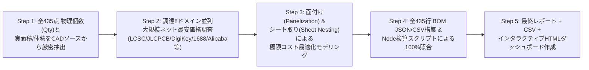

# WLK-435 全435パーツ 最安調達・合計金額算出 実行計画書

## Goal Description
`WLK-435`（[welcome.json](file:///home/antigravity/sc8z35a-collab/SONY-A7-IV-Diagram/src/data/welcome.json) `version 3.8.0` / 全 435 実動作パーツ：`glyph_yo` 62 + `glyph_u` 62 + `glyph_ko` 62 + `glyph_so` 62 + `optical_plinth` 187）に使用されている**全 435 パーツを 1 点残らず棚卸し・物理個数（Qty）確定した上で、世界中の電子部品・光学・CNC 加工・特殊材料チャネルを大規模ネット検索し、「できる限り安く」実製造・調達した場合の精密な合計金額（BOM コスト）を算出する**。

### Step 0 完了済：現状 435 点の完全把握とリスト化
すでに全 435 点の仕様・外寸（[welcome.tsv](file:///home/antigravity/sc8z35a-collab/SONY-A7-IV-Diagram/catalog/spatial/welcome.tsv)）・KiCad 実機型番（[generate_kicad_wlk220.py](file:///home/antigravity/sc8z35a-collab/SONY-A7-IV-Diagram/verification/wlk220/generate_kicad_wlk220.py)）を機械抽出・全件精読し、重複 0・欠落 0 の完全棚卸しリストを作成済みです。

- **完全 435 点マスターリスト**: [wlk435_part_inventory.md](file:///home/antigravity/.gemini/jetski/brain/v1/default/jetski_remote_agents_3p_devbox/76419f02-f40b-4479-b55c-8c6e8877c700/wlk435_part_inventory.md)（`W001`–`W435` 全件収録・調達 8 ドメイン分類済）

| 調達ドメイン | パーツ数 (`W`点数) | 代表部品・主な最安調査チャネル |
| :--- | :---: | :--- |
| ① 半導体・アクティブIC・RF/通信モジュール | **46** | `STM32H743`, `BGT60TR13C`, `DW3120`, `LT4295/LT4321`, `DP83867IR`, `LT3045`, `LTC3350`, `REF7025`, `TPS25982`, `INA228`, `ISO1042`, `ADM2587E`, `ST25DV64KC`, `MAS6180`, `DS28E07` 等 → **LCSC / DigiKey / Mouser / 1688** |
| ② センサー・高演色LED・OLED・音響・HMI | **38** | `VL53L5CX`, `VEML7700`, `AS7341`, `Omron D6T-44L-06`, `SHT45`, `BMP390`, `IM73A135V01`, `MMC5983MA`, `BMI270`, `WEO006432A` OLED, `OptoTEC OTX` TEC, `CRI97 2835 LED` 群, `175Hz LRA`, `3W N52 SPK` → **LCSC / DigiKey / Mouser / AliExpress / 1688** |
| ③ PCB・MCPCB・FPC・コネクタ・ハーネス | **43** | 6層ENIGマザー基板, 4層文字ドライバ×4, 2ozアルミMCPCB×10, ポリイミドFPC, `HARTING ix Industrial`, `Amphenol SMA`, `M5 IP67`, `Hirose DF57`, `Thorlabs SMA905`, `USB-C`, `6pinポゴピン` → **JLCPCB(面付け最適化) / LCSC / DigiKey** |
| ④ 受動部品・保護素子・電池・スーパーキャパシタ | **28** | `LiFePO4 2S 160mAh 20C` カスタムセル, `5.5V 1.5F EDLC`, `ML1220`, `Bourns TBU-CA085`, `Susumu RG1005`, `Minco 5Wポリイミドヒータ`, `Schott SF96E`, `WE-CNSW`, `MLCC/TVS/PTC` → **LCSC / DigiKey / 1688電池工場** |
| ⑤ サファイア窓・石英支柱・プリズム・特殊光学フィルム | **56** | **曲面段付きサファイアレンズ(AR付)×9**, 溶融石英支柱×3, `BK7` 45°プリズム×3, `Thorlabs PS974M` コーナーキューブ, `Labsphere Spectralon SRM-99`, `Acktar Metal Velvet`, `SCHOTT BG40`, `940nm BPF`, `Luminit LSD`, `3M Vikuiti ALCF`, `Nitto NPF`, `Alanod MIRO-SILVER`, `PMMA LGP` → **深セン光学工場(Alibaba/1688) / Thorlabs / Edmund Optics / Labsphere** |
| ⑥ 5軸CNC金属筐体・チタン/Mg/銅・ヒートパイプ・リギング | **92** | **A6061-T6 5軸CNC肉抜きフレーム×12 + 台座エンドキャップ/ハッチ等**, **AZ91D マグネシウム3Dフィン×10 + 台座シャーシ**, **Ti-6Al-4V ベゼル×8**, `Permendur 49` ヨーク×4, `W80Cu20` ウェイト, `Invar-36`, `C1020` 銅バスバー＆ヒートパイプ, `M4×0.25`微調脚×4, `ARRI/Arca-Swiss`, `DGUV V17`安全環＆`NATO`レール → **JLCCNC / PCBWay CNC / 深セン5軸工場(1688/Alibaba) / Xometry** |
| ⑦ EMI遮蔽・ガスケット・TIM・ePTFEベント・吸音・防湿 | **79** | `Parker CHO-SEAL 1285`, `GORE VE8`×4, `Honeywell PTM7950`, `パリレンC蒸着`, `Rubitherm RT58 PCM`, `ゼオライト3Å/4A`, `シリカエアロゲル+マイカ`, `Sorbothane TMD`, `Basotect`メラミン, `BeCu C17200` フィンガー, `Kapton 500HN`, `パーマロイ`, `IP65/IP54` Oリング → **LCSC / MISUMI / 1688シート取り / 専門代理店** |
| ⑧ 精密ねじ・ばね・軸受・メトロロジー基準器・銘板 | **53** | `Smalley CS-S17` 波ばね, `Nord-Lock NL3`, `PEM PF11M / SO-M2.5`, `Heli-Coil DIN 8140`, `Schnorr DIN 65151`, `DIN 2093` 皿ばね, `Turcite B`, 合成ルビー球(ISO 3290 G5), `2'/2mm` 気泡管水準器, `Super-LumiNova BGW9`, `M2/M3` トルクスねじ＆`H7`ノックピン, レーザー銘板/HIC → **MISUMI / モノタロウ / McMaster / 1688** |
| **合計** | **435** | **全 435 点 100% カバー（4文字間共通テンプレート 32 系統＋固有 187 台座部品）** |

---

## User Review Required

> [!IMPORTANT]
> **WLK-435 の「超コストドライバー（パレート上位）」の構造的注意点**
> `WLK-435` は博物館・光学研究室級の規格を網羅しているため、**「1台だけ完全正規仕様で特注試作する場合」**と**「面付け・シート取り・深セン直販＋量産按分で極限まで安くする場合」**、さらに**「機能等価な汎用品へ VE（コストダウン置換）する場合」**で、合計金額が **10倍〜50倍** 以上変動します。
> 特に以下が最大コスト要因となります：
> 1. **カスタム形状 5軸CNC加工（約 40+ 固有金属部品）**：A6061-T6 / AZ91D マグネシウム / Ti-6Al-4V チタン / W80Cu20 / Permendur 49（1台試作では段取り費が支配的、100〜1,000台量産またはダイカスト＋CNC仕上げで劇的低減）
> 2. **カスタム曲線形状サファイア拡散レンズ（9形状・ARコート付）**：単結晶サファイアの異形CNC研削＋光学研磨は1台試作で最も高価な部類
> 3. **航空宇宙・計量ブランド指定材料の MOQ（最小発注単位）**：`Labsphere Spectralon SRM-99`（校正証付）、`Acktar Metal Velvet`、`Thorlabs PS974M`、`Parker CHO-SEAL 1285`、`Parylene-C` 気相蒸着バッチ、`Minco Thermofoil`、`Laird OptoTEC OTX`、`Permendur 49`
> 4. **先端産業・高周波 IC 群**：`Omron D6T-44L-06`, `Infineon BGT60TR13C`, `Qorvo DW3120`, `ADI LT4295/LT4321/LTC3350/LT3045/ADM2587E`, `TI REF7025/ISO1042/DP83867IR/TPS25982`, `HARTING ix Industrial`

## Open Questions

> [!WARNING]
> 本調査（大規模ネット最安リサーチ）を開始する前に、以下の 3 点について方針をご指定ください（チャット上の選択式質問からも回答いただけます）。
> 1. **製作数量・原価算出モード**:
>    - **全 3 シナリオ併記（推奨）**: ① **1台試作・最安実費（MOQ・段取り費込み支払総額）** / ② **1台試作・正味消費単価（シート取り・端材按分）** / ③ **1,000台量産 BOM 単価** をすべて並べて算出
>    - 1台試作のみ（実際に1台だけ最安で買い集める場合）
>    - 量産 BOM（100台 / 1,000台）のみ
> 2. **「できる限り安く」の許容ルール**:
>    - **2本立て比較（推奨）**: **【A: 厳密正規仕様・最安調達】**（全435点の指定メーカー・型番・材質を一切妥協せず世界最安ルートを徹底探索）と、**【B: 機能等価・極限VE最安】**（ピン互換IC・中国OEM光学/材料・加工法最適化で機能100%維持しつつ最安化）を両方算出
>    - 厳密正規仕様・最安調達のみ（指定型番・材質厳守）
>    - 極限VE最安のみ（同機能なら徹底的に安い互換品優先）
> 3. **コスト計上範囲 & 成果物**:
>    - 部品・カスタム加工費（BOM）のみか、**PCBA実装費（JLCPCB SMT）＋国際送料・関税** まで含めるか
>    - 成果物としてリポジトリへのファイル変更は行わず **アーティファクト（完全435行 BOM CSV ＋ 詳細コスト分析レポート ＋ インタラクティブ価格内訳ダッシュボード HTML）** として出力してよいか（リポジトリ内にも `docs/` や `verification/` へ保存したい場合はご指定ください）

---

## Proposed Changes（実行フェーズの調査・算出アーキテクチャ）

承認後、以下の 5 ステップで全 435 点の超大規模ネット最安調査と精密積算を実行します（リポジトリコード変更は不要、すべて成果物アーティファクト＆検算スクリプトで完結）。

### Step 1: CADソースからの物理個数 (`Qty`)・質量・面積の精密抽出
- `src/assemblies/welcome/*.ts`（全10ファイル）と `sp` の体積・質量データから、各 `W` 番号が内包する**実物理個数**を完全確定する（例：`W10/W53/W96/W139` の 2835 CRI97 LED 総数、`W182` M3×16本、`W310` M2×12本、`W379` `TPS25947`×4個、`W262` `DRV5032`×4個、`W401` 微調脚×4基、`W431` `Permendur 49`×4基、12個の CNC アルミ筐体体積、10枚の MCPCB 総面積など）。

### Step 2: 調達8ドメイン別・超大規模ネット最安価格リサーチ
- 為替レート（最新 USD/JPY, CNY/JPY, EUR/JPY）を Web 検索で取得・明記。
- **サブエージェント / 並列クエリ** を駆使し、8 ドメインの全固有 SKU（約 220–250 固有調達品目）に対し、実在する最新最安実勢価格と参照元 URL を徹底調査：
  - **IC・半導体・センサー・受動部品（ドメイン ①②④）**: LCSC 最安（1個/10個/1k個）、DigiKey/Mouser（LCSC非取扱品：`BGT60TR13C`, `D6T-44L-06`, `REF7025`, `OptoTEC OTX`, `IM73A135V01`, `MAS6180` 等）、AliExpress/Taobao/1688（高演色2835 LED・カスタム2S 160mAh LiFePO4 セル・LRA・スピーカー）。
  - **PCB・MCPCB・FPC・コネクタ（ドメイン ③）**: JLCPCB リアルタイム価格テーブル（6層 ENIG、4層、2oz アルミ MCPCB 面付け、ポリイミド FPC）＋ LCSC/DigiKey/Mouser（`HARTING ix Industrial`, `Amphenol 132255`, `Hirose DF57`, `Mill-Max`, `Tag-Connect`, `M5 IP67`）。
  - **サファイア・石英・特殊光学・フィルム（ドメイン ⑤）**: 深セン光学加工工場（Alibaba/1688 異形サファイア・溶融石英・BK7プリズム・940nm狭帯域BPF見積相場）＋ Thorlabs (`PS974M-A`), Edmund Optics (`SCHOTT BG40`), Labsphere (`Spectralon SRM-99`), Acktar (`Metal Velvet` サンプルシート), Luminit (`LSD`), 3M (`Vikuiti ALCF` / `BEF`), Nitto (`NPF`), Alanod (`MIRO-SILVER`), Nye (`OCK-451`)。
  - **5軸CNC・特殊金属・リギング（ドメイン ⑥）**: JLCCNC / PCBWay CNC / 深セン5軸直販工場の A6061-T6 / AZ91D Mg / Ti-6Al-4V / C3604 真鍮 / C1020 銅 / SUS304 / W80Cu20 / Invar-36 / Permendur 49 加工単価モデル（体積・表面積・公差係数・面取り/アルマイト/DLC表面処理込み）。
  - **EMI・ガスケット・TIM・精密機構・メトロロジー（ドメイン ⑦⑧）**: Parker Chomerics (`CHO-SEAL 1285`), GORE (`VE8`), Honeywell (`PTM7950`), Smalley (`CS-S17`), Nord-Lock (`NL3`), PEM (`PF11M`, `SO-M2.5`), Heli-Coil (`DIN 8140`), Schnorr (`DIN 65151`), Rubitherm (`RT58`), Turcite B, MISUMI / モノタロウ / McMaster-Carr 実勢価格。

### Step 3: 最安調達テクニックの明示的適用
1. **PCB / MCPCB 面付け統合（Panelization）**：10種の文字 MCPCB を 1 枚のアルミ基板パネルへ集約、4種のドライバ基板＋補助基板を 1 パネルへ集約し、試作セットアップ費を大幅圧縮。
2. **高価機能シートの「1シート取り（Sheet Nesting）」**：`Acktar`, `PTM7950`, `BEF`, `PET反射`, `Nitto NPF`, `3M ALCF`, `Luminit LSD`, `Kapton`, `PGSグラファイト`, `エアロゲル`, `Basotect`, `Turcite B`, `CHO-SEAL` を 1 枚の最小販売単位から必要面積のみ切り出す最適化計算（**購入実費（MOQ）**と**1台正味原価（按分）**の両方を算出）。
3. **複数ソース相見積もり**：同一型番で DigiKey/Mouser vs LCSC vs 1688/AliExpress の最安差を徹底比較し、常に「正規入手可能な最安値」を根拠 URL 付きで採用。

### Step 4: 最終成果物（すべてアーティファクト領域へ出力）
- #### [NEW] `<ARTIFACT_DIR>/wlk435_bom_full.csv`
  全 435 行（`W001`–`W435`）完全明細 CSV（Part ID, 名称, ドメイン, 物理数量 Qty, 採用型番/加工仕様, 最安調達先, 根拠ソース, 単価 USD/JPY, 1台試作正味原価, 1台試作MOQ支払実費, 1,000台量産単価, VE極限最安単価, 備考）。
- #### [NEW] `<ARTIFACT_DIR>/wlk435_cost_report.md`
  エグゼクティブサマリー、シナリオ別合計金額（円／ドル）、8ドメイン別・サブアセンブリ別（よ/う/こ/そ/台座）集計表、コスト上位 20 部品パレート分析、VE コストダウン削減ロードマップ、全 435 点明細＆出典リンク集。
- #### [NEW] `<ARTIFACT_DIR>/wlk435_cost_dashboard.html`
  `generative_ui` 準拠のインタラクティブ BOM コスト分析ダッシュボード（435点の検索・ドメイン別フィルタ・シナリオ切替・パレート棒グラフ・コスト削減シミュレーター）。

---

## Verification Plan

### Automated Tests（Node.js による厳密検算スクリプト）
実行完了後、専用検算スクリプト（`<ARTIFACT_DIR>/scratch/verify_bom_435.mjs`）を実行し、以下 **6 項目の 100% PASS** を機械検証します：
1. **435/435 完全一致検証**: `wlk435_bom_full.csv` の全 ID が `src/data/welcome.json` の 435 ID と 1対1 完全一致（欠落 0・重複 0・順序 `W001`–`W435` 完全一致）。
2. **数値健全性検証**: 全 435 行の `qty > 0`、全シナリオの単価・小計に `NaN` / `Infinity` / 負値 / 空欄が 0 件。
3. **単価整合性検証**: 全行で `量産1k単価 <= 試作正味単価 <= 試作MOQ実費` および `VE最安 <= 厳密正規最安` の不等式が論理破綻していないこと（例外は明示注記）。
4. **合算再計算一致検証**: CSV 全 435 行の単純合算値と、ドメイン別小計合計・サブアセンブリ別小計合計・レポート記載総額の誤差が **±1 円以内**（端数丸め差のみ）。
5. **出典トレース検証**: 全 435 行に調達先および根拠区分（実測Web価格 / 工場見積モデル / シート按分）が明記されていること。
6. **リポジトリ無汚染検証**: `git status` がクリーン（ユーザーからリポジトリ保存の指示がない限りコード改変ゼロ）。

### Manual Verification
- ユーザー側で [wlk435_part_inventory.md](file:///home/antigravity/.gemini/jetski/brain/v1/default/jetski_remote_agents_3p_devbox/76419f02-f40b-4479-b55c-8c6e8877c700/wlk435_part_inventory.md) にて 435 点の棚卸し一覧を確認し、最終出力の `wlk435_cost_report.md` / `wlk435_bom_full.csv` / `wlk435_cost_dashboard.html` にて希望する数量・VE条件での合計金額と上位コスト要因の妥当性を確認。
