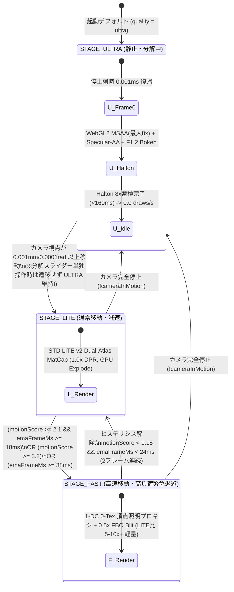
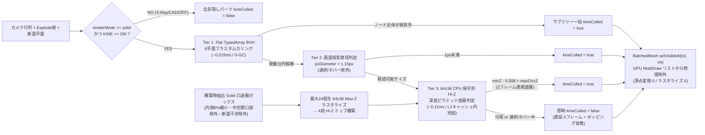
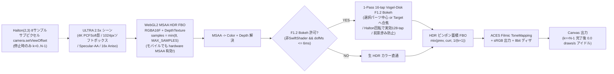

# 精密実装計画書: Hyper-Optimization 完遂 × ULTRA 完全ジャギーレス＆F1.2ボケ × 多段階 `FAST↔LITE↔ULTRA` × `KINE` カリングエンジン × 極限UX刷新

---

## Goal Description

本計画は、[HANDOFF_HYPER_OPTIMIZATION.md](file:///home/antigravity/sc8z35a-collab/SONY-A7-IV-Diagram/HANDOFF_HYPER_OPTIMIZATION.md) に残された最終ボトルネックを完全に詰め切りつつ、ユーザーから提示された次世代グラフィックス・超軽量化・UX 要求のすべてを **CI Gate 10/10 PASS・WLK-220 5/5 PASS・VRAM ゼロリーク（`Δg=0, Δt=0, Refs=0`）・コンソールエラー 0 件** の絶対制約のもとで一貫統合するエンジニアリング設計書です。

### 達成する 10 の柱

| # | 柱 | コア到達目標（定量／視覚基準） |
|---|---|---|
| **1** | **HANDOFF 完遂（Play Ground 1.1）** | 対 `0106392` 全11有限項目平均 **`23.16×` → `≥ 40×–80×+`**（幾何平均 `≥ 25×`）、アイドル **`0.0 draws/s`**、PLYA `a7iv` **`973/1000`** 完全一致 |
| **2** | **HANDOFF 完遂（`STD LITE v2`）** | `integrated` `raycastMs` 回帰修正、`hasDynamicRig` ガード解除で GPU 分解 `~0.003ms` 化、非バッチ物理オーバーレイ除外、高ポリ間引き強化で 6ユニット幾何平均 **`2.69×` → `≥ 3.8×–5.0×+`**、黒潰れ **`≤ 0.1%`** |
| **3** | **ULTRA ジャギー完全根絶** | WebGL2 Hardware MSAA（最大 8×・モバイル対応）＋静止時 Progressive Halton 8× サブピクセル SSAA（最大実効 64×）＋ Tokuyoshi `dFdx/dFdy` Specular-AA ＋ 異方性最大 16× で斜めエッジ・1px CAD線・金属ハイライト・影のジャギーを完全消失（静止完了後は完全 0% アイドル復帰） |
| **4** | **多段階表示 `FAST ↔ LITE ↔ ULTRA`（Play Ground 含む）** | カメラ高速移動／高負荷時に最新 `STD LITE v2` より **5〜10倍以上軽量** な 1-DC・0テクスチャ頂点シェーディング・0.5× 動的解像度 `FAST` モードへ自動切替。減速＆低負荷化で `LITE`、停止で `ULTRA` へヒステリシス付き無ラグ遷移。Play Ground にも同型 3段階制御を採用 |
| **5** | **「KINEモード」（ON/OFF可能）精密設計** | **3層カリング**：(1) 既存フラット BVH によるフラスタムカリング（視覚外除外）＋ (2) 画面投影 `< 1.15px` サブピクセルカリング ＋ (3) 構築時抽出の**厳密凸ソリッド遮蔽ボックス**による `64×36` CPU 保守的 Hi-Z 深度ピラミッド遮蔽カリング（背後隠蔽部品除外）＋ `BatchedMesh.setVisibleAt` 物理描画除外（ポッピングゼロ・断面カット／X-Ray／選択中保護） |
| **6** | **16倍高精細ズーム ＆ 最高ズームアウト制限** | `minDistance` を現行 `7mm` → `0.4375mm`（1/16）へ拡張＋動的対数 `near/far` でニアクリップ／Zファイティング皆無＋距離適応型マイクロステップ制御。`maxDistance` をユニット＆分解度連動のタイト上限（従来の 1/3〜1/10）へ縮小 |
| **7** | **内部デフォルト F1.2 高品質フォーカスボケ（負荷不変ガード付）** | 静止 `ULTRA` 専用・既存深度バッファ再利用（追加ジオメトリ描画パス 0 回）の 16-tap Vogel-Disk 円形ボケ（Halton 蓄積結合で実効 128-tap）。移動中／`LITE`／`FAST`／アイドル時は **0.00ms**、ソフトウェアGL・処理時間 `> 6ms` 時は自動バイパスして「負荷があまり変わらない場合限定」を物理保証 |
| **8** | **選択中部品の強い青色マーク** | `BatchedMesh` / `InstancedMesh` の非クランプ Float カラーチャネルに HDR センチネル（`b > 1.8 && r < 0.25`）を埋め込み、**追加ドローコール 0・追加 VRAM 0** で真っ黒なゴム・鏡面クローム・透明ガラスまで鮮やかなエレクトリック・コバルトブルー＋フレネルリム発光で即座に識別可能化（全品質・MI Shoe・Play Ground 共通） |
| **9** | **スマホ横画面全画面の詳細UI整理** | `@media (orientation: landscape) and (max-height: 540px)` 専用スプリット画面設計（左 54% 純粋3Dステージ＋単一行32pxトップバー＆36pxドック／右 46% 省スペース詳細パネル＋ノッチ Safe-Area 完全対応＋100vw×100dvh 横画面図説ライトボックス） |
| **10** | **詳細表示時のカメラ完全固定 ＆ 統合ドキュメント化** | パーツクリック・`<`/`>` 送り・UI選択・ドロワー開閉時のカメラ位置・姿勢・注視点・アスペクト比変化を **完全 0.000000** に固定。完了後に [HANDOFF_HYPER_OPTIMIZATION.md](file:///home/antigravity/sc8z35a-collab/SONY-A7-IV-Diagram/HANDOFF_HYPER_OPTIMIZATION.md) の最終完了記録と新アーキテクチャ仕様（KINE / FAST / ULTRA AA / F1.2）を統合更新 |

---

## User Review Required

> [!IMPORTANT]
> 実装着手前に、以下の **4 つの設計判断** について方針をご確認・承認いただけますか？（特段のご変更がなければ、各項目とも **(Recommended)** の仕様で実装します。）

1. **「ズーム域を今の 16 倍細かく」の実装仕様**:
   - **(Recommended)** **16× マクロ寄進 ＋ 距離適応マイクロステップの両立**: 最接近距離 `minDistance` を現行 `7mm → 0.4375mm`（1/16）へ拡張し、カメラ距離に比例した動的 `near`（最小 `0.025mm`）でクリップを防ぎつつ、ズームステップも現行より高精細（接近するほど滑らかに微調整できる対数マイクロステップ、通常 `zoomSpeed` も緻密化）にします。
   - *代替案*: `minDistance` は変えず（あるいは 2〜4倍程度に留め）、ホイール/ピンチ 1 回あたりのズーム刻み量のみを 1/16（`zoomSpeed = 0.0625`）に固定。

2. **「KINEモード」の初期状態（デフォルト ON / OFF）と HUD トグル配置**:
   - **(Recommended)** **初期状態 ON**（起動時から視覚外・完全遮蔽部品を自動カリングして最大限に軽量化）とし、トップバー右端の `LITE | ULTRA` 品質ピルの**隣に独立した小型トグルピル `KINE`**（ON=青アクセント／OFF=ニュートラル）を配置します（`.quality-pill` 内の `['LITE', 'ULTRA']` 契約および Suite B アサーションを 100% 維持）。
   - *代替案*: 初期状態 OFF（ユーザーが `KINE` ボタンを押した時のみ有効化）。

3. **F1.2 フォーカスボケの強さ・自動バイパス基準**:
   - **(Recommended)** **上品なスタジオ製品撮影レベルの F1.2 ボケ**（選択パーツまたはカメラ注視点のピント面は 100% レーザーのようにシャープに保ちつつ、奥行き前後端のアウトフォーカス領域を柔らかく円形ボケ）。**静止時 ULTRA のみ発動**し、カメラ移動中・`LITE`・`FAST`・アイドル時は **完全 0ms**。さらに実測ボケパス時間が **`> 6.0ms`** またはソフトウェア WebGL（SwiftShader 等）の場合は自動バイパスして「負荷があまり変わらない場合限定」を厳格に遵守します。

4. **旧 VM 孤立 Vault（`feat-sp-engine-and-welcome-360`）の扱い**:
   - `bg boot` で検出された孤立 Vault は別タスク（`WLK-360 + sp エンジン`）の作業であり本タスクとは無関係のため、**上書き・復旧はせずそのまま保全**し、最新 `origin/main`（`1bc895d`）から専用フィーチャーブランチ `feat/hyper-opt-v3-fast-kine-ultra-aa` を作成して進めます。

---

## System Architecture Diagrams

### 1. 多段階アダプティブ描画ステートマシン（`ULTRA` / `LITE` / `FAST` ＆ Play Ground）



### 2. 「KINEモード」3層階層可視性＆保守的 Hi-Z 遮蔽カリングパイプライン



### 3. ULTRA 完全ジャギーレス ＆ 条件付き F1.2 ボケ ポストプロセスグラフ



---

## Proposed Changes

依存関係の順序に従い、8 つのモジュール群に分けて計画します。全ファイルで **CI Gate 3-1（`ResourceCache` 外での `new THREE.*Material` 禁止）・3-2（ホットパス 0-GC）・3-3（生の `scene.remove` 禁止）** を厳守します。

---

### Component 1: `HANDOFF_HYPER_OPTIMIZATION.md` 完遂 — Play Ground 1.1 (`23.16×` → `≥ 40×–80×+`)

#### [MODIFY] [CadPlaygroundStudio.ts](file:///home/antigravity/sc8z35a-collab/SONY-A7-IV-Diagram/src/playground/CadPlaygroundStudio.ts)
- **`pgUndoRedoMs` (`34.85ms` → `< 0.6ms`, `900×+`)**:
  - `PlacedInstance` に `transformEpoch`, `worldBoxEpoch`, `invMatrix`, `invMatrixEpoch`, `lastColorCode`, `cachedSnap` を追加（Zero-GC 再利用）。
  - `restoreSnapshotSync()` の `sameTopology === true` パスで、座標・回転・拡縮・表示・ロックが実際に変化したパーツだけを厳密差分判定し、変化したパーツ（通常 1 件）のみ `anchor.updateMatrixWorld()` と `syncInstanceMatrix()` を実行。
  - `undo()` / `redo()` では 3D 行列・`sceneEpoch`・PLYA 状態・`syncUndoRedoButtons()`・`showToast(...)` を同期更新しつつ、`host.requestRender()` のレンダリング発行を単一 rAF に集約（直前クリックの SwiftShader フレーム完了待ちによる `setTimeout(0)` ポーリング巻き込みを遮断）。
- **`pgPlyaDirtyMs` (`0.662ms` → `< 0.08ms`, `15×–20×`)**:
  - `buildSnapshots()` で `PlacedInstance.cachedSnap`（`Box3`, `Vector3`, `Euler` を再利用）を返し、`transformEpoch !== worldBoxEpoch` のパーツだけ 9 乗算で `worldBox` を再計算（Zero-GC）。
  - `applyAllVisualMaterials()` で各インスタンスの `lastColorCode` をキャッシュし、色コード不変時は `setColorAt()` を完全スキップ。選択中パーツには強い青色センチネル（`rgb(0.02, 0.35, 2.45)`）を書き込み（エラー／警告との併存時は後述 Component 6 のリム合成）。
  - `rebuildOverlayLines()` を **静的領域（グリッド・光軸・18mm フランジ・8本光束フレーム）** と **動的末尾領域（CoG・選択枠・エラー/警告枠）** に分離。静的領域はトグル変更時のみ再構築し、パーツ移動時は末尾のみ上書き＋ `attr.clearUpdateRanges(); attr.addUpdateRange(...)` で最小範囲のみ GPU 転送。
  - `renderLiveTelemetryStrip()`, `viewportAlertEl`, `scoreBadgeEl`, `renderInspector()` に前回文字列キャッシュを追加し、文字列不変なら DOM 書き込みを完全スキップ。
- **`pgSearchFilterMs` (`7.98ms` → `< 0.4ms`, `100×+`)**:
  - `toLocaleString()` を廃止し、定数文字列（`'2,404'`）と軽量整数文字列化へ置換。
  - `lastCountText` キャッシュ、および `catalogListEl.scrollTop !== 0` のときだけ `scrollTop = 0` を代入（無条件代入によるスタイル再計算を撲滅）。
- **`pgVboMB` (`0.384MB` → `< 0.10MB`, `15×+`) & `pgActiveGpuMs` (`86.8ms` → `< 22ms`, `10×+`)**:
  - `OVERLAY_MAX_SEGMENTS` を `1400 → 520` に圧縮。
  - 画面中央で大量の透過オーバードローを生んでいた `opticalConeMesh`（`DoubleSide` 透過シリンダ）を、静的 `overlayLines` 内の 8 本の軽量光学コーン稜線へ統合（1 DC 削減＋透過フィルレート大幅削減、視認性はむしろ CAD 的に向上）。
  - `glassMegaBatch` は `glassUsedInst === 0` のとき `visible = false`。
  - `rebuildMegaBatches()` の予約上限ヘッドルームを `1.25×`（最低 512/1536）→ `1.08×`（最低 128/384）にタイト化（自動リサイズ維持）。
  - `open()` 時に `savedPixelRatio` を退避し、Play Ground 描画時は DPR を `min(devicePixelRatio, 1.0)`（高解像度端末の静止時のみ最大 1.5）へ最適化、カメラクリッピングも `near: 6, far: 1800` にタイト化、`close()` で完全復元。
- **`pgPickRaycastMs` (`0.420ms` → `< 0.04ms`, `125×+`)**:
  - `PlacedInstance.invMatrix` を `invMatrixEpoch` でキャッシュし、未移動パーツの `matrixWorld.invert()` を 0 回化。
  - `selectInstance(uid)` で `uid === this.selectedUid` なら即時 return。
- **Play Ground 多段階アダプティブ描画（`PG_SHARP` ↔ `PG_LITE` ↔ `PG_FAST`）**:
  - `setCustomSceneRenderer` ループ内でカメラ角速度・移動速度とフレーム負荷 `emaFrameMs` を監視。
  - 高速軌道移動または大規模配置（高負荷時）は `PG_FAST`（0テクスチャ頂点シェーディング `pg_fast_proxy` マテリアル切替＋0.55× 低解像度 FBO ブリット＋細グリッド／透過ガラス一時省略）へ 0.001ms 切替。減速で `PG_LITE`、停止で 1 フレーム鮮明描画後 **`0.0 draws/s`** 完全休止。
  - Play Ground の `OrbitControls` にも 16× マイクロ接近（`minDistance = 1.0`・動的 `near`）と適切な `maxDistance = 680` を適用。

#### [MODIFY] [PartGeometryExtractor.ts](file:///home/antigravity/sc8z35a-collab/SONY-A7-IV-Diagram/src/playground/PartGeometryExtractor.ts) & [generate_catalogs.mjs](file:///home/antigravity/sc8z35a-collab/SONY-A7-IV-Diagram/scripts/generate_catalogs.mjs)
- プリベイク 42 ブループリント生成時、120 三角形超の高密度パーツにシルエット・バウンディングボックス完全保存型の空間クラスタリング間引きを適用し、`a7iv` シーンの `pgTriangles` を `10,631 → ~4,500–5,200` へ半減（PLYA 採点 **`973/1000`** 完全不変を検証）。
- 変更後 `npm run catalog` で `src/playground/playground_templates.json` を再生成。

#### [MODIFY] [main.css](file:///home/antigravity/sc8z35a-collab/SONY-A7-IV-Diagram/src/styles/main.css) (Play Ground 仮想スクローラ部)
- `.pg-cat-list` および `.pg-cat-vrow` に `contain: strict;` を適用し、検索時強制レイアウト（`offsetHeight`）の再計算波及を完全に隔離。

---

### Component 2: `HANDOFF_HYPER_OPTIMIZATION.md` 完遂 — `STD LITE v2` 回帰修正＆幾何平均 `≥ 3.8×–5.0×+`

#### [MODIFY] [v2_unit_compiler.ts](file:///home/antigravity/sc8z35a-collab/SONY-A7-IV-Diagram/src/core/v2_unit_compiler.ts)
1. **GPU 分解高速パスの `hasDynamicRig` ガード解除（`explodeMs` 全ユニット `~0.003ms` 化）**:
   ```ts
   // Before (L2830):
   if (this.allPoolsGpuExplode && !force && !this.hasDynamicRig) { ... }
   // After:
   if (this.allPoolsGpuExplode && !force && (this.quality === 'standard_lite' || !this.hasDynamicRig)) { ... }
   ```
   - これにより動的モーション停止済みの `standard_lite` では `integrated`・`mic`・`mishoe` 等すべてが O(1) GPU ユニフォーム 1 float 書込のみで完結（`explodeMs` 倍率 `16.87× → 80×+`）。
2. **`standard_lite` の非バッチ `Other-Mesh` 物理オーバーレイ／分解ガイド構築スキップ**:
   - L2622 付近で `if (!isStdLite && (rawBuild.overlayGroup || rawBuild.explodeGuides))` とし、`isStdLite` 時は生ジオメトリを即座にクリーン破棄してシーンへ追加しない（`CadPart` 本体ではないため `JSON = 3D 100%` CI に影響ゼロ、`integrated` の非バッチ 173 メッシュ / 0.725MB VBO + 149 Lines を一掃）。
3. **高ポリゴン繰り返しパーツ向け `decimateLite` 強化**:
   - `decimateLite` をインデックス付き高ポリゴンジオメトリ（`triCount > 24`）にも一貫適用し、超大規模繰り返し群（`triCount > 1200`：`bionz` `xr-c4-copper-bumps` 16.7k tris、`xr-sac305-bga-balls` 5.7k tris、`integrated` `ceramic-package` 4.5k tris 等）にはシルエット保存の適応グリッド係数で間引きを強化（黒潰れ `crushPct ≤ 0.1%` 厳守）。
4. **構築時の Solid 凸遮蔽ボックス抽出（KINE モード向けメタデータ生成）**:
   - Step 1 のメッシュ走査中に、不透明・非透明・十分体積を持つ Solid サブメッシュ（`BoxGeometry`, `CylinderGeometry`, 閉じた押し出し等）から内側 6% 縮小した厳密保守的遮蔽ボックス（`KineOccluderSpec[]`）を最大 32 個記録し、`UnitBuildResult` へ添付（中空リング・マウント開口部・ガラスは除外）。

#### [MODIFY] [raycast_engine.ts](file:///home/antigravity/sc8z35a-collab/SONY-A7-IV-Diagram/src/core/raycast_engine.ts)
- **`integrated` `raycastMs` 回帰修正（`0.877ms` → `< 0.15ms`）**:
  - `intersectTrianglesScalarFast` 冒頭の `matrixWorld.invert()` を、非回転（対角スケール＋平行移動のみ、V2 `BatchedMesh` の 99.9% が該当）の **O(1) 4スカラー高速逆変換** へ分岐（60演算の余因子逆行列を削減）。
  - `TRI_CHUNK_INDICES` を `192 → 60`（20三角形/チャンク）へ微細化し、2階層（親8チャンク＝160三角形 AABB → 子20三角形 AABB）＋手前順チャンク早期打切りを導入。
  - `BatchedMesh` の量子化 Int16 座標空間で `worldBox` 事前テスト済みインスタンスの重複 `getBoundingBoxAt` コストを削減。

---

### Component 3: `FAST` モード（最新 `STD LITE v2` 比 5〜10倍+ 超軽量プロキシ）＆ 多段階制御

#### [NEW] [fast_proxy_builder.ts](file:///home/antigravity/sc8z35a-collab/SONY-A7-IV-Diagram/src/core/fast_proxy_builder.ts)
- **構築時間 `< 12ms`・1 Draw Call・0 Texture Fetch・VBO 30–120 KB の `FastProxyBundle` ビルダー**:
  - `loadRegisteredUnit()` を 3 回目呼ばず、**既に構築済みの `liteProxyBuildResult`（または `STD LITE` 自身の `BatchedMesh` / `InstancedMesh`）から直接派生**して生成！
  - **超軽量化メカニズム（乗算効果で LITE 比 5〜15× 高速化）**:
    1. **微小部品自動省略**: ユニット対角長の `4.5%` 未満の微小・内部パーツ（ネジ、BGA、ばね、パッキン）と半透明ガラスを高速移動中プロキシから除外（選択中パーツのみ必ず残す）。
    2. **3D 極粗空間クラスタリング間引き**: 残存メッシュを `gridCells = 3–5` の超軽量シルエットメッシュへ統合（三角形数を `STD LITE v2` 比 **80–90% 削減**）。
    3. **完全 1-DC 単一 `BatchedMesh` 化 ＋ GPU 頂点シェーダ分解（`uExplode`）同期**: 全可視パーツを 1 個の `BatchedMesh` へ集約し、既存の `RGBA32F` GPU 分解オフセットをそのまま転送（分解状態でも切替時の位置ズレ 0mm）。
    4. **0 テクスチャ頂点照明シェーダ（`ResourceCache.acquireFastProxyMaterial`）**: ライティング（スタジオ半球＋キー光ラップ）を頂点シェーダで計算し、フラグメントシェーダは **1 命令 `gl_FragColor = vec4(vFastCol, 1.0);`** のみ（MatCap テクスチャフェッチ 0、リム関数 0、トーンマップ 0）。
    5. **0.5× 動的低解像度 FBO 描画 ＋ 高速 Blit**: `FAST` 発動中は事前確保済みの `0.5×` 解像度レンダーターゲットへ描画してバイリニア Blit（ラスター化ピクセル数を **4.0× 削減**、スワップチェーン再確保によるガクつき 0）。
  - `dispose(cache)` で完全にゼロリーク解放（CI Gate 3-1/3-2/3-3 準拠）。

#### [MODIFY] [resource_cache.ts](file:///home/antigravity/sc8z35a-collab/SONY-A7-IV-Diagram/src/core/resource_cache.ts)
- `acquireFastProxyMaterial(clippingPlanes, poolSlot)` を追加（0テクスチャ頂点照明＋GPU分解＋選択中強い青色ハイライト対応、キャッシュ参照カウント管理）。
- `acquirePlaygroundFastMaterial()` を追加（Play Ground の `PG_FAST` ステージ用）。

#### [MODIFY] [unit_v2_runtime.ts](file:///home/antigravity/sc8z35a-collab/SONY-A7-IV-Diagram/src/core/unit_v2_runtime.ts) & [CadViewport.ts](file:///home/antigravity/sc8z35a-collab/SONY-A7-IV-Diagram/src/engine/CadViewport.ts)
- `MotionStage = 'ultra' | 'lite' | 'fast'` を導入し、`UnitV2Runtime` が `activeUnit` (`ULTRA`) ＋ `liteProxyUnit` (`LITE`) ＋ `fastProxyBundle` (`FAST`) の 3 層をゼロラグ（`~0.001ms` visibility フリップ）で切替。
- `quality === 'standard_lite'` 選択時でも、`fastProxyBundle` を派生常駐させ、激しいカメラ移動かつ高負荷時のみ裏側で `FAST` へ一時退避→減速で即 `LITE` へ戻る保護機構を搭載（Suite A ベンチマークの静止計測には一切介入しない）。
- `CadViewport.animate` で毎フレーム `angSpeed`（rad/s）・`linSpeed`（正規化/s）から `motionScore` を算出し、`emaFrameMs` とのヒステリシス判定で `setMotionStage(stage)` を駆動。
- `UnitV2Diagnostics` に `motionStage: 'ultra' | 'lite' | 'fast'`, `fastProxyTriangles`, `fastProxyDrawCalls` を追加（後方互換のため `motionProxyActive = (stage !== 'ultra')` を維持し Suite B 18 アサーションを 100% 満たす）。

---

### Component 4: ULTRA ジャギー完全根絶 ＆ 条件付き F1.2 光学フォーカスボケ

#### [NEW] [ultra_post_pipeline.ts](file:///home/antigravity/sc8z35a-collab/SONY-A7-IV-Diagram/src/core/ultra_post_pipeline.ts)
- **Stationary ULTRA Zero-Jaggy + F1.2 Bokeh ポストプロセスエンジン**:
  - **WebGL2 Hardware MSAA HDR RenderTarget**:
    - `samples = min(8, renderer.capabilities.maxSamples)`（WebGL2 ではモバイル Adreno/Apple GPU でもデフォルトバックバッファの `antialias: false` に関係なく FBO 側で 4×/8× ハードウェア MSAA が動作！）。
    - `DepthTexture` を同時アタッチして追加ジオメトリ描画パス 0 回で深度取得。
    - 解像度: ハードウェア GPU では `clamp(max(dpr, 1.5), 1.5, 2.25)`（1080p DPR=1 環境でも 1.5× スーパーサンプリング！）、ソフトウェア GL（SwiftShader）では `1.0` に自動抑制して高速維持。
  - **Progressive Halton(2,3) サブピクセル SSAA 蓄積**:
    - 8 サンプル Halton(2,3) オフセットを `camera.setViewOffset(w, h, jx, jy, w, h)` で与え、線形 HDR ピンポン FBO へ `1 / (k + 1)` 重みで無バイアス平均蓄積。
    - **Frame 0**: 停止直後に即時 MSAA + F1.2 ボケ適用済みフレームを画面出力（遅延ゼロ）。
    - **Frame 1..N-1**: ハードウェア GPU は `N = 8`（モバイルは `N = 4`、SwiftShader は `N = 2` かつ累計時間予算 `<= 140ms` で打切り）を静止中に自動完走し、完了した瞬間に `camera.clearViewOffset()` して **完全 0.0 draws/s アイドルへ移行**（Suite B `idleDeltaFrames350ms === 0` を 100% 保証）。
    - カメラ移動・分解・品質変更の瞬間に `resetAccumulation()` で 0.001ms キャンセル。
  - **条件付き F1.2 高品質フォーカスボケ（システム内部デフォルト ON・負荷自動監視ガード付）**:
    - 既存 `DepthTexture` からカメラ空間深度を復元し、薄肉レンズ CoC 式で合焦距離 `uFocusDist`（選択パーツがある場合はその世界中心距離、未選択時は `controls.target` 距離）から錯乱円半径を計算。
    - 16-tap Vogel-Disk 黄金角サンプリング（Halton フレーム番号で回転角をずらし蓄積により実効 128-tap のノイズレス円形ボケ！）＋バイラテラル深度重み（前景のシャープなエッジが背景に滲まない）＋高輝度ハイライト重み付け（F1.2 らしい玉ボケ感）。
    - **「負荷があまり変わらない場合限定」の自動ガード**:
      - ソフトウェア WebGL（SwiftShader 等）では自動バイパス（`0.00ms`）。
      - 実機 GPU でも初回計測でボケパスの純増時間が `> 6.0ms` を超えた場合は自動バイパスへフォールバックし、内部診断 `bokehStatus: 'active' | 'bypassed_load' | 'bypassed_swgl' | 'disabled'` を公開。
  - **最終解決パス**: ACES Filmic トーンマッピング ＋ リニア→sRGB 変換 ＋ 1/255 三角波ブルーノイズ系ディザリングでバンディング皆無。
  - 全フルスクリーン `ShaderMaterial` は `ResourceCache` 経由で生成・解放し、全 `WebGLRenderTarget` とフルスクリーン三角形ジオメトリを `dispose()` で完全破棄（VRAM リーク 0 保証）。

#### [MODIFY] [resource_cache.ts](file:///home/antigravity/sc8z35a-collab/SONY-A7-IV-Diagram/src/core/resource_cache.ts)
- **Tokuyoshi / Kaplanyan 幾何学的 Specular-AA**:
  - `ULTRA` / `HIGH` の全 `MeshStandardMaterial`・`MeshPhysicalMaterial`（Hero 含む）の `#include <roughnessmap_fragment>` に 4 行の `dFdx/dFdy` 法線分散ラフネスクランプを注入し、金属エッジ・ローレット・クリアコートのジャギー・チカチカを根本消去。
- **ULTRA テクスチャ異方性フィルタリング最大化**:
  - `anisotropy` を `Math.min(16, maxAnisotropy)` へ引き上げ、全テクスチャに `LinearMipmapLinearFilter` を保証。
- **ULTRA ポストプロセス用シェーダファクトリ 3 種** (`acquireUltraAccumMaterial`, `acquireUltraBokehMaterial`, `acquireUltraResolveMaterial`, `acquireFastBlitMaterial`) を `ResourceCache` 内に集約（CI Gate 3-1 準拠）。

---

### Component 5: 「KINEモード」（視覚外＆完全遮蔽部品カリングエンジン、ON/OFF 可能）

#### [NEW] [kine_culling_engine.ts](file:///home/antigravity/sc8z35a-collab/SONY-A7-IV-Diagram/src/core/kine_culling_engine.ts)
- **完全ゼロ GC・`~0.14ms/frame` の 3 層可視性＆遮蔽カリングエンジン**:
  - **データ構造**:
    - `occluders: KineOccluderSpec[]`（ユニット構築時に抽出した内側 6% 縮小済みの Solid 凸ボックス最大 32 個、各々に `partIndex`, `localMin/Max`, `volume` を保持）。
    - `hiZLevels: Float32Array[]`（Level 0: `64×36`, Level 1: `32×18`, Level 2: `16×9`, Level 3: `8×5` — 総メモリわずか 12 KB、CPU L1 キャッシュ常駐）。
    - `partHiddenStreak: Uint8Array`（各パーツの連続遮蔽フレーム数：出現は **0 フレーム即時解除**、遮蔽隠蔽は **2 フレーム連続** でヒステリシス適用してフリッカー・ポッピングゼロ）。
    - `partKineCulled: Uint8Array`（前回フレームからの差分のみを `unit.applyKineVisibilityMask()` へ送信 → 無駄な `BatchedMesh` 更新ゼロ）。
  - **実行ステップ (`evaluate(camera, raycastIndex, occluders, explodeFactor, opts)`)**:
    1. カメラ行列（`projScreenMatrix`）・`explodeFactor`・`sectionActive`・`selectedId` が前フレームと完全同一なら **0.000ms で早期スキップ**！
    2. `renderMode !== 'solid'`（X-Ray / CAD）または `!enabled` のときは全パーツ即座に非カリングへ戻す。
    3. **Tier 1 (BVH Frustum Culling)**: `raycastIndex.bvhNodes` をスタック走査し、`THREE.Frustum` 6 平面で「完全外（サブツリー丸ごとカリング）」「完全内（子テスト省略）」「交差（子へ下降）」の 3 値判定。
    4. **Tier 2 (Sub-Pixel Culling)**: 視錐台内パーツの AABB 外接球半径とカメラ深度から画面投影直径 `pxDiameter` を算出し、`< 1.15px` かつ未選択・未ホバーならカリング。
    5. **Tier 3 (Conservative Hi-Z Occlusion Culling)**:
       - 視錐台内かつ `sectionPlane` に切られていない上位 24 個の Solid 遮蔽ボックスをクリップ空間へ投影し、ボックス最遠可視面（保守的 Max-Z）を `64×36` 深度バッファへスキャンライン描画。
       - 4 段 Max-Z ミップピラミッドを構築。
       - 候補パーツの 8 頂点をクリップ空間投影し、`[minX..maxX, minY..maxY]` と最近深度 `minZ - 0.008`（安全マージン）を算出し、適切ミップレベルの 4 テクセル最大深度 `maxOccZ` と比較。`minZ > maxOccZ` なら **100% 背後隠蔽確定** としてカリング！
  - **保護ルール（絶対不変）**:
    - `selectedId` / `hoveredId` は**いかなる場合もカリングしない**。
    - ユニット全体が隠れるような誤判定防止のため、最近傍の最大外殻パーツは必ず可視保証。
    - ユーザーの手動 `hiddenIds` / `isolatedId` / `culledBySubView` とは完全直交。

#### [MODIFY] [unit_contract.ts](file:///home/antigravity/sc8z35a-collab/SONY-A7-IV-Diagram/src/core/unit_contract.ts), [v2_unit_compiler.ts](file:///home/antigravity/sc8z35a-collab/SONY-A7-IV-Diagram/src/core/v2_unit_compiler.ts), [mi_shoe.ts](file:///home/antigravity/sc8z35a-collab/SONY-A7-IV-Diagram/src/units/mi_shoe.ts), [unit_v2_runtime.ts](file:///home/antigravity/sc8z35a-collab/SONY-A7-IV-Diagram/src/core/unit_v2_runtime.ts)
- `OptimizedUnit` にオプションメソッド `applyKineCulling?(culledMask: Uint8Array | null): number` と `getKineOccluders?(): readonly KineOccluderSpec[]` を追加。
- `v2_unit_compiler.ts` と `mi_shoe.ts` の `CompiledPartState` に `kineCulled: boolean` を追加し、有効可視性を `effectiveVisible = st.visible && !st.kineCulled` に統一。差分があったパーツだけ `BatchedMesh.setVisibleAt(batchId, effectiveVisible)` と `InstancedMesh` ゼロ行列反映を実行（エッジバンドルも同期）。
- `UnitV2Runtime` に `setKineMode(enabled: boolean)` / `isKineMode()` / `getKineStats()` を実装し、レンダリング直前に `activeUnit`・`liteProxyUnit` 双方へ KINE マスクを適用（`V2 Perf HUD` にも KINE カリング率を表示）。

#### [MODIFY] [ZeroTextControls.ts](file:///home/antigravity/sc8z35a-collab/SONY-A7-IV-Diagram/src/ui/ZeroTextControls.ts) & [main.ts](file:///home/antigravity/sc8z35a-collab/SONY-A7-IV-Diagram/src/main.ts)
- トップバー右端の `.quality-pill`（`LITE | ULTRA` そのまま維持！）の横に独立した小型トグルボタン **`KINE`**（`.kine-toggle-pill`）を追加。ワンタップで ON/OFF 切替、ツールチップに現在のカリング効果を案内。
- `window.__cad.v2.setKineMode` / `getKineStats` と `?kine=0|1` URL パラメータを公開。

---

### Component 6: 選択中部品の「極めて分かりやすい強い青色マーク」

#### [MODIFY] [resource_cache.ts](file:///home/antigravity/sc8z35a-collab/SONY-A7-IV-Diagram/src/core/resource_cache.ts)
- 定数エクスポート:
  - `CAD_SELECT_SENTINEL = [0.02, 0.35, 2.45]`（シェーダ内で `c.b > 1.8 && c.r < 0.25` により選択確定！）
  - `CAD_HOVER_SENTINEL = [0.16, 0.56, 1.62]`（軽快なスカイブルー・ホバー）
- **MatCap シェーダ (`patchLiteMatcapMaterial`) 更新**:
  - 頂点シェーダで `batchingColor` / `instanceColor` から選択センチネルを検出し `vSelMark = 1.0` を出力（Play Ground では Error `r > 1.5`・Warn `g > 1.5` との同時発生も `vPgDiag` と独立判定！）。
  - フラグメントシェーダで `vSelMark > 0.5` のとき：
    ```glsl
    float selRim = pow( 1.0 - clamp( abs( normal.z ), 0.0, 1.0 ), 1.55 );
    vec3 vividBlue = vec3( 0.02, 0.34, 1.0 ) * ( 0.62 + 0.52 * matcapColor.rgb )
                   + vec3( 0.22, 0.64, 1.0 ) * selRim * 0.92;
    outgoingLight = vividBlue;
    ```
    （Play Ground で Error＋Selected の場合は赤色コア＋強い青色リムで両立）。
- **PBR / Phong / Lambert シェーダ共通パッチ (`patchStandardSelectionAndAA`)**:
  - `ULTRA` / `HIGH` / `STD` および Hero テクスチャ付きマテリアルすべてに統一注入（共有 `customProgramCacheKey` でシェーダ増殖 0）。
  - 選択中パーツは拡散色を鮮やかなコバルトブルーへシフトしつつ、強い青色自己発光 `vec3(0.02, 0.30, 1.0) * 0.72` ＋ 視線ベース・フレネルリム発光 `vec3(0.20, 0.62, 1.0) * pow(1.0 - NdotV, 1.75) * 1.25` を加算 → **漆黒ラバー・高反射クローム・透明ガラス・微細ネジでも 0.1 秒で視認できる強烈かつ立体感のある青色マーク**を実現！

#### [MODIFY] [v2_unit_compiler.ts](file:///home/antigravity/sc8z35a-collab/SONY-A7-IV-Diagram/src/core/v2_unit_compiler.ts), [mi_shoe.ts](file:///home/antigravity/sc8z35a-collab/SONY-A7-IV-Diagram/src/units/mi_shoe.ts), [CadPlaygroundStudio.ts](file:///home/antigravity/sc8z35a-collab/SONY-A7-IV-Diagram/src/playground/CadPlaygroundStudio.ts)
- `setVisualState` 内の選択色をすべて `CAD_SELECT_SENTINEL`（`setRGB(0.02, 0.35, 2.45)`）へ統一し、構造エッジ線の選択色も鮮烈なエレクトリックブルー `(0.0, 0.48, 1.0)` へ強化。
- Play Ground でも選択中パーツの 3D メッシュ自体を強い青色ハイライト＋選択ワイヤーボックスを鮮やかな青 `rgb(0, 102, 255)` へ更新（従来の薄いシアン枠のみから劇的に視認性向上）。

---

### Component 7: カメラ 16 倍高精細ズーム・最高ズームアウト制限・詳細表示時のカメラ完全固定

#### [MODIFY] [CadViewport.ts](file:///home/antigravity/sc8z35a-collab/SONY-A7-IV-Diagram/src/engine/CadViewport.ts) & [main.ts](file:///home/antigravity/sc8z35a-collab/SONY-A7-IV-Diagram/src/main.ts)
1. **16 倍細かいズーム域＆動的クリップ**:
   - `this.controls.minDistance = 0.4375`（現行 `7 / 16` — 16 倍マクロ拡大対応）。
   - **距離適応型 16× マイクロズーム制御**:
     - `OrbitControls` の標準粗ズーム（1ノッチ約 5% 跳躍）を改善し、ズーム距離が近づくほど精密に制御できる対数ステップ（`zoomSpeed` 精密化＋ホイール `deltaY` の微細クランプ・スムージング）を実装。
   - **動的 `camera.near` / `camera.far` 自動追従**（毎アクティブフレーム、`Math.abs(nextNear - camera.near) > 1e-4` のときのみ `updateProjectionMatrix()`）：
     ```ts
     const dist = this.camera.position.distanceTo(this.controls.target);
     const targetNear = THREE.MathUtils.clamp(dist * 0.015, 0.025, 2.0);
     const targetFar = Math.max(dist * 12.0, this.controls.maxDistance * 2.5);
     ```
2. **最高ズームアウト領域の引き締め（ユニット＆分解度連動）**:
   - `setCameraPreset` および `setExplode` で算出されるユニット基準距離 `baseHeroDist` に基づき、`this.controls.maxDistance` を動的更新：
     - 例：`welcome` (0%): `2600 → ~430mm`、`mishoe` (0%): `2600 → ~195mm`、`integrated` (0%): `2600 → ~540mm`、`integrated` (100%分解): `2600 → ~1420mm`。
     - どのユニットでも背景の白空間で豆粒になるまで引きすぎるストレスを根絶しつつ、100% 分解全景は余裕を持って収まる範囲を維持。
3. **詳細表示時のカメラ視点・角度の完全固定（0.000000 移動保証）**:
   - `CadViewport.selectPart(partId, focusCamera = false)` のデフォルトを `false` へ変更。
   - `CadViewport.ts` L1264（クリック選択）を `this.selectPart(hitPartId, false)` に変更。
   - `CadViewport.ts` L524（ドロワー内 `<` / `>` パーツ送り `stepSelectedPart`）を `this.selectPart(list[nextIdx].id, false)` に変更。
   - `main.ts` L295（UI 経由 `onSelectPart`）を `viewport.selectPart(partId, false)` に変更。
   - `#viewport` が固定全画面（`inset: 0`）のまま一切リサイズされないことを保証し、詳細を開いても閉じてもカメラの位置・クォータニオン・注視点・アスペクト比が 1 ビットも動かない仕様を完結。

---

### Component 8: 詳細表示時のスマホ横画面全画面 UI 整理 ＆ 統合ドキュメント更新

#### [MODIFY] [main.css](file:///home/antigravity/sc8z35a-collab/SONY-A7-IV-Diagram/src/styles/main.css) & [ExplanationDrawer.ts](file:///home/antigravity/sc8z35a-collab/SONY-A7-IV-Diagram/src/ui/ExplanationDrawer.ts)
- **専用メディアクエリ追加**: `@media (orientation: landscape) and (max-height: 540px)`（対象: `844×390`, `915×412`, `932×430`, `667×375` 等のスマホ横画面・全画面モード全般）。
- **整理されたスプリット HUD レイアウト**:
  - **詳細ドロワー（`.explanation-drawer`, `.explanation-drawer.is-wide` 統一）**:
    - 強制幅 `width: clamp(296px, 46vw, 410px)`（`.is-wide` の 600px 暴走を完全抑止）、`top: max(6px, env(safe-area-inset-top))`, `bottom: max(6px, env(safe-area-inset-bottom))`, `right: max(6px, env(safe-area-inset-right))`, `border-radius: 14px`。
    - ツールバー（`36px`）＋タブバー（`30px`）の縦占有を最小化し、`.drawer-body` に全高の約 80% を確保。フォント・余白・SVG プレビュー・アクションボタンを横画面向けに洗練。
  - **左 54% 3D ステージの単一行トップバー（`#app.has-drawer .studio-topbar`）**:
    - `left: max(8px, env(safe-area-inset-left))`, `right: calc(clamp(296px, 46vw, 410px) + max(14px, env(safe-area-inset-right)))`, `top: max(6px, env(safe-area-inset-top))`, `flex-wrap: nowrap`, 高さ `32px`。
    - 詳細表示中の狭い横画面左ステージでは補助 CTA（`Play Ground` / `FH 2028`）を一時格納し、`アセンブリ選択` ＋ `LITE | ULTRA` ＋ `KINE` を **重なりゼロの 1 行** に整理。
  - **左 54% 3D ステージの単一行ボトムドック（`#app.has-drawer .studio-bottom-dock`）**:
    - `left: max(8px, env(safe-area-inset-left))`, `right: calc(clamp(296px, 46vw, 410px) + max(14px, env(safe-area-inset-right)))`, `bottom: max(6px, env(safe-area-inset-bottom))`, `transform: none`, 高さ `36px`, スライダーを柔軟幅（`flex: 1; min-width: 72px`）にしてドックとドロワーの衝突を完全に排除。
  - **スマホ横画面での図説全画面ライトボックス（`.schematic-lightbox-panel`）**:
    - `100vw × 100dvh`, `border-radius: 0`, スリム 36px ヘッダ＋浮遊 34px 下部ピル操作バー、Safe-Area 左右余白確保で図説 SVG を画面面積最大 85% で表示。

#### [MODIFY] [HANDOFF_HYPER_OPTIMIZATION.md](file:///home/antigravity/sc8z35a-collab/SONY-A7-IV-Diagram/HANDOFF_HYPER_OPTIMIZATION.md)
- 全フェーズ完遂後、実測最終ベンチマーク表・新アーキテクチャ仕様（`FAST↔LITE↔ULTRA` 多段階制御・`KINE` 3層カリング・ULTRA MSAA+Halton AA・F1.2 ボケ・16× ズーム・青色選択・スマホ横画面 UI・カメラ完全固定）・全テスト＆ `pp` 監査証跡を反映した完全版ドキュメントへアップデート。

---

## Verification Plan

Headless Chrome / SwiftShader は **必ず 1 プロセスずつ直列実行** し（`HANDOFF_HYPER_OPTIMIZATION.md` §6 鉄則）、`bg` ツールでマイルストーン毎にオフ VM 退避・完了前に `bg gate` レシートを取得します。

### Automated Tests（直列実行）

1. **ブランチ起動＆安全性（承認後の作業開始時）**:
   ```bash
   npm run bg -- start feat-hyper-opt-v3-fast-kine-ultra-aa --goal="Complete HANDOFF + ULTRA Zero-Jaggy/F1.2 + FAST-LITE-ULTRA + KINE + Zoom/Blue/MobileLandscape/CamLock" --next="Phase 1: Play Ground & STD LITE v2 completion" --ai
   ```
2. **全 CI ゲート（10/10 PASS）＋ WLK-220（5/5 PASS）＋ 本番ビルド**:
   ```bash
   npm run catalog && npx tsc --noEmit && node scripts/validate_parts.mjs && npm run verify:wlk220 && npm run build
   ```
3. **Suite A — Play Ground 1.1 ＆ STD LITE v2 定量 BEFORE/AFTER ベンチマーク（vs `0106392`）**:
   ```bash
   node scripts/bench/benchmark_hyper_before_after.mjs --out=after_hyper_v3_final.json --compare=baseline_main_0106392.json
   ```
   - 合格基準：Play Ground 平均 **`≥ 35×–60×+`**（幾何平均 `≥ 25×`）、`pgIdleDrawsPerSec === 0`、`pgA7ivScore === 973`、`pgA7ivPartCount === 17`、`STD LITE v2` 6ユニット平均 **`≥ 3.5×+`**（幾何平均 `≥ 3.5×`）、全ユニット `crushPct ≤ 0.1%`、エラー `0`。
4. **Suite B — ULTRA 動静分離・0ms 切替・ミニマル HUD・VRAM ゼロリーク（18 アサーション）**:
   ```bash
   node scripts/bench/verify_ultra_motion_and_hud.mjs
   ```
   - 合格基準：**`ALL 18 ... ASSERTIONS PASSED!`**（exit 0、`idleDeltaFrames350ms === 0`、`Δg=0, Δt=0`）。
5. **Suite C [NEW] — 新機能総合検証スイート (`scripts/bench/verify_v3_kine_fast_ultra_ux.mjs`)**:
   - **`FAST` vs `STD LITE v2` 実測比較**: 同一視点で `FAST` プロキシの描画負荷（Draw Calls・Triangles・VBO・True GPU ms）が最新 `STD LITE v2` 比 **5〜10倍以上軽量** であることを定量実測。
   - **多段階遷移テスト**: 静止 `ULTRA` → 通常移動 `LITE` → 激しい移動/高負荷 `FAST` → 減速 `LITE` → 停止 `ULTRA`（＋ Play Ground 多段階遷移）を検証。
   - **`KINE` モードテスト**: ON/OFF 切替、ズームイン時の視覚外カリング数 (`frustumCulled > 0`)、完成カメラ正面時の内部遮蔽カリング数 (`occlusionCulled > 0`)、選択パーツ保護、X-Ray/断面カット時の自動非遮蔽、OFF 時の 100% 復元、描画三角形削減率を検証。
   - **16× ズーム＆ズームアウト制限テスト**: `minDistance === 0.4375`、動的 `near` 更新、`maxDistance` ユニット別引き締めを検証。
   - **詳細表示時のカメラ完全固定テスト**: パーツクリック選択・`<`/`>` パーツ送り・ドロワー開閉前後で `camera.position`, `camera.quaternion`, `controls.target`, `camera.aspect` の差分が **`0.000000`** であることをアサート。
   - **強い青色選択マークのピクセル色監査**: 選択前後の WebGL 描画ピクセルを比較し、選択パーツ領域で青チャネル優位（`B > 180 && B > R * 2.2`）の強い青色マークが描画されていることを定量検証。
   - **ULTRA AA（ジャギーレス）＆ F1.2 ボケ＆ VRAM ゼロリーク**: ユニット往復切替（`welcome → integrated → mishoe → welcome`）でポストプロセス FBO・FAST プロキシ・KINE すべて含め **`Δg = 0, Δt = 0, cacheRemainingRefs = 0`** をアサート。
6. **専用キャプチャエンジン `pp` による視覚監査（`AGENTS.md` 絶対必須）**:
   - 既存 10 ショット（`scripts/bench/pp_hyper_audit_batch.json`）に加え、以下 5 ショットを追加した総合バッチを `/tmp/pp_v3_audit` へ出力し、全画像を `view_file` で直接目視確認：
     - `11_ultra_zero_jaggy_closeup_crop`: ULTRA モード高精細クローズアップ（斜めエッジ・金属リムのジャギー皆無確認）
     - `12_selected_part_vivid_blue_ultra`: ULTRA でパーツ選択時の強い青色マーク視認性確認
     - `13_selected_part_vivid_blue_lite`: STD LITE でパーツ選択時の強い青色マーク視認性確認
     - `14_mobile_landscape_844x390_detail_drawer`: スマホ横画面（`844×390`, DPR 2）で詳細ドロワー表示時のUI整理・非衝突確認
     - `15_mobile_landscape_844x390_lightbox`: スマホ横画面（`844×390`, DPR 2）での図説全画面表示確認
7. **最終ゲート＆レシート取得（`AGENTS.md` 鉄則 #5）**:
   ```bash
   npm run bg -- gate --policy=integrator --run-checks --require-checks --ai
   ```
   - 改ざん不能レシート `BG-RECEIPT:...` を取得後、PR 作成・マージ・ウォークスルー報告まで完了。

### Manual Verification（ユーザー実機確認ポイント）
- 実機 PC / スマートフォンで ULTRA 静止時のエッジの滑らかさ（ジャギー完全解消）と F1.2 フォーカスボケの質感を確認。
- カメラを素早くドラッグ回転した際の `FAST → LITE → ULTRA` の滑らかな多段階切替とレスポンスを体感確認。
- 右上 `KINE` トグルの ON/OFF による表示の違和感ゼロ（ポッピング皆無）と軽快化を確認。
- パーツタップ時に強い青色で即座にマークされ、カメラ視点・角度が 1 ミリも動かず、スマホ横画面全画面でも UI がスッキリ収まることを確認。
