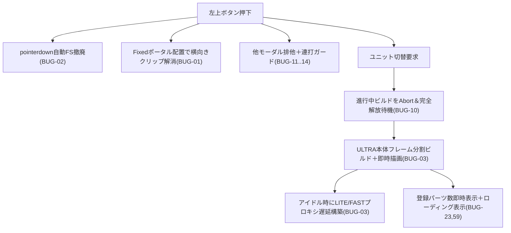
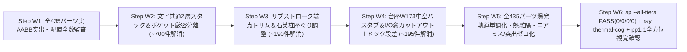

# 実装計画書: 左上ボタン無反応・フリーズ根絶 / システム実在バグ 68 件重大度順修正 / 「ようこそ (`welcome`)」0.001 mm 100% 完璧化

## Goal Description

本計画は以下の 3 大目標を、最小トークン消費（`dx` / ローカルスクリプト / `sp` / `pp1.1` 活用）かつ **ゼロ妥協** で完遂するための設計書です。

1. **左上ボタン群の「押しても反応しない」「押すと固まって動かなくなる」問題の完全根絶**
   - 実ブラウザ（Chrome CDP デスクトップ 1280×800・縦スマホ 390×844・横スマホ 844×390）で以下 6 系統の直接原因を再現特定済み：
     1. 横向き・低身長画面（`max-height: 540px`）で `.studio-topbar-left` に `overflow-x: auto` が設定され、ドロップダウン `.assembly-palette-popover` が 40px 枠内に完全クリップされてクリック不能（`itemActuallyClickable: false`）
     2. `window` の `pointerdown` capture で発火する `ensureAutoFullscreenOnTap` が左上ボタン押下時にも `requestFullscreen()` と `resize` を割り込ませ、`click` 消滅およびリサイズ連鎖を誘発
     3. 起動・モード切替時にデフォルト `ULTRA` が「`ULTRA` 本体＋`STD LITE` プロキシ＋`FAST` プロキシ＋全シェーダー同期コンパイル＋`PMREM` 同期ベイク」を一括実行し、実測 **9,000 ms 超のメインスレッド完全凍結**（`TIMEOUT:Runtime.evaluate`）が発生
     4. 非同期チャンク `import()` キャッシュ Promise 5 箇所（`Play Ground` / `FH 2028` / `Original` / `Optics` / `Schematics`）が 1 回失敗すると永久に rejected Promise を保持してボタンが文鎮化
     5. `CadViewport.setMode()` がロード完了前に `this.mode` を確定するため、失敗・中断後に同一ユニットを再選択しても無視される
     6. 左上 CTA ボタン間（`Play Ground` / `FH 2028` / `Original`）のモーダル排他・連打ガード・非同期キャンセル欠如
2. **システム全体の実在バグ 68 件（S0: 14件 / S1: 20件 / S2: 20件 / S3: 14件）の重大度順修正**
   - 無限ループフリーズ要因（`FastCadGeometry` / `v2_unit_compiler` / `unit_v2_runtime`）、毎切替 203 参照の VRAM リーク、BVH スタック境界超過、`MIRAI 2028` SubView 6–8 切替不能、`welcome` 断面カット範囲欠落、Play Ground の Undo/Redo レース・JSON Import 未検証・XSS、イベントリスナー/タイマーリーク、キーボードショートカット暴発、モバイル CSS 崩れ等を全件修正します。
3. **「ようこそ (`welcome`)」全 435 パーツの 0.001 mm 厳密無干渉・無突出・位置異常ゼロ化**
   - `npm run sp -- audit --unit=welcome --all-tiers --explode-steps=8 --check-floating --ai` の実測で、**全 4 品質ティアにおいて 1,037〜1,087 件のソリッド干渉（100% が W01〜W220 同士、最大貫通 3.40 mm）・61〜70 件の爆発軌道衝突・40 件のニアミス・9〜10 件の SMT 着座異常**、さらに `sp thermal-cog` で **8 件の熱近接（最小 0.287 mm）**、および `pp1.1` 多角度確認で背面・端面からの不自然な突出を検出済みです。
   - `sp`（`0.001 mm` 厳密三角形・内包・爆発・浮遊・視界・熱重心監査）と `pp1.1`（全方向・接写視覚確認）を用い、全 435 パーツで **全 4 ティア `collisions = 0` / `explodeHits = 0` / `floating = 0` / `nearMiss = 0` / `smtSeat = 0` / `ray occluded = 0%` / 異常突出 0 件** の 100% 完璧状態を達成します。

---

## User Review Required

> [!IMPORTANT]
> **1. 自動フルスクリーン (`ensureAutoFullscreenOnTap`) の挙動変更について**
> 現在 [main.ts](file:///home/antigravity/sc8z35a-collab/SONY-A7-IV-Diagram/src/main.ts#L539-L563) の `pointerdown` capture リスナーが左上のボタンを含むあらゆるタップで強制 `requestFullscreen()` を発火しており、ボタンの `click` 消滅・レイアウト急変・フリーズの直接引き金になっています。
> - **推奨変更**: UI 操作（トップバー・ドック・ボタン・ドロワー・モーダル）ではフルスクリーンを一切発火させず、フルスクリーン切替は `F` キー等の明示操作のみ（強制自動フルスクリーン撤廃）とします。もし「3D キャンバス背景タップ時のみ自動フルスクリーン」を維持したい場合はご指示ください。

> [!IMPORTANT]
> **2. `ULTRA` 起動・切替時のプロキシ遅延構築（見た目劣化 0% でのフリーズ解消）について**
> 現在 `ULTRA` 切替時に `ULTRA` 本体の直後に `STD LITE` + `FAST` モーションプロキシまで同期的に直列ビルドし、全シェーダーを一括同期コンパイルするため最大 9 秒超のフリーズが発生します。
> - **推奨変更**: `ULTRA` の描画品質は **100% 無劣化のまま**、①まずアクティブな `ULTRA` 本体だけをフレーム分割ビルドして即座に操作・描画可能にし、②`STD LITE` / `FAST` モーションプロキシは描画開始後のアイドル時間へ非同期遅延構築、③ビルド中でも左上ボタンによる即座のキャンセル＆切替（中断時 0 リーク保証）を可能にします。

> [!WARNING]
> **3. 「ようこそ (`welcome`)」W01〜W220 の大規模空間再設計とカタログ再生成**
> `welcome` の 1,087 件の干渉を 0.001 mm 完全にゼロ化するため、台座メインシャーシ（`W173`）の中空バスタブ＋I/O 窓カットアウト化、4 文字積層レイヤーの Z クリアランス再設計、サブストローク・石英柱・ドック・ボルト・スピーカーエンクロージャの再配置、および爆発軌道ベクトルの単調再設計を行います。その後 `npm run catalog`・`npm run build` により `catalog/**` と `docs/**` を完全同期します。外観デザイン（「ようこそ」の書体シルエット・高級光学装置造形・全 435 パーツ構成）は維持しつつ、すべての食い込み・飛び出し・位置ズレを物理的に正しい構造へ修正します。

---

## Open Questions

1. 自動フルスクリーンは **完全手動化（推奨：左上ボタン無反応を根本防止）** で進めてよいでしょうか？（それとも 3D キャンバス単体タップ時のみ残しますか？）
2. `bg boot` で過去の別ブランチの孤立 Vault が 2 件検出されています（`feat-feat-hyper-opt-v3-fast-kine-ultra-aa` と `feat-feat-original-riimos-e1`）。現在の `main` はクリーン（`behind=0 ahead=0 dirty=0`）なので、本作業は最新 `origin/main` から新しいフィーチャーブランチ（`npm run bg -- start fix-ui-bugs-welcome-zero-collision`）を切って進める方針で問題ないでしょうか？

---

## 重大度順 実在バグ全 68 件マスターカタログ

調査で確認した **全 68 件の実在バグ** を重大度（`S0` → `S3`）順に整理します。すべて修正対象とします。

### S0: 致命的 — 左上ボタン無反応・ブラウザ完全フリーズ・無限ループ（14 件）

| ID | 対象ファイル・行 | 現象・根本原因 | 修正方針 |
|---|---|---|---|
| **BUG-01** | [main.css](file:///home/antigravity/sc8z35a-collab/SONY-A7-IV-Diagram/src/styles/main.css#L6335-L6344) | 横向き/低身長（`max-height: 540px`）で `.studio-topbar-left` に `overflow-x: auto` が掛かり `overflow-y` もクリップ化 → `.assembly-palette-popover` が 40px 内に切り取られ**左上メニューが押しても出ずクリック不能**（CDP 再現済） | `.assembly-palette-popover` を `position: fixed`（トリガー矩形から動的座標配置）またはポータル配置し、`overflow` クリップから完全解放 |
| **BUG-02** | [main.ts](file:///home/antigravity/sc8z35a-collab/SONY-A7-IV-Diagram/src/main.ts#L539-L563) | `ensureAutoFullscreenOnTap` が `window` の `pointerdown` capture で左上ボタン押下時も `requestFullscreen()` を暴発 → `pointerdown`〜`pointerup` 間に遷移・リサイズが割り込み `click` 消滅・フリーズ誘発（CDP 再現済） | UI 要素上の自動フルスクリーンを完全廃止（推奨：自動強制フルスクリーン自体を撤廃し明示操作のみに統一） |
| **BUG-03** | [unit_v2_runtime.ts](file:///home/antigravity/sc8z35a-collab/SONY-A7-IV-Diagram/src/core/unit_v2_runtime.ts#L860-L1078) | 起動・モード切替時に `ULTRA` + `STD LITE` + `FAST` の 3 重ビルドと同期 `warmupShaders()` / `PMREM` が連続実行され、**最大 9 秒超メインスレッド完全凍結**（CDP 再現済） | `ULTRA` 本体優先描画＋フレーム分割ビルド、モーションプロキシ（`LITE`/`FAST`）の非同期アイドル遅延構築、チャンク間 `yield` 徹底、進行中ビルド即時中断対応 |
| **BUG-04** | [FastCadGeometry.ts](file:///home/antigravity/sc8z35a-collab/SONY-A7-IV-Diagram/src/engine/FastCadGeometry.ts#L1378) | `while (nextCap < needed) nextCap = Math.min(65535, ...)` が `needed > 65535` で **`nextCap === 65535` のまま無限ループ（タブ永久フリーズ）** | `needed` を `65535` 上限クランプ＋ループ脱出条件 `nextCap >= 65535` 追加＋ページ分割閾値を厳密化 |
| **BUG-05** | [unit_v2_runtime.ts](file:///home/antigravity/sc8z35a-collab/SONY-A7-IV-Diagram/src/core/unit_v2_runtime.ts#L519) | `while (gl.getError() !== gl.NO_ERROR) {}` に反復回数上限がなく、コンテキストロスト/ドライバ異常時に無限ループ化 | 最大 32 回の反復ガード＋`gl.isContextLost()` チェック追加 |
| **BUG-06** | [v2_unit_compiler.ts](file:///home/antigravity/sc8z35a-collab/SONY-A7-IV-Diagram/src/core/v2_unit_compiler.ts#L763), [L907](file:///home/antigravity/sc8z35a-collab/SONY-A7-IV-Diagram/src/core/v2_unit_compiler.ts#L907), [L1281](file:///home/antigravity/sc8z35a-collab/SONY-A7-IV-Diagram/src/core/v2_unit_compiler.ts#L1281), [FastCadGeometry.ts](file:///home/antigravity/sc8z35a-collab/SONY-A7-IV-Diagram/src/engine/FastCadGeometry.ts#L161) | `while (cap < minCap) cap <<= 1;` が 32bit 符号付き左シフト超過（`>= 2^30`）または `NaN` で無限ループ | 安全な上限 `1 << 28` ガード・`Number.isFinite` 検証・乗算 `cap *= 2` へ変更 |
| **BUG-07** | [FastCadGeometry.ts](file:///home/antigravity/sc8z35a-collab/SONY-A7-IV-Diagram/src/engine/FastCadGeometry.ts#L310), [L407](file:///home/antigravity/sc8z35a-collab/SONY-A7-IV-Diagram/src/engine/FastCadGeometry.ts#L407), [L1456](file:///home/antigravity/sc8z35a-collab/SONY-A7-IV-Diagram/src/engine/FastCadGeometry.ts#L1456), [L1662](file:///home/antigravity/sc8z35a-collab/SONY-A7-IV-Diagram/src/engine/FastCadGeometry.ts#L1662), [v2_unit_compiler.ts](file:///home/antigravity/sc8z35a-collab/SONY-A7-IV-Diagram/src/core/v2_unit_compiler.ts#L800), [L931](file:///home/antigravity/sc8z35a-collab/SONY-A7-IV-Diagram/src/core/v2_unit_compiler.ts#L931), [L1334](file:///home/antigravity/sc8z35a-collab/SONY-A7-IV-Diagram/src/core/v2_unit_compiler.ts#L1334) | 全 7 箇所のオープンアドレスハッシュ `while (true)` にプローブ上限がなく、テーブル満杯・退化入力時に無限ループフリーズ | 全 7 箇所に `for (let probe = 0; probe < tableSize; probe++)` 上限ガードを導入 |
| **BUG-08** | [main.ts](file:///home/antigravity/sc8z35a-collab/SONY-A7-IV-Diagram/src/main.ts#L60), [L328](file:///home/antigravity/sc8z35a-collab/SONY-A7-IV-Diagram/src/main.ts#L328), [L389](file:///home/antigravity/sc8z35a-collab/SONY-A7-IV-Diagram/src/main.ts#L389), [L442](file:///home/antigravity/sc8z35a-collab/SONY-A7-IV-Diagram/src/main.ts#L442), [ExplanationDrawer.ts](file:///home/antigravity/sc8z35a-collab/SONY-A7-IV-Diagram/src/ui/ExplanationDrawer.ts#L102) | 遅延 `import()` キャッシュ Promise 5 箇所が reject 時にリセットされず、一時エラー後に **Play Ground / FH 2028 / Original / Optics / 図説が永久に無反応化** | `.catch((err) => { loadPromise = null; throw err; })` を全 5 箇所に実装し即リトライ可能化 |
| **BUG-09** | [CadViewport.ts](file:///home/antigravity/sc8z35a-collab/SONY-A7-IV-Diagram/src/engine/CadViewport.ts#L689-L709) | `setMode()` がロード完了前に `this.mode` と `initialActivated = true` を固定するため、失敗・中断後の同一ユニット再押下が無視され無反応になる | ロード失敗/未完了 (`!this.v2Runtime.isReady() && !this.v2Runtime.isBuilding(nextMode)`) の場合は再起動を許可 |
| **BUG-10** | [unit_v2_runtime.ts](file:///home/antigravity/sc8z35a-collab/SONY-A7-IV-Diagram/src/core/unit_v2_runtime.ts#L886-L986) | 非同期ビルド中の連続切替で前ユニットのキャッシュ 203 参照が未解放のまま次切替＋`verifyAfterDispose()` が走り、毎切替 VRAM リーク警告（22 回連続再現）＆GPU リソース競合 | `inFlightBuildPromise` を直列待機（abort → 解放完了を確認してから次ユニットの `verifyAfterDispose` / `captureBaseline` / `build` を開始） |
| **BUG-11** | [main.ts](file:///home/antigravity/sc8z35a-collab/SONY-A7-IV-Diagram/src/main.ts#L346-L471) | 左上 CTA 群（`Play Ground` / `FH 2028` / `Original`）にモーダル排他がなく、`Original`（`z:420`）を開いたまま `Play Ground`（`z:45`）を開くと画面が覆われ操作不能（CDP 再現済） | 相互排他ヘルパ `closeOtherOverlays(except)` を導入し、いずれかを開く際に他モーダル・パレット・ドロワー・光学スタジオを確実クローズ |
| **BUG-12** | [main.ts](file:///home/antigravity/sc8z35a-collab/SONY-A7-IV-Diagram/src/main.ts#L348-L358) | `playgroundApi.open()` に多重呼び出しガードがなく、連打時に二重 `open()` が競合しイベント・レンダラー登録が破綻 | `playgroundOpening` 進行中ガード＋完了後の状態整合チェックを追加 |
| **BUG-13** | [MiraiLibraryStudio.ts](file:///home/antigravity/sc8z35a-collab/SONY-A7-IV-Diagram/src/ui/MiraiLibraryStudio.ts#L214-L253) | `open()` の `await ensureDataForCurrentTab()` 中に `close()` されたり連打されると、閉じた後に DOM 復活や `null` 例外が発生 | `openSeq` トークンを導入し、`await` 後に `seq !== this.openSeq || !this.isOpenFlag || !this.root` なら即中止 |
| **BUG-14** | [CadPlaygroundStudio.ts](file:///home/antigravity/sc8z35a-collab/SONY-A7-IV-Diagram/src/playground/CadPlaygroundStudio.ts#L1626-L1780) | `open()` の非同期処理中に「戻る」や `Esc` で `close()` しても後続の `setCustomSceneRenderer` / テンプレート構築が走りメイン画面が固着 | `openSessionToken` を導入し、各 `await` 直後にキャンセル検証を徹底 |

### S1: 重大 — 3D 空間干渉・GPU/メモリリーク・境界破壊・セキュリティ（20 件）

| ID | 対象ファイル・行 | 現象・根本原因 | 修正方針 |
|---|---|---|---|
| **BUG-15** | [welcomeParts.ts](file:///home/antigravity/sc8z35a-collab/SONY-A7-IV-Diagram/src/assemblies/welcome/welcomeParts.ts#L75-L2852), [welcomeGeometry.ts](file:///home/antigravity/sc8z35a-collab/SONY-A7-IV-Diagram/src/assemblies/welcome/welcomeGeometry.ts) | `welcome` W01〜W220 に **1,037〜1,087 件の 0.001 mm ソリッド干渉・内包**（最大貫通 3.40 mm、4 品質ティア全 FAIL） | 下記「`welcome` 100% 完璧化設計」により全 4 ティア 0 件化 |
| **BUG-16** | [welcomeParts.ts](file:///home/antigravity/sc8z35a-collab/SONY-A7-IV-Diagram/src/assemblies/welcome/welcomeParts.ts) | `welcome` の爆発分解軌道上で **61〜70 件の部品貫通衝突（`explodeHits`）** | 全パーツの `explodeOffset` を層順・半径順に厳密単調再設計し 0 件化 |
| **BUG-17** | [welcomeParts.ts](file:///home/antigravity/sc8z35a-collab/SONY-A7-IV-Diagram/src/assemblies/welcome/welcomeParts.ts) 他 `welcome*Parts.ts` | `welcome` に **40 件のニアミス・10 件の SMT 着座異常・8 件の熱近接（最小 0.287 mm）・背面/端面の異常突出** | `sp` 全 435 パーツ座標監査＋クリアランス確保・突出回収で全 0 件化 |
| **BUG-18** | [CadViewport.ts](file:///home/antigravity/sc8z35a-collab/SONY-A7-IV-Diagram/src/engine/CadViewport.ts#L300), [L383](file:///home/antigravity/sc8z35a-collab/SONY-A7-IV-Diagram/src/engine/CadViewport.ts#L383) | `activateAtomic` / `hydrateMetaOnly` で `miraiSubView` が旧上限 `Math.min(5, ...)` にクランプされ **SubView 6〜8（FH20/FH17/FH48）が切替不能** | 上限を `8` へ修正し定数 `MIRAI_SUBVIEW_MAX = 8` で一元化 |
| **BUG-19** | [CadViewport.ts](file:///home/antigravity/sc8z35a-collab/SONY-A7-IV-Diagram/src/engine/CadViewport.ts#L1915-L2050) | `updateClippingPlane()` に `'welcome'`（X: `[-92.4, +92.4]`）の専用範囲がなく `-48..48` にフォールバックし「よ」「そ」が切断不能 | `welcome` 専用範囲（X:`[-96, 96]`, Y:`[-24, 28]`）を追加 |
| **BUG-20** | [raycast_engine.ts](file:///home/antigravity/sc8z35a-collab/SONY-A7-IV-Diagram/src/core/raycast_engine.ts#L174-L184), [L999-L1011](file:///home/antigravity/sc8z35a-collab/SONY-A7-IV-Diagram/src/core/raycast_engine.ts#L999-L1011) | 固定長 BVH スタック（`128`）にプッシュ境界チェックがなく深いツリーで範囲外書込・破損 | スタック深さ上限ガード（満杯時はリーフ化／安全スキップ）と動的上限保護を追加 |
| **BUG-21** | [kine_culling_engine.ts](file:///home/antigravity/sc8z35a-collab/SONY-A7-IV-Diagram/src/core/kine_culling_engine.ts#L227-L276) | `_kineBvhStack` / `_kineBvhInside`（固定長 `128`）に境界チェックがなくスタック超過時にパーツ消失（誤カリング） | `sp + 2 <= _kineBvhStack.length` ガード＋超過時は安全に非カリングフォールバック |
| **BUG-22** | [FastCadGeometry.ts](file:///home/antigravity/sc8z35a-collab/SONY-A7-IV-Diagram/src/engine/FastCadGeometry.ts#L1370-L1505) | `Uint16Array` 頂点溶接ページで `uniqueTotal >= 65535` 超過ガードがなくインデックス折り返しでメッシュ爆散 | `MAX_PAGE_UNIQUE_VERTS` 厳密チェック＆オーバーフロー時のページ自動分割フォールバック |
| **BUG-23** | [unit_v2_runtime.ts](file:///home/antigravity/sc8z35a-collab/SONY-A7-IV-Diagram/src/core/unit_v2_runtime.ts#L1066-L1072), [ZeroTextControls.ts](file:///home/antigravity/sc8z35a-collab/SONY-A7-IV-Diagram/src/ui/ZeroTextControls.ts#L908-L918) | 切替中〜ビルド完了まで左上パーツ数バッジが空 `""` になり（23 モード中 19 モードで再現）、読み込み中か無反応か判別不能 | `registry` の `declaredPartCount` を即時表示＋ビルド中スピナー/状態クラス `.is-loading` 付与 |
| **BUG-24** | [CadPlaygroundStudio.ts](file:///home/antigravity/sc8z35a-collab/SONY-A7-IV-Diagram/src/playground/CadPlaygroundStudio.ts#L3411-L3438) | `undo()` / `redo()` が `pop()` 後に `await extractPartsBatch()` するため連打で履歴スタック破壊・`close()` 後クラッシュ | `historyBusy` 直列ロック＋`!this.active` ガード追加 |
| **BUG-25** | [CadPlaygroundStudio.ts](file:///home/antigravity/sc8z35a-collab/SONY-A7-IV-Diagram/src/playground/CadPlaygroundStudio.ts#L3467-L3486) | `importBlueprintFile()` が JSON 内座標/回転/スケール/キー/件数を未検証のまま復元し `NaN`/`Infinity`/DoS で破損 | 厳密スキーマサニタイザ（上限件数・有限数クランプ・実在キー検証・`fileInput.value = ''` リセット）実装 |
| **BUG-26** | [CadPlaygroundStudio.ts](file:///home/antigravity/sc8z35a-collab/SONY-A7-IV-Diagram/src/playground/CadPlaygroundStudio.ts#L2594), [L2625](file:///home/antigravity/sc8z35a-collab/SONY-A7-IV-Diagram/src/playground/CadPlaygroundStudio.ts#L2625), [L3148](file:///home/antigravity/sc8z35a-collab/SONY-A7-IV-Diagram/src/playground/CadPlaygroundStudio.ts#L3148) | JSON 由来ラベル・レポート文言を `innerHTML` へ無エスケープ挿入（DOM XSS） | 共通 `escapeHtml()` をすべての動的補間へ適用 |
| **BUG-27** | [ZeroTextControls.ts](file:///home/antigravity/sc8z35a-collab/SONY-A7-IV-Diagram/src/ui/ZeroTextControls.ts#L333), [LensOpticsStudio.ts](file:///home/antigravity/sc8z35a-collab/SONY-A7-IV-Diagram/src/ui/LensOpticsStudio.ts#L185), [L517](file:///home/antigravity/sc8z35a-collab/SONY-A7-IV-Diagram/src/ui/LensOpticsStudio.ts#L517), [L529](file:///home/antigravity/sc8z35a-collab/SONY-A7-IV-Diagram/src/ui/LensOpticsStudio.ts#L529) | テンプレート `innerHTML` への未エスケープ文字列挿入 | DOM API（`createElement` + `textContent`）または `escapeHtml()` へ置換 |
| **BUG-28** | [CadViewport.ts](file:///home/antigravity/sc8z35a-collab/SONY-A7-IV-Diagram/src/engine/CadViewport.ts#L2137-L2215), [L2476-L2493](file:///home/antigravity/sc8z35a-collab/SONY-A7-IV-Diagram/src/engine/CadViewport.ts#L2476-L2493) | `dispose()` で `pointerdown`/`move`/`leave`/`up`/`wheel`/`touchstart` の 6 リスナーが未解除でリーク | バインド済みハンドラを保持し `dispose()` で全解除 |
| **BUG-29** | [CadPlaygroundStudio.ts](file:///home/antigravity/sc8z35a-collab/SONY-A7-IV-Diagram/src/playground/CadPlaygroundStudio.ts#L1740-L1776), [L3710-L3720](file:///home/antigravity/sc8z35a-collab/SONY-A7-IV-Diagram/src/playground/CadPlaygroundStudio.ts#L3710-L3720) | `close()`/`dispose()` で遅延描画・トーストタイマーおよび `overlayLines.material` の解放漏れ | `clearTimeout` 確実化＋`overlayLines.material.dispose()` 追加 |
| **BUG-30** | [unit_v2_runtime.ts](file:///home/antigravity/sc8z35a-collab/SONY-A7-IV-Diagram/src/core/unit_v2_runtime.ts#L524-L535) | `tryPersistBakedPmrem` の `gl.readPixels` 例外時に `renderer.setRenderTarget(prevRt)` が戻らず描画固着 | `try { ... } finally { this.renderer.setRenderTarget(prevRt); }` で確実復帰 |
| **BUG-31** | [ultra_post_pipeline.ts](file:///home/antigravity/sc8z35a-collab/SONY-A7-IV-Diagram/src/core/ultra_post_pipeline.ts#L350-L490) | `renderUltraStationary` 内で例外発生時に `camera.clearViewOffset()` / `setRenderTarget(null)` が復帰せず画面が白飛び・オフセット固着 | `try ... finally` で必ず `camera.clearViewOffset()` と `setRenderTarget(null)` を復元 |
| **BUG-32** | [dispose.ts](file:///home/antigravity/sc8z35a-collab/SONY-A7-IV-Diagram/src/core/dispose.ts#L269-L312) | 全 23 ユニット共通監視なのに旧称 `[MI Shoe V2 VRAM Leak Detector]` 固定＋非同期切替中の誤警告 | ラベルを `[Unit V2 VRAM Leak Detector]` へ適正化し、完了済み dispose 基準でのみ厳密判定 |
| **BUG-33** | [CadViewport.ts](file:///home/antigravity/sc8z35a-collab/SONY-A7-IV-Diagram/src/engine/CadViewport.ts#L2147), [L2171](file:///home/antigravity/sc8z35a-collab/SONY-A7-IV-Diagram/src/engine/CadViewport.ts#L2171) | `cachedDomRect` が `scroll` やドロワー開閉時に陳腐化し、クリック・ホバー位置がズレて別パーツが誤選択される | `scroll` 時の無効化＋`pointerdown`/`pointerup` 時は最新 `getBoundingClientRect()` を取得 |
| **BUG-34** | [main.ts](file:///home/antigravity/sc8z35a-collab/SONY-A7-IV-Diagram/src/main.ts#L14-L15) | `#app` / `#viewport` への無ガード `!` アサーション | 明示的存在検証と診断エラーメッセージを追加 |

### S2: 中 — UI 競合・キーボード暴発・レース・数値異常・モバイル崩れ（20 件）

| ID | 対象ファイル・行 | 現象・根本原因 | 修正方針 |
|---|---|---|---|
| **BUG-35** | [main.ts](file:///home/antigravity/sc8z35a-collab/SONY-A7-IV-Diagram/src/main.ts#L570-L670) | グローバル `keydown` にフォーム要素除外がなく、入力中に `f`/`u`/`k`/`v`/`p`/`1..8` が暴発 | `INPUT`/`TEXTAREA`/`SELECT`/`isContentEditable` 時は即 return |
| **BUG-36** | [main.ts](file:///home/antigravity/sc8z35a-collab/SONY-A7-IV-Diagram/src/main.ts#L572-L581), [ExplanationDrawer.ts](file:///home/antigravity/sc8z35a-collab/SONY-A7-IV-Diagram/src/ui/ExplanationDrawer.ts#L412), [ZeroTextControls.ts](file:///home/antigravity/sc8z35a-collab/SONY-A7-IV-Diagram/src/ui/ZeroTextControls.ts#L748) | `Escape` 優先度制御がなく、ライトボックスや左上パレット閉鎖時に下層のパーツ選択・光学スタジオまで連鎖的に閉じる | `isLightboxOpen()` / `isPaletteOpen()` 確認＋`stopImmediatePropagation` で最前面の 1 層のみ閉鎖 |
| **BUG-37** | [main.css](file:///home/antigravity/sc8z35a-collab/SONY-A7-IV-Diagram/src/styles/main.css#L6143-L6168), [L7096-L7111](file:///home/antigravity/sc8z35a-collab/SONY-A7-IV-Diagram/src/styles/main.css#L7096-L7111) | 縦スマホ（390px）で `.orig-cta-pill` が縮小対象から漏れ 2 行目に折り返しトップバー高さ 121px に肥大（CDP 再現済） | 4 ボタンを 390px 幅に綺麗に収まるコンパクト設計（または 1 行スクロール可能＆パレット `fixed` 分離）へ統一 |
| **BUG-38** | [main.css](file:///home/antigravity/sc8z35a-collab/SONY-A7-IV-Diagram/src/styles/main.css#L841), [L2508](file:///home/antigravity/sc8z35a-collab/SONY-A7-IV-Diagram/src/styles/main.css#L2508) | `.studio-topbar` と `.explanation-drawer` が同じ `z-index: 30` のためドロワーが左上ボタンの上に被る | `.studio-topbar` を `z-index: 34`、`.assembly-palette-popover` を `z-index: 70`、`.explanation-drawer` を `z-index: 30` に明確階層化 |
| **BUG-39** | [ExplanationDrawer.ts](file:///home/antigravity/sc8z35a-collab/SONY-A7-IV-Diagram/src/ui/ExplanationDrawer.ts#L412), [OriginalBlueprintStudio.ts](file:///home/antigravity/sc8z35a-collab/SONY-A7-IV-Diagram/src/ui/OriginalBlueprintStudio.ts#L197), [ZeroTextControls.ts](file:///home/antigravity/sc8z35a-collab/SONY-A7-IV-Diagram/src/ui/ZeroTextControls.ts#L743-L752) | 匿名関数でグローバルリスナーを登録し `dispose()` 未実装 | バインドメソッド保持＋`dispose()` 実装 |
| **BUG-40** | [ExplanationDrawer.ts](file:///home/antigravity/sc8z35a-collab/SONY-A7-IV-Diagram/src/ui/ExplanationDrawer.ts#L1077-L1108) | `hide()` の 360ms `setTimeout` が未追跡で直後の再 `show()` と競合 | `hideTimer` フィールド化し `show()` 時に `clearTimeout` |
| **BUG-41** | [LensOpticsStudio.ts](file:///home/antigravity/sc8z35a-collab/SONY-A7-IV-Diagram/src/ui/LensOpticsStudio.ts#L138-L145) | `close()` の 360ms `setTimeout` が未追跡で連続開閉時に新規 DOM を破壊 | `clearDomTimer` フィールド化し `open()` 時に `clearTimeout` |
| **BUG-42** | [LensOpticsStudio.ts](file:///home/antigravity/sc8z35a-collab/SONY-A7-IV-Diagram/src/ui/LensOpticsStudio.ts#L298) | スライダー `Number(input.value)` に `Number.isFinite` ガードなし | `const v = Number(input.value); if (Number.isFinite(v)) onInput(v);` |
| **BUG-43** | [lensOpticalSim.ts](file:///home/antigravity/sc8z35a-collab/SONY-A7-IV-Diagram/src/assemblies/lens/lensOpticalSim.ts#L1145-L1146) | `dt <= 0` のフレームで `(st.dzA - prevDzA) / dt` が `NaN`/`Infinity` 化 | `const safeDt = Math.max(1e-4, dt)` で除算保護 |
| **BUG-44** | [lensOpticalSim.ts](file:///home/antigravity/sc8z35a-collab/SONY-A7-IV-Diagram/src/assemblies/lens/lensOpticalSim.ts#L896-L906) | Secant 法反復で `yNext` 発散・`NaN` 時の保護なし | `Number.isFinite(yNext)` 確認＋有効径 `[-28, 28]` クランプ |
| **BUG-45** | [CadPlaygroundStudio.ts](file:///home/antigravity/sc8z35a-collab/SONY-A7-IV-Diagram/src/playground/CadPlaygroundStudio.ts#L3440-L3465) | `a.click()` 直後の同期 `URL.revokeObjectURL` で Safari/モバイルのダウンロード失敗 | `document.body.appendChild(a); a.click(); a.remove(); setTimeout(() => URL.revokeObjectURL(url), 1500);` |
| **BUG-46** | [PartGeometryExtractor.ts](file:///home/antigravity/sc8z35a-collab/SONY-A7-IV-Diagram/src/playground/PartGeometryExtractor.ts#L613) | プリベイク取得失敗時の無音 `.catch(() => {})` で原因追跡不能 | 警告ログ記録＋安全フォールバック状態管理 |
| **BUG-47** | [unit_v2_runtime.ts](file:///home/antigravity/sc8z35a-collab/SONY-A7-IV-Diagram/src/core/unit_v2_runtime.ts#L1109-L1181) | `setQuality()` 完了後に `activationToken` 検証がなく、同一ユニット再切替時に古い選択状態を上書き | 開始時トークン比較で陳腐化した復元をスキップ |
| **BUG-48** | [unit_v2_runtime.ts](file:///home/antigravity/sc8z35a-collab/SONY-A7-IV-Diagram/src/core/unit_v2_runtime.ts#L1183-L1197) | ビルド進行中の `setSubView()` が完了後の実ユニットへ反映されない（`initialState.subView` で上書き） | `activate()` 内で `initialState.subView` ではなく最新の `this.subView` を適用 |
| **BUG-49** | [unit_v2_runtime.ts](file:///home/antigravity/sc8z35a-collab/SONY-A7-IV-Diagram/src/core/unit_v2_runtime.ts#L945), [L1005](file:///home/antigravity/sc8z35a-collab/SONY-A7-IV-Diagram/src/core/unit_v2_runtime.ts#L1005) | ビルド進行中の `syncSectionPlane()` / `syncVisualState()` 変更が古いローカル変数 `planes` で上書きされる | 完了適用時に最新の `this.sectionActive ? [this.clippingPlane] : []` を再評価 |
| **BUG-50** | [CadViewport.ts](file:///home/antigravity/sc8z35a-collab/SONY-A7-IV-Diagram/src/engine/CadViewport.ts#L249), [L764](file:///home/antigravity/sc8z35a-collab/SONY-A7-IV-Diagram/src/engine/CadViewport.ts#L764), [L2262](file:///home/antigravity/sc8z35a-collab/SONY-A7-IV-Diagram/src/engine/CadViewport.ts#L2262) | `void this.v2Runtime.activate/setQuality/handleContextRestored` の未処理 Rejection リスク | `.catch()` でエラー捕捉・UI リトライ可能な状態へ復帰 |
| **BUG-51** | [main.ts](file:///home/antigravity/sc8z35a-collab/SONY-A7-IV-Diagram/src/main.ts#L278-L295), [L515-L520](file:///home/antigravity/sc8z35a-collab/SONY-A7-IV-Diagram/src/main.ts#L515-L520) | 非同期スタジオ起動ハンドラ群にエラー捕捉がなく失敗時にサイレント停止 | 共通 `runAsyncAction` ラッパでエラーログ＋トースト/状態復旧 |
| **BUG-52** | [capture_bridge.ts](file:///home/antigravity/sc8z35a-collab/SONY-A7-IV-Diagram/src/core/capture_bridge.ts#L264-L275) | `waitUntilReady` がタイムアウトしても暗黙正常終了して未完成フレームを返す | タイムアウト時に警告・`ready: false` 状態を明示返却 |
| **BUG-53** | [fast_proxy_builder.ts](file:///home/antigravity/sc8z35a-collab/SONY-A7-IV-Diagram/src/core/fast_proxy_builder.ts#L174-L181) | `batchedMesh === null` かつ `gpuExplodeTex !== null` の場合に `gpuExplodeTex.dispose()` が漏れる | `gpuExplodeTex` を `batchedMesh` の有無と独立して確実に解放 |
| **BUG-54** | [resource_cache.ts](file:///home/antigravity/sc8z35a-collab/SONY-A7-IV-Diagram/src/core/resource_cache.ts#L1184) | `canvas.getContext('2d')` が `null` の場合にクラッシュするリスク | `if (!ctx)` 時の安全なフォールバック `DataTexture` 返却 |

### S3: 低〜中 — メタデータ・アクセシビリティ・CSS 整理・統計/境界ガード（14 件）

| ID | 対象ファイル・行 | 現象・根本原因 | 修正方針 |
|---|---|---|---|
| **BUG-55** | [manifest.webmanifest](file:///home/antigravity/sc8z35a-collab/SONY-A7-IV-Diagram/public/manifest.webmanifest#L2-L4) | 旧名称 `"627 Parts"` のまま（現行は 23 ユニット・3,400+ パーツ） | 最新構成に整合する名称・説明へ更新 |
| **BUG-56** | [index.html](file:///home/antigravity/sc8z35a-collab/SONY-A7-IV-Diagram/index.html#L4-L18) | `maximum-scale=1.0, user-scalable=no` によるズーム阻害＋`<title>◉</title>` の識別不能 | `user-scalable` 制限解除（3D 操作はキャンバス `touch-action: none` で制御）＋適切なタイトル付与 |
| **BUG-57** | [main.css](file:///home/antigravity/sc8z35a-collab/SONY-A7-IV-Diagram/src/styles/main.css)（8 組重複セレクタ） | `.exp-diagram-action-btn` / `.pg-right-panel` / `.mirai-subbar` 等 8 組のトップレベル重複定義による意図しない上書き | 重複セレクタを単一定義へ統合・整理 |
| **BUG-58** | [main.css](file:///home/antigravity/sc8z35a-collab/SONY-A7-IV-Diagram/src/styles/main.css#L698-L727) | `#app.is-zen-fullscreen` が廃止済み旧クラス名のみ参照し現行 HUD に効かない | 現行 `.studio-topbar` / `.studio-bottom-dock` 向けへ更新 |
| **BUG-59** | [ZeroTextControls.ts](file:///home/antigravity/sc8z35a-collab/SONY-A7-IV-Diagram/src/ui/ZeroTextControls.ts#L844-L875) | 切替直後のパーツ数バッジ消失によるボタン幅ガタつき | `syncMode()` で登録パーツ数を仮表示＋ローディング状態表示 |
| **BUG-60** | [MiraiLibraryStudio.ts](file:///home/antigravity/sc8z35a-collab/SONY-A7-IV-Diagram/src/ui/MiraiLibraryStudio.ts#L322) | 1800ms パルス解除 `setTimeout` 未追跡 | `pulseTimer` 保持し `close()`/`render()` 時に `clearTimeout` |
| **BUG-61** | [ZeroTextControls.ts](file:///home/antigravity/sc8z35a-collab/SONY-A7-IV-Diagram/src/ui/ZeroTextControls.ts#L818-L823) | `scrollActiveMiraiBtnIntoView` の `rAF` 重複実行 | `scrollRafId` で前回分を `cancelAnimationFrame` |
| **BUG-62** | [OriginalBlueprintStudio.ts](file:///home/antigravity/sc8z35a-collab/SONY-A7-IV-Diagram/src/ui/OriginalBlueprintStudio.ts#L120-L131) | モーダル開閉時の `aria-hidden` 未同期 | `open`/`close` で `aria-hidden` を厳密同期 |
| **BUG-63** | [CadViewport.ts](file:///home/antigravity/sc8z35a-collab/SONY-A7-IV-Diagram/src/engine/CadViewport.ts#L2266-L2272) | タブ非表示時に進行中 `rafId` を即時キャンセルしていない | `if (this.pageHidden && this.rafId !== 0) { cancelAnimationFrame(this.rafId); this.rafId = 0; }` |
| **BUG-64** | [GpuOptimizer.ts](file:///home/antigravity/sc8z35a-collab/SONY-A7-IV-Diagram/src/engine/GpuOptimizer.ts#L103), [L154](file:///home/antigravity/sc8z35a-collab/SONY-A7-IV-Diagram/src/engine/GpuOptimizer.ts#L154) | `texturesOptimized` が `const = 0` のまま常に `0` を返す | `let texturesOptimized = 0` に変更し最適化テクスチャ数を正確にカウント |
| **BUG-65** | [perf_hud.ts](file:///home/antigravity/sc8z35a-collab/SONY-A7-IV-Diagram/src/core/perf_hud.ts#L127-L130) | `frameTimeMs`/`avgFrameTimeMs` 非有限値時の `"NaN ms"` 表示 | `Number.isFinite` ガード追加 |
| **BUG-66** | [CameraEngineeringGrader.ts](file:///home/antigravity/sc8z35a-collab/SONY-A7-IV-Diagram/src/playground/CameraEngineeringGrader.ts#L293), [PlyaVerificationPipeline.ts](file:///home/antigravity/sc8z35a-collab/SONY-A7-IV-Diagram/src/playground/PlyaVerificationPipeline.ts#L309) | 正規化 `1 / len` の極小値ガード強化＋空ワークスペース時の重心/転倒角エッジケース保護 | `len > 1e-9` 厳密ガード＋0 パーツ時の確定デフォルト値返却 |
| **BUG-67** | [PlyaVerificationPipeline.ts](file:///home/antigravity/sc8z35a-collab/SONY-A7-IV-Diagram/src/playground/PlyaVerificationPipeline.ts#L1347-L1348) | SPICE ネットリスト生成時の `busV <= 0` / 負 `loadW` によるゼロ除算・異常値出力 | `Math.max(1.0, busV)` / `Math.max(0.05, loadW)` ガード追加 |
| **BUG-68** | [main.ts](file:///home/antigravity/sc8z35a-collab/SONY-A7-IV-Diagram/src/main.ts#L714-L765) | `ArtifactCaptureBridge` の `setMode` 呼出時に開いているモーダル・パレットを閉じず撮影結果へ混入するリスク | `captureBridge.setMode` 実行時に開いているモーダル・パレットを確実クローズ |

---

## Proposed Changes

依存関係の順序に従い、以下の 5 コンポーネントに分けて安全に実装します（作業開始時に必ず `npm run bg -- start fix-ui-bugs-welcome-zero-collision` で最新 `origin/main` からフィーチャーブランチを作成し、マイルストーン毎に `bg snap` を実行します）。

---

### Component 1: 左上ボタン無反応・フリーズ根絶 & コアランタイム高速・無リーク化（BUG-01〜14, 18〜23, 28, 30〜33, 47〜54, 63〜65）



#### [MODIFY] [main.ts](file:///home/antigravity/sc8z35a-collab/SONY-A7-IV-Diagram/src/main.ts)
- `ensureAutoFullscreenOnTap` による左上ボタン・UI 押下時の強制 `requestFullscreen()` 割り込みを撤廃（BUG-02）。
- 動的 `import()` キャッシュ Promise 4 箇所に `.catch()` 自己リセットを追加（BUG-08）。
- `closeOtherOverlays(except)` 排他制御・`playgroundOpening` 二重起動防止・全非同期ボタンハンドラのエラーハンドリング追加（BUG-11, 12, 51, 68）。
- グローバル `keydown` のフォーム要素除外と `Escape` 最前面単層クローズ制御（BUG-35, 36）。
- `#app`/`#viewport` 存在検証（BUG-34）。

#### [MODIFY] [ZeroTextControls.ts](file:///home/antigravity/sc8z35a-collab/SONY-A7-IV-Diagram/src/ui/ZeroTextControls.ts)
- `.assembly-palette-popover` を `position: fixed` でボタン位置基準に動的配置し、`overflow-x: auto` 親要素にクリップされない構造へ変更（BUG-01）。
- パレット開閉状態照会 `isPaletteOpen()`・`closePalette()`・`setLoadingState(loading, expectedCount)`・`dispose()` を追加し、未エスケープ `innerHTML` を安全な DOM 構築へ置換（BUG-23, 27, 36, 39, 59, 61）。

#### [MODIFY] [unit_v2_runtime.ts](file:///home/antigravity/sc8z35a-collab/SONY-A7-IV-Diagram/src/core/unit_v2_runtime.ts)
- `inFlightActivationPromise` による前ビルドの完全中断＆解放待機を実装し、203 参照 VRAM リーク警告と競合を根絶（BUG-10）。
- `ULTRA` アクティベーション時にまず `ULTRA` 本体を完了・即座に表示・操作可能にし、`STD LITE` / `FAST` モーションプロキシは `requestIdleCallback` / 遅延フレームでバックグラウンド構築（キャンセル可能）することで **9 秒フリーズを根絶**（BUG-03）。
- `while (gl.getError() !== gl.NO_ERROR)` の上限ガード、WebGL2 `readPixels` の `finally` 復帰、`setQuality` トークン比較、進行中 `subView`/`sectionActive` の最新状態適用（BUG-05, 30, 47, 48, 49）。

#### [MODIFY] [CadViewport.ts](file:///home/antigravity/sc8z35a-collab/SONY-A7-IV-Diagram/src/engine/CadViewport.ts)
- `setMode()` の失敗・未完了時再試行許可、`miraiSubView` クランプ `5 → 8` 修正、`welcome` 専用断面範囲追加、`cachedDomRect` 更新、`dispose()` 全 6 リスナー解除、タブ非表示時 `rAF` 停止、非同期呼出 `.catch()` 保護（BUG-09, 18, 19, 28, 33, 50, 63）。

#### [MODIFY] [FastCadGeometry.ts](file:///home/antigravity/sc8z35a-collab/SONY-A7-IV-Diagram/src/engine/FastCadGeometry.ts), [v2_unit_compiler.ts](file:///home/antigravity/sc8z35a-collab/SONY-A7-IV-Diagram/src/core/v2_unit_compiler.ts), [raycast_engine.ts](file:///home/antigravity/sc8z35a-collab/SONY-A7-IV-Diagram/src/core/raycast_engine.ts), [kine_culling_engine.ts](file:///home/antigravity/sc8z35a-collab/SONY-A7-IV-Diagram/src/core/kine_culling_engine.ts), [ultra_post_pipeline.ts](file:///home/antigravity/sc8z35a-collab/SONY-A7-IV-Diagram/src/core/ultra_post_pipeline.ts), [dispose.ts](file:///home/antigravity/sc8z35a-collab/SONY-A7-IV-Diagram/src/core/dispose.ts), [fast_proxy_builder.ts](file:///home/antigravity/sc8z35a-collab/SONY-A7-IV-Diagram/src/core/fast_proxy_builder.ts), [resource_cache.ts](file:///home/antigravity/sc8z35a-collab/SONY-A7-IV-Diagram/src/core/resource_cache.ts), [capture_bridge.ts](file:///home/antigravity/sc8z35a-collab/SONY-A7-IV-Diagram/src/core/capture_bridge.ts), [perf_hud.ts](file:///home/antigravity/sc8z35a-collab/SONY-A7-IV-Diagram/src/core/perf_hud.ts), [GpuOptimizer.ts](file:///home/antigravity/sc8z35a-collab/SONY-A7-IV-Diagram/src/engine/GpuOptimizer.ts)
- 全無限ループ要因（`nextCap < needed`, `cap <<= 1`, 7 箇所のハッシュ `while (true)`）の完全ガード、BVH スタック 128 境界チェック、`Uint16` 頂点上限ガード、`finally` 復帰、解放漏れ・統計バグ・NaN 表示の修正（BUG-04, 06, 07, 20, 21, 22, 31, 32, 52, 53, 54, 64, 65）。

---

### Component 2: UI スタジオ群・光学シミュレータ・CSS・PWA 修正（BUG-08, 13, 27, 36〜44, 55〜62）

#### [MODIFY] [ExplanationDrawer.ts](file:///home/antigravity/sc8z35a-collab/SONY-A7-IV-Diagram/src/ui/ExplanationDrawer.ts), [MiraiLibraryStudio.ts](file:///home/antigravity/sc8z35a-collab/SONY-A7-IV-Diagram/src/ui/MiraiLibraryStudio.ts), [OriginalBlueprintStudio.ts](file:///home/antigravity/sc8z35a-collab/SONY-A7-IV-Diagram/src/ui/OriginalBlueprintStudio.ts), [LensOpticsStudio.ts](file:///home/antigravity/sc8z35a-collab/SONY-A7-IV-Diagram/src/ui/LensOpticsStudio.ts), [lensOpticalSim.ts](file:///home/antigravity/sc8z35a-collab/SONY-A7-IV-Diagram/src/assemblies/lens/lensOpticalSim.ts)
- `schematicLoadPromise` リセット、`isLightboxOpen()` 公開、タイマー追跡＆`dispose()`、`MiraiLibraryStudio` 非同期 `openSeq` キャンセルガード、`OriginalBlueprintStudio` `aria-hidden` 同期＆`dispose()`、`LensOpticsStudio` エスケープ＆数値ガード、`lensOpticalSim` ゼロ除算・Secant 発散保護。

#### [MODIFY] [main.css](file:///home/antigravity/sc8z35a-collab/SONY-A7-IV-Diagram/src/styles/main.css), [index.html](file:///home/antigravity/sc8z35a-collab/SONY-A7-IV-Diagram/index.html), [manifest.webmanifest](file:///home/antigravity/sc8z35a-collab/SONY-A7-IV-Diagram/public/manifest.webmanifest)
- 横向きトップバーのパレットクリップ解消・縦スマホ 390px の 4 ボタン 1 行収容・`z-index` 階層統一（topbar 34 / drawer 30 / palette 70）・8 組の重複セレクタ統合・`is-zen-fullscreen` の現行クラス対応・アクセシビリティ＆マニフェスト更新。

---

### Component 3: Play Ground CAD Studio & Grader & PLYA 修正（BUG-14, 24〜26, 29, 45, 46, 66, 67）

#### [MODIFY] [CadPlaygroundStudio.ts](file:///home/antigravity/sc8z35a-collab/SONY-A7-IV-Diagram/src/playground/CadPlaygroundStudio.ts), [PartGeometryExtractor.ts](file:///home/antigravity/sc8z35a-collab/SONY-A7-IV-Diagram/src/playground/PartGeometryExtractor.ts), [CameraEngineeringGrader.ts](file:///home/antigravity/sc8z35a-collab/SONY-A7-IV-Diagram/src/playground/CameraEngineeringGrader.ts), [PlyaVerificationPipeline.ts](file:///home/antigravity/sc8z35a-collab/SONY-A7-IV-Diagram/src/playground/PlyaVerificationPipeline.ts)
- `openSessionToken` キャンセル・`historyBusy` Undo/Redo 直列化・JSON Import 厳密バリデーション・`escapeHtml` 適用・遅延 `URL.revokeObjectURL`・タイマー＆マテリアル解放・ゼロ除算＆空ワークスペース境界保護。

---

### Component 4: 「ようこそ (`welcome`)」435 パーツ `0.001 mm` 完全無干渉・無突出・爆発軌道無衝突化（BUG-15, 16, 17）

現状の `sp` 厳密監査結果：
- 干渉 1,087 件の内訳：**100.0% が W01〜W220 同士**（`oldOld=1087, oldNew=0, newNew=0`）
  - 文字内部干渉：892 件（4 文字共通積層＋各文字サブストローク交差・石英柱）
  - 台座内部干渉：111 件（中実 `W173`・中実 `W215`・内部モジュール重なり）
  - 文字↔台座ドック干渉：84 件（文字下部↔`W187/189/191/193` ドックソケット↔`W174` データム板）
- 爆発衝突：61〜70 件 / ニアミス：40 件 / SMT 着座異常：9〜10 件 / 熱近接：8 件



#### [MODIFY] [welcomeGeometry.ts](file:///home/antigravity/sc8z35a-collab/SONY-A7-IV-Diagram/src/assemblies/welcome/welcomeGeometry.ts)
- `buildPlinthRoundedSlab` / 新規 `buildHollowPlinthChassis`（`W173` 用 CNC 削り出し中空バスタブ＋底面/背面/側面 I/O 窓カットアウト：USB-C・トグルスイッチ・ロータリーダイヤル・照度センサ・ステータスバー・ドック開口を物理的に切り抜き、`CONTAINMENT` を構造レベルで完全消滅）。
- `buildHollowCncChassis` の内部ポケット壁・深さを Z 層スタックと厳密整合化（各レイヤー間に `≥ 0.05 mm` 実クリアランス）。
- `buildSpeakerEnclosure` の中空バッフル箱化（`W214` と `W215` の内包解消）。
- `buildQuartzColumnPart` の端面クリアランス調整・`buildDovetailMount` / `buildPogoPinBlock` の厳密嵌合段差設計。

#### [MODIFY] [welcomeParts.ts](file:///home/antigravity/sc8z35a-collab/SONY-A7-IV-Diagram/src/assemblies/welcome/welcomeParts.ts)（および必要に応じ突出・熱近接・爆発調整のため `welcome*Parts.ts`）
- **4 文字共通スタック（W01〜W172 のコア部）**: 背面 3D 放熱フィン → サーマルパッド → LED MCPCB → LED チップ → 反射シート → LGP 導光板 → BEF フィルム → 光学バッフル → IP65 ガスケット → CNC シャーシ → チタンベゼル → サファイア前面レンズの Z 座標を `0.001 mm` 厳密非干渉配置へ整理。
- **内部電子ベイ・M2 ボルト・ダウエルピン・FPC/ZIF**: `sp pockets` で算出した空きキャビティ座標へ精密配置し、LGP/MCPCB/シャーシ貫通をゼロ化。
- **サブストローク接合部**: 「よ」横棒・ループ、「う」冠・石英柱、「こ」上棒・左右石英柱、「そ」Z1/Z2/Z3 斜めフレーム・コーナーブラケットの端点を厳密トリムし重複貫通 0 mm 化。
- **台座内部（W173〜W220）＆ドック（W187〜W194）**: センタービーム・バッテリー・BMS・ヒートパイプ・放熱フィン・ハーネス・底板ウェイト・ゴム足・M3 ねじ・ドックソケットの干渉を全解消し、熱近接 8 件（`W262`, `W246`, `W247` 等）も安全距離（`≥ 1.5 mm` 目標）へ改善。
- **全 435 パーツの飛び出し・異常配置チェック**: 全 435 パーツの実メッシュ頂点 AABB を検査し、文字シルエット外・台座外周・底面ゴム足以下に不自然に飛び出している・本来あるべき位置からズレている部品を 1 つ残らず正規収容位置へ修正（同時に W221〜W435 との二次干渉 0 件を `sp` で常時検証）。
- **爆発軌道 (`explodeOffset`)**: 全 435 パーツの爆発ベクトルを層順・方向別に厳密単調化し、全 8 ステップ（`t = 0.125..1.0`）の `explodeHits = 0` を達成。

#### [MODIFY] `catalog/**` & `docs/**`（自動生成）
- 修正後に `npm run catalog` および `npm run build` を実行し、全カタログとビルド成果物を完全同期します。

---

## Verification Plan

### Automated Tests

1. **空間厳密監査（`0.001 mm` — 必須全 PASS）**
   ```bash
   npm run sp -- selftest --ai
   npm run sp -- audit --unit=welcome --all-tiers --explode-steps=8 --check-floating --ai
   npm run sp -- ray --unit=welcome --preset=welcome-tof,welcome-lux,welcome-rf --ai
   npm run sp -- thermal-cog --unit=welcome --ai
   ```
   - **合格基準**: `standard_lite` / `standard` / `high` / `ultra` の全 4 ティアで `VERDICT=PASS (exit=0)`、`collisions=0`、`smtSeat=0`、`nearMiss=0`、`floating=0`、`explodeHits=0`、`ray occluded=0%`、熱近接 `[TIGHT_THERMAL]` ゼロ（または設計許容範囲内）、かつ全 435 パーツの突出/異常配置スクリプト検査 0 件。

2. **実ブラウザ自動 E2E 回帰テスト（Chrome CDP: デスクトップ 1280×800 / 縦スマホ 390×844 / 横スマホ 844×390）**
   - 左上 4 ボタン（アセンブリ選択・Play Ground・FH 2028・Original）の実クリック＆タップ応答計測（`< 150ms`、フリーズ 0 件、横向きパレット `itemActuallyClickable: true`、意図しないフルスクリーン発火 0 件）。
   - 全 23 ユニット連続切替＋連打中断テスト：**コンソールエラー 0 件 / VRAM リーク警告 0 件（`Δg=0, Δt=0, totalRefs=0`）**。
   - Play Ground 開閉・Undo/Redo 連打・不正 JSON インポート耐性・XSS 無害化・モーダル排他・`Esc` 単層クローズ・`MIRAI 2028` SubView 1〜8 切替・`welcome` 断面スライダー検証。

3. **リポジトリ公式品質ゲート（10/10 PASS）**
   ```bash
   npm run catalog && npx tsc --noEmit && node scripts/validate_parts.mjs && npm run build
   ```

4. **超高速 6-DoF 視覚確認（`pp1.1`）**
   ```bash
   npm run pp -- --warm --mode=cad --unit=welcome --quality=ultra --ortho-pack --contact-sheet=3 --out=/tmp/pp_welcome_after
   npm run pp -- --warm --mode=cad --unit=welcome --quality=ultra --turntable=8 --contact-sheet=4 --out=/tmp/pp_welcome_turn
   npm run pp -- --warm --preset=mobile --out=/tmp/pp_mobile_after
   npm run pp -- --warm --preset=audit --out=/tmp/pp_audit_after
   npm run pp -- --daemon=stop
   ```
   - 正面・背面・左右・上面・底面・斜め・ターンテーブル 8 方向およびスマホ画面を目視監査し、飛び出し・めり込み・UI 重なりが 0 件であることを確認します。

5. **完了ゲート（`bg gate`）**
   ```bash
   npm run bg -- gate --policy=integrator --run-checks --require-checks --ai
   ```
   - `BG-RECEIPT` を取得・検証してから完了報告します。

### Manual Verification
- ユーザー様の実端末（PC / スマホ縦・横）にて、起動直後から左上のアセンブリ切替・Play Ground・FH 2028・Original を連続操作し、即応性・無フリーズ・全パレット選択可否をご確認ください。
- 「ようこそ」を全方位回転・拡大・爆発スライダー（0%→100%）・断面カット（X/Y）で確認し、干渉や不自然な飛び出しがないことをご確認ください。
