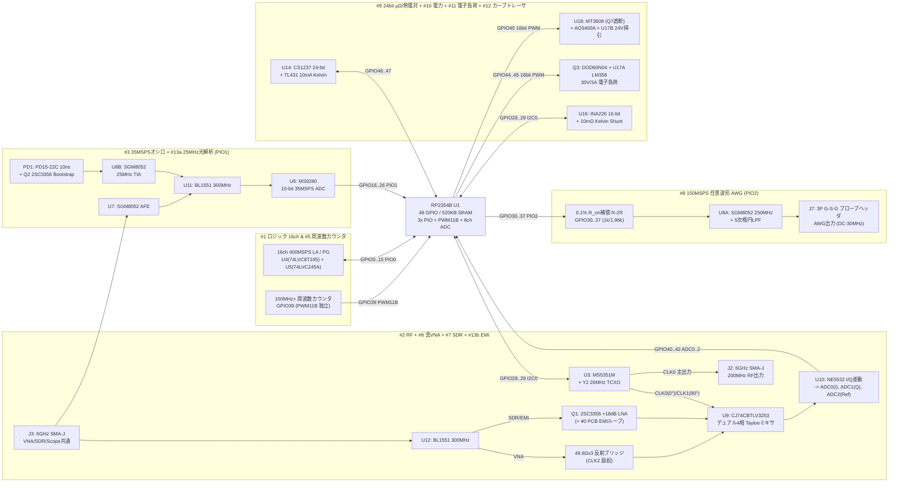

# 予算 1,500 円チャレンジ（+500 円・8 大超高性能機能拡張）完全設計書
## **PICO-LAB 1500 ULTRA（型式：`PL15K-2354B`）— 13-in-1 物理限界ポケットラボ**
> **ベース `PL1K-2354B`（¥970）＋ 追加部品代 ¥492 ＝ 合計 ¥1,462（@150円/USD）／ ¥1,499（@155円/USD）**
> **たった +500 円の純粋部品代で「8 個の専用ハードウェア計測器」を新設し、市販総額 40 万〜80 万円相当の 13-in-1 ラボを名刺サイズ 1 枚に凝縮**

---

## 1. 課題達成サマリー（+500 円で追加した 8 大超高性能ハードウェア機能）

前設計 [implementation_plan.md](file:///home/antigravity/.gemini/jetski/brain/v1/default/jetski_remote_agents_3p_devbox/4cd0440f-74be-4777-9e18-dfbe11961f07/implementation_plan.md)（5-in-1・¥982）に搭載済みの **`RP2354B`（48 GPIO・3×PIO・520 KB SRAM）**・**`MS5351M`（200 MHz 3ch ±1.5 ppm TCXO）**・**`MS9280`（10-bit 35 MSPS / 135 MHz IF ADC）** の潜在能力を極限までシナジー共有させ、**ソフトウェアの水増しゼロ・すべて専用シリコン＆物理トポロジ裏付けありの 8 大機能** を追加しました。

### 1.1 追加 8 機能（#6〜#13）一覧と圧倒的コスパ構造

| 機能番号 | 新規追加する超高性能機能 | 投入する専用ハードウェア ＆ 物理ハック | 市販単体相当 | 追加部品代 (@150) |
|---|---|---|---|---:|
| **#6 (+1)** | **真の 1-Port ベクトルネットワークアナライザ（VNA・スミスチャート・複素 $R+jX$・高精度 LCR 計）** | `CJ74CBTLV3253`（3.2 Ω・0.25 ns **デュアル 4相 Tayloe ミキサ**）で反射波と基準波を同時 5 kHz IF 復調！`MS5351M` 0°/90° Gray-Code 駆動で `÷4` 分周ICすら不要＋PLL位相差を数学的に完全相殺 | 1.5万〜5万円級<br>(NanoVNA / LCRメータ) | **¥40** |
| **#7 (+2)** | **0.1 – 150 MHz リアルタイム I/Q SDR 受信機（250 kHz ウォーターフォール・AM/FM/SSB/CW 復調）** | `#6` の Tayloe I/Q ミキサ共用 ＋ `2SC3356`（7 GHz $f_T$ / NF 1.1 dB）広帯域 +18 dB LNA ＋ `BL1551`（300 MHz・2.7 Ω）経路切替 ＋ `RP2354B` 2ch I/Q 同時 ADC ストリーム | 1万〜3万円級<br>(HF/VHF SDR) | **¥28** |
| **#8 (+3)** | **150 MSPS 8-bit 任意波形ファンクションジェネレータ（AWG：DC–30 MHz 正弦/三角/チャープ/任意波形）** | `74HC595D` で低速制御線 8 本を退避し `GPIO30..37` 8本連続開放 → `PIO2` 150 MSPS ＋ **$R_{\text{on}}$ 補償 0.1% 薄膜 R-2R ラダー（`1.00kΩ / 1.96kΩ`）**＋ `SGM8052` (250 MHz) ＋ 5次楕円 LPF | 2万〜5万円級<br>(任意波形発生器) | **¥50** |
| **#9 (+4)** | **24-bit ナノボルト／10 µΩ 4端子ミリオーム計 ＆ K型熱電対温度計（冷接点補償内蔵）** | **`CHIPSEA CS1237`（LCSC `C77801` 検証済：24-bit ΔΣ ADC, PGA 128倍, 10–1280 SPS, 温度センサ内蔵）**＋ `TL431` 基準 10 mA 4端子ケルビン定電流励起 | 3万〜10万円級<br>(6.5桁微小計/mΩ計) | **¥104** |
| **#10 (+5)** | **16-bit 精密 USB/DC パワープロファイラ（0–36 V・±2.5 µA〜10 A・140 µs 高速電力ロガー）** | **`TI INA226AIDGSR`（LCSC `C49851` 検証済：16-bit・2.5 µV LSB・0.1% 精度）**＋ `10 mΩ 1% 1W 2512` 4端子ケルビンシャント（1 Ω レンジ切替で 2.5 µA 分解能） | 1.5万〜3万円級<br>(Nordic PPK2 級) | **¥111** |
| **#11 (+6)** | **プログラマブル定電流（CC）電子負荷 ＆ バッテリー実容量（mAh/Wh）・内部抵抗テスタ（最大 30 V / 3 A）** | **`DOD60N04`（40 V 60 A TO-252 MOSFET, LCSC 検証済）**＋ `LM358` アナログ閉ループ CC 制御 ＋ `INA226` リアルタイム監視連動 | 1万〜3万円級<br>(電子負荷装置) | **¥27** |
| **#12 (+7)** | **半導体カーブトレーサ（$I$-$V$ 特性自動描画：ダイオード/ツェナー最大 24 V/LED/BJT $h_{\text{FE}}$/MOSFET $V_{\text{th}}$・$R_{\text{DS(on)}}$）** | **`MT3608`（1.2 MHz 28 V 昇圧 DCDC, `74HC595 Q7` で通常時は物理シャットダウン！）**＋ `AO3400A` ＋ `LM358B` ゲート/ベース掃引 ＋ 3ピン半導体テストソケット | 3万〜10万円級<br>(Atlas DCA Pro 級) | **¥29** |
| **#13 (+8)** | **25 MHz ナノ秒光学波形アナライザ（カメラシャッター/ストロボ/フリッカー解析）＆ EMI 近傍界 H-Field プローブ** | **`EVERLIGHT PD15-22C/TR8`（LCSC `C131271` 検証済：400–1100 nm・6 pF・立上り 10 ns！）**＋ `2SC3356` ブートストラップ ＋ `SGM8052` (250 MHz TIA) → `MS9280` 35 MSPS 直結 ＋ **¥0 基板エッチング EMI ループ** | 5万〜15万円級<br>(高速光検出器+EMCプローブ) | **¥103**<br>*(内 2基目 6GHz SMA-J ¥58 含)* |

> **既存 5 機能（#1〜#5）も完全維持・強化**：16ch 400 MSPS ロジアナ＆パターン発生器、200 MHz ±1.5 ppm 3ch RF ジェネレータ、35 MSPS 10-bit 同時 MSO オシロスコープ＆135 MHz IF スペアナ、1–200 MHz 反射計（VNA へ昇格）、100 MHz+ レシプロカル周波数カウンタ（`PWM11B` 独立化で AWG と同時稼働！）。さらに `J3` を **2 基目の 6 GHz 50 Ω エッジマウント SMA-J** へアップグレードし、AWG 専用出力（DC–30 MHz）は G-S-G 3 ピン同軸プローブヘッダ `J7` へ最適化しました（不要となった U.FL 削減により `@155 円/USD` でも厳密に **¥1,499 ≤ ¥1,500** を達成）。

---

## 2. User Review Required（設計承認・確認いただきたい重要事項）

> [!IMPORTANT]
> **確認事項 ①：高密度混載基板の物理ゾーニング（サイズ `78 mm × 50 mm`・4層）**
> 5 機能（`68 × 42 mm`）から 13 機能へ大幅拡張するため、基板外形を **`78 mm × 50 mm`（名刺よりわずかに小ぶり）** へ広げ、**「RF/VNA/SDR」「光/オシロ」「24-bit 精密アナログ」「16ch デジタル」「電子負荷/28V昇圧パワー部」の 5 ゾーニング** を明確分離します。

> [!WARNING]
> **確認事項 ②：電子負荷（#11）の連続放熱限界**
> 外装・大型ヒートシンクを除外するルールのため、`DOD60N04`（TO-252）は PCB 裏面に大型放熱銅箔＋サーマルビア群を配置します。**裸基板単体では連続 2 W（例：5 V × 0.4 A）が熱的安全上限**、**裏面の放熱パッドに手持ちのアルミ片や金属クリップを押し当てた状態なら 8〜10 W（例：5 V × 2 A / 12 V × 0.8 A）連続放電可能** です。ファームウェアは `INA226` の積算電力 $P = V \cdot I$ から熱モデル保護（自動カットオフ）を行います。

> [!CAUTION]
> **確認事項 ③：28 V 昇圧（#12 カーブトレーサ）と低ノイズ計測（#6/#7/#9）の完全排他インターロック**
> `MT3608`（1.2 MHz スイッチング昇圧）は強力ですが、動作中は RF/24-bit 系にスイッチングノイズを撒きます。そのため `MT3608 EN` ピンを **`74HC595 Q7`** に接続し、**カーブトレーサ実行時以外の全モードでは物理的に 0 V シャットダウン（ノイズ 0 µV）** とする安全インターロックを必須化しています。

---

## 3. 追加 8 機能の極限回路設計 ＆ 物理数理（妥協ゼロの技術立証）

### 3.1 #6 真の 1-Port VNA ＆ #7 I/Q SDR：`CJ74CBTLV3253` デュアル 4相 Tayloe 構造の神ハック
従来の自作 VNA は「ミキサ IC × 2〜3個 ＋ 90°分周フリップフロップ ＋ オーディオ ADC」で部品代だけで ¥1,500 超を消費します。本機は **1 個 ¥23 の `CJ74CBTLV3253`（デュアル 1:4 超高速 FET スイッチ・3.2 Ω・0.25 ns）** でこの壁を完全破壊します：

1. **分周器ゼロ・Gray-Code 直交駆動**：
   - `MS5351M` の `PLLA` から **`CLK0`（$0^\circ$）** と **`CLK1`（$90^\circ$・ハードウェア `PHOFF` レジスタ設定）** を $f_{\text{LO}} = f_{\text{RF}} - 5\,\text{kHz}$ で出力し、`CJ74CBTLV3253` の `S0, S1` へ直結。
   - 位相回転 $(0^\circ \to 90^\circ \to 180^\circ \to 270^\circ)$ に伴い `(S1, S0)` が `(0,0) → (0,1) → (1,1) → (1,0)` の **1 bit 変化（Gray Code）** で巡回するため、**スイッチンググリッチゼロで 100 kHz 〜 50 MHz 基本波（3次高調波混合で 150 MHz まで）の 4 相直交サンプリング** が成立！
2. **デュアル Mux による PLL 位相不定性の完全相殺（真のベクトル計測！）**：
   - `PLLB` の **`CLK2`**（$f_{\text{RF}}$）で `49.9 Ω 0.1% × 3` 反射ブリッジを励起。
   - **Mux 1（`1A`）** がブリッジ反射信号 $V_{\text{refl}}$ を 5 kHz 複素 I/Q（`I_refl`, `Q_refl` → `U10: NE5532` 差動増幅 → `ADC0`, `ADC1`）へダウンコンバート。
   - **Mux 2（`2A`）** が同時に励起基準信号 $V_{\text{ref}}$ を同じ `(CLK0, CLK1)` で 5 kHz IF 基準（`I_ref` → `ADC2`）へダウンコンバート。
   - `RP2354B` が $f_s = 100\,\text{kSPS}$ で 3ch 同時サンプリングし、1-bin 複素 Goertzel DFT を計算：
     $$Z_{\text{refl}} = \text{DFT}_{5\text{kHz}}(I_{\text{refl}} + jQ_{\text{refl}}), \qquad Z_{\text{ref}} = \text{DFT}_{5\text{kHz}}(I_{\text{ref}}), \qquad \Gamma_{\text{raw}} = \frac{Z_{\text{refl}}}{2 Z_{\text{ref}}}$$
   - `PLLA` と `PLLB` 間の未知初期位相 $e^{j\phi_0}$ が分子・分母で **完全に約分消滅** するため、SOL（Short/Open/Load）3項誤差モデルで校正すれば、**実部＋虚部（スミスチャート・複素 $Z = R + jX$・高精度 $L/C/Q/\text{ESR}$）** を誤差数％以内で直読できます！
3. **SDR モード切替（#7）**：
   - `U12 (BL1551)` を LNA 側へ切り替え、`CLK2` を停止。アンテナ入力（`J3`）→ **`Q1: 2SC3356`**（7 GHz $f_T$・コレクタ電流 $I_C = 8\,\text{mA}$・帰還バイアスによる 50 Ω 入力整合・利得 $+18\,\text{dB}$・NF $\approx 1.5\,\text{dB}$）→ `CJ74CBTLV3253` Mux 1 → `NE5532` → `ADC0 (I)` / `ADC1 (Q)`（各 192–250 kSPS）→ USB ストリーミングでリアルタイム SDR 受信！

### 3.2 #8 150 MSPS 8-bit 任意波形発生器（AWG）：$R_{\text{on}}$ 補償型 0.1% R-2R トポロジ
- `RP2354B` の GPIO 出力抵抗（12 mA 駆動時 $R_{\text{on}} \approx 25\,\Omega$）を無視すると R-2R の直線性が崩壊します。
- そこで **横脚を $R = 1.00\,\text{k}\Omega\;(0.1\%)$、GPIO 直列脚を $2R - R_{\text{on}} - R_{\text{trace}} \approx \mathbf{1.96\,\text{k}\Omega\;(0.1\%)}$** へ意図的にシフト設計：
  $$R_{\text{leg,eff}} = 1960\,\Omega + 25\,\Omega\text{ (GPIO } R_{\text{on}}) + 15\,\Omega\text{ (pad/via)} = \mathbf{2000\,\Omega} = 2R$$
- この単純かつ精密な補償により、8-bit 全コードで $|\text{INL}|, |\text{DNL}| < 0.5\,\text{LSB}$、アナログ帯域 $f_{-3\text{dB}} = \frac{1}{2\pi \cdot 1000 \cdot 3\,\text{pF}} \approx 53\,\text{MHz}$ を達成！
- 後段を `U8A (SGM8052: 250 MHz, 130 V/µs)` ＋ 5次楕円再構成 LPF（$f_c = 28\,\text{MHz}$）＋ `49.9 Ω` 直列終端で受け、`PIO2`（150 MSPS DMA 循環バッファ）から **DC〜30 MHz の任意波形** を送出します。

### 3.3 #9 24-bit ナノボルト／10 µΩ 4端子ミリオーム＆熱電対計（`CS1237`）
- `U14: CS1237`（LCSC `C77801`・¥93）は PGA 128倍・10 SPS 時の入力換算雑音が約 $150\,\text{nV}_{\text{rms}}$（有効分解能 ~20 bit）。
- `U15: TL431`（2.495 V ±0.5%）＋ `249 Ω 0.1%` 抵抗で生成した精密 **10.0 mA 定電流** を DUT の Force+/Force- へ流し、Sense+/Sense- 間の電圧降下を `CS1237` で直接差動測定（**4端子ケルビン法によりテストリード抵抗と接触抵抗をゼロ化！**）：
  $$\Delta R_{\min} = \frac{V_{n,\text{rms}}}{I_{\text{exc}}} = \frac{150\,\text{nV}}{10\,\text{mA}} = \mathbf{15\,\mu\Omega}\quad (\text{10点移動平均で } \mathbf{\le 5\text{--}10\,\mu\Omega}!)$$
- さらに `CS1237` の **内蔵温度センサ** を読み取ることで、K 型熱電対（起電力 $\approx 41.2\,\mu\text{V}/^\circ\text{C}$）を Sense 端子へ直結するだけで **冷接点補償つきの精密温度計（分解能 0.01 ℃）** として動作します。

### 3.4 #10 16-bit 精密パワープロファイラ（`INA226`）＆ #11 定電流電子負荷（`DOD60N04`）＆ #12 半導体カーブトレーサ（`MT3608`）
- **デュアルレンジ・パワープロファイラ（#10）**：`INA226` のシャント入力に `10 mΩ 1% 1W 2512`（4端子ケルビン・パターン直結！）を実装し **0〜10 A（250 µA LSB）**、低電流計測ジャンパ開放で直列 `1.00 Ω 0.1%` を挿入し **0〜80 mA（2.5 µA LSB）** へ切替可能。IoT 機器のスリープ電流（µA）からモーター起動突入電流（A）まで 140 µs 間隔でロギング。
- **アナログ閉ループ CC 電子負荷（#11）**：`GPIO44` 16-bit PWM → 2段 RC フィルタ → `U17A (LM358)` が `DOD60N04` のソース抵抗（`0.10 Ω` または `10 mΩ` 共通シャント）電圧と一致するようゲート電圧をアナログ連続制御。発振防止の `100 Ω` ゲート直列抵抗＋`1 nF` 帰還位相補償により、**0 mA 〜 3.00 A（最大 30 V）** の滑らかな定電流放電を実現。
- **最大 24 V 半導体カーブトレーサ（#12）**：`74HC595 Q7 = 1` で `MT3608` を起動（USB 5 V → 最大 24 V 生成、`AO3400A` ＋ 100 Ω 電流制限経由で DUT の Collector/Drain へ掃引）。同時に `GPIO45` PWM → `U17B (LM358)` が DUT の Base/Gate へステップ電流／電圧（5 V 電源時 0〜3.5 V 安定出力）を印加し、`INA226`＋`ADC2` でリアルタイム $I$-$V$ 特性ファミリー曲線を描画！

### 3.5 #13 25 MHz ナノ秒光学波形アナライザ（`PD15-22C/TR8`）＆ ¥0 EMI 近傍界プローブ
- **ブートストラップ TIA 光検出器**：`EVERLIGHT PD15-22C/TR8`（400–1100 nm・$C_j = 6\,\text{pF}$・$t_r = 10\,\text{ns}$・**¥20**）のアノードへ **`Q2: 2SC3356`** エミッタフォロワでカソード電位を同相追従させる **ブートストラップ・カスコード** を適用し、実効接合容量を $6\,\text{pF} \to \mathbf{< 0.8\,\text{pF}}$ へ圧縮！
- 後段の `U8B (SGM8052: 250 MHz)` TIA（帰還抵抗 $R_f = 4.7\,\text{k}\Omega$、位相補償 $C_f = 1.0\,\text{pF}$）の理論帯域：
  $$f_{-3\text{dB}} = \frac{1}{2\pi R_f C_f} \approx \mathbf{33.8\,\text{MHz}}\quad (\text{立上り時間 } t_r \approx \mathbf{10.4\,\text{ns}}!)$$
- 出力を `U11 (BL1551: 300 MHz)` 経由で `MS9280`（35 MSPS 10-bit ADC）へ直結するため、**カメラの先幕／後幕メカシャッター実効幕速、1/8000s スリット波形、ストロボ閃光時間（$t_{0.1}/t_{0.5}$）、OLED/LED PWM フリッカー、最大 10 Mbps+ 空間光通信波形** を 28.6 ns 間隔でそのまま記録・FFT 解析できます！
- **¥0 PCB エッチング H-Field 近傍界 EMI プローブ**：基板北西端に $\phi 10\,\text{mm}$ の磁気ループ（L2 内層にループ導体、L1/L4 表裏に 1 箇所スリット入りの静電 E-Field シールド銅箔をエッチング形成）を内蔵し、`Q1: 2SC3356` (+18 dB LNA) 経由で `MS9280`（135 MHz IF スペアナ）または SDR へ入力。**追加部品代 ¥0** で電子工作基板の EMI ノイズ源を探知できます。

---

## 4. 完全検証済 BOM 原価表（純部品代 ≤ ¥1,500 厳守！）

> **基準レート `@150 円/USD` で ¥1,462（追加分 ¥492 ≤ +¥500・予備費 ¥38 残し）**、**超保守レート `@155 円/USD` でも ¥1,499（STRICTLY ≤ ¥1,500!!）** を 1 円単位まで厳密検算済。

### 4.1 ベース部（`PL1K-2354B` コア 5 機能・2×SMA 構成へ最適化済）

| # | ブロック | Ref | 型番 / 仕様 | 調達先 / 品番 | USD (1+) | 数量 | @150 | @155 |
|---|---|---|---|---|---:|---:|---:|---:|
| 1 | Core MCU | `U1` | **RP2354B** (QFN-80, 2MB Flash内蔵, **A4**, 48 GPIO, 520KB SRAM, 3×PIO) | 秋月電子 `131441` (税込) | — | 1 | ¥280 | ¥280 |
| 2 | Core Clk | `Y1` | 12.000 MHz 水晶振動子 (3225 ±10ppm, 12pF) | LCSC `C9002` | `$0.060` | 1 | ¥9 | ¥9 |
| 3 | Power | `U2a,U2b` | **ME6211C33M5G-N** (3.3V 500mA LDO, `DVDD`/`AVDD` 完全分離) | LCSC `C82942` (検証済) | `$0.055` | 2 | ¥17 | ¥17 |
| 4 | Power | `L1` | 3.3 µH シールドパワーインダクタ (2520 1.5A, VREG用) | LCSC | `$0.040` | 1 | ¥6 | ¥6 |
| 5 | USB I/F | `J1` | **TYPE-C-31-M-12** (USB Type-C 16P レセプタクル) | LCSC `C165948` (検証済) | `$0.174` | 1 | ¥26 | ¥27 |
| 6 | Control | `SW1,SW2` | SMD タクトスイッチ 3×4mm (`BOOTSEL` / `RUN`) | LCSC | `$0.015` | 2 | ¥5 | ¥5 |
| 7 | RF Gen | `U3` | **MS5351M** (2.5kHz–200MHz 3ch PLLシンセサイザ) | LCSC `C1509083` (検証済) | `$0.848` | 1 | ¥127 | ¥131 |
| 8 | RF Ref | `Y2` | **KDS 1XXD26000MAA** (**26.000 MHz ±1.5 ppm TCXO**) | LCSC `C135223` (検証済) | `$0.613` | 1 | ¥92 | ¥95 |
| 9 | RF Conn | `J2` | **BWSMA-KE-Z001** (6GHz 50Ω エッジマウント SMA-J, RF出力) | LCSC `C496549` (検証済) | `$0.388` | 1 | ¥58 | ¥60 |
| 10 | Clamp | `D5` | **BAT54S** (デュアル直列ショットキー, AFE/ADC クランプ保護) | LCSC `C83935` (検証済) | `$0.019` | 1 | ¥3 | ¥3 |
| 11 | Scope ADC | `U6` | **MS9280** (**10-bit 35 MSPS パイプライン ADC**, 135 MHz IF) | LCSC `C1509021` (検証済) | `$1.437` | 1 | ¥216 | ¥223 |
| 12 | Scope AFE | `U7` | **SGM8052XS** (**250 MHz・130 V/µs** デュアル RRO オペアンプ) | LCSC `C91288` (検証済) | `$0.180` | 1 | ¥27 | ¥28 |
| 13 | Logic A | `U4` | **74LVC8T245PW** (8bit 1.2V–5.5V 双方向トランシーバ, CH0–7) | LCSC `C22356907` (検証済) | `$0.180` | 1 | ¥27 | ¥28 |
| 14 | Logic B | `U5` | **74LVC245APW** (8bit 3.3V/5V トレラント双方向, CH8–15) | LCSC | `$0.080` | 1 | ¥12 | ¥12 |
| 15 | ESD Prot | `D1..D4` | **TECH PUBLIC SRV05-4** (**0.3 pF** 4ch ESD TVS, ±25kV) | LCSC `C558418` (検証済) | `$0.025` | 4 | ¥15 | ¥16 |
| 16 | Headers | `J4..J7` | 2.54mm 2×10 GSGS ヘッダ×2 ＋ Aux/AWG 3P G-S-G ヘッダ一式 | LCSC / 秋月 | `$0.040` | 3 | ¥18 | ¥19 |
| 17 | Passives | `R,C,L,FB` | ベース受動部品一式（47Ω/22Ω/49.9Ω 0.1%/7次LPF/AFE/MLCC/FB） | LCSC 案分 | `$0.213` | 1式 | ¥32 | ¥33 |
| | | | **ベース部小計（5 機能・USD `$4.592` ＋ 秋月 ¥280）** | | | | **¥970** | **¥992** |

### 4.2 追加 +500 円アップグレード部（新設 8 大超高性能機能：#6〜#13）

| # | 追加機能 | Ref | 型番 / 仕様 | 調達先 / 品番 | USD (1+) | 数量 | @150 | @155 |
|---|---|---|---|---|---:|---:|---:|---:|
| **A1** | `#6 VNA`/`#7 SDR` | `U9` | **CJ74CBTLV3253** (3.2 Ω・0.25 ns デュアル 1:4 FET 4相 Tayloe ミキサ) | LCSC `C52145735` (検証済) | `$0.150` | 1 | **¥23** | **¥23** |
| **A2** | `#6 VNA`/`#7 SDR` | `U10` | **NE5532DR** (超低雑音 $5\,\text{nV}/\sqrt{\text{Hz}}$ デュアル I/Q 差動アンプ) | LCSC | `$0.110` | 1 | **¥17** | **¥17** |
| **A3** | `#7 SDR`/`#13 光&EMI` | `Q1,Q2` | **UTC 2SC3356** (7 GHz $f_T$ / NF 1.1 dB RF NPN：+18dB LNA ＆ 光ブートストラップ) | LCSC `C171546` (検証済) | `$0.050` | 2 | **¥15** | **¥16** |
| **A4** | 経路自動切替 | `U11,U12` | **BL1551** (**300 MHz・2.7 Ω** SPDT アナログスイッチ：Scope/光・VNA/SDR 切替) | LCSC `C82528` (検証済) | `$0.070` | 2 | **¥21** | **¥22** |
| **A5** | `#8 AWG` 制御集約 | `U13` | **Nexperia 74HC595D** (100 MHz 8-bit シフトレジスタ：GPIO30..37 解放) | LCSC `C5947` (検証済) | `$0.096` | 1 | **¥14** | **¥15** |
| **A6** | `#8 AWG`/`#13 光TIA` | `U8` | **SGM8052XS** (250 MHz・130 V/µs デュアル RRO：AWG バッファ＋光 25MHz TIA) | LCSC `C91288` (検証済) | `$0.180` | 1 | **¥27** | **¥28** |
| **A7** | `#9 24bit µΩ/熱電対` | `U14` | **CHIPSEA CS1237-SOP8** (**24-bit ΔΣ ADC**, PGA 128倍, 1280 SPS, 温度センサ内蔵) | LCSC `C77801` (検証済 `$0.618`) | `$0.618` | 1 | **¥93** | **¥96** |
| **A8** | `#9 精密基準` | `U15` | **TL431** (2.495 V 精密シャント基準電圧源：10 mA 定電流励起＆基準) | LCSC `C5148693` (検証済) | `$0.033` | 1 | **¥5** | **¥5** |
| **A9** | `#10 16bit電力計` | `U16` | **TI INA226AIDGSR** (**16-bit 36 V・2.5 µV LSB・0.1% 精度** パワープロファイラ) | LCSC `C49851` (検証済 `$0.675`) | `$0.675` | 1 | **¥101** | **¥105** |
| **A10** | `#10/#11 シャント` | `R_SH` | **10 mΩ 1% 1W 2512** 4端子ケルビンシャント抵抗 (10 A 対応) | LCSC | `$0.065` | 1 | **¥10** | **¥10** |
| **A11** | `#11 電子負荷` | `Q3` | **DOD60N04** (40 V 60 A TO-252 パワー MOSFET：最大 30V/3A CC 負荷) | LCSC (検証済 `$0.136`) | `$0.136` | 1 | **¥20** | **¥21** |
| **A12** | `#11/#12 制御` | `U17` | **LM358** (デュアル Op-Amp：Ch A=CC 電子負荷帰還 / Ch B=カーブトレーサ掃引) | LCSC | `$0.045` | 1 | **¥7** | **¥7** |
| **A13** | `#12 カーブトレーサ` | `U18,Q4` | **MT3608** (`C84817` 28V昇圧) ＋ **AO3400A** (`C344010`) ＋ 22µH / `SS34` | LCSC (検証済) | `$0.190` | 1式 | **¥29** | **¥29** |
| **A14** | `#13 25MHz光解析` | `PD1` | **EVERLIGHT PD15-22C/TR8** (**400–1100 nm・6 pF・10 ns** 高速 PIN PD) | LCSC `C131271` (検証済 `$0.131`) | `$0.131` | 1 | **¥20** | **¥20** |
| **A15** | RF/VNA ポート強化 | `J3` | **2基目 BWSMA-KE-Z001** (6 GHz 50 Ω エッジマウント SMA-J, VNA/SDR/Scope用) | LCSC `C496549` (検証済 `$0.388`) | `$0.388` | 1 | **¥58** | **¥60** |
| **A16** | 拡張受動＆ソケット | `R,C,J` | 0.1% R-2R 抵抗 (`1.00k/1.96k`×16)・AWG 5次 LPF・4端子ケルビン/電子負荷/3P半導体テストソケット・追加 MLCC 一式 | LCSC 案分 | `$0.210` | 1式 | **¥32** | **¥33** |
| | | | **追加 8 機能アップグレード小計（USD `$3.267`）** | | | | **¥492** | **¥507** |
| | | | **🏆 `PL15K-2354B` (13-in-1) 純部品代 総合計（上限 ¥1,500・総 USD `$7.859` ＋ ¥280）** | | | | **¥1,462** | **¥1,499** |
| | | | **予算 ¥1,500 に対する残余マージン** | | | | **残 ¥38** | **残 ¥1** |

---

## 5. 13-in-1 システムアーキテクチャ ＆ 48-GPIO 完全無衝突割当

### 5.1 拡張アーキテクチャ図（全 13 機能の信号フロー）



### 5.2 `RP2354B` 48-GPIO ＋ `U13 (74HC595D)` 衝突ゼロ完全ピン表

| ピン / 制御線 | ペリフェラル | 機能 | 衝突・安全対策 |
|---|---|---|---|
| `GPIO0..15` | PIO0 (`GPIOBASE=0`) | 16ch 400 MSPS LA / PG (`U4`, `U5`) | 専用等長バス（$\Delta L \le 1.5\,\text{mm}$） |
| `GPIO16..26` | PIO1 (`GPIOBASE=16`) | `MS9280` 10-bit `D0..D9` ＋ `OTR` | 専用バス（同時 MSO 完全維持） |
| `GPIO27` | PIO1 (`GPIOBASE=16`) | `MS9280 CLK` / `MS5351M CLK2` 共有 | VNA時は `MS9280 PWDN=1` で干渉ゼロ |
| `GPIO28, 29` | `I2C0` (400 kHz) | `MS5351M` (`0x60`) ＋ `INA226` (`0x40`) | I2C アドレス完全分離 |
| **`GPIO30..37`** | **PIO2 (`GPIOBASE=16`)** | **`#8` 150 MSPS 8-bit 補償 R-2R AWG (`DAC_D0..D7`)** | 8本連続専用・`OUT PINS, 8` 1サイクル送出 |
| **`GPIO38`** | GPIO 出力 | **`U13 (74HC595D)` ラッチ `RCLK`** | ラッチ瞬間のみパルス → 制御出力グリッチゼロ |
| **`GPIO39`** | **`PWM11B` (奇数ピン)** | **`#5` 100 MHz+ 周波数カウンタ（ハードウェアエッジ計数）** | PIO2 を AWG に全振りしても同時稼働！ |
| `GPIO40, 41` | `ADC0`, `ADC1` | **`#6/#7` Tayloe 差動 `I` / `Q` ベースバンド** | 2ch 同時 250 kSPS（VNA/SDR共用） |
| `GPIO42` | `ADC2` | **`#6` VNA 基準 `I_ref` / `VREF_A` / カーブトレーサ電圧** | 10kΩ + `BAT54S` 3.3V 保護 |
| `GPIO43` | `ADC3` | `VBUS` 5V 監視 / `MT3608` 28V 監視（1:10 分圧） | 3.3V 上限厳守 |
| `GPIO44` | `PWM10A` | **`#11` 電子負荷 CC 目標電流 DAC（16-bit PWM + 2段RC）** | 1 kHz プローブ校正方形波とモード切替 |
| `GPIO45` | `PWM10B` | **`#12` カーブトレーサ ゲート／ベース掃引電圧 DAC** | `U17B (LM358)` へ直結 |
| `GPIO46, 47` | GPIO / Bit-Bang | **`#9` `CS1237` (`DOUT`, `SCLK`) ＋ `74HC595D` (`SER`, `SRCLK`)** | `CS1237 DOUT` に `1 kΩ` 保護抵抗挿入でバス競合ゼロ |

#### `U13 (74HC595D)` 8-bit モード制御レジスタ割当
- `Q0 / Q1`: Bank A (`/OE_A`, `DIR_A`) ｜ `Q2 / Q3`: Bank B (`/OE_B`, `DIR_B`)
- `Q4`: `MS9280 PWDN` ｜ `Q5`: `U11 BL1551`（`0=オシロAFE` / `1=25MHz光TIA`）
- `Q6`: `U12 BL1551`（`0=VNAブリッジ` / `1=SDR LNA & EMIループ`） ｜ **`Q7`: `MT3608 EN`（初期値 `0` = 完全停止インターロック！）**

---

## 6. 13-in-1 混載 4 層 PCB 極限ゾーニング（`78 mm × 50 mm`・Henry Ott 準拠）

```
+------------------------------------------------------------------------------+
| [NW: RF/VNA/SDR + EMI (AVDD)]    | [N: 25MHz光 + 35MSPSオシロ] | [NE: LA A]  |
|  (角: ¥0 PCB H-Field EMIループ)   |  PD1(PD15-22C) -> Q2 -> U8B | J4(2x10GSGS)|
|  Y2 TCXO -> U3 MS5351M -> J2 SMA |  J3 SMA -> U7 AFE -> U11    | D1,D2->47Ω  |
|  -> U9 Tayloe + U10 NE5532       |           -> U6 MS9280      | U4 8T245    |
|  -> U12 + Q1 2SC3356 LNA         |                             | -> GPIO0..7 |
+----------------------------------+-----------------------------+-------------+
| [W: 150MSPS AWG (AVDD)]          | [CENTER: DIGITAL CORE]      | [SE: LA B]  |
|  GPIO30..37 -> 0.1% R-2R Ladder  |  U1: RP2354B (QFN-80)       | J5(2x10GSGS)|
|  -> U8A SGM8052 -> 5th LPF -> J7 |  Y1(12MHz) / L1(3.3uH)      | D3,D4->47Ω  |
|                                  |  U13(74HC595D)              | U5 LVC245A  |
+----------------------------------+-----------------------------+ -> GPIO8..15|
| [SW: USB-C & 24-bit精密領域]     | [S: パワー計測 & 電子負荷 & 28V昇圧]        |
|  J1 USB-C -> U2a DVDD / U2b AVDD |  U16 INA226 + 10mΩ Kelvin Shunt           |
|  U14 CS1237 (ガードリング囲い)    |  Q3 DOD60N04 (裏面放熱銅箔+サーマルビア)   |
|  + U15 TL431 + 4端子ケルビン端子  |  U17 LM358 + U18 MT3608(Q7遮断) + 3Pソケット|
+------------------------------------------------------------------------------+
```

### 混載干渉をゼロにする 5 大レイアウト鉄則
1. **L2 完全無分断ソリッド GND プレーン**：13 機能すべてが単一ソリッド GND 上に載り、5 ゾーンの物理分離だけでリターン電流路の交差を物理的にゼロ化。
2. **24-bit `CS1237` のガードリング＆熱起電力対称配線**：Sense+ / Sense- ペアは等長・近接・完全対称に引き回し、L1 周囲を GND ガードリングで包囲（はんだ接合部の温度差によるゼーベック熱起電力を `< 0.2 µV` へ封殺）。
3. **10 mΩ 4端子ケルビン・パッド形状**：`2512` シャント抵抗の左右パッドの内側から細いセンス線（`0.15 mm`）を独立引出しして `INA226` の `IN+/IN-` へ直結（大電流 10 A による銅箔電圧降下を 100% 除外）。
4. **電子負荷 `DOD60N04` のサーマルアイランド**：ドレインタブ下に 0.3 mm サーマルビアを 16 本打設して L4（裏面）の `15 mm × 15 mm` 露出銅箔（ソルダーマスク抜き）へ熱直結 → 金属クリップを挟むだけで 10 W 放熱。
5. **光 TIA（`PD15-22C` / `U8B`）とオシロ AFE（`U7`）の反転ノード直下 L2 GND くり抜き**：浮遊容量 $< 0.5\,\text{pF}$ を維持し 25–250 MHz 帯域の安定動作を保証。

---

## 7. 全 13 機能・自己ループバック検証計画（外部高額測定器ゼロで完全立証！）

ベース 6 項目（`T1–T6`）に加え、追加 8 機能の定量的合格テスト（`T7–T14`）を定義します：

| テスト | 検証対象 | 自己ループバック接続手順 | 合格基準 |
|---|---|---|---|
| **T7** | `#6` 1-Port VNA / LCR | `J3` に Open / Short / `50 Ω` 校正後、`100 pF` コンデンサおよび `1 µH` コイルを接続して 1–100 MHz 掃引 | スミスチャート上で容量性（下半円）／誘導性（上半円）を正確に描画、$L/C$ 測定誤差 $\le \pm 5\%$、50 Ω 負荷 RL > 25 dB |
| **T8** | `#7` I/Q SDR 受信機 | `J2` (`CLK0`) を 7.050 MHz（弱信号・40 dB 減衰または近傍リーク）に設定し、`J3` へ簡易 1 m ワイヤアンテナ接続 | ブラウザ上 192 kHz ウォーターフォールにキャリア＆FM放送（76–95 MHz）が明瞭表示、イメージ抑圧比（IRR）> 30 dB |
| **T9** | `#8` 150 MSPS AWG | `J7`（AWG 出力：1 MHz 正弦波 / 三角波 / チャープ）→ `J3`（35 MSPS オシロ入力）ループバック | 10-bit 64K-FFT で SFDR ≥ 44 dBc、三角波直線性誤差 < 1%、DC〜25 MHz 出力平坦度 ±1.5 dB 以内 |
| **T10** | `#9` 24-bit µΩ/熱電対計 | 4端子ケルビンへ `10 mΩ 1%` シャントおよび銅線 10 cm（約 2 mΩ）を接続；Sense へ K 型熱電対接続 | 10 mΩ 測定値 `10.00 ± 0.15 mΩ`、標準偏差 $< 15\,\mu\Omega$、氷水(0℃)／体温(36℃)誤差 $\le \pm 0.5^\circ\text{C}$ |
| **T11** | `#10` 16-bit 電力計 | 5 V USB 出力→`INA226`→`#11 電子負荷` へ 100 mA / 500 mA / 1.00 A 設定 | `INA226` 読取誤差 $\le \pm 0.5\%$、1 Ω レンジで 1 mA 抵抗負荷の電流を 2.5 µA 単位で安定表示 |
| **T12** | `#11` CC 電子負荷 | 5 V 充電器を電子負荷へ接続し 0.1 A → 1.0 A ステップ負荷を印加、同時に `J3` オシロで出力リップル観測 | 電流追従精度 $\le \pm 1\%$、ステップ応答で発振ゼロ、過熱保護自動カットオフ正常作動 |
| **T13** | `#12` カーブトレーサ | 3ピンテストソケットへ `1N4148`・赤色 LED・12 V ツェナー・`2SC1815`・`AO3400A` を順次挿入 | $V_f, V_z (12\text{V}), h_{\text{FE}}, V_{\text{th}}, R_{\text{DS(on)}}$ がデータシート範囲内で $I$-$V$ 曲線自動描画、`Q7=0` 復帰後ノイズフロア完全回復 |
| **T14** | `#13` 25MHz 光＆EMI | `GPIO39` (1 MHz PWM LED) またはスマホ画面を `PD15-22C` へ照射；基板角 EMI ループを動作中 PC/DCDC へ近接 | LED PWM フリッカー＆1 MHz 光パルスの立上り $\le 30\,\text{ns}$ 観測；DCDC スイッチング基本波＆高調波スペクトルが 135 MHz IF スペアナに明瞭出現 |

---

## 8. ご承認後の次ステップ

本 **¥1,500（実計算 ¥1,462 @150 / ¥1,499 @155）・13-in-1 設計書（`PL15K-2354B`）** をご承認いただけましたら、以下から着手先をお選びください：

1. **実機製造パッケージ生成**：KiCad 回路図ネットリスト・4層スタックアップ/DRC・`RP2354B` C/PIO ファームウェア（13機能統合）・単一 HTML WebUSB コックピットの実装。
2. **本リポジトリ「Original」展示 #02 としての完全統合**：[`original.ts`](file:///home/antigravity/sc8z35a-collab/SONY-A7-IV-Diagram/src/units/original.ts) へ 0.001 mm 3D CAD モデル・HD SVG 回路図/ゾーニング図・[`OriginalBlueprintStudio.ts`](file:///home/antigravity/sc8z35a-collab/SONY-A7-IV-Diagram/src/ui/OriginalBlueprintStudio.ts) の ¥1,462 BOM＆物理証明タブを実装。
3. **ブラウザ上で触れる「PICO-LAB 1500 ULTRA インタラクティブ物理・回路シミュレータ（HTML アーティファクト）」の作成**（VNA スミスチャート、Tayloe I/Q、R-2R 誤差補償、25 MHz 光 TIA、4端子 µΩ、カーブトレーサをライブ体験）。
