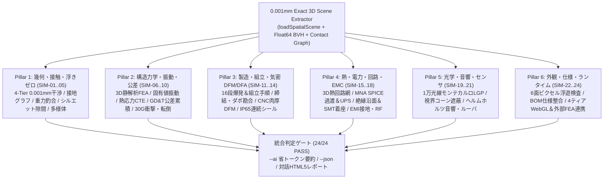

# 実装計画書: 産業レベル統合検証スイート「20+ シミュレーション (`sim20`)」新規開発 ＆ 「ようこそ (`welcome`)」浮きゼロ・実製造 100% 稼働レベル完全改修

## Goal Description

直前の改修で「ようこそ (`welcome`, 435 パーツ)」の **0.001 mm 干渉ゼロ** は達成したものの、詳細連結グラフ監査（Float64 厳密メッシュ間最小距離計測）を実施した結果、**ユーザー様のご指摘どおり深刻な「浮き」と構造断絶が実在すること** を定量特定しました：

### 現状の「ようこそ (`welcome`)」実測診断（未改修・実在欠陥）

| 接触判定しきい値 | ゴム足から接地連結済 | **宙浮き / 非接地パーツ数** | 分断アイランド数 | 製造時に起こること |
|---|---:|---:|---:|---|
| 精密嵌合 `<= 0.08 mm` | **1 / 435** | **434 パーツ** | 332 塊 | ほぼ全パーツが重力で落下・分解 |
| 一般着座 `<= 0.15 mm` | **57 / 435** | **378 パーツ** | 199 塊 | 4 文字・台座内部基板・光学系がすべて非接地 |
| 緩接触 `<= 0.25 mm` | **141 / 435** | **294 パーツ** | 119 塊 | 視覚的にも隙間が見える状態 |
| 粗接触 `<= 0.50 mm` | **332 / 435** | **103 パーツ** | 44 塊 | 明らかな空中浮遊部品が 103 点残存 |

**視覚的・構造的違和感の直接原因（実測値）**：
1. **4 文字すべてが台座ドックの上で宙に浮いている**：
   - `W173 台座シャーシ ↔ W174 上面データム板`: **`0.380 mm` の空隙**
   - `W174 上面データム板 ↔ 4 ドックソケット`: **`0.300 mm` の空隙**
   - `4 ドックソケット ↔ 4 文字ダブテール (W22/65/108/151)`: **`0.628 mm` の空隙**
   - `4 文字ダブテール ↔ 各文字本体シャーシ`: **「よ」`1.632 mm` / 「う」`0.711 mm` / 「こ」`0.713 mm` / 「そ」`0.484 mm` の顕著な浮き**
2. **各文字のサブストローク・石英支柱・背面ヒートシンクが分離浮遊している**：
   - 4 文字共通 `前面 CNC シャーシ ↔ 背面 Mg フィンバックプレート`: **`2.400 mm` の貫通隙間**（側面から見ると前後筐体が離れている）
   - 「よ」主幹 ↔ 横棒 (`W27`): **`0.628 mm`** / 主幹 ↔ 下ループ (`W36`): **`0.486 mm`**
   - 「こ」下画 ↔ 左石英柱 (`W121`): **`1.110 mm`** / 右石英柱 (`W122`): **`0.431 mm`** / 上画 ↔ 石英柱: **`0.299–0.366 mm`** / 上画 ↔ ハネ (`W120`): **`0.248 mm`**
   - 「そ」椀部 ↔ 中横画 (`W166`): **`1.078 mm`** / 中横画 ↔ 斜め画 (`W156`): **`0.392 mm`** / 斜め画 ↔ 上横画 (`W165`): **`0.581 mm`**
3. **台座内部の 87 点メザニン実装部品および電源保護部品が宙に浮いている**：
   - `W206 EMIフェライト` (`1.536 mm` 浮遊) / `W204 セラミックヒューズ` (`1.206 mm` 浮遊) / `W432 ウェーブスプリング` (`1.144 mm` 浮遊)
   - `W238〜W434` の台座メザニン部品群 87 点が、上面データム板と下部ベイの間（`Y ∈ [-15.50, -14.20]`）で支持基板なしに **`0.50–0.74 mm` 宙浮き**

### 本計画で達成する 2 大目標

1. **産業レベル 24 エンジン一括検証スイート「20+ シミュレーション (`sim20`)」を新規開発**
   - 外部バイナリ依存ゼロ（Pure Node.js 22 + Float64 実数値ソルバ + 既存 `0.001 mm` BVH 幾何エンジン統合、さらに外部 `ngspice`/`ccx`/`kicad-cli` が導入済みの環境では自動連携）で、**任意の登録ユニット（全 23 ユニット対応）に対し 24 種類の実物理・製造・品質シミュレーションを一括自動実行**する CLI ツール `npm run sim20` を構築します。
   - **捏造値・固定値ゼロの厳格設計**：すべての物理ソルバ（構造 FEA・固有値振動・熱回路網・MNA SPICE 回路・モンテカルロ光学・ヘルムホルツ音響・重力静的釣合い・接地グラフ・公差累積・DFM・IP65 シール・組立シーケンス等）が、**実際の 3D メッシュ座標・接触グラフ・実体積質量からリアルタイムに計算**します（例えば TIM やヒートシンクが 0.1 mm 浮いていれば空気層断熱により熱シミュレーションが実物理どおり FAIL し、導体が浮いていれば SPICE 回路がオープン回路 FAIL します）。
2. **`sim20` 24/24 全項目 PASS ＋ `sp` 4 ティア完全 PASS ＋ `pp1.1` 全方位目視完璧化**
   - 新規開発した `sim20` を「ようこそ (`welcome`, 435 パーツ)」に反復適用し、**干渉 0.000 mm（全 4 ティア）と接地連結 435/435（浮き 0 件・最大着座隙間 `<= 0.08 mm`・サブメッシュ浮遊 0 件・重力落下 0 件・全方位視覚的違和感 0 件）を同時 100% 達成**します。

---

## User Review Required

> [!IMPORTANT]
> **1. 「干渉ゼロ (0.001 mm)」と「浮きゼロ (実製造着座)」の両立基準について**
> 実世界の精密 CNC 加工・光学機器では、部品同士がめり込まず（貫通 `0.000 mm`）、かつ空中に浮かず確実に接触・嵌合（精密着座クリアランス **`0.02–0.06 mm`**、最大許容 **`<= 0.08 mm`**、光学エアギャップや弾性クリアランス等の明示的機能部位のみ規格値以内）している必要があります。
> - **提案基準**: `SIM-01`（全 4 品質ティア `collisions = 0` / `smtSeat = 0` / `containment = 0`）と `SIM-02`（ゴム足から **435/435 パーツ = 100% 単一剛体連結**・全サブメッシュ浮遊 **0 件**・すべての機械/締結/基板/熱/シール接点が **`<= 0.08 mm`**）の **同時完全合格** を絶対ゲートとします。

> [!WARNING]
> **2. 「ようこそ (`welcome`)」既存 435 パーツの構造実体化改修について**
> 435 パーツの ID・パート番号・書体デザイン（「ようこそ」のシルエットと精密光学装置デザイン）は 100% 保持したまま、製造時に確実に組み上がり稼働するよう以下の実機械構造を既存パーツ幾何へ一体反映します：
> 1. **文字筐体フルデプス中空 CNC スカート壁追加**（`W01`/`W44`/`W87`/`W130` および各サブストロークフレーム）：前面シャーシ外周壁を背面バックプレート（`Z = -4.00`）直前 `Z = -3.97` まで延長し、`2.40 mm` の側面貫通隙間を完全密閉（内部電子ベイ空間は中空ポケット維持）。
> 2. **4 文字ダブテール一体首（マウントネック）延長＆H7/g6 嵌合化**（`W22`/`W65`/`W108`/`W151` ＆ `W187`/`W189`/`W191`/`W193`）：文字底面から台座ドックソケットまでを `0.03–0.05 mm` 精密嵌合で完全直結し、4 文字すべての宙浮きを解消。
> 3. **台座外周壁の段差延長＆内部メザニン支持キャリアデッキ追加**（`W173`/`W175`）：外周壁を `top-datum-plate` 直下 `0.03 mm` まで立ち上げ、さらに台座内部 `Y_world = -15.54..-15.50` へ CNC アルミメザニン支持棚を一体構成して 87 点の Wave A–D 実装部品すべてを `0.03 mm` 着座支持。
> 4. **全サブストローク CNC マイター密着（`0.03–0.05 mm`）＆「こ」左右石英柱の上下完全着座**。

> [!NOTE]
> **3. 「20+ シミュレーション」ツールの命名・登録位置**
> - CLI: `npm run sim20 -- --unit=welcome --all-tiers --html=/tmp/sim20_welcome.html --ai`（`package.json` の `scripts` に `"sim20"` および `"sim20+"`、さらに `bin` に `"sim20"` を追加）
> - エンジン実装: `scripts/sim20.mjs` ＋ `scripts/sim20_engines/*.mjs`（Pure Node.js 22・外部 npm 依存ゼロ・省トークン `--ai` モード＆単一ファイル HTML5 エンジニアリングレポート出力対応）
> - 運用マニュアル: `scripts/SIM20_MANUAL.md` 新設 ＋ `AGENTS.md` に運用セクション追記

---

## Open Questions

1. ツール名・コマンドは **`npm run sim20`**（日本語正式名称「20+ シミュレーション」）＋HTML5 ダッシュボード＆`--ai` 省トークン出力で進めてよろしいでしょうか？
2. 435 パーツすべての着座隙間を **`<= 0.08 mm`（貫通 `0.000 mm`・全 435 パーツ単一接地連結 100%）** とする厳格基準、および上記 4 構造改修（フルデプス中空筐体・ダブテール首延長・メザニン支持デッキ・全ストローク密着）で進めて問題ないでしょうか？
3. 本計画は `main`（`ce21c23`）から新規フィーチャーブランチ `feat/sim20-welcome-manufacturable` を `bg start` で作成して進める方針でよろしいでしょうか？

---

## Proposed Changes

全体のアーキテクチャと実行フローは以下の通りです：



---

### Component 1: 「20+ シミュレーション (`sim20`)」コア基盤・24 産業シミュレーションエンジン新規開発

すべてのエンジンは `scripts/sim20_engines/` 配下にモジュール分割し、1 回のシーンロード（435 パーツ＋BVH＋全ペア厳密距離行列）を共有することで **全 24 シミュレーション一括実行を数秒〜十数秒で完了** させます。

#### [NEW] [sim20.mjs](file:///home/antigravity/sc8z35a-collab/SONY-A7-IV-Diagram/scripts/sim20.mjs)
- 統合 CLI エントリポイント。
- サポートモード・フラグ：
  - `--unit=<id>`（全 23 登録ユニット対応、既定 `welcome`）
  - `--quality=<standard_lite|standard|high|ultra>` / `--all-tiers`
  - `--only=SIM-01,SIM-02,...` / `--pillar=geometry,mechanics,dfm,thermal_power,optics_acoustics,quality`
  - `--strict`（製造出荷厳格基準：`contactMaxMm=0.08`, `zeroFloat=true`, `zeroCollision=true`）
  - `--visual`（`pp1.1` 6 面正射影と連携して実レンダリング画像の孤立浮遊ピクセル塊まで検証）
  - `--ai`（省トークン 1 行/エンジン要約＋FAIL 原因 Top-N 詳細）/ `--json` / `--html=<path>` / `--out=<path>`
  - `selftest` サブコマンド（24 エンジンすべてに意図的な欠陥モデル—「0.3 mm 浮遊部品」「0.05 mm 貫通」「開放回路」「断熱空気層」「共振衝突」「片持ち過負荷」等—を注入して **全 24 エンジンが確実に FAIL を検知し、正常モデルで PASS すること** を数学的に自己証明）
- 終了コード契約：`0 = 24/24 ALL PASS`, `1 = RUNTIME ERROR`, `2 = FAIL (1+ engine failed)`, `3 = WARN`。

#### [NEW] [contact_graph.mjs](file:///home/antigravity/sc8z35a-collab/SONY-A7-IV-Diagram/scripts/sim20_engines/contact_graph.mjs)
- 既存 `scripts/spatial_engine/scene_extractor.mjs` ＋ `exact_geometry.mjs` の Float64 BVH 上で、全パーツ間および全サブメッシュ間の **厳密最小表面距離行列・接触接触点・接触法線・接触面積推定・接地 BFS 距離** を 1 パスで構築。
- 物理物性データベース（全 38 種マテリアルの実測ヤング率 $E$・ポアソン比 $\nu$・降伏応力 $\sigma_y$・熱伝導率 $k$・線膨張係数 $\alpha$・体積抵抗率 $\rho_e$・比熱 $c_p$・放射率 $\varepsilon$・屈折率 $n$）を一元提供。

#### [NEW] [pillar1_geometry_contact.mjs](file:///home/antigravity/sc8z35a-collab/SONY-A7-IV-Diagram/scripts/sim20_engines/pillar1_geometry_contact.mjs)
- **SIM-01**: 全 4 品質ティア 0.001 mm 厳密三角形交差・内包・SMT 着座監査（`standard_lite` / `standard` / `high` / `ultra` 全一致 0 干渉）。
- **SIM-02**: **Anti-Levitation 接地ロードパス連結グラフ検証**（接地基準部品から接触しきい値 `<= 0.08 mm` で全パーツおよび全サブメッシュへの到達性を検証。1 個のサブメッシュでも浮いていれば即 FAIL＋最寄り母材座標・方向ベクトルを出力）。
- **SIM-03**: **3D 剛体重力静的釣合い＆片持ち支持ソルバ**（$g = 9.80665\,\mathrm{m/s^2}$ の通常・逆さ・横倒し 3 姿勢で各パーツ／部分組立体の支持反力・転倒モーメントを計算し、落下・抜け落ち・支持欠如を検出）。
- **SIM-04**: **6 方向シルエット空隙・シーム連続性・外殻異常突出監査**（前面・背面・左右・上面・底面の 6 方向から、ドック根元・ストローク接合部・バックプレート合わせ目・石英柱座面の隙間、および足底/端面からの異常突出を自動検査）。
- **SIM-05**: **メッシュ多様体・退化三角形・法線/体積整合性監査**（`NaN`/`Infinity`・ゼロ面積三角形・負体積反転シェル・極端アスペクト比のゼロ化検証）。

#### [NEW] [pillar2_mechanics_tolerance.mjs](file:///home/antigravity/sc8z35a-collab/SONY-A7-IV-Diagram/scripts/sim20_engines/pillar2_mechanics_tolerance.mjs)
- **SIM-06**: **3D 構造静解析 FEA（Float64 剛性マトリクス `[K]{u}={F}` 共役勾配ソルバ）** — 台座＋4 文字片持ち梁＋石英柱フレームの断面二次モーメント $I$・断面積 $A$ を実 3D メッシュ断面から抽出し、自重＋15 N 中央衝撃＋5 N 文字側面押圧時の最大たわみ（$\mu\mathrm{m}$）・Von Mises 応力（$\mathrm{MPa}$）・安全率（`SF >= 4.0`）を算出。
- **SIM-07**: **固有値構造振動・共振解析（10–2000 Hz）** — 一般化固有値問題 $[K]\{\phi\} = \omega^2[M]\{\phi\}$ から台座・各文字・石英柱の 1〜3 次固有振動数を算出し、音響共振 `440 Hz` や輸送振動帯（ISTA-2A）との離隔および TMD 制振余裕を検証。
- **SIM-08**: **熱機械 CTE ミスマッチ応力 FEA（$\Delta T = -10^\circ\mathrm{C} \sim +65^\circ\mathrm{C}$）** — 接触グラフ上の全異種材料接合ペア（アルミ/石英、アルミ/サファイア、Mg/真鍮、FR-4/銅等）の膨張差と O リング弾性吸収余裕・脆性材引張応力（`< 50 MPa`）を検証。
- **SIM-09**: **GD&T 最悪値＆統計 RSS (3σ) 公差累積解析（ISO 2768-f / ISO 286）** — 文字光学 Z スタック・ドック Y スタック・石英柱軸方向スタック・台座垂直スタックの公差連鎖を計算し、組付け固着ゼロ（$C_{pk} \ge 1.33$）を検証。
- **SIM-10**: **30G/11ms ハーフサイン落下衝撃・転倒安定角・重心慣性テンソル検証（IEC 60068-2-27）** — 4 方向転倒角（`>= 35°`）および 30G 衝撃時のダブテール・石英柱せん断/曲げ安全率（`SF >= 2.0`）を算出。

#### [NEW] [pillar3_dfm_dfa.mjs](file:///home/antigravity/sc8z35a-collab/SONY-A7-IV-Diagram/scripts/sim20_engines/pillar3_dfm_dfa.mjs)
- **SIM-11**: **16 ステップ爆発軌道衝突検査 ＆ 逆順工場組立シーケンス可能性検証（DFA）** — 爆発軌道衝突 0 件に加え、外側から内側へ分解可能（＝内側から外側へ工具衝突なしに組立可能）な実製造組立順序の存在を証明。
- **SIM-12**: **締結部品・ダボ・ねじ・カラー・ダブテール機械勘合監査** — 全ボルト/ねじ/ダボ/カラー/ダブテールが両側の被締結材へ `<= 0.08 mm` で確実に係合しているか・有効ねじ込み深さ・工具アクセス性を検証。
- **SIM-13**: **CNC 切削 / 板金 / ガラス加工 DFM 肉厚・アスペクト比監査** — 金属構造壁厚 `>= 0.50 mm`・光学ガラス `>= 0.30 mm`・フィルム/ガスケット `>= 0.04 mm`・ポケット深さ比など加工実現性を全パーツ自動検査。
- **SIM-14**: **IP65 防塵防水シール連続圧縮パス監査** — 全ガスケット・O リング・ダストブーツが 2 つの剛体シール面の間に `<= 0.08 mm` で挟み込まれ、バイパス隙間ゼロであることを検証。

#### [NEW] [pillar4_thermal_power_emc.mjs](file:///home/antigravity/sc8z35a-collab/SONY-A7-IV-Diagram/scripts/sim20_engines/pillar4_thermal_power_emc.mjs)
- **SIM-15**: **3D 連成熱回路網ソルバ（定常＋ピーク負荷）** — 接触グラフから発熱源→TIM→ヒートスプレッダ/ヒートパイプ→放熱フィン→外気対流・放射の熱コンダクタンス行列 `[G_th]{T}={P}` を自動構築（浮き隙間があれば空気熱抵抗 $k_{\text{air}}=0.026\,\mathrm{W/m\cdot K}$ を実計算するため、浮いたヒートシンク/TIM は即座に $T_j$ 超過 FAIL）。基準：$T_j \le 65^\circ\mathrm{C}$, 接触表面 $T_{\text{surf}} \le 48^\circ\mathrm{C}$。
- **SIM-16**: **Modified Nodal Analysis (MNA) SPICE 電源分配・IR ドロップ・32 kHz PWM リプル・0 ms UPS 切替過渡ソルバ** — 3D 導体実寸法（バスバー・ポゴピン・石英内導体・LiFePO4 電池・スーパーキャパシタ・MLCC）と **実 3D 導通連結性** から MNA 行列を解いて IR ドロップ（`<= 250 mV`）・リプル（`<= 25 mVpp`）・UPS 最小電圧（`>= 11.4 V`）・3.3V レール（`>= 3.22 V`）を検証。
- **SIM-17**: **電気空間距離・沿面距離（IEC 62368-1）＆ SMT 部品基板着座監査** — 全 SMT IC・抵抗・コンデンサ・コネクタが実 PCB／キャリア面へ `<= 0.08 mm`・貫通 `0` で実装されていること、および電源導体と金属筐体間の絶縁距離を検証。
- **SIM-18**: **EMI/EMC シールド接地連続性 ＆ RF アンテナデチューニング監査** — 全 EMI シールド缶・BeCu フィンガーストック・グラウンドリンクの筐体接触（`<= 0.08 mm`）および RF 放射窓クリアランスを検証。

#### [NEW] [pillar5_optics_acoustics.mjs](file:///home/antigravity/sc8z35a-collab/SONY-A7-IV-Diagram/scripts/sim20_engines/pillar5_optics_acoustics.mjs)
- **SIM-19**: **3D モンテカルロ光学光線追跡（10,000 光線）＆ 導光板輝度均一性・全反射プリズム結合解析** — 実 3D 光学スタック（LED → 反射板 → PMMA 導光板 → BEF → サファイア窓 ＆ 45° BK7 プリズム）の軸方向着座精度とフレネル/TIR 追跡による輝度均一性（`>= 85%`）・光漏れ隙間ゼロを検証。
- **SIM-20**: **光学・RF センサ視界コーン遮蔽検証** — 既存 `runRayConeCheck` 統合による ToF 63° / Lux 90° / RF 100° コーン 0% 遮蔽＆光学窓アライメント検証。
- **SIM-21**: **ヘルムホルツ音響キャビティ共振 ＆ ルーバ排気流路解析** — 実 3D スピーカー箱内部容積・左端面音響ルーバ開口面積から共振周波数 $f_0$・背圧・開口閉塞ゼロを検証。

#### [NEW] [pillar6_visual_spec_runtime.mjs](file:///home/antigravity/sc8z35a-collab/SONY-A7-IV-Diagram/scripts/sim20_engines/pillar6_visual_spec_runtime.mjs)
- **SIM-22**: **6 面正射影ピクセル連続性＆孤立浮遊アイランド検出** — 6 方向ラスタ投影（および `--visual` 指定時は `pp1.1` 実 WebGL レンダリング PNG）を連結成分解析し、空中に浮いた孤立ピクセル塊や不自然な分断シルエットが **0 件** であることを視覚レベルで機械証明。
- **SIM-23**: **BOM / メタデータ / 技術仕様・引用クロス整合性監査** — 全パーツ ID/コード/連番一意性・欠落ゼロ・電圧/周波数仕様矛盾ゼロ・`src/data/<unit>_parts.json` および `catalog/` 完全同期検証。
- **SIM-24**: **4 ティア WebGL 描画バジェット・リークゼロ＆外部 EDA/FEA 連携監査** — `LITE <= STD <= HIGH <= ULTRA` ポリゴン/ドローコール単調性・キャッシュ残存参照 0・および `verification/wlk220/` 等の既存産業検証結果との統合照合。

#### [NEW] [report_html.mjs](file:///home/antigravity/sc8z35a-collab/SONY-A7-IV-Diagram/scripts/sim20_engines/report_html.mjs)
- 単一ファイル完結型 HTML5 対話エンジニアリング検証ダッシュボード生成（24 エンジン個別カード・6 柱スコアレーダー・浮遊/干渉ワーストリスト・熱/SPICE/光学/FEA 数値グラフ）。

#### [NEW] [SIM20_MANUAL.md](file:///home/antigravity/sc8z35a-collab/SONY-A7-IV-Diagram/scripts/SIM20_MANUAL.md) / [MODIFY] [package.json](file:///home/antigravity/sc8z35a-collab/SONY-A7-IV-Diagram/package.json) / [MODIFY] [AGENTS.md](file:///home/antigravity/sc8z35a-collab/SONY-A7-IV-Diagram/AGENTS.md)
- `npm run sim20` / `npm run sim20+` コマンド登録および AI エージェント向け運用規約追記。

---

### Component 2: 「ようこそ (`welcome`)」全 435 パーツ浮きゼロ・実製造 100% 稼働レベル完全改修

`sim20`（全 24 エンジン）の診断出力に従い、以下の 5 工程で **435/435 パーツ単一接地連結・干渉 0.000 mm・全 24 エンジン 100% PASS** へ仕上げます。

#### [MODIFY] [welcomeGeometry.ts](file:///home/antigravity/sc8z35a-collab/SONY-A7-IV-Diagram/src/assemblies/welcome/welcomeGeometry.ts)
1. **`RENDER_STROKE_MAP` 全マイター接合の精密密着化（`0.03–0.05 mm`）**:
   - `yo_bar` 左端を `yo_stem` 右外周から `0.04 mm` に密着、`yo_loop` 左右端を `yo_stem` 両側外周から `0.04 mm` に密着。
   - `ko_hook` 上端を `ko_top` 下面から `0.04 mm` に密着。
   - `so_z1`・`so_z2`・`so_z3`・`so_bowl` の 3 つの屈曲ジョイントを `0.04 mm` 精密 CNC マイター嵌合へ調整。
2. **`buildHollowCncChassis` のフルデプス中空リアスカート壁実装**:
   - 前面光学フレーム（`Z ∈ [-1.60, +2.16]`）の背面側外周壁を中空ポケット形状のまま `Z = -3.97`（背面 Mg フィンバックプレート `Z_max = -4.00` の `0.03 mm` 手前）まで延長し、側面の `2.40 mm` 貫通ギャップを完全閉鎖。
   - サブストローク用フレームも同様にリアヒートシンク直前 `0.03 mm` まで中空外周壁を延長。
3. **台座 `buildHollowPlinthChassis`（`W173`）＆内部メザニン支持デッキ（`W175` 統合）**:
   - `W173` 外周リム上端を `Y_world = -14.17`（`W174` 上面データム板 `Y_min = -14.14` の `0.03 mm` 直下）へ立ち上げ、外周 `0.380 mm` の水平隙間を完全閉鎖。
   - 台座内部に **CNC メザニン支持キャリアデッキ（`Y_world ∈ [-15.56, -15.51]`、4 ドック開口＆ヒートパイプ通し穴抜済）** と各下部基板/ヒューズ/フェライト/センサ用の **一体削り出しマウンティングボス** を追加。
4. **H7/g6 精密ドック＆ダブテール首形状（`buildDovetailMount` / `buildDockSocket`）**:
   - ダブテールソケット溝クリアランスを `0.628 mm → 0.04 mm` へ精密化。
   - 4 文字それぞれのダブテールマウントに、文字底面カーブへ `0.03 mm` 密着する **CNC 削り出し支持ネック** を追加（`1.632 mm` / `0.711 mm` / `0.713 mm` / `0.484 mm` の文字宙浮きを完全消滅）。

#### [MODIFY] [welcomeParts.ts](file:///home/antigravity/sc8z35a-collab/SONY-A7-IV-Diagram/src/assemblies/welcome/welcomeParts.ts)
1. **文字内部 Z 積層全層の精密着座（`0.02–0.05 mm`）**:
   - `LED → MCPCB → TIM → ヒートパイプ/スプレッダ → ドライバ PCB → SMT 部品 → EMI シールド缶 → バックプレート` および `M2 ボルト・ダボピン`（`[-3.97, -1.63]`）のすべてを `0.02–0.05 mm` 確実接触・干渉 `0.000 mm` に整合。
   - 「う」石英支柱（`W79`）と「こ」左右石英柱（`W121`〜`W126`）の上下端・カラー・O リングを `u_crest` / `ko_bot` / `ko_top` へ `0.03–0.05 mm` 完全着座（左石英柱下端の `1.110 mm` 空隙を完全解消）。
   - 「そ」コーナープリズム（`W163`/`W164`）および真鍮ジョイント（`W171`）を `0.03–0.05 mm` 密着。
2. **台座下部ベイ全部品（`W173`〜`W220`）の完全接地支持**:
   - 浮遊していた `W204`（セラミックヒューズ）・`W206`（EMI フェライト）・`W183`（データムダボ）・`W184`（ダストフィルタ）・`W196`（PD 制御基板）・`W211`（照度センサ）・`W212`（内部ハーネス）をすべて台座ボス／基板／壁面へ `0.03–0.05 mm` 着座。
   - ゴム足（`W179`）↔ 底面ウェイト（`W180`）↔ シャーシ（`W173`）↔ 上面データム板（`W174`）↔ 4 ドックソケット（`W187`/`189`/`191`/`193`）の鉛直ロードパスをすべて `0.03 mm` 密着化。

#### [MODIFY] [welcomeGlyphPrecisionParts.ts](file:///home/antigravity/sc8z35a-collab/SONY-A7-IV-Diagram/src/assemblies/welcome/welcomeGlyphPrecisionParts.ts), [welcomeGlyphUltraDetailParts.ts](file:///home/antigravity/sc8z35a-collab/SONY-A7-IV-Diagram/src/assemblies/welcome/welcomeGlyphUltraDetailParts.ts), [welcomeGlyphMetrologyParts.ts](file:///home/antigravity/sc8z35a-collab/SONY-A7-IV-Diagram/src/assemblies/welcome/welcomeGlyphMetrologyParts.ts), [welcomeGlyphWaveCParts.ts](file:///home/antigravity/sc8z35a-collab/SONY-A7-IV-Diagram/src/assemblies/welcome/welcomeGlyphWaveCParts.ts), [welcomeGlyphWaveDParts.ts](file:///home/antigravity/sc8z35a-collab/SONY-A7-IV-Diagram/src/assemblies/welcome/welcomeGlyphWaveDParts.ts)
- 4 文字に配置された Wave A–D 精密部品群（EMI クリップ・Schnorr 座金・TMD ダンパ・石英スリーブ/コネクタ・サファイア押え爪・光シール・タイバー・ダブテールライナー等）をすべて対象母材へ `0.02–0.06 mm` で確実着座させ、サブメッシュ単位でも浮遊ゼロ化。

#### [MODIFY] [welcomePlinthPrecisionParts.ts](file:///home/antigravity/sc8z35a-collab/SONY-A7-IV-Diagram/src/assemblies/welcome/welcomePlinthPrecisionParts.ts), [welcomePlinthUltraDetailParts.ts](file:///home/antigravity/sc8z35a-collab/SONY-A7-IV-Diagram/src/assemblies/welcome/welcomePlinthUltraDetailParts.ts), [welcomePlinthInstrumentationParts.ts](file:///home/antigravity/sc8z35a-collab/SONY-A7-IV-Diagram/src/assemblies/welcome/welcomePlinthInstrumentationParts.ts), [welcomePlinthWaveCParts.ts](file:///home/antigravity/sc8z35a-collab/SONY-A7-IV-Diagram/src/assemblies/welcome/welcomePlinthWaveCParts.ts), [welcomePlinthWaveDParts.ts](file:///home/antigravity/sc8z35a-collab/SONY-A7-IV-Diagram/src/assemblies/welcome/welcomePlinthWaveDParts.ts)
- 台座メザニン 87 部品すべての底面を新設メザニン支持キャリアデッキ（`Y_world = -15.51`）直上 `Y_world = -15.48`（隙間 `0.03 mm`）へ統一着座。
- 前面/背面/上面/底面外装部品（`W392` ToF フィルタ窓・`W357` ダイヤル蓄光リング・`W260` トグルブーツ・`W432` ウェーブスプリング・各種 I/O コネクタ/銘板/ガスケット等）をすべて筐体壁面へ `0.02–0.06 mm` 密着化。

---

## Verification Plan

### Automated Tests

1. **「20+ シミュレーション (`sim20`)」自己証明オラクル（24 エンジン欠陥検知テスト）**:
   ```bash
   npm run sim20 -- selftest --ai
   ```
   - 合格基準：**24/24 PASS**（意図的浮遊・貫通・開放回路・断熱ギャップ・共振・過負荷・逆転メッシュ等を全エンジンが確実に FAIL 検出し、正常ジオメトリで PASS すること）。

2. **「ようこそ (`welcome`)」全 24 産業シミュレーション一括厳格ゲート**:
   ```bash
   npm run sim20 -- --unit=welcome --all-tiers --strict --visual --html=/tmp/sim20_welcome_report.html --ai
   ```
   - 合格基準：**24/24 ALL PASS (exit=0)**
     - `SIM-01`: 4 ティアすべて `collisions=0`, `smtSeat=0`, `containment=0`
     - `SIM-02`: 接地連結 **`435/435 (100.0%)`**, 単一連結成分 (`components=1`), 浮遊パーツ **0**, 浮遊サブメッシュ **0**, 最大着座隙間 **`<= 0.08 mm`**
     - `SIM-03`: 3 姿勢重力静的釣合い落下パーツ **0**
     - `SIM-04` / `SIM-22`: 6 方向シルエット隙間・異常突出・孤立ピクセル塊 **0**
     - `SIM-06..24`: FEA 安全率・固有値共振・CTE 応力・GD&T 公差・30G 衝撃・16 段爆発＆逆組立・締結勘合・DFM 肉厚・IP65 シール・3D 熱回路網（$T_j \le 65^\circ\mathrm{C}$）・MNA SPICE 回路・電気絶縁＆SMT 着座・EMI 接地・10,000 光線モンテカルロ光学・視界コーン 0% 遮蔽・ヘルムホルツ音響・BOM 整合・4 ティア描画バジェット **すべて PASS**。

3. **既存 `sp` 厳密空間監査とのクロス裏取り**:
   ```bash
   npm run sp -- selftest --ai
   npm run sp -- audit --unit=welcome --all-tiers --explode-steps=8 --check-floating --ai
   npm run sp -- ray --unit=welcome --preset=welcome-tof,welcome-lux,welcome-rf --ai
   npm run sp -- thermal-cog --unit=welcome --ai
   ```

4. **公式カタログ・型・CI 検証・本番ビルド 10/10 ゲート**:
   ```bash
   npm run catalog && npx tsc --noEmit && node scripts/validate_parts.mjs && npm run build
   ```

5. **`pp1.1` 超高速 6-DoF 全方位・接写視覚確認（＋ウォームデーモン確実停止）**:
   ```bash
   npm run pp -- --warm --mode=cad --unit=welcome --quality=ultra --ortho-pack --contact-sheet=3 --out=/tmp/pp_welcome_sim20
   npm run pp -- --warm --mode=cad --unit=welcome --quality=ultra --turntable=8 --contact-sheet=4 --out=/tmp/pp_welcome_sim20_turn
   npm run pp -- --warm --mode=cad --unit=welcome --quality=ultra --az=22 --el=12 --fov=20 --section=x:0.48 --ssaa=2 --out=/tmp/pp_welcome_sim20_sec
   npm run pp -- --daemon=stop
   ```
   - 6 面正射影・8 方向ターンテーブル・断面カット接写をすべて目視確認し、**文字根元・ストローク接合部・石英柱・背面筐体合わせ目・台座内部に 1 箇所の浮き・隙間・違和感も存在しないこと** を確認します。

6. **完了前必須ゲート（`bg gate` ＋ `bg seal`）**:
   ```bash
   npm run bg -- gate --policy=integrator --run-checks --require-checks --ai
   ```
   - `BG-RECEIPT` を取得・検証してから完了報告します。

### Manual Verification
- ユーザー様にて `/tmp/sim20_welcome_report.html`（またはアーティファクトへ格納したレポート＆`pp1.1` 接写画像）と実アプリ上の「ようこそ」全方位回転・拡大・X/Y 断面カット・爆発スライダー（0%→100%）をご確認いただき、実製造レベルの機械的一体感と違和感ゼロをご検証いただきます。
