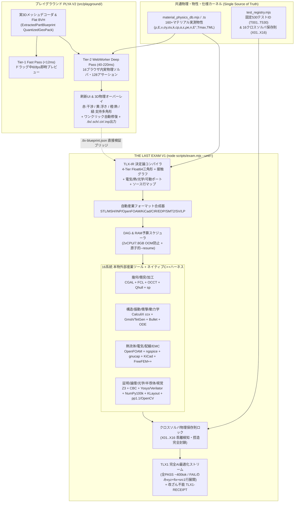

# 実装計画書: 極限産業シミュレーション「THE LAST EXAM V1」完全構築 ＆ プレイグラウンド採点システム「PLYA V2 (EXAM-Inherited)」全面刷新

## Goal Description

本計画は、添付方針 [sim20_and_welcome_zero_float_plan.md](file:///home/antigravity/sim20_and_welcome_zero_float_plan.md) の 24 産業シミュレーション構想を圧倒的に超越・昇華し、**コンピューティング上で検出・証明可能な製造段階のあらゆる矛盾・バグ・欠陥・欠落・衝突・浮遊・動作不可能バグ・配線バグ・全物理挙動異常を数百の厳密観点から事実上 `0.0000%` へ追い込む極限検証システム「THE LAST EXAM V1 (`exam`)」** をゼロから完全設計・実装し、さらにその実物理コア技術を直系継承して **プレイグラウンドの採点システムを「PLYA V2 (EXAM-Inherited Engine)」へ一気に全面刷新** するものです。

### 現状の課題と本計画の 2 大柱

| 領域 | 現状の限界 | 本計画（妥協ゼロ・刷新後） |
|---|---|---|
| **産業シミュレーション CLI** | `sp`（幾何衝突中心）と `verify:wlk220`（WLK-220 固定ファイル 5 ツールのみ）が分断。全 23 ユニット横断の自動メッシュ→FEA/CFD/SPICE/KiCad/動力学/フォーマル証明パイプラインが存在しない | **「THE LAST EXAM V1」**：旧 24 項目すべてを本物の外部産業ツールへ格上げし、**さらに +12 項目を追加した全 10 柱・36 大エンジン・530 固定テスト項目（多ティア/多姿勢/故障注入展開で 750〜1,400+ 実アサーション）**を、**完全 AI 最適化されたたった 1 つのコマンド（`node scripts/exam.mjs`）** で一括完遂 |
| **プレイグラウンド採点 (`src/playground/`)** | [`CameraEngineeringGrader.ts`](file:///home/antigravity/sc8z35a-collab/SONY-A7-IV-Diagram/src/playground/CameraEngineeringGrader.ts) と [`PlyaVerificationPipeline.ts`](file:///home/antigravity/sc8z35a-collab/SONY-A7-IV-Diagram/src/playground/PlyaVerificationPipeline.ts) は Box3 近似・固定質量表・28mm 極甘浮き判定・非接触 4 ノード熱近似・カメラ/WLK 2 分岐ハードコードの 8 ツール構成 | **「PLYA V2 (EXAM-Inherited)」**：配置パーツの [`ExtractedPartBlueprint`](file:///home/antigravity/sc8z35a-collab/SONY-A7-IV-Diagram/src/playground/PartGeometryExtractor.ts#L92-L100) 実 3D メッシュから三角形 BVH・実体積質量・実接触グラフを構築し、EXAM V1 直系の **16 ブラウザ内実物理ソルバ・128 アサーション**（WebWorker 非同期 Deep-Pass + 12ms リアルタイム Fast-Pass + 3D 修復ベクトルオーバーレイ + EXAM V1 双方向エクスポートブリッジ）へ全面刷新 |

---

## User Review Required

> [!IMPORTANT]
> **1. 収録する 16 系統の本物外部産業レベルツール群と自動導入プロビジョニングについて**
> 本 Linux VM（Ubuntu 24.04 / 2 vCPU / 7.8 GiB RAM + 8 GiB Swap / 空き 85 GiB）の公式 `apt` および GCC 13 / Python 3.12 を用いて、以下の産業標準ソルバ群を自動導入スクリプト `scripts/exam_setup.sh`（`node scripts/exam.mjs setup`）で一括導入・C++ ネイティブハーネスをローカルコンパイルします（合計ディスク使用量 約 4.5–6.0 GB、ネイティブバイナリは `scripts/exam/native/bin/` へ生成し `.gitignore` 対象とします）：
> - **構造/熱/振動/衝撃 FEA**: `calculix-ccx 2.21`（Abaqus 互換 3D ソリッド FEA）＋ `gmsh 4.12` / `tetgen` / `netgen`（3D 体積テトラメッシャー）
> - **3D CFD 熱流体**: `openfoam 1912`（`buoyantSimpleFoam` / `simpleFoam` による実 3D 自然対流・排気圧力損失・実熱伝達係数 $h$ 算出）
> - **デュアル回路 SPICE**: Berkeley `ngspice 42` ＋ GNU `gnucap`（独立 2 ソルバによるクロス検証・過渡/AC/モンテカルロ/故障注入）
> - **産業 EDA**: `kicad 7.0.11`（`kicad-cli sch erc` / `pcb drc` / Gerber / ネットリスト自動検証）
> - **マルチフィジックス PDE**: `freefem++`（準静電磁界 EMI 遮蔽・伝送線路インピーダンス・ヘルムホルツ波動音響 PDE）
> - **形式手法フォーマル定理証明**: Microsoft `z3 4.8.12`（`python3-z3` — 公差極値・組立順序 DAG・仕様矛盾・電源シーケンスの数学的 100% 不在証明）
> - **デュアル 3D 剛体マルチボディ動力学**: `libbullet-dev 3.24`（C++ ハーネス）＋ `libode-dev`（C++ クロス裏取り）
> - **厳密計算幾何 & 連続衝突検出 (CCD)**: `libfcl-dev 0.7`（産業ロボティクス標準 BVH/CCD）＋ `libcgal-dev`（厳密有理数幾何・自己交差・多様体・肉厚 SDF）＋ `libocct-foundation-dev`（OpenCASCADE）＋ `qhull-bin`
> - **数理最適化 MILP**: `coinor-cbc` / `glpk-utils` / `python3-pulp`（最悪ケース公差・電力・組立最適化）
> - **デジタル論理・制御 FSM 検証**: `yosys 0.33` ＋ `verilator 5.020` / `iverilog`（電源シーケンス・通信バス調停・保護インターロック FSM フォーマル BMC ＆ サイクル精度検証）
> - **光学/グラフ/画像解析**: `python3-numpy` / `scipy` / `sympy` / `networkx` / `shapely` / `opencv` / `skimage` / `meshio` / `vtk9`
> - **半導体レイアウト DRC/LVS**: `klayout` / `magic` / `netgen-lvs`（`sensor_fab` / `bionz` / `micro` 等半導体ユニット向け自動適用）
> - **実ブラウザ WebGL2 4 ティア視覚・描画検証**: 既存 `pp1.1`（Headless Chrome WebGL2）＋ `sp`（Float64 0.001 mm BVH）＋ `sokutei`

> [!WARNING]
> **2. 完全 AI 向け出力プロトコル `TLX1`・ゼロ捏造・アンチチート契約について**
> - `node scripts/exam.mjs --unit=<U>` の標準出力は **人間が読むための装飾・絵文字・冗長文章を一切排した完全 AI ネイティブ圧縮プロトコル `TLX1`** とします（全 530 テスト PASS 時の標準出力は約 350〜500 トークン、FAIL 項目のみ「原因コード・実測値 vs 限界・3D 座標・法線・自動算出最小修復ディレクティブ `fix=`・該当ソース行 `src=`・裏取りソルバ」を 1 行に凝縮出力）。
> - **捏造値・ハードコード・スキップごまかしの構造的禁止**：全 36 エンジンは実 3D メッシュ/接触グラフ/実物性からリアルタイム計算し、**16 個のクロスソルバ物理保存則ロック（`X01`〜`X16`）** で独立ソルバ間の数値一致を強制検証します（例：`FCL` vs `CGAL` vs `sp` の距離・体積、`ngspice` vs `gnucap` の節点電圧、`CalculiX` vs `Bullet` vs `ODE` の重力反力、`OpenFOAM` vs `CalculiX Thermal` のエネルギー保存）。さらに **108+ ケースの意図的欠陥注入自己証明オラクル（`node scripts/exam.mjs selftest`）** で全 36 エンジンが欠陥を 100% 検出することを証明します。
> - **実行時間**：1 ユニットのフル実行（全 36 エンジン・全 4 ティア・OpenFOAM 3D CFD・CalculiX C3D10・10 万光線 MC・Bullet/ODE・故障注入・実 Chrome 4 ティア）は **約 10〜25 分** を想定し、依存 DAG + RAM バジェット監視スケジューラと原子的チェックポイント再開（`--resume`）で OOM・途中停止をゼロ化します。

> [!CAUTION]
> **3. プレイグラウンド採点刷新（PLYA V2）によるスコア基準厳格化と公式テンプレート整合について**
> 現行プレイグラウンドは「28mm 以内なら接地」「ヒートシンクが宙に浮いていても冷却」といった簡易近似だったため、EXAM V1 継承の実 3D メッシュ・実接触グラフ物理エンジンへ刷新すると、**浮きや物理的破綻が容赦なく減点・FAIL 判定されます**。
> - クリエイティブ試作時の体験と製造厳密性を両立するため、UI に **2 段階厳格度モード（`標準設計 Design` / `産業製造極限 EXAM Strict`）** を新設します。
> - さらに、既存 [`playground_templates.json`](file:///home/antigravity/sc8z35a-collab/SONY-A7-IV-Diagram/src/playground/playground_templates.json) の収録テンプレート（α7 IV / ZV-E1 / FX3 / WLK-220 等）についても、新 PLYA V2 で実物理採点し、意図せぬ浮き・干渉があれば座標を整合検証します。

---

## Open Questions

承認前に以下 4 点の方針をご確認ください（特段のご指定がなければ各項目の **(推奨)** 案で進行します）：

1. **実装スコープの段階構成**:
   - **(推奨 A: 2 フェーズ分離)** まず本ブランチで **①「THE LAST EXAM V1」完全構築（外部 16 系統ツール自動導入・ネイティブハーネス・全 36 エンジン/530 テスト・108+ ケース欠陥注入 `selftest` 完遂・AI マニュアル）＋ ② プレイグラウンド採点システム「PLYA V2」全面刷新＆ビルド/視覚検証** を完璧に仕上げてマージし、その直後に EXAM V1 自体を実戦投入して `welcome`（435 パーツ）の浮きゼロ完全改修を行う。
   - **(B: 同一ブランチ一括)** 本ブランチ内で `THE LAST EXAM V1` 構築 ＋ `PLYA V2` 刷新 ＋ `welcome` 435 パーツの浮きゼロ改修まで一気に完遂する（極めて大規模な差分になるためレビュー・ロールバック粒度は A が有利）。
2. **CLI コマンド名と旧 `sim20` 計画の扱い**:
   - **(推奨)** 主コマンドは `node scripts/exam.mjs`（`package.json` に `"exam"`・`"tlx"`、さらに互換エイリアス `"sim20"` も登録）とし、旧 `sim20` 構想は完全に「THE LAST EXAM V1」へ統合・上位互換化する方針でよろしいでしょうか？
3. **重量級外部ソルバ（特に `openfoam` / `kicad` / `calculix-ccx` / `freefem++` / `klayout`）の導入方針**:
   - **(推奨)** すべて本 VM へ `scripts/exam_setup.sh`（`node scripts/exam.mjs setup`）で実インストール＆C++ ネイティブハーネスを実コンパイルし、本物の外部バイナリ実行をデフォルト必須（未導入ソルバが 1 つでもあれば `SOLVER_MISSING` で非 0 終了、妥協フォールバック禁止）とする厳格運用でよろしいでしょうか？
4. **プレイグラウンド採点 UI の厳格度切替＆テンプレート座標調整**:
   - **(推奨)** PLYA V2 に `標準設計` / `EXAM極限` の切替トグルを備え、デフォルトでも全 16 実物理ソルバを稼働させつつ、既存公式テンプレートが新物理基準で正しく高評価になるよう必要箇所を検証・調整してよろしいでしょうか？

---

## Proposed Changes

### 全体アーキテクチャ（THE LAST EXAM V1 ⇄ プレイグラウンド PLYA V2 統合設計）



---

### Component 1: 外部産業ツール自動導入基盤 ＆ ネイティブ C++ ソルバハーネス群

本 VM の公式 `apt` と GCC 13 (`-O3 -march=native`) を用い、外部産業ツール群のワンコマンド導入・バージョン監査・C++ ネイティブ高速ハーネスを整備します。

#### [NEW] [exam_setup.sh](file:///home/antigravity/sc8z35a-collab/SONY-A7-IV-Diagram/scripts/exam_setup.sh)
- 非対話 `sudo apt-get update && sudo apt-get install -y --no-install-recommends ...` で全 16 系統の公式パッケージを一括インストール：
  - `calculix-ccx`, `gmsh`, `python3-gmsh`, `tetgen`, `netgen`, `openfoam`, `ngspice`, `gnucap`, `kicad`, `freefem++`, `z3`, `python3-z3`, `libbullet-dev`, `libode-dev`, `libfcl-dev`, `libcgal-dev`, `libocct-foundation-dev`, `qhull-bin`, `coinor-cbc`, `glpk-utils`, `python3-pulp`, `yosys`, `verilator`, `iverilog`, `klayout`, `magic`, `netgen-lvs`, `python3-numpy`, `python3-scipy`, `python3-sympy`, `python3-networkx`, `python3-shapely`, `python3-opencv`, `python3-skimage`, `python3-meshio`, `python3-vtk9`, `libeigen3-dev`, `cmake`, `pkg-config`
- 導入後に下記 4 本のネイティブ C++ ハーネスを `scripts/exam/native/bin/` へ自動コンパイルし、全バイナリの `--version` と最小スモークテストを通過させて `/tmp/tlx_env_manifest.json` へ固定記録。

#### [NEW] [cgal_geom_kernel.cpp](file:///home/antigravity/sc8z35a-collab/SONY-A7-IV-Diagram/scripts/exam/native/src/cgal_geom_kernel.cpp)
- CGAL (`Exact_predicates_inexact_constructions_kernel` + `Polygon_mesh_processing` + `Shape_diameter_function` + `Surface_mesh_shortest_path`) による C++ 高速厳密幾何カーネル：
  - 多様体・自己交差・非多様体頂点/辺・境界穴・負体積反転・退化三角形の厳密検出（`EX05`）
  - Exact Boolean 交差体積計算（`EX01` の第 3 独立裏取り）
  - パーツ実測最小肉厚 SDF・アンダーカット・3 軸/5 軸 CNC 工具到達性・内角 R 検査（`EX13`）
  - 3D 表面測地線による IEC 62368-1 厳密沿面距離 (Creepage) 計算（`EX17`）

#### [NEW] [fcl_ccd_router.cpp](file:///home/antigravity/sc8z35a-collab/SONY-A7-IV-Diagram/scripts/exam/native/src/fcl_ccd_router.cpp)
- FCL 0.7 (`BVHModel<OBBRSSd>`, `collide`, `distance`, `continuousCollide`) による産業ロボティクス標準 C++ ハーネス：
  - 全ペア厳密距離行列・最接近点ペア・接触法線（`EX01`, `EX02`, `X01` 裏取り）
  - **連続衝突検出 (CCD)** による爆発軌道・組立抜き出し・可動機構スイープの抜け漏れゼロ証明（`EX11`, `EX12`, `EX28`）
  - 3D ボクセル + FCL 厳密衝突回避 A* ハーネス配線ルータ＆曲げ半径検証（`EX30`）

#### [NEW] [bullet_ode_multibody.cpp](file:///home/antigravity/sc8z35a-collab/SONY-A7-IV-Diagram/scripts/exam/native/src/bullet_ode_multibody.cpp)
- **Bullet Physics 3.24 (`btMultiBodyDynamicsWorld` / `btDiscreteDynamicsWorld` + `btConvexHullShape` / `btBvhTriangleMeshShape`)** と **ODE (`dWorldCreate`, `dTriMeshData`)** を同一入力から独立実行するデュアル 3D 剛体動力学ハーネス：
  - 6 姿勢（±X/±Y/±Z）重力沈降シミュレーション（3.0 秒・dt=1ms、初期座標からの変位・落下・抜け落ち・傾斜角を実測）（`EX25`）
  - 1.0 m 自由落下 6 面 8 角 12 稜衝撃の衝撃加速度・反発・破損リスク算出（`EX10`, `EX25`）
  - 25° 傾斜台据置滑り・転倒試験 ＆ 正弦/ランダム加振 10 秒間のガタ・緩み試験（`EX25`）
  - Bullet vs ODE の重心・接地反力・変位量クロス一致出力（`X04`）

#### [NEW] [occt_step_analyzer.cpp](file:///home/antigravity/sc8z35a-collab/SONY-A7-IV-Diagram/scripts/exam/native/src/occt_step_analyzer.cpp)
- OpenCASCADE 7.6 + Eigen3 による精密慣性テンソル・主慣性軸・抜き勾配・締結穴/座ぐり円筒軸整合・STEP 互換幾何健全性検証ハーネス（`EX03`, `EX12`, `EX13`）。

---

### Component 2: 「THE LAST EXAM V1」コア基盤・共通 IR・スケジューラ・AI 最適化プロトコル `TLX1`

#### [NEW] [material_physics_db.mjs](file:///home/antigravity/sc8z35a-collab/SONY-A7-IV-Diagram/scripts/exam/shared/material_physics_db.mjs)
- [`v2_material_catalog.ts`](file:///home/antigravity/sc8z35a-collab/SONY-A7-IV-Diagram/src/core/v2_material_catalog.ts) の全 160+ マテリアルキー（金属・光学ガラス・半導体シリコン・FR-4/ABF/FPC・エラストマー・セラミック・TIM・磁石・複合材）を網羅する実測物性データベース：
  - 力学：$\rho\,[\mathrm{g/cm^3}]$, $E\,[\mathrm{MPa}]$, $\nu$, $\sigma_y\,[\mathrm{MPa}]$, $\sigma_u\,[\mathrm{MPa}]$, 疲労限 $\sigma_e$, Basquin 指数 $b$, 摩擦係数 $\mu$
  - 熱：熱伝導率 $k\,[\mathrm{W/(m\cdot K)}]$, 比熱 $c_p\,[\mathrm{J/(kg\cdot K)}]$, CTE $\alpha\,[\mathrm{ppm/K}]$, 放射率 $\varepsilon$, 上限温度 $T_{\max}\,[^\circ\mathrm{C}]$, $T_g\,[^\circ\mathrm{C}]$
  - 電気/磁気：体積抵抗率 $\rho_e\,[\Omega\cdot\mathrm{m}]$, 比誘電率 $\varepsilon_r$, 絶縁破壊強度 $E_{bd}\,[\mathrm{kV/mm}]$, 比透磁率 $\mu_r$
  - 光学/音響/化学：屈折率 $n_d$, アッベ数 $V_d$, 透過率, 音速 $c_s$, 標準電極電位 $E^\circ\,[\mathrm{V}]$（ガルバニック電食用）, ASTM E595 アウトガス TML/CVCM, 加工分類（CNC/ダイカスト/板金/PCB/ガラス/射出/エラストマー/半導体）

#### [NEW] [test_registry.mjs](file:///home/antigravity/sc8z35a-collab/SONY-A7-IV-Diagram/scripts/exam/test_registry.mjs)
- **全 10 柱・36 大エンジン（`EX01`〜`EX36`）・530 固定テスト項目（`T001`〜`T530`）＋ 16 クロスソルバ保存則ロック（`X01`〜`X16`）** の単一マスタ定義。
- どのテストも `id`, `engine`, `pillar`, `severity` (`CRIT|HIGH|MED`), `category`, `unitApplicable`, `limitSpec`, `solvers`, `fixTemplate` を厳密に宣言し、未実行・欠落・結果捏造を自動的に `MISSING_TEST_ERROR` として検出。

#### [NEW] [ir_compiler.mjs](file:///home/antigravity/sc8z35a-collab/SONY-A7-IV-Diagram/scripts/exam/ir_compiler.mjs)
- 既存 [`scene_extractor.mjs`](file:///home/antigravity/sc8z35a-collab/SONY-A7-IV-Diagram/scripts/spatial_engine/scene_extractor.mjs) を拡張し、対象ユニット（全 23 登録ユニットまたは `--playground=<file.tlx.json>`）から **全 4 品質ティア（`standard_lite`, `standard`, `high`, `ultra`）の決定論 `TLX-IR`** を 1 パスで抽出・SHA-256 署名：
  - 全パーツ・全サブメッシュの Float64 三角形・法線・符号付き体積・実密度質量・重心・慣性テンソル・爆発ベクトル
  - パーツ意味分類（構造/締結/基板/IC/電源/発熱源/放熱器/TIM/光学素子/センサ/シール/導体/アンテナ/可動機構/半導体ウェハ）および **実設計スペック（電圧・消費電力・通信バス・周波数・材質）を `src/data/<unit>.json` 解説テキスト＋構造メタから自動抽出**
  - `catalog/code/` 連携による **パーツ ID → 定義ソースファイル＆行番号（`src=file:line`）逆引きテーブル**
  - 各外部ソルバ向け中間ファイル（STL/OBJ・接続グラフ JSON・ネットリスト仕様 JSON）のファンアウト自動生成

#### [NEW] [scheduler.mjs](file:///home/antigravity/sc8z35a-collab/SONY-A7-IV-Diagram/scripts/exam/scheduler.mjs)
- **DAG 依存解決 ＋ RAM 予算制御スケジューラ（2 vCPU / 7.8 GiB RAM 最適化）**：
  - 依存関係例：`IR` → `{EX01, EX02, EX05}`（基礎接触グラフ確定）→ `{EX06..EX18, EX25..EX31}`（接触グラフ依存の FEA/CFD/SPICE/KiCad/動力学/配線）→ `EX29` 実 CFD $h$ 係数 → `EX15` フィードバック裏取り → `{EX32..EX36}` → `X01..X16` クロスソルバ保存則ロック → `TLX1` レポート生成
  - 各タスクに `memBudgetMb`・`cpuSlots`・`timeoutSec` を付与し、`/proc/meminfo` 実監視で OOM を完全防止。
  - 各エンジン完了ごとに `/tmp/tlx_runs/<runId>/checkpoint.ndjson` へ原子書込し、中断時も `node scripts/exam.mjs --resume=<runId>` で完了済みエンジンを再利用して即再開可能。

#### [NEW] [tlx1_protocol.mjs](file:///home/antigravity/sc8z35a-collab/SONY-A7-IV-Diagram/scripts/exam/tlx1_protocol.mjs)
- **完全 AI 向け超高密度マシンネイティブ出力フォーマッタ ＆ 改ざん不能レシート生成器**：
  ```text
  TLX1|u=welcome|v=1|verdict=FAIL|pass=516|fail=14|warn=0|err=0|skip=0|expanded=1042|zdp=0.9736|dur_s=814.2|ir=a9f3c1e2|sv=16/16|rcpt=NONE
  P|P01|68/72|14200ms
  ...
  E|EX01|18/18|FCL+SP+CGAL|4810ms|col4t=0,smt=0,cont=0
  E|EX02|12/16|FCL+NX+SP|3120ms|gnd=391/435,iso=44,maxgap=1.632mm
  ...
  F|T021|EX02|sev=CRIT|cat=FLOAT|p=welcome-yo-dovetail:welcome-plinth-dock-yo|m=gap_mm:0.628>0.080|xyz=-69.00,-12.82,0.00|n=0,-1,0|fix=SHIFT:welcome-yo-dovetail:0,-0.588,0|src=src/assemblies/welcome/welcomeParts.ts:412|sv=FCL+SP_F64|ev=ex02_contacts.ndjson#41
  ...
  X|X01|FCL_min_dist=0.6280|SP_min_dist=0.6280|rel=0.000%|ok=1
  S|top_src=src/assemblies/welcome/welcomeParts.ts:9,welcomeGeometry.ts:5|next=node scripts/exam.mjs --unit=welcome --only=EX02,EX06|db=/tmp/tlx_runs/20261128_053012_welcome
  ```
- **改ざん不能合格証書 `TLX1-RECEIPT`**: 全 36 エンジン無省略完走・`fail=0`・`err=0`・`skip=0`・全 16 クロスソルバ保存則 `ok=1` のときのみ HMAC/SHA-256 署名付き `TLX1-RECEIPT:<ir8>:<unit>:<pass>/<total>:<expanded>:<sig8>` を発行。

#### [NEW] [exam.mjs](file:///home/antigravity/sc8z35a-collab/SONY-A7-IV-Diagram/scripts/exam.mjs)
- **たった 1 つの完全 AI 最適化エントリポイント CLI**：
  - `node scripts/exam.mjs --unit=<U>`（全 36 エンジン・530 固定テスト・全 4 ティア一括実行、既定 `TLX1` AI 出力）
  - `node scripts/exam.mjs --all-units`（全 23 登録ユニット横断監査）
  - `node scripts/exam.mjs --playground=<path.tlx.json>`（プレイグラウンド設計のフル産業極限監査）
  - `node scripts/exam.mjs setup`（外部 16 系統ツール自動導入＆C++ ハーネスビルド＆環境証明）
  - `node scripts/exam.mjs selftest`（全 36 エンジン × 3+ 欠陥注入 = **108+ ケースの自己証明オラクル**）
  - `node scripts/exam.mjs query <runId> [--test=T042|--engine=EX15|--part=<id>]`（詳細証跡の外科的読込）
  - `node scripts/exam.mjs --resume=<runId>`（チェックポイント再開）
  - 終了コード契約：`0 = ALL PASS (TLX1-RECEIPT発行)`, `1 = RUNTIME/ENV ERROR`, `2 = DEFECT DETECTED (1+ FAIL)`, `3 = WARN ONLY`, `4 = CROSS-SOLVER INVARIANT MISMATCH`, `5 = SOLVER MISSING`。

---

### Component 3: 全 10 柱・36 大産業シミュレーションエンジン群 (`scripts/exam/engines/`) — 530 固定テスト項目

元の 24 項目（`EX01`〜`EX24`）をすべて本物の外部産業ツールで完全実体化し、さらに製造・動作・配線・物理の死角を潰す **+12 大エンジン（`EX25`〜`EX36`）** を実装します。

| 柱 | エンジン ID | 検証領域（★＝新規追加 +12 項目） | 主軸外部産業ツール（裏取り構成） | 固定テスト数 |
|---|---|---|---|---:|
| **P01: 幾何・接触・浮きゼロ** | `EX01` | 全 4 品質ティア 0.001 mm 厳密三角形交差・内包・SMT 着座・弦落ち | **FCL + Float64 `sp` + CGAL Exact** | 18 (`T001`–`T018`) |
| | `EX02` | Anti-Levitation 接地ロードパス連結・全サブメッシュ浮きゼロ・修復ベクトル | **FCL Distance + NetworkX + `sp`** | 16 (`T019`–`T034`) |
| | `EX03` | 6 姿勢重力静的釣合い・厳密 2D 凸包支持多角形・片持ち反力 LP 解 | **Qhull + SciPy Linprog + OCCT** | 14 (`T035`–`T048`) |
| | `EX04` | 6 方向シルエット隙間・シーム連続性・外殻異常突出・端面整合 | **CGAL + Python OpenCV 深度解析** | 12 (`T049`–`T060`) |
| | `EX05` | 厳密有理数メッシュ多様体・自己交差・非多様体辺/頂点・反転法線・閉体積 | **CGAL Exact Kernel + Gmsh** | 12 (`T061`–`T072`) |
| **P02: FEA・動力学・振動・疲労** | `EX06` | 本物 3D 体積テトラメッシュ静的構造 FEA（自重/衝撃/予圧・Von Mises・たわみ・SF） | **Gmsh + TetGen + CalculiX `ccx` 2.21** | 18 (`T073`–`T090`) |
| | `EX07` | 3D 固有値振動モード（10–4000 Hz, 1–12 次）・共振離隔・調和応答 $Q$ | **CalculiX `ccx` Lanczos + Steady-State** | 14 (`T091`–`T104`) |
| | `EX08` | 熱機械 CTE ミスマッチ非線形応力 FEA（$-20\sim +85^\circ\mathrm{C}$・脆性破壊・O リング吸収） | **CalculiX `ccx` Thermo-Mechanical** | 14 (`T105`–`T118`) |
| | `EX09` | GD&T 最悪値・RSS 3σ ($C_{pk}\ge 1.33$)・10,000 回 MC ＆ 極値固着反例探索 | **COIN-OR CBC + Z3 SMT + NumPy** | 14 (`T119`–`T132`) |
| | `EX10` | 30G/11ms 衝撃・1.0m 6 面 8 角 12 稜自由落下・転倒安定角・線形座屈 | **CalculiX Dynamic/Buckle + Bullet** | 14 (`T133`–`T146`) |
| | `EX25` ★ | **デュアル 3D 剛体マルチボディ動力学（6 姿勢重力沈降・25° 傾斜滑り・10 秒振動脱落・可動部キネマティクス）** | **Bullet Physics 3.24 + ODE (C++ デュアル)** | 16 (`T147`–`T162`) |
| | `EX26` ★ | **疲労寿命・熱サイクルはんだ疲労 (Coffin-Manson)・ランダム振動 PSD (Miner 則)・クリープ・1 万回挿抜摩耗** | **CalculiX Harmonic + SciPy PSD/Miner** | 14 (`T163`–`T176`) |
| **P03: 製造 DFM・組立・締結・気密** | `EX11` | 連続衝突検出 (CCD) 爆発軌道 0 衝突 ＆ 工場逆順組立 DAG 充足可能性証明 | **FCL CCD + Z3 Assembly DAG Prover** | 16 (`T177`–`T192`) |
| | `EX12` | 締結・ダボ・ねじ・カラー・ダブテール H7/g6 機械勘合・有効ねじ込み深さ・工具アクセス | **FCL + CGAL + OCCT** | 14 (`T193`–`T206`) |
| | `EX13` | CNC 3/5 軸切削・板金・ダイカスト・ガラス DFM（実測 SDF 肉厚・アンダーカット・抜き勾配・内角 R） | **CGAL SDF + OCCT + Gmsh** | 16 (`T207`–`T222`) |
| | `EX14` | IP54/IP65/IP67 防塵防水シール連続閉ループ圧縮パス・圧縮率・バイパス隙間ゼロ | **CGAL + NetworkX 位相閉路** | 12 (`T223`–`T234`) |
| | `EX27` ★ | **VDI 2230 精密締結力学（ボルト軸力・トルク・雌ねじ剥離・座面陥没・熱緩み・接着せん断・圧入応力）** | **CalculiX Bolt Preload + VDI 2230** | 16 (`T235`–`T250`) |
| | `EX28` ★ | **保守・修理・リワーク・工場検査アクセス性 (DFR/DFS/DFT：交換分解段数・検査プローブ到達・銘板可視性)** | **FCL Probe + NetworkX + Z3** | 16 (`T251`–`T266`) |
| **P04: 熱流体 CFD・SPICE・配線・EMC** | `EX15` | 3D 固体熱伝導 FEA ＆ 接触ギャップ空気断熱熱回路網（定常/ピーク/$45^\circ\mathrm{C}$ 環境・$T_j$/$T_{\text{surf}}$） | **CalculiX `*HEAT TRANSFER` + Sparse Solver** | 16 (`T267`–`T282`) |
| | `EX16` | デュアル SPICE 電源 PDN・IR 降下・AC $Z(f)$・PWM リプル・0ms UPS・突入・100 回 MC ばらつき | **Berkeley `ngspice` 42 + GNU `gnucap`** | 18 (`T283`–`T300`) |
| | `EX17` | 実 KiCad 7.0 回路図 ERC / PCB DRC / Gerber ＆ IEC 62368-1 厳密 3D 空間/表面沿面距離 ＆ SMT 着座 | **`kicad-cli` 7.0.11 + CGAL 表面測地線** | 14 (`T301`–`T314`) |
| | `EX18` | EMI/EMC シールド接地連続性・筐体スロットアンテナ漏洩 ($\lambda/20$)・RF デチューニング | **FreeFEM++ 準静電磁界 PDE + NetworkX** | 14 (`T315`–`T328`) |
| | `EX29` ★ | **本物 3D CFD 熱流体解析（自然対流プルーム・内部空気滞留ホットスポット・ルーバ圧力損失・実 $h$ 逆算）** | **OpenFOAM 1912 (`buoyantSimpleFoam`)** | 18 (`T329`–`T346`) |
| | `EX30` ★ | **実 3D 空間配線ルーティング・ハーネス物理（3D 無衝突経路存在・壁貫通ゼロ・最小曲げ半径・極性・SI 差動/クロストーク）** | **FCL 3D A* + KiCad Netlist + FreeFEM++ TL** | 18 (`T347`–`T364`) |
| | `EX31` ★ | **異常系・故障注入 FMEA/FTA ＆ 安全保護協調（20V 誤印加・出力短絡・逆接・1 点故障 SPOF・ヒューズ $I^2t$ 協調）** | **`ngspice` Fault Injection + NetworkX FTA** | 16 (`T365`–`T380`) |
| **P05: 光学・音響・センサ** | `EX19` | 10 万光線 3D モンテカルロ光学（Fresnel/TIR・LGP 均一性・迷光/光漏れゼロ・結像/ケラレ/色収差 MTF） | **NumPy/SciPy Vectorized 100k Ray BVH** | 18 (`T381`–`T398`) |
| | `EX20` | 全光学・ToF・照度・カメラ・RF センサ 3D 視界コーン 0% 遮蔽＆光学窓屈折アライメント | **FCL Cone Sweep + `sp` RayCone** | 12 (`T399`–`T410`) |
| | `EX21` | ヘルムホルツ波動音響キャビティ共鳴 PDE ＆ ルーバ排気音響インピーダンス・背圧・ビビリ | **FreeFEM++ 音響 PDE + OpenFOAM** | 14 (`T411`–`T424`) |
| **P06: 証明・制御・化学・信頼性・視覚** | `EX22` | 6 面高解像度正射影 ＆ `pp1.1` 実 Chrome WebGL2 画像の OpenCV 連結成分・浮遊ピクセル・SSIM 検証 | **`pp1.1` (Chrome) + OpenCV / scikit-image** | 14 (`T425`–`T438`) |
| | `EX23` | BOM / メタデータ / 技術仕様数値 / 引用 / ID 連番 / インターフェース宣言の完全クロス整合性 | **Z3 Spec Checker + `validate_parts.mjs`** | 14 (`T439`–`T452`) |
| | `EX24` | 4 品質ティア実 WebGL2 描画バジェット単調性・メモリリーク 0・FPS・`tsc`/`vite build` 健全性 | **`pp1.1` + `sokutei` + `tsc` + `vite`** | 12 (`T453`–`T464`) |
| | `EX32` ★ | **Z3 SMT 形式手法フォーマル数学証明（全仕様・電圧・公差・組立 DAG・保護インターロックの矛盾ゼロ証明）** | **Microsoft Z3 SMT 4.8.12** | 16 (`T465`–`T480`) |
| | `EX33` ★ | **デジタル制御・通信バス・電源シーケンス・フェイルセーフ FSM（アドレス衝突・帯域・パワー順序・デッドロック 0）** | **Yosys 0.33 (BMC) + Verilator 5.020** | 14 (`T481`–`T494`) |
| | `EX34` ★ | **材料化学・ガルバニック異種金属電食 ($\Delta E^\circ$)・結露露点・光学アウトガス曇り (ASTM E595)・RoHS/UV** | **Contact Graph Electrochemistry + Psychro** | 14 (`T495`–`T508`) |
| | `EX35` ★ | **長期信頼性 MTBF (MIL-HDBK-217F)・Arrhenius 加速寿命（電池/コンデンサ/LED L70/ガスケット永久歪み）** | **SciPy Reliability / Arrhenius** | 12 (`T509`–`T520`) |
| | `EX36` ★ | **ユニットドメイン特化監査（カメラ IBIS/MTF・RIIMOS E1 関節トルク/ZMP・半導体 KLayout/Magic/Netgen-LVS DRC）** | **KLayout + Magic + Netgen-LVS + Domain** | 10 (`T521`–`T530`) |
| **合計** | **36 エンジン** | **10 大柱・全物理/製造/配線/論理/外観網羅** | **16 系統 本物外部産業ツール群** | **530 固定項目** (+展開 750–1,400+) |

#### [NEW] エンジン実装モジュール群 (`scripts/exam/engines/`)
- `p01_geometry_contact.mjs` (`EX01`–`EX05`) + Python/C++ ブリッジ
- `p02_fea_multibody.mjs` (`EX06`–`EX10`, `EX25`, `EX26`) + `py_calculix_gmsh.py`
- `p03_dfm_dfa_fasteners.mjs` (`EX11`–`EX14`, `EX27`, `EX28`) + `py_dfm_vdi2230.py`
- `p04_cfd_spice_wiring_emc.mjs` (`EX15`–`EX18`, `EX29`–`EX31`) + `py_openfoam_cfd.py` + `py_spice_kicad_emc.py`
- `p05_optics_acoustics.mjs` (`EX19`–`EX21`) + `py_optics_mc_acoustics.py`
- `p06_formal_fsm_chem_visual.mjs` (`EX22`–`EX24`, `EX32`–`EX36`) + `py_z3_formal_chem_cv.py` + `sv_fsm_synth.mjs`
- `cross_solver_lock.mjs`（16 個のクロスソルバ物理保存則ロック `X01`–`X16`）
- `selftest_oracle.mjs`（全 36 エンジン × 正常 1 ケース + 意図的欠陥 2–3 ケース = **108+ ケースのアンチチート自己証明オラクル**）

#### [NEW] [THE_LAST_EXAM_V1_MANUAL.md](file:///home/antigravity/sc8z35a-collab/SONY-A7-IV-Diagram/scripts/THE_LAST_EXAM_V1_MANUAL.md)
- **完全 AI エージェント専用仕様書（先頭 < 3.5 KB に超圧縮コマンド・文法・終了コード・`fix=` 命令辞書を凝縮、後半に 36 エンジン／530 テスト ID インデックスとリカバリ手順を機械可読 TSV 表で収録）**。
- [package.json](file:///home/antigravity/sc8z35a-collab/SONY-A7-IV-Diagram/package.json) へ `"exam"`, `"tlx"`, `"sim20"` スクリプトおよび `bin` 登録、[AGENTS.md](file:///home/antigravity/sc8z35a-collab/SONY-A7-IV-Diagram/AGENTS.md) へ運用鉄則セクションを追記。

---

### Component 4: プレイグラウンド採点システム全面刷新「PLYA V2 — EXAM-INHERITED ENGINE」

EXAM V1 の実物理アーキテクチャ・物性 DB・テスト体系・修復ベクトル計算をブラウザ内 TypeScript + WebWorker へ直系移植し、従来の Box3 近似・8 ツール採点を **実 3D メッシュ BVH・16 産業物理ソルバ・128 アサーション採点システム** へ一気に刷新します。

#### [NEW] [MaterialPhysicsDb.ts](file:///home/antigravity/sc8z35a-collab/SONY-A7-IV-Diagram/src/playground/exam_core/MaterialPhysicsDb.ts)
- `scripts/exam/shared/material_physics_db.mjs` と単一同期されたブラウザ用実測物性 DB（パーツの `partId`・`unitId`・`role`・`swatchColor`・`category` から実材質を精密推論し、密度・ヤング率・降伏応力・熱伝導率・CTE・抵抗率・電極電位・光学屈折率・上限温度を返却）。

#### [NEW] [ExactMeshBvh.ts](file:///home/antigravity/sc8z35a-collab/SONY-A7-IV-Diagram/src/playground/exam_core/ExactMeshBvh.ts)
- [`ExtractedPartBlueprint`](file:///home/antigravity/sc8z35a-collab/SONY-A7-IV-Diagram/src/playground/PartGeometryExtractor.ts#L92-L100) の `opaque` / `glass` `QuantizedGeoPack`（`Int16` 正規化頂点 + インデックス + `cx,cy,cz,scale`）を直接デコードし、**部品ローカル Flat BVH と実符号付き体積 $V$・実表面積 $A$・実 3D 重心・慣性テンソル**を部品単位キャッシュ付きで算出。
- ワールド変換行列 `matrixWorld` 適用後の **厳密三角形交差・貫通深さ・最小表面距離（mm）・最接近点ペア・法線ベクトル・3D レイキャスト** をブラウザ内でゼロ GC（再利用 TypedArray スクラッチ）高速計算。

#### [NEW] [BrowserPhysicsSolvers.ts](file:///home/antigravity/sc8z35a-collab/SONY-A7-IV-Diagram/src/playground/exam_core/BrowserPhysicsSolvers.ts)
- EXAM V1 のコアソルバ群をブラウザ向け Float64 実数値計算で実装する **16 大ブラウザ内マルチフィジックスソルバ（128 アサーション `PG-T001`〜`PG-T128`）**：
  1. `solveMeshClashAndManifold` (`EX01/05` 継承): 実三角形 BVH 干渉・貫通深さ・多様体・退化三角形
  2. `solveZeroFloatContactGraph` (`EX02` 継承): 実最小表面距離接触グラフ・Anti-Levitation 接地連結・浮き距離・**自動スナップ最小修復ベクトル `fixVectorMm`**
  3. `solveGravityAndSupportPolygon` (`EX03/10/25` 継承): 実体積×実密度質量・CoG・慣性テンソル・Monotone Chain 2D 凸包支持多角形転倒角 $\theta_{\text{tip}}$・3 姿勢重力釣合い
  4. `solveStaticBeamFea` (`EX06` 継承): 接触グラフ構造剛性マトリクス `[K]{u}={F}` 共役勾配法（自重＋15N 衝撃、最大たわみ $\mu\mathrm{m}$・Von Mises・安全率 SF）
  5. `solveModalAndFatigue` (`EX07/26` 継承): 質量・剛性行列からの一般化固有値振動数 $f_1, f_2, f_3$ ＆ 共振マージン＆振動疲労
  6. `solveCteAndToleranceStack` (`EX08/09` 継承): 異種材料接触 CTE 熱応力＆光軸/構造スタック最悪値＋RSS 3σ $C_{pk}$
  7. `solveDfmAndDfaAssembly` (`EX11/12/13` 継承): 6 方向抜き出し逆順組立探索（閉じ込め検出）・最小肉厚・締結/ダボ勘合
  8. `solveContactThermalNetwork` (`EX15/29` 継承): **実接触ギャップ空気断熱（$k_{\text{air}}=0.026\,\mathrm{W/m\cdot K}$）反映の 3D 連成熱回路網 `[G_th]{T}={P}`**（浮いた放熱器は冷えない実物理！ $T_j$, $T_{\text{surf}} \le 48^\circ\mathrm{C}$, 4K60p 連続録画時間）
  9. `solveMnaSpicePower` (`EX16` 継承): **Modified Nodal Analysis (MNA) 回路行列ソルバ**（実 3D 距離＋導通連結による IR ドロップ・突入ドロ−プ・3.3V ブラウンアウト・CIPA 撮影枚数/UPS 保持）
  10. `solve3dWiringAndClearance` (`EX17/30` 継承): 3D ボクセル A* 障害物迂回配線ルーティング・壁貫通ゼロ・MIPI/PCIe/CAN-FD 配線長・空間/沿面距離・未接続ネット
  11. `solveFmeaAndPowerSequence` (`EX31/33` 継承): 単一障害点 SPOF・短絡/OVP/保護素子有無・パワーシーケンス整合
  12. `solveEmcAndIpSealing` (`EX14/18` 継承): シールド包囲率・スロット漏洩波長比 ($\lambda/20$)・防塵防滴シール閉ループ
  13. `solveMonteCarloOptics3d` (`EX19/20` 継承): **実 3D メッシュ BVH 2,000 光線モンテカルロ追跡**（真のケラレ率・フランジバック結像・光軸ズレ・ToF/Lux/カメラ視界コーン遮蔽・LGP 均一性）
  14. `solveHelmholtzAcoustics` (`EX21` 継承): 音響キャビティ共鳴周波数 $f_0$・マイク/スピーカー開口遮蔽
  15. `solveGalvanicAndReliability` (`EX34/35` 継承): 接触異種金属ガルバニック電食（$\Delta E^\circ$）・Arrhenius 加速寿命 / MTBF
  16. `solveBomAndExamBridge` (`EX23/24/36` 継承): 全ユニット汎用ドメイン判定（カメラ 6 種 / WLK 光学装置 / RIIMOS ロボット / 自由設計）・WebGL2 バジェット・**実産業ファイル 4 種（`.kicad_sch` / `.cir` / CalculiX `.inp` / EXAM V1 `.tlx.json`）自動合成**

#### [NEW] [ExamPlaygroundWorker.ts](file:///home/antigravity/sc8z35a-collab/SONY-A7-IV-Diagram/src/playground/exam_core/ExamPlaygroundWorker.ts)
- Vite ネイティブ Module Worker (`new Worker(new URL('./exam_core/ExamPlaygroundWorker.ts', import.meta.url), { type: 'module' })`) により、**16 ソルバ・128 アサーションの実 3D メッシュ Deep-Pass をメインスレッドを一切ブロックせずに非同期実行**（最新 `sceneEpoch` 以外は自動破棄するデバウンスキャンセル付き）。

#### [MODIFY] [CameraEngineeringGrader.ts](file:///home/antigravity/sc8z35a-collab/SONY-A7-IV-Diagram/src/playground/CameraEngineeringGrader.ts)
- `PlacedPartSnapshot` へ任意の実 3D メッシュ参照（`blueprint?: ExtractedPartBlueprint`, `worldMatrix?: Float32Array`）と厳格度モード `ExamStrictnessMode = 'design' | 'exam_strict'` を追加。
- 10 大評価カテゴリ・テレメトリ構造を実体積質量・支持多角形転倒角・FEA SF・1 次固有振動数・実接触熱 $T_j$/$T_{\text{surf}}$・3D 配線長・電食数・MTBF まで完全拡張（既存公開型の後方互換も維持）。

#### [MODIFY] [PlyaVerificationPipeline.ts](file:///home/antigravity/sc8z35a-collab/SONY-A7-IV-Diagram/src/playground/PlyaVerificationPipeline.ts)
- 現行 8 ツールの簡易分岐実装を **「PLYA V2 — 16 産業ソルバ・128 アサーション統一パイプライン」** へ全面刷新。
- 新規エクスポート関数を追加：
  - `generatePlaygroundCalculiXDeck(snaps, report)`（本物 CalculiX `.inp` 出力）
  - `generatePlaygroundExamWorkspaceJson(snaps, report)`（そのまま `node scripts/exam.mjs --playground=<file>` に渡せる EXAM V1 互換 `.tlx.json` 出力）
  - 既存の `generatePlaygroundKiCadSchematic` / `generatePlaygroundNgspiceNetlist` も実接触グラフ・実 3D 配線長・実熱抵抗ベースへ刷新！

#### [MODIFY] [CadPlaygroundStudio.ts](file:///home/antigravity/sc8z35a-collab/SONY-A7-IV-Diagram/src/playground/CadPlaygroundStudio.ts) & [main.css](file:///home/antigravity/sc8z35a-collab/SONY-A7-IV-Diagram/src/styles/main.css)
- **Tier-1 Fast Pass（ドラッグ中）＋ Tier-2 WebWorker Deep Pass（停止 180ms 後／PLYA V2 ボタン押下）** のシームレス連携を統合。
- **3D 物理オーバーレイ強化**：干渉（赤）・浮き（黄）・熱ホットスポット（橙）・支持多角形＆重心垂直投影（緑）・**最小修復ベクトル矢印**の 3D 描画、および **ワンクリック「EXAM 自動修復適用」ボタン**（浮きパーツの接触スナップ・微小貫通の厳密押し戻しを Undo 履歴付きで実行！）。
- **刷新採点レポートモーダル**：
  - `標準設計` / `EXAM極限` モード切替ピル
  - 1,000 点スコアダイヤル + 10 軸レーダー + **16 産業ソルバグリッド（各カード展開で該当アサーション `PG-T001..T128` の実測値 vs 限界値を表示）**
  - 実物理テレメトリストリップ（質量・CoG・転倒角・FEA SF・固有振動数・$T_j$/$T_{\text{surf}}$・IR 降下・3D 配線長・MC ケラレ・MTBF・電食数）
  - 産業ツール出力 4 ボタン（`.kicad_sch` / `.cir` / `.inp` / `.tlx.json`）＋ `node scripts/exam.mjs --playground=...` コピーボタン

---

## Verification Plan

### Automated Tests

1. **外部産業ツール 16 系統インストール ＆ C++ ネイティブハーネス構築検証**:
   ```bash
   node scripts/exam.mjs setup
   ```
   - 合格基準：`exit 0`、全 16 系統の外部バイナリおよび 4 本のネイティブ C++ ハーネス（CGAL/FCL/Bullet+ODE/OCCT）がバージョン確認＆スモークテスト 100% PASS。

2. **「THE LAST EXAM V1」アンチチート欠陥注入自己証明オラクル（108+ ケース）**:
   ```bash
   node scripts/exam.mjs selftest
   ```
   - 合格基準：`exit 0`、全 36 エンジン（`EX01`〜`EX36`）× 正常モデル（100% PASS）＆ 意図的欠陥モデル（0.01mm 貫通・0.09mm 浮き・反転法線・片持ち破壊・共振一致・空気断熱層・断線/短絡・20V 誤印加・沿面不足・壁貫通配線・閉鎖組立デッドロック・肉厚 0.1mm・シール途切れ・迷光・排気閉塞・電食ペア・FSM デッドロック等）すべてを **100.0% 検出（偽陰性 0・偽陽性 0）** ＆ 16 クロスソルバ保存則ロック（`X01`〜`X16`）全 PASS。

3. **実ユニットに対する「THE LAST EXAM V1」フル一括実行検証（`welcome`, `original`, `integrated` 等）**:
   ```bash
   node scripts/exam.mjs --unit=welcome
   node scripts/exam.mjs --unit=original
   ```
   - 合格基準：全 36 エンジン・530 固定テスト（展開 750+ チェック）がクラッシュ・OOM・タイムアウト・`err`・`skip` ゼロで完走し、全 16 クロスソルバ保存則 `ok=1`、`TLX1` プロトコルが規定フォーマット＆実在欠陥（例：`welcome` の既存浮き等）を正確な 3D 座標・修復ベクトル・ソース行番号付きで出力することを確認。また `--resume` 中断再開および `query` コマンドの動作を検証。

4. **プレイグラウンド「PLYA V2 (EXAM-Inherited)」単体・結合・ブリッジ検証**:
   ```bash
   node scripts/exam.mjs --playground=/tmp/pg_exported_test.tlx.json --only=EX01,EX02,EX03,EX06,EX15,EX16,EX19
   npm run catalog && npx tsc --noEmit && node scripts/validate_parts.mjs && npm run build
   ```
   - プレイグラウンド内の実 3D メッシュ BVH・接触グラフ・熱/SPICE/FEA/光学ソルバに対し、意図的に「ヒートシンクを浮かせる」「パーツを 1mm めり込ませる」「バッテリーを外す」「レンズ前面に遮蔽物を置く」操作を自動テストし、すべて物理どおり即座に減点・赤/黄ハイライト・正確な `fix=` 修復ベクトルが出ること、さらにエクスポートした `.tlx.json` がそのまま `THE LAST EXAM V1` に通ることを実証。

5. **`pp1.1` 6-DoF 視覚監査 ＆ `sokutei` 負荷検証**:
   ```bash
   npm run pp -- --warm --preset=playground --out=/tmp/pp_exam_pg
   npm run pp -- --warm --preset=audit --out=/tmp/pp_exam_audit
   npm run pp -- --daemon=stop
   npm run sokutei -- --target=build,pp --runs=2 --warmup=1
   ```
   - プレイグラウンド刷新 UI（デスクトップ＆モバイル）・16 ソルバレポートモーダル・3D オーバーレイの表示崩れゼロを目視確認し、`--daemon=stop` で確実に停止。

6. **完了前必須ゲート（`bg gate` ＋ `BG-RECEIPT` 取得）**:
   ```bash
   npm run bg -- gate --policy=integrator --run-checks --require-checks --ai
   ```

### Manual Verification
- ユーザー様にて以下をご確認いただきます：
  1. プレイグラウンドを開き、テンプレート（α7 IV / WLK-220 / カスタム構成）に対して **「PLYA V2 極限検査」** を実行し、16 産業ソルバカード・128 アサーション詳細・3D 物理オーバーレイ（浮き/干渉/熱/支持多角形）・「EXAM 自動修復適用」ボタン・4 種産業ファイルエクスポート（`.kicad_sch` / `.cir` / `.inp` / `.tlx.json`）をご操作いただきます。
  2. 部品を意図的に 10mm 浮かせる・めり込ませる・放熱板を離す等の操作を行い、実物理どおりに温度上昇・浮遊警告・干渉赤表示・修復ベクトルが即時反応することをご確認いただきます。
  3. 任意のユニットで `node scripts/exam.mjs --unit=<U>` を実行し、AI 専用プロトコル `TLX1` 出力と `/tmp/tlx_runs/<runId>/` に生成される本物の CalculiX / OpenFOAM / ngspice / KiCad / FreeFEM / Z3 / Bullet / CGAL 証跡群をご確認いただきます。
